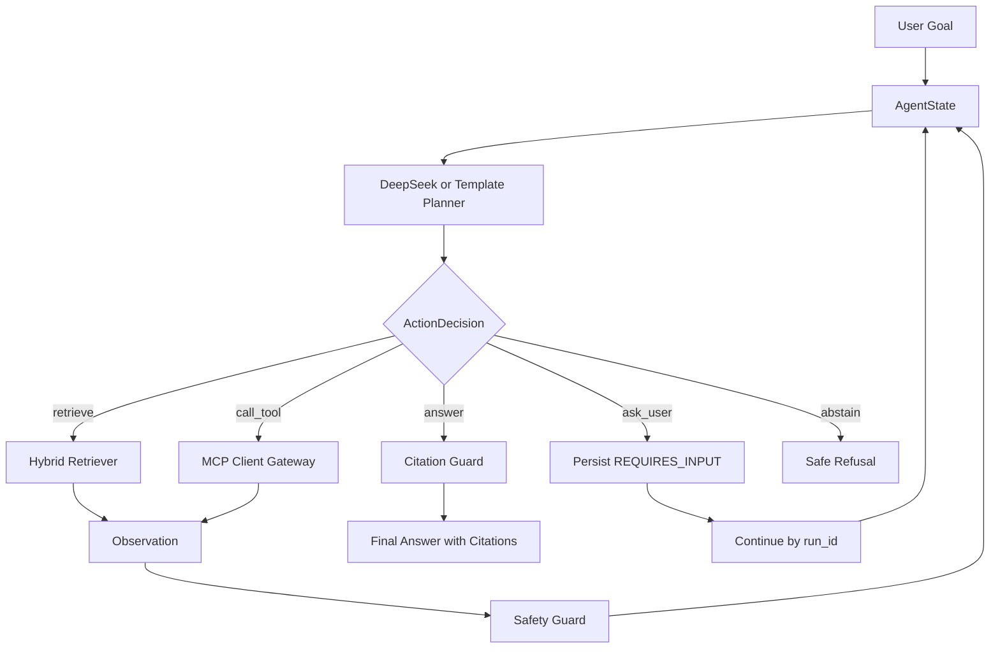

# 网络安全课程 MCP-RAG 教学智能体

这是一个面向网络安全实践课程的本地教学智能体项目。第一阶段完成了 FastAPI、Streamlit、SQLite 学习日志、本地知识库检索、引用回答、实践指导和教师端统计。第二阶段在此基础上扩展为可验证的 MCP-RAG Agent：文档解析、SQLite 文档索引、Chroma 向量库、混合检索、DeepSeek Provider、TemplateProvider 离线降级、MCP 工具网关、Agent Loop、安全守卫、教师端分析和端到端评测。

## 阶段 0 安全兼容说明

本版本有意收紧了课程正文的可见性与外发语义。新上传或重索引的文档即使状态为 `INDEXED`，也必须由当前课程的授权教师或管理员在教师端明确“发布给学生”后，才能进入学生检索、资料门户、资源打开或创新案例。外部模型默认不接收课程正文；只有课程负责人已配置课程 allowlist，且用户在本次请求中明确勾选课程引用时，系统才发送有界、去身份化的最小片段。请求字段不能扩大服务器许可，continue 也不会继承上一次选择。未满足条件时，DeepSeek 课程问答和严格实践指导会返回明确拒绝；本地 Template 与纯公共证据流程仍按原合同可用。

## 功能概览

- 学生端：课程介绍、专题导航、智能问答、实践指导、引用来源、Agent 轨迹、补充信息继续同一 `run_id`、回答评价。
- 教师端：学习统计、模型成功率、平均耗时、fallback 次数、Agent 步数、工具选择路径、知识库命中率、拒答率、模块卡点、FAQ、安全 CSV 导出、知识库管理。
- 后端：`/api/chat`、`/api/agent/runs/{run_id}`、`/api/agent/runs/{run_id}/continue`、`/api/knowledge/upload`、`/api/knowledge/documents`、`/api/tools`、`/api/system/status`、`/api/feedback`。
- Agent：每轮只允许一个动作，动作包括 `retrieve`、`call_tool`、`ask_user`、`answer`、`abstain`。DeepSeek 只做决策，不直接执行工具。

## 环境准备

```powershell
cd "D:\edu agent"
python -m venv .venv
.\.venv\Scripts\python.exe -m pip install -r requirements.txt
.\.venv\Scripts\python.exe -m pip install -r requirements-phase2.txt
```

复制配置文件：

```powershell
Copy-Item .env.example .env
```

离线演示不需要填写 `DEEPSEEK_API_KEY`。需要 DeepSeek 模式时，只把真实密钥写入本机 `.env`，不要写入 `.env.example`、README、报告或截图。

## 启动

后端：

```powershell
.\scripts\start_backend.ps1
```

默认启动保持所有真实外部资料来源关闭。需要显式启用受支持的论文、NVD、GitHub 与 RFC Editor
元数据查询时，使用单 worker、无 reload 的正常联网入口（不会写入 `.env` 或用户级环境）：

```powershell
.\scripts\start_live.ps1
```

`ENABLE_MCP_SERVER` 与 `ENABLE_REAL_STANDARD_FETCH` 为兼容保留的 no-op；MCP 生命周期由
FastAPI lifespan 管理，RFC 联网开关为 `ENABLE_REAL_RFC_LOOKUP`。

如果 PowerShell 禁止执行脚本，可使用：

```powershell
.\scripts\start_backend.cmd
```

等价命令：

```powershell
.\.venv\Scripts\python.exe -m uvicorn backend.main:app --reload --port 8000
```

前端：

```powershell
.\scripts\start_frontend.ps1
```

如果 PowerShell 禁止执行脚本，可使用：

```powershell
.\scripts\start_frontend.cmd
```

等价命令：

```powershell
.\.venv\Scripts\python.exe -m streamlit run frontend/app.py
```

## 验证

完整测试：

```powershell
.\.venv\Scripts\python.exe -m pytest -q
```

第二阶段离线冒烟：

```powershell
.\.venv\Scripts\python.exe scripts\smoke_phase2.py
```

第二阶段离线评测并输出指标：

```powershell
.\.venv\Scripts\python.exe scripts\evaluate_phase2.py --output docs\phase2_eval_results.json
```

一键本地检查：

```powershell
.\scripts\run_phase2_checks.ps1
```

如果 PowerShell 禁止执行脚本，可使用：

```powershell
.\scripts\run_phase2_checks.cmd
```

DeepSeek 模式烟测需要先在 `.env` 填写密钥，然后显式允许：

```powershell
.\.venv\Scripts\python.exe scripts\smoke_phase2.py --allow-deepseek
.\.venv\Scripts\python.exe scripts\evaluate_phase2.py --allow-deepseek --output docs\phase2_eval_results_deepseek.json
```

## 验收问题

第一阶段 8 个演示问题位于 `tests/test_demo_questions.py`。第二阶段补充验收覆盖：

- 简单问题一次检索后回答。
- 复杂实践问题连续选择两个不同工具。
- 信息不足时 `ask_user`。
- 用户补充后继续原 `run_id`。
- 工具或模型失败后降级。
- 模型请求非法工具时由 Action Guard 拦截。
- 证据不足时 `abstain`。
- 达到最大步骤、工具调用次数或超时时强制停止。

## 评测指标

`scripts/evaluate_phase2.py` 输出：

- `Recall@K`
- `Citation Accuracy`
- `Groundedness`
- `Abstention Accuracy`
- `Intent Accuracy`
- `Action Accuracy`
- `Tool Routing Accuracy`

默认使用 TemplateProvider，不产生真实 API 费用。

## Agent Loop



## 数据来源与许可证

- `knowledge_base/` 内置课程资料为本项目教学演示数据。
- 上传文档由本机用户提供，仅写入本地 SQLite 和 Chroma。
- MCP 第一轮工具默认使用本地数据，不启用联网检索。
- 项目报告、测试记录和评测输出不得包含 API Key、学生敏感信息或未授权外部材料。

## 故障排查

- 后端不可用：确认已运行 `uvicorn backend.main:app --reload --port 8000`。
- 前端无法连接：检查 `COURSE_AGENT_API_URL`，默认是 `http://127.0.0.1:8000`。
- DeepSeek 未生效：确认 `.env` 中 `DEEPSEEK_API_KEY` 非空，且不要放入 `.env.example`。
- Chroma 或 embedding 初始化慢：首次加载本地模型会花时间，离线评测可先跑 TemplateProvider。
- 删除或重建知识库失败：教师管理操作需要 `X-User-Role: teacher`，前端默认会带此角色头。
- Windows 终端显示乱码：优先用测试 `tests/test_no_mojibake.py` 判断源码是否正常，PowerShell 显示不等于源码损坏。
- PowerShell 提示禁止运行脚本：使用 `.cmd` 脚本，或临时运行 `powershell -ExecutionPolicy Bypass -File .\scripts\run_phase2_checks.ps1`。

## 重要文件

- `backend/agent/orchestrator.py`：有限自主 Agent Loop。
- `backend/llm/`：DeepSeek 与 TemplateProvider。
- `backend/rag/`：文档解析、向量库、混合检索。
- `backend/tools/mcp_client.py`：MCP Client Gateway。
- `mcp_server/`：本地 MCP 工具定义。
- `frontend/`：Streamlit 学生端与教师端。
- `scripts/evaluate_phase2.py`：第二阶段评测脚本。
- `docs/phase2_report_materials.md`：报告材料。

## 第三阶段开发说明

第二阶段已经完成本地 MCP-RAG Agent 原型闭环：FastAPI、Streamlit、SQLite、Chroma、DeepSeek/TemplateProvider、MCP 工具、Agent Loop、知识库管理、教师统计、安全守卫和离线评测均可运行。第三阶段不重写现有功能，不强制切换 React、PostgreSQL 或 Docker，而是在第二阶段基础上补齐老师原始项目要求中尚未产品化的部分。

第三阶段目标：

- 增加真实用户、课程、班级和角色上下文。
- 增加学生访问、活跃度、学习轨迹和学习事件统计。
- 对接论文库、漏洞库、标准资料、开源项目和竞赛案例 Connector。
- 建立学生端独立课程资料库页面。
- 建立创新启发与案例推荐模块。
- 实现问题语义聚类、教师人工修正和 FAQ 输出。
- 增强实验任务、学习进度和卡点分析。
- 补充网络安全内容的权限、隐私和审计证据。

第三阶段依赖安装：

```powershell
.\.venv\Scripts\python.exe -m pip install -r requirements-phase3.txt
```

第三阶段仍沿用当前启动方式：

```powershell
.\scripts\start_backend.cmd
.\scripts\start_frontend.cmd
```

或直接运行：

```powershell
.\.venv\Scripts\python.exe -m uvicorn backend.main:app --reload --port 8000
.\.venv\Scripts\python.exe -m streamlit run frontend/app.py
```

第三阶段配置占位已加入 `.env.example`。所有密钥保持为空，真实密钥只写入本机 `.env`，且 `.env` 已在 `.gitignore` 中忽略。

第三阶段身份与课程上下文：

```powershell
.\.venv\Scripts\python.exe -m backend.auth.seed
```

该命令会幂等创建一个演示课程、一个演示班级、一个教师账号和两个学生账号。默认密码仅用于本地演示，首次登录后应修改。启用登录接口前，需要在本机 `.env` 配置 `JWT_SECRET_KEY`，不要写入 `.env.example`。

第三阶段外部 Connector：

- `semantic_scholar`：论文元数据和摘要。可选 `SEMANTIC_SCHOLAR_API_KEY`，不配置时使用公开限额。
- `arxiv`：公开预印本元数据和摘要，不需要 API Key。
- `nvd`：CVE、CVSS、CWE、发布日期、更新时间和 NVD 来源链接。建议配置 `NVD_API_KEY`，否则更容易触发限流。
- `standard_source`：只返回标准编号、版本、官方链接和本地上传状态，不抓取受版权保护全文。
- `github`：可选公开仓库元数据，默认关闭；配置 `ENABLE_GITHUB_SEARCH=true` 和可选 `GITHUB_TOKEN` 后启用。

普通测试全部使用 mock，不访问公网：

```powershell
.\.venv\Scripts\python.exe -m pytest tests\connectors tests\test_mcp_tools.py -q
```

真实外部 smoke 默认跳过，只有显式允许才会访问公网并消耗外部服务配额：

```powershell
$env:RUN_LIVE_CONNECTOR_TESTS="true"
.\.venv\Scripts\python.exe -m pytest -m live -q
```

外部服务超时、429 或 5xx 时，系统会记录明确错误；如果本地缓存存在，会返回缓存降级结果，不影响本地 RAG 和已有问答。真实密钥只写入 `.env`，不要写入 `.env.example`、README、测试记录或截图。

第三阶段规划与需求追踪：

- `docs/phase3_architecture.md`：第三阶段架构、基线、启动方式和后续实施顺序。
- `docs/requirements_traceability.md`：老师原始要求 ① 至 ④、创新启发模块与当前模块/第三阶段任务/验收证据的对应关系。
- `docs/phase3_testing_report.md`：第三阶段完整回归、E2E 和 live smoke 记录。
- `docs/phase3_final_report.md`：最终报告材料、关键实现、限制和后续工作。
- `docs/phase3_data_sources_licenses.md`：数据来源、许可证和引用原则。
- `docs/phase3_privacy_security.md`：隐私、安全、权限和网络安全教学边界。
- `docs/phase3_final_architecture.md`：最终系统架构 Mermaid 图。
- `docs/phase3_database_diagram.md`：第三阶段数据库关系图。
- `docs/phase3_demo_script.md`：从安装、seed、启动到演示的脚本。
- `docs/phase3_acceptance_questions.md`：第三阶段最终验收问题逐题对照表。

### 第三阶段第九步状态

已在第二阶段和第三阶段前八步基础上补齐实验任务、学生进度和卡点分析闭环：

- 后端新增实验任务、步骤、学生进度、主动卡点上报和教师卡点分析 API。
- 学生端新增“实验任务”页签，问答和实践指导可携带当前 `assignment_id` 与 `step_id`。
- 教师端新增实验步骤卡点看板，可确认、忽略或标记已解决。
- 卡点分析综合主动上报、同一步骤重复提问、高拒答率和长期未推进，不会仅凭一次页面访问判定卡点。
- 当前验证结果：`pytest tests/test_assignment_progress.py -q` 为 `5 passed`，`pytest -q` 为 `187 passed, 2 skipped, 12 warnings`。

### 第三阶段第十步状态

已扩展教师端第三阶段教学摘要：

- 新增 `backend/api/teacher_phase3.py`，提供 `/api/teacher/phase3/summary`、`/api/teacher/phase3/students/{student_id}/timeline` 和 `/api/teacher/phase3/faq-export.csv`。
- 教师端支持课程、班级、时间范围筛选，覆盖访问监控、学习轨迹、资料搜索/打开、问答、实践指导、创新会话、实验进度、卡点分析、语义聚类和 FAQ 审核导出。
- 统计口径明确：访问次数只统计 `PAGE_VIEW` 学习事件，不把 Agent 内部步骤计为学生访问。
- 教师只能查看自己课程和班级，管理员可查看全部。
- 当前验证结果：`pytest tests/test_teacher_phase3.py tests/test_auth_rbac.py -q` 为 `16 passed`，`pytest -q` 为 `187 passed, 2 skipped, 12 warnings`。

### 第三阶段第十一步状态

已完善学生端说明与安全复核：

- 学生端新增完整“使用说明”，覆盖课程简介、考核方式、专题示例、智能问答、课程资料库、实践指导、创新启发、实验任务和网络安全实验边界。
- 知识库删除与重建、Connector 同步、聚类管理、教师统计和 MCP 调试类入口均要求后端 JWT 身份与教师/管理员角色，不能依赖请求体或伪造角色头。
- 外部资源 URL 只允许 `http://` 和 `https://`，上传文档、Observation 和工具结果继续由 Safety Guard 视为不可信内容处理。
- CSV 导出保留公式注入防护，系统状态、工具清单和页面不显示 API Key。
- 当前验证结果：`pytest tests/test_security_phase3.py tests/test_auth_rbac.py -q` 为 `18 passed`，`pytest -q` 为 `187 passed, 2 skipped, 12 warnings`。

### 第三阶段第十二步状态

已补齐最终端到端验收与报告材料：

- 新增 `tests/test_phase3_e2e.py`，使用 demo 学生和教师完成登录、课程资料检索、mock 论文/NVD/标准元数据、本地正文引用、实践任务、进度更新、卡点上报、创新启发、访问轨迹、语义聚类、教师修正、FAQ 导出和权限拒绝。
- 普通测试保持离线可重复，不访问 DeepSeek、HuggingFace 或真实外部 Connector；真实服务使用 `pytest -m live -q` 单独验证。
- 新增最终测试报告、需求追踪材料、数据来源与许可证、隐私安全说明、最终架构图、数据库图和演示脚本。

第十二步专项验证：

```powershell
.\.venv\Scripts\python.exe -m pytest tests\test_phase3_e2e.py -q
```

完整回归：

```powershell
.\.venv\Scripts\python.exe -m pytest -q
```
