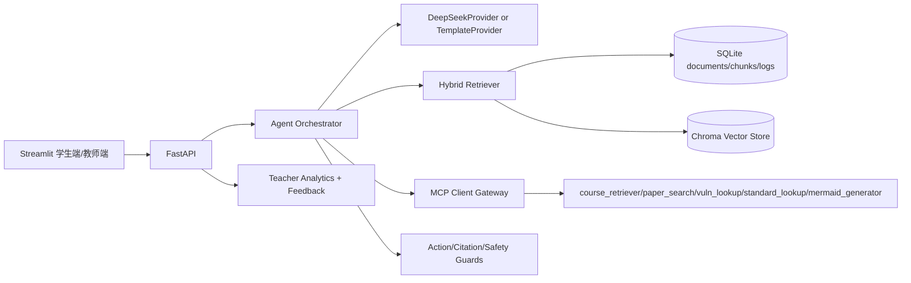
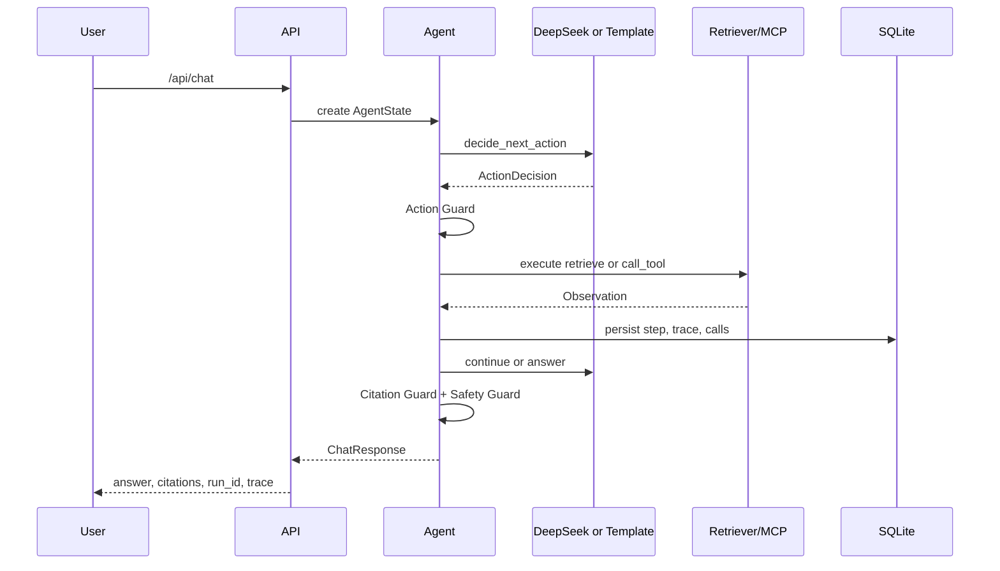

# 第二阶段报告材料

## 目标

第二阶段目标是在第一阶段本地课程问答闭环基础上，形成可验证的 MCP-RAG 复杂智能体项目。系统需要支持真实文档知识库、混合检索、DeepSeek 决策、MCP 工具、Agent Loop、引用校验、安全守卫、教师统计和端到端评测。

## 架构



## Agent Loop



## 关键实现

- 文档解析：`backend/rag/document_parser.py` 支持 Markdown、TXT、PDF、DOCX，并统一为 `Document/Page`。
- 存储：`backend/storage/logger.py` 使用版本化 migration，保留学习日志、文档、chunk、索引任务、Agent run/step、模型调用、工具调用和学生反馈。
- 检索：`backend/rag/hybrid_retriever.py` 融合关键词和向量检索，先归一化再加权。
- 向量库：`backend/rag/vector_store.py` 使用 Chroma 持久化索引，SQLite chunk id 与 Chroma vector id 保持一致。
- LLM：`backend/llm/deepseek_provider.py` 通过 OpenAI 兼容 SDK 调 DeepSeek；未配置密钥时 `TemplateProvider` 离线降级。
- MCP：`mcp_server/tools.py` 和 `backend/tools/mcp_client.py` 提供标准工具清单、schema、策略、超时和本地 fallback。
- Agent：`backend/agent/orchestrator.py` 按有限步数执行 `retrieve/call_tool/ask_user/answer/abstain`。
- Guards：`backend/guards/` 拦截非法动作、伪造引用和提示注入。
- 前端：`frontend/pages/student.py` 展示回答、引用、轨迹和反馈；`frontend/pages/teacher.py` 展示知识库、模型、工具、检索和学习分析。

## 验收矩阵

| 验收项 | 覆盖位置 |
|---|---|
| TemplateProvider 离线闭环 | `scripts/smoke_phase2.py` |
| DeepSeek 模式 | `scripts/smoke_phase2.py --allow-deepseek` |
| 简单问题一次检索后回答 | `tests/test_agent_orchestration.py` |
| 复杂实践问题两个不同工具 | `test_complex_practice_task_can_choose_two_different_tools` |
| ask_user 暂停 | `tests/test_agent_resume.py` |
| 同 run_id 继续 | `tests/test_agent_resume.py` |
| 工具/模型失败降级 | `tests/test_agent_orchestration.py` |
| 非法工具拦截 | `tests/test_action_guard.py` |
| 证据不足拒答 | `tests/test_agent_orchestration.py` |
| 步骤/工具上限停止 | `tests/test_agent_orchestration.py` 和 `tests/test_action_guard.py` |
| 上传、索引、检索、问答、日志、统计闭环 | `tests/test_api_endpoints.py` |
| CSV 公式注入防护 | `tests/test_teacher_exports.py` |
| 源码乱码防护 | `tests/test_no_mojibake.py` |

## 评测记录

运行：

```powershell
.\.venv\Scripts\python.exe scripts\evaluate_phase2.py --output docs\phase2_eval_results.json
```

输出指标：

- Recall@K
- Citation Accuracy
- Groundedness
- Abstention Accuracy
- Intent Accuracy
- Action Accuracy
- Tool Routing Accuracy

当前离线 TemplateProvider 评测结果，来自 40 条课程域评测集：

| 指标 | 结果 |
|---|---:|
| Recall@K | 0.4118 |
| Citation Accuracy | 1.0000 |
| Groundedness | 1.0000 |
| Abstention Accuracy | 0.7250 |
| Intent Accuracy | 0.8500 |
| Action Accuracy | 0.7000 |
| Tool Routing Accuracy | 0.8750 |

说明：离线 TemplateProvider 主要验证闭环、路由、安全停止和引用定位；真实 DeepSeek 模式应在本机 `.env` 配置密钥后运行 `--allow-deepseek` 重新生成一份评测结果。

最新测试基线请以本机命令输出为准：

```powershell
.\.venv\Scripts\python.exe -m pytest -q
```

## 演示脚本

1. 后端启动：`.\scripts\start_backend.ps1`
2. 前端启动：`.\scripts\start_frontend.ps1`
3. 学生端提问：`5G NAS 认证流程有哪些关键风险点？`
4. 展开引用和 Agent 轨迹。
5. 提交学生反馈。
6. 教师端查看模型、工具、检索、学习分析和反馈统计。
7. 上传 Markdown/TXT/PDF/DOCX 文档，查看 index jobs。
8. 手动重建索引，再提问验证新知识。
9. 删除文档，确认 SQLite 与 Chroma 同步清理。
10. 运行离线评测脚本，保存 `docs/phase2_eval_results.json`。

## 故障与降级路径

- DeepSeek 未配置：Factory 自动使用 TemplateProvider。
- DeepSeek 超时或结构化输出异常：记录模型错误，并基于已有证据 fallback。
- Chroma 不可用：Hybrid Retriever 回退到关键词检索，并标记 fallback。
- MCP 不可用：低风险只读工具回退本地 registry；高风险或联网工具不会绕过策略。
- 工具非法或越权：Action Guard 拦截，不执行工具。
- 证据不足：Agent 返回拒答，不要求模型补充事实。
- 达到最大步数、工具次数或超时：强制停止并返回限制说明。

## 限制

- 当前 MCP 工具第一轮使用本地模拟数据，联网工具默认关闭。
- 评测集是课程域小型离线集，适合作为回归基线，不代表公开基准。
- DeepSeek 真实调用受网络、配额、模型版本和提示稳定性影响。
- Streamlit 第一轮采用请求完成后一次性展示轨迹，未实现 SSE。

## 后续工作

- 增加更大规模人工标注评测集。
- 引入真实论文、标准、CVE 数据源的可审计连接器。
- 为教师端增加按班级、作业、实验主题的分组分析。
- 增加 SSE 或 WebSocket 展示实时 Agent 步骤。
- 引入更严格的引用事实一致性自动评估。
