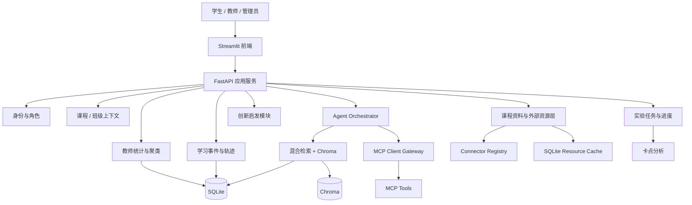

# 第三阶段架构说明

## 当前基线

第三阶段从已经完成的第二阶段继续开发，不重写现有功能。当前项目已经具备：

- FastAPI 后端、Streamlit 学生端和教师端。
- SQLite 学习日志、文档索引、Agent Run、模型调用、工具调用和反馈记录。
- Markdown/TXT/PDF/DOCX 文档解析、Chroma 持久化向量库、TF-IDF + Chroma 混合检索。
- DeepSeek Provider、TemplateProvider 离线降级、MCP Server/Client Gateway。
- 有限自主 Agent Loop、Action Guard、Citation Guard、Safety Guard。
- 知识库管理、Agent 轨迹、教师端统计、FAQ/CSV 安全导出。

真实密钥只写入本机 `.env`，不得进入 `.env.example`、README、报告或截图。

## 基线验证记录

| 项目 | 命令 | 当前结果 |
|---|---|---|
| 单元与集成测试 | `.\.venv\Scripts\python.exe -m pytest -q` | `187 passed, 2 skipped, 12 warnings` |
| 第九步专项测试 | `.\.venv\Scripts\python.exe -m pytest tests\test_assignment_progress.py -q` | `5 passed, 1 warning` |
| 第十步教师端专项测试 | `.\.venv\Scripts\python.exe -m pytest tests\test_teacher_phase3.py tests\test_auth_rbac.py -q` | `16 passed, 1 warning` |
| 第十一步安全专项测试 | `.\.venv\Scripts\python.exe -m pytest tests\test_security_phase3.py tests\test_auth_rbac.py -q` | `18 passed, 1 warning` |
| 第十二步 E2E | `.\.venv\Scripts\python.exe -m pytest tests\test_phase3_e2e.py -q` | `1 passed, 1 warning` |
| TemplateProvider smoke | `.\.venv\Scripts\python.exe scripts\smoke_phase2.py` | `run_status=COMPLETED`, `provider=template`, `steps=1` |
| 离线评测 | `.\.venv\Scripts\python.exe scripts\evaluate_phase2.py --output docs\phase2_eval_results.json` | 40 条样例完成 |
| 评测指标 | 同上 | Recall@K 0.4118, Citation Accuracy 1.0, Groundedness 1.0, Abstention Accuracy 0.725, Intent Accuracy 0.85, Action Accuracy 0.7, Tool Routing Accuracy 0.875 |

DeepSeek 真实调用仍沿用第二阶段方式：在本机 `.env` 填写 `DEEPSEEK_API_KEY` 后运行 `scripts\smoke_phase2.py --allow-deepseek`。

## 第三阶段 1-12 步复核快照

已完成并复核：

1. 新增 `requirements-phase3.txt`、第三阶段配置占位、README 说明、架构文档和需求追踪表。
2. 新增用户、课程、班级、成员关系、JWT 登录、Argon2 密码哈希、角色权限和 demo seed。
3. 新增学习会话与学习事件，支持访问监控、heartbeat、学生时间线和教师活动统计。
4. 新增统一 Connector 框架、外部资源缓存、TTL、去重、同步记录和向量同步。
5. 新增 Semantic Scholar、arXiv、NVD、标准元数据和可选 GitHub Connector，并扩展真实 MCP 工具。
6. 新增统一课程资料库 API 和 Streamlit 页面，展示课程文档、论文、标准、漏洞、开源项目和竞赛题目。
7. 新增独立创新启发模块，支持案例推荐、连续追问、学生回答保存和最终创新方向输出。
8. 新增问题语义聚类、教师重命名/合并/拆分/批准和带引用 FAQ 导出。
9. 新增实验任务、步骤、学生进度、主动卡点上报、疑似卡点分析和教师处理入口。
10. 新增 `backend/api/teacher_phase3.py` 和教师端第三阶段教学摘要，支持课程/班级/时间筛选、访问监控、资源行为、问答、实践、创新、实验进度、卡点、聚类、FAQ 审核、学生时间线和安全 CSV 导出。
11. 完善学生端使用说明、课程简介、考核方式、专题示例和网络安全实验边界；复核第三阶段 API 身份依赖、角色权限、外部 URL、日志脱敏、错误响应、提示注入和密钥扫描。
12. 新增 `tests/test_phase3_e2e.py` 和最终报告材料，完成学生端、教师端、资源、引用、实验任务、卡点、创新、学习轨迹、聚类、FAQ 和权限拒绝的离线端到端验收。

第九步新增数据表：

- `assignments`
- `assignment_steps`
- `student_assignment_progress`
- `stuck_reports`

第九步新增或完善模块：

- `backend/storage/logger.py`：实验任务、步骤、进度和卡点持久化。
- `backend/analytics/stuck_analysis.py`：主动卡点、重复同一步骤提问、高拒答模块和长期未推进的疑似卡点分析。
- `backend/main.py`：新增 `/api/assignments`、`/api/assignments/{assignment_id}/progress`、`/api/stuck-reports`、`/api/teacher/stuck-analysis`、`/api/teacher/stuck-reports/{report_id}/action`。
- `frontend/api_client.py`：新增任务、进度、卡点和教师卡点分析调用。
- `frontend/pages/student.py`：新增“实验任务”页签，问答和实践指导可携带当前实验步骤。
- `frontend/pages/teacher.py`：新增实验步骤卡点看板和处理按钮。
- `tests/test_assignment_progress.py`：覆盖权限、进度隔离、实践指导关联、主动卡点、疑似卡点和教师处理。

## 启动方式

后端：

```powershell
.\scripts\start_backend.cmd
```

或：

```powershell
.\.venv\Scripts\python.exe -m uvicorn backend.main:app --reload --port 8000
```

前端：

```powershell
.\scripts\start_frontend.cmd
```

或：

```powershell
.\.venv\Scripts\python.exe -m streamlit run frontend/app.py
```

## 第三阶段目标架构



## 第三阶段新增边界

第三阶段继续沿用 `Streamlit + FastAPI + SQLite + Chroma + DeepSeek + MCP`，补齐老师原始要求中尚未产品化的部分：

- 身份、角色、课程、班级维度。
- 学生访问、活跃度、学习轨迹与学习事件。
- 论文库、漏洞库、标准库等外部 Connector。
- 独立课程资料库页面。
- 独立创新启发与案例推荐模块。
- 问题语义聚类、教师人工修正和 FAQ 输出。
- 实验任务、学生进度和卡点分析。
- 网络安全教学内容的权限、隐私和审计。

第三阶段暂不强制 React 重写、PostgreSQL 迁移、Docker 部署、Redis/Celery 或复杂 OAuth。

## 配置分层

第三阶段配置已在 `.env.example` 中预留，所有密钥保持为空：

- 身份：`JWT_SECRET_KEY`、`JWT_ALGORITHM`、`ACCESS_TOKEN_EXPIRE_MINUTES`、`ENABLE_DEMO_ACCOUNTS`
- 外部 Connector：`EXTERNAL_CONNECTOR_MODE`、`ENABLE_SEMANTIC_SCHOLAR`、`ENABLE_ARXIV`、`ENABLE_NVD`、`ENABLE_GITHUB_SEARCH`
- 缓存：`RESOURCE_CACHE_DIR`、`EXTERNAL_CACHE_TTL_HOURS`、`CONNECTOR_SYNC_BATCH_SIZE`
- 聚类：`QUESTION_CLUSTER_MIN_SIZE`、`QUESTION_CLUSTER_DISTANCE_THRESHOLD`、`QUESTION_CLUSTER_LOOKBACK_DAYS`
- 学习事件：`LEARNING_EVENT_RETENTION_DAYS`、`SESSION_IDLE_TIMEOUT_MINUTES`、`ACTIVITY_HEARTBEAT_SECONDS`

真实密钥只能写入本机 `.env`，且 `.env` 已在 `.gitignore` 中忽略。

## 后续优化建议

1. 教师端更多课程管理页面抛光。
2. 资源 Connector live smoke 的容错与配额说明补充。
3. 实验任务编辑器和教师自定义任务模板。
4. 多班级真实使用后的聚类阈值和卡点规则校准。
