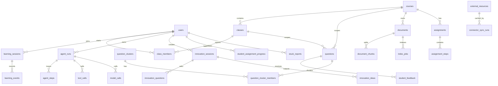

# 第三阶段数据库图

## 关键表

- 身份课程：`users`, `courses`, `classes`, `class_members`
- 学习日志：`questions`, `conversations`, `learning_sessions`, `learning_events`, `student_feedback`
- Agent 追踪：`agent_runs`, `agent_steps`, `model_calls`, `tool_calls`, `agent_traces`
- 知识库：`documents`, `document_chunks`, `index_jobs`
- 外部资源：`external_resources`, `connector_sync_runs`
- 创新启发：`innovation_sessions`, `innovation_questions`, `innovation_ideas`
- 教师分析：`question_clusters`, `question_cluster_members`, `assignments`, `assignment_steps`, `student_assignment_progress`, `stuck_reports`
