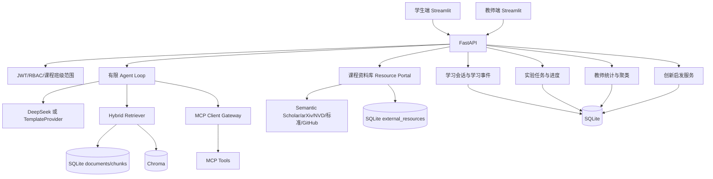

# 第三阶段最终架构图

## 运行边界

- 普通离线模式：TemplateProvider、本地知识库、本地 MCP fallback、SQLite 和缓存资源。
- DeepSeek 模式：`.env` 配置 `DEEPSEEK_API_KEY` 后启用真实 Planner/Answer Provider。
- Live Connector 模式：显式设置 live smoke 环境变量后访问真实论文源或 NVD。
