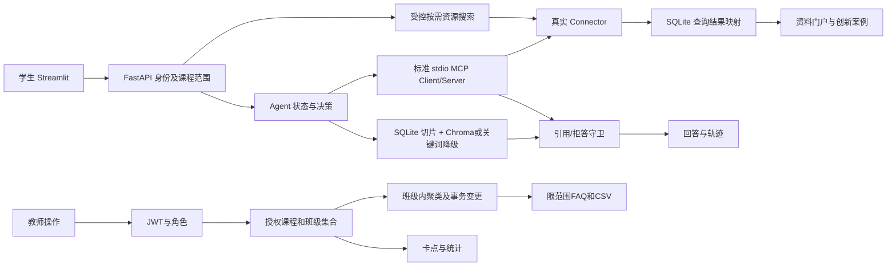
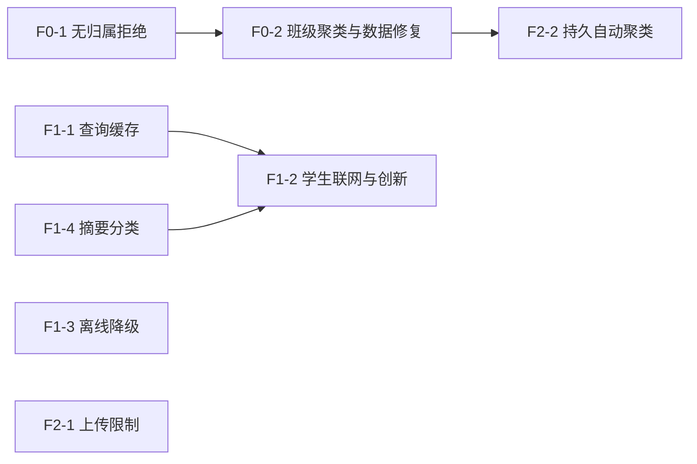

# 《最终修复实施设计书》反向评审与修订版

**评审结论：原设计的方向可用，但不能直接照单实施。**

本轮只读复核了当前源码、原始要求及 SQLite；未修改代码、数据库或配置，未安装依赖，也未重跑测试。以下“已复现”指上一轮真实验收结果；本轮重新核对了对应的当前代码。

## A. 反向评审发现与修正

| 原设计的问题 | 当前证据 | 修正 |
|---|---|---|
| P0 仅修两个范围解析器仍不够 | 按簇 ID 操作走[`_require_cluster_scope`](<C:/Users/Asd/Desktop/edu agent/backend/main.py:253>)，它只验课程；`course_id=None` 又被[`_user_can_access_course`](<C:/Users/Asd/Desktop/edu agent/backend/main.py:183>)视为可访问 | 第一批同时堵住所有聚类读取、导出、重建及按 ID 变更；无班级教师和归属不明簇均失败关闭 |
| 只按簇的 `class_id` 过滤会漏成员 | [重建](<C:/Users/Asd/Desktop/edu agent/backend/analytics/clustering.py:105>)按课程混合问题，簇班级取代表问题；当前库只读查询发现簇 **28** 含两个班级的成员。当前问题和簇的空班级数均为 **0**，簇 28 未审批 | 按班级建簇；读取和变更校验**全部成员**；单独、幂等修复簇 28 等旧混合簇 |
| 聚类重建可能破坏教师已通过页面完成的编辑 | [`delete_unapproved_question_clusters`](<C:/Users/Asd/Desktop/edu agent/backend/storage/logger.py:1917>)删除所有未审批簇；[改名](<C:/Users/Asd/Desktop/edu agent/backend/storage/logger.py:2007>)会标 `source='teacher'`，但不阻止删除；[重建](<C:/Users/Asd/Desktop/edu agent/backend/analytics/clustering.py:105>)还在计算新簇**之前**删除旧簇 | P0 聚类批次内改成先计算、后事务替换；保留教师编辑及已审批簇，失败不得清空原簇 |
| 查询缓存若只在 `search()` 写入，教师与 MCP 仍绕开 | [教师同步](<C:/Users/Asd/Desktop/edu agent/backend/main.py:1410>)、[MCP 真实工具](<C:/Users/Asd/Desktop/edu agent/mcp_server/tools.py:285>)直接调用 `sync()`；当前 `search_cache` 又按整句匹配 | `sync()` 成功时也写查询→资源映射；`search()`、教师同步、MCP 使用同一映射 |
| “联网后重新读门户”仍可能显示零结果 | [门户关键词过滤](<C:/Users/Asd/Desktop/edu agent/backend/resources/portal.py:212>)要求完整短语出现；真实外源结果未必包含完整查询串；[创新案例](<C:/Users/Asd/Desktop/edu agent/backend/innovation/service.py:135>)亦如此 | 本次联网结果直接规范化并交给学生页面及创新案例选择，同时写缓存供后续浏览 |
| 未处理公开接口触发联网和显式 fake 注入 | [`POST /api/resources/search`](<C:/Users/Asd/Desktop/edu agent/backend/main.py:1434>)使用可选身份且 `ResourceQuery.allow_remote` 默认 true；默认[Registry](<C:/Users/Asd/Desktop/edu agent/backend/connectors/registry.py:81>)含 FakeConnector | 远程搜索要求登录；生产 API 拒绝 `fake`；测试继续通过显式注入 FakeConnector，不用 fake 冒充 live。既有 fake 缓存保留但不作为学生真实资源展示 |
| 故障响应设计中的 `fallback_reason` 会被过滤 | `/api/chat` 有 `response_model=ChatResponse`，当前[模型](<C:/Users/Asd/Desktop/edu agent/backend/schemas.py:36>)无该字段 | 最小方案复用现有 `fallback_used`、`run_status` 和 run 轨迹；确需新字段时必须同步改 schema，本版不新增 |
| 上传提示方案改动过大 | 当前安装的 Streamlit `file_uploader` 已支持**单控件** `max_upload_size`，见[本机依赖实现](<C:/Users/Asd/Desktop/edu agent/.venv/Lib/site-packages/streamlit/elements/widgets/file_uploader.py:344>) | 在[现有上传控件](<C:/Users/Asd/Desktop/edu agent/frontend/pages/teacher.py:281>)设 `max_upload_size=25`；不新增全站配置 |
| 迁移“可回滚”表述过于绝对 | 项目用[`schema_migrations`](<C:/Users/Asd/Desktop/edu agent/backend/storage/logger.py:79>)防重复；数据拆簇后若继续产生教学记录，直接恢复旧 DB 会丢新数据 | 维护窗口内停写、SQLite 一致性备份、单事务迁移和核验；恢复开放写入后只能先导出增量再做补偿迁移，不能承诺无条件快照回滚 |
| 提交指令当前不能执行 | 根目录 `git status --short` 返回“Not a git repository” | 批次仍独立交付；Git 提交说明仅适用于用户指定的 Git 仓库，不在本轮或实施时擅自 `git init` |

原始课程要求中，[教师监控、聚类、卡点和 FAQ](<C:/Users/Asd/Desktop/edu agent/md/题目最终要求.md:27>)对应 P0；[专题检索、摘要分类](<C:/Users/Asd/Desktop/edu agent/md/题目最终要求.md:91>)及[论文、开源、竞赛创新案例](<C:/Users/Asd/Desktop/edu agent/md/题目最终要求.md:101>)对应 P1。标准资料当前是有明确标记的本地官方元数据和链接；原要求没有规定必须抓取受限标准全文，因此**不安排全文爬取**。使用说明、六步实践、认证、课程文档隔离、正常 DeepSeek 和 stdio MCP 已通过的部分只做回归。

## B. 最终目标调用链



登录、首次改密、退出与令牌失效沿用[现有页面](<C:/Users/Asd/Desktop/edu agent/frontend/app.py:61>)、[认证 API](<C:/Users/Asd/Desktop/edu agent/backend/main.py:344>)和[令牌版本校验](<C:/Users/Asd/Desktop/edu agent/backend/auth/dependencies.py:13>)，本轮修复批次不改。Chroma、DeepSeek、MCP Server/Client 的已通过主链保留；只调整离线模型加载与真实工具的数据来源边界。

## C. 最终问题与批次矩阵

| 批次 | 优先级、对应要求 | 确认存在的缺口 | 主要定位 | 迁移/API/页面/外网 |
|---|---|---|---|---|
| **F0-1** | P0；教师权限 | 无班级教师可经摘要/FAQ 读取全局数据；按 ID 守卫也未完整验班级 | [phase3 范围](<C:/Users/Asd/Desktop/edu agent/backend/api/teacher_phase3.py:180>)、[main 范围和簇守卫](<C:/Users/Asd/Desktop/edu agent/backend/main.py:107>) | 无迁移；错误 200→403；页面提示；不依赖外网 |
| **F0-2** | P0；问题聚类、FAQ | 同课程跨班读取/变更；旧混合簇；重建可能删除教师编辑 | [聚类服务](<C:/Users/Asd/Desktop/edu agent/backend/analytics/clustering.py:105>)、[仓储](<C:/Users/Asd/Desktop/edu agent/backend/storage/logger.py:1868>) | 一次性数据修复及索引；可选 `class_id`；教师页面传筛选；不依赖外网 |
| **F1-1** | P1；高效外部检索 | 相同查询不能稳定复用；教师/MCP 直接同步绕开缓存键 | [资源服务](<C:/Users/Asd/Desktop/edu agent/backend/resources/service.py:44>)、[全文匹配](<C:/Users/Asd/Desktop/edu agent/backend/storage/logger.py:1411>) | 新查询映射表；搜索响应补来源状态；首次验证依赖外网 |
| **F1-2** | P1；资料入口、创新项目 | 学生只读缓存；创新选例仍可能漏掉刚获取的资源；公开联网与 fake 边界 | [学生页](<C:/Users/Asd/Desktop/edu agent/frontend/pages/student.py:322>)、[创新服务](<C:/Users/Asd/Desktop/edu agent/backend/innovation/service.py:135>)、[搜索 API](<C:/Users/Asd/Desktop/edu agent/backend/main.py:1434>) | 无新表，依赖 F1-1；远程搜索认证行为变化；真实 live 依赖外网，GitHub 开关需启用 |
| **F1-3** | P1；失败降级 | 断网冷启动向量模型探测导致客户端超时 | [向量加载](<C:/Users/Asd/Desktop/edu agent/backend/rag/vector_store.py:19>)、[检索降级](<C:/Users/Asd/Desktop/edu agent/backend/rag/hybrid_retriever.py:137>) | 无迁移或必需 API 新字段；离线测试不依赖 Key |
| **F1-4** | P1；专题摘要分类 | 现有自动处理主要为模板加截断，缺少专题内容归纳 | [摘要及分类](<C:/Users/Asd/Desktop/edu agent/backend/resources/portal.py:278>) | 无迁移；保留旧字段、可加解释字段；无需外网 |
| **F2-1** | P2；上传体验 | 上传控件提示 200 MB，API 实限 25 MB | [控件](<C:/Users/Asd/Desktop/edu agent/frontend/pages/teacher.py:281>) | 单行前端控件参数；无迁移/API/外网 |
| **F2-2** | P2；自动聚类可靠性 | 进程内阈值重启丢失，失败静默 | [调度](<C:/Users/Asd/Desktop/edu agent/backend/main.py:1459>) | 持久任务状态表；依赖 F0-2；无外网 |

## D. 最终可执行修复批次

### F0-1｜先使所有无授权教师路径失败关闭

- **修改：**`backend/api/teacher_phase3.py::_resolve_scope` [180](<C:/Users/Asd/Desktop/edu agent/backend/api/teacher_phase3.py:180>)和 `backend/main.py::_resolve_teacher_scope` [107](<C:/Users/Asd/Desktop/edu agent/backend/main.py:107>)在教师无任课班级时立即 403。`main._require_cluster_scope` [253](<C:/Users/Asd/Desktop/edu agent/backend/main.py:253>)也必须核对该教师至少有授权班级；归属为空的旧簇仅管理员可管理。逐一覆盖 `GET /api/teacher/phase3/summary`、两种 FAQ 导出、簇列表、重建、审批、改名、合并、拆分。管理员全局行为保持。
- **API/数据库/页面：**请求与成功响应不变；无权请求稳定返回 `403 COURSE_FORBIDDEN` 或 `CLASS_FORBIDDEN`，匿名 401、学生 403。无迁移。教师页只展示后端错误。
- **证明测试：**两课程、两教师、一个无班级教师；逐端点断言 403，特别是无参数 `POST .../rebuild` 前后簇与成员数量完全相同。扩展[教师 API 测试](<C:/Users/Asd/Desktop/edu agent/tests/test_teacher_phase3.py:155>)和[聚类测试](<C:/Users/Asd/Desktop/edu agent/tests/test_question_clustering.py:177>)；浏览器登录无班级教师核对拒绝。
- **回滚/完成：**纯代码回退，但回退会重新开放 P0。全部入口均拒绝且无写入才关闭本批。

### F0-2｜按班级建簇、按全部成员授权、修复旧数据

- **修改：**`ClusterBuildOptions` [28](<C:/Users/Asd/Desktop/edu agent/backend/analytics/clustering.py:28>)增加班级范围；`QuestionClusteringService.rebuild/list_clusters/export_faq` [105、162、181](<C:/Users/Asd/Desktop/edu agent/backend/analytics/clustering.py:105>)按 `(course_id,class_id)` 处理。`LearningLogger.questions_for_clustering/question_clusters` [1868、1972](<C:/Users/Asd/Desktop/edu agent/backend/storage/logger.py:1868>)查询授权范围并验证**每个成员**。`main` 的列表、导出与按 ID 变更 [1175–1242](<C:/Users/Asd/Desktop/edu agent/backend/main.py:1175>)及 phase3 摘要、CSV [37、118](<C:/Users/Asd/Desktop/edu agent/backend/api/teacher_phase3.py:37>)使用同一授权班级集合。合并须同课程同班；拆分的所有 `question_id` 必须属于原簇及授权班级，仓储事务内再验一次。
- **保护现有编辑：**先完成嵌入和分组计算，成功后在一个 SQLite 事务中替换本班 `source='auto' AND approved=0` 的簇；[已审批](<C:/Users/Asd/Desktop/edu agent/backend/storage/logger.py:2018>)及 `source='teacher'` 的成员从候选中排除。任何计算或写入失败都保留旧簇。不能继续使用现有“先删后算”顺序。
- **迁移：**沿用[`schema_migrations`](<C:/Users/Asd/Desktop/edu agent/backend/storage/logger.py:79>)新增版本 13，增 `(course_id,class_id,approved)` 查询索引，记录受影响簇的原行、成员和新子簇 ID。维护窗口停写，以 SQLite backup API 生成一致备份；在单事务中把旧混合簇按成员实际班级拆开，重新确定各组代表问题。当前簇 28 为未审批、两班成员，且当前问题/簇均无空班级；迁移仍要对未来空归属数据失败关闭并交管理员核实，不猜班级。版本记录与变更同事务提交，重复运行不再改变数据。
- **API/页面：**簇列表和 FAQ JSON/CSV 增可选 `class_id`，省略表示该教师所有授权班级；教师[筛选页](<C:/Users/Asd/Desktop/edu agent/frontend/pages/teacher.py:74>)把同一班级筛选传给摘要、簇和 CSV。跨班簇读取、审批、改名、合并、拆分一律 403，不能仅隐藏按钮。
- **证明测试：**默认 TF-IDF 的同课程两班相似问题不得混簇；两教师摘要、列表、CSV 的班级集合完全一致；异班 ID 的四种变更均 403 且无部分写入；重建中注入嵌入异常后原簇及教师未审批改名仍在；旧簇拆分前后成员数相同、混合簇数 0、第二次迁移无变化。复用[默认嵌入测试](<C:/Users/Asd/Desktop/edu agent/tests/test_question_clustering.py:369>)及教师权限测试。浏览器分别以两教师核对。
- **回滚/完成：**恢复开放写入**前**若核验失败，停服务后恢复备份即可；开放后先导出新增教学记录，利用修复记录做补偿迁移，不能直接覆盖 DB。全部跨班读写关闭、历史成员无丢失、失败重建不破坏教师编辑才关闭 P0。

### F1-1｜统一真实查询缓存

- **修改：**在[资源仓储](<C:/Users/Asd/Desktop/edu agent/backend/resources/repository.py:13>)和[`ExternalResourceService.search/sync`](<C:/Users/Asd/Desktop/edu agent/backend/resources/service.py:44>)之间建立规范化查询键→有序资源 ID 映射。键包括来源要求（明确来源或 `auto`）、类型、查询、模块、年份、页码、页大小。`sync()` 的成功结果也写来源专用映射；`auto` 按候选源查新鲜映射，显式 arXiv 不能误命中 NVD 或其他来源。失败时仅按同键取旧结果。直接 MCP 同步返回已取得资源或映射结果，不再依赖完整短语 `LIKE`。
- **数据库/API：**版本 14 增 `resource_query_cache` 和 `resource_query_cache_items`，外键指向现有 `external_resources`，加唯一键及过期索引；旧资源记录不删除、不伪造查询历史。`POST /api/resources/search` 保留 `resources/cache_hit/status/error`，补统一的 `delivery_mode`（`live`、`fresh_cache`、`stale_cache`、`local_metadata`）；缓存命中无新外部 sync run。
- **测试：**计数 Connector 的首查一次、次查零次；教师 `sync()` 后学生同专题可取映射；MCP 真实工具同步后也可取；显式来源不串源；过期后外网失败为 `FAILED_WITH_CACHE`。真实 arXiv 相同请求两次核对第二次 `cache_hit=true`、run 数不增。扩展[Connector 测试](<C:/Users/Asd/Desktop/edu agent/tests/connectors/test_connector_framework.py:169>)。
- **回滚/完成：**表为附加结构，旧代码可忽略，保留已缓存资料。真实同专题第二次不联网且断网能按同键取旧结果才关闭。

### F1-2｜学生按需检索、创新案例和来源边界

- **修改：**学生[资源页面](<C:/Users/Asd/Desktop/edu agent/frontend/pages/student.py:322>)一次性调用现有 `POST /api/resources/search`，将**本次响应**规范化后直接显示，不依赖门户完整短语再次过滤；同时写 F1-1 缓存。[创新会话入口](<C:/Users/Asd/Desktop/edu agent/backend/main.py:1333>)在有限总时长内取论文和项目，直接将取得的资源交给[案例选择](<C:/Users/Asd/Desktop/edu agent/backend/innovation/service.py:135>)，保留已有课程 RAG、MCP、竞赛资料。直接 API 创建会话也应生效，不能仅由前端预热缓存。[MCP 论文 `auto`](<C:/Users/Asd/Desktop/edu agent/mcp_server/tools.py:285>)使用真实候选源及 F1-1 缓存，不能固定 Semantic Scholar。
- **安全与 fake：**`POST /api/resources/search` 的 `allow_remote=true` 要求已认证用户；匿名远程请求 401。生产搜索与教师同步 API 拒绝显式 `fake`，默认生产 Registry 不注册 FakeConnector；单元测试仍可显式注入。已有 fake 缓存保留、标为测试来源，不作为学生真实论文/CVE/项目呈现。修改相关[使用 fake 的 API 测试](<C:/Users/Asd/Desktop/edu agent/tests/test_resource_portal.py:345>)为显式测试注入或真实源替身，保持原业务断言。
- **配置/API/页面：**复用 `ENABLE_GITHUB_SEARCH` [110](<C:/Users/Asd/Desktop/edu agent/backend/core/config.py:110>)，仅在答辩环境完成 live 验证后开启；可选 GitHub token，不写真实值。现有请求/成功字段保留，新增来源、缓存和错误状态；教师同步权限不变。学生 UI 显示 live/缓存/限流/禁用，创新页已有[来源链接和缓存标记](<C:/Users/Asd/Desktop/edu agent/frontend/pages/innovation.py:38>)，只补获取状态，避免重复开发。
- **测试与完成：**空缓存学生专题真实取得有链接的论文、NVD CVE、GitHub 项目；创新会话 `cases` 保存真实 `project`；匿名远程 401、学生教师同步 403、显式 fake 400/403；断网显示缓存或受控失败。Mock 只证明分支，最终另跑 arXiv 或 Semantic Scholar、NVD、GitHub live 和浏览器。网络限流记为外部故障，不记代码通过。

### F1-3｜离线冷启动的有界降级

- **修改：**[Chroma 初始化](<C:/Users/Asd/Desktop/edu agent/backend/rag/vector_store.py:19>)在默认离线模式只查本地模型缓存；缺失则让[混合检索器](<C:/Users/Asd/Desktop/edu agent/backend/rag/hybrid_retriever.py:137>)迅速走关键词。实施时核对现有 Chroma 集合对嵌入配置参数变化的兼容；先用**向量目录副本**验证，不直接重建或清空现有 Chroma。协调[DeepSeek SDK 与应用重试](<C:/Users/Asd/Desktop/edu agent/backend/llm/deepseek_provider.py:65>)，使单次调用受 Agent 总时间约束。
- **契约与数据：**复用[现有 `ChatResponse.fallback_used`](<C:/Users/Asd/Desktop/edu agent/backend/schemas.py:54>)、run 轨迹和 `run_status`；不添加会被 response model 丢掉的字段。新文档在缺少向量模型时若无法完成索引，保持明确 `FAILED/PENDING` 与错误说明，**不能谎称向量 INDEXED**；已有 INDEXED 文档可用关键词降级。无迁移。
- **测试与完成：**隔离空模型缓存、断外网及 DeepSeek，真实 `/api/chat` 在预设客户端时限内返回有引用的 fallback 回答或 `ABSTAINED`，不发生 `ReadTimeout`；正常 Chroma/DeepSeek 仍通过。测试来源包括[检索降级测试](<C:/Users/Asd/Desktop/edu agent/tests/test_hybrid_retriever.py:100>)、[模型故障测试](<C:/Users/Asd/Desktop/edu agent/tests/test_agent_orchestration.py:350>)及新增真实 HTTP 冷启动测试。回滚代码和无密钥示例配置，保留索引数据。

### F1-4｜可核对的专题摘要分类

- **修改：**保留[现有门户结果字段](<C:/Users/Asd/Desktop/edu agent/backend/resources/portal.py:260>)，将模板截取改为按专题选择原始摘要中的相关句；分类返回有关键词/标签依据的专题，无法判断则为“待分类”。无来源摘要时明确缺失；标准只概括编号、版本、官方链接和本地正文状态。不引入新模型、框架或网络依赖。
- **API/数据库/页面：**无迁移；`summary/raw_summary/topic_category` 保持，解释字段可选添加；[学生卡片](<C:/Users/Asd/Desktop/edu agent/frontend/pages/student.py:369>)继续能展开原始内容。
- **测试与完成：**首句无关、后句相关的样例必须选后句，不能只截前 180 字；未知专题不强分；标准不编造全文。扩展[现有门户测试](<C:/Users/Asd/Desktop/edu agent/tests/test_resource_portal.py:209>)并做浏览器核对。纯代码回滚，缓存原文不变。

### F2-1｜单控件 25 MB 上传限制

- **修改：**仅在[教师 `st.file_uploader`](<C:/Users/Asd/Desktop/edu agent/frontend/pages/teacher.py:281>)传 `max_upload_size=25`；当前安装版本明确支持该参数。不改全站 Streamlit 服务上限。
- **验证：**浏览器控件显示 25 MB；后端[25 MB 限制](<C:/Users/Asd/Desktop/edu agent/backend/rag/document_parser.py:14>)仍对直接 HTTP 超限请求返回 413；正常上传→索引→检索回归。无数据库、API 或依赖变化；回滚该参数即可。

### F2-2｜持久化自动聚类触发

- **修改：**在 F0-2 的安全、原子重建基础上，替换[进程内计数与静默失败](<C:/Users/Asd/Desktop/edu agent/backend/main.py:1459>)。SQLite 记录 `(course_id,class_id)` 的成功水位、任务状态及脱敏错误码；事务领取任务，重启后扫描未处理问题，失败可重试。不用 Redis/Celery。教师可看到失败状态，不把失败显示为“无热点”。
- **迁移与回填：**版本 15 增状态表和复合唯一键。回填时对照**已有簇成员与未聚类问题**，不能简单设为当前最大问题 ID，否则会漏掉未处理题。迁移幂等；旧簇和问题不删除。
- **测试与完成：**两问后重启、第三问触发；故障后状态 `FAILED`，恢复后成功；两进程竞争只领取一次；教师未审批改名和已审批 FAQ 均保留。扩展[自动聚类测试](<C:/Users/Asd/Desktop/edu agent/tests/test_question_clustering.py:423>)。代码可回退而保留附加状态表；任何回滚不删除学生问题。

## E. 数据库、API 与依赖汇总

| 顺序 | 数据库变化 | API 变化 | 依赖 |
|---|---|---|---|
| F0-1 | 无 | 无权教师由错误 200 改 403 | 无 |
| F0-2 | 版本 13：班级索引、旧混合簇事务修复及修复记录 | 簇列表和 FAQ 可选 `class_id`；跨班变更 403 | F0-1 |
| F1-1 | 版本 14：查询缓存及资源映射 | 搜索结果统一来源/缓存状态，旧字段保留 | 无 |
| F1-2 | 无，使用版本 14 | 匿名远程搜索 401、fake 被拒绝；学生与创新完整链路 | F1-1 |
| F1-3 | 无 | 聊天既有字段不变 | 可独立 |
| F1-4 | 无 | 门户现有字段不变，可附解释字段 | 可独立；与 F1-2 合并前核对结果形状 |
| F2-1 | 无 | 无 | 可独立 |
| F2-2 | 版本 15：按课程班级的调度水位与状态 | 可选教师任务状态字段 | F0-2 |

**额外依赖说明：**F1-2 必须消费 F1-1 返回的规范化资源，且 F1-4 的展示转换须同样作用于实时结果和已有缓存；F0-2 的按班级安全重建必须先于 F2-2 的持久调度。GitHub 开关在进程启动时读取，启用后必须重启 FastAPI/MCP 服务并重新做 live 验证。

## F. 测试与最终验收矩阵

| 核验 | 最低证据 |
|---|---|
| P0 权限 | 无班级教师所有相关接口 403；两课程两班教师的摘要、JSON、CSV、审批、改名、合并、拆分无越权；拒绝请求前后 SQLite 相同 |
| 迁移 | 一致性备份；簇 28 修复；成员总数不减、跨班簇数 0；重复启动迁移无变化；失败注入无部分写入 |
| 聚类回归 | 默认 TF-IDF 而非仅 FixedEmbedding；自动重建失败不删原簇，教师编辑和已审批 FAQ 保留 |
| 缓存 | 首次 live、第二次相同键无外部请求；教师同步和 MCP 同步写同一映射；断网同键取过期缓存 |
| 来源真实性 | arXiv **或** Semantic Scholar 一条真实论文、NVD 一条真实 CVE、GitHub 一条真实项目；各有有效来源链接、时间和实际 Connector 轨迹 |
| fake 与认证 | 匿名远程请求 401；显式 fake 生产 API 拒绝；学生同步 403；历史 fake 不以真实资源身份显示 |
| 学生/创新 | 从空缓存专题取得本次实时结果；直接 API 创建创新会话也得到正确类型的项目，不依赖先打开资料页 |
| 降级 | 隔离向量模型缓存与外网的真实 HTTP 首问有界结束；证据足够回答并引用，不足拒答；无客户端读超时 |
| 页面与上传 | 学生来源状态、教师范围与 FAQ 一致；上传控件 25 MB，直接超限 HTTP 413 |
| 完整回归 | 完整 pytest 分别报告 passed、failed、skipped、xfail、warnings；真实 MCP 初始化/调用、DeepSeek 正常调用、Agent 同 run 继续、RAG 引用与拒答复测 |

Mock 只能验证局部分支。真实 Connector 测试若因网络、密钥缺失或限流跳过，标为**未验证**；不能计入 live 通过。标准本地官方元数据应明确标记，不宣称已抓取标准正文。

## G. 实施顺序与独立交付



先 **F0-1 → F0-2**，关闭 P0。随后 **F1-1 与 F1-4 → F1-2**；F1-3、F2-1 可独立实施。F2-2 在 F0-2 后进行。每批分别保存变更清单、定向测试、完整回归和回滚点。

建议提交标题依次为：

- `fix(auth): reject unassigned teacher cluster access`
- `fix(clustering): isolate classes and repair mixed clusters atomically`
- `fix(resources): map connector queries to cached results`
- `feat(resources): ground topic summaries in source text`
- `feat(resources): connect student and innovation live search`
- `fix(rag): bound offline embedding and model fallback`
- `fix(frontend): set uploader limit to 25 MiB`
- `fix(clustering): persist auto rebuild progress`

当前目录不是 Git 仓库；上述标题只能在用户指定的 Git 仓库中使用，不能当作已经存在的提交。

## H. 备份与回滚的实际边界

- **F0-2 上线前停写。**使用 SQLite `Connection.backup()` 得到一致快照，保存 Chroma 与课程文件副本，记录混合簇前像；迁移、校验和 `schema_migrations` 标记在单事务内完成。开放写入前失败可恢复整个快照。
- **开放写入后不直接恢复旧快照。**先导出新增提问、审批、会话和资源；依据修复记录执行补偿或前向修复。版本 14/15 是附加表，代码回退时可保留表。
- **每批回滚不删失败证据。**失败 sync run、索引任务、Agent 轨迹和教学问题保留；测试数据库与正式 `backend/data/app.db` 分离。
- **外部结果留来源证据。**记录 URL、时间、状态和错误类别；日志及报告不记录 Key、JWT、密码或 bearer。

## I. 最终通过标准

**F0-1 或 F0-2 未通过即不得以最终版答辩。**F1-1、F1-2、F1-3、F1-4 未通过时，不能宣称原要求的实时专题检索、可信创新案例、自动摘要分类和故障降级完整达成。F2-1、F2-2 仍需按其明确判据关闭，不能把正常单进程的一次成功等同于跨重启可靠。

真实 live 至少覆盖一个论文源、NVD、GitHub；真实 stdio MCP、正常 DeepSeek、学生与教师浏览器和完整 pytest 必须重跑。可使用已标来源的缓存作离线降级，但**缓存、fake、Mock 或跳过的 live 测试不能证明本次联网成功**。

## J. 逐批交给 Codex 的执行模板

本模板供**后续实施**，本轮未执行：

```text
项目：C:\Users\Asd\Desktop\edu agent
执行本设计书的批次 F0-1（每次只替换为一个批次）。
先复查当前函数和行号，记录实施前测试与数据库只读计数。
只修改本批列出的代码、测试和必要迁移；先添加能复现缺陷的断言，
再修复，不降低旧断言，不清理失败记录，不输出 .env 密钥值。
运行本批定向测试、完整 pytest、指定真实 HTTP/浏览器步骤。
报告变更文件、passed/failed/skipped/xfail/warnings、HTTP 状态、
迁移前后不变量、真实/缓存/fake 来源、回滚方式。
本批 DoD 未满足时停止进入依赖批次。
当前目录若仍无 .git，不擅自初始化或声称已提交。
```

通用 PowerShell 测试命令：

```powershell
Set-Location 'C:\Users\Asd\Desktop\edu agent'
$env:PYTHONDONTWRITEBYTECODE = '1'
.\.venv\Scripts\python.exe -m pytest tests\test_teacher_phase3.py tests\test_question_clustering.py -q -rs
.\.venv\Scripts\python.exe -m pytest tests\connectors\test_connector_framework.py tests\test_resource_portal.py -q -rs
.\.venv\Scripts\python.exe -m pytest tests\test_hybrid_retriever.py tests\test_llm_provider.py tests\test_agent_orchestration.py -q -rs
.\.venv\Scripts\python.exe -m pytest -q -rs
```

实施后按[现有 README 启动说明](<C:/Users/Asd/Desktop/edu agent/README.md:35>)启动服务，以真实 HTTP 和浏览器完成 F 节矩阵；每轮结束停止本轮进程并确认 8000、8501 端口无遗留监听。
