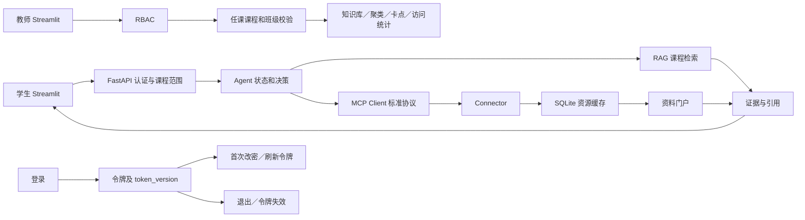
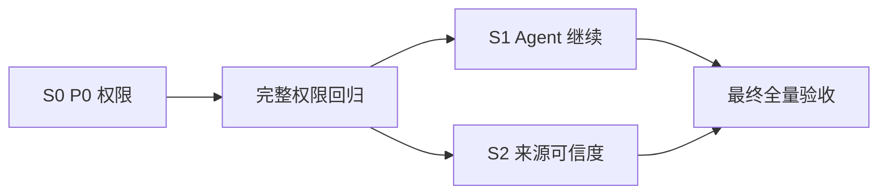
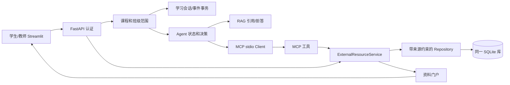
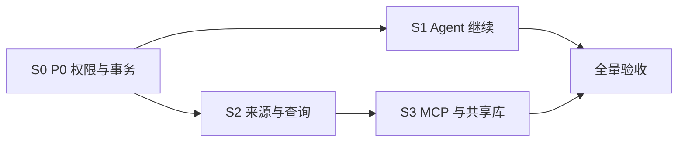

# 课程智能体项目修复实施设计书 2

> 本文整理了两组“问题与回复”：初版修复实施设计，以及对该设计进行反向技术评审后的最终修订版。
>
> 后续开发应以第二部分的修订版 `S0-S3` 为直接执行依据；第一部分保留用于追踪设计演变、被修正的问题和原始决策。

## 目录

1. [第一部分：初版修复实施设计](#第一部分初版修复实施设计)
2. [第二部分：反向评审与最终修订](#第二部分反向评审与最终修订)
3. [使用原则](#使用原则)

---

# 第一部分：初版修复实施设计

## 问题一：生成可直接执行的最终修复实施设计书

```text
基于你刚才输出的最终零信任验收报告，请把“剩余问题与最小修复建议”扩展成一份可以直接执行的《最终修复实施设计书》。

项目根目录：
C:\Users\Asd\Desktop\edu agent
请先阅读以下文件：
1. 原始课程要求：
   C:\Users\Asd\Desktop\edu agent\md\题目最终要求.md
2. 总体开发参考：
   C:\Users\Asd\Desktop\edu agent\md\course_agent_development_reference.md
3. 前期审计与剩余问题：
   C:\Users\Asd\Desktop\edu agent\md\项目审计内容.md  C:\Users\Asd\Desktop\edu agent\md\项目审计内容-2.md
4. 最终修复实施设计书：
   C:\Users\Asd\Desktop\edu agent\md\修复实施设计书.md
   本轮只进行修复设计和代码定位，不修改代码、不修改数据库、不安装依赖、不降低测试断言。
   
   一、先重新确认剩余问题
   1. 只处理刚才最终验收中仍然存在的问题，不重复开发已经通过验收的功能。
   2. 重新读取当前代码，确认每个问题在最新版本中确实存在。
   3. 不得直接沿用历史文件行号；必须根据当前代码重新给出文件路径、类名、函数名和准确行号。
   4. 如果某个问题实际已经解决，提供代码和测试证据，并将它从修复计划中移除。
   5. 区分代码缺陷、配置缺失、演示数据不足、网络限制和第三方服务故障。
   
   二、设计原则
   1. 保持现有技术栈：
      FastAPI + Streamlit + SQLite + Chroma + DeepSeek + MCP。
   2. 优先复用现有模块、权限依赖、数据库访问层、Connector、Agent状态和测试工具。
   3. 不进行与验收无关的大规模重构。
   4. 不引入React、PostgreSQL、Redis、Celery等新基础设施，除非能够证明现有架构无法满足原始要求。
   5. 所有修改必须考虑现有数据兼容、旧API兼容、权限隔离、失败回退和可回滚性。
   6. 不得输出.env中的API Key、JWT Secret或密码。
   
   三、先输出总体修复架构
   请说明：
   1. 当前相关模块之间的调用关系。
   2. 剩余问题分别位于前端、API、业务服务、Agent、MCP、RAG、Connector、数据库还是权限层。
   3. 修改后的目标调用链。
   4. 哪些模块保持不动，哪些模块需要修改。
   5. 用Mermaid或文本图表示：
      - 学生请求→Agent→RAG/MCP/Connector→引用回答；
      - 教师操作→RBAC→课程范围→知识库/聚类/卡点；
      - 外部检索→Connector→缓存→资料门户→Agent；
      - 登录、改密、退出和令牌失效链路。
   
   四、生成剩余问题矩阵
   每个问题必须包含：
   - 问题编号和P0/P1/P2优先级；
   - 对应原始课程要求；
   - 当前复现方式；
   - 实际结果和期望结果；
   - 根因；
   - 涉及模块；
   - 需要修改的文件、类、函数和行号；
   - 是否涉及数据库迁移；
   - 是否涉及API契约变化；
   - 是否涉及前端变化；
   - 是否依赖外部网络或API Key；
   - 修复完成判据。
   
   五、为每个问题编写详细实施方案
   每个修复批次必须按以下模板展开：
   
   ### 批次编号和名称
   
   1. 修复目标
      说明本批具体解决什么问题，不解决什么问题。
   
   2. 根因分析
      从入口、权限、业务逻辑、数据库查询、Agent决策或页面调用一直追踪到根因，不能只描述表面现象。
   
   3. 技术方案
      说明采用什么架构和实现方法，以及为什么适合当前项目。
      明确是否使用现有依赖、服务层、Repository、RBAC依赖、Connector Registry、MCP Client、Chroma过滤器或SQLite事务。
   
   4. 后端修改
      列出具体文件、类、函数和行号。
      说明每处代码需要增加、删除或调整的逻辑。
      给出关键函数签名、数据流和伪代码，但本轮不要真正修改。
   
   5. API修改
      列出HTTP方法、路径、认证角色、请求字段、响应字段、状态码和错误行为。
      明确是否保持向后兼容。
   
   6. 数据库修改
      列出表、字段、索引、唯一约束、外键和查询范围。
      如果需要迁移，给出迁移、数据回填、幂等检查、备份和回滚步骤。
      如果不需要迁移，也要明确说明原因。
   
   7. Agent、MCP、RAG或Connector修改
      根据问题说明工具注册、协议调用、课程范围、缓存、引用、拒答、超时、重试和降级如何调整。
      明确真实网络结果、本地缓存和fake测试数据如何区分。
   
   8. 前端修改
      列出Streamlit页面和api_client方法。
      说明按钮、筛选条件、权限状态、错误提示和成功状态如何变化。
      不允许仅靠隐藏按钮代替后端权限控制。
   
   9. 配置修改
      列出需要新增或调整的.env.example变量及默认值。
      不写入真实密钥。
   
   10. 测试设计
       分别列出：
       - 单元测试；
       - API集成测试；
       - 权限和跨课程测试；
       - MCP协议测试；
       - RAG/Connector测试；
       - 浏览器端到端测试；
       - 可选live测试。
       每个测试写清输入、操作、预期状态码和关键断言。
   
   11. 实际验收步骤
       给出修复完成后需要执行的PowerShell命令、启动命令、HTTP请求和浏览器操作。
       写明预期结果，不要只写“测试通过”。
   
   12. 风险与回滚
       说明可能影响的已有功能、数据和兼容性。
       给出可执行的回滚方案。
   
   13. Definition of Done
       使用可检查的完成条件，禁止使用“基本完成”“应该可用”等模糊表述。
   
   六、安排实施顺序
   1. 按依赖关系重新划分修复批次，不必机械沿用旧B1-B9编号。
   2. P0必须最先处理。
   3. 每个批次应能够独立修改、测试、验收和回滚。
   4. 给出批次依赖图和建议提交顺序。
   5. 标出可以并行的批次和必须串行的批次。
   6. 给出每个批次建议的Git提交说明。
   
   七、设计最终验收门槛
   明确：
   1. 哪些问题不修复就绝对不能答辩。
   2. 哪些外部服务必须完成真实live验证。
   3. 哪些场景允许使用缓存或离线降级。
   4. 哪些skipped测试会阻止最终通过。
   5. P0、P1和P2分别达到什么条件才能关闭。
   6. 最终必须重新执行哪些测试和浏览器流程。
   
   八、输出要求
   最终按以下顺序输出：
   A. 最新剩余问题确认结果；
   B. 总体修复架构；
   C. 问题矩阵；
   D. 详细修复批次；
   E. 数据库和API变化汇总；
   F. 测试与验收矩阵；
   G. 实施顺序和依赖关系；
   H. 风险、备份和回滚计划；
   I. 最终通过标准；
   J. 可直接交给Codex逐批执行的命令模板。
   
   本轮不要修改任何代码。所有文件、函数和行号必须来自当前项目实际代码，不能凭空假设。
```

## 回复一：《最终修复实施设计书》

**范围说明：**本轮重新读取了当前源码并核对上一轮零信任验收的失败链路；没有修改代码、测试、配置或数据库，也没有安装依赖。本轮未重跑完整验收，因此下文的 HTTP 结果属于上一轮实测证据，当前代码行号则已重新定位。项目目录执行 `git status --short` 返回 **“not a Git repository”**；文中的提交说明是将来纳入 Git 管理时的建议，当前不能直接执行提交。

### A. 最新剩余问题确认结果

原始需求基线来自[题目最终要求.md](<C:/Users/Asd/Desktop/edu agent/md/题目最终要求.md:3>)：

| 编号 | 原始要求 |
|---|---|
| R1 | MCP 教学智能体统一上下文、调用外部工具并对接资料接口，第 3–11 行 |
| R2 | 领域知识库整理、结构化存储、检索和证据支持，第 13–25 行 |
| R3 | 教师访问监控、轨迹、问题聚类、卡点分析、FAQ，第 27–51 行 |
| R4 | 学生使用说明、课程简介和资料入口，第 53–75 行 |
| R5 | 实践指导、论文／标准／漏洞检索、摘要分类，第 77–99 行 |
| R6 | 论文／开源项目／竞赛案例推荐及创新提问，第 101–113 行 |

开发参考、两份历史审计和现有设计书仅用于寻找检查点，不作为“已完成”的证据。

| 结论 | 最新确认 |
|---|---|
| **S0，P0：教师学习活动权限** | **仍存在代码缺陷。**[ActivityService.teacher_activity](<C:/Users/Asd/Desktop/edu agent/backend/analytics/activity.py:14>) 对无任课班级教师传空 `class_ids`，没有拒绝；[LearningEventService._resolve_context](<C:/Users/Asd/Desktop/edu agent/backend/analytics/events.py:138>) 在教师无班级时回退到全体班级。上一轮真实 HTTP：无任课教师 `GET /api/teacher/activity` 为 **200**，向外班创建学习会话 `POST /api/learning/sessions` 为 **200**，且临时验收库产生记录；期望 403 且零写入。 |
| **S1，P1：离线 Agent 继续执行** | **仍存在代码缺陷。**[continue_run](<C:/Users/Asd/Desktop/edu agent/backend/agent/orchestrator.py:143>) 保留原目标中的“需要补充”；[TemplateProvider.decide_next_action](<C:/Users/Asd/Desktop/edu agent/backend/llm/template_provider.py:51>) 只按摘要中该字串再次选择 `ask_user`。上一轮 HTTP 同一 `run_id` 的步骤为 `ask_user, ask_user`，仍为 `REQUIRES_INPUT`。现有[恢复测试](<C:/Users/Asd/Desktop/edu agent/tests/test_agent_resume.py:10>)使用模拟决策序列，未覆盖该真实模板路径。 |
| **S2，P1：外部资料来源可信度** | **仍存在代码缺陷。**标准 Connector 明确为本地元数据，`supports_remote=False`，见[StandardSourceConnector](<C:/Users/Asd/Desktop/edu agent/backend/connectors/standard_source.py:52>)；[ExternalResourceService._delivery_mode](<C:/Users/Asd/Desktop/edu agent/backend/resources/service.py:324>) 却将任意成功结果标为 `live`。上一轮 HTTP 的标准查询确实返回 `delivery_mode=live`。此外[正式默认 Registry](<C:/Users/Asd/Desktop/edu agent/backend/connectors/registry.py:88>)含 `FakeConnector`，[教师同步 API](<C:/Users/Asd/Desktop/edu agent/backend/main.py:1462>)未拒绝它；学生搜索接口已有 fake 拒绝检查，见第 1497–1504 行。两处合并为一个来源治理批次。 |
| 已通过或环境限制 | 当前不安排重做 MCP 协议、RAG 索引、聚类持久化、课程资料门户等已经验证的实现。上一轮完整 pytest 为 **270 passed、0 failed、2 skipped、0 xfail、22 warnings**；真实 arXiv、NVD 和 MCP 协议有独立运行证据。DeepSeek 曾验证直接 Provider 调用，但**完整浏览器至 DeepSeek 的链路仍是最终复验门槛**，目前不是已证实的代码缺陷。网络失败、Key 缺失或演示数据不足也不自动列为代码修复。 |

上述三项之外，若实施时发现新的失败，应保留失败证据并另立问题；不得将未复现的 F0–F2 历史事项重新开发。

### B. 总体修复架构

当前主调用关系：Streamlit 经 FastAPI 的认证依赖进入学习事件、Agent 或资料服务；Agent 的[运行循环](<C:/Users/Asd/Desktop/edu agent/backend/agent/orchestrator.py:55>)选择 RAG 检索或[MCP 工具调用](<C:/Users/Asd/Desktop/edu agent/backend/agent/orchestrator.py:553>)；外部资料通过 Connector Registry、统一缓存和资料门户展示。教师统计另走 `ActivityService`。这次只修三处决策／权限边界及其前端状态呈现，不改变技术栈。



- **S0 修改**：[活动服务](<C:/Users/Asd/Desktop/edu agent/backend/analytics/activity.py:10>)、[学习事件服务](<C:/Users/Asd/Desktop/edu agent/backend/analytics/events.py:36>)和[Streamlit 登录处理](<C:/Users/Asd/Desktop/edu agent/frontend/app.py:61>)；复用现有[认证依赖](<C:/Users/Asd/Desktop/edu agent/backend/auth/dependencies.py:13>)与 `LearningLogger.classes_for_teacher/classes_for_user`。后端权限是决定性边界，页面提示只是配套。
- **S1 修改**：[AgentPlanner.decide](<C:/Users/Asd/Desktop/edu agent/backend/agent/planner.py:14>)、模板 Provider 的决策及必要的继续状态清理。保持 DeepSeek Provider、MCP Client、RAG 与 run JSON 结构不变。
- **S2 修改**：[资源服务](<C:/Users/Asd/Desktop/edu agent/backend/resources/service.py:26>)、[默认 Registry](<C:/Users/Asd/Desktop/edu agent/backend/connectors/registry.py:88>)、教师同步入口、[资料门户](<C:/Users/Asd/Desktop/edu agent/backend/resources/portal.py:115>)及[学生展示适配](<C:/Users/Asd/Desktop/edu agent/frontend/pages/student.py:437>)。继续使用现有 SQLite 缓存、超时重试和 Chroma 索引；不增加基础设施。

### C. 剩余问题矩阵

| 问题／优先级／需求 | 复现、实际与期望 | 根因及当前定位 | 迁移／API／前端／网络 | 完成判据 |
|---|---|---|---|---|
| S0／P0／R3 | 两课程、两班级、两教师、一名无任课教师：无任课教师读活动统计及指定外班创建会话；实际 200／200，期望 403／403、无新记录 | [ActivityService.teacher_activity 第 22–31 行](<C:/Users/Asd/Desktop/edu agent/backend/analytics/activity.py:22>)只拦显式异班，空范围未拒绝；[LearningEventService._resolve_context 第 145–167 行](<C:/Users/Asd/Desktop/edu agent/backend/analytics/events.py:145>)的 `or self.storage.classes()` 与默认班级回退扩大权限；[record_event 第 97–107 行](<C:/Users/Asd/Desktop/edu agent/backend/analytics/events.py:97>)允许请求上下文覆盖已有会话 | 无迁移；成功响应结构不变，非法请求改 403；登录页面需明确提示无课程；无需外网或 Key | 教师仅可读写所负责课程／班级；管理员正常；跨用户、跨课程与无归属账号均拒绝且数据库零新增 |
| S1／P1／R1、R5 | 模板模式发“需要补充…”→补充信息→同一 run 继续；实际再次 `ask_user`，期望进入检索并 `ANSWERED` 或有证据不足原因的 `ABSTAINED` | [状态恢复第 173–183 行](<C:/Users/Asd/Desktop/edu agent/backend/agent/orchestrator.py:173>)追加原目标；[Planner 第 14–19 行](<C:/Users/Asd/Desktop/edu agent/backend/agent/planner.py:14>)只传文本摘要；[TemplateProvider 第 63–68 行](<C:/Users/Asd/Desktop/edu agent/backend/llm/template_provider.py:63>)按关键字决定追问 | 无迁移；run/continue API 不变；现有继续表单不变；无需网络或 DeepSeek Key | 同一 `run_id` 的第二步不再 `ask_user`，补充内容进入检索，引用或拒答正确，权限及步数限制不退化 |
| S2／P1／R1、R4–R6 | 查标准元数据：实际标 `live`，期望标本地目录；教师同步 `fake` 目前可进入正式缓存，期望拒绝 | [标准目录第 52–61 行](<C:/Users/Asd/Desktop/edu agent/backend/connectors/standard_source.py:52>)是本地；[delivery_mode 第 324–333 行](<C:/Users/Asd/Desktop/edu agent/backend/resources/service.py:324>)把成功等同联网；[默认 Registry 第 88–97 行](<C:/Users/Asd/Desktop/edu agent/backend/connectors/registry.py:88>)注册 fake；[教师同步第 1462–1470 行](<C:/Users/Asd/Desktop/edu agent/backend/main.py:1462>)未限制；[学生适配第 437–471 行](<C:/Users/Asd/Desktop/edu agent/frontend/pages/student.py:437>)又按 `cache_hit` 猜来源 | 无迁移；搜索响应增加来源字段、`delivery_mode` 精确定义，fake 同步改 400；页面改来源标签；真实论文／NVD／GitHub live 验收依赖网络，各服务 Key 依其配置 | 本地目录、实时联网、新鲜／过期缓存、失败、fake 在 API 和页面可区分；正式 API 无法写入 fake |

### D. 详细修复批次

#### S0｜P0 教师任课范围与学习事件写入

1. **目标。**关闭无任课教师读取统计、写入任意班级，以及请求中的课程／班级与既有会话不一致的路径。保留管理员跨课程管理能力；不改聚类、FAQ 已通过的实现。
2. **根因。**`GET /api/teacher/activity` 已经过角色认证，但服务在空任课集合时继续查询，见[活动服务](<C:/Users/Asd/Desktop/edu agent/backend/analytics/activity.py:21>)及[API 的 403 映射](<C:/Users/Asd/Desktop/edu agent/backend/main.py:510>)。`POST /api/learning/sessions` 也已认证，但 `_resolve_context` 把无任课教师映射到所有班级；`record_event` 又接受请求携带的课程／班级覆盖会话上下文，见[学习事件服务](<C:/Users/Asd/Desktop/edu agent/backend/analytics/events.py:80>)。
3. **技术方案。**服务层统一“先求授权班级，再选课程／班级，再写入”；教师集合只取 `classes_for_teacher`，学生只取 `classes_for_user`，管理员可取所有有效班级。空集合立即拒绝。显式 `course_id` 与 `class_id` 必须指向同一授权班级；已有 session 的事件以 session 的课程／班级为准，显式不一致则拒绝。复用 `LearningLogger` 和现有 FastAPI RBAC；写入前完成校验，维持 SQLite 原有事务边界。
4. **后端修改。**
   - 调整 `ActivityService.teacher_activity`，[第 14–31 行](<C:/Users/Asd/Desktop/edu agent/backend/analytics/activity.py:14>)：对教师的 `class_ids=[]`、不属于其课程的 `course_id`、课程和班级不匹配均抛 `PermissionError`；管理员仍查询有效范围。
   - 调整 `LearningEventService._resolve_context`，[第 138–168 行](<C:/Users/Asd/Desktop/edu agent/backend/analytics/events.py:138>)：删除教师的全体班级回退和认证用户的 demo 默认回退；校验所选 `class.course_id == course_id`。
   - 调整 `record_event`，[第 97–107 行](<C:/Users/Asd/Desktop/edu agent/backend/analytics/events.py:97>)：拒绝请求上下文与 session 不一致。伪代码：`session = require_owner(); authorized = classes_for_role(user); require session.class in authorized; require requested_context matches session; write_event(session.context)`。
   - 若心跳允许撤销任课后继续刷活跃度，再在[heartbeat 第 69–74 行](<C:/Users/Asd/Desktop/edu agent/backend/analytics/events.py:69>)复用相同授权校验；保留撤权用户关闭旧会话的能力。
5. **API。**`GET /api/teacher/activity?course_id=&class_id=`：教师／管理员，合法为 200，非法为 403 `detail.error_code=FORBIDDEN`。`POST /api/learning/sessions` 的 `client_session_id,course_id,class_id` 见[请求模型](<C:/Users/Asd/Desktop/edu agent/backend/schemas.py:234>)；合法仍为 200 原 `LearningSessionResponse`，非法为 403。`POST /api/learning/events` 的字段见[请求模型](<C:/Users/Asd/Desktop/edu agent/backend/schemas.py:252>)；冲突上下文为 403。现有成功契约保持兼容。
6. **数据库。**不迁移、不回填、不删除历史数据。现有 `users/courses/classes/class_members` 和 `learning_sessions/learning_events` 表在[迁移定义第 3107–3161、3292–3348 行](<C:/Users/Asd/Desktop/edu agent/backend/storage/logger.py:3107>)，足以表达授权与记录。发布前用只读查询计算“当前无任课关系却写入的会话”数量并人工核对；历史任课关系若变更，不能仅凭当前成员关系自动删除历史记录。备份后部署；回滚恢复代码即可。
7. **Agent／MCP／RAG／Connector。**本批不改变协议或检索；学习事件上报失败不能让未经授权的记录落库，也不能通过页面隐藏按钮替代后端检查。
8. **前端。**[登录处理第 91–105 行](<C:/Users/Asd/Desktop/edu agent/frontend/app.py:91>)先调用 `create_learning_session` 才保存令牌；改为认证成功即保存登录状态，若会话因无课程而 403，则展示“尚未分配课程／班级”，不生成虚假会话。首次改密的[第 125–139 行](<C:/Users/Asd/Desktop/edu agent/frontend/app.py:125>)应先保存刷新令牌，再尝试创建会话，避免改密成功而页面持旧令牌。[APIClientError 与 `_request`](<C:/Users/Asd/Desktop/edu agent/frontend/api_client.py:14>)可最小增加结构化状态码／错误码，避免靠解析中文错误文本；教师页面仍由 API 控制权限。
9. **配置。**无需新增 `.env.example` 变量；不修改生产密钥。演示账号是否自动创建由现有配置控制，本批不得借此赋予无归属账号任课关系。
10. **测试。**单元：空班级、异课程、课程班级不匹配均抛权限错误。API：两课程／两班级／两教师／两学生／无任课账号，分别测 `GET activity` 与 `POST sessions/events` 的 200/403，断言非法写入前后行数不变；管理员合法请求 200。跨用户会话 ID 403/404 按现有约定。MCP／RAG／Connector：本批跑既有回归，要求无变化。浏览器：无归属教师可以登录但看到无任课提示，不能查看他人活动；任课教师正常。可选 live：无外部依赖。
11. **实际验收。**在隔离测试库启动 API 后，带无任课教师 Bearer 令牌发 `GET /api/teacher/activity`、`POST /api/learning/sessions` 指定另一教师的 `course_id/class_id`，两者均 403；只读 SQL 验证 `learning_sessions` 与 `learning_events` 数量不增加。任课教师本班 200、外班 403；管理员合法跨班 200。
12. **风险与回滚。**原本依赖“无课程也记录登录活动”的演示账号会收到 403，所以同步调整页面提示和演示账号的课程分配；不放宽权限。发布前复制 SQLite 数据库及 WAL/SHM 一致性快照，停写或用 SQLite backup API；失败时停止服务、恢复本批代码快照，若测试只在隔离库运行则不回滚生产数据。
13. **DoD。**上述权限矩阵全绿；无任课及跨班请求都是 403 且零写入；管理员与本班教师原功能仍 200；浏览器登录／改密／退出没有旧令牌残留。

#### S1｜P1 模板模式 Agent `ask_user → continue`

1. **目标。**补充信息后在同一 run 继续检索或作出有依据的拒答；不重写 DeepSeek、MCP 或 RAG。
2. **根因。**恢复代码把补充内容追加到原目标，[第 173–183 行](<C:/Users/Asd/Desktop/edu agent/backend/agent/orchestrator.py:173>)；[模板 Provider](<C:/Users/Asd/Desktop/edu agent/backend/llm/template_provider.py:63>)只看到含“需要补充”的整段摘要，不知道追问已回答。
3. **技术方案。**让模板决策优先读取结构化 `AgentState`：若最近一次动作是 `ask_user`、状态已恢复为 `RUNNING`、`pending_question` 已清空，且其后有新用户消息，则选择 `retrieve`，检索词由原研究目标与最新补充组成；有证据时按现有回答逻辑处理。一般 Provider 仍用原 `decide_next_action(summary, tools)` 接口。保持[AgentState 字段](<C:/Users/Asd/Desktop/edu agent/backend/agent/state.py:25>)与旧 run JSON 兼容。
4. **后端修改。**在[AgentPlanner.decide 第 14–19 行](<C:/Users/Asd/Desktop/edu agent/backend/agent/planner.py:14>)仅对 `TemplateProvider` 调用新增的状态感知辅助方法，例如 `decide_from_state(state, tools) -> ActionDecision`；其他 Provider 原调用不动。辅助方法检查 `observations`、`messages`、`pending_question`，而非删除原目标的文字。在[Orchestrator._load_or_create_state](<C:/Users/Asd/Desktop/edu agent/backend/agent/orchestrator.py:163>)恢复时按需清除旧的 `stop_reason`，但保留 run_id、课程范围和历史步骤。伪代码：`if resumed_after_ask(state): return RETRIEVE(query=original_goal + latest_user_input); return existing_template_decision(...)`。
5. **API。**`POST /api/chat` 使用[ChatRequest](<C:/Users/Asd/Desktop/edu agent/backend/schemas.py:25>)；`GET /api/agent/runs/{run_id}` 和 `POST /api/agent/runs/{run_id}/continue` 见[API 第 610–675 行](<C:/Users/Asd/Desktop/edu agent/backend/main.py:610>)。认证、`user_input`、返回 `run_id/status/steps/citations` 不改。非 run 拥有者继续维持拒绝；不可继续的 run 维持 400 `RUN_CANNOT_CONTINUE`。
6. **数据库。**不迁移。现有 `agent_runs`、`agent_steps` 见[第 2980、3004 行](<C:/Users/Asd/Desktop/edu agent/backend/storage/logger.py:2980>)；仅更新既有 state JSON 与步骤。旧 run 可照原格式恢复。回滚旧代码即可读取新旧相同字段。
7. **Agent／MCP／RAG／Connector。**补充后的 `RETRIEVE` 调现有[HybridRetriever 路径](<C:/Users/Asd/Desktop/edu agent/backend/agent/orchestrator.py:460>)，继续保留课程过滤、引用、低相关拒答、超时和步数限制；MCP 工具注册及标准协议不变。模型失败时模板降级必须明确标注 fallback，不能冒充 DeepSeek 成功。
8. **前端。**现有[学生继续表单](<C:/Users/Asd/Desktop/edu agent/frontend/pages/student.py:172>)和[api_client.continue_agent_run](<C:/Users/Asd/Desktop/edu agent/frontend/api_client.py:217>)足够；除非浏览器复验发现展示错误，不改页面。
9. **配置。**不新增变量；保留现有 `AGENT_MAX_STEPS`、`AGENT_ALLOW_ASK_USER`。不能提高步数来掩盖重复追问。
10. **测试。**单元用真实 `TemplateProvider`，输入含“需要补充”的问题，先断言 `ask_user`，继续后断言第二动作不是 `ask_user`。API 集成使用临时库、模板模式走真实 HTTP：首请求 200 且 `REQUIRES_INPUT`，继续 200、同一 run_id，最终 `ANSWERED` 且有引用，或 `ABSTAINED` 且理由为证据不足。权限测试另一学生 GET/continue 必须 403。MCP 协议测试跑既有标准握手／工具调用回归；RAG 测有资料与无资料两支；Connector 无改动但跑回归；浏览器实际提交补充并查看轨迹。可选 DeepSeek live 用单独标记，不以模拟序列代替。
11. **实际验收。**以模板模式启动 API，学生 Bearer 令牌 `POST /api/chat` 提问“需要补充实验目标……”，保存返回 `run_id`；随后 `POST /api/agent/runs/{run_id}/continue`，请求 `{"user_input":"目标是分析5G NAS鉴权流程，使用课程资料"}`。预期 HTTP 200、同一 run_id，`GET` 轨迹不含第二次 `ask_user`，结果为有引用回答或明确拒答。另一学生同一 URL 返回 403。
12. **风险与回滚。**模板模式可能对含“需要补充”但补充仍不足的请求过早检索；因此仍由 RAG 置信度和拒答兜底，并测空泛补充。无需数据回填；回滚此批代码后旧 run 结构仍可读。
13. **DoD。**真实模板模式 HTTP 与浏览器完整复现通过；同 run 继续、课程范围、步骤上限、他人 run 禁止访问均通过；现有模拟测试保留但不作为唯一证据。

#### S2｜P1 真实来源、缓存与 fake 边界

1. **目标。**准确表示“本地标准目录、实时网络、缓存、失败”，阻止测试用 fake 资料进入正式同步和门户。不实现新的标准全文抓取服务。
2. **根因。**`_delivery_mode` 以 `SUCCESS` 判定联网，与 Connector 的 `supports_remote=False` 不一致；学生适配又以 `cache_hit` 猜来源；生产 Registry 注册 fake，教师同步入口只做角色检查。
3. **技术方案。**保留现有 `ExternalResourceService`、`ExternalResourceRepository`、Connector Registry 与 SQLite 缓存。将“资料原始来源”和“本次交付方式”分开：`origin_kind=remote|local_catalog`；`delivery_mode=live|local_metadata|fresh_cache|stale_cache|cache_miss|failed`。正式默认 Registry 不注册 fake；API 再显式拒绝 `name=fake`，避免自定义注册时绕过。fake 类仍留给显式注入的合同测试。
4. **后端修改。**
   - [ExternalResourceService.search 第 44–109 行](<C:/Users/Asd/Desktop/edu agent/backend/resources/service.py:44>)：缓存命中保留 `fresh_cache/stale_cache`，同时按 `source_name`/Connector 元数据给资源标记原始来源；[ `_delivery_mode` 第 324–333 行](<C:/Users/Asd/Desktop/edu agent/backend/resources/service.py:324>)只有 `supports_remote=True` 且本次确实调用成功才返回 `live`。
   - [默认 Registry 第 88–97 行](<C:/Users/Asd/Desktop/edu agent/backend/connectors/registry.py:88>)移出 `FakeConnector()`；[教师同步接口第 1462–1470 行](<C:/Users/Asd/Desktop/edu agent/backend/main.py:1462>)在调用 service 前对 fake 返回 400 `FAKE_CONNECTOR_FORBIDDEN`。
   - [ResourcePortal._external_resources 第 115–158 行](<C:/Users/Asd/Desktop/edu agent/backend/resources/portal.py:115>)过滤历史 fake 条目，保留原始摘要、官方 URL、抓取时间和 `raw_metadata.official_metadata_only`。不得静默删除数据库记录。
5. **API。**`POST /api/connectors/{name}/sync` 仅教师／管理员；真实 Connector 保持现有响应，`fake` 改 400。`POST /api/resources/search`：`ResourceQuery` 字段见[模型第 11–19 行](<C:/Users/Asd/Desktop/edu agent/backend/connectors/schemas.py:11>)；匿名 `allow_remote=true` 仍 401，显式 fake 仍 400；成功 200 增加可选 `origin_kind`，现有字段不删除。标准目录成功返回 `delivery_mode=local_metadata`，同查询再次命中为 `fresh_cache`，但 `origin_kind` 仍为 `local_catalog`。超时／限流返回 `failed` 或 `stale_cache`，不得返回 `live`。
6. **数据库。**无需迁移：`external_resources`、`connector_sync_runs`、`resource_query_cache` 已分别定义于[第 3355、3381、3603 行](<C:/Users/Asd/Desktop/edu agent/backend/storage/logger.py:3355>)，可保存链接、抓取时间、状态与错误。上线前只读核查 `source_name='fake'` 数量；上一轮正式库为 0。若在目标库发现历史 fake，先备份并隔离展示，人工决定是否另开数据清理批次；本批不删除它们。代码回滚无需数据库逆迁移。
7. **Agent／MCP／RAG／Connector。**MCP Client 和工具协议不改；MCP 与学生搜索仍通过同一资料服务及缓存。真实 arXiv／NVD／GitHub 有来源 URL 才标远程；标准目录官方链接虽真实，内容仍标本地元数据。Chroma 索引不重建。错误、超时、重试沿用[资源服务第 123–268 行](<C:/Users/Asd/Desktop/edu agent/backend/resources/service.py:123>)，失败时有缓存才显示缓存，且同时保留错误码。
8. **前端。**[学生 `_normalize_remote_resource_payload` 第 437–471 行](<C:/Users/Asd/Desktop/edu agent/frontend/pages/student.py:437>)读取服务端 `delivery_mode/origin_kind`，停止用 `cache_hit ? fresh_cache : live` 推断；本地标准显示“本地标准目录／官方链接”，过期缓存显示“旧缓存／网络失败”。[教师同步页面](<C:/Users/Asd/Desktop/edu agent/frontend/pages/teacher.py:365>)显示相同状态、来源 URL 和失败原因；前端本来不显示 fake 按钮，但后端 400 才是安全边界。[api_client 搜索／同步](<C:/Users/Asd/Desktop/edu agent/frontend/api_client.py:428>)继续传递原响应字段，不伪造状态。
9. **配置。**无需新增变量。`.env.example` 的外部超时、ArXiv 与 GitHub 开关保持现状；live 验收可在隔离进程启用相应已有变量，不能把本地缓存当 live 成功，也不输出 Key。
10. **测试。**单元：本地标准首查 `local_metadata/local_catalog`、次查 `fresh_cache/local_catalog`；远端首次实际调用的测试替身计数为 1，次查为 0，失败缓存带错误码。API：匿名远程 401、学生远程 200、教师 fake 同步 400 且缓存数量不变、真实源同步 200。跨课程权限回归不因来源字段变化而失效。MCP 标准协议握手／列表／真实工具调用复验，确认工具结果状态一致。RAG/Connector 检查来源链接和引用，不将 fake 作为远程证据；浏览器分别展示 live、本地、缓存、失败。可选 live 对 arXiv、NVD、GitHub 各作首次真实网络请求，记录链接和时间；无 Key 或网络失败需单列原因。
11. **实际验收。**隔离库中先清空该查询的测试缓存或换唯一查询词；`POST /api/resources/search?connector_name=arxiv` 首次有 `delivery_mode=live`、真实 URL，第二次为 `fresh_cache` 且同步调用数不增加；`standard_source` 首次为 `local_metadata`；教师 `POST /api/connectors/fake/sync` 为 400。浏览器卡片显示相应中文来源和原摘要。
12. **风险与回滚。**旧前端可能只识别 `live/fresh_cache`；保留现有字段，并对未知模式显示“来源未确认”，不误报。既有[测试第 399–431 行](<C:/Users/Asd/Desktop/edu agent/tests/connectors/test_connector_framework.py:399>)把教师 fake 同步 200 当预期，需要保留其角色／同步意图，改用显式注入的真实命名确定性 Fixture，另加 fake 拒绝断言，不能降低原有权限断言。回滚代码快照；缓存记录不删。
13. **DoD。**真实网络、本地标准、fresh/stale 缓存和 fake 在 API、同步日志、门户和浏览器的标签一致；fake 无法经正式入口写入；真实资料的 URL、时间、错误信息可追溯；既有课程资料与引用测试无回归。

### E. 数据库和 API 变化汇总

| 批次 | 数据库 | API 契约 |
|---|---|---|
| S0 | **无迁移**；现有表和索引足够，非法请求写入数必须为 0 | 成功响应不变；无任课、跨班、上下文冲突改为 403 |
| S1 | **无迁移**；沿用 agent run JSON、steps | 路径及字段不变；改变继续执行的正确行为 |
| S2 | **无迁移**；沿用资源、同步日志、查询缓存表 | 搜索响应可追加 `origin_kind` 并精确定义 `delivery_mode`；教师 fake 同步改 400 |

三个批次都不需要迁移、回填、索引或唯一约束变更，因此不存在数据库逆迁移脚本。若实施时发现确实必须改变表结构，应暂停该批，先写独立的幂等迁移及反向迁移，并在数据库副本上验证两次执行和恢复；不得顺手修改正式库。

### F. 测试与验收矩阵

| 层级 | 必跑内容与关键断言 |
|---|---|
| 单元 | S0 空／异班授权抛错；S1 真 `TemplateProvider` 继续后不重复追问；S2 来源／缓存状态映射准确 |
| API 集成 | 两课程、两班、两教师、两学生、无任课账号的 200／403／401 和数据库零非法写入；同 run 继续；fake 同步 400 |
| Agent／RAG | 有课程文档时有正确引用；低相关时 `ABSTAINED`；补充后在同一 run 进入检索；课程过滤不松动 |
| MCP 协议 | 跑[标准 stdio 测试](<C:/Users/Asd/Desktop/edu agent/tests/test_mcp_tools.py:32>)及[客户端测试](<C:/Users/Asd/Desktop/edu agent/tests/test_mcp_client.py:45>)：握手、列表、参数校验、工具调用及错误处理；进程内函数调用不能替代 |
| Connector | 首次外网／二次缓存、标准本地目录、失败旧缓存、fake 禁止；原有[Connector 框架测试](<C:/Users/Asd/Desktop/edu agent/tests/connectors/test_connector_framework.py:142>)和[真实服务测试](<C:/Users/Asd/Desktop/edu agent/tests/connectors/test_real_connectors.py:190>)分别报告 |
| 浏览器 | 学生登录、改密、退出、提问及继续、来源标签；教师登录、任课统计、同步、资料门户；无任课账号看不到他人数据且后端返回 403 |
| 全量回归 | `.venv\Scripts\python.exe -m pytest -q -ra`，分别报告 passed、failed、skipped、xfail、warnings；必需场景的 skipped 不能计为通过 |

建议的 PowerShell 验收命令，均在**隔离测试库**及已有虚拟环境执行：

```powershell
Set-Location 'C:\Users\Asd\Desktop\edu agent'
$env:PYTHONDONTWRITEBYTECODE='1'
$env:PYTEST_DISABLE_PLUGIN_AUTOLOAD='1'
.\.venv\Scripts\python.exe -m pytest -q -ra -p no:cacheprovider
.\.venv\Scripts\python.exe -m pytest tests\test_teacher_phase3.py tests\test_agent_resume.py tests\test_agent_orchestration.py tests\test_mcp_tools.py tests\test_mcp_client.py tests\connectors tests\test_resource_portal.py tests\test_f2_2_persistent_auto_clustering.py -q -ra -p no:cacheprovider
```

真实 HTTP 验收另开两个受控终端，按[README 启动入口](<C:/Users/Asd/Desktop/edu agent/README.md:46>)运行 `.\.venv\Scripts\python.exe -m uvicorn backend.main:app --port 8000` 和 `.\.venv\Scripts\python.exe -m streamlit run frontend/app.py --server.port 8501`。先用 `Invoke-WebRequest http://127.0.0.1:8000/health` 确认健康，再用隔离测试账号的 Bearer 令牌请求上述 API；浏览器完成流程后停止这两个终端进程，确认 8000／8501 不再监听。令牌仅放内存变量，不记录到测试输出或报告。

### G. 实施顺序和依赖关系



先完成并验收 S0。S1 与 S2 **代码上可并行**；若共用同一工作目录和测试库，应顺序实施、分别验收，避免互相覆盖。建议提交说明：

1. `fix(auth): fail closed for teacher activity and learning context`
2. `fix(agent): resume template runs from answered clarification`
3. `fix(resources): preserve provenance and block fake production sync`

目前项目根目录不是 Git 仓库；先以独立代码快照和隔离测试库作为批次边界。只有用户另行建立或提供 Git 仓库后，才使用上述提交说明。

### H. 风险、备份和回滚计划

- **批次前：**记录待改文件校验值；对 SQLite 使用其 backup API 制作一致性副本，记录 schema version、会话总数、`source_name='fake'` 数量。不要复制或展示 `.env` 内容。测试与 live 查询只写隔离库。
- **S0 回滚：**停止服务，恢复 S0 文件快照，重启并重跑旧成功路径；已产生的真实学习记录保留审计，不自动删除。
- **S1 回滚：**恢复 Planner／模板决策文件快照；由于不改变 run JSON 字段，已存 run 可读。
- **S2 回滚：**恢复资源服务／Registry／API／页面文件快照；不删缓存。若出现历史 fake，先隔离展示并单独评估清理，不把删除作为回滚手段。
- **主要回归风险：**无归属演示账号登录体验、管理员正常跨课程能力、Agent 步数耗尽、教师同步现有测试对 fake 的依赖，以及老前端对新来源标签的显示。各批对应测试必须先覆盖这些路径。

### I. 最终通过标准

- **绝对不能进入答辩：**S0 任一无任课或跨课程读取／写入仍成功，或伪造会话上下文仍能落库。P0 必须有真实 HTTP 403、数据库零非法新增和管理员正向证据才关闭。
- **不能判定完全通过：**S1 同一 run 补充后仍重复追问；S2 把本地标准或缓存称为 live，或正式接口仍能注入 fake。P1 必须有 API、轨迹、浏览器和相关回归证据才关闭。
- **P2：**目前没有新确认的 P2 代码问题。若最终复验发现页面文案等 P2，需有复现、修复和浏览器证据才关闭。
- **外部 live：**至少对论文源、NVD 和 GitHub 的课程演示路径完成一次真实网络请求，记录来源 URL、抓取时间、状态和缓存前后差异；标准目录须明确为本地元数据及官方链接。DeepSeek 要在配置了有效 Key 的隔离环境完成完整应用链路验证。网络不可达、Key 缺失、限流与代码失败分别记录；缓存或离线模板可用于受控降级演示，但不得替代 live 成功声明。
- **skipped：**MCP 标准协议、核心权限、Agent 继续、RAG 引用／拒答、缓存来源及课程浏览器流程若 skipped，阻止最终通过。可选第三方 live 因外部限制跳过时，结论只能写“未验证”，不能写该真实集成已通过。
- **最终重跑：**全量 pytest、上述分类测试、两个课程的权限矩阵、真实 MCP、学生与教师浏览器流程、DeepSeek／Connector live、服务关闭检查。F2-2 持久化与重启场景也须作为回归门槛；目前没有证据要求重做其架构。

### J. 可直接交给 Codex 的逐批命令模板

**S0 提示词：**

> 仅实施本设计书 S0。先用当前源码确认 `ActivityService.teacher_activity`、`LearningEventService._resolve_context/record_event` 和 Streamlit 登录路径；使用隔离数据库建立两课程、两班、两教师、两学生及无任课账号。先新增能复现 200 越权与非法写入的测试，再以最小服务层改动使非法请求为 403、零写入，同时保持管理员和本班教师 200。运行定向及完整 pytest、真实 HTTP 和浏览器验证。不要修改聚类、MCP、RAG；不要读取或输出 `.env` 密钥；报告文件行号、状态码、数据库计数和回滚文件清单。

**S1 提示词：**

> 仅实施本设计书 S1。先以真实 `TemplateProvider` 和 HTTP 复现同一 run 的 `ask_user, ask_user`，再让模板决策依据结构化 `AgentState` 识别已回答的追问。保持 DeepSeek Provider、run JSON 和 API 契约兼容，不通过删除用户原文或提高步数掩盖问题。验证有证据回答、低相关拒答、跨用户禁止继续和浏览器补充流程；报告步骤轨迹。

**S2 提示词：**

> 仅实施本设计书 S2。保留现有 Connector、统一缓存和 SQLite；把 `origin_kind` 与 `delivery_mode` 分开，标准目录不得标 live，缓存不得标实时联网。移出正式默认 Registry 中的 fake，并在教师同步 API 明确返回 400；保留显式注入的 fake 合同测试。更新门户与 Streamlit 来源显示，验证论文／NVD／GitHub 真实 URL、首次联网、二次缓存、失败降级；不删除旧缓存，报告来源、时间、状态与错误码。

**每批交付格式：**改动文件和准确行号 → 定向测试统计 → 全量测试统计 → HTTP／浏览器／数据库证据 → 未验证事项 → 回滚步骤。三批均不得将 mock、fake 或已有缓存描述为真实联网结果。

---

# 第二部分：反向评审与最终修订

## 问题二：对初版实施设计进行反向技术评审

```text
请对刚才的《最终修复实施设计书》进行一次反向技术评审。
重点检查：
1. 是否遗漏了原始课程要求或最终验收中的剩余问题；
2. 文件、函数、API和数据库结构是否与当前代码一致；
3. 是否存在只修改前端、不保护后端的权限漏洞；
4. 是否把Mock、缓存或fake数据误当成真实联网能力；
5. 数据库迁移是否可回滚、可重复执行；
6. 各批次之间是否有未声明的依赖；
7. 测试能否真实复现问题并证明修复；
8. 是否引入了不必要的新框架或大规模重构；
9. 是否存在修改后会破坏已通过功能的回归风险。
请修正实施设计书中的问题，并给出最终可执行版本。本轮仍然不要修改代码。
```

## 回复二：《最终修复实施设计书》反向评审修订版

**本轮结论：上一版不能直接照单实施。**我重新核对了当前代码，发现接口路径、响应字段、缓存查询、MCP 返回状态和隔离数据库方案中存在遗漏。以下是修正后的执行版本。本轮只读取代码和文档；**未修改代码、测试、数据库或依赖，未重新运行验收测试**。上一轮的 `270 passed、0 failed、2 skipped、0 xfail、22 warnings` 仍是上一轮结果，不能充当修复后的结果。

### A. 反向评审结果与需求边界

原始要求以[题目最终要求.md](<C:/Users/Asd/Desktop/edu agent/md/题目最终要求.md:3>)为准：

| 编号 | 原始要求 | 本设计中的处理 |
|---|---|---|
| R1 | MCP 智能体、统一上下文、外部工具与接口，第 3–11 行 | S1、S3 修复及最终协议复验 |
| R2 | 知识库、检索、证据，第 13–25 行 | 保留已实现链路，做引用／拒答回归 |
| R3 | 教师监控、轨迹、聚类、卡点、FAQ，第 27–51 行 | S0 修复活动权限；其余做回归 |
| R4 | 使用说明、课程简介、资料入口，第 53–75 行 | S2 来源展示；页面流程回归 |
| R5 | 六步实践指导、资料检索、摘要分类，第 77–99 行 | S1、S2；摘要与分类验收 |
| R6 | 论文、开源项目、**竞赛题目**和创新提问，第 101–113 行 | 上版漏写竞赛题目验收；本版补入最终门槛，不凭此推定要重做功能 |

#### 上一版的具体错误

| 上一版表述或遗漏 | 当前代码证据 | 修正 |
|---|---|---|
| 健康检查写为 `/health` | 实际是[`GET /api/health`](<C:/Users/Asd/Desktop/edu agent/backend/main.py:361>) | 所有命令改用 `/api/health` |
| 把 `POST /api/chat` 的 `status` 当响应字段 | [ChatResponse](<C:/Users/Asd/Desktop/edu agent/backend/schemas.py:36>)字段是 `run_status`；`GET run` 才是 `status` | 测试分别断言正确字段 |
| 认为指定来源搜索必定只取该来源 | [LearningLogger.search_external_resources](<C:/Users/Asd/Desktop/edu agent/backend/storage/logger.py:1414>)在查询缓存未命中时的 SQL **未应用 `source_name`**；映射查询也只筛 `qc.source_name`，未核对 `er.source_name`，见第 1517–1529 行 | 加入 S2，先修 SQL 来源约束，再做联网／缓存证明 |
| 认为 API 与 MCP 使用同一类服务就足以证明共享同一库 | API 用[`LearningLogger()`](<C:/Users/Asd/Desktop/edu agent/backend/main.py:81>)；MCP 子进程也独立创建[`LearningLogger()`](<C:/Users/Asd/Desktop/edu agent/mcp_server/tools.py:317>)。当前[构造函数](<C:/Users/Asd/Desktop/edu agent/backend/storage/logger.py:13>)固定相对默认路径；`.env.example` 的 `SQLITE_DB_PATH` 第 6 行并未被使用 | S3 让现有变量生效，并用两个真实进程、同一绝对临时库证明共享 |
| 认为 MCP 直接透传缓存状态 | [MCP `_run_connector_search`](<C:/Users/Asd/Desktop/edu agent/mcp_server/tools.py:317>)额外执行一次过期缓存查询并用 `resources or cached` 返回；[包装器](<C:/Users/Asd/Desktop/edu agent/mcp_server/tools.py:216>)对带 `status=FAILED` 的字典也给 `ToolResult.success=True` | S3 删除二次猜测，透传交付方式，失败无资源时返回失败 |
| 仅从正式 Registry 移除 fake 即可杜绝旧 fake | [默认 Registry](<C:/Users/Asd/Desktop/edu agent/backend/connectors/registry.py:88>)现含 fake；既有缓存和门户查询仍可能读取历史 fake | S2 在**正式入口与读取边界**双重限制；不删除历史数据 |
| 无授权写入“零记录”只靠服务校验 | [create_session](<C:/Users/Asd/Desktop/edu agent/backend/analytics/events.py:40>)先写会话，再调用 `record_event`；底层两次独立连接，见[会话写入](<C:/Users/Asd/Desktop/edu agent/backend/storage/logger.py:1120>)和[事件写入](<C:/Users/Asd/Desktop/edu agent/backend/storage/logger.py:1192>) | S0 在写前验证，并使“会话＋LOGIN”同一 SQLite 事务提交；检查重试幂等性 |
| 用 `cache_hit=false` 证明首次联网 | [资源服务](<C:/Users/Asd/Desktop/edu agent/backend/resources/service.py:44>)先查缓存；底层无映射时又模糊搜资源 | 必须同时证明 Connector 调用次数或真实网络请求及来源 URL |

历史[开发参考](<C:/Users/Asd/Desktop/edu agent/md/course_agent_development_reference.md:7>)、[审计记录](<C:/Users/Asd/Desktop/edu agent/md/项目审计内容-2.md:1>)与[旧设计书](<C:/Users/Asd/Desktop/edu agent/md/修复实施设计书.md:1>)仅作检查线索。当前 `git status --short` 仍返回 **not a Git repository**，提交标题只是将来有仓库时使用的建议。

### B. 修订后的架构和批次



- **S0／P0：**服务层权限和学习会话事务。沿用现有 RBAC、`classes_for_teacher`、`classes_for_user`；页面只负责呈现拒绝原因。
- **S1／P1：**模板模式 Agent 恢复。沿用现有 run 状态、RAG、MCP；DeepSeek 决策接口不变。
- **S2／P1：**来源查询、fake 边界、标准目录与缓存来源标识。先修 Repository，再修服务和门户。
- **S3／P1：**MCP 子进程与 API 同库、MCP 工具状态透传。依赖 S2 的规范化来源结果。

RAG 的文档解析、Chroma 检索、教师聚类、自动聚类持久任务、上传限制及竞赛资料实现暂不改动；必须做回归验证，失败再立独立问题。没有依据引入 React、Redis、Celery 或新数据库。

### C. 最新问题矩阵

| 批次／要求 | 当前复现与根因 | 涉及文件、函数和当前行号 | DB／API／前端／外网 | 完成判据 |
|---|---|---|---|---|
| **S0 P0，R3** | 上轮真实 HTTP 中，无任课教师活动统计 200、向外班创建会话 200；期望 403 且零写入。活动服务未拒绝空任课集合；学习事件服务回退全体班级，事件请求还能覆盖会话范围 | [`ActivityService.teacher_activity` 14–31](<C:/Users/Asd/Desktop/edu agent/backend/analytics/activity.py:14>)；[`LearningEventService.create_session/record_event/_resolve_context` 40–168](<C:/Users/Asd/Desktop/edu agent/backend/analytics/events.py:40>)；[`LearningLogger.create_learning_session/log_learning_event` 1120–1238](<C:/Users/Asd/Desktop/edu agent/backend/storage/logger.py:1120>) | 无 schema 迁移；非法请求改 403；登录提示需调整；无需外网 | 两课程两班及无授权账号矩阵通过，非法请求前后会话和事件计数均不变 |
| **S1 P1，R1/R5** | 上轮真实 HTTP：同一 run 补充后步骤为 `ask_user, ask_user`。模板规划器按“需要补充”字串判断，未识别已回答追问 | [`AgentPlanner.decide` 14–19](<C:/Users/Asd/Desktop/edu agent/backend/agent/planner.py:14>)；[`TemplateProvider.decide_next_action` 51–79](<C:/Users/Asd/Desktop/edu agent/backend/llm/template_provider.py:51>)；[`AgentOrchestrator._load_or_create_state` 163–184](<C:/Users/Asd/Desktop/edu agent/backend/agent/orchestrator.py:163>) | 无迁移、API 契约不变；现有继续页面可复用；无需 Key | HTTP `run_status` 从 `REQUIRES_INPUT` 经补充转 `ANSWERED` 或有明确理由的 `ABSTAINED`；同一 run 不再重复 ask |
| **S2 P1，R1/R4–R6** | 标准目录被标 live；指定来源查询可能读另一来源的记录；正式教师同步可写 fake | [`LearningLogger.search_external_resources/_search_resource_query_cache` 1414–1542](<C:/Users/Asd/Desktop/edu agent/backend/storage/logger.py:1414>)；[`ExternalResourceService.search/_delivery_mode` 44–109、324–333](<C:/Users/Asd/Desktop/edu agent/backend/resources/service.py:44>)；[`get_default_registry` 88–97](<C:/Users/Asd/Desktop/edu agent/backend/connectors/registry.py:88>)；[`sync_connector` 1462–1470](<C:/Users/Asd/Desktop/edu agent/backend/main.py:1462>)；[`ResourcePortalService._external_resources` 115–158](<C:/Users/Asd/Desktop/edu agent/backend/resources/portal.py:115>) | 无迁移；搜索加可选来源字段、fake 同步改 400；学生标签调整；真实 live 验收依赖网络 | 明确来源搜索不串源；标准本地、live、fresh/stale cache 不混淆；fake 无法从正式入口写入或展示 |
| **S3 P1，R1/R5** | MCP 子进程不能用现有 `SQLITE_DB_PATH` 指向隔离库；失败后再次捞缓存；内部 `FAILED` 仍可能被包装为工具成功 | [`LearningLogger.__init__` 13–21](<C:/Users/Asd/Desktop/edu agent/backend/storage/logger.py:13>)；[`MCP `_run_connector_search` 317–342](<C:/Users/Asd/Desktop/edu agent/mcp_server/tools.py:317>)；[`_run_with_timeout` 216–245](<C:/Users/Asd/Desktop/edu agent/mcp_server/tools.py:216>)；[`MCPClientGateway` 249–283](<C:/Users/Asd/Desktop/edu agent/backend/tools/mcp_client.py:249>) | 无 schema 迁移；MCP 结果加状态／来源元数据；无页面必改；真实网络另验 | 两个真实进程同库首查／次查，标准协议握手及调用；失败无资源时 `success=false`，旧缓存有明确降级标记 |

**边界说明：**S2 的 SQL 缺少来源过滤、S3 的状态包装与路径配置是本次反向代码审查新增的**确认缺陷**。MCP 超时后线程可能仍在运行，见[`_run_with_timeout` 225–237](<C:/Users/Asd/Desktop/edu agent/mcp_server/tools.py:225>)；这是需定向复现的回归风险，当前未观察到后台写库，不把它写成已经实测的数据破坏。

### D. 最终可执行批次

#### S0｜P0 任课范围及会话事务

1. **目标：**无任课、跨班、课程与班级不匹配的读写全部拒绝；管理员合法操作保留。
2. **根因：**[活动服务](<C:/Users/Asd/Desktop/edu agent/backend/analytics/activity.py:22>)把空授权范围交给统计查询；[学习事件服务](<C:/Users/Asd/Desktop/edu agent/backend/analytics/events.py:145>)使用 `classes_for_teacher(...) or storage.classes()` 及默认班级；[事件创建](<C:/Users/Asd/Desktop/edu agent/backend/analytics/events.py:97>)未绑定原会话范围。
3. **方案：**先按角色取得真实授权班级；空集合对非管理员直接拒绝；显式课程／班级必须是同一授权组合；事件以会话范围为准。复用现有 RBAC 与 `LearningLogger`，不靠隐藏页面按钮。会话和 LOGIN 事件同一 SQLite 事务。
4. **后端定位与伪代码：**调整 `ActivityService.teacher_activity` 第 14–31 行、`LearningEventService._resolve_context/record_event/create_session` 第 40–168 行，并在 `LearningLogger` 第 1120–1238 行增设**不改表结构**的事务写入方法。`allowed = classes_for_role(user); require selected in allowed; require event_context == session_context; BEGIN; insert_or_reuse_session; insert_login_if_absent; COMMIT`。重试相同 `client_session_id` 不能生成第二个 LOGIN；并发撤权场景在同一写事务中重查授权，避免校验后权限变化。
5. **API：**[`GET /api/teacher/activity`](<C:/Users/Asd/Desktop/edu agent/backend/main.py:510>) 教师／管理员；[`POST /api/learning/sessions`](<C:/Users/Asd/Desktop/edu agent/backend/main.py:442>)与[`POST /api/learning/events`](<C:/Users/Asd/Desktop/edu agent/backend/main.py:486>)需认证。合法仍按现有模型返回 200；无任课、跨班、课程班级冲突及会话上下文冲突为 403，带现有 `detail.error_code/message` 形状。管理员提供无效课程／班级也须明确 400/403，不能靠外键错误变成 500。
6. **数据库：**表、外键和索引已存在于[第 3292–3349 行](<C:/Users/Asd/Desktop/edu agent/backend/storage/logger.py:3292>)；**不迁移、不回填、不删除旧记录**。新增事务逻辑可重复调用，使用既有 `client_session_id UNIQUE` 和 `dedupe_key UNIQUE` 保证幂等。只读核查历史异常记录，不能根据当前任课关系自动判定过去记录非法。
7. **Agent/MCP/RAG/Connector：**本批不改这些模块；学习事件上报失败不得让教学回答绕过课程范围。
8. **前端：**[登录与改密流程](<C:/Users/Asd/Desktop/edu agent/frontend/app.py:91>)应在认证／改密成功后保存有效令牌；会话因无课程而被拒绝时明确提示“未分配课程或班级”，且不制造 session_id。可在[`APIClientError`](<C:/Users/Asd/Desktop/edu agent/frontend/api_client.py:14>)保留 HTTP 状态和错误码。后端检查仍为准。
9. **配置：**无新增变量、无真实密钥。
10. **测试：**单元覆盖空集合、课程／班级冲突、管理员有效与无效组合；真实 HTTP 使用两课程两班两教师两学生及无授权账号，断言 200/403 和拒绝前后两表行数一致；相同 `client_session_id` 重试只产生一次 LOGIN；另一用户会话不可用。现有 MCP、RAG、聚类测试作回归。
11. **验收操作：**隔离库启动 API，请求上述三个端点；逐项记录方法、URL、状态、`error_code`、会话及事件数量。浏览器完成无归属教师登录、任课教师统计及改密／退出。健康检查用**`GET /api/health`**。
12. **风险与回滚：**新增事务若处理重试不当会重复记录或丢 LOGIN，必须有幂等测试。备份数据库一致性副本；停止服务后回退本批代码。已产生的真实历史记录不自动删除。
13. **DoD：**全部非法读写 403、零新增；本班教师及管理员正向路径 200；无课程账号提示准确；同 ID 重试幂等；完整回归无新增失败。

#### S1｜P1 Agent 补充后继续

1. **目标：**修复模板模式重复追问，不改 DeepSeek Provider 决策和现有 MCP／RAG。
2. **根因：**[恢复逻辑](<C:/Users/Asd/Desktop/edu agent/backend/agent/orchestrator.py:173>)保留原目标；[模板决策](<C:/Users/Asd/Desktop/edu agent/backend/llm/template_provider.py:63>)仅检查摘要字串。
3. **方案：**`AgentPlanner` 对模板 Provider 使用结构化状态辅助判断：最近一次是 `ask_user`，恢复后有新用户消息、`pending_question=None`，则检索“原目标＋最新补充”；其他 Provider 维持现有接口。不可通过删掉用户原文或提高 `AGENT_MAX_STEPS` 掩盖问题。
4. **后端：**调整[`AgentPlanner.decide`](<C:/Users/Asd/Desktop/edu agent/backend/agent/planner.py:14>)、[`TemplateProvider.decide_next_action`](<C:/Users/Asd/Desktop/edu agent/backend/llm/template_provider.py:51>)附近的模板专用辅助方法；必要时在[状态恢复](<C:/Users/Asd/Desktop/edu agent/backend/agent/orchestrator.py:163>)清理旧 `stop_reason`，保留 run_id、课程、历史步骤及工具预算。
5. **API：**[`POST /api/chat`](<C:/Users/Asd/Desktop/edu agent/backend/main.py:566>)与[`POST /api/agent/runs/{run_id}/continue`](<C:/Users/Asd/Desktop/edu agent/backend/main.py:643>)不改字段。**ChatResponse 断言 `run_status`**；[`GET run`](<C:/Users/Asd/Desktop/edu agent/backend/main.py:610>)断言 `status/steps`。非拥有者仍拒绝，不可继续的状态仍按现有 400 错误返回。
6. **数据库：**现有[`agent_runs/agent_steps`](<C:/Users/Asd/Desktop/edu agent/backend/storage/logger.py:2980>)足够；无迁移，旧 run JSON 可读。
7. **Agent/MCP/RAG/Connector：**补充后走现有[ `_retrieve`](<C:/Users/Asd/Desktop/edu agent/backend/agent/orchestrator.py:460>)：有证据时带引用，低相关时拒答；保留课程过滤、超时、步数和 MCP 权限。
8. **前端：**现有[学生继续表单](<C:/Users/Asd/Desktop/edu agent/frontend/pages/student.py:172>)及[`api_client.continue_agent_run`](<C:/Users/Asd/Desktop/edu agent/frontend/api_client.py:217>)先复验；只有显示不正确才修改。
9. **配置：**沿用 `LLM_PROVIDER=template` 测离线路径；不增加步数、不写密钥。
10. **测试：**用真实 TemplateProvider 的单元测试及真实 HTTP：首请求 `run_status=REQUIRES_INPUT`、同一 run 继续后不再 `ask_user`，终态为 `ANSWERED` 且引用正确，或 `ABSTAINED` 且证据不足；另一学生 GET/continue 403。现有[模拟恢复测试](<C:/Users/Asd/Desktop/edu agent/tests/test_agent_resume.py:10>)继续保留，但不是唯一证据。
11. **验收操作：**浏览器学生提问、补充、查询 run 轨迹；记录 `run_id`、`run_status`、步骤动作、引用或拒答原因。DeepSeek live 单独验证，不能把模板结果写成 DeepSeek 成功。
12. **风险与回滚：**过于简单的“已有补充”判断可能让空泛补充直接检索；用低相关拒答测试约束。恢复原 Planner／模板文件即可回滚，无数据逆迁移。
13. **DoD：**真实 HTTP 与浏览器同 run 完成或受控拒答；无重复追问；跨用户权限、步数、引用和低相关拒答回归通过。

#### S2｜P1 来源查询、fake 与展示可信度

1. **目标：**指定来源不串源；本地标准、远程结果、新鲜／过期缓存不混称；正式路径不能注入 fake。
2. **根因：**[存储回退 SQL](<C:/Users/Asd/Desktop/edu agent/backend/storage/logger.py:1424>)遗漏 `source_name`；[映射查询](<C:/Users/Asd/Desktop/edu agent/backend/storage/logger.py:1523>)没有核对资源来源；[ `_delivery_mode`](<C:/Users/Asd/Desktop/edu agent/backend/resources/service.py:324>)把所有 SUCCESS 视为 live；[默认 Registry](<C:/Users/Asd/Desktop/edu agent/backend/connectors/registry.py:88>)和[教师同步 API](<C:/Users/Asd/Desktop/edu agent/backend/main.py:1462>)允许 fake。
3. **方案：**先在 Repository/SQLite 查询边界应用来源条件及生产可用源集合，再在服务层按“本次交付方式”和“资源原始来源”分别标记。`delivery_mode=live|local_metadata|fresh_cache|stale_cache|cache_miss|failed`；每条资料 `origin_kind=remote|local_catalog|unknown`。`origin_kind` 是来源类别，**不是本次进行了联网的证明**。只有网络调用轨迹可以证明 live。
4. **后端：**修改 `LearningLogger.search_external_resources/_search_resource_query_cache` 第 1414–1542 行：明确来源时，映射查询同时检查 `qc.source_name` 与 `er.source_name`，模糊回退 SQL 也加来源条件；生产无来源搜索排除 fake，且筛选须发生在分页前。修改[`ExternalResourceService.search`](<C:/Users/Asd/Desktop/edu agent/backend/resources/service.py:44>)的所有分支，包括“无候选 Connector”分支，使状态字段齐全；缓存写入前核对资源的 `source_name` 与执行的 Connector 一致。移出默认 Registry 中的 fake，但保留 `FakeConnector` 类供显式测试注入；教师 fake 同步在调用服务前返回 400。门户[ `_external_resources`](<C:/Users/Asd/Desktop/edu agent/backend/resources/portal.py:115>)排除历史 fake，`resource_exists` 因共用该列表也随之拒绝 fake。
5. **API：**`POST /api/resources/search` 匿名远程仍 401、显式 fake 仍 400；指定来源 200 的每项 `source_name` 必须一致。`POST /api/connectors/fake/sync` 教师也返回 400 `FAKE_CONNECTOR_FORBIDDEN`；正常教师真实源同步保持原状态码。新增来源字段为可选字段，不删除旧字段。
6. **数据库：**现有[`external_resources`](<C:/Users/Asd/Desktop/edu agent/backend/storage/logger.py:3355>)、[`connector_sync_runs`](<C:/Users/Asd/Desktop/edu agent/backend/storage/logger.py:3381>)与[查询缓存映射](<C:/Users/Asd/Desktop/edu agent/backend/storage/logger.py:3603>)已有来源、时间、错误和唯一约束，**无迁移**。不删除旧 fake；上线前只读统计 fake 及其索引数，若目标库确有历史 fake 向量，必须先单独隔离并复验 RAG，不能仅凭门户过滤宣告全部清除。
7. **Agent/MCP/RAG/Connector：**S2 建立服务层可信来源契约，S3 再让 MCP 透传。标准源[`supports_remote=False`](<C:/Users/Asd/Desktop/edu agent/backend/connectors/standard_source.py:52>)，官方链接不等于实时抓取；远程结果必须有真实来源 URL。缓存结果保留原始摘要、抓取时间和错误原因；Chroma 课程过滤不改。
8. **前端：**[学生规范化函数](<C:/Users/Asd/Desktop/edu agent/frontend/pages/student.py:437>)停止用 `cache_hit ? fresh_cache : live` 猜测来源；[学生资料页第 380 行](<C:/Users/Asd/Desktop/edu agent/frontend/pages/student.py:380>)“学生只读展示缓存”文案与按需搜索按钮矛盾，应改成真实行为说明。教师同步页显示来源及失败状态。隐藏 fake 按钮不能替代后端 400。
9. **配置：**沿用现有源开关、超时、缓存 TTL；不新增框架或密钥。
10. **测试：**先在临时库写入“与 arXiv 关键词相同的 NVD/fake 条目”，但**不建立该查询映射**，再指定 `connector_name=arxiv`：不得返回其他来源；这是上一版缺少的反例。真实命名测试 Connector 的首次调用计数为 1、第二次为 0；本地标准首查 `local_metadata`，次查 `fresh_cache` 且 `origin_kind=local_catalog`；失败带旧缓存为 `stale_cache`。教师 fake 同步 400、库行数不变。现有[教师 fake 同步期望 200 的测试](<C:/Users/Asd/Desktop/edu agent/tests/connectors/test_connector_framework.py:399>)须改为真实命名的注入 Connector 保留角色断言，另新增 fake 拒绝断言，不能删掉该权限测试。
11. **验收操作：**隔离库真实 HTTP：唯一查询词首查 arXiv，记录 Connector 调用或网络请求及 URL；次查断言缓存；标准源本地标识；教师 fake 同步 400。浏览器核对原始摘要、分类、官方链接、时间与缓存状态。
12. **风险与回滚：**增加 SQL 过滤可能改变原本“串源”的历史搜索结果，这是纠正错误；回归无来源搜索的分页与数量。恢复 S2 代码可回滚，但回退会重新开放 fake 与串源风险；缓存不删除。
13. **DoD：**映射命中与回退查询都不串源；fake 不进入正式同步、搜索、门户；本地／缓存／live 标签与实际调用一致；摘要和分类可核对。

#### S3｜P1 MCP 与 API 共享缓存及状态

1. **目标：**通过标准 MCP 协议证明与真实 HTTP API 使用同一缓存，并如实返回失败、旧缓存及来源状态。
2. **根因：**API 与 MCP 分别 `LearningLogger()`；目前 `SQLITE_DB_PATH` 虽见于[`.env.example` 第 6 行](<C:/Users/Asd/Desktop/edu agent/.env.example:6>)，但[构造函数](<C:/Users/Asd/Desktop/edu agent/backend/storage/logger.py:18>)忽略它。MCP 工具[第 330–342 行](<C:/Users/Asd/Desktop/edu agent/mcp_server/tools.py:330>)重复查旧缓存；[包装器第 240–245 行](<C:/Users/Asd/Desktop/edu agent/mcp_server/tools.py:240>)无条件 `success=True`。
3. **方案：**让 `LearningLogger()` 在未显式传 `db_path` 时读取现有 `SQLITE_DB_PATH`，为空才沿用旧默认值；API 与 MCP 子进程继承**同一绝对路径**。MCP 工具直接使用 S2 服务响应，不另猜缓存。网络调用失败且无资源时 `ToolResult.success=false`；旧缓存有资源时可返回数据，但元数据明确 `stale_cache`、上游失败码，绝不称 live。
4. **后端：**改[`LearningLogger.__init__`](<C:/Users/Asd/Desktop/edu agent/backend/storage/logger.py:17>)，显式 `LearningLogger(tmp_path)` 优先级高于环境变量；改[`mcp_server.tools._run_connector_search`](<C:/Users/Asd/Desktop/edu agent/mcp_server/tools.py:317>)透传 `delivery_mode、cache_hit、error_code、resources`，去掉 `resources or cached` 二次查询；改[ `_run_with_timeout`](<C:/Users/Asd/Desktop/edu agent/mcp_server/tools.py:216>)仅对 Connector 返回的失败状态映射工具失败，本地 Mermaid 等工具无 `status` 时行为不变。
5. **API／协议：**HTTP 路径不变。标准 MCP `initialize → list_tools → call_tool` 不变；工具结果 `data` 增加交付方式，失败时 `success/error_code` 如实表示。参数校验仍由[ `call_tool` 第 181–213 行](<C:/Users/Asd/Desktop/edu agent/mcp_server/tools.py:181>)负责。
6. **数据库：****无 schema 迁移**。配置路径切换属于**数据位置风险**：部署前比较当前实际 `backend/data/app.db` 与配置目标。两者不同不得静默切换空库；停服务、做一致性备份并明确选择沿用旧路径或迁移副本。新路径上重复执行 `LearningLogger.init_db()` 两次，schema 版本、记录数量及唯一约束须稳定。
7. **Agent/MCP/RAG/Connector：**使用真实 stdio MCP 客户端；API 与子进程传同一个绝对临时 DB 路径。`MCPClientGateway` 仍走[`ClientSession.initialize/list_tools/call_tool`](<C:/Users/Asd/Desktop/edu agent/backend/tools/mcp_client.py:249>)；进程内 `call_tool` 单测不能替代协议测试。超时后线程是否继续写库列为定向回归：以受控慢 Connector 测 `TOOL_TIMEOUT` 后的库计数；若复现后台写入，须在本批限制外部总耗时或取消任务，再关闭 S3。
8. **前端：**原则上无新增页面改动；S2 标签消费新 MCP 来源时需浏览器确认 Agent 工具结果没有被标成 live。
9. **配置：**复用 `.env.example` 现有 `SQLITE_DB_PATH`，无新变量。测试指定绝对临时路径；不读取或输出 `.env`。
10. **测试：**两个**真实进程**共用一临时库：MCP 标准协议首查标准元数据后，HTTP 同查询缓存命中；反向先 HTTP 后 MCP 也命中。失败无缓存时 MCP `success=false`；失败有旧缓存时资源可用但标 `stale_cache` 和上游错误。握手、工具列表、参数无效、超时均测试；[现有协议测试](<C:/Users/Asd/Desktop/edu agent/tests/test_mcp_tools.py:32>)及[网关测试](<C:/Users/Asd/Desktop/edu agent/tests/test_mcp_client.py:45>)保留。
11. **验收操作：**启动 API 和独立 MCP 子进程，确认两者有效数据库路径相同；使用标准客户端完成初始化、列表、一次工具调用、错误参数、失败／超时；从同库只读查询 `resource_query_cache` 与 `connector_sync_runs`，核对首次／二次行为。关闭两个进程。
12. **风险与回滚：**已有部署若设置了非默认 `SQLITE_DB_PATH` 却一直被忽略，修复后可能突然看到另一库；必须先进行路径预检与备份。回滚构造函数和 MCP 包装代码后，恢复原路径配置；不覆盖新增教学记录。
13. **DoD：**真实协议及两个进程共享缓存证据齐全；失败不报成功，旧缓存不冒充 live；配置路径重复初始化安全；超时后无意外后台写入，或有明确复现并继续修复。

### E. 数据库与 API 变化汇总

| 项目 | 最终决定 |
|---|---|
| 数据库版本、表、索引、外键 | **不新增迁移**。S0 只改事务写入；S2 改既有查询条件；S3 改数据库路径选择。`schema_migrations` 版本不应因这四批变化。 |
| 可重复执行 | S0 同一 `client_session_id` 不重复插入 LOGIN；S3 同一路径两次初始化不重复迁移或记录。 |
| 回滚 | 代码逐批回退；数据路径切换前备份，不能在运行中直接覆盖 SQLite/WAL 文件；上线后新增数据须先导出或保留，不能用旧备份覆盖。 |
| `GET /api/teacher/activity`、`POST /api/learning/sessions/events` | 合法成功契约不变；越权改 403。 |
| Agent API | 路径、请求和响应字段不变；聊天字段为 `run_status`。 |
| 资料 API | 保留旧字段，增加可选来源字段并精确定义 `delivery_mode`；教师 fake 同步改 400。 |
| MCP 结果 | 保留工具名和输入 schema；增加交付状态，失败的 `success/error_code` 与实际服务状态一致。 |

### F. 能证明修复的测试矩阵

| 要证明的事 | 必须使用的证据 | Mock 的适用范围 |
|---|---|---|
| S0 无越权 | 真 HTTP 403、两课程／两班／无授权矩阵、拒绝前后 SQLite 两表计数 | 可用于服务单元测试，不能替代 HTTP 与落库检查 |
| S0 原功能未坏 | 管理员、本班教师 200；登录／改密／退出浏览器流程 | 不足以证明真实页面 |
| S1 真继续 | 真 TemplateProvider＋HTTP 的 `run_status`、同 run_id 的 `GET run.status/steps`、引用或拒答 | 模拟规划器只验证编排局部逻辑 |
| S2 无串源 | 无查询映射、其他来源同关键词的反例；指定来源返回项全属该源 | 假 Connector 可验证 SQL 条件，不能证明外网 |
| S2 真联网 | 新查询的外部请求轨迹、来源 URL、抓取时间；第二次调用数为零且标缓存 | 缓存命中和 fake 数据均不能证明 |
| S3 真 MCP | 独立 stdio 子进程的握手、列表、调用、参数错误、失败／超时，以及 API／MCP 同库记录 | 进程内函数调用不足以证明协议 |
| R2–R6 回归 | 上传→索引→检索→引用／拒答；实践六步；竞赛题目、论文和项目、创新提问；教师聚类、卡点与 FAQ 浏览器流程 | 页面打开或全量 pytest 通过仍不足以替代业务操作 |

### G. 顺序、依赖与提交边界



先做 S0 并关掉 P0。之后 S1 与 S2 可在**独立工作副本和独立测试库**并行；S3 必须在 S2 的返回契约确定后进行。建议提交标题：`fix(auth): enforce learning scope atomically`、`fix(agent): resume answered clarification`、`fix(resources): enforce source provenance`、`fix(mcp): share configured cache and propagate failures`。目前目录没有 `.git`，实施前以文件快照记录批次；不可假装已提交或可用 `git revert`。

### H. 回归、备份与风险控制

1. 每批前记录待改文件清单和校验值。SQLite 用 `Connection.backup()` 获取一致副本；记录迁移版本、两类学习记录数、fake 资源数和索引数。
2. S0 特别防止登录成功却留下旧改密令牌，及原有 session 重试产生重复 LOGIN。
3. S2 特别防止新增来源条件破坏合法的无来源混合搜索、分页和缓存映射；门户过滤应在分页前完成。
4. S3 特别核对已有 `SQLITE_DB_PATH` 与实际老库位置；若不同，部署必须先作数据位置决策。MCP 超时后的后台线程行为需要实测，不能因表面返回 `TOOL_TIMEOUT` 就认为调用已停止。
5. 不删除失败记录、历史缓存或 fake 行来获得“通过”；历史 fake 若存在，做隔离展示并另列数据处置证据。四批均不引入新框架。

### I. 最终通过标准

- **P0：**S0 所有匿名、跨用户、跨课程、无任课及课程班级冲突请求均按预期拒绝；非法请求零写入；管理员和本班正向场景通过。否则不得答辩。
- **P1：**S1 真实继续链路、S2 来源可信度、S3 标准 MCP 与共享缓存均有 HTTP／协议／数据库／浏览器证据；否则不能判定完全通过。
- **P2：**目前无新增确认的 P2 修复批次。25 MB 上传提示、跨重启自动聚类、摘要分类、竞赛资料与 FAQ 仍是必须复验的既有功能；失败时另立问题，不预先重做。
- **外部 live：**至少论文源、NVD、GitHub 及项目答辩所宣称的 DeepSeek 应有独立真实请求证据。网络、限流或 Key 缺失分别记为“未验证／环境限制”；可用缓存或离线模式演示受控降级，但不能称真实联网成功。标准源是本地元数据和官方链接，不宣称抓取标准全文。
- **skipped：**核心权限、Agent 继续、标准 MCP、RAG 引用／拒答、来源与缓存、浏览器流程的跳过会阻止最终通过。第三方 live 因客观环境跳过时，该能力只能标未验证。
- **总复验：**完整 pytest，分组测试，两个课程的权限矩阵，FastAPI 与 Streamlit 浏览器流程，真实 MCP、外部 live，以及结束后的进程／端口检查。报告分别列出 passed、failed、skipped、xfail、warnings。

### J. 逐批交给 Codex 的执行模板

所有命令在**后续实施轮次**执行；本轮没有执行这些测试或启动服务。按[README 的既有环境](<C:/Users/Asd/Desktop/edu agent/README.md:43>)使用 `.venv`。

```powershell
Set-Location 'C:\Users\Asd\Desktop\edu agent'
$env:PYTHONDONTWRITEBYTECODE='1'
$env:PYTEST_DISABLE_PLUGIN_AUTOLOAD='1'
.\.venv\Scripts\python.exe -m pytest -q -ra -p no:cacheprovider
```

S0／S1 的真实 HTTP 需用临时工作目录或隔离启动器指定临时库；**仅 monkeypatch `backend.main.learning_logger` 不能隔离 MCP 子进程**。S3 完成后，两进程均设置同一**绝对路径**的 `SQLITE_DB_PATH` 再启动。健康检查：

```powershell
Invoke-WebRequest 'http://127.0.0.1:8000/api/health'
```

逐批执行提示词：

> **S0：**仅实施本设计 S0。先写无任课教师、跨班、会话上下文冲突与管理员正向的失败测试，再修改服务层授权和同事务会话／LOGIN 写入。用两课程两班、两教师两学生和无归属账号跑真 HTTP，提交状态码及拒绝前后数据库计数。不要改聚类、RAG、Connector。
>
> **S1：**仅实施 S1。用真 TemplateProvider 和 HTTP 先复现同 run 两次 `ask_user`，再按结构化状态修复。记录 ChatResponse `run_status` 与 run 查询 `status/steps`；验证引用、拒答、他人 run 禁止访问。不要提高步数或修改 DeepSeek Provider。
>
> **S2：**仅实施 S2。先写“查询映射未命中、其他来源同关键词”的反例测试；修 SQL 来源过滤、fake 正式边界及本地／live／缓存标签。保留显式 fake 合同测试，改教师 API 测试使其仍覆盖角色权限。证明首查调用 Connector、次查命中缓存；不要删除缓存数据。
>
> **S3：**仅实施 S3。在 API 与独立 MCP 子进程设置同一绝对临时 `SQLITE_DB_PATH`；通过标准协议握手、列工具、调用、参数错误、失败、超时及双向缓存命中。透传服务状态，移除 MCP 工具的额外过期缓存猜测。发布前核对现有实际库与配置路径，避免静默切库。

每批交付：**修改文件与新行号、定向和完整测试统计、真实 HTTP／MCP／数据库／浏览器证据、未验证事项、代码与数据回滚步骤**。

---

# 使用原则

1. 后续实施以第二部分反向评审修订版的 `S0 → S1 → S2 → S3` 为准，不再直接执行第一部分的旧批次定义。
2. 每次只实施一个批次，先复现问题，再修改代码，最后运行定向测试、完整回归和对应的真实流程验证。
3. `S0` 是最终验收的 P0 阻断项，必须优先完成并证明所有非法请求零写入。
4. `S1-S3` 属于核心 P1 链路，必须分别提供 Agent、真实来源、缓存边界和标准 MCP 协议证据。
5. Mock、fake、历史缓存和跳过的 live 测试不能作为真实联网成功的唯一证据。
6. 当前项目目录若仍不是 Git 仓库，不得擅自执行 `git init` 或声称已提交。
7. 全部批次完成后，应从原始课程要求重新进行一次只验收、不修改代码的零信任复验。
