# 《最终三项缺陷收尾修复计划》反向评审修订版

> 本文可直接替换上一版计划。  
> 本轮仅完成只读源码核对和证据归并，未修改产品代码、测试、配置或数据库。  
> 当前目录不是 Git 仓库，执行修复前应按批次制作文件备份，不得擅自 `git init`。

> **2026-10-13 最新状态（优先于下方历史时点说明）：** 命令9A至9L均已完成。9J在批准的
> 4个产品文件和3个测试文件内完成Paper语义链修复，完整pytest为
> `568 passed / 0 failed / 0 errors / 2 skipped / 0 xfail / 22 warnings`。9K真实页面验收中，Paper
> 已永久记为`PASS_SAVED`：唯一run通过arXiv live fallback返回2篇真实、相关且字段完整的论文，
> 终态为`COMPLETED / PAPER_PARTIAL_RELEVANCE_RESULTS`，DeepSeek、引用和Guard均通过。
> 9L仅续验此前未闭环的Multi-source：唯一真实页面run中Paper、NVD、GitHub各自主调用一次并全部
> live成功，DeepSeek无fallback，三类source/span、HTTPS provenance、required-source coverage、
> renderer、Citation Guard及页面引用卡片全部通过。最终裁决为`POST_V6_MANUAL_ACCEPTANCE_PASS`；
> confirmed product defect、第三方/环境/夹具阻断及未验证项均为0。当前没有待执行验收命令。

## 执行摘要

- **历史修订前确认缺陷：3 个；8V裁决时开放缺陷：0 个；2026-10-11扩展人工验收确认的外部grounding、引用显示和匿名teacher入口已由9D修复，Paper剩余缺陷已由9J修复并在9K真实页面验收通过**
- **当前代码修复与验收状态：9J完成且回归通过；9K Paper与9L Multi-source均真实验收通过；当前无确认产品缺陷、无核心未验证项**
- **已完成的 Q1 修复：** 命令5A renderer/Citation Guard 边界修复、命令5A-R identifier 提取与误判修复、命令5A-R2同源 canonical identity 边界修复、命令5A-R3 Renderer/Binding canonical render unit 修复、命令5A-R4 Grounded Claim 严格 selected-span support、命令5A-R5 Grounded v2 输出契约稳定化、命令5A-R6 Grounded claim 与 selected span 支持关系修复；相关定向测试及安全回归均已通过
- **已通过且禁止重做的历史批次：** F1 首次 span 实施、F2 创新相关性、F3 学生深链接、A1、A2
- **以下为命令7历史执行链（仅作记录；当前验收链已经关闭）**
  - 命令7R5 / V6-R4-B 的历史 `FAIL / ENVIRONMENT_LIMITATION` 完整保留；后续 V6-R4-B2 已使用新的隔离批次完成最小本机页面预检、12项真实页面流程和权限矩阵并判定 `PASS`，三个 Agent 正例继续按 `PASS_LOCKED_REUSED` 复用；
  - V6-R4总体已为 `PASS`；命令7第二次独立执行因临时验收脚本误设`ENABLE_GITHUB`而非`ENABLE_GITHUB_SEARCH`，判定 `FAIL / TEST_HARNESS_DEFECT`；
  - 命令7第三次独立执行的阶段H已通过，但正式V6把live网络开关全局传播给默认语义pytest，造成6个“网络工具默认禁用/本地优先”测试前提被污染，判定 `FAIL / TEST_HARNESS_DEFECT`，`confirmed product defect=0`；
  - 命令7第四次独立执行未创建正式V6批次：H4的双profile、默认运行时及6项定向测试实际均通过，但临时JUnit解析器未聚合`<testsuites>`中的子`<testsuite>`，把6个PASS误记为0 tests，判定 `FAIL / TEST_HARNESS_DEFECT`，`confirmed product defect=0`；
  - 命令7第五次独立执行的H5已完整通过并留有可校验证据；正式F5因临时runner误判MCP工具域fallback、不变量消费者解包错误，以及归档失败后误删attempt目录而判定`FAIL / TEST_HARNESS_DEFECT`，`confirmed product defect=0`。其中正式F5原始证据已丢失，观察到的pytest、分组、live/cache等结果均不能复用；
  - 命令7第六次独立执行已完成：H5锁定复用、F01至F15全部PASS并事务保存原始证据；F16浏览器正向问答因冻结计划未固定“可由极简课程种子回答的问题及输入哈希”而安全拒答，最终判定`FAIL / TEST_HARNESS_DEFECT`，`confirmed product defect=0`；
  - 命令7第七次独立执行只因发布命令写入错误的冗余集合指纹常量而停止；32个历史PASS检查点及其原始证据实际均完整，未启动产品服务或浏览器，`confirmed product defect=0`；
  - 历史时点当时只允许执行“命令7第八次独立执行 / V6-FINAL-8”；该命令及其后续8A至8V现均已完成，最终由8V形成历史`V6 PASS`。
- **历史已完成纯验收：** A1、A2、命令5B、命令5B-E、V5-D、V5-E、命令6/最新V5
- **推荐顺序：**
  1. 命令5A至5A-R6均已完成，不重复执行；
  2. 命令5B与命令5B-E均已通过；
  3. 原V5失败记录保留；V5-D为 `not_reproduced`，没有发现 confirmed product defect；
  4. V5-E完成证据增强稳定性重验并判定 PASS，命令6/最新V5据此正式判定 PASS，不再重复执行原命令6；
  5. 原始V6已执行并判定FAIL，但未确认产品代码缺陷；
  6. V6-D只读取证诊断已PASS，确认arXiv/GitHub原失败未复现，Connector与MCP正常；
  7. V6-R因全局pytest临时目录权限阻断而FAIL；V6-R2的完整pytest、Connector、MCP九工具及TOOL_TIMEOUT零迟到写入已通过，但三个Agent正例因间歇性`paper_search_real`超时而FAIL；
  8. V6-R3只读取证诊断已完成，Connector、MCP与Agent三来源完整链路成功，未确认产品缺陷；
  9. 命令7R4/V6-R4已执行：三个固定真实Agent正例全部PASS；Codex内置浏览器在三次初始化中均发生运行时退出，浏览器阻断项未执行，本批次判定FAIL / ENVIRONMENT_LIMITATION；
  10. 命令7R5/V6-R4-B已执行：Codex内置浏览器首次初始化失败，按规则显式重置后唯一重试仍返回运行时退出；12项页面流程与权限矩阵均未执行，判定 `FAIL / ENVIRONMENT_LIMITATION`；
  11. V6-R4-B2已执行：Codex IAB本机静态页预检、12项页面流程和权限矩阵全部PASS；正式数据库、产品代码、正式测试和配置不变量全部成立；临时资源已清理；
  12. V6-R4总体据此更新为PASS，并已解除最终完整V6的前置阻断；
  13. 命令7第二次独立执行已完成并判定 `FAIL / TEST_HARNESS_DEFECT`：完整pytest及分组测试通过，arXiv/NVD live→fresh_cache通过，但临时Connector/MCP脚本使用错误变量名导致GitHub `CONNECTOR_DISABLED`，按停止规则未继续后续核心矩阵；
  14. 命令7第三次独立执行已完成并判定 `FAIL / TEST_HARNESS_DEFECT`：阶段H只验证了单一live环境；正式完整pytest又在该live环境中运行，结果为`483 passed / 6 failed / 2 skipped`，后续核心矩阵按停止规则未执行；
  15. 命令7第四次独立执行已完成并判定 `FAIL / TEST_HARNESS_DEFECT`：原始JUnit、pytest退出码和日志一致证明6项定向测试通过，但冻结临时解析器只读取外层`testsuites`属性，错误记录0 tests；live四层和GitHub smoke按旧停止规则未运行，正式V6批次未创建；
  16. 命令7第五次独立执行已完成：H5 PASS；正式F5因三项临时验收夹具缺陷及证据删除事故失败，未确认产品代码缺陷；
  17. 命令7第六次独立执行已完成：H5及F01至F15均有`COMMITTED/PASS`原始证据；F16流程1为PARTIAL、流程2为INVALIDATED、流程3为FAIL、流程4至12未执行；F17为COMMITTED/FAIL；
  18. 命令7第七次独立执行已完成：32个检查点逐项验证实际均通过，但因发布命令中的冗余集合指纹常量错误而停止；没有执行产品或浏览器动作；
  19. 历史下一步曾是“命令7第八次独立执行”；该步骤及8A至8V已完成，相关原始PASS继续保留。
- **当前执行门：** 验收链已关闭。8V历史`V6 PASS`、9D-S1、9E、9J回归、9K Paper与9L Multi-source证据共同形成`POST_V6_MANUAL_ACCEPTANCE_PASS`；除非产品代码、配置、依赖或冻结验收契约发生实质变化，否则禁止重复执行历史验收命令。

```mermaid
flowchart LR
    F1[F1 多来源证据绑定] --> F1B[命令5A 已完成]
    F1B --> F1R[命令5A-R 已完成]
    F1R --> F1R2[命令5A-R2 已完成]
    F1R2 --> F1R3[命令5A-R3 已完成 canonical render units]
    F1R3 --> F1R4[命令5A-R4 已完成 Grounded Claim support]
    F1R4 --> F1R5[命令5A-R5 已完成 Grounded v2 contract]
    F1R5 --> F1R6[命令5A-R6 已完成]
    F1R6 --> F1V[命令5B与5B-E 已 PASS]
    F1V --> V5[V5-E裁决最新V5 PASS]
    F2[F2 已通过：创新相关性] --> V5
    F3[F3 已通过：学生深链接] --> V5
    A1[A1 已通过：continue] --> V5
    A2[A2 已通过：API契约] --> V5
    V5 --> V6[V6 首次执行：FAIL]
    V6 --> V6D[V6-D 只读取证：PASS]
    V6D --> V6R[V6-R：FAIL / ENVIRONMENT_LIMITATION]
    V6R --> V6R2[V6-R2：FAIL / Agent论文工具间歇性超时]
    V6R2 --> V6R3[V6-R3：诊断完成 / 未确认产品缺陷]
    V6R3 --> V6R4[V6-R4：Agent PASS / 浏览器曾阻断]
    V6R4 --> V6R4B2[V6-R4-B2：PASS / V6-R4总体PASS]
    V6R4B2 --> V6F2[命令7第二次：FAIL / 错误GitHub变量]
    V6F2 --> V6F3[命令7第三次：FAIL / live环境污染pytest]
    V6F3 --> V6F4[命令7第四次：FAIL / JUnit解析器]
    V6F4 --> V6F5[命令7第五次：H5 PASS / F5夹具失败]
    V6F5 -->|复用封存H5；正式阶段事务式检查点续跑| V6F6[命令7第六次：F01-F15 PASS / F16计划缺陷]
    V6F6 -->|继承门逐项均通过；错误汇总指纹导致停止| V6F7[命令7第七次：FAIL / 夹具常量]
    V6F7 -->|不再复验既有PASS；只做未完成项| V6F8[命令7第八次至8V：已完成 / V6 PASS]
    V6F8 --> MANUAL[扩展人工验收：9A至9D完成修复]
    MANUAL --> M9E[9E：多数定向项PASS / Paper第三方限流]
    M9E --> M9F[9F：arXiv成功 / Paper语义失败]
    M9F --> M9G[9G：只读诊断唯一Paper run]
    M9G --> M9H[9H：Paper最小修复计划]
    M9H --> M9I[9I：反向评审批准]
    M9I --> M9J[9J：实施完成 / 568 passed]
    M9J --> M9K[9K：Paper PASS / Multi第三方限制]
    M9K --> M9L[9L：Multi-source PASS]
    M9L --> FINALPASS[扩展人工验收 PASS / 无开放缺陷]
    V5 -.-> RISK[保留历史UNSUPPORTED_CITATION风险]
```



---

# A. 反向评审裁决

## A.1 已修订的问题

### 1. 删除本地 `vuln_lookup` 修复任务

新证据已经证明：启用正确的进程级配置后，三个独立 run 均自主选择：

```text
paper_search_real
→ vuln_lookup_real
→ github_project_search
```

该问题属于 `configuration_difference / superseded_by_new_evidence`。

后续不得：

- 修改 Agent 路由偏向 `vuln_lookup_real`；
- 禁用本地 `vuln_lookup`；
- 硬编码特定问题的工具选择；
- 重复开发已经通过的 Connector、MCP Schema 或 Action Guard。

相关配置入口应继续核查 `ENABLE_REAL_PAPER_SEARCH` 和 `ENABLE_REAL_CVE_LOOKUP`，但这不构成代码修复批次。

### 2. Q1 5A-R4历史诊断裁决（已实施；最新状态见命令5A-R5）

Q1 曾依次暴露 renderer/claim-unit、identifier、canonical identity 和 renderer/binding 问题；这些问题已经分别由 5A、5A-R、5A-R2、5A-R3 修复并纳入回归。当前不得再用早期诊断替代最新证据。

当前校验链及最新结论：

| 阶段 | 当前状态 | 最新证据 |
|---|---|---|
| GroundedSpanAnswer v2 解析 | 通过 | 真实 DeepSeek 生成 `grounded_claims_v2`，`fallback_used=false` |
| source/span/quote/identifier 校验 | 通过 | 首条失败 claim 的 `S4:text:6` 存在、归属正确、quote hash 可核验 |
| renderer/binding 严格数量、顺序和字段校验 | 通过 | 5A-R3 后未再出现 `GROUNDING_BINDING_MISMATCH` |
| Citation Guard 支持性检查 | **拒绝且本次拒绝正确** | `_validate_citation()` → `_supports_answer()` 返回 `UNSUPPORTED_CITATION` |

最新只读取证 run 为 `c127d98e-b612-44d9-af12-bfd0c2c0f046`，trace 为 `16cd8ee0-e10f-479b-b1d3-26c34fecb40a`。第一条失败是 0-based index 1：`source_id=S4`、`resource_type=vulnerability`、`evidence_span_id=S4:text:6`。selected span 仅包含 `CVSS 10.0 CRITICAL`、`CWE-20` 和时间元数据；模型 claim 还合并了 JNDI/LDAP 任意代码执行及 5G 实验用途。前者只存在于同一 EvidenceItem 的其他 text spans，后者属于进一步用途推理，均不能由当前 selected span 支持。

因此当前直接根因是 **`model_claim_overreach`**。同时确认三项契约偏差，但它们不得用于放行该 overreach claim：

1. `verified_span_visibility_mismatch`：grounded v2 已选定 verified span，但普通 `_supports_answer()` 只读取整个 `EvidenceItem.text`；
2. `canonical_identity_support_mismatch`：同源 CVE/arXiv/repository 身份已经由 5A-R2 严格校验，但普通数字检查看不到 `external_id/source_url`；
3. `cross_language_lexical_mismatch / assertion_or_number_mismatch`：中文 claim 与英文 span 无法依靠严格词面规则证明支持。

当前准确代码位置：

- [GroundedSpanAnswer Schema](C:/Users/Asd/Desktop/edu%20agent/backend/llm/schemas.py:87)
- [Grounded v2 Prompt 契约](C:/Users/Asd/Desktop/edu%20agent/backend/llm/prompts.py:176)
- [Grounded span 校验](C:/Users/Asd/Desktop/edu%20agent/backend/agent/orchestrator.py:1511)
- [Canonical render units](C:/Users/Asd/Desktop/edu%20agent/backend/agent/orchestrator.py:1695)
- [Grounded renderer 校验](C:/Users/Asd/Desktop/edu%20agent/backend/guards/citation_guard.py:189)
- [Citation 支持检查](C:/Users/Asd/Desktop/edu%20agent/backend/guards/citation_guard.py:311)
- [普通 `_supports_answer`](C:/Users/Asd/Desktop/edu%20agent/backend/guards/citation_guard.py:353)

5A-R4已让正确原子 claim 使用 selected verified span 完成严格支持校验，同时让真实 overreach claim 继续拒绝；5A-R5随后关闭Grounded Prompt冲突和embedded-marker格式错误。R6真实诊断随后定位合法身份表达假阴性和attempt 1抽取式收敛问题；命令5A-R6现已实施完成，并由命令5B、5B-E及V5-E的真实链路证据验证通过。

### 3. 修正 `evidence_span_id` 设计

当前 `EvidenceItem` 使用 `extra="forbid"`，字段中没有 `evidence_span_id`：

- [EvidenceItem](C:/Users/Asd/Desktop/edu%20agent/backend/llm/schemas.py:10)

因此不得直接向现有 `EvidenceItem` 或 API Citation 增加任意字段。

修订后的方案使用**临时、内部、请求级 EvidenceSpan 目录**：

- 从 `EvidenceItem.text/title/external_id` 确定性生成；
- 不写入 Agent State；
- 不改变数据库 Schema；
- 不改变 `/api/chat` 响应；
- 不改变现有 Citation 数据结构；
- 通过 `LLMRequest.metadata` 或专用 Prompt 构造参数送入模型。

### 4. 保留“同一来源支持多个不同 claim”

当前实现和测试已经明确允许同一来源支持多个不同 claim：

- Prompt 明确允许：[prompts.py](C:/Users/Asd/Desktop/edu%20agent/backend/llm/prompts.py:163)
- 单元测试已覆盖：[test_r3_grounded_answer_contract.py](C:/Users/Asd/Desktop/edu%20agent/tests/test_r3_grounded_answer_contract.py:84)

禁止引入“每个 `source_id` 全局只能使用一次”的错误限制。

应保持以下不变量：

- 一个 claim 只能绑定一个 `source_id`；
- 一个 claim 只能选择一个 `evidence_span_id`；
- 同一 source 可以支持多个不同 claim；
- 同一个完整 `(source_id, span_id, normalized_claim)` 绑定不能重复；
- 相同事实换标点、大小写或轻微格式后仍不能重复；
- 不同 claim 使用同一 source 时必须分别通过事实支持校验。

---

# B. 最终问题矩阵

| 编号 | 优先级 | 分类 | 现状 | 是否修代码 | 阻止通过 |
|---|---:|---|---|---:|---:|
| Q1 | — | `already_fixed / residual_risk_retained` | 命令5A至5A-R6已关闭 renderer/Guard、identifier、canonical identity、binding、Prompt及 selected-span support 等已确认缺陷。命令5B、5B-E和V5-E均已通过；V5-E三个固定真实正例全部 `COMPLETED / ANSWERED`，四个固定负例全部 `ABSTAINED` 且引用为0。原V5间歇性 `UNSUPPORTED_CITATION` 作为V6重点复测风险保留，不改写为“从未发生” | 否 | 否；V6仍须复测 |
| Q2 | — | `already_fixed / live_coverage_limitation` | F2 实施及测试通过；弱相关候选在规则下过滤，当前真实候选不足只属于 live 覆盖限制 | 否 | 否 |
| Q3 | — | `already_fixed` | F3 后未登录直接 `/student` 显示登录提示，登录/退出和后端 401/403 回归通过 | 否 | 否 |
| Q4 | — | `already_fixed` | A1 已证明同一 run 的 continue 状态机和权限回归；不再改生产 Planner | 否 | 否 |
| Q5 | — | `already_fixed / contract_confirmed` | A2 已确认 phase3 教师范围 API 与 FAQ JSON/CSV，旧全局接口保持管理员权限 | 否 | 否 |

---

# C. 已通过且禁止重复改造的基线

以下功能只增加回归测试，不安排重构：

- 430 passed、0 failed、2 skipped 的测试基线；
- 后端认证、课程和班级隔离；
- 匿名 401、跨课程 403、管理员合法访问 200；
- fake、unknown、无 proof 来源隔离；
- arXiv、NVD、GitHub 空缓存 live 和二次 fresh_cache；
- MCP stdio 握手、9 个工具、参数 Schema 和错误语义；
- Agent 三个真实工具自主选择，每个必要工具一次；
- Action Guard；
- 本地课程 RAG；
- API 和 MCP `course_retriever` 课程范围一致；
- 上传 → `PENDING` → `INDEXED` → 学生引用；
- V3-F 页面正确显示 `TOOL_TIMEOUT`；
- MCP 超时后零迟到数据库写入；
- `fallback_used` 现有聚合语义；
- 不存在论文、虚构 CVE、离题和跨课程证据拒答；
- 标准资料 `local_metadata` 类型；
- 创新来源的 trust/proof/course scope 过滤；
- 教师统计、时间线、聚类、卡点和 FAQ JSON/CSV；
- `ask_user → continue` 的同一 `run_id` 状态恢复能力。

---

# D. F1：多来源 Grounded Evidence Binding（命令5A至5A-R6均已完成；禁止重复实施）

## D.1 修复目标

解决：

1. 修复 v2 renderer 与 Citation Guard 事实单元之间的结构契约；
2. 保留模型 claim 的证据支持校验，不把展示 quote 元数据当作事实内容；
3. 保证 paper、vulnerability、project 三类来源完整覆盖；
4. 保证 DeepSeek 完成最终 claim 综合。

非目标：

- 不修改 Agent 工具路由；
- 不修改 Connector；
- 不降低 Citation Guard；
- 不加入模糊 quote 匹配；
- 不自动把错误 source 改绑到其他来源；
- 不用 TemplateProvider 冒充成功；
- 不修改单来源课程 RAG 路径。

## D.2 强制诊断门

实施代码前，必须从隔离 run 取得以下脱敏数据：

- `EvidenceItem.source_id/resource_type/title/external_id/text` 的必要片段；
- DeepSeek 原始或解析后的 `GroundedAnswer.claims`；
- 每条 `claim_text/source_id/evidence_quote`；
- `_validate_grounded_answer` 的失败 claim；
- 如果结构校验通过，保存 `_render_grounded_answer` 输出；
- Citation Guard 的失败 claim unit、source_id 和错误码；
- 不记录 API Key、Token 或完整敏感响应。

裁决：

1. v2 span/source/quote 通过而 renderer 行失败：允许只在 `citation_guard.py` 的解析边界做确定性最小修复，或同步调整 renderer 与 Guard 的显式格式契约；
2. quote 非原文子串、span/source 错绑或未知 span：保持拒答；
3. claim 带证据未支持的数字、因果或性能断言：保持拒答；
4. 证据不能支持 claim：保持拒答，不改支持阈值；
5. 无法取得具体失败 claim：停止，不实施猜测性修复。

## D.3 推荐内部协议

新增内部模型，不修改 `EvidenceItem`：

```python
class EvidenceSpan(BaseModel):
    span_id: str
    source_id: str
    field: Literal["text", "title", "external_id"]
    exact_text: str
    resource_type: str

class GroundedSpanClaim(BaseModel):
    claim_text: str
    source_id: str
    evidence_span_id: str

class GroundedSpanAnswer(BaseModel):
    claims: list[GroundedSpanClaim]
```

处理链：

```text
EvidenceItem
→ 服务端确定性建立 EvidenceSpan 目录
→ DeepSeek 只能选择 source_id + evidence_span_id
→ 服务端检查 span 是否存在且属于 source
→ 服务端从 span 目录取回 exact_text
→ 检查 claim 是否受该 span 和对应 EvidenceItem 支持
→ 渲染 claim + exact quote + [Sx]
→ Agent 将同一请求的 `evidence_spans` 目录及按渲染顺序生成的内部 `(source_id, span_id, exact_text_hash)` 绑定以 keyword-only 参数传给 CitationGuard
→ CitationGuard 先严格解析展示用 quote 元数据，并要求每一行与同位置绑定的 `span_id/source_id/exact_text` 确定性匹配
→ CitationGuard 再只对不含展示元数据的 claim 事实文本执行现有 forged/coverage/location/relevance/support 检查
```

内部 parser 契约必须是显式且锚定的，例如
`_parse_grounded_rendered_unit(unit) -> (claim_text, display_quote, source_id) | None`：只接受完整的
`- <claim> | evidence quote: <quote> [S<n>]` 行，拒绝缺 quote、缺 source、重复分隔符或尾随未解析文本。
Grounded v2 渲染时必须同时传入与行数相同的 `verified_bindings`，由服务端在 `_validate_grounded_span_answer` 成功后按 `grounded_answer.claims` 顺序生成；不能依据 S 编号在列表中的位置推断 span。Guard 先比较行的 source/quote 与该位置绑定，再在 `verified_spans` 中确认绑定的 span 属于该 source 且 exact_text hash 相同；数量不一致、顺序不一致或绑定缺失均拒答。为复用现有 forged/coverage 检查，传给 `_validate_citation` 的内部 claim 可保留已解析的 `[Sx]` 标记，但绝不能包含 `evidence quote` 元数据。Guard 返回的原始答案文本保持不变，展示 quote 只作为已验证元数据，不加入 claim support token。

禁止接受模型提供的自由 `evidence_quote` 作为权威原文。

## D.4 不变量

- 模型引用不存在的 source：`GROUNDING_UNKNOWN_SOURCE`；
- 模型引用不存在的 span：新增 `GROUNDING_UNKNOWN_SPAN`；
- span 不属于所填 source：新增 `GROUNDING_SPAN_SOURCE_MISMATCH`；
- 不可信来源：`GROUNDING_UNTRUSTED_SOURCE`；
- 缺 paper/NVD/GitHub 任一来源：`GROUNDING_SOURCE_COVERAGE`；
- quote 必须由服务器从 span 目录取得；
- renderer 的 `| evidence quote: ...` 只属于可核验展示元数据，不得进入事实 claim 的 support token；
- v2 渲染单元必须携带可解析的展示 quote；缺失、空值、格式不匹配或未知 `[Sx]` 仍拒答；
- Guard 必须使用本次请求传入的 `EvidenceSpan` 目录和 `verified_bindings`，验证显示 quote 与同一位置的 `span_id/source_id` 的 `exact_text` 相等（仅允许现有确定性空白/Unicode规范化和渲染清理）；不得退回到同一 EvidenceItem 的任意子串，也不得通过列表位置猜测未传入的 span；
- v2 证据目录缺失时不得把 v2 结果当作普通自由文本通过；应返回受控内部失败并保持 ABSTAINED；
- claim 仍须通过事实支持检查；
- 同 source 多 claim 合法；
- duplicate claim 和 duplicate binding 继续拒绝；
- DeepSeek 输出结构无效时受控 `ABSTAINED`；
- 不允许服务端自动修改 claim 或重新选择 source。

## D.5 文件范围

本次二次修复的首选范围仅为：

- [backend/guards/citation_guard.py](C:/Users/Asd/Desktop/edu%20agent/backend/guards/citation_guard.py:58)：`CitationGuard.enforce`、`_validate_citation`、`_claim_units` 及同文件内的严格渲染元数据解析辅助函数；
- [backend/agent/orchestrator.py](C:/Users/Asd/Desktop/edu%20agent/backend/agent/orchestrator.py:1103)：只在调用 Guard 时传入当前请求的 `evidence_spans` 目录，必要时才调整 `_render_grounded_answer`（:1663）；
- [tests/test_r3_grounded_answer_contract.py](C:/Users/Asd/Desktop/edu%20agent/tests/test_r3_grounded_answer_contract.py:84)；
- 可新增 `tests/test_q1_grounded_citation_boundary.py`。

本次不得修改 `backend/llm/schemas.py`、`backend/llm/prompts.py`、`backend/llm/template_provider.py`、Connector、MCP 或 Agent 路由；它们只作为现有 v2 契约的只读依赖。当前 `CitationGuard.enforce` 的外部调用保持兼容，可增加仅供内部调用的 keyword-only `verified_spans: Sequence[EvidenceSpan] | None = None` 和 `verified_bindings: Sequence[Mapping[str, str]] | None = None`；不改变 HTTP/API/数据库字段。`orchestrator.py` 在 grounded v2 路径将第937行生成的 `evidence_spans` 和按 `grounded_answer.claims` 顺序生成的 bindings 传入，普通非 v2 路径传 `None`。

本次诊断已经证明 `_render_grounded_answer()` 的固定格式把展示 quote 元数据送入 `_claim_units()` 后污染了 S4 身份事实的 support 检查。修复优先在 `citation_guard.py` 增加**锚定到同一请求 EvidenceSpan 的解析边界**：不能仅去掉字符串后检查同一 EvidenceItem 的任意子串。不得调整支持阈值、相关性阈值或绕过安全检查。`orchestrator.py` 仅做内部 span 目录传递或经失败测试证明必要的最小 renderer 调整。

## D.6 API 和数据库

- `/api/chat`：保持兼容；
- `/api/agent/runs/{run_id}`：保持兼容；
- Citation 响应：保持兼容；
- `CitationGuard.enforce` 的 `verified_spans/verified_bindings` 仅为内部 keyword-only 参数；不改变公开 HTTP 契约；直接调用 Guard 的旧测试在未传目录时继续走旧路径，但 grounded v2 正例必须同时传入目录和按渲染顺序的 bindings，不能静默降级为无 span 校验；
- SQLite：不迁移；
- Chroma：不迁移；
- 可在 `model_calls.metadata_json` 增加：
  - `output_contract=grounded_claims_v2`
  - `evidence_span_ids`
  - `resolved_span_hashes`
  - `grounding_error_code`

## D.7 先失败后通过测试

必须先新增能够在旧实现失败的测试：

1. 模型把 quote 改写后触发 mismatch；
2. 不存在的 `evidence_span_id`；
3. span 与 source 错绑；
4. quote 来自 S1，但 claim 绑定 S2；
5. 同一 source 支持两个不同 claim；
6. 同一 claim 重复；
7. 同一完整绑定重复；
8. 缺 paper、vulnerability 或 project；
9. claim 含 span 不支持的额外数字、版本或结论；
10. forged source；
11. untrusted source；
12. 跨课程 source；
13. 单来源课程 RAG 不受影响；
14. DeepSeek 无效结构导致受控拒答；
15. TemplateProvider 不能被计为真实 DeepSeek 成功；
16. 旧实现稳定复现：合法的中文外部身份 claim 经 `_render_grounded_answer()` 生成 `| evidence quote: ...` 后，Citation Guard 返回 `UNSUPPORTED_CITATION`；
17. 修复后同一渲染行必须由严格、锚定格式的 parser 拆成 `claim_text/display_quote/source_id`；`display_quote` 必须与同一请求按行 binding 指定的 `verified_spans[span_id]` 的 `exact_text` 确定性相等（仅现有空白/Unicode/渲染清理），不得使用同一 EvidenceItem 的任意子串或列表位置替代；
18. parser 拆出的 `claim_text` 才进入现有 `_is_relevant_to_question`/`_supports_answer`；同一 `verified_spans` 目录或按渲染顺序的 `verified_bindings` 缺失、source/span/行序不匹配或 quote 缺失时必须拒答，而不是走无 span 的宽松路径；
19. 正例覆盖 paper、NVD、GitHub，且同一 source 多个独立 claim 仍通过；
20. 反例仍拒绝额外数字/因果、错 source/span、forged、fake/unknown、跨课程和缺 required source。

## D.8 Definition of Done

- 同一真实三来源自然语言问题连续 3 个独立 run 均 `COMPLETED`；
- 三次均由 DeepSeek 完成最终生成；
- `provider=deepseek`；
- model 有值；
- `fallback_used=false`；
- 每次均覆盖 paper、NVD、GitHub；
- 每个必要工具最多调用一次；
- 不进入 `MAX_STEPS`；
- 每个 claim 的 span/source 可追溯；
- 每个渲染行均有服务端生成的 `verified_bindings`，且绑定顺序、source_id、span_id、exact_text hash 可对账；
- quote 为服务端解析出的原文；
- Citation Guard 全部通过；
- 渲染的展示 quote 不改变事实 claim 的 support 语义；
- Guard 仍能拒绝 quote 伪造、quote/source 错绑和未经证据支持的 claim；
- 不存在论文、虚构 CVE、离题和跨课程证据继续拒答；
- 全量既有测试无回归。

---

# E. F2：创新案例可解释相关性（已通过，禁止重新开发）

## E.1 根因

当前逻辑只要求专题与候选存在任意共享 term：

- [select_cases](C:/Users/Asd/Desktop/edu%20agent/backend/innovation/recommender.py:50)
- [_topic_relevance](C:/Users/Asd/Desktop/edu%20agent/backend/innovation/recommender.py:268)

`score > 0` 即可进入候选，因此只共享“5G”等泛化词的 NOMA、handover 论文可能进入“5G NAS安全/open5gs复现实验”。

现有 trust 过滤正确，必须保留：

- [_is_trusted_case](C:/Users/Asd/Desktop/edu%20agent/backend/innovation/recommender.py:236)

## E.2 技术方案

不引入 embedding 服务或新框架。构建确定性、可解释的专题画像：

```text
topic
├─ domain anchors：NAS、5G core、blockchain、LLM 等
├─ entity anchors：open5gs、CVE、协议号、工具名
├─ task anchors：复现、检测、隐蔽通信、漏洞分析、实验
└─ generic terms：research、security、5G、system 等
```

建议评分：

- 标题命中强锚点：高权重；
- 摘要命中强锚点：中权重；
- tags/module 命中：辅助权重；
- 任务锚点覆盖：单独计分；
- Connector 原始 rank：只能作为同等相关候选的次级排序；
- 泛化词不能单独使候选通过；
- 主题包含明确任务锚点时，候选至少应满足一个领域/实体锚点和一个任务锚点；
- 最低阈值必须由多专题测试确定；
- 没有合格结果时返回空列表，并展示诚实提示。

每个案例增加兼容性字段：

```json
{
  "relevance_score": 0.0,
  "relevance_reasons": [],
  "connector_rank": null
}
```

这些字段保存在现有 `cases_json` 中，不新增数据库列。

## E.3 文件范围

允许修改：

- [backend/innovation/recommender.py](C:/Users/Asd/Desktop/edu%20agent/backend/innovation/recommender.py:50)
- [backend/innovation/service.py](C:/Users/Asd/Desktop/edu%20agent/backend/innovation/service.py:144)
- [frontend/pages/innovation.py](C:/Users/Asd/Desktop/edu%20agent/frontend/pages/innovation.py:35)
- 对应 innovation 测试文件

不得修改：

- Connector 信任判定；
- source proof 生成；
- Resource Portal 课程权限；
- 数据库 Schema；
- 正式缓存；
- fake/unknown 过滤。

## E.4 测试专题

至少使用：

1. `5G NAS安全/open5gs复现实验`
2. `区块链隐蔽通信`
3. `LLM漏洞检测`
4. `通用网络安全实验`

必须验证：

- open5gs、NAS、核心网安全相关内容进入；
- 仅含 NOMA、handover 或泛“5G”内容被降权或过滤；
- 区块链专题不会被 5G 规则影响；
- LLM 漏洞检测不会退化为普通 LLM 论文；
- 无相关案例时返回空数组；
- fake、unknown、无 URL、无 proof 不进入；
- 跨课程课程文档不进入；
- `relevance_score/reasons` 经 API、持久化和页面保持一致。

## E.5 Definition of Done

- 相关性规则不是为单个标题硬编码；
- 四个专题测试均通过；
- 分数和原因可解释；
- trust/proof/course scope 未改变；
- 无结果时不凑数；
- 创新会话仍能追问、生成方向并 finalize；
- 旧 `cases_json` 无新字段时仍能读取。

---

# F. F3：学生端 `/student` 深链接登录提示（已通过，禁止重新开发）

## F.1 根因

[student.render()](C:/Users/Asd/Desktop/edu%20agent/frontend/pages/student.py:35) 已有未登录提示，但文件末尾没有执行入口。

通过主入口访问时，[frontend/app.py](C:/Users/Asd/Desktop/edu%20agent/frontend/app.py:45) 会主动调用 `student.render()`；Streamlit 直接执行 `/student` 页面脚本时只加载函数定义，因而显示空白壳。

## F.2 最小修复

在 `frontend/pages/student.py` 末尾增加页面执行入口：

```python
if __name__ == "__main__":
    render()
```

修复的是直接页面执行行为，不修改导航体系、登录协议或后端权限。

## F.3 文件范围

允许修改：

- `frontend/pages/student.py`
- 学生页面相关测试

不得修改：

- `/api/auth/*`；
- 后端认证依赖；
- 401/403 行为；
- Streamlit 大范围导航结构；
- session token 保存方式；
- 数据库。

## F.4 测试

- 使用 `streamlit.testing.v1.AppTest` 直接运行 `student.py`；
- 未登录显示“请先登录”；
- 未登录不调用业务 API；
- 登录后深链接显示学生页；
- `must_change_password=true` 显示改密提示；
- 退出后再次访问重新显示登录提示；
- 后端匿名 `/api/chat` 继续 401；
- 学生跨课程继续 403；
- 主入口 `/` 登录流程无回归。

## F.5 Definition of Done

- 未登录直达 `/student` 不再空白；
- 登录后直达正常；
- 退出后不能恢复旧页面数据；
- 后端权限测试无变化；
- 不依赖只隐藏前端按钮保护数据。

---

# G. A1：`ask_user → continue` 纯验收

这是验收夹具，不修改生产决策逻辑。

使用现有确定性触发能力建立隔离场景：

```text
POST /api/chat
→ REQUIRES_INPUT
→ POST /api/agent/runs/{run_id}/continue
→ 同一 run_id
→ COMPLETED 或合法 ABSTAINED
```

验收必须检查：

- 同一 `run_id`；
- 同一用户才能继续；
- 其他学生 403；
- pending question 被清除；
- `ask_user` 只发生一次；
- 补充信息进入 `user_goal`/state；
- 最终进入明确终态；
- run、steps、observations 一致。

现有代码和测试证据：

- [continue API](C:/Users/Asd/Desktop/edu%20agent/backend/main.py:643)
- [状态恢复测试](C:/Users/Asd/Desktop/edu%20agent/tests/test_agent_resume.py:62)
- [HTTP 同 run 与跨用户拒绝](C:/Users/Asd/Desktop/edu%20agent/tests/test_agent_resume.py:141)

A1 不证明 DeepSeek 的自由语言触发稳定性，只证明 Agent continue 状态机和权限。

---

# H. A2：教师旧 API 契约裁决

## H.1 当前裁决

旧接口：

- `GET /api/teacher/analytics`
- `GET /api/teacher/faq`

当前由 `_require_admin_api_access` 保护：

- [权限依赖](C:/Users/Asd/Desktop/edu%20agent/backend/main.py:107)
- [legacy analytics](C:/Users/Asd/Desktop/edu%20agent/backend/main.py:1173)
- [legacy FAQ](C:/Users/Asd/Desktop/edu%20agent/backend/main.py:1215)

它们返回无课程范围的全局聚合，因此不应直接开放给普通教师。

普通教师使用：

- `/api/teacher/phase3/summary`
- `/api/teacher/phase3/students/{student_id}/timeline`
- `/api/teacher/question-clusters/faq-export`
- `/api/teacher/phase3/faq-export.csv`

前端实际调用这些课程范围接口：

- [phase3 summary client](C:/Users/Asd/Desktop/edu%20agent/frontend/api_client.py:106)
- [timeline client](C:/Users/Asd/Desktop/edu%20agent/frontend/api_client.py:126)
- [FAQ JSON client](C:/Users/Asd/Desktop/edu%20agent/frontend/api_client.py:135)
- [FAQ CSV client](C:/Users/Asd/Desktop/edu%20agent/frontend/api_client.py:154)

## H.2 结论

Q5 当前不是权限缺陷。

A2 只需确认：

| 接口 | 教师 | 管理员 | 课程范围 | 前端使用 | 裁决 |
|---|---:|---:|---:|---:|---|
| `/api/teacher/analytics` | 403 | 200 | 无 | 管理员兼容页面 | 管理员聚合接口 |
| `/api/teacher/faq` | 403 | 200 | 无 | 管理员兼容页面 | 管理员聚合接口 |
| `/api/teacher/phase3/summary` | 200 | 200 | 有 | 是 | 正式教师接口 |
| phase3 timeline | 200/越课403 | 200 | 有 | 是 | 正式教师接口 |
| FAQ JSON/CSV | 200/越课403 | 200 | 有 | 是 | 正式教师接口 |

不得为了让旧接口返回 200 而降低权限。

如需处理，只补 README/OpenAPI 的弃用或管理员聚合说明，不列入代码缺陷关闭条件。

---

# I. 数据库、API 和配置影响

| 批次 | 数据库迁移 | API 契约 | 配置 |
|---|---|---|---|
| F1 | 无 | 保持兼容 | 无新增必需配置 |
| F2 | 无；新字段写入现有 `cases_json` | 案例对象增加可选字段 | 无 |
| F3 | 无 | 无 | 无 |
| A1 | 无 | 只验证现有契约 | 临时进程环境 |
| A2 | 无 | 不降低权限 | 无 |

数据库证据：

- [innovation session 写入](C:/Users/Asd/Desktop/edu%20agent/backend/storage/logger.py:2035)
- [cases_json 表结构](C:/Users/Asd/Desktop/edu%20agent/backend/storage/logger.py:3622)

---

# J. 批次风险与回滚

项目不是 Git 仓库。每个修复批次开始前：

1. 创建 `tmp/rollback/<批次>-<时间戳>/`；
2. 只备份该批次允许修改的文件；
3. 保存文件 SHA-256；
4. 记录正式数据库大小、mtime 和只读表计数；
5. 不复制 `.env`；
6. 回滚时只恢复该批次备份文件；
7. 删除本批产生的临时 SQLite、Chroma 和脚本；
8. 确认临时端口无监听。

F2 的新增 JSON 字段为向后兼容字段，回滚代码后旧读取逻辑会忽略额外键，因此无数据库回填或逆向迁移。

---

# K. V5 定向复验

V5 只复验剩余项目，不重复全量验收。
Q2、Q3、A1、A2 已通过；本轮只核对其回归证据和最小 smoke，不重新开发或大范围重跑。

## K.1 当前 V5 最终结果（由V5-E证据增强重验完成裁决）

| 项目 | 当前结果 | 证据与裁决 |
|---|---|---|
| Q1 多来源 grounded 最终回答 | **PASS（保留历史间歇性风险）** | 命令5B、5B-E通过；V5-E三个固定真实正例全部 `COMPLETED / ANSWERED`，均由DeepSeek完成`grounded_claims_v2`、`fallback_used=false`、三工具各一次、selected span与renderer binding可核验、Citation Guard通过并覆盖paper/NVD/GitHub。原V5曾出现一次`UNSUPPORTED_CITATION`，历史记录保留为V6重点复测风险。 |
| Q2 创新相关性 | **PASS（live coverage limitation 仍需保留）** | F2 代码和信任/课程范围通过；候选不足时允许空结果，不重新开发 Connector |
| Q3 `/student` 深链接 | **PASS** | 未登录提示、登录后页面和退出后重新保护已复验；后端 401/403 保持 |
| A1 `ask_user→continue` | **PASS** | 同一 run 状态机、权限和终态验收通过 |
| A2 教师 API 契约 | **PASS** | phase3 教师范围、FAQ JSON/CSV、旧管理员接口权限通过 |
| V5 总结 | **PASS** | V5-D三次未复现失败且无confirmed product defect；V5-E固定批次三正例、四负例全部通过。命令6/最新V5由V5-E完成最终裁决，不再重复执行；其后原始V6已执行并FAIL，V6-D已PASS；“等待V6-R”仅属于该历史时点，当前执行门见文档顶部。 |

必须验证：

1. Q1 同一三来源问题连续 3 次；
2. 三次工具序列正确且无重复；
3. 三次 DeepSeek GroundedAnswer 均成功；
4. 每个 claim 的 source/span/quote 可核验；
5. paper、NVD、GitHub 覆盖；
6. forged、错 span、错 source、额外断言继续被拒；
7. Q2 四个专题的相关性、空结果和解释字段；
8. Q3 未登录、登录、退出后的 `/student`；
9. Q4 同一 run continue 进入终态；
10. Q5 教师 phase3 200、越课403、管理员200；
11. 430 passed 基线没有回归；
12. 正式数据库不变。

以上为命令6原始验收门槛，继续保留作历史与V6风险复核依据。当前命令6已由V5-E裁决为PASS，不再重复执行。

---

# L. V6 最终全量零信任验收门槛

**历史时点状态：当时命令5B、命令5B-E及命令6/最新V5已PASS，命令7第六次完成H5/F01-F15，第七次被错误冗余指纹拦停，下一步曾是命令7第八次。该链路现已执行至8V并形成历史`V6 PASS`；最新状态以文档顶部及O节为准。**

只有以下条件全部满足才能执行：

- F1、F2、F3 完成；
- A1、A2 完成；
- V5 全部 PASS；
- 无 P0；
- 无未关闭核心 P1；
- 外部服务在宿主非沙箱网络运行；
- 临时 SQLite/Chroma 和端口已准备；
- 正式数据库已记录只读基线。

V6 仍须重新覆盖原始课程要求中的：

- 学习辅助；
- 实践六步框架；
- 创新启发；
- 课程资料、论文、标准、漏洞和开源项目；
- MCP 工具协议；
- Agent 状态、决策、工具、继续、回答和拒答；
- RAG 解析、索引、检索、引用、低相关拒答；
- 教师访问、轨迹、聚类、卡点和 FAQ；
- 学生、教师、管理员和跨课程权限；
- live/cache/local/fake/unknown 区分；
- DeepSeek 最终综合；
- 浏览器完整流程。

---

# M. 可直接发给 VSCode AI 的逐批命令

## 命令 1：F1 首次实施（历史已完成，禁止重做）

```text
此命令属于历史记录：F1首次实施已完成。本轮不要再次执行；仅在回归时引用其测试证据。

现在执行 F1：多来源 Grounded Evidence Binding 修复。

项目根目录：
C:\Users\Asd\Desktop\edu agent

本批允许修改产品代码和测试，但必须限制在：
- backend/llm/schemas.py
- backend/llm/prompts.py
- backend/agent/orchestrator.py
- backend/llm/template_provider.py，仅在内部结构化 Schema 兼容确有需要时
- backend/guards/citation_guard.py，仅在失败测试证明固定渲染格式被 claim parser 误解析时
- tests 中与 grounded answer 直接相关的文件

开始前：
1. 重新读取上述文件并报告当前行号；
2. 备份允许修改的文件到 tmp/rollback/F1-时间戳；
3. 不读取或输出 .env 密钥；
4. 不修改正式数据库；
5. 不假设 evidence_span_id 已存在于 EvidenceItem。

先执行诊断门：
- 使用已有三次失败证据或新的隔离复现，取得脱敏的 GroundedAnswer claims；
- 逐条记录 claim_text、source_id、evidence_quote；
- 区分 GROUNDING_QUOTE_MISMATCH 和 Citation Guard 的 UNSUPPORTED_CITATION；
- 如果不能定位具体失败 claim，停止，不修改代码；
- 不得依据错误码名称猜测根因。

修复要求：
1. 建立请求级、内部 EvidenceSpan 目录；
2. 不修改 EvidenceItem、API Citation 或数据库 Schema；
3. DeepSeek 输出 claim_text、source_id、evidence_span_id；
4. 服务端验证 source 和 span 存在且归属一致；
5. exact quote 必须由服务端从 span 目录解析；
6. 同 source 可以支持多个不同 claim；
7. duplicate claim、duplicate binding、未知 source/span、错绑、缺来源覆盖继续拒绝；
8. claim 本身仍须通过事实支持检查；
9. paper、vulnerability、project 必须全部覆盖；
10. DeepSeek 无效结构时受控 ABSTAINED；
11. 不使用 TemplateProvider 冒充真实成功。

禁止：
- 放宽 Citation Guard；
- 模糊 quote 匹配；
- 自动改绑 source；
- 删除 quote 或 identifier 校验；
- 硬编码本次论文/CVE/GitHub；
- 修改 Agent 工具路由；
- 修改 Connector、MCP、权限、数据库和 API；
- 只改 prompt 而没有确定性结构验证。

只有失败测试证明 renderer 固定文本导致 Citation Guard 错误切分时，才允许最小修改 citation_guard.py；不得修改支持阈值和相关性阈值。

测试至少覆盖：
- 未知 source；
- 未知 span；
- span/source 错绑；
- 同 source 多个不同 claim；
- duplicate claim；
- duplicate binding；
- 缺 paper/NVD/GitHub 覆盖；
- 额外无依据事实；
- forged citation；
- untrusted/cross-course source；
- 单来源课程 RAG；
- Template fallback 不得标记为 DeepSeek 成功。

先运行定向测试，再运行 Agent、Citation、权限、MCP 和 RAG 回归，最后运行 pytest -q。

停止条件：
- 无法取得失败 claim；
- 需要修改数据库 Schema；
- 需要降低 Guard；
- 需要修改 Agent 路由或 Connector；
- 定向测试只能通过硬编码；
- 已有安全负例失败。

完成证据：
- 修改文件和函数；
- 修复前失败测试；
- 修复后测试统计；
- API/DB 是否改变；
- 风险和回滚路径；
- 是否可以进入 V5。
```

## 命令 2：F2 实施（历史已完成，禁止重做）

```text
此命令属于历史记录：F2 已通过。本轮不要再次执行或重新设计；仅在 V5/V6 做定向回归。

现在执行 F2：创新案例可解释相关性修复。

允许修改：
- backend/innovation/recommender.py
- backend/innovation/service.py
- frontend/pages/innovation.py
- 对应 innovation 测试

不得修改：
- Connector 信任逻辑；
- provenance/proof 生成；
- course scope 权限；
- 数据库 Schema；
- 正式数据库；
- fake/unknown 过滤；
- 已通过的会话追问和 finalize 流程。

修复前先用测试稳定复现：
“5G NAS安全/open5gs复现实验”会接收仅因 5G 泛词匹配的 NOMA 或 handover 案例。

实现确定性、可解释评分：
- 区分 domain、entity、task 和 generic anchors；
- 标题、摘要、tags/module 分开计分；
- connector rank 只能作为次级排序；
- 泛词不能单独通过；
- 输出 relevance_score、relevance_reasons、connector_rank；
- 无合格案例时返回空列表并诚实提示；
- 不用 fake、unknown、无 proof、无 URL 或跨课程数据凑数。

至少覆盖：
1. 5G NAS/open5gs；
2. 区块链隐蔽通信；
3. LLM漏洞检测；
4. 通用网络安全实验；
5. 无相关资源返回空数组；
6. 旧 cases_json 无新字段仍可展示；
7. API、持久化和页面字段一致。

不新增依赖，不使用新向量服务，不做数据库迁移。

运行创新、来源可信度、课程隔离、Connector、前端测试，再运行 pytest -q。

停止条件：
- 规则只能通过硬编码具体论文标题；
- 需要放宽 trust/proof；
- 需要加入 fake 数据；
- 需要数据库迁移；
- 跨课程资源进入结果。

输出修改文件、测试、回滚、兼容性及是否可进入 V5。
```

## 命令 3：F3 实施（历史已完成，禁止重做）

```text
此命令属于历史记录：F3 已通过。本轮不要再次执行或重新设计；仅在 V5/V6 做定向回归。

现在执行 F3：学生端 /student 深链接登录提示修复。

允许修改：
- frontend/pages/student.py
- 学生端前端测试

不得修改：
- frontend/app.py，除非只读检查证明 student.py 入口方案不可行，届时停止并报告；
- 后端认证和授权；
- API；
- 数据库；
- session token 协议；
- 课程权限。

先使用 Streamlit AppTest 或同等真实页面脚本执行方式复现：
未登录直接执行 frontend/pages/student.py 时页面为空。

最小方案优先：
在 student.py 增加直接执行入口，使 Streamlit 深链接执行该脚本时调用 render()。

测试：
- 未登录显示明确登录提示；
- 未登录不调用业务 API；
- must_change_password 显示改密提示；
- 登录后页面正常；
- 退出后重新访问再次要求登录；
- 主入口登录不重复渲染；
- 匿名后端请求继续401；
- 学生跨课程继续403。

不得用隐藏按钮代替后端保护，不得大改导航架构。

运行学生前端、认证、权限和快速回归；时间允许运行 pytest -q。

输出根因、修改、测试、API/DB影响和回滚。
```

## 命令 4：A1 纯验收（历史已完成，禁止重做）

```text
此命令属于历史记录：A1 已通过。本轮不要再次执行生产修改；仅保留验收证据。

现在执行 A1：ask_user→continue 终态纯验收。

本轮不得修改产品代码、测试、配置文件或正式数据库。

使用隔离 SQLite、隔离 Chroma、临时端口和现有确定性 TemplateProvider 触发条件：

POST /api/chat
→ REQUIRES_INPUT
→ POST /api/agent/runs/{run_id}/continue
→ 同一 run_id
→ COMPLETED 或有证据的 ABSTAINED。

必须记录：
- 两次 HTTP 状态；
- run_id、trace_id；
- user_id 和 conversation_id；
- agent_steps；
- observations；
- pending_question；
- run_status；
- provider/model/fallback_used；
- citations；
- 跨用户 GET 和 continue 的403。

限制：
- 此验收证明状态机和权限，不宣称 DeepSeek 自由语言 ask_user 稳定性；
- 不修改生产 Planner；
- 不伪造响应；
- 不使用正式数据库。

完成后清理临时服务、数据库和 Chroma。
输出 PASS/FAIL/BLOCKED 矩阵。
```

## 命令 5：A2 契约裁决（历史已完成，禁止重做）

```text
此命令属于历史记录：A2 已通过。本轮不要再次执行权限修改；仅保留契约证据。

现在执行 A2：教师旧 API 契约确认。

本轮只读和验收，不修改权限、产品代码、测试或数据库。

核对：
- 原始课程要求；
- README；
- OpenAPI；
- frontend/api_client.py；
- frontend/pages/teacher.py；
- backend/main.py；
- backend/api/teacher_phase3.py；
- 权限和 phase3 测试。

验证矩阵：
1. /api/teacher/analytics：教师403、管理员200；
2. /api/teacher/faq：教师403、管理员200；
3. /api/teacher/phase3/summary：本课教师200、跨课403、管理员200；
4. phase3 timeline：本课教师200、越权403；
5. FAQ JSON/CSV：本课教师200、跨课403、管理员200。

判断旧接口是否为无课程范围的管理员聚合兼容接口。
若是，不修改权限，只提出文档/OpenAPI弃用说明。
只有原始正式契约明确要求普通教师调用旧接口，才报告需要另行设计，不得直接放宽权限。

输出契约裁决表和证据。
```

## 命令 5A：Q1 Grounded/Citation 二次修复

```text
现在执行 Q1 的二次最小修复。本批允许修改产品代码和测试，但不允许修改 Connector、MCP 工具路由、Action Guard、权限、课程隔离、数据库 Schema、API 响应契约或正式数据库。

项目根目录：
C:\Users\Asd\Desktop\edu agent

已确认的真实根因（不得重新解释为网络问题）：
1. 真实 DeepSeek 的 GroundedSpanAnswer 使用 output_contract=grounded_claims_v2；source_id、evidence_span_id、span/source 归属、trusted/provenance、required paper/NVD/GitHub 覆盖和服务端 exact quote 校验已通过。
2. backend/agent/orchestrator.py:1663 的 _render_grounded_answer 生成“claim | evidence quote: exact_text [Sx]”。
3. backend/guards/citation_guard.py:429 的 _claim_units 将整行作为事实单元；backend/guards/citation_guard.py:155 的 _validate_citation 再把展示字段 evidence quote 当作 claim 内容交给 _supports_answer（:197）。
4. 对同一合法 S4/CVE 身份 claim，带展示字段时返回 UNSUPPORTED_CITATION，去掉“| evidence quote: ...”后支持检查为真。该诊断属于 render_split_mismatch + guard_contract_mismatch；不是放宽 Guard 的理由。

允许修改的文件：
- backend/guards/citation_guard.py：CitationGuard.enforce、_validate_citation、_claim_units 或新增同文件内的严格 renderer 元数据解析辅助函数；允许增加仅内部 keyword-only `verified_spans` 与按渲染顺序的 `verified_bindings` 参数，并将展示 quote 绑定到同一请求的 `EvidenceSpan`。
- backend/agent/orchestrator.py：在 grounded v2 路径由已通过的 `_validate_grounded_span_answer` 结果生成 bindings，并在调用 CitationGuard 时传入当前请求的 `evidence_spans` 与 bindings（当前 `_answer` 约 :937、Guard 调用约 :1103）；只有测试证明必要时才调整 `_render_grounded_answer`（约 :1663），不得改变 EvidenceSpan 生成、Agent 路由或外部 API。
- tests/test_r3_grounded_answer_contract.py；可新增 tests/test_q1_grounded_citation_boundary.py。

本批不得修改 backend/llm/schemas.py、backend/llm/prompts.py 或 backend/llm/template_provider.py；它们的 v2 结构已通过 F1，除非先停止并报告现有 Schema 与诊断证据矛盾。

最小实现要求：
1. 对当前 `- claim | evidence quote: quote [Sx]` 做锚定、确定性解析；普通自由文本没有该格式时保持原逻辑。
2. v2 路径必须传入本次请求的 `verified_spans`（`EvidenceSpan.span_id -> EvidenceSpan`）及按渲染顺序的 `verified_bindings`；缺目录、缺 bindings、未知 span、quote 为空或格式不匹配时受控拒答，不能降级成无 span 校验。
3. quote 只能与 binding 指定 span 的 `exact_text` 经过现有确定性空白/Unicode/渲染清理后相等；不得使用同一 EvidenceItem 的任意子串、列表顺序或其他来源文本替代，也不能自动改绑 source/span。
4. v2 模式下解析出的事实单元数量必须与 bindings 数量一致；多余、缺失或未带引用的事实单元必须拒答。只有 parser 拆出的 claim_text 进入现有 `_is_relevant_to_question`/`_supports_answer`；不得修改支持阈值、相关性规则、forged、coverage、location、course scope、provenance 检查。
5. GroundedSpanAnswer、EvidenceSpan、`_validate_grounded_span_answer` 继续执行所有已有校验；同一 source 的多个不同 claim 继续允许，但重复 claim/binding 继续拒绝。
6. 仍由 DeepSeek 完成最终结构化生成；TemplateProvider 只可用于既有 fallback 负例，不能作为正例通过依据。

先失败后通过测试：
- 先运行现有 pytest tests/test_r3_grounded_answer_contract.py，新增一个旧实现必失败的回归：合法中文 CVE 身份 claim + renderer evidence quote 必须在修复前得到 UNSUPPORTED_CITATION。
- 同一夹具必须断言：使用完整 renderer 行时旧实现失败；只把展示字段从 claim 文本中剥离、或只传 `verified_spans` 而不传按行 bindings，均不能计为安全修复；只有传入同一请求 span 目录和按渲染顺序的 bindings，并完成 quote/span/source 校验后才允许进入原 Guard 支持检查。
- 追加一条带无引用事实的 renderer 行、少一条/多一条 binding、交换两条 binding 的测试；均必须拒答，证明 Guard 没有把解析边界错误变成漏检。
- 再覆盖 paper 标题身份 claim、NVD/CVE 身份 claim、GitHub 项目身份 claim、同一 source 两个不同 claim。
- 覆盖 quote 为空、quote 不属于 source、伪造 source/span、错 source/span、额外数字/因果断言、缺 paper/NVD/project、fake/unknown、跨课程；这些必须继续拒答。
- 运行 pytest tests/test_r3_grounded_answer_contract.py tests/test_s2_multi_source_citations.py tests/test_j3_agent_evidence.py -q，然后权限、MCP、RAG、Connector 和快速回归。

完成判定：
- 定向失败测试先证明旧问题；修复后同一正例在传入真实 `verified_spans` 和 `verified_bindings` 时 CitationGuard.ok=True；
- 用错误 span、同 source 另一 span、错误行序、伪造 source、缺目录、缺 bindings 和 quote 截断各跑一次，必须拒绝；
- 安全负例仍拒答且不生成引用；
- API/SQLite/Chroma Schema 不变，/api/chat 和 GET /api/agent/runs/{run_id} 契约不变；
- 430 passed 基线及权限、课程隔离、MCP 超时零迟到、fallback_used、负例拒答无回归。

停止条件：
- 需要降低 Guard 阈值、删除 quote/source 校验、改变工具路由、修改数据库/API、使用 Template 冒充 DeepSeek、或正例只能靠硬编码通过；
- 需要把 `span_id` 暴露到公开回答、改变 Citation 响应字段或让 Guard 接受无 `verified_bindings` 的 v2 正例；
- 无法先稳定复现“renderer 元数据污染 claim”的失败；
- 任一安全负例或 P0 权限回归失败。停止并保留脱敏证据。

回滚：
- 修改前备份允许文件和 SHA-256；失败时只恢复本批文件，删除临时测试数据库/Chroma/脚本，确认正式数据库未改变。

输出：修改文件/函数、失败与通过测试、Guard 前后错误码、API/DB 影响、回归结果、回滚路径，以及是否可以执行命令5B。
```

## 命令 5A-R：`GROUNDING_IDENTIFIER_MISMATCH` 残余修复

### 已确认根因与证据

- **总体分类：`G. multiple_causes`。** 本次命令5B真实失败的直接原因是 `C. repository_regex_false_positive`；同一函数还由最小隔离调用证实 `D. url_repository_overlap` 和 `E. legitimate_cross_reference_rejected`。没有证据支持 `A. model_identifier_misbinding`、`B. other_evidence_false_positive`、`F. normalization_collision`。
- 命令5B失败 run：`e388f651-87d7-4d24-9445-a79e094ca02d`，trace：`b3f18b7e-b7e4-4edc-8c3c-1b5ccf7ebd67`。三项真实工具各调用一次且均为 live，DeepSeek 使用 `grounded_claims_v2`，服务端 Grounded 校验返回 `GROUNDING_IDENTIFIER_MISMATCH`，未进入 Citation Guard。
- 独立宿主网络复现 run：`95622fa8-57fb-41dc-a5f4-c90c98b6cccd`，trace：`24bb9ab0-7021-4fe5-8c00-2955880d99af`。paper、NVD、GitHub 均有可信 proof，模型输出的 source/span 均存在。
- 第一条 paper claim 为“在 **5G/NAS** 安全实验中……”，绑定 `S1:title:1`；`backend/agent/orchestrator.py::_contains_foreign_identifier` 的 repository 分支把 `5G/NAS` 匹配成 `owner/repo`，因当前来源是 paper 且该短语不在 paper EvidenceItem 中而返回 `True`。同一误判还出现在合法的 paper、CVE、project claims 中。
- 捕获结果明确记录该 `5G/NAS` 出现在 `claim_text`，不在 `evidence_quote`，也不与 URL 区间重叠；因此本次直接原因不是 span 原文污染或 URL 重叠。计划中的回归测试仍须分别覆盖 `claim_text`、`evidence_quote` 和两者同时含标识符三种来源位置。
- 同一捕获中，`1802.01719v1` 对 paper、`CVE-2021-44228` 对 vulnerability、`open5gs/open5gs` 对 project 的真实标识归属均通过；因此本次不是模型真实错绑。
- 函数级最小复核还证明：当前 paper EvidenceItem 自身包含 `CVE-2024-12345` 时仍被拒绝；合法 `https://arxiv.org/abs/...` URL 会在 URL 校验后再次被 repository 正则识别。这两项分别是合法跨文档标识归属误判和 URL/repository 二次匹配。
- 当前 `_contains_foreign_identifier` 在约1752-1758行先遍历其他 EvidenceItem 的 `external_id/source_url` 并立即返回，早于 CVE、URL、repository、arXiv 的类型化归属检查；这是明确的顺序风险。修复必须先判断标识是否由当前绑定的 exact EvidenceSpan 支持，再判断它是否只属于其他 EvidenceItem，不能保留这一提前返回语义，也不能用同一文档的其他段落替代当前 span。

### 可直接执行的提示词

```text
现在执行命令5A-R：GROUNDING_IDENTIFIER_MISMATCH 残余最小修复。本批允许修改产品代码和正式测试，但不得修改配置、数据库 Schema 或正式数据库。

项目根目录：
C:\Users\Asd\Desktop\edu agent

前置事实（不得重新解释为网络、Connector、MCP、工具路由或 Citation Guard 问题）：
1. 命令5A renderer/Citation Guard 边界修复及其测试已经通过，禁止回退或重做。
2. 命令5B真实 run e388f651-87d7-4d24-9445-a79e094ca02d 在 Citation Guard 前返回 GROUNDING_IDENTIFIER_MISMATCH。
3. 独立真实复现证明：普通技术短语 `5G/NAS` 被 `_contains_foreign_identifier` 的通用 owner/repo 正则误判为 repository。
4. CVE-2021-44228、1802.01719v1、open5gs/open5gs 的真实归属均正确；没有模型真实错绑证据。
5. 最小函数复核另证明：URL 路径会被 repository 正则二次识别；当前可信 EvidenceItem 自身含有的 CVE 仍可能因资源类型判断被拒。
6. 当前代码在类型化检查前遍历其他 EvidenceItem 的 external_id/source_url 并立即返回。若该标识同时真实存在于当前绑定的 exact EvidenceSpan，这个提前返回会造成误判；必须调整判断顺序，但不能删除“只属于其他来源时拒绝”的能力，也不得把同一 EvidenceItem 的任意全文命中当成当前 span 的支持。

只允许修改：
- backend/agent/orchestrator.py：`_contains_foreign_identifier`（当前约1736-1772行）、`_normalize_identifier_text`（约1775行）；可在相邻位置增加小型纯函数，例如 URL 区间屏蔽、repository candidate 提取、当前来源精确归属判断。不得改 `_validate_grounded_span_answer` 的调用顺序、GroundedSpanAnswer/EvidenceSpan Schema 或 renderer。
- tests/test_r3_grounded_answer_contract.py；只有为隔离测试清晰度确有必要时，允许新增一个 `tests/test_q1_identifier_validation.py`。

禁止修改：
- backend/guards/citation_guard.py 及命令5A已经通过的 renderer/Guard 边界协议；
- backend/llm/schemas.py、prompts.py、Provider、TemplateProvider；
- Connector、MCP Client/Server、Action Guard、Agent 工具路由；
- API 请求/响应、数据库 Schema、权限、课程隔离、正式数据库；
- Citation Guard 阈值、forged/coverage/location/course scope/provenance 规则。

最小实现不变量：
1. 从 `claim_text` 与 `evidence_quote` 分别提取标识符 occurrence，保留 origin=`claim_text`、`evidence_quote` 或 `both`；不能先拼接后丢失来源位置。公开 API 不需要增加该字段，内部辅助结构或测试诊断信息即可。
2. 对每个已经识别为 CVE、URL、repository 或 arXiv ID 的 occurrence，判断顺序必须固定为：
   - 先做无语义扩张的规范化；
   - 若 occurrence 来自 `evidence_quote`，先由既有 `_normalized_quote_match` 保证 quote 是当前 `evidence_span_id` 的 exact span，并检查标识精确存在于该 quote；
   - 若 occurrence 来自 `claim_text`，必须检查同一标识是否精确存在于本 claim 绑定的 `evidence_quote`；只有所选 span 支持该标识时才属于合法绑定。标识仅出现在同一 EvidenceItem 的其他段落、标题或 URL，但不在所选 span 中，不能据此放行 claim；
   - 当前 EvidenceItem 的 text/title/external_id/source_url 只用于确认所选 span 和来源身份的一致性，不能替代 span 支持；
   - 若当前 exact span 不含该标识，再检查是否等于其他 EvidenceItem 的 external_id/source_url 或其确定性派生标识；若是则判 foreign；
   - 若当前和其他来源均不存在，对格式明确的 CVE、URL、arXiv ID，以及具有 GitHub/repository 语境的 owner/repo 仍判为无来源标识并拒绝。
   不得保留“命中 other evidence 后不检查当前 item 就立即 return True”的现有顺序。
3. 先提取并校验 URL，再从 repository 候选扫描文本中屏蔽 URL 区间；`arxiv.org/abs`、`nvd.nist.gov/vuln`、`github.com/owner/repo` 的 URL 路径不得被第二次当作普通 owner/repo。
4. repository candidate 必须是恰好两个合法段，正则边界必须同时排除字母、数字、点、下划线、连字符和相邻斜线，不能截取多斜线链的一部分；`5G/NAS`、`LTE/NR`、`paper/CVE/GitHub`、`protocol/version` 等普通技术短语不得仅因包含斜线被视为 GitHub 仓库。
5. 只有满足以下至少一项才把非 URL 斜线串视为 repository identifier：
   - 它等于本次可信 project EvidenceItem 的标题或从 GitHub source_url 确定性提取出的 owner/repo；
   - 它在明确 GitHub/repository/repo/仓库语境中出现。未知 owner/repo 在明确 GitHub 语境中仍必须受归属检查并拒绝，不能因“未知”而忽略。
6. 当前绑定的 exact EvidenceSpan 自身确实含有某 CVE/repository/arXiv ID 时允许合法提及，即使另一 EvidenceItem 也含有该标识；这只表示当前 span 支持该提及，不改变 required source type coverage，也不允许用 paper 代替必需的 vulnerability 来源。仅同一 EvidenceItem 的其他字段含有该标识而所选 span 不含时，claim 仍必须拒绝。
7. 若标识只属于其他 EvidenceItem、在当前绑定 span 中不存在，必须继续拒绝；不得把它自动改绑到其他来源。
8. 只允许确定性 Unicode/大小写/连续空白/尾随标点清理；不得使用编辑距离、向量相似度、关键词相似度或其他语义模糊匹配。
9. 不增加 regenerate/retry：本次证据是校验器误判，不是模型真实错绑。若后续出现有证据的模型真实错绑，应保持 `GROUNDING_IDENTIFIER_MISMATCH` 并受控拒答，另行设计最多一次的有界重试；5A-R不得预先加入重试、Template 回退或循环。

先失败后通过测试：
1. 先在未修复代码上新增并运行测试，稳定证明以下合法输入当前返回 foreign=True：
   - `claim_text` 中的普通 `5G/NAS`；
   - `evidence_quote` 中、且该 quote 确实是当前 EvidenceItem 的绑定 span 的普通 `5G/NAS`；
   - `claim_text` 与 `evidence_quote` 同时包含 `5G/NAS`；
   - project claim 中的 `LTE/NR`；
   - paper 的当前绑定 span 明确包含某 CVE，claim 引用同一 CVE；
   - project 的当前绑定 span 明确包含某 CVE，claim 引用同一 CVE；
   - 当前 paper span 与另一个 vulnerability EvidenceItem 都包含同一 CVE，paper claim 绑定该 paper span 时不得被 other-evidence 提前返回拒绝；
   - 合法 arXiv/NVD/GitHub URL 不被 URL 内路径二次判成 repository。
2. 修复后上述正例必须通过 identifier 校验，并继续进入现有 Grounded/Citation 校验，不能直接绕过后续 Guard。
3. 以下反例必须继续返回 GROUNDING_IDENTIFIER_MISMATCH：
   - paper claim 使用只存在于 vulnerability EvidenceItem 的 CVE；
   - paper claim 的 `evidence_quote` 属于当前 span，但 `claim_text` 额外嫁接只存在于 vulnerability EvidenceItem 的 CVE；
   - CVE 只存在于当前 EvidenceItem 的其他段落、但不在 claim 所选 evidence span 中；
   - vulnerability claim 使用错误 CVE；
   - project claim 使用其他仓库或明确 GitHub 语境下的 invented owner/repo；
   - arXiv ID 绑定到不含该 ID 的非 paper 来源；
   - 完整的其他来源 URL 嫁接到当前来源；
   - source/span 错绑、forged、untrusted、fake/unknown、无 provenance、跨课程。
4. `open5gs/open5gs` 对正确 project 必须通过；对 paper/NVD 且当前来源不含该 slug 时必须拒绝；普通 `5G/NAS` 通过不能依赖字符串白名单。
5. 现有 `test_grounded_span_answer_keeps_identifier_and_coverage_guards`（当前约483行）和 `test_forged_untrusted_and_wrong_identifier_bindings_are_rejected`（当前约688行）必须保留并继续通过，不得删除或改弱断言。
6. 运行：
   pytest tests/test_r3_grounded_answer_contract.py -q
   pytest tests/test_s2_multi_source_citations.py tests/test_j3_agent_evidence.py -q
   再运行命令5A的 renderer/Citation 边界测试、权限/课程隔离、MCP、RAG 和快速回归。

Definition of Done：
- 真实失败形状 `5G/NAS` 的先失败测试在修复后通过；
- 测试能够分别报告并断言标识符来自 claim、quote 或两者，而非只验证最终 bool；
- other-evidence 提前返回被改为“当前绑定 span 归属优先、只属于他项或不受当前 span 支持时拒绝”，并有正反两组测试；
- URL/repository 重叠和当前来源合法跨标识场景通过；
- 所有真实错绑反例继续拒绝；
- identifier 通过后仍执行 exact span/source、required source coverage 和 Citation Guard；
- 命令5A原测试继续通过；
- API、数据库、Schema、Connector、MCP、Agent 路由均未改变；
- 正式数据库不变。

停止条件：
- 需要关闭 identifier 校验、删除 repository/CVE/URL/arXiv 检查、使用模糊语义匹配或自动改绑；
- 需要修改 Citation Guard、Grounded Schema、Connector/MCP/路由/API/数据库；
- 合法正例只能靠硬编码 `5G/NAS` 白名单通过；
- 任一真实错绑、安全负例、权限或课程隔离回归失败。

回滚：
- 修改前记录允许文件 SHA-256 并制作副本；失败时只恢复本批修改的 orchestrator identifier 辅助逻辑和本批测试，删除临时文件，确认正式数据库未变化。当前目录不是 Git 仓库，不得声称 git revert。

历史执行状态：本命令已完成并通过定向测试；不得重复改造。其输出作为命令5A-R2回归基线，当前不能绕过5A-R2直接执行命令5B。
```

## 命令 5A-R2：同源规范标识符支持边界修复

### 最新失败证据与根因

- 命令5A-R已实施，`tests/test_r3_grounded_answer_contract.py` 为 `23 passed`，`tests/test_s2_multi_source_citations.py tests/test_j3_agent_evidence.py` 为 `20 passed`；旧 `5G/NAS` repository 正则误判已经关闭。
- 最新命令5B失败 run：`e7f22bea-d9ae-4d87-9ac4-9bf8ebbeb65c`，trace：`c6a025e3-ee94-472e-bd14-d953bc86c8aa`；HTTP 200，`ABSTAINED / GROUNDING_IDENTIFIER_MISMATCH`，DeepSeek `deepseek-flash`，`grounded_claims_v2`，三项真实工具各一次且均为 live，尚未进入 Citation Guard。
- 补充诊断 run：`56f63b7e-e53b-4595-971e-dc2192a2e8e5`，trace：`ba5a3baf-24fe-4a49-9d2e-c5f53b057e35`。触发标识符是 paper `S2` 的 arXiv ID `1904.08394v2`，origin=`claim_text`；绑定 span 是论文 title，ID不在 bound quote，但精确属于当前可信 EvidenceItem 的 `external_id/source_url`，且 `other_matches=[]`。
- **根因分类：`same_source_canonical_identifier_outside_bound_span / single_span_identity_contract_mismatch`。** 这不是网络、Connector、MCP、工具路由、repository正则误判、其他来源嫁接或 Citation Guard 问题。现有 `_contains_foreign_identifier`（当前约1736-1749行）只接受标识符出现在唯一 `evidence_quote`；它没有区分“内容事实必须由 exact span 支持”和“同一可信来源的规范身份可以由结构化身份字段支持”。

### 可直接执行的提示词

```text
现在执行命令5A-R2：同源规范标识符支持边界最小修复。本批允许修改产品代码和正式测试，但不得修改配置、数据库 Schema 或正式数据库。

项目根目录：
C:\Users\Asd\Desktop\edu agent

前置事实：
1. 命令5A renderer/Citation Guard 边界修复已完成。
2. 命令5A-R 的 identifier occurrence、origin、URL屏蔽和 repository 误判修复已完成，旧测试全部通过，禁止回退。
3. 最新真实失败不是错误来源嫁接：arXiv ID `1904.08394v2` 不在 title span，但精确属于同一个可信 paper EvidenceItem 的 canonical external_id/source_url，且不属于其他 EvidenceItem。
4. 当前内部契约只有一个 evidence_span_id；需要严格区分内容证据和同源规范来源身份，而不是把 item.text 整体加入 allowlist。

只允许修改：
- backend/agent/orchestrator.py：
  - `_contains_foreign_identifier`（当前约1736-1749行）；
  - `_normalize_identifier_text`（约1752行）；
  - `_identifier_occurrences`（约1757行）；
  - `_extract_identifier_values`（约1800行）；
  - `_trusted_project_repository_identifiers`、`_github_repository_from_url` 等相邻 identifier 辅助函数；
  - 可新增小型确定性纯函数，如 `_canonical_identifiers_for_item(item)`、`_identifier_is_supported_by_binding(...)`、严格 arXiv/NVD/GitHub URL 解析辅助函数。
- tests/test_r3_grounded_answer_contract.py；只有为隔离测试清晰度确有必要时才新增 `tests/test_q1_canonical_identifier_binding.py`。

禁止修改：
- backend/guards/citation_guard.py 和命令5A renderer/Guard协议；
- GroundedSpanAnswer、GroundedSpanClaim、EvidenceSpan Schema；
- DeepSeek prompt、Provider、TemplateProvider；
- Connector、MCP Client/Server、Action Guard、Agent工具路由；
- API请求/响应、数据库Schema、权限、课程隔离、正式数据库；
- Citation Guard的support、forged、coverage、location、course scope、provenance规则。

严格内部协议：
A. 内容证据：
- claim中的普通事实仍必须由其绑定 `EvidenceSpan.exact_text` 支持；后续 Citation Guard 必须照常执行。
- 不得用同一 EvidenceItem 的其他正文段落、摘要、标题或整篇 `item.text` 替代所选 span。

B. 同源规范身份：
- 标识符不在 bound span 时，只有与当前可信 EvidenceItem 的严格 canonical identity 精确一致才允许。
- `_canonical_identifiers_for_item(item)` 必须先要求 `_is_groundable_external_evidence(item)` 为真，并返回按类型区分的规范值，不能返回自由正文词语；该函数不得查询数据库、全局缓存或其他 EvidenceItem，只能处理已经通过当前 run source/span/trust 检查的 `item`。
- canonical identity 的原始来源严格限定为 `external_id` 和规范官方 `source_url`。`title`、`text`、section、摘要、标签和模型生成字段都不得成为 span 外 identity allowlist；标题只有在它本身就是当前绑定 span 时才能按规则A支持内容。
- 5A-R现有 `_trusted_project_repository_identifiers` 可以继续将可信project标题用于“识别某个斜线串是否是repository候选”，但该候选集合只负责类型识别，绝不能复用为5A-R2的canonical支持目录；最终放行仍只能由当前item的external_id或官方source_url证明。
- paper：只允许 external_id 中严格匹配的 arXiv ID，或从官方 arXiv `https` source_url 的 `/abs/<id>` 确定性解析出的同一 ID。当前结构没有正式、可证明的 DOI 类型时，本批不得猜测性增加 DOI。
- vulnerability：只允许 external_id 中严格匹配的 CVE，或从 `https://nvd.nist.gov/vuln/detail/<CVE>` 确定性解析出的同一 CVE。
- project：只允许 external_id 本身是严格 `owner/repo` 时使用，或从 `https://github.com/<owner>/<repo>` 确定性解析slug。当前GitHub numeric external_id不能当作owner/repo；project title不能作为span外canonical fallback；不得把任意斜线文本当仓库。
- URL：只允许当前 EvidenceItem 自己的规范 source_url；仅可做 scheme/host大小写、允许的安全尾随标点和末尾斜杠等确定性规范化，不得只按域名或路径片段匹配。

C. 判定顺序：
1. identifier在绑定 span exact_text 中：按5A-R现有逻辑允许；这属于内容证据。
2. identifier不在span中，但与当前可信 EvidenceItem同类型 canonical identity 精确一致：允许；这只补充来源身份，不补充内容事实。
3. identifier属于其他 EvidenceItem而不属于当前 canonical identity：拒绝 `GROUNDING_IDENTIFIER_MISMATCH`。
4. identifier既不在当前span，也不是当前canonical identity：拒绝。
5. 模型虚构identifier：拒绝。
6. canonical fallback 的identifier类型与resource_type不兼容：拒绝；例如paper不能借用CVE作为自身canonical identity。若CVE原文确实在bound span中，它只是该span支持的内容提及，仍不能代替required vulnerability来源。
7. canonical fallback只能在 `_validate_grounded_span_answer` 已完成unknown source、unknown span、span/source绑定、required source type及 `_is_groundable_external_evidence` 检查之后执行；不得移动到这些检查之前。
8. 当前来源fake/unknown、无provenance、不可信或越课：保持既有拒绝。不得修改当前run的证据选择和课程范围逻辑，也不得通过数据库全局查询补入当前run之外的身份。

这不是模糊匹配、自动改绑或Guard放宽。不得删除 `_contains_foreign_identifier` 或 `GROUNDING_IDENTIFIER_MISMATCH`，不得自动删改模型claim，不得加入Template正例或硬编码 `1904.08394v2`、`CVE-2021-44228`、`open5gs/open5gs`。

先失败后通过测试：
正例：
1. paper claim绑定title span，同时包含该paper自己的规范arXiv ID；旧实现必须先稳定失败，修复后通过。
2. paper claim绑定text span，同时包含自己的canonical external_id。
3. vulnerability claim绑定description span，同时包含自己的CVE。
4. project claim绑定description span，同时包含从自己的官方GitHub source_url严格解析出的owner/repo；另覆盖external_id本身为owner/repo的合法结构，以及numeric external_id不被误当slug。
5. claim同时包含由span支持的内容事实和同源规范source_url。
6. identifier经过允许的大小写、尾部安全标点或URL末尾斜杠规范化后仍精确对应。
7. identifier校验通过后必须继续进入原Grounded coverage及Citation Guard，不能提前生成引用或直接COMPLETED。

反例：
1. paper claim使用另一paper的arXiv ID。
2. paper claim使用NVD CVE，当前bound span不含该CVE，且它不是paper canonical identity。
3. vulnerability claim使用另一个CVE。
4. project claim使用其他GitHub repository。
5. 模型虚构arXiv ID、CVE、owner/repo或URL。
6. `5G/NAS`、`LTE/NR`等普通斜线文本继续不作为repository。
7. URL路径继续不被repository检测二次识别。
8. 当前EvidenceItem正文其他段落偶然含某ID，但selected span不含且该ID不是当前canonical identity时必须拒绝。
9. current item的title含owner/repo、但selected span不含且external_id/官方URL也不提供该slug时，不得使用title作为canonical fallback。
10. claim使用正确canonical arXiv/CVE/repository身份但附带bound span没有支持的性能数字、因果关系或安全结论，identifier阶段可以通过，随后Citation Guard必须拒绝，证明identity放行没有扩展内容支持。
11. fake/unknown、无provenance、不可信、跨课程、source/span错绑继续拒绝；canonical helper不得改变这些错误的优先级。
12. 原命令5A renderer/Citation Guard的unknown span、错binding、forged、unsupported claim、quote/location/coverage负例继续通过。
13. 原命令5A-R的identifier origin、other source、invented repository、URL overlap测试继续通过且不得改弱断言。

必须运行：
- 先运行新测试证明旧实现稳定出现 GROUNDING_IDENTIFIER_MISMATCH；
- pytest tests/test_r3_grounded_answer_contract.py -q
- pytest tests/test_s2_multi_source_citations.py tests/test_j3_agent_evidence.py -q
- 命令5A renderer/Citation边界定向测试；
- 权限/课程隔离、MCP、Connector、Agent路由、RAG快速回归；
- 最后运行完整 pytest -q，报告 passed/failed/skipped/xfail/warnings。

Definition of Done：
- paper title span + 自身 canonical arXiv ID 场景通过；
- 内容事实仍由绑定 span 支持，canonical identity只补充同源身份；
- canonical目录只来源于external_id和规范官方source_url，不包含title/text；
- 其他来源、类型不兼容或虚构identifier继续拒绝；
- 正确canonical identity与无支持内容组合仍被Citation Guard拒绝；
- 5A、5A-R全部测试继续通过；
- Citation Guard阈值和安全规则不变；
- GroundedSpanClaim/GroundedSpanAnswer/EvidenceSpan Schema不变；API、数据库Schema、Connector、MCP、Agent路由不变；
- 权限和课程隔离无回归，完整pytest通过，正式数据库不变；
- 可以重新执行命令5B。

停止条件：
- 需要把整个item.text加入allowlist；
- 需要模糊相似度、自动删除identifier、自动改绑source/span、关闭identifier校验或降低Citation Guard；
- 需要修改Schema、API、数据库、Connector、MCP或Agent路由；
- 只能通过硬编码本次arXiv/CVE/repository值；
- 任一真实错绑、安全负例、5A/5A-R、权限或课程隔离回归失败。

回滚：
- 修改前记录允许文件SHA-256并制作副本；失败时只恢复本批identifier canonical辅助逻辑和本批测试，删除临时文件，确认正式数据库未变化。当前目录不是Git仓库，不得声称git revert。

完成后报告：修改函数和当前行号、canonical目录规则、先失败/后通过证据、正反例、5A/5A-R回归、完整pytest统计、API/数据库影响、回滚路径，以及是否可以重新执行命令5B。
```

## 命令 5A-R3：Renderer/Binding 残余修复

### 真实诊断证据与最终根因

- 单次真实三工具诊断 run：`9578c1cd-7ef1-45b2-9fde-b633829be01a`，trace：`653bf2b1-c137-4955-85c3-4d845a9dde7f`；HTTP 200，`ABSTAINED / GROUNDING_BINDING_MISMATCH`。
- `paper_search_real`、`vuln_lookup_real`、`github_project_search` 各调用一次；arXiv、NVD、GitHub 均为真实 HTTP 200 和 `delivery_mode=live`，证据有可信 URL、provenance 和 content hash。
- DeepSeek planner 与 `generate_answer` 均成功；provider=`deepseek`、model=`deepseek-flash`、`output_contract=grounded_claims_v2`、`fallback_used=false`、claim count=8。失败发生在 Grounded 校验通过之后的 Citation Guard renderer/binding 严格比较。
- 第一个 mismatch 为 index 0：
  - rendered claim repr：`'The paper is titled "A Survey on the Security and the Evolution of Osmotic and Catalytic Computing for 5G Networks"'`
  - binding claim repr：`'The paper is titled "A Survey on the Security and the Evolution of Osmotic and Catalytic Computing for 5G Networks".'`
  - 唯一字符差异是 binding 末尾的 `U+002E FULL STOP`；空白规范化和 casefold 后仍不同，二者经 `_clean_grounded_text` 后完全一致。
- renderer count=8、binding count=8；顺序相同；source序列均为 `S1,S1,S1,S6,S6,S6,S7,S7`；index 0 span均为 `S1:title:1`，quote hash均为 `3bb61f600488858e51abc32fd998e008f92011cde13d944e9b5db56d09e57716`。
- 无 count mismatch、order/zip drift、duplicate claim/binding、delimiter collision、source drift、span drift 或 quote drift。最终根因唯一分类为 **`renderer_binding_normalization_drift`**。
- 本次捕获的8条对象逐项对照如下。Citation Guard在index 0即返回，因此只声称index 0是实际首个Guard失败点；index 1-7是同一run中已捕获的renderer/binding对象差异，不能表述为Guard逐条执行后的八次失败：

| index | source / span | binding原始结尾 | renderer解析结尾 | quote SHA-256 | 对照结果 |
|---:|---|---|---|---|---|
| 0 | `S1 / S1:title:1` | `Networks".` | `Networks"` | `3bb61f600488858e51abc32fd998e008f92011cde13d944e9b5db56d09e57716` | 仅少`U+002E`，实际首个失败 |
| 1 | `S1 / S1:external_id:1` | `1909.08844v1.` | `1909.08844v1` | `d8fd3bd0f39af8b7ff0487a9070a2411193feb7382f2376426afd54223ef6b64` | 仅尾部句号差异 |
| 2 | `S1 / S1:text:3` | `formations.` | `formations` | `a334fca4a77ade838bfae3081d235b0e5c7ddf2157fde0da452af8291214b8fa` | 仅尾部句号差异 |
| 3 | `S6 / S6:external_id:1` | `CVE-2021-44228.` | `CVE-2021-44228` | `6254dc332644b00acecc0b5e850672f136444e06d1b70730dffff5484420383d` | 仅尾部句号差异 |
| 4 | `S6 / S6:text:1` | `endpoints.` | `endpoints` | `94ce9707249bec4c5c265769969f68c63ba80c008e11bf51dbb47d235cbfbc34` | 仅尾部句号差异 |
| 5 | `S6 / S6:text:2` | `enabled.` | `enabled` | `057a3c5f9d95e83a9027f439287c0198d831eb8ac4f2b0c5b612eadf028fda84` | 仅尾部句号差异 |
| 6 | `S7 / S7:title:1` | `open5gs/open5gs.` | `open5gs/open5gs` | `0cdecc37c6fda94fd254fd329755f71e4465753f0cc91898c8fc9eabe3b8f1d1` | 仅尾部句号差异 |
| 7 | `S7 / S7:text:1` | `i.e.` | `i.e` | `fe1fc51b8df5e704f8b62d2653e4f63d2ceef7eecac763d3060d472e2b154b4e` | 仅尾部句号差异 |

- 静态边界与实测一致：`AgentOrchestrator._answer()`位于`backend/agent/orchestrator.py:928`，主v2组装位于983-1001行、fallback兼容分支位于1058-1076行；`_render_grounded_answer()`位于1675-1681行并对claim/quote调用`_clean_grounded_text()`；`_grounded_span_citation_bindings()`位于1684-1696行并保存未清理的`resolved.claim_text`；`_clean_grounded_text()`位于1699-1701行。Citation Guard的renderer校验位于`backend/guards/citation_guard.py:189-268`，严格binding比较位于229-246行，仅做空白规范化和casefold。

### 可直接执行的提示词

```text
现在执行命令5A-R3：Renderer/Binding canonical render unit 残余最小修复。本批允许修改指定产品代码和正式测试，但不得修改配置、数据库Schema或正式数据库。

项目根目录：
C:\Users\Asd\Desktop\edu agent

前置事实：
1. 命令5A、5A-R、5A-R2已经完成并通过定向测试，禁止回退或重做。
2. 单次真实三工具诊断已经证明本次错误是 renderer_binding_normalization_drift，不是网络、Connector、MCP、Agent路由、DeepSeek生成、identifier、source/span/quote漂移或Citation Guard阈值问题。
3. 第一个失败index=0：renderer删除claim末尾U+002E句号，binding保留句号；两者经同一个_clean_grounded_text后相同。renderer/binding数量均为8，顺序、source、span和quote hash相同。

只允许修改：
- backend/agent/orchestrator.py：
  - `AgentOrchestrator._answer`（定义始于当前928行）中 grounded_claims_v2 的组装位置（当前983-1001行；fallback兼容分支1058-1076行）；
  - `_render_grounded_answer`（当前1675-1681行）；
  - `_grounded_span_citation_bindings`（当前1684-1696行）；
  - `_clean_grounded_text`（当前1699-1701行）只允许原样复用，本批不得修改其规则；
  - 可新增一个小型内部数据类/TypedDict和纯函数，例如 `_build_grounded_render_units(grounded_answer, claims)`，但不得暴露为API或写入数据库。
- tests/test_r3_grounded_answer_contract.py；当前测试文件的本地`_bindings()`位于211-220行，它复制了生产绑定逻辑。本批必须删除该影子实现或改为调用生产canonical unit/binding函数，禁止在测试中单独复刻另一套清理规则制造通过。仅当现有文件无法清晰隔离时，才可新增一个小型Q1 renderer/binding契约测试文件。
- tests/test_s2_multi_source_citations.py 仅可增加必要回归，不得降低既有断言。

禁止修改：
- backend/guards/citation_guard.py，包括binding数量、顺序、claim、source、span和quote的严格检查；
- GroundedSpanAnswer、GroundedSpanClaim、EvidenceSpan、EvidenceItem及API Citation Schema；
- DeepSeek prompt、Provider、TemplateProvider；
- identifier逻辑及命令5A-R/5A-R2已经通过的canonical identity规则；
- Connector、MCP Client/Server、Action Guard、Agent工具路由；
- API请求/响应、数据库Schema、权限、课程隔离和正式数据库；
- Citation Guard的forged、coverage、location、course scope、provenance和support要求；
- 自动排序、集合匹配、按source_id重新配对、自动改绑、删除失败unit或自由文本回退。

最小实现要求：
1. 不得让renderer和bindings分别清理同一原始claim。必须在Grounded校验通过后，按GroundedSpanAnswer/validated claims原始顺序一次性构造同一组canonical render units。
2. 每个canonical unit至少保存：canonical claim_text、canonical evidence_quote、source_id、evidence_span_id。claim和quote只能做当前 `_clean_grounded_text` 的确定性空白及尾部展示标点清理，不得进行语义重写。原始`EvidenceSpan.exact_text`及其hash继续由`verified_spans`独立保存；canonical quote hash不要求与含展示标点的原始span字节hash相同，但必须能通过Citation Guard现有`_normalize_rendered_quote`与同一span匹配，不能匹配其他span。
3. `_answer`必须只构造一次该units列表；renderer和verified_bindings从同一列表派生。renderer不得再次清理，binding不得回到raw/resolved原字符串另行构造。
4. 每个unit保持与模型claim完全相同的index；禁止排序、去重、集合化或按source_id重新分组。
5. renderer输出一行对应一个unit；binding同一index引用同一unit的claim/source/span/quote。任何缺失、额外、重复或错位仍由Citation Guard拒绝。
6. 不改变Grounded校验、identifier校验和Citation Guard。真实unsupported claim、forged、错source/span/quote、跨课程证据继续失败。
7. 正常DeepSeek路径和现有fallback兼容路径若共用renderer/binding逻辑，必须调用同一canonical unit builder；这不允许Template结果被当作DeepSeek成功，fallback_used语义保持不变。
8. canonical unit builder必须在清理前检查模型提供的原始`claim_text`：若包含换行、保留分隔符`| evidence quote:`（大小写不敏感）或伪造citation marker `[S数字]`，应抛出受控`GroundedAnswerValidationError`并使用现有`GROUNDING_RENDER_FORMAT`语义拒答，不得先折叠字符后继续渲染。服务端解析出的evidence quote仍来自已验证span，不能由模型自由提供或改写；若其内容导致既有parser/embedded-citation规则拒绝，应保持拒答，不能转自由文本。
9. canonical builder不得吞掉空claim或空quote；清理后为空必须受控失败。renderer不得转义后绕过Guard，Guard继续负责最终格式、数量、顺序和防篡改校验。

先失败后通过测试：
A. 先用当前实现稳定复现：
- 构造8个claims，包含paper、vulnerability、project；同一source多个claims；title、external_id、text spans；所有原始claim带英文或中文尾部标点。
- Grounded校验通过、renderer count=8、binding count=8，但index 0在Guard返回GROUNDING_BINDING_MISMATCH；断言差异只为末尾标点且clean后相等。

B. 修复后正例：
1. 同一8 claims输入的renderer与binding逐index canonical claim完全相等。
2. 同source多个不同claim保持原顺序且独立binding。
3. 覆盖英文 `. ! ? ; :` 和中文 `。！？；：` 尾部标点。
4. 覆盖连续空白、换行和首尾空白；canonical化只折叠展示空白，不改内部事实。
5. 覆盖title、external_id、text三种EvidenceSpan。
6. 每个index断言claim hash、source_id、span_id、canonical quote hash与同一个canonical unit一致；另断言原始span exact_text hash保持在verified_spans中，canonical/rendered/binding quote只能映射回该同一span。
7. canonical units经renderer解析并与bindings严格zip比较通过，之后仍进入Citation Guard support/coverage/location/provenance检查。

C. 安全负例必须继续拒绝：
1. swapped bindings；
2. missing binding和extra binding；
3. tampered claim、source_id、span_id或quote；
4. 模型claim注入`| evidence quote:`、换行或伪造`[Sx]`必须在canonical unit构造阶段受控拒绝；已验证span中的quote若触发既有embedded-citation/parser规则也必须拒绝，不能自由文本回退；
5. duplicate claim和duplicate binding；
6. forged source、fake/unknown、无provenance、跨课程证据；
7. unsupported claim、伪造数字或因果关系；
8. 其他来源/虚构identifier及source/span错绑；
9. 缺少paper、vulnerability或project任一required source type；
10. 任何真实错位不能因统一canonical unit而被自动排序、自动配对或忽略。

回归测试：
- pytest tests/test_r3_grounded_answer_contract.py -q
- pytest tests/test_s2_multi_source_citations.py tests/test_j3_agent_evidence.py -q
- 运行命令5A renderer/Citation、5A-R identifier和5A-R2 canonical identity全部定向测试；
- 运行权限/课程隔离、MCP、Connector、Agent路由、RAG快速回归；
- 最后运行完整 pytest -q，报告passed、failed、skipped、xfail、warnings，不把skipped算作通过。

Definition of Done：
- 8 claims场景的canonical units、renderer units和verified bindings数量均为8；
- 每个index的canonical/rendered/binding claim、source、span及canonical quote hash严格一致；原始span exact hash独立保留并通过现有确定性quote规范化校验绑定到同一span；
- 英文和中文尾部标点、连续空白不再制造renderer/binding漂移；
- 同source多claims、title/external_id/text spans保持原始顺序；
- swapped、missing/extra、tampered、duplicate和delimiter注入继续被严格拒绝；
- 测试不得保留一套与生产不同的本地binding清理实现；renderer和bindings必须由同一批实际canonical unit对象生成；
- forged、cross-course、unsupported、无provenance及identifier安全负例继续拒绝；
- Citation Guard代码和阈值未改变；
- 5A、5A-R、5A-R2测试全部通过；权限、课程隔离、Connector、MCP和Agent路由无回归；
- API和数据库Schema不变，正式数据库不变；
- 完整pytest通过后才允许重新执行命令5B。

回滚：
- 修改前记录允许文件SHA-256并制作副本；失败时只恢复本批canonical render unit builder、`_answer`接线、renderer/binding函数及本批测试；删除临时脚本和缓存并核对正式数据库mtime/size。当前目录不是Git仓库，不得声称git revert。

停止条件：
- 需要修改Citation Guard或降低任何严格检查；
- 需要renderer和binding各自独立清理；
- 需要修改`_clean_grounded_text`规则，或在测试本地`_bindings()`中复制一套与生产不同的canonical逻辑；
- 需要自动排序、集合匹配、按source_id重新配对或自动改绑；
- 需要修改Schema、API、数据库、Connector、MCP、Agent路由、identifier或权限；
- 只能通过硬编码本次claim/source/span或忽略标点差异；
- 任一5A、5A-R、5A-R2、安全负例、权限或课程隔离回归失败。

完成后报告：修改文件/函数及当前行号、修复前index 0逐字符失败证据、canonical unit结构、修复后逐index hash对照、正反例、完整pytest统计、API/数据库影响、回滚路径，以及是否可以重新执行命令5B。
```

## 命令 5A-R4：Grounded Claim 支持关系收尾修复

### 真实诊断证据与根因裁决

- 命令5A、5A-R、5A-R2、5A-R3均已完成；identifier、canonical identity和renderer/binding错误已越过，不得重复改造。
- 最新5B失败 run：`89e2febe-4cd0-458f-9e51-6cc511181025`，trace：`9f577964-0157-4bb4-85a0-518f54ecbd1e`；HTTP 200，`ABSTAINED / UNSUPPORTED_CITATION`。三个真实工具各调用一次且均为live，DeepSeek `deepseek-flash` 成功生成 `grounded_claims_v2`，`fallback_used=false`，失败发生于 Citation Guard support 检查。
- 5A-R4只读取证 run：`c127d98e-b612-44d9-af12-bfd0c2c0f046`，trace：`16cd8ee0-e10f-479b-b1d3-26c34fecb40a`；HTTP 200，三个工具各一次，arXiv/NVD/GitHub均HTTP 200并形成7条可信provenance，最终同样为`ABSTAINED / UNSUPPORTED_CITATION`。
- 第一条失败为0-based index 1、`source_id=S4`、`resource_type=vulnerability`、`evidence_span_id=S4:text:6`。该span SHA-256为`78b529bfe6bd058f3e899dcb914e10faf283236f1e5cbeb7df28e4331e48956e`，内容仅为`CVSS 10.0 CRITICAL`、`CWE-20`及发布时间/修改时间元数据。
- 失败claim的canonical SHA-256为`a7b61392daa1ed266cc0b4eb2542aaf3e45e0b06ea0e418a84542cf1e3509ed7`。宿主PTY未可靠保留中文原字节，计划只记录脱敏语义而不伪称逐字原文：它除上述元数据及同源`CVE-2021-44228`身份外，还陈述JNDI、LDAP、任意代码执行，并把它扩展为5G核心网实验中的日志组件漏洞验证/修复用途。这些内容不由所选`S4:text:6`单独支持。JNDI/LDAP事实存在于同一EvidenceItem的其他text spans，5G实验用途是进一步推理；不能用整个item正文为当前selected span补证。
- `_validate_citation()`中间结果：`_has_location=true`、`_is_relevant_to_question=true`、`_is_external_identity_fact=false`、`_verified_paper_title=''`、`_is_paper_identity_fact=false`、`_has_unsupported_specifics=true`、`_supports_answer=false`。claim与整个item有至少10个token交集、与selected span有至少7个token交集，阈值为2；失败在token overlap之前的unsupported-specifics检查。
- claim数字为`10.0/20/2021/44228`；`44228`位于当前可信EvidenceItem的`external_id/title/source_url`，不在`item.text`或selected span。claim还含中文断言词“导致”，英文证据使用`can execute`，当前词面断言检查不能建立跨语言对应。

最终分类为 **`multiple_causes`**：

1. **直接且足以拒答的原因：`model_claim_overreach`。** 模型把多个内容span和实验建议合并到只绑定metadata span的一条claim中。Guard本次拒绝结果正确。
2. **已确认的契约偏差：`verified_span_visibility_mismatch`。** grounded v2的事实边界是selected verified span，但`_validate_grounded_renderer_units()`完成span/quote校验后仍调用`_supports_answer(claim, EvidenceItem)`；support函数只看整个`item.text`，看不到当前selected span。
3. **已确认的身份支持偏差：`canonical_identity_support_mismatch`。** 5A-R2允许同源canonical identity通过identifier校验，但Citation Guard的数字检查仍只对`item.text`，没有按同一可信item的`external_id/source_url`识别CVE编号。
4. **已确认的词面偏差：`cross_language_lexical_mismatch / assertion_or_number_mismatch`。** 中文断言词与英文证据词面不相等。但本次claim即使修复词面差异仍然overreach，因此不得以跨语言放行为本次修复。

当前准确代码边界：

- `backend/llm/prompts.py::_grounded_span_answer_contract`（当前176行起，契约正文210-223行）：生成契约只要求一条claim绑定一个source/span，尚未明确“claim全部内容必须由该单一span支持、必须为原子事实、不得混入用途推理”。
- `backend/agent/orchestrator.py::AgentOrchestrator._answer`（当前928行起，v2路径983-1008行，Guard调用1122-1129行）：负责生成、Grounded校验、canonical render units与最终Guard接线。
- `backend/agent/orchestrator.py::_validate_grounded_span_answer`（当前1511行起）：已校验source/span/trust/quote/identifier，但未校验claim全部内容是否只由selected span支持。
- `backend/guards/citation_guard.py::_validate_grounded_renderer_units`（当前189-268行）：已拿到verified span，却在265行把claim和整个EvidenceItem交给`_validate_citation()`。
- `backend/guards/citation_guard.py::_validate_citation`及`_supports_answer`（当前311-382行）：普通路径支持检查只读取`item.text`；普通单来源RAG行为必须保持不变。

### 可直接执行的提示词

```text
现在执行命令5A-R4：Grounded Claim支持关系收尾修复。本批允许修改指定产品代码和正式测试，不得修改配置、数据库Schema或正式数据库。

项目根目录：
C:\Users\Asd\Desktop\edu agent

已确认事实：
1. 5A、5A-R、5A-R2、5A-R3已经完成，identifier、canonical identity及renderer/binding问题均已关闭，禁止回退或重做。
2. 真实诊断run=c127d98e-b612-44d9-af12-bfd0c2c0f046，trace=16cd8ee0-e10f-479b-b1d3-26c34fecb40a。真实三工具各一次，DeepSeek grounded_claims_v2生成和Grounded/binding校验均通过，首个失败为Citation Guard UNSUPPORTED_CITATION。
3. 失败claim绑定S4:text:6；该span只含CVSS 10.0 CRITICAL、CWE-20和时间元数据，但claim还包含JNDI/LDAP任意代码执行及5G实验用途。直接根因为model_claim_overreach，Guard拒绝结果正确。
4. 同时确认：grounded v2的selected verified span没有进入support判断；CVE canonical identity存在于同源external_id/title/source_url但不在item.text；中文“导致”与英文can execute被词面断言检查视为不一致。

只允许修改：
- backend/llm/prompts.py：GroundedSpanAnswer v2生成契约；
- backend/agent/orchestrator.py：只允许修改`AgentOrchestrator._answer`中grounded v2候选生成、同一CitationGuard预检和至多一次DeepSeek结构化重试的编排及审计元数据；`_validate_grounded_span_answer`只允许接线调用既有source/span/trust/quote/identifier校验，不得在orchestrator复制第二套内容support算法；不得修改工具选择或执行循环；
- backend/guards/citation_guard.py：仅允许新增grounded-v2专用的strict span-aware support接线/纯函数，使已验证的当前span成为内容支持边界，并复用当前可信EvidenceItem的严格canonical identity；普通/非grounded `_supports_answer`路径保持原行为；
- tests/test_r3_grounded_answer_contract.py；
- tests/test_s2_multi_source_citations.py和tests/test_j3_agent_evidence.py仅可增加必要回归，不得降低既有断言；
- 如现有文件无法清楚隔离，可新增一个小型Q1 grounded support契约测试文件，不得引入新框架。

禁止修改：
- Connector、MCP Client/Server、工具注册和Agent工具路由；
- Action Guard、权限、课程/班级隔离；
- GroundedSpanClaim/GroundedSpanAnswer/EvidenceSpan/EvidenceItem以及API Citation Schema；
- 数据库Schema、迁移、外部API契约和正式数据库；
- F2、F3、A1、A2；
- 5A/5A-R/5A-R2/5A-R3的identifier、canonical identity和canonical render unit既有规则；
- Citation Guard的forged、coverage、location、course scope、provenance、binding、quote和support强度；
- 模糊相似度、自动翻译后直接放行、自动删除claim内容、自动改绑source/span、合并其他span或其他source补证、使用整个EvidenceItem任意正文替代selected span；
- TemplateProvider或硬编码本次CVE/arXiv/GitHub内容制造正例成功。

最小实现要求：
1. 收紧GroundedSpanAnswer生成指令：每条claim只能陈述一个selected evidence_span_id单独支持的原子事实；不得把多个span的事实合并；不得加入span不存在的数字、因果、性能、安全结论或实验用途。若使用title/external_id span，只能陈述身份事实；若使用text span，只能陈述该span内容。优先要求claim采用extractive或与span相同语言的短句，避免依赖跨语言模糊判断。
2. 为grounded v2建立唯一的严格span-aware support路径。最终判定必须只有一份实现：由`backend/guards/citation_guard.py::_validate_grounded_renderer_units`在完成source/span/quote/binding检查后调用新增的纯函数（建议名`_supports_grounded_span_claim(claim, item, verified_span)`）。orchestrator不得复制该算法；如需要重试，只能调用同一个`CitationGuard.enforce()`取得候选拒绝结果。该路径只能使用已经通过source/span/quote/binding/trust/course scope校验的当前span：
   - 内容事实必须由当前span支持；
   - 同一EvidenceItem的其他text spans不得补证；
   - 其他source不得补证；
   - exact quote被渲染或展示只证明quote未被篡改，不能自动证明claim成立；即使`claim`旁显示完整exact quote，仍必须独立通过内容support；
   - canonical identity只能来自当前可信EvidenceItem经5A-R2验证的`external_id`和规范官方`source_url`，resource_type必须兼容；title/text不得变成canonical identity allowlist。grounded专用support可确定性移除claim中与这两个字段精确对应的身份部分，再对剩余内容与selected span做严格检查；不得把整个item正文作为allowlist；
   - strict support至少保留现有额外数字和断言词拒绝，并对selected span而不是整个item.text计算；canonical identity中的合法数字只能在严格移除同源身份部分后排除，其他数字继续拒绝；
   - token支持阈值不得低于现有规则，不得添加向量相似度、编辑距离、翻译模型或任意语义模糊匹配；跨语言claim无法由确定性规则证明时必须进入一次受控重试或拒答；
   - 普通单来源RAG和非grounded Citation Guard继续调用原`_supports_answer(answer,item)`，行为与阈值不变。
3. 服务端必须由上述同一CitationGuard helper稳定识别“claim超出selected span”的形状并受控拒绝。不得因claim与整个item正文相关就通过，也不得在orchestrator先用较宽或不同规则放行。
4. 有界重试规则固定如下，不能由实施者自行扩大：首次grounded v2候选通过结构/source/span/identifier/binding校验，但同一CitationGuard仅以`UNSUPPORTED_CITATION`拒绝且分类为`overreach`或`cross_language_unverified`时，允许同一DeepSeek、同一schema重试一次；首次通过时不重试，其他错误不得重试：
   - 重试仍使用deepseek和grounded_claims_v2，不调用TemplateProvider；
   - 只提供脱敏错误类型、允许source_id/span_id、对应span安全短摘要及canonical identity目录；不得回送密钥、完整内部prompt或其他来源任意正文；
   - 不重新调用任何工具，不增加Agent tool_call_count，不进入新的工具决策循环；
   - `grounding_retry_attempt`只能为0或1；第二次仍失败必须ABSTAINED并保留最终错误码、首轮错误码和两次candidate hash；禁止无限循环；
   - `FORGED_CITATION`、`GROUNDING_UNKNOWN_*`、`GROUNDING_*_MISMATCH`、untrusted/provenance/course-scope、缺失required source等安全或结构错误不得触发重试；
   - 同一DeepSeek provider/schema重试不是Template/provider fallback，`fallback_used`保持false，但每次真实模型请求必须各有可审计model_call或等价attempt记录，metadata至少含`grounding_retry_attempt`、`candidate_accepted`、Guard错误码和candidate hash；如果项目既有fallback定义要求重试计为替代路径，应停止并先报告语义冲突，不能暗改旧字段。
5. 不得为使本次正例通过而接受原失败claim。正确结果应是模型首次或一次重试后拆为原子claims，例如CVSS/CWE绑定metadata span、JNDI/LDAP事实绑定实际描述span；5G实验用途只有存在独立可信课程/外部span支持时才能作为事实输出，否则省略或保持拒答。
6. renderer和bindings继续只从5A-R3同一canonical render units派生；不得更改数量、顺序或自动配对。

先失败后通过测试：
A. 保存真实失败形状：
- 构造可信NVD EvidenceItem和spans；claim绑定metadata span，但同时加入JNDI/LDAP任意代码执行及5G实验用途；修复前后都必须拒绝，不能把本轮目标写成让该错误claim通过。
- 断言selected span hash、source_id、resource_type及失败分类，证明拒绝发生于claim/span支持关系，而非网络或identifier/binding。

B. grounded v2正例：
1. paper title、text、external_id分别生成单一原子claim；
2. NVD metadata span只支持CVSS/CWE，同源canonical CVE可作为严格身份字段；JNDI/LDAP事实必须绑定包含该事实的text span；
3. GitHub title/text/external_id分别覆盖repository身份与实现描述；
4. 同source多个claims，每条使用自己的span且保持顺序；
5. paper、vulnerability、project三类完整回答通过Grounded校验、renderer/binding和Citation Guard；
6. 中文claim若使用英文span，不得依赖任意模糊相似度；优先通过受控重试生成extractive/同语言原子claim。无法严格证明时保持拒答。

C. 安全反例必须继续拒绝：
1. claim额外数字、性能结果、因果关系、安全结论或实验用途；
2. metadata span claim加入另一个text span的事实；
3. 即使renderer展示的exact quote与verified span逐字一致，只要claim含span外事实仍必须拒绝，禁止“有quote即支持”；
4. 整个EvidenceItem.text包含某事实、但selected span不包含时仍必须拒绝；
5. source/span错绑、其他source补证、其他span补证；
6. invented CVE、arXiv ID、owner/repo或URL；
7. canonical identity类型与resource_type不兼容，或identity仅出现在title/text而不在external_id/规范官方URL；
8. fake/unknown、无proof、untrusted、跨课程；
9. forged citation、错quote、missing/extra/swapped/duplicate binding；
10. identifier、URL/repository、canonical identity和renderer/binding原回归全部继续通过；
11. 普通单来源RAG和非grounded Citation Guard行为不变，并直接针对原`_supports_answer(answer,item)`增加不变性回归。

D. 有界重试必须覆盖：
1. 第一次overreach、第二次生成正确原子claims，最终DeepSeek成功；
2. 第二次仍overreach，受控ABSTAINED；
3. retry_attempt最多1；
4. 工具不重复调用，tool_call_count不增加，不进入MAX_STEPS；
5. 两次model_calls或attempt metadata可审计；
6. provider/model仍为deepseek/deepseek-flash，TemplateProvider未参与；
7. fallback_used语义与项目既有定义一致。
8. forged、unknown span、source/span/quote/binding mismatch、untrusted、跨课程及coverage错误均不得触发重试。
9. 首次候选通过时不产生第二次model_call。

回归命令：
- pytest tests/test_r3_grounded_answer_contract.py -q
- pytest tests/test_s2_multi_source_citations.py tests/test_j3_agent_evidence.py -q
- 运行5A、5A-R、5A-R2、5A-R3全部定向及安全回归；
- 运行权限/课程隔离、MCP、Connector、Agent工具路由和单来源RAG快速回归；
- 最后运行pytest -q，报告passed、failed、skipped、xfail、warnings，不把skipped算作通过。

Definition of Done：
- 原真实失败形状仍被严格拒绝，错误claim不会因同源item正文包含部分词语而通过；
- renderer展示exact quote不能替代claim support校验；
- 正确拆分的paper/NVD/GitHub原子claims可通过严格span-aware support；
- 内容事实只由selected verified span支持；canonical identity只由同一可信来源的严格规范字段支持；
- 额外数字、因果、性能、安全结论和用途继续拒绝；
- 普通/非grounded Citation Guard行为不变；
- 5A、5A-R、5A-R2、5A-R3定向及安全测试全部通过；
- 首次候选不合格时最多一次同DeepSeek/schema重试；仅`UNSUPPORTED_CITATION`的overreach/cross-language-unverified可重试，其他安全/结构错误零重试；无工具重复、无MAX_STEPS、无Template冒充、fallback语义无漂移；
- API、Schema和数据库不变，正式数据库不变；
- 完整pytest通过后才允许重新执行5B。

回滚：
- 修改前记录允许文件SHA-256并制作副本；失败时只恢复本批prompt、grounded-v2 span-aware support接线/辅助函数及本批测试；删除临时脚本、SQLite和Chroma并核对正式数据库mtime/size。当前目录不是Git仓库，不得声称git revert。

停止条件：
- 需要降低或绕过Citation Guard、改support阈值、使用任意模糊相似度或整项自动放行；
- 需要在orchestrator和CitationGuard分别实现两套内容support算法，或两套规则对同一claim给出不同结果；
- 需要用整个item.text、其他span或其他source为selected span补证；
- 需要自动删除claim、自动改绑source/span或硬编码本次外部数据；
- 需要修改Schema、API、数据库、Connector、MCP、工具路由、权限或课程隔离；
- 重试超过一次、重试重新调用工具、TemplateProvider参与正例，或无法保持既有fallback语义；
- 任一forged、coverage、location、provenance、course scope、identifier、binding或单来源RAG回归失败。

完成后报告：修改文件/函数和当前行号、真实失败形状的先失败/后仍拒绝证据、正确原子claim的通过证据、span-aware support边界、是否使用重试及次数、model_calls/tool_calls/fallback审计、定向与完整pytest统计、API/数据库影响、回滚路径，以及是否可以重新执行命令5B。
```

## 命令 5A-R5：Grounded v2 输出契约稳定化

### 最新失败与诊断裁决

- 命令5A、5A-R、5A-R2、5A-R3、5A-R4均已实施，禁止重复开发。
- 最新5B失败run：`69eaea67-c11c-4697-9634-2bcfe48aa14b`，trace：`c8f24aa8-7760-49e4-b3a4-d80836da49d0`；真实paper/NVD/GitHub工具各一次且均为live，DeepSeek `deepseek-flash` 使用`grounded_claims_v2`，`fallback_used=false`，最终在`_validate_grounded_span_answer()`返回`GROUNDING_EMBEDDED_CITATION`。该run没有进入5A-R4的span-aware Citation Guard。
- 使用三个脱敏模拟可信EvidenceItem调用项目真实`build_structured_messages()`，最终DeepSeek user message同时包含：
  - Grounded专用规则：`Do not include citation markers such as [S1] inside claim_text.`；
  - Additional instructions：`Cite factual claims with the exact evidence IDs such as [S1]`以及引用紧邻事实的要求。
- 冲突传播路径已经由真实函数调用证明：`AgentOrchestrator._answer → _answer_instructions → LLMRequest.instructions → build_structured_messages → _grounded_span_answer_contract → Additional instructions → DeepSeek`。对应当前代码入口为`backend/agent/orchestrator.py::_answer_instructions`、`backend/llm/prompts.py::build_structured_messages`和`::_grounded_span_answer_contract`，不是根据README或测试名称推断。
- 同一Prompt还同时包含“同一可信来源可支持多个不同claim”和“mixed-source回答每个required source恰好一个list item”，会诱导模型合并多个span事实。
- `GroundedSpanClaim`当前仅有`claim_text/source_id/evidence_span_id`，没有citation或evidence_quote字段；最终`[Sx]`和exact quote由服务端renderer确定性生成。根因确认为`prompt_contract_conflict`，不是网络、Connector、MCP、DeepSeek transport、Citation Guard或Schema缺字段。

### 可直接执行的提示词

```text
现在执行命令5A-R5：Grounded v2输出契约稳定化。本批允许修改指定产品代码和正式测试，不得修改配置、数据库Schema或正式数据库。

项目根目录：
C:\Users\Asd\Desktop\edu agent

已确认事实：
1. 5A、5A-R、5A-R2、5A-R3、5A-R4均已实施并通过定向测试，禁止回退或重做。
2. 最新真实5B run=69eaea67-c11c-4697-9634-2bcfe48aa14b，trace=c8f24aa8-7760-49e4-b3a4-d80836da49d0；三工具各一次、均live，DeepSeek grounded_claims_v2在Grounded结构校验返回GROUNDING_EMBEDDED_CITATION，尚未进入5A-R4 span-aware Citation Guard。
3. 真实Prompt构造证明Grounded专用规则禁止claim_text包含[S1]，但LLMRequest.instructions经Additional instructions同时要求模型添加[S1]并紧邻事实；还存在“每来源恰好一个列表项”与“同源允许多claim”的冲突。
4. GroundedSpanClaim Schema只有claim_text、source_id、evidence_span_id；最终引用和quote由服务端renderer生成。禁止给Schema增加citation字段。

修复目标：
A. 消除Prompt冲突：
- 按输出模式拆分普通自由文本回答与GroundedSpanAnswer指令；
- 普通自由文本回答继续由模型添加相邻引用；
- GroundedSpanAnswer只输出符合Schema的JSON字段：claim_text、source_id、evidence_span_id；
- Grounded路径不得继承“Cite ... [S1]”“引用紧邻事实”“输出list item”等渲染层指令；
- 不得只在冲突Prompt末尾再追加一句禁止marker，必须从Grounded路径移除相反指令；
- Grounded专用Prompt明确：最终[Sx]和exact quote由服务端renderer添加，模型不得控制引用位置。

B. Grounded专用契约必须明确：
- 只输出一个符合GroundedSpanAnswer Schema的JSON对象，不输出Markdown或自由文本；
- claim_text不得包含[Sx]、Markdown引用、renderer保留分隔符、前言、结论、工具名、内部步骤或Prompt内容；
- 每条claim是一条selected span独立支持的原子事实；
- source_id和evidence_span_id只能填写各自字段；
- 不输出evidence_quote字段，不输出最终列表格式；
- 同一可信来源可产生多个不同原子claim，不得要求“每个来源恰好一个合并claim”；
- required source type应至少覆盖一次，但不能为了覆盖而合并span外事实；
- title、external_id、text span以及同源canonical identity继续遵守5A-R2和5A-R4边界。

C. 保留严格拒绝：
- GROUNDING_EMBEDDED_CITATION必须继续存在；不得自动删除、清洗或忽略模型claim中的[Sx]后继续；
- 保留source/span/identifier、canonical identity、renderer/binding、selected-span support、Citation Guard、forged/provenance/course scope、duplicate和coverage检查；
- 不修改5A-R4的strict span-aware support和普通Citation Guard；
- 不修改renderer独占添加引用的职责。

D. 最多一次受控格式重试：
- 5A-R5新增的recoverable集合当前只能包含GROUNDING_EMBEDDED_CITATION；其他错误未经单独证据和设计不得加入；
- attempt 0在同一DeepSeek结构化生成后因GROUNDING_EMBEDDED_CITATION失败时，可使用同一provider/model、同一GroundedSpanAnswer Schema、同一批已验证evidence/spans重试一次；
- attempt 1必须从同一份**已清理的Grounded专用基础instructions**重新构造request，只附加脱敏纠错要求：claim_text不得包含citation marker，引用由renderer添加；严禁使用当前`request.instructions + correction`而把“Cite ... [S1]”等旧冲突再次带入重试Prompt；不得反馈完整第一次输出、完整Prompt、密钥或其他敏感数据；
- 不重新调用工具、不重新运行planner、不增加Agent循环步数或新的Agent step；总生成调用最多2次；
- 第二次仍失败，或出现任一其他Grounded安全/绑定错误，立即ABSTAINED；
- 不调用TemplateProvider；同一DeepSeek重试不属于provider fallback，fallback_used保持false；
- 5A-R4已经为有明确证据的Citation Guard UNSUPPORTED_CITATION设计了支持性重试。5A-R5不得扩大或绕过该路径，也不得把所有UNSUPPORTED_CITATION或所有GROUNDING_*归入格式重试；**同一个answer阶段必须只有一个共享的语义生成attempt计数器，全局预算固定为2次候选生成（attempt 0加最多一个attempt 1）**，不得让格式重试函数和support重试函数各维护自己的局部预算。attempt 1只能由`GROUNDING_EMBEDDED_CITATION`或已有5A-R4 `UNSUPPORTED_CITATION`二者之一触发，不能串联：如果attempt 0因embedded marker触发attempt 1，而attempt 1随后被Citation Guard以UNSUPPORTED_CITATION拒绝，必须直接ABSTAINED，不得第三次生成；反向同理。
- 上述“最多2次”指Agent answer阶段产生结构化候选及对应`model_calls`记录的语义尝试次数；`DeepSeekProvider`内部既有transport retry属于单次provider调用内部的网络重试，本批不得修改，也不得把它伪报为第二个Grounded候选。5B必须分别报告语义attempt数和网络失败分类，不能混计。
- 冲突移除是主修复，单次重试只是对真实模型仍可能违反字符串语义约束的防御性恢复。若最终Prompt仍有相反指令，即使重试测试通过也不得判5A-R5完成。

E. 绝对不可重试并必须立即拒答：
- GROUNDING_UNKNOWN_SOURCE、GROUNDING_UNKNOWN_SPAN、GROUNDING_SPAN_SOURCE_MISMATCH；
- GROUNDING_UNREQUESTED_SOURCE、GROUNDING_UNTRUSTED_SOURCE；
- GROUNDING_IDENTIFIER_MISMATCH、GROUNDING_QUOTE_MISMATCH；
- GROUNDING_DUPLICATE_CLAIM、GROUNDING_DUPLICATE_BINDING；
- GROUNDING_SOURCE_COVERAGE；
- renderer/binding数量、顺序、source、span、quote或保留分隔符错误；
- forged、无provenance、fake/unknown、course scope或跨课程错误；
- 任何无法明确归入GROUNDING_EMBEDDED_CITATION的错误。
代码中没有独立GROUNDING_CROSS_COURSE错误码，不得为本批新增；跨课程继续由既有权限、范围查询和证据过滤立即拒绝。

只允许修改：
- backend/agent/orchestrator.py：Grounded专用instructions选择、GROUNDING_EMBEDDED_CITATION单次格式重试编排及model_calls审计；不得修改工具选择、工具循环或安全校验含义；
- backend/llm/prompts.py：Grounded专用Prompt和Additional instructions隔离；
- tests/test_r3_grounded_answer_contract.py：最终messages、Schema、marker、renderer及既有Grounded安全回归；
- tests/test_j3_agent_evidence.py：同一步内最多一次格式重试、日志、planner/tool调用数量和终态；
- 如确有必要，可在既有Grounded测试文件中增加辅助provider，不得引入新框架。

禁止修改：
- backend/guards/citation_guard.py；
- backend/llm/schemas.py和backend/llm/deepseek_provider.py，除非停止并提交新的只读取证据证明当前结论错误；本批默认禁止修改；
- Connector、MCP Client/Server、工具注册、Action Guard和Agent工具路由；
- 权限、课程/班级隔离、API契约、数据库Schema、迁移和正式数据库；
- F2、F3、A1、A2；
- 5A至5A-R4的identifier、canonical identity、renderer/binding和span-aware support规则；
- 自动剥离marker、自动改绑source/span、模糊匹配、TemplateProvider、硬编码本次run或外部数据。

日志语义：
- attempt 0：独立model_call，success=false，error_code=GROUNDING_EMBEDDED_CITATION，fallback_used=false，metadata含output_contract=grounded_claims_v2、grounding_retry_attempt=0、retry_reason=embedded_citation、candidate_accepted=false及脱敏candidate hash；
- attempt 1：独立model_call，grounding_retry_attempt=1，provider/model与attempt 0相同，fallback_used=false；成功时success=true、candidate_accepted=true；失败时success=false并把实际Grounded错误码写入model_calls.error_code，不能只写MODEL_ANSWER_FAILED而把真实码藏在metadata；
- `model_calls.success`表示该次逻辑候选已经通过对应的结构/语义校验并被接纳，而不仅是DeepSeek HTTP返回200；transport/api/parse/schema/grounding错误必须分别记录，不能把HTTP成功但Grounded失败写成`success=true`；
- tool_calls数量不增加、planner调用次数不增加、Agent step不重复；
- 不需要数据库迁移，复用现有model_calls.metadata_json。

先失败后通过测试：
A. Prompt契约：
1. 用真实build_structured_messages渲染Grounded最终messages，断言不存在要求模型添加[S1]、引用紧邻事实或输出list item的指令；注意证据标签和“禁止[S1]”示例可合法出现，测试必须检查语义指令而非粗暴断言整个Prompt不含字符串[S1]；
2. Grounded messages明确禁止字段内citation marker，并说明renderer负责最终引用；
3. 普通build_answer_messages仍保留引用要求；
4. PracticeGuide不受影响；
5. Grounded Schema字段与Prompt完全一致，不要求evidence_quote/citation/Markdown；
6. 不同时要求自由文本和JSON；
7. 不同时要求每来源恰好一个claim和允许同源多claim。

B. 输出与renderer：
1. 合法无marker的GroundedSpanAnswer通过；
2. claim_text含[S1]继续返回GROUNDING_EMBEDDED_CITATION；
3. evidence_span_id异常marker或不符合pattern由Schema/既有校验拒绝；
4. renderer最终确定性添加[Sx]和exact quote；
5. 模型不能控制最终citation位置；
6. renderer保留分隔符、Markdown引用或自由文本污染继续拒绝。

C. 重试：
1. attempt 0 embedded citation、attempt 1合法，最终成功；
2. 两次embedded citation，最终ABSTAINED；
3. attempt 1出现其他安全错误，立即ABSTAINED且无第三次；
4. 总DeepSeek生成调用最多2次，工具各一次、planner不重复、Agent step不增加；
5. TemplateProvider不被调用，fallback_used=false；
6. 两次model_calls均有独立记录、实际error_code、attempt、retry_reason和candidate_accepted；
7. 首次合法时不发生attempt 1；
8. 5A-R4既有UNSUPPORTED_CITATION单次路径继续通过，但与本批格式重试共享“最多2次总生成”的全局预算；
9. attempt 0 embedded citation、attempt 1通过结构校验但被UNSUPPORTED_CITATION拒绝时不得第三次生成，最终ABSTAINED；
10. attempt 1的最终Prompt必须来自已清理Grounded基础instructions，断言不存在attempt 0中已移除的通用citation/list-item冲突；
11. semantic candidate attempt数与DeepSeekProvider内部transport retry分类分别记录，不能混计；
12. identifier/binding/canonical identity/span-aware Citation Guard及权限、课程隔离回归继续通过。

建议定向测试：
- .\.venv\Scripts\python.exe -m pytest tests\test_r3_grounded_answer_contract.py -q
- .\.venv\Scripts\python.exe -m pytest tests\test_j3_agent_evidence.py tests\test_s2_multi_source_citations.py -q
- .\.venv\Scripts\python.exe -m pytest tests\test_auth_rbac.py tests\test_security_phase3.py tests\test_teacher_phase3.py -q
- 定向全部通过后运行 .\.venv\Scripts\python.exe -m pytest -q

Definition of Done：
- Grounded最终Prompt不存在相反引用指令、list-item渲染要求或exactly-one/multi-claim冲突；
- attempt 0和attempt 1如存在，均基于同一份已清理Grounded专用基础instructions；不得从含冲突的通用`request.instructions`追加构造；
- DeepSeek只生成Schema字段，renderer继续独占[Sx]和quote添加；
- GROUNDING_EMBEDDED_CITATION继续严格拒绝，代码不清洗非法输出；
- 纯格式错误最多一次同DeepSeek重试；整个answer阶段不论格式或support原因总生成调用最多2次，第二次失败受控ABSTAINED；
- 无工具、planner或Agent step重复，无Template冒充，fallback_used语义不变；
- model_calls两次尝试可独立审计且记录实际错误码；
- 5A至5A-R4、普通自由文本回答、PracticeGuide、权限和课程隔离无回归；
- API和数据库Schema不变，正式数据库不变；
- 完整pytest通过后才允许重新执行命令5B。

回滚：
- 修改前记录允许文件SHA-256并制作副本；失败时只恢复本批Grounded instruction分流、embedded-citation retry接线和本批测试；不得回滚5A至5A-R4；清理临时脚本、SQLite和缓存，核对正式数据库mtime/size。当前目录不是Git仓库，不得声称git revert。

停止条件：
- 需要删除或绕过GROUNDING_EMBEDDED_CITATION；
- 需要自动清洗marker、放宽identifier/binding/Citation Guard或使用TemplateProvider；
- 需要重试所有GROUNDING_*、超过一次本批格式重试、重新执行工具/planner或增加Agent循环；
- 需要修改Schema、API、数据库、Connector、MCP、权限或课程隔离；
- 无法保证5A-R4已有UNSUPPORTED_CITATION重试与本批格式重试共享最多2次总生成预算，或出现第三次生成；
- 格式重试仍复用含“Cite ... [S1]”的旧`request.instructions`，或仅靠在末尾追加更强禁令覆盖冲突；
- 任一5A至5A-R4、安全负例、普通回答、PracticeGuide、权限或课程隔离回归失败。

完成后报告：修改文件/函数和当前行号、修复前后最终Prompt指令对照、recoverable集合、最大尝试次数、两次model_calls审计、planner/tool/step计数、定向与完整pytest统计、API/数据库影响、回滚路径，以及是否可以重新执行命令5B。
```

## 命令 5A-R6：Grounded claim 与 selected span 支持关系修复

### 5A-R6真实诊断裁决

- 5A-R5已实施并生效：最新真实run未再出现`GROUNDING_EMBEDDED_CITATION`，Grounded路径未继承要求模型自行添加`[Sx]`的自由文本指令；两次候选均由`deepseek/deepseek-flash`生成，`fallback_used=false`，没有重复planner、MCP或工具调用。
- 5A-R6只读取证run为`6018f43c-e13c-47f5-970b-039393e1ca30`，trace为`83741627-361b-40d4-a002-bb6a676401ee`；HTTP 200，paper/NVD/GitHub三个真实工具各调用一次，arXiv、NVD、GitHub均HTTP 200，最终`ABSTAINED / UNSUPPORTED_CITATION`。
- Attempt 0第一条失败claim为`The paper is titled "Cross-Layer Authentication Protocol Design for Ultra-Dense 5G HetNets"`，绑定正确的`S1:title:1`；selected span就是标题本身，SHA-256=`23578b8a20a5bc5a0654c41d430188358e5fa48268d11f30ef66e999522b966f`。无额外数字、标识符、因果、比较、性能或安全断言；唯一决定性差集是`claim_tokens - span_tokens = {"titled"}`。
- Attempt 1第一条失败claim仍绑定`S1:title:1`，并加入同源canonical arXiv ID。移除该同源canonical identity后，决定性差集为`{"arxiv", "titled"}`。重试没有向严格词面契约收敛。
- 对两次GroundedSpanAnswer共20条候选使用当前生产`_supports_grounded_span_claim()`做只读重放：7条通过、13条拒绝。除真实逐字text claims外，合法身份表达常因`titled/identified/named/lists/external`被拒绝；`we → authors`的改写仍不满足抽取契约；`i.e.`还暴露终止标点清理与token化漂移。
- 5A-R4 selected-span接线真实生效：`_validate_grounded_citation()`把当前verified span传入`_supports_grounded_span_claim()`，没有使用整个`EvidenceItem.text`补证。首条失败不是`model_claim_overreach`、跨语言、错误span、identifier、binding、网络或验收夹具问题。
- **confirmed_defect：** Grounded v2没有为`title/external_id` span定义可审计的身份事实语法，却要求所有非通用词严格属于span token。合法的“论文标题是X”“漏洞标识为CVE”“项目名称为owner/repo”必须使用关系词，导致`normalization_false_negative`。同时，support重试只要求atomic/boundary，没有强制text claim抽取原文或规定身份句式，构成`retry_prompt_noncompliance`。
- **正确的安全拒答：** claim加入selected span没有的数字、否定、因果、比较、性能、安全影响或实验用途；使用其他source/span；使用虚构或其他来源identifier；依赖同一EvidenceItem其他非selected span；fake/unknown、无proof、跨课程、forged、duplicate或coverage失败，均必须继续拒绝。

### 可直接执行的提示词

```text
现在执行命令5A-R6：Grounded claim 与 selected span 支持关系最小修复。本批允许修改下列产品文件和对应正式测试；不得修改配置、数据库Schema或正式数据库。

项目根目录：
C:\Users\Asd\Desktop\edu agent

一、必须采用的真实根因

1. 5A、5A-R、5A-R2、5A-R3、5A-R4、5A-R5均已实施并通过定向测试，禁止回退或重做。
2. 只读取证run=6018f43c-e13c-47f5-970b-039393e1ca30，trace=83741627-361b-40d4-a002-bb6a676401ee；三项真实工具各一次且均live，DeepSeek attempt 0/1均成功生成grounded_claims_v2，最终均在selected-span Citation Guard返回UNSUPPORTED_CITATION。
3. Attempt 0首条claim绑定正确的paper title span；span hash=23578b8a20a5bc5a0654c41d430188358e5fa48268d11f30ef66e999522b966f，无额外数字、断言或错误identifier，唯一缺失词元为titled。Attempt 1移除同源canonical arXiv ID后仍多出arxiv和titled。
4. 主因是normalization_false_negative，次因是retry_prompt_noncompliance。不是model overreach、跨语言、错误span、整个item补证、网络、Connector、MCP、工具路由、identifier或binding问题。
5. 20条候选只读重放还确认：合法身份词titled/identified/named/lists/external会被拒绝；we→authors不是抽取式表达，应由Prompt/重试收敛而非Guard模糊放行；i.e.与i.e.的边界标点token漂移需确定性处理。

二、修改目标与调用顺序

保持调用顺序：
DeepSeek GroundedSpanAnswer
→ _validate_grounded_span_answer的source/span/trust/identifier校验
→ canonical render units与verified bindings
→ CitationGuard._validate_grounded_renderer_units
→ _validate_grounded_citation
→ _supports_grounded_span_claim
→ 最终coverage/COMPLETED。

只修两个边界：
A. title/external_id span的确定性身份事实支持协议；
B. text span的抽取式生成/重试约束及无语义扩张的边界标点规范化。

三、允许修改的文件和函数

1. backend/guards/citation_guard.py：
   - _supports_grounded_span_claim（当前约421行）；
   - 可在相邻位置新增仅供grounded v2使用的小型确定性辅助函数，例如：
     _supports_grounded_identity_span_claim、
     _matches_grounded_identity_template、
     _normalize_grounded_support_token；
   - _has_unsupported_specifics_for_span、_strict_grounded_tokens、_remove_grounded_canonical_identity_text及_grounded_canonical_identity_values默认只读复用；若失败测试证明必须改其中任一函数，立即停止本批并先报告具体输入/分支/安全影响，不得在R6中顺手扩大其语义。
2. backend/llm/prompts.py：
   - _grounded_span_answer_contract（当前约176行），收紧title/external_id/text的输出约束。
3. backend/agent/orchestrator.py：
   - AgentOrchestrator._retry_grounded_answer_once（当前约1220行）中unsupported_citation的attempt 1 guidance；
   - 只允许修改重试指导和既有审计元数据，不得修改planner、工具循环、MCP调用、证据收集或第三次生成预算。
4. tests/test_r3_grounded_answer_contract.py；
5. tests/test_j3_agent_evidence.py；
6. 如既有文件无法清晰隔离，可新增一个小型grounded selected-span契约测试文件，但不得引入新框架。

四、最小实现

A. title/external_id身份事实协议：
1. 只在span.field为title或external_id时进入身份专用路径；text span不得借用该路径。
2. claim必须逐字包含当前selected span的完整确定性值；不得只含关系词而没有身份锚点。若selected span本身就是external_id，该值同时按5A-R2规则核验为当前可信来源的canonical identity。
3. 先执行既有数字、identifier、source/span、trust/provenance/course scope校验；身份专用路径不得改变这些错误的优先级。
4. 不使用“删除若干词后看剩余”的宽松白名单作为最终判定；必须按resource_type和span.field使用**整句锚定的有限身份模板**，模板占满规范化后的整条claim，并把`<IDENTITY>`占位符精确替换为当前selected span。允许模板示例只能表达“当前资源的标题/标识符是X”，不得表达发现、结论、影响、用途或动作。
5. 模板必须按字段隔离：title模板只能陈述title；external_id模板只能陈述external_id。即使5A-R2允许同源canonical identifier通过identifier归属校验，R6 support也不得用另一个字段的canonical identity给title claim增加第二个事实；`title X has arXiv ID Y`必须拆为分别绑定title和external_id span的两个原子claim，否则拒绝。
6. 英文和中文若均支持，必须各自列出有限、可测试的固定身份模板；中文模板只能给英文identity加元数据标签，例如“论文标题为<完整英文标题>”，不能翻译或概括identity内容。此规则仅适用于title/external_id元数据，不构成text span跨语言支持。
7. 模板匹配前后仍须保留否定、数字、identifier和断言检查；包含not/不是/并非、比较、因果、程度、性能、安全影响或额外数字的身份句不得因模板词出现而放行。
8. 当前可信来源canonical identity仍只来自external_id和规范官方source_url；不得把title、item.text、摘要、标签或其他span变成allowlist。
9. identifier属于其他EvidenceItem、类型不兼容、虚构或跨课程时继续拒绝。

B. text span保持严格抽取边界：
1. 不给text span增加titled/authors/lists/named等通用豁免；we→authors等改写由模型生成契约收敛，Guard不得做语义猜测。
2. R6不新增自由文本跨语言支持：中文概括英文text span、英文概括中文text span继续拒绝。只有title/external_id有限身份模板可以使用固定中文/英文标签包裹未翻译的完整identity锚点。
3. 只允许无语义扩张的Unicode、连续空白、大小写及token边界标点规范化；不得删除数字、否定词、CVE/arXiv/repository标识符、因果词、比较词、程度词或安全语义。
4. i.e.等缩写只允许在grounded专用token规范化中去除**词元末尾**展示标点，使`i.e.`与`i.e`产生同一词元；必须先保留并核验typed identifiers、URL、版本号和数字，不能删除内部点号、连字符、版本号段或URL结构。不得修改普通`_support_tokens()`的全局行为。
5. text claim在规范化后仍须满足严格selected-span token子集，并继续执行unsupported numbers、assertion及极性/否定一致性检查。至少覆盖`not/never/without/不/未/无/并非/不是`：claim新增否定或把span否定改成肯定均拒绝。

C. Grounded与attempt 1 Prompt：
1. _grounded_span_answer_contract必须明确：
   - text span的claim优先直接复制selected span的exact_text，只允许边界标点/空白规范化，不翻译、不把we改写为authors、不增加介绍性谓词；
   - title/external_id使用规定的单一、整句锚定身份模板，并原样保留selected span值；title与external_id分别绑定各自span，不合并成一个claim；
   - text claim与selected span保持同语言；身份模板可使用已列明的固定中文/英文标签，但identity值不得翻译或改写；
   - 不增加span没有的用途、结论、数字、因果、比较或安全影响。
2. unsupported_citation的attempt 1 guidance必须明确指出：
   - 失败类型为selected-span support，不反馈完整第一次输出、完整Prompt或敏感证据；
   - text claim必须复制selected span原文，不做同义改写、翻译或主体替换；
   - title/external_id只能使用受控身份模板，并把当前span值逐字放入唯一占位符；
   - title、external_id和text事实分别绑定对应span，不能合并字段；
   - text保持同语言；身份值保持原文；
   - 保留数字、否定、identifier、因果和比较关系，不得删改后制造表面匹配；
   - 删除不能由单一span支持的claim，而不是改绑到其他span。
3. attempt 1 guidance必须来自固定的脱敏错误分类和上述契约，不能包含完整attempt 0 claim、完整模型响应、完整Prompt、密钥或未选择证据正文；只允许携带`retry_reason=unsupported_citation`、attempt编号及既有安全span目录。
4. 最多一次重试；整个answer阶段语义候选总数最多2次。attempt 1仍使用同一个DeepSeek provider/model、同一批evidence和spans；不重新planner、不调用MCP或工具、不增加Agent step、不调用TemplateProvider、不形成第三次生成。
5. attempt 1仍失败则ABSTAINED；同一provider重试不是fallback，`fallback_used=false`。每次`model_calls.success`继续表示该次provider/Schema/Grounded候选是否成功产生并通过相应结构校验；最终是否被Citation Guard接纳由同一run状态、agent step/stop_reason和Guard取证区分；现有`candidate_accepted`仅表示Grounded结构候选形成，不得新增或假定当前存储层不存在的`guard_result`列/字段，不得覆盖或删除attempt 0记录。`retry_reason`仅在attempt 1记录为`unsupported_citation`。

五、禁止修改和禁止方案

不得修改：
- GroundedSpanClaim/GroundedSpanAnswer/EvidenceSpan Schema；
- CitationGuard的forged、coverage、location、provenance、course scope、source/span/binding/quote/identifier检查；
- 普通非grounded _supports_answer和单来源课程RAG；
- Connector、MCP Client/Server、工具Schema、Action Guard、Agent工具路由；
- 权限、课程/班级隔离、API契约、数据库Schema、迁移和正式数据库；
- F2、F3、A1、A2及Q2/Q3功能。

不得采用：
- embedding、LLM裁判或任意语义模糊相似度直接放行；
- 回退到整个EvidenceItem.text或同一来源其他span补证；
- 把titled/authors/lists等全部加入全局stopword；
- 自动删除非法词、自动改写claim、自动改绑source/span；
- 删除或降低UNSUPPORTED_CITATION、数字、断言、identifier或selected-span要求；
- 使用TemplateProvider或硬编码本次标题、CVE、仓库及run_id制造通过。

六、先失败后通过的定向测试

A. 当前真实失败形状：
1. paper title span + `The paper is titled <exact title>`：修改前必须稳定得到UNSUPPORTED_CITATION，修改后通过；
2. paper external_id span +自己的arXiv ID身份句：通过；
3. vulnerability title/external_id span +自己的CVE身份句：通过；
4. project title/external_id span +自己的owner/repo身份句：通过；
5. title span +同源canonical external_id合并在一个claim时，即使identifier归属合法，也必须因跨字段双事实而拒绝；拆成分别绑定title/external_id span的两个claim后通过；
6. selected text span的逐字/确定性规范化claim通过；
7. selected span以i.e.等边界标点结尾时，renderer清理前后token一致且通过。
8. 固定中文身份模板包裹完整英文title/external_id可按明确模板通过；中文概括英文text span继续拒绝，证明没有引入任意跨语言支持。

B. 正确安全拒答：
1. title/external_id身份句加入span没有的性能数字、因果、安全影响、比较、程度或实验用途：拒绝；
2. paper绑定另一paper的arXiv ID、CVE或GitHub repo：拒绝；
3. vulnerability绑定另一CVE：拒绝；project绑定其他repo：拒绝；
4. 虚构arXiv/CVE/repository/URL：拒绝；
5. 整句身份模板的锚点和固定标签之外残留任意内容词：拒绝；
6. text span将we改写为authors、将描述改为结论或加入同一item其他span内容：仍拒绝，除非模型重试改为抽取式原文；
7. 数字、否定、因果、比较、程度及assertion不一致：拒绝；至少覆盖span为`does not protect`而claim写`protects`、span为肯定而claim新增`not`、中文`未/不/无/并非`增删两组方向；
8. fake/unknown、无proof、无location、forged、跨课程、source/span错绑、quote篡改、duplicate、coverage缺失：拒绝；
9. 整个EvidenceItem其他位置偶然包含某词或identifier，selected span不含且不是同源canonical identity时：拒绝；
10. 普通单来源RAG和非grounded Citation Guard行为不变。
11. typed CVE、arXiv ID、owner/repo、URL、版本号和内部点号在边界标点规范化前后保持同一值；虚构或错绑值不得因标点规范化通过。

C. 重试和审计：
1. attempt 0因合法身份模板被旧规则拒绝的固定夹具先失败；修复后首次即可通过且不触发重试；
2. attempt 0 text claim非抽取式而失败、attempt 1按新guidance返回selected span原文，最终通过；
3. attempt 1仍非抽取式或加入额外事实，最终ABSTAINED；
4. 整个answer阶段最多2次DeepSeek候选；planner和三个工具各自调用次数不增加，Agent step不重复；
5. 不调用TemplateProvider，fallback_used=false；两次model_calls审计字段正确；
6. 5A、5A-R、5A-R2、5A-R3、5A-R4、5A-R5所有定向和安全回归继续通过。
7. attempt 1 request只包含固定脱敏`unsupported_citation`指导和既有安全span目录，不包含完整attempt 0输出；断言其明确要求text原文、identity模板、同语言/不翻译、单span原子事实。
8. attempt 0结构成功但Guard失败时，其model_call不能被删除或覆盖；attempt 1记录`grounding_retry_attempt=1/retry_reason=unsupported_citation`，两次provider/model一致，最终run状态单独反映Guard结果。
9. attempt 0若已通过，不生成attempt 1；attempt 0若已经消耗embedded-citation格式重试预算，后续support失败不得第三次生成。

建议命令：
- .\.venv\Scripts\python.exe -m pytest tests\test_r3_grounded_answer_contract.py -q
- .\.venv\Scripts\python.exe -m pytest tests\test_j3_agent_evidence.py tests\test_s2_multi_source_citations.py -q
- .\.venv\Scripts\python.exe -m pytest tests\test_auth_rbac.py tests\test_security_phase3.py tests\test_teacher_phase3.py -q
- 上述全部通过后运行 .\.venv\Scripts\python.exe -m pytest -q

七、Definition of Done

- 真实诊断中的paper title身份claim不再因单独的titled词元被误拒绝；
- paper、CVE、GitHub三类title/external_id身份事实均通过按resource_type/field限定、整句锚定的确定性协议，不含来源值硬编码；title与external_id不能合并为一个双事实claim；
- text span继续严格抽取式支持，we→authors等非抽取改写不会被Guard静默放行；
- text span跨语言概括继续拒绝；固定双语identity模板只能包裹未翻译的完整identity锚点；
- i.e.边界标点只做无语义扩张的确定性规范化，typed identifier、URL和版本号保持不变；
- 所有数字、否定、标识符、因果、比较、安全语义、source/span/trust/provenance/course scope负例继续拒绝；
- attempt 1 guidance真实要求同语言、近原文/原文和原子事实，并在失败后受控ABSTAINED；
- 整个answer阶段最多一次语义候选重试，无planner/MCP/tool/step重复，无Template fallback；model_calls、retry_reason、candidate与最终Guard状态含义不混用；
- 5A至5A-R5、P0权限、Q2/Q3/A1/A2、live/cache/provenance和普通RAG无回归；
- API、Schema和数据库不变，完整pytest通过；
- 才允许重新执行命令5B。

八、回滚

- 修改前记录允许文件SHA-256并制作副本；当前目录不是Git仓库，不得声称git revert。
- 回滚时只恢复本批grounded身份support辅助函数、grounded专用token规范化、Prompt/retry guidance和本批测试；不得回滚5A至5A-R5。
- 删除临时脚本、pytest缓存和隔离数据，核对正式数据库size/mtime/count不变。

九、停止条件

出现以下任一情况立即停止并报告，不得扩大修改：
- 必须使用embedding、模糊语义相似度、翻译模型或LLM judge才能放行；
- 必须回退到整个EvidenceItem或其他span补证；
- 必须删除数字、否定、identifier、因果、比较、assertion或course scope检查；
- 必须修改Schema、API、数据库、Connector、MCP、Agent路由或权限；
- 必须自动改写/删除模型claim或自动改绑source/span；
- 必须调用TemplateProvider、执行第三次候选生成或重复planner/tool/Agent step；
- 任一5A至5A-R5、安全负例、P0权限、Q2/Q3/A1/A2或普通RAG回归失败；
- 无法用确定性规则同时让合法身份事实通过并让额外内容事实拒绝。

完成后报告：修改文件、函数和当前行号；修复前后首条claim/span/token差异；整句锚定身份模板规则；text span标点规则；Prompt和attempt 1 guidance；先失败后通过证据；安全负例；model_calls/tool_calls/planner/step/fallback审计；定向与完整pytest统计；API/数据库影响；回滚路径；是否可以重新执行命令5B。
```

## 命令 5B：Q1 三次真实链路定向复验

```text
现在执行 Q1 的命令5A、5A-R、5A-R2、5A-R3、5A-R4、5A-R5、5A-R6全部完成后的三次真实链路定向复验。本批只验收，不修改产品代码、测试、配置或正式数据库。

前置条件：
- 命令5A的 renderer/Citation 边界定向测试和回归测试继续通过；
- 命令5A-R已经实施，identifier提取、origin、repository和URL误判定向正反例全部通过；
- 命令5A-R2已经实施，同源canonical identity正反例、title/text不得作为canonical目录的反例、5A及5A-R安全回归和完整pytest全部通过；
- 命令5A-R3已经实施，8 claims、同source多claims、中英文尾部标点、连续空白、title/external_id/text spans及swapped/missing/extra/tampered/duplicate/delimiter安全测试全部通过；原5A、5A-R、5A-R2回归继续通过；
- 命令5A-R4已经实施：真实overreach形状继续拒绝，正确原子claim通过严格span-aware support；paper/NVD/GitHub、同源canonical identity、跨语言策略、额外数字/因果/用途及普通单来源RAG回归全部通过；若实现有界重试，最多一次且model_calls审计、tool_calls不重复、fallback语义测试全部通过；
- 命令5A-R5已经实施：Grounded最终Prompt不再包含要求模型自行添加[S1]、输出list item或每来源恰好一个合并claim的冲突指令；GROUNDING_EMBEDDED_CITATION仍严格拒绝，纯格式错误最多一次同DeepSeek重试，无工具/planner/Agent step重复，model_calls记录实际错误码；普通自由文本回答和PracticeGuide回归通过；
- 命令5A-R6已经实施：paper/NVD/GitHub三类title/external_id身份事实通过按 resource_type/field 整句锚定的确定性 identity template 协议；text span仍保持严格抽取式支持；边界标点只做无语义扩张的grounded专用规范化；所有额外数字、否定、identifier、因果、比较、安全语义、其他span和跨课程负例继续拒绝；attempt 1 guidance、model_calls、tool_calls、planner、Agent step和fallback审计测试全部通过；
- 使用新的临时 SQLite、Chroma、FastAPI/MCP 端口和空外部缓存；
- FastAPI、MCP 子进程、Connector 和 DeepSeek 全部在同一宿主非沙箱网络环境启动；
- 通过进程级环境变量启用 ENABLE_REAL_PAPER_SEARCH、ENABLE_REAL_CVE_LOOKUP、ENABLE_ARXIV、ENABLE_NVD、ENABLE_GITHUB_SEARCH；不改写 .env；
- 不使用 FakeConnector、Mock HTTP、旧失败 run、旧缓存或手工最终答案；不输出任何密钥。

使用同一个自然语言问题，连续创建三个独立 run；不得在请求中指定工具名，但问题必须明确要求真实论文、真实 NVD CVE、真实 GitHub 项目、DeepSeek 最终综合和逐项引用。
第一 run 必须在空外部缓存下取得 `delivery_mode=live`、sync/proof/官方 URL；第二、第三 run 可以显示 `fresh_cache`，但必须引用同一可信缓存记录，记录 `cache_hit`、proof 和来源 URL，不能把旧报告或预置缓存当作本轮 live。

每个 run 必须记录脱敏证据：
- run_id、trace_id、HTTP 状态；
- DeepSeek planner 的 action 序列；
- paper_search_real、vuln_lookup_real、github_project_search 各调用一次且无无意义重复；
- model_calls 中必须至少有一个最终答案候选的`generate_answer`记录：`success=true`、provider=deepseek、实际model、output_contract=grounded_claims_v2、fallback_used=false。`model_calls.success`只表示Provider调用以及Schema/Grounded结构校验是否成功，不表示Citation Guard最终接纳：Provider/Schema/Grounded结构失败时该次`success=false`并记录实际错误码；结构成功但随后被Citation Guard拒绝时，该次仍为`success=true`，现有`candidate_accepted`按当前契约解释为“Grounded结构候选已形成”，最终拒绝必须由同一run的agent step/stop_reason、Citation Guard结果和5B取证共同证明，不得倒改已写入的model_call，也不得虚构当前存储层不存在的`guard_result`字段。attempt 1必须另记`retry_reason=unsupported_citation`；任何首轮记录均不得因第二次成功而覆盖或删除；整个answer阶段语义candidate attempt总数只能为1或2；
- GroundedSpanAnswer 的 claim_text/source_id/evidence_span_id；服务器解析出的 exact quote 哈希和短预览；
- required source coverage：paper、vulnerability、project；
- CitationGuard 使用的 `verified_spans` 目录摘要（span_id→source_id、exact_text hash）；不得只记录“引用了 Sx”而省略 span 绑定；
- renderer unit count、verified binding count；二者必须相等且与GroundedSpanAnswer claim count一致；
- 对每个index记录canonical unit的确定性序列化hash、`rendered_claim_sha256`、`binding_claim_sha256`、canonical/rendered/binding source_id、evidence_span_id、原始`EvidenceSpan.exact_text` hash、canonical/rendered/binding quote hash；hash必须基于UTF-8字符串，不能基于对象地址或不稳定repr；canonical/rendered/binding同index字段必须一致，并证明canonical quote按Guard现有确定性规则只对应记录的原始span，不得只报告总数；
- 明确记录是否存在count、order/zip、duplicate、delimiter、source、span、quote或normalization drift；任一漂移均判Q1失败；
- Citation Guard.ok=true，run_status=COMPLETED，citations>0；
- 每个最终 claim 的 source/span/quote 与 EvidenceItem/provenance proof 一一对应；同一 source 多 claim 时每条 claim 独立可核验；
- 对每个 identifier（无论成功或失败）记录：identifier type、脱敏 value/hash、origin=`claim_text`/`evidence_quote`/`both`、是否在bound span、是否属于同源canonical identity、canonical依据字段=`external_id`/`source_url`/none、是否属于other source、resource_type兼容性及最终允许/拒绝原因；任何记录以title/text作为canonical依据都判5A-R2失败；
- 对每次 Grounded 校验失败，另保存 claim/source/span、触发检查分支、是否与URL区间重叠、当前EvidenceItem的canonical目录摘要和命中的other EvidenceItem；
- 对每个run记录第一条unsupported claim（如无则记none）、verified span SHA-256、support分类（atomic/extractive、canonical-identity-only、overreach、cross-language-unverified）、是否触发bounded retry、retry次数、首次错误码和最终Guard结果；不得输出完整prompt或完整模型响应；
- 对每个title/external_id身份claim记录：span field、完整身份锚点是否存在、使用的同源canonical identity字段、整句模板匹配结果及模板外残余词元；对每个text claim记录抽取/规范化后token差集。不得用整个EvidenceItem、其他span、embedding或语义相似度补证；
- 记录Grounded Prompt契约版本或`answer_prompt_sha256`，以及最终messages中不存在相反引用指令的定向测试证据；
- 对每个run分别记录semantic candidate attempt count、DeepSeekProvider transport retry/失败分类（若可从现有审计取得）、retry_used、retry_reason、每次provider/model、实际错误码、candidate_accepted、planner调用次数、tool_calls次数、Agent step数量、renderer结果和Guard结果；不得把provider内部网络重试当成新的Grounded候选，也不得漏计第二个结构化候选；
- 若触发重试，记录attempt 0/1各自的model_call标识、provider/model、candidate hash、candidate_accepted和实际错误码；两次必须均为真实DeepSeek请求，工具调用总数仍为3且每个必要工具只有一次，planner和Agent step不得重复。若首次候选通过，必须证明没有attempt 1；若因GROUNDING_EMBEDDED_CITATION格式重试后成功，允许该run通过，但必须明确写`retry_used=true`，不得写成首次生成成功；
- 正式数据库计数/mtime 不变。

5B 的真实联网负例只使用自然语言请求：不存在论文、虚构 CVE、离题问题、跨课程独有标记；必须 `ABSTAINED` 且无无关引用。

`未知 span`、`span/source 错绑`、`duplicate claim`、`duplicate binding`、`forge source`、无 provenance、fake/unknown、无支持数字/因果等结构化输入负例属于命令5A 的单元/API 测试，不得在5B用手工构造模型响应冒充真实 Agent 证据；V5只抽查其测试结果。

每个正例若发生 transport、timeout、rate_limit、DNS/ConnectError 或真实外部服务不可用，标记 `ENVIRONMENT_LIMITATION` 并停止，不把该次联网失败归因于 Q1 代码修复；只有 DeepSeek 已成功生成而 grounded/Citation Guard 失败，才记为 Q1 失败。

判定：三个独立正例必须全部满足“真实工具各一次、DeepSeek grounded_claims_v2、fallback_used=false、Grounded校验通过、renderer/binding逐index hash一致、Citation Guard通过、COMPLETED、paper/NVD/GitHub逐项引用、整个answer阶段generate attempt count为1或2且无重复工具/planner/step”，才算Q1 PASS；报告必须有三行不同run_id/trace_id，不能以一次成功重复查询三次数据库替代。一次GROUNDING_EMBEDDED_CITATION格式重试后成功可以判该run通过，但必须完整记录attempt 0/1；任一次最终为ABSTAINED、UNSUPPORTED_CITATION、GROUNDING_*、MAX_STEPS、fallback_used=true、generate attempt count>2、生成重试形成循环、count/hash不一致、缺任一来源或重复工具，Q1 FAIL并立即停止；失败时允许后续run不再执行，但绝不能据此标记“三次通过”。

失败时：不执行命令6，不执行V6，不继续猜测性修改；区分 DeepSeek/网络失败、Prompt/embedded-marker格式失败、identifier/其他 Grounded 校验失败、renderer/binding契约失败和 Citation Guard support失败，并保留 model_calls、tool_calls、proof、prompt hash、attempt/retry_reason、canonical units、逐index hash和数据库计数。若出现`GROUNDING_EMBEDDED_CITATION`，必须记录marker所在字段、attempt 0/1、最终Prompt契约hash、是否重复planner/tool/step及最终错误码，5B阶段不得清洗输出或临时扩大重试；若 claim 中的 identifier 既不受当前绑定 span 支持、也不是当前可信来源同类型 canonical identity，则裁决为模型真实错绑并保持受控拒答；若出现 `GROUNDING_BINDING_MISMATCH`，必须保存第一个失败index、rendered/binding repr、Unicode差异、count/order/source/span/quote/duplicate/delimiter判定；若出现`UNSUPPORTED_CITATION`，必须保存第一条claim、selected span hash、canonical identity目录、support分类、retry计数及Guard各中间判定，不能把整个item正文相关性误记为selected span支持。三次正例必须全部通过，不能以一次成功或旧缓存替代。

完成后关闭本轮进程，删除临时 SQLite/Chroma/脚本和端口监听，输出三行 run 证据矩阵及 PASS/FAIL 原因。
```

## 命令 5B-E：缺失正例的独立证据补验

> 本命令只用于补齐原命令5B中因控制台截断而缺少独立证据的第2个正例。它不重新诊断Q1、不修改代码，也不替代命令5B的安全负例结果。执行成功后，本次run与原5B已有完整证据的Run 1、Run 3共同构成三个可独立复核的正例。

```text
现在执行“5B-E：第三个可独立核验正例的最小证据补验”。

背景：
上一轮5B的功能汇总为三次真实正例均COMPLETED，四项负例均ABSTAINED且引用数为0。原Run 1和Run 3已有完整run_id、trace_id及逐层证据；原Run 2因控制台输出截断且临时数据库随后清理，缺少可独立复核的run_id、trace_id和逐层证据。

本轮不诊断、不修复代码，也不重跑完整5B。只补跑一个新的独立真实三来源正例，用它替代原来证据不完整的Run 2。

一、执行要求

1. 本轮只验收，禁止修改产品代码、正式测试、配置文件、.env、API契约、数据库Schema、正式数据库和本计划文档。
2. 使用全新的临时SQLite、临时Chroma、独立FastAPI端口、独立MCP进程和空外部查询缓存。
3. FastAPI、MCP、Connector和DeepSeek必须由同一组进程级临时环境变量在宿主非沙箱网络环境启动；不得继续使用旧的沙箱内服务，不得把密钥值写入日志。
4. 只通过POST /api/chat输入自然语言问题；不指定工具名，不用Connector直调或MCP直调冒充Agent，不使用Mock、fake、预置结果或人工写入结果。
5. 自然语言问题必须要求综合一篇可信论文、一个真实CVE、一个相关GitHub项目，并形成带逐项引用的实验建议。

二、通过条件

必须同时满足：

1. POST /api/chat返回HTTP 200；
2. run_status=COMPLETED；
3. run_id和trace_id均非空；
4. Agent自主选择并调用paper_search_real、vuln_lookup_real、github_project_search各恰好一次；
5. 不调用本地paper_search或vuln_lookup代替真实工具；
6. 三个真实工具均success=true；
7. 因本轮使用新临时数据库和空缓存，三项首次外部查询都必须是delivery_mode=live且cache_hit=false。若出现fresh_cache，必须判定该数据库并非空缓存、同一查询被预先执行或存在其他取证异常，不能直接记为PASS；
8. 每个外部资源都有真实官方URL和provenance/proof；
9. DeepSeek generate_answer成功，output_contract=grounded_claims_v2，provider=deepseek，model非空，fallback_used=false；
10. 不调用TemplateProvider；
11. Grounded schema、identifier、span、binding和embedded-citation校验全部通过；
12. Citation Guard通过；
13. 最终引用至少分别覆盖paper/arXiv、vulnerability/NVD、project/GitHub；
14. 没有跨课程证据、fake、unknown或无proof证据进入最终答案；
15. planner 和三个真实工具不得因 Grounded 重试而重复执行；允许记录最多两次 generate_answer 模型候选及其对应的语义候选审计，但不得新增第二轮工具规划与调用。
16. 整个answer阶段Grounded候选总数只能为1或2。若使用attempt 1，必须保留attempt 0记录、retry_reason和实际错误码，并证明没有第三次生成；
17. model_calls.success按当前契约只表示Provider及Schema/Grounded结构生成结果；Citation Guard最终接纳由同一run的agent step、run_status和Guard证据证明，不得篡改历史model_call或虚构不存在的Guard数据库字段。

三、证据保存要求

不得依赖控制台长输出或单一PASS字符串作为证据。

1. 在清理临时数据库前，将完整脱敏证据写入一个临时JSON文件。
2. JSON至少包含：run_id、trace_id、HTTP状态、run_status、stop_reason、provider、model、fallback_used、planner调用次数、Agent step数量、tool_calls名称/顺序/次数/success/error_code、delivery_mode、cache_hit、来源URL、provenance/proof摘要、model_calls purpose/success/output_contract/grounding_retry_attempt/retry_reason/实际错误码、claims数量、verified spans的span_id/source_id/hash、Citation Guard结果、citations数量/source_type/URL、正式数据库前后绝对路径/大小/修改时间，以及临时数据库前后的external_resources、resource_query_cache、resource_query_cache_items、resource_provenance、connector_sync_runs、tool_calls和model_calls计数。
3. 写入JSON后必须重新读取同一文件并执行自动断言；断言必须基于该文件内容，不能只基于内存对象。
4. 计算JSON的SHA-256。在删除JSON前，把SHA-256以及包含全部关键字段的精简证据矩阵写入最终报告。报告必须保留本次run_id、trace_id、三项工具记录、三项URL/proof、model_calls、span/source覆盖、Guard结果、正式库不变量和每项断言结果，不能只输出汇总PASS。
5. 不打印API Key、Authorization、完整Prompt、完整模型响应或过长外部正文。
6. 只有重新读取JSON后的全部自动断言通过，才能输出PASS。
7. 证据矩阵完整写入最终报告后才允许清理临时SQLite、Chroma、脚本和临时证据JSON；随后报告清理结果和端口监听状态。

四、最终裁决

若本轮全部通过：

- 将本次run作为原5B Run 2的替代验收证据；
- 与原Run 1：run_id=9ce05794-dac8-413a-84d9-59c2f3c19fe7，trace_id=b8fd4504-e357-4aa2-8fcf-425c85fa19d9；
- 以及原Run 3：run_id=d313b926-8d86-497b-94bf-34cd2b711102，trace_id=4f77cdff-b762-43a9-9395-925197f1f45f；
- 共同组成三个可独立核验的正例；
- 正式将Q1和5B标记为PASS；
- 明确写出“可以执行命令6 / V5”。

若本轮任何代码行为或安全断言失败：

- 将5B标记为FAIL，停止，不执行命令6/V5/V6；
- 区分Grounded/Citation代码缺陷、外部环境限制和取证脚本缺陷；
- 不在本轮修改代码。

若只是网络、第三方限流、密钥未配置或宿主网络不可用：

- 标记ENVIRONMENT_LIMITATION，5B保持INCOMPLETE；
- 不把环境失败写成产品代码缺陷。

本轮不重新执行四项负例；上一轮负例证据继续有效。
```

## 命令 6：V5 定向复验

### 命令6执行状态

**最终状态：PASS，由V5-E证据增强重验完成最终裁决，不再重复执行原命令6。**

执行历史：

1. 原V5首次执行：
   - 3个真实正例中2个`COMPLETED`；
   - 1个`ABSTAINED / UNSUPPORTED_CITATION`；
   - 因失败run没有保存完整claim/span内部证据，V5判定FAIL，V6被阻断。

2. V5-D只读取证诊断：
   - 使用同语义真实三来源问题执行3个独立run；
   - 3次均`COMPLETED / ANSWERED`；
   - 均在attempt 0通过；
   - 没有复现`UNSUPPORTED_CITATION`；
   - 完整但不存在的CVE经真实NVD查询后正确`ABSTAINED`；
   - 裁决为`not_reproduced`；
   - 没有发现confirmed product defect；
   - 因原失败内部证据缺失，当时仍未直接解除V6阻断。

3. V5-E证据增强稳定性重验：
   - 使用预先固定的manifest和验收批次；
   - 3个固定真实正例全部`COMPLETED / ANSWERED`；
   - 4个固定负例全部`ABSTAINED`且引用数为0；
   - 三个正例均由Agent自主调用`paper_search_real`、`vuln_lookup_real`、`github_project_search`；
   - DeepSeek均完成`grounded_claims_v2`；
   - `fallback_used=false`；
   - selected span、renderer binding和Citation Guard全部通过；
   - paper、NVD、GitHub引用及provenance完整；
   - 未复现`UNSUPPORTED_CITATION`；
   - 正式数据库未变化；
   - 临时资源全部清理；
   - V5-E最终判定PASS。

4. 临时验收脚本问题：
   - 预运行曾把`ChatRequest.user_id`错误传为整数，API正确返回HTTP 422；
   - 临时离线判定曾错误假设辅助函数返回完整`citations`和冗余`purpose`字段；
   - 以上均属于test harness defect，不是产品代码缺陷；
   - 有效固定批次未受影响；
   - 产品代码、正式测试、配置、API和数据库均未因此修改。

关键证据：

- batch_id：`v5e-20261008T160043Z-4a26157c68`
- manifest SHA-256：`4f1fd081ca136e2f23e0d3794f7a66ee5f8b4124ef855e84527ad8f1dc495154`
- summary SHA-256：`7fea23e198b11c9758f17ce55cd23c62fce65356e83f5176e757de9cb87d759a`
- adjudication SHA-256：`649b2a6955543d30e4528668f092b5e530a62a594ea96313a2ca2063761da73d`
- final report SHA-256：`1d7b00f9898106339e56d4dc1def721c5c89a3f2b83c7eebc14bd3d04ef46a29`

三个固定正例：

1. `run_id=f669f14c-2dbf-492b-8251-e45b0bd20f8d`，`trace_id=c3c49834-73e0-43c6-ae94-27c86e79ea8c`；
2. `run_id=f3a2d6d8-ec3c-4838-8313-f3ff2fad2eb9`，`trace_id=1df81a28-86a3-499f-866b-ddb5934f8acb`；
3. `run_id=bdf4d259-1a7d-4998-9fe9-36174776bba0`，`trace_id=806619b2-3f2e-4cd5-9ba4-225dc898b528`。

正式数据库不变量：

- 路径：`C:\Users\Asd\Desktop\edu agent\backend\data\app.db`
- 大小：`761856 bytes`
- mtime UTC：`2026-09-29T15:31:33.890025+00:00`
- `agent_runs=18`
- `agent_steps=23`
- `model_calls=36`
- `tool_calls=5`
- `questions=35`

统一状态：

- 命令5B：PASS；
- 命令5B-E：PASS；
- 原V5：曾FAIL，保留历史记录；
- V5-D：`not_reproduced`，无confirmed product defect；
- V5-E：PASS；
- 命令6 / 最新V5：PASS，由V5-E完成最终裁决；
- confirmed product defect：0；
- test harness defect：已在临时验收脚本中处理，不属于产品修复；
- 旧`UNSUPPORTED_CITATION`：保留为残余风险；
- 原始V6：已执行，FAIL；
- V6-D：PASS，confirmed product defect=0；
- V6-R至V6-R4-B2：历史记录已完整保留，V6-R4总体PASS；
- 最终完整V6第二次独立执行：`FAIL / TEST_HARNESS_DEFECT`，confirmed product defect=0；
- 最终完整V6第三次独立执行：`FAIL / TEST_HARNESS_DEFECT`；第四次独立执行：`H4 FAIL / TEST_HARNESS_DEFECT`，正式V6未创建；第五次独立执行：`H5 PASS / F5 FAIL / TEST_HARNESS_DEFECT`；第六次独立执行：`H5及F01-F15 PASS / F16 FAIL / TEST_HARNESS_DEFECT`；第七次独立执行：`FAIL / TEST_HARNESS_DEFECT`（错误冗余指纹，未执行产品动作）；第八次独立执行：待执行。

以下保留原命令6正文，仅作为历史验收定义和V6复测范围依据，不再重复执行：

```text
现在执行 V5：只对 Q1 及其已通过基线做定向复验；F2、F3、A1、A2 不重新开发。

前置条件：
- 命令5A Q1 二次修复已实施，定向测试和回归测试通过；
- 命令5A-R identifier 残余修复已实施，合法斜线短语、URL重叠、合法跨标识及真实错绑反例测试通过；
- 命令5A-R2同源canonical identity边界修复已实施，完整pytest及所有身份错绑安全反例通过；
- 命令5A-R3 Renderer/Binding canonical render unit修复已实施，逐index claim/source/span/quote hash、数量、顺序和安全负例全部通过，且未修改Citation Guard；
- 命令5A-R4 Grounded Claim支持关系修复已实施：真实overreach继续拒绝、正确原子claims通过严格selected-span支持、同源canonical identity和普通单来源RAG回归通过；若采用有界重试，最多一次且无工具重复、无Template冒充、fallback语义一致；
- 命令5A-R5 Grounded v2输出契约稳定化已实施：Prompt冲突已消除、renderer独占最终引用、GROUNDING_EMBEDDED_CITATION单次格式重试和审计测试通过，普通回答与PracticeGuide无回归；
- 命令5A-R6 selected-span支持关系修复已实施：合法身份模板不再假阴性，text span保持抽取式严格支持，边界标点规范化和所有安全反例通过；普通Citation Guard、单来源RAG、API和数据库无变化；
- 命令5B 三个真实三工具正例全部 PASS；
- F2、F3、A1、A2 的既有 PASS 证据仍有效，并仅接受最小 smoke 回归；不得重新修改这些模块；
- 使用新隔离 SQLite/Chroma；
- 外部联网在宿主非沙箱网络环境运行；
- 不使用旧失败 run、旧缓存或手工页面数据。

本轮不得修改代码、测试、配置或正式数据库。

Q1：
- 复核命令5B的三个独立真实 run，不用旧缓存或手工结果替代；
- 每次自主调用 paper_search_real、vuln_lookup_real、github_project_search；
- 每个必要工具最多一次；
- DeepSeek完成 grounded_claims_v2 结构化最终综合；
- provider=deepseek、model有值、fallback_used=false；
- paper/NVD/GitHub全部覆盖；
- 每个claim的source/span/exact quote可验证；
- Citation Guard通过；
- COMPLETED；
- 不进入MAX_STEPS。

Q1负例：
- 未知span；
- span/source错绑；
- duplicate claim；
- duplicate binding；
- forged引用；
- 无支持断言；
- 不存在论文；
- 虚构CVE；
- 离题；
- 跨课程证据。
必须受控拒绝。

Q2：
- 验证4个专题的分数和原因；
- 弱相关内容被过滤；
- 无结果允许空数组；
- trust/proof/course scope不变；
- 页面展示score/reasons；
- 会话能追问、生成方向、finalize。

Q3：
- 未登录直达/student显示登录提示；
- 登录后可用；
- 退出后重新访问需登录；
- 后端401/403不变。

A1：
- continue同run进入明确终态。

A2：
- phase3教师接口正常；
- 旧全局接口保持管理员权限。

输出逐项证据矩阵。
任一核心项失败、BLOCKED 或仍有未验证项则停止，不执行V6；命令5B未全部 PASS 时不得开始本命令。
结束后清理全部临时资源。
```

## 命令 7：V6 最终全量零信任验收

### 命令7首次执行状态

**历史结果：FAIL。** `pytest tests -q` 为 `489 passed, 2 skipped, 0 failed`，但根目录 `pytest -q` 被历史目录 `tmp\inspect_seed_9rmb_78a` 的 `WinError 5` 阻断。宿主连通性检查时arXiv、NVD及GitHub API均为HTTP 200；真实链路中NVD live成功，arXiv发生30秒`TOOL_TIMEOUT`，GitHub返回`CONNECTOR_SERVICE_ERROR / HTTPStatusError`。Agent自主调用顺序正确，但三来源证据不完整，未进入DeepSeek最终综合；浏览器及MCP九工具现场验收因停止条件未继续。本次没有确认产品代码缺陷，正式数据库未变化。后续已执行V6-D只读取证诊断，其结果记录在命令7D之后。

以下命令7正文按首次执行时的原始定义完整保留；其中“本轮尚未执行”属于首次执行前的历史前置说明，不代表当前状态。当前状态以文档顶部执行摘要和O节为准。

```text
现在执行 V6：课程智能体最终全量零信任验收。

前置条件：
当前状态说明：命令5B、5B-E已通过；命令6/V5已由V5-E证据增强重验正式判定为PASS；原V5间歇性UNSUPPORTED_CITATION保留为V6重点复测风险；V6已解除前置阻断，但本轮尚未执行。

V5 所有项目必须 PASS。若 V5 仍有 FAIL、BLOCKED 或核心未验证项，立即停止，不执行本命令。

本轮只验收，不修改代码、测试、配置、数据库或断言。

1. 从 md/题目最终要求.md 重新建立 R1、R2 等需求矩阵。
2. 运行完整 pytest，报告 passed、failed、skipped、xfail、warnings。
3. 分组运行权限、Agent、MCP、RAG、Connector、创新、聚类和端到端测试。
4. 使用隔离 SQLite/Chroma 和独立端口启动 FastAPI、Streamlit、MCP。
5. 使用两个课程、两个班级、两名学生、两名教师、管理员和无授权账号。
6. 完成学生端学习、实践、创新、资料、问答、引用、拒答和continue流程。
7. 完成教师端上传、索引、统计、时间线、聚类、卡点、FAQ流程。
8. 验证 arXiv/NVD/GitHub 空缓存 live 和二次 fresh_cache。
9. 验证标准资料为本地官方元数据，不宣称实时标准全文。
10. 验证完整链：
API→DeepSeek Planner→Agent→MCP→Connector→SQLite
→Observation→DeepSeek GroundedAnswer→Citation Guard→COMPLETED。
11. 分别证明 Connector、MCP、Agent自主调用和DeepSeek最终综合。
12. 验证同source多claim、逐claim exact quote和三类来源覆盖。
13. 验证 forged、错span、错source、duplicate、无支持断言被拒。
14. 验证不存在论文、虚构CVE、离题和跨课程证据拒答。
15. 验证fallback语义、ask_user→continue和TOOL_TIMEOUT零迟到写入。
16. 验证/student深链接和创新案例相关性。
17. 验收结束关闭全部本轮进程并删除临时资源。

禁止：
- Mock、fake、旧缓存代替live；
- Connector直调代替Agent；
- MCP直调代替Agent；
- Template代替DeepSeek成功；
- 放宽或绕过Citation Guard；
- 把skipped算作通过；
- 把网络限制写成代码缺陷；
- 输出密钥。

存在P0必须不通过。
核心教学链路存在P1不得判完全通过。
输出完整需求矩阵、浏览器矩阵、四层调用矩阵、问题清单及答辩建议。
```
补充执行约束：

一、宿主网络要求

1. 完整pytest和不需要联网的测试可以在默认环境运行。
2. 以下链路必须在宿主非沙箱网络环境运行：
   - DeepSeek；
   - Semantic Scholar/arXiv；
   - NVD；
   - GitHub；
   - FastAPI调用MCP及Connector的完整链路。
3. FastAPI、MCP和Connector必须使用同一组进程级临时环境变量启动，不得让FastAPI运行在宿主环境而MCP继续使用受限沙箱网络。
4. 如果当前工具不能访问宿主网络，应先请求相应网络权限；权限未获得时标记ENVIRONMENT_LIMITATION并停止真实联网验收，不得使用Mock、旧缓存或fake数据替代。
5. 只检查API Key是否存在和配置状态，不得输出任何密钥内容。
6. 真实联网前先执行脱敏连通性检查；失败时区分DNS、TLS、代理、超时、401、403、429及第三方服务错误。

二、数据库与文件不变量

1. “不修改数据库”特指不得修改正式数据库：
   C:\Users\Asd\Desktop\edu agent\backend\data\app.db
2. 允许新的隔离SQLite/Chroma记录本轮验收数据。
3. 验收前后记录正式数据库的：
   - 绝对路径；
   - 文件大小；
   - mtime UTC；
   - agent_runs、agent_steps、model_calls、tool_calls、questions只读计数。
4. 不得通过复制正式数据库后写回、修改时间戳或恢复备份掩盖正式库写入。
5. 不得修改产品代码、正式测试、配置、.env、API、Schema和断言。

三、Q1残余风险专项复测

1. 针对旧V5间歇性UNSUPPORTED_CITATION，预先固定一个验收批次。
2. 固定执行3个独立真实多来源正例，不得失败后重新开始批次，不得挑选成功run。
3. 每个正例必须保存：
   - 原始自然语言输入；
   - run_id、trace_id；
   - planner决策；
   - Agent steps；
   - 工具名称、顺序、参数和调用次数；
   - delivery_mode、cache_hit、URL和provenance；
   - DeepSeek model_calls；
   - attempt 0/1 claims；
   - source_id、evidence_span_id和exact quote hash；
   - renderer bindings；
   - Citation Guard结果；
   - 最终引用。
4. 任一次出现UNSUPPORTED_CITATION，必须先保存第一条失败claim、selected span、规范化中间值、attempt 0/1差异及Guard第一失败分支，然后将V6判定为FAIL；不得自动重开批次直到通过。
5. Grounded候选最多2次；重试不得重复planner、MCP或真实工具调用。

四、live/cache验证

1. 使用全新的隔离数据库和空查询缓存。
2. 首次完全相同查询必须证明live、cache_hit=false。
3. 第二次完全相同查询用于证明fresh_cache和provenance继承正确。
4. 如果Agent的Planner改变了检索词，不能把不同查询的第二次live误判成缓存失败。
5. 可在Connector/MCP层使用完全相同参数验证缓存语义，但不得把该结果冒充Agent自主调用成功。
6. Agent完整链必须另外通过自然语言POST /api/chat验证。

五、浏览器验收

1. 必须实际启动Streamlit并通过浏览器操作学生端、教师端和管理员端。
2. HTTP/API测试不能替代浏览器验收。
3. 保存关键页面截图，截图不得包含密码、Token或.env内容。
4. 每个页面流程记录：
   - 时间；
   - 账号角色；
   - 课程和班级；
   - 操作步骤；
   - 页面结果；
   - 对应HTTP状态；
   - run_id或业务对象ID。
5. 页面能打开不等于流程通过，必须完成操作并验证结果持久化和权限边界。

六、证据保存

1. 每个核心run完成后立即把脱敏证据写入JSON/JSONL，不得等到整批结束后才保存。
2. 写入后重新读取并执行自动断言。
3. 为manifest、逐run证据、测试汇总、浏览器矩阵和最终报告计算SHA-256。
4. 先输出完整证据矩阵，再清理临时文件和进程。
5. 不得只以控制台PASS字符串作为证据。
6. 如果验收脚本自身出错，分类为TEST_HARNESS_DEFECT；不得直接归为产品失败，也不得在没有证据时改判PASS。

七、最终裁决

分别给出：

- 产品代码缺陷；
- TEST_HARNESS_DEFECT；
- ENVIRONMENT_LIMITATION；
- 第三方服务限制；
- 未验证项；
- 残余风险。

只有同时满足以下条件才能判定V6 PASS：

- 完整pytest无失败；
- skipped逐项说明且不冒充通过；
- 原始课程需求矩阵全部满足；
- 权限和课程隔离通过；
- 学生端与教师端浏览器流程通过；
- 真实Agent三来源链路通过；
- DeepSeek最终综合与Citation Guard通过；
- 负例正确拒答；
- TOOL_TIMEOUT无迟到写入；
- 正式数据库未变化；
- 临时资源全部清理；
- 没有核心BLOCKED或未验证项

若任何核心项失败，本轮只输出失败证据和最小后续建议，不修改代码，也不在同一批次内修复后重新宣布通过。
---
## 命令 7D：V6-D 外部 Connector 与 pytest 收集环境只读取证诊断

**执行状态：PASS。** 本命令已经完成，只读取证未确认产品代码缺陷。arXiv、GitHub、Connector及MCP在宿主真实网络和空缓存下均验证正常；pytest根目录阻断被裁决为历史临时产物和收集配置问题。V6-R现已允许执行，但尚未执行。

```text
现在执行“V6-D：外部Connector与pytest收集环境只读取证诊断”。

背景：
V6当前FAIL，但没有确认产品代码缺陷：

- pytest tests -q：489 passed，2 skipped，0 failed；
- 根目录pytest -q被历史目录tmp\inspect_seed_9rmb_78a的WinError 5阻断；
- 宿主连通性检查中arXiv、NVD、GitHub API均HTTP 200；
- 真实Connector链路中：
  - arXiv：TOOL_TIMEOUT，30秒；
  - NVD：live成功；
  - GitHub：CONNECTOR_SERVICE_ERROR / HTTPStatusError；
- Agent自主调用顺序正确，但三来源证据不完整，未进入DeepSeek最终综合；
- 浏览器和MCP九工具现场验收因停止条件未执行。

本轮只诊断，不修改产品代码、正式测试、配置、.env、API、数据库Schema、正式数据库或修复计划。不得执行完整V6，不得通过Mock或旧缓存替代真实请求。

一、pytest收集环境诊断

检查绝对路径：

C:\Users\Asd\Desktop\edu agent\tmp\inspect_seed_9rmb_78a

记录：

1. 路径是否存在；
2. 文件或目录类型；
3. 是否为junction、symlink或reparse point；
4. 所有者和ACL；
5. 是否有进程占用；
6. 是否能够只读列出内容；
7. 创建时间和修改时间；
8. 是否属于历史临时验收产物；
9. 是否被产品代码、测试、配置或正式数据库引用；
10. pytest为什么会递归收集该目录；
11. 项目的pytest.ini、pyproject.toml或其他配置是否限定testpaths/norecursedirs；
12. 删除该目录是否会影响产品或正式测试。

不得在本轮删除目录、修改ACL或增加pytest忽略规则。若当前权限不足以读取所有者、ACL、句柄或目录内容，记录为insufficient_access，不得猜测。

分类为：

- stale_test_artifact
- filesystem_acl_issue
- locked_process
- pytest_collection_configuration
- product_required_directory
- unknown

二、arXiv诊断

必须在宿主非沙箱网络、与V6相同的Python环境和进程级临时环境变量下执行。

分别验证：

1. DNS解析；
2. TCP/TLS连接；
3. arXiv网页地址；
4. Connector实际使用的arXiv API endpoint；
5. 使用Connector相同的User-Agent、参数、超时、代理继承规则和HTTP客户端；
6. 记录DNS、connect、TLS、first-byte、read及总耗时；若当前HTTP客户端无法直接分离全部阶段，记录可观测阶段和不可观测项，不得伪造分阶段时间；
7. 记录重试次数和每次错误；
8. 记录是否存在代理，只报告configured=true/false及代理类型，不输出代理凭据；
9. 使用新的隔离SQLite和空缓存调用arxiv Connector一次；
10. 再通过真实stdio MCP的paper_search_real使用完全相同查询调用一次。

不得打印完整响应正文或密钥。Connector直接调用与MCP调用必须使用相同endpoint、查询参数、User-Agent和超时口径。若出现“等价直接请求成功、Connector失败”，只允许再做一次有界确认；不得循环重试直到成功或失败。

分类为：

- third_party_timeout
- network_path_issue
- proxy_issue
- connector_timeout_configuration
- connector_request_defect
- mcp_timeout_mismatch
- environment_limitation

如果直接请求和Connector都超时，不能判定代码缺陷。
如果相同endpoint直接请求稳定成功，而Connector在最多两次等价验证中稳定失败，才列为possible product defect。

三、GitHub诊断

记录原V6 HTTPStatusError的：

- 实际HTTP状态码；
- 脱敏请求URL；
- 响应头中的rate-limit信息；
- Retry-After；
- 脱敏错误摘要；
- 是否配置GitHub Token，只输出configured=true/false；
- User-Agent是否存在；
- 请求参数；
- 超时；
- 重试次数。

在宿主非沙箱网络依次验证：

1. GitHub API根端点；
2. /rate_limit；
3. Connector实际使用的search/repositories请求；
4. 新隔离数据库空缓存Connector调用；
5. 真实stdio MCP的github_project_search调用。

分类规则：

- 401：认证配置问题；
- 403且remaining=0：第三方限流；
- 429：第三方限流；
- 5xx：第三方服务问题；
- DNS/TLS/timeout：环境或网络问题；
- 400/422且由请求参数构造导致：possible connector defect；
- 相同请求直接成功而Connector在最多两次等价验证中稳定失败：possible connector defect。

不得申请、替换或输出Token，不得修改.env。若Token未配置但匿名GitHub搜索仍在官方限额内成功，应如实记录；Token未配置本身不自动构成产品缺陷。

四、MCP与Agent边界

本轮只诊断到Connector和MCP：

- 证明Connector直接调用结果；
- 证明MCP调用结果；
- 不把它们冒充Agent成功；
- 不运行完整三来源Agent正例；
- 不运行浏览器流程。

记录MCP错误是否准确保留Connector的：

- success/isError；
- error_code；
- HTTP状态或脱敏upstream状态；
- delivery_mode；
- fallback_used；
- retry信息；
- timeout语义。

五、诊断裁决

分别输出：

1. pytest根目录收集失败的根因；
2. arXiv失败分类；
3. GitHub失败分类；
4. 是否存在confirmed product defect；
5. 是否只需环境清理/等待限流恢复；
6. 是否需要配置GitHub Token；
7. 是否允许进入V6-R补验；
8. 是否需要制定产品修复计划。

只有满足以下条件才能建议产品修复：

- 问题可重复；
- 宿主网络和第三方服务正常；
- 等价直接请求成功；
- Connector/MCP请求稳定失败；
- 已定位到具体文件、函数、参数或超时传播错误。

否则不得提出修改Connector、提高超时、增加重试或放宽验收标准。

六、证据和清理

- 使用临时诊断脚本和隔离数据库；
- FastAPI、MCP、Connector及诊断请求必须继承同一组进程级临时环境变量；
- 将脱敏证据写入JSON并回读断言；
- 输出SHA-256；
- 先输出证据矩阵和正式库不变量，再清理临时脚本、数据库、Chroma、进程和端口；
- 不删除历史tmp目录；
- 证明正式数据库大小、mtime及agent_runs、agent_steps、model_calls、tool_calls、questions只读计数未变化。

最终只给出诊断结论和下一步路径。本轮不要实施任何修复，也不要执行V6-R。
```

### 命令7D执行结果

- V6-D证据JSON SHA-256：`c86ff7a6491083974e569cf486100784cae609dc8fa4e3a9d9d7f3ebe611b551`；
- confirmed product defect：`0`；
- pytest根目录阻断分类：`stale_test_artifact + pytest_collection_configuration`；
- 历史目录：`C:\Users\Asd\Desktop\edu agent\tmp\inspect_seed_9rmb_78a`；目录存在、不是symlink/junction/reparse point，可见内容包括`x.db`；Owner为`YQW\Asd`，ACL仅见`OWNER RIGHTS`、`SYSTEM`和`Administrators`；产品代码、正式测试和配置不引用该目录；
- arXiv：DNS/TCP/TLS和API HTTP 200；空缓存Direct Connector成功返回3项；stdio MCP `paper_search_real`成功、`delivery_mode=live`、`cache_hit=false`；原V6 `TOOL_TIMEOUT`未复现，分类为外部服务波动；
- GitHub：Token `configured=false`，API root和`/rate_limit`为HTTP 200，匿名search remaining为9；空缓存Direct Connector及stdio MCP `github_project_search`均成功返回3项、`delivery_mode=live`、`cache_hit=false`；原HTTPStatusError未复现；
- MCP准确保留`success=true`、`error_code=null`、`delivery_mode=live`、`fallback_used=false`和`cache_hit=false`；未发现timeout mismatch或错误语义丢失；
- 不需要产品修复计划，不需要为了本次问题配置GitHub Token；
- 历史目录按V6-D限制未删除，句柄占用因缺少句柄扫描器属于不可观测项；
- 正式数据库保持不变：`C:\Users\Asd\Desktop\edu agent\backend\data\app.db`，size=`761856`，mtime UTC=`2026-09-29T15:31:33.890024Z`，`agent_runs=18`、`agent_steps=23`、`model_calls=36`、`tool_calls=5`、`questions=35`；
- 临时诊断脚本和证据目录已清理；
- 裁决：允许进入V6-R，但最终完整V6仍未重新执行，当前不能宣称项目最终验收通过。

依赖关系：

```text
命令7 V6（FAIL，无confirmed product defect）
→ 命令7D V6-D只读取证诊断（PASS）
→ 命令7R V6-R环境恢复与阻断项定向复验（待执行）
→ V6-R PASS后等待下一条命令重新执行最终完整V6
```

## 命令 7R：V6-R 环境恢复与阻断项定向复验

**执行状态：FAIL。** 本命令只处理V6-D已确认的历史环境阻断并补验原V6未完成项。本轮在根目录pytest执行阶段遭遇用户临时目录`C:\Users\Asd\AppData\Local\Temp\pytest-of-Asd`的`WinError 5`，按停止条件未继续Connector、MCP、Agent或浏览器补验。它不等于最终完整V6；最终完整V6仍不得执行。

```text
现在执行“命令7R：V6-R环境恢复与阻断项定向复验”。

前置结论：
V6-D已经PASS，confirmed product defect=0。arXiv、GitHub、Connector和MCP在宿主真实网络及空缓存下均已验证正常。当前无需修改产品代码，也无需制定产品修复计划。

本轮只允许：
1. 清理经V6-D确认无产品引用的历史临时验收目录；
2. 修复临时验收脚本自身的问题；
3. 执行V6-R定向复验。

禁止修改产品代码、正式测试、pytest配置、.env、API、数据库Schema、正式数据库、Citation Guard、Connector、MCP、Agent和超时配置。

一、更新计划文档状态

更新：

C:\Users\Asd\Desktop\edu agent\md\最终三项缺陷收尾修复计划.md

记录：

- 原V6：FAIL；
- V6-D：PASS；
- confirmed product defect：0；
- arXiv原超时：本轮未复现，分类为外部服务波动；
- GitHub原HTTPStatusError：本轮未复现，匿名额度正常；
- pytest阻断：stale_test_artifact + pytest_collection_configuration；
- V6-R：执行中；
- 最终V6：仍未通过，必须等待V6-R。

二、历史临时目录清理授权

我明确授权仅删除以下历史临时验收目录：

C:\Users\Asd\Desktop\edu agent\tmp\inspect_seed_9rmb_78a

删除前必须：

1. 解析并打印其规范化绝对路径；
2. 确认规范化路径严格等于上述路径；
3. 确认它位于：
   C:\Users\Asd\Desktop\edu agent\tmp\
4. 确认不是symlink、junction或reparse point；
5. 保存目录路径、创建时间、修改时间、Owner、ACL和文件名清单；
6. 再次使用rg确认产品代码、正式测试和配置均不引用它；
7. 不读取或输出其中可能存在的敏感数据；
8. 不使用通配符；
9. 不删除tmp目录中的任何其他文件或目录。

验证完成后，使用同一个PowerShell环境对该精确LiteralPath执行删除。若普通权限不足，可以请求仅针对该目录的提升权限。

删除后确认：

- 该精确路径不存在；
- 项目其他tmp目录未被删除；
- 产品文件未变化；
- 正式数据库未变化。

三、pytest收集恢复验证

1. 在项目根目录先运行：
   pytest --collect-only -q
2. 确认不再出现WinError 5或历史目录收集错误。
3. 再运行：
   pytest -q
4. 报告passed、failed、skipped、xfail和warnings。
5. 说明根目录pytest实际收集范围是否与tests目录一致。
6. 不得通过新增norecursedirs、testpaths或忽略规则掩盖问题。
7. 若仍被其他历史临时目录阻断，立即停止并报告，不得继续批量删除。

四、V6-R真实外部链路复验

必须在宿主非沙箱网络运行，使用新的隔离SQLite、临时Chroma、空缓存和独立端口。

验证：

1. arXiv、NVD、GitHub首次查询：
   - success=true；
   - delivery_mode=live；
   - cache_hit=false；
   - URL和provenance完整。
2. 使用完全相同参数二次查询：
   - delivery_mode=fresh_cache；
   - cache_hit=true；
   - provenance保持一致。
3. 完成MCP stdio握手并现场列出全部九个工具。
4. 验证九工具的Schema、合法调用、缺参、禁用、失败和超时语义。
5. 验证TOOL_TIMEOUT后：
   - 没有external_resources迟到写入；
   - 没有cache迟到写入；
   - 没有provenance迟到写入；
   - 没有迟到SUCCESS；
   - 没有残留RUNNING任务。

五、Agent和DeepSeek定向复验

固定执行3个真实多来源正例，不得失败后重开批次。

每次必须：

- 只通过POST /api/chat输入自然语言；
- Agent自主调用paper_search_real、vuln_lookup_real、github_project_search各一次；
- 不用Connector或MCP直调冒充Agent成功；
- DeepSeek完成grounded_claims_v2；
- fallback_used=false；
- 不使用TemplateProvider；
- selected span、binding和Citation Guard通过；
- paper、NVD、GitHub引用齐全；
- run_status=COMPLETED；
- 保存run_id、trace_id及逐层证据。

如果再次出现UNSUPPORTED_CITATION，必须保存第一条失败claim、selected span、attempt 0/1和Guard失败分支，然后立即将V6-R判定FAIL。

六、浏览器阻断项补验

核心三来源链路通过后，实际启动FastAPI和Streamlit，通过浏览器完成：

1. 学生登录、退出和/student深链接；
2. 课程介绍、资料门户、问答和逐项引用；
3. 实践指导、创新流程、ask_user→continue；
4. 工具错误和TOOL_TIMEOUT页面展示；
5. 教师上传→PENDING→INDEXED→学生引用；
6. 教师统计、时间线、聚类、卡点、FAQ JSON/CSV；
7. 教师跨课程拒绝和管理员双课程访问；
8. 学生、教师筛选切换及刷新后的课程隔离。

HTTP测试不能替代浏览器操作。保存关键截图，但不得包含密码、Token或.env内容。

七、V6-R裁决

只有以下全部通过，V6-R才能PASS：

- 历史临时目录安全清理；
- 根目录pytest正常收集并通过；
- arXiv/NVD/GitHub live和fresh_cache通过；
- MCP九工具现场复验通过；
- 三个真实Agent正例全部通过；
- DeepSeek和Citation Guard通过；
- TOOL_TIMEOUT零迟到写入通过；
- 浏览器全部阻断流程通过；
- 正式数据库未变化；
- 临时资源全部清理。

若V6-R PASS：

- 更新Markdown状态为“V6-R PASS”；
- 明确写出“允许重新执行最终完整V6”；
- 本轮不要自动执行最终V6，等待下一条命令。

若失败：

- 区分PRODUCT_DEFECT、TEST_HARNESS_DEFECT、ENVIRONMENT_LIMITATION和THIRD_PARTY_LIMITATION；
- 不在本轮修改产品代码；
- 不执行最终V6。

八、证据与清理

每个核心run完成后立即将脱敏证据写入JSON并回读断言，计算SHA-256。先输出完整矩阵，再清理临时脚本、SQLite、Chroma、证据文件、进程和端口。

最后报告：

- 文档更新；
- 历史目录清理证据；
- pytest结果；
- Connector/MCP/Agent/DeepSeek矩阵；
- 浏览器矩阵；
- 正式数据库不变量；
- 临时资源清理；
- V6-R最终裁决。

本轮不要执行最终完整V6。
```


请先更新：

C:\Users\Asd\Desktop\edu agent\md\最终三项缺陷收尾修复计划.md

然后执行“命令7R2：V6-R2独立pytest临时环境恢复与阻断项续验”。

本轮不制定产品修复计划，不进行产品代码反向评审。禁止修改产品代码、正式测试、pytest配置、.env、API、Schema、正式数据库、Connector、MCP、Agent、Citation Guard和全局Windows ACL。

一、更新计划状态

保留原V6-R失败记录并写入：

- V6-R：FAIL / ENVIRONMENT_LIMITATION；
- confirmed product defect：0；
- 历史项目目录清理：PASS；
- pytest collect：PASS，491 tests collected；
- pytest执行：233 passed、2 skipped、256 errors；
- 256 errors由C:\Users\Asd\AppData\Local\Temp\pytest-of-Asd权限统一阻断，不是256个产品测试失败；
- Connector、MCP、Agent、浏览器因停止条件未执行；
- V6-R证据SHA-256：
  3D28E402E1EC8A00C2047715B41921D0AFBCF465C8EBA15674D9A70751DC9138
- V6-R2：待执行；
- 最终完整V6：继续阻断。

在命令7R之后新增：

## 命令 7R2：V6-R2 独立 pytest 临时环境恢复与阻断项续验

二、独立临时环境

1. 不修改、不删除、不接管以下全局目录：
   C:\Users\Asd\AppData\Local\Temp\pytest-of-Asd
2. 不修改该目录或父目录ACL。
3. 在项目目录之外创建唯一批次目录，例如：
   C:\Users\Asd\Desktop\edu_agent_v6r2_<batch_id>
4. 在该目录下分别创建：
   - process_temp
   - pytest_collect_basetemp
   - pytest_run_basetemp
   - evidence
5. 创建后验证：
   - 当前用户可创建、读取、写入、重命名和删除测试文件；
   - 不是symlink、junction或reparse point；
   - 不位于项目根目录中；
   - 不会被根目录pytest递归收集。
6. TEMP、TMP和TMPDIR只在本轮启动pytest的同一个进程环境中临时设置为process_temp。
7. 不使用setx，不修改系统或用户永久环境变量。

三、pytest环境恢复验证

在项目根目录：

C:\Users\Asd\Desktop\edu agent

使用项目虚拟环境Python运行。

先执行收集：

.\.venv\Scripts\python.exe -m pytest --collect-only -q --basetemp "<pytest_collect_basetemp绝对路径>"

要求：

- 正常完成；
- 收集数量与正式测试集一致；
- 不访问pytest-of-Asd；
- 不出现WinError 5。

再执行完整测试：

.\.venv\Scripts\python.exe -m pytest -q --basetemp "<pytest_run_basetemp绝对路径>"

要求报告：

- passed；
- failed；
- skipped；
- xfail；
- warnings；
- 总耗时；
- 实际TEMP、TMP、TMPDIR；
- basetemp绝对路径。

不得把skipped算作通过。逐项说明2个skipped测试，并在后续真实联网验收中覆盖对应能力。

如果仍出现临时目录权限错误：

- V6-R2判定ENVIRONMENT_LIMITATION；
- 立即停止；
- 不批量删除其他临时目录；
- 不修改ACL；
- 不继续Connector、Agent和浏览器验收。

如果出现真实测试断言失败：

- 保存具体测试、堆栈和复现证据；
- 分类为possible product defect；
- 停止；
- 本轮不修复代码。

只有完整pytest没有failed/error后，才继续下面的阻断项续验。

四、继续V6-R尚未执行的外部链路

使用新的隔离SQLite、Chroma、空缓存和独立端口，并在宿主非沙箱网络运行。

1. arXiv、NVD、GitHub首次完全相同查询：
   - success=true；
   - delivery_mode=live；
   - cache_hit=false；
   - URL、content_hash、verified_url、sync_run和provenance完整。
2. 相同参数二次查询：
   - delivery_mode=fresh_cache；
   - cache_hit=true；
   - provenance保持一致。
3. 完成MCP stdio握手并现场列出九个工具。
4. 验证九工具Schema、合法调用、缺参、禁用、失败和超时语义。
5. 验证TOOL_TIMEOUT后：
   - 无external_resources迟到写入；
   - 无cache迟到写入；
   - 无provenance迟到写入；
   - 无迟到SUCCESS；
   - 无残留RUNNING任务。

五、Agent与DeepSeek

固定执行3个独立真实多来源正例，不得失败后重开批次。

每次必须：

- 仅通过POST /api/chat提交自然语言；
- Agent自主调用paper_search_real、vuln_lookup_real、github_project_search各一次；
- DeepSeek完成grounded_claims_v2；
- fallback_used=false；
- 不使用TemplateProvider；
- selected span、binding、Citation Guard通过；
- paper、NVD、GitHub引用齐全；
- run_status=COMPLETED；
- 保存run_id、trace_id、claims、spans、bindings和引用证据。

再次出现UNSUPPORTED_CITATION时，先保存第一条失败claim、selected span、attempt 0/1和Guard失败分支，再判定FAIL。

六、浏览器阻断项续验

核心三来源链路通过后，实际启动FastAPI和Streamlit，通过浏览器完成：

1. 学生登录、退出及/student深链接；
2. 课程介绍、资料门户、问答和引用；
3. 实践指导、创新流程、ask_user→continue；
4. TOOL_TIMEOUT页面展示；
5. 教师上传→PENDING→INDEXED→学生引用；
6. 统计、时间线、聚类、卡点和FAQ JSON/CSV；
7. 教师跨课程拒绝及管理员双课程访问；
8. 学生、教师筛选切换和刷新后的课程隔离。

HTTP请求不能代替浏览器操作。保存不含密码、Token和.env内容的关键截图。

七、证据与正式数据库

1. 每个核心步骤完成后立即写入脱敏JSON/JSONL并回读断言。
2. 为manifest、pytest结果、逐run证据、浏览器矩阵和最终报告计算SHA-256。
3. 正式数据库验收前后记录：
   - 绝对路径；
   - size；
   - mtime UTC；
   - agent_runs；
   - agent_steps；
   - model_calls；
   - tool_calls；
   - questions。
4. 正式数据库必须保持不变。
5. 先输出证据矩阵，再清理本批次临时目录、SQLite、Chroma、脚本、进程和端口。
6. 只能删除本轮创建的edu_agent_v6r2_<batch_id>目录，不得删除其他目录。

八、最终裁决

只有以下全部通过，V6-R2才能PASS：

- 独立pytest临时环境验证通过；
- 根目录完整pytest无failed/error；
- arXiv/NVD/GitHub live和fresh_cache通过；
- MCP九工具现场复验通过；
- 三个Agent真实正例通过；
- DeepSeek和Citation Guard通过；
- TOOL_TIMEOUT零迟到写入通过；
- 浏览器全部阻断流程通过；
- 正式数据库未变化；
- 临时资源清理完成。

若V6-R2 PASS：

- 更新Markdown为“V6-R2 PASS”；
- 明确“允许重新执行最终完整V6”；
- 本轮不要自动执行最终V6。

若V6-R2失败：

- 分类为PRODUCT_DEFECT、TEST_HARNESS_DEFECT、ENVIRONMENT_LIMITATION或THIRD_PARTY_LIMITATION；
- 不修改产品代码；
- 不执行最终V6。

最后输出：

- Markdown更新内容；
- pytest隔离环境及结果；
- Connector/MCP/Agent/DeepSeek矩阵；
- 浏览器矩阵；
- 正式数据库不变量；
- 临时资源清理；
- V6-R2最终裁决。

现在执行“V6-R3：Agent论文工具超时差异只读取证诊断”。

背景：
V6-R2中完整pytest为489 passed、2 skipped、0 failed。arXiv/NVD/GitHub的Connector和MCP live/fresh_cache均通过，但3个自然语言Agent正例均在paper_search_real发生30秒TOOL_TIMEOUT。V5-E历史上相同能力已真实通过。

本轮只诊断，不修改产品代码、测试、配置、.env、API、Schema、数据库或超时参数，不执行浏览器和最终V6。

要求：

1. 在同一个宿主非沙箱网络窗口、同一组进程级环境变量、同一个隔离SQLite/Chroma和空缓存下，记录并比较：
   - Connector直接调用；
   - stdio MCP paper_search_real；
   - POST /api/chat触发Agent调用。
2. 固定一条完全相同的论文查询参数，避免Planner查询变化干扰第一组对照。
3. 另执行一条自然语言Agent请求，保存Planner实际生成的查询参数。
4. 每层记录：
   - 请求参数；
   - 开始和结束时间；
   - DNS/connect/TLS/first-byte/read耗时；
   - Connector超时；
   - MCP超时；
   - Agent工具超时；
   - 重试次数；
   - Semantic Scholar/arXiv调用顺序；
   - MCP启动和序列化耗时；
   - cancellation发生时间；
   - timeout后是否仍有worker运行；
   - 是否有迟到数据库写入。
5. 对比FastAPI进程和MCP进程中以下配置，只输出值或是否一致，不输出密钥：
   - Connector timeout；
   - MCP timeout；
   - Agent tool timeout；
   - retry设置；
   - enabled Connector；
   -代理配置；
   - TEMP/TMP；
   - Python解释器和工作目录。
6. 检查Agent传给paper_search_real的真实query是否与Connector/MCP成功查询存在明显差异。
7. 检查30秒预算是：
   - 单次Connector预算；
   - 多数据源共享预算；
   - MCP整体预算；
   - Agent整步预算。
8. 最终分类为：
   - third_party_latency
   - planner_query_variance
   - connector_fallback_budget_exhaustion
   - agent_mcp_timeout_mismatch
   - process_environment_mismatch
   - mcp_startup_overhead
   - cancellation_or_worker_defect
   - test_harness_defect
   - multiple_causes
9. 只有在相同请求下Connector和MCP稳定成功、Agent稳定失败，并定位到具体超时传播或配置差异时，才能确认产品缺陷。
10. 将脱敏证据写入JSON并回读断言，计算SHA-256；清理临时资源并证明正式数据库未变化。

本轮只输出诊断报告和下一步建议，不实施修复，不执行V6-R或最终V6。

### V6-R2、V6-R3历史结果与命令7R4执行状态

- V6-R2完整pytest：`489 passed, 2 skipped, 0 failed`；该证据继续有效，本轮不重复执行完整pytest；
- V6-R2的arXiv/NVD/GitHub Connector live/fresh_cache、MCP stdio九工具及TOOL_TIMEOUT零迟到写入均已通过；这些证据继续有效，本轮不重复执行MCP九工具；
- V6-R2最终为FAIL：三个固定自然语言Agent正例均在`paper_search_real`发生间歇性`TOOL_TIMEOUT`，浏览器流程按停止条件未执行；
- V6-R3只读取证诊断完成：同一宿主环境下Connector、MCP和Agent完整三来源链路成功，未发现Agent/MCP超时不一致、进程环境差异、取消缺陷或迟到写入；
- V6-R2超时当前分类：`third_party_latency / environment_limitation`；影响因素：`planner_query_variance`；
- V6-R3 confirmed product defect：`0`；历史失败和证据全部保留；
- **V6-R4：FAIL / ENVIRONMENT_LIMITATION。** 三个固定真实Agent正例全部PASS；Codex内置浏览器运行时在页面初始化前连续退出，浏览器阻断项未执行；
- 当前confirmed product defect：`0`；最终完整V6继续阻断，本批次未执行最终完整V6。

### 命令7R4执行结果

#### 1. 固定Manifest与执行边界

- 批次ID：`v6r4-20261009T063406Z-a6dc77`；
- Manifest写入后已回读断言，SHA-256：`f9d8421e5a2df8cf7deaad97bf1fdfb950f7443de4e18b43e026de349308ccf5`；
- 三个正例使用完全相同的固定自然语言输入，按`positive_1 → positive_2 → positive_3`顺序执行；未失败重开、未挑选run、未在请求中指定工具；
- 复用V6-R2已经通过的完整pytest、Connector live/fresh_cache、MCP九工具和TOOL_TIMEOUT零迟到写入证据，本轮未重复执行这些项目；
- 正式数据库、产品代码、正式测试、配置、`.env`、API、Schema、Connector、MCP、Agent、Citation Guard、Prompt和超时配置均未修改。

#### 2. 三个真实Agent正例矩阵

| run | run_id / trace_id | 工具顺序 | delivery / cache | DeepSeek与引用 | 结果 |
|---|---|---|---|---|---|
| 1 | `fd816c35-a054-4f29-b0c9-9a928e315b0a` / `c1f3c590-947a-4b0f-93e0-d5c3d306fa40` | paper → NVD → GitHub | 三项均`live`、`cache_hit=false`；paper依次尝试Semantic Scholar、arXiv | `deepseek-flash`；grounded v2；1次候选；span/binding/Guard通过；三类引用和SUCCESS provenance齐全 | PASS |
| 2 | `9a37d465-ee5b-466c-ba4c-92c448c68723` / `2c92c5bf-632a-45b6-a259-3789b606b573` | paper → NVD → GitHub | paper因Planner查询变化为`live`；NVD/GitHub为`fresh_cache` | `deepseek-flash`；grounded v2；1次候选；span/binding/Guard通过；三类引用和SUCCESS provenance齐全 | PASS |
| 3 | `6e336414-5a07-495a-8fa1-30505cd2550e` / `7a165a05-1ef2-4b0c-876c-9127d33a036f` | NVD → paper → GitHub | paper因Planner查询变化为`live`；NVD/GitHub为`fresh_cache` | `deepseek-flash`；grounded v2；1次候选；span/binding/Guard通过；三类引用和SUCCESS provenance齐全 | PASS |

三次均为HTTP 200、`COMPLETED/ANSWERED`、三个真实工具各一次、`fallback_used=false`、无TemplateProvider、无本地paper/vuln工具替代、无MAX_STEPS、无TOOL_TIMEOUT、无UNSUPPORTED_CITATION或ABSTAINED。逐run证据SHA-256：

- run 1：`9ff3300bb259904e25cc3fe87977a36db7c56837c73e9c0d8e198303b779fa56`；
- run 2：`39ff0976f7b2520af5b6e9659e704e3634521aa54dc6a0196f86e2747375cd1a`；
- run 3：`c5eeb45e3a914a30a8a2f921ae9b712051ab7afdc0c00d52f7e219fddf413e69`；
- Agent矩阵摘要：`41e2f96042ef6243fad41d281b325dbc4f20b087049d4c900e67570ee0d04bf7`；
- DeepSeek/Grounded/Citation矩阵：`deaeb421cc9439cb516c87ed39166f8a6583c809ac9793b457f31991fadb84b8`。

#### 3. 浏览器与权限矩阵

- Codex内置浏览器第一次初始化、恢复重试、显式内核重置后的第三次初始化均返回`trusted Node process exited unexpectedly; kernel reset`；
- 页面从未进入可操作状态，未进行登录、上传、筛选、刷新或其他页面操作；
- 按命令停止条件，没有使用HTTP/API冒充浏览器通过；
- 学生、实践、创新、ask_user→continue、TOOL_TIMEOUT页面、教师上传/索引/分析/聚类/FAQ、权限隔离和连续筛选刷新全部记录为`NOT_EXECUTED / ENVIRONMENT_LIMITATION`；
- 截图数为0，没有捕获密码、Token、API Key、JWT或`.env`内容；
- 浏览器环境失败证据SHA-256：`9619236352cc76571877fd47813de82da9a7e8ba700e0d1f23cd22644605e995`；
- 浏览器矩阵SHA-256：`37b497cfaf0d8c52104b571287535ab72930cf817d854d9803bcc2c69d99fa67`；
- 权限矩阵SHA-256：`beebf920bf04fe0e54f964710ae9b3060763b38661612170418e66024977d2ca`；
- 截图清单SHA-256：`092d355e9c70dd581cfa8d7cd1d12b82a75f341ea8ed6c3aaa9dc4e8c9930e98`。

#### 4. 不变量、证据与清理

- 正式数据库前后完全一致：`C:\Users\Asd\Desktop\edu agent\backend\data\app.db`，size=`761856`，mtime UTC=`2026-09-29T15:31:33.890025Z`，`agent_runs=18`、`agent_steps=23`、`model_calls=36`、`tool_calls=5`、`questions=35`；不变量证据SHA-256：`462502b250b466702b770e362989877440bd1118762e3529fdb36f5d46925b9b`；
- 140个产品代码、正式测试和配置文件的size、mtime与SHA-256前后无差异；文件不变量证据SHA-256：`63ada15da55cdf1a1ebb40e5c0726ab98f5c7567b77f3135fa77482c700ae775`；
- FastAPI、Streamlit及辅助进程已停止；端口`18740`、`18741`、`18742`均无监听；
- 项目外批次目录`C:\Users\Asd\Desktop\edu_agent_v6r4-20261009T063406Z-a6dc77`已删除；隔离SQLite、Chroma、上传文件和批次临时目录已清理；
- 脱敏证据已在删除批次目录前归档至`C:\Users\Asd\Desktop\edu agent\tmp\v6r4_evidence_v6r4-20261009T063406Z-a6dc77.zip`，归档SHA-256：`fd0b86218d2ce5f77f3998d0692d77f7a1d5a60594e47cbca2a02328a30b813b`；
- 最终报告SHA-256：`cfe8668ce0d45ef2691fa52ebb4252c0db62cb76cf51bdafd448422439064552`。

临时收尾脚本曾出现缺少可选`psutil`依赖以及缺少标准库`time`导入，两次均在收尾阶段中断；仅修正临时脚本后在同一批次完成清理，未修改产品或验收结果，分类为已处理的`TEST_HARNESS_DEFECT`。

#### 5. V6-R4裁决

- PRODUCT_DEFECT：`0`；
- TEST_HARNESS_DEFECT：`2`个临时收尾脚本问题，均已处理，不影响Agent证据；
- THIRD_PARTY_LIMITATION：本批三个真实Agent正例未出现第三方失败；
- ENVIRONMENT_LIMITATION：Codex内置浏览器运行时不可用；
- V6-R4：**FAIL**；
- V6-R总体：**未通过**；
- 最终完整V6：**未执行，继续阻断**。

下一批只能重做未完成的真实浏览器阻断项；不得把本批Agent PASS证据改写为失败，也不得在浏览器环境恢复前执行最终完整V6。

## 命令7R5：V6-R4-B 浏览器专项补验

> **执行状态（2026-10-09）：V6-R4-B `FAIL / ENVIRONMENT_LIMITATION`。** 已只读核验计划与归档证据包；V6-R4 三个固定真实 Agent 正例 PASS 继续作为本批有效前置证据且未重跑 pytest、Connector、MCP 或 Agent 正例。Codex内置浏览器 attempt 1 初始化返回 `trusted Node process exited unexpectedly; kernel reset, rerun your request`；按既有恢复规则显式执行一次 `js_reset` 后，attempt 2 唯一重试仍返回同一原始错误。两次均未获得会话标识、可操作页面、元素读取/点击或首屏截图，且未使用HTTP/API冒充浏览器证据；停止规则随即触发，12项业务页面流程和权限矩阵全部记为 `NOT_EXECUTED / ENVIRONMENT_LIMITATION`，页面功能未验证，不能据此确认或否定产品缺陷。
>
> **不变量与清理：** 正式数据库 `backend/data/app.db` 前、中、清理后三次均为 SHA-256 `d92a04a2fa229093484d0dd60ba0dfb6bba4cfe76dcfb72a28bd90eaec0f52a8`、size `761856`、mtime UTC `2026-09-29T15:31:33.890025+00:00`，业务表计数保持 `agent_runs=18`、`agent_steps=23`、`model_calls=36`、`tool_calls=5`、`questions=35`；140个受管产品代码、正式测试与配置文件无变化。隔离批次目录、SQLite/WAL/SHM、Chroma、uploads、screenshots、runtime与临时脚本均 `exists_after=false`，本批进程均已停止，端口 `18750`—`18753` 均已释放。
>
> **证据封存：** 本批证据包为 `tmp/v6r4b_browser_evidence_v6r4b-20261009T093232Z-b8b285.zip`，SHA-256 `bd4b41993de2508f7c276e51e6e6da509fd30b5e1fa410c94e2eef6c2f98f82b`；清理清单 SHA-256 `26355f9de4b3c0cb2e432b3d4f09782237c43a4c1a3098c1ebfbe727919a91ac`；最终报告 SHA-256 `f2bb201bc55f9fc049a4b684fbcf4ff6cbce0f53d8e96ceecfbedec9f7f18ec5`；最终证据 manifest SHA-256 `3e120b2f26b94685d4f081359750dc9364a6264047ed6d725c949b06366e81ee`。
>
> **总体状态：** 历史 confirmed product defect 仍为0，但本批未验证页面功能；V6-R4总体继续为 `FAIL / ENVIRONMENT_LIMITATION`。最终完整V6尚未执行且不允许执行，必须等待后续独立浏览器补验完整PASS。
>
> **批次性质：** 这是 V6-R4 的浏览器阻断项补验，不是新的全量验收，也不是最终完整 V6。
>
> **前置裁决：** 已归档的 V6-R4 三个固定真实 Agent 正例均为 PASS；其证据包为 `tmp/v6r4_evidence_v6r4-20261009T063406Z-a6dc77.zip`，SHA-256 为 `fd0b86218d2ce5f77f3998d0692d77f7a1d5a60594e47cbca2a02328a30b813b`。本批只补浏览器与页面权限证据，不得重跑、否定或替换这三条 Agent PASS 证据。

将以下整段命令交给执行 AI：

```text
现在执行“命令7R5 / V6-R4-B：浏览器专项补验”。

项目根目录：
C:\Users\Asd\Desktop\edu agent

必须先阅读：
1. C:\Users\Asd\Desktop\edu agent\md\最终三项缺陷收尾修复计划.md
2. 已归档 V6-R4 证据包：
   C:\Users\Asd\Desktop\edu agent\tmp\v6r4_evidence_v6r4-20261009T063406Z-a6dc77.zip

本批次的唯一目标：补齐 V6-R4 中因浏览器运行环境异常而未执行的真实页面流程与权限矩阵。

一、严格边界

1. 只验收，不修改产品代码、正式测试、配置、.env、API 契约、数据库 Schema、Citation Guard、Connector、MCP、Agent 或正式数据库。
2. 不重跑完整 pytest；不重跑 Connector、MCP、Agent 三个正例；不以 HTTP/API 调用代替浏览器操作。
3. 已归档的三个 V6-R4 Agent PASS 为本批有效前置证据，必须原样保留；本批不能把它们重新写成失败、未验证或需重跑。
4. 允许新建隔离 SQLite、Chroma、上传目录、临时脚本和独立端口；这些仅用于本批，严禁写回正式数据库。
5. 不输出密码、Token、JWT、API Key、.env 内容或包含敏感输入的截图。
6. 本批通过后只允许更新裁决和证据，不得在同一批自动执行最终完整 V6。

二、浏览器环境预检与停止规则

1. 使用真实可交互的浏览器会话启动本批。先完成“浏览器预检”，再启动任何 12 项业务流程。
2. 预检必须记录：浏览器/会话标识、尝试编号、初始化原始响应或错误、目标 URL、是否获得可操作页面、首屏截图（仅在页面成功渲染且不含敏感信息时保存）。
3. 预检成功条件：能够真实打开本批 Streamlit 首页，页面可交互，并完成一次不涉及敏感信息的页面元素读取或点击。
4. 若首次初始化或首屏打开失败：保存原始工具错误和 attempt/session 标识；按运行环境既有恢复规则进行一次显式恢复或内核重置后重试一次。
5. 若重试后仍不能得到可操作页面：立即停止本批，不运行任何业务页面流程；裁决为 `V6-R4-B: FAIL / ENVIRONMENT_LIMITATION`。报告只能写“浏览器工具/运行环境不可用，页面功能未验证”，不得据此断言产品无缺陷或产品有缺陷。
6. 禁止循环重试、改用 HTTP 冒充浏览器、或因为浏览器失败而修改产品代码。

三、隔离运行环境与不变量

1. 使用全新隔离 SQLite、Chroma、上传目录和独立 FastAPI/Streamlit 端口；FastAPI、Streamlit 和辅助进程必须继承同一组进程级临时环境变量。
2. 按真实产品流程准备两个课程、两个班级、两名学生、两名教师、管理员及无授权账号；如首次登录产品要求改密，必须按页面流程完成，不能把初次 403 当作产品缺陷。
3. 启动前记录正式数据库的绝对路径、SHA-256、大小、mtime UTC，以及 `agent_runs`、`agent_steps`、`model_calls`、`tool_calls`、`questions` 的只读计数；结束后重新读取并逐项断言一致。
4. 记录受管产品代码、测试和配置文件的前后哈希；本批不得产生产品文件变更。

四、必须由真实浏览器完成的 12 项流程

以下每一项都必须记录：角色、课程/班级、操作步骤、可见页面结果、关键 HTTP 状态或业务对象 ID、必要截图、对应 run_id 或资源 ID（如存在）。HTTP/API 辅助检查只能佐证，不能替代页面操作。

1. 学生首次登录（如适用）→ 改密 → 登录成功 → 退出 → 未登录直达 `/student` 显示明确登录提示或安全跳转；不得出现空白页面。
2. 学生查看课程介绍、考核信息、专题导航和资料门户；标准资料必须如实显示为本地官方元数据或官方链接，不得伪称实时标准全文。
3. 学生在本课程完成问答，页面展示本次 run 的回答、逐项引用、来源/provenance，以及 provider、model、fallback、run_id、trace_id 或产品设计中的等价可见信息。
4. 学生完成实践指导流程，验证目标、方法、工具、步骤、结果分析和创新点等页面输出与课程范围一致。
5. 学生完成创新流程：输入专题、查看可信案例/理由、追问、生成方向并 finalize；不得用 fake、unknown 或无 provenance 内容冒充真实案例。
6. 真实验证 `ask_user → continue`：在同一 run 中补充信息后，页面进入明确终态；记录同一 run_id 或等价任务标识。
7. 使用既有、隔离且不修改生产代码的验收夹具触发 `TOOL_TIMEOUT`；页面必须如实展示 `TOOL_TIMEOUT`，且验明无迟到数据库写入。
8. 教师完成资料上传 → `PENDING` → `INDEXED`，然后学生在浏览器中检索并引用该资料；验证课程范围和引用可见性。
9. 教师查看统计、时间线、问题聚类、学习卡点和 FAQ；实际导出 FAQ JSON 与 CSV，并验证下载/内容属于本教师可访问课程。
10. 无任课关系教师尝试访问另一课程的数据、上传、统计、聚类、卡点和 FAQ，页面必须受控拒绝，不得泄露内容。
11. 管理员真实登录并合法访问两个课程的管理范围；管理员正向权限不得被误伤。
12. 学生与教师分别切换课程/班级筛选并刷新页面，验证不会混入另一课程或班级的数据；退出后再次深链也必须保持权限边界。

五、浏览器证据、裁决与禁止事项

1. 每个通过项保存最小必要截图；截图不得含密码、Token、API Key、完整 .env 或敏感原始模型输入。
2. 保存浏览器预检的原始初始化证据；若失败，必须保存原始工具错误、尝试编号和会话标识，不能只保存总结性文字。
3. 不得以页面能打开代替流程完成；不得以 HTTP 200、数据库记录或旧截图代替本批浏览器证据。
4. 任一已执行的核心页面流程出现产品行为失败时：保存第一条失败证据，分类为产品缺陷、验收夹具问题或环境限制；本批不实施修复、不在同批重跑至通过。
5. 仅当 12 项页面流程和权限矩阵全部 PASS，且未出现核心未验证项，才可将“V6-R4 浏览器阻断项”判定 PASS，并将 V6-R4 总体状态更新为 PASS。
6. 即使 V6-R4-B PASS，也只表示允许下一条独立命令执行最终完整 V6；不得宣布项目最终验收通过。

六、清理与证据封存

1. 在清理前写入并回读脱敏证据清单，计算每个关键证据与总 manifest 的 SHA-256。
2. 临时资源清理后必须逐项记录 `exists_after=false`：临时脚本、隔离 SQLite 及其 WAL/SHM、Chroma、上传目录、批次工作目录和本批启动的进程；可保留只读证据 ZIP/manifest 作为归档。
3. 证明本批端口已释放；不得停止或删除与本批无关的用户进程或文件。
4. 最终报告必须分别列出：浏览器预检、12 项浏览器矩阵、权限矩阵、正式数据库前后 SHA/大小/mtime/计数、产品文件不变量、临时资源清理证明、证据包路径和 SHA-256。

七、最终输出格式

只输出：
1. V6-R4-B 裁决：PASS、FAIL / ENVIRONMENT_LIMITATION、FAIL / PRODUCT_DEFECT 或 TEST_HARNESS_DEFECT；
2. 浏览器预检原始证据摘要；
3. 12 项流程和权限矩阵；
4. 未执行项及其原因；
5. 不变量、清理和证据哈希；
6. V6-R4 总体状态；
7. 是否“允许另起一条命令执行最终完整 V6”。

本批不得执行最终完整 V6，不得修改产品代码，也不得因未验证项宣布项目最终通过。
```

### V6-R4-B 结果回写规则

- 若浏览器预检及 12 项流程全部通过：记录 `V6-R4-B: PASS`，并把 V6-R4 总体更新为 `PASS`；仅解除最终完整 V6 的前置阻断。
- 若浏览器会话在预检阶段仍不可用：记录 `V6-R4-B: FAIL / ENVIRONMENT_LIMITATION`，保留原始工具错误与会话/尝试标识；不改变三个 Agent PASS 证据，也不执行最终完整 V6。
- 若真实页面行为失败：记录最小失败证据和分类；不在本批修复或重跑，最终完整 V6继续阻断。

## V6-R4-B2 浏览器专项补验执行结果

> **执行状态（2026-10-09）：`PASS`。** 批次ID为 `v6r4b2-20261009T114637Z-22331b`。V6-R4三个固定真实Agent正例继续按 `PASS_LOCKED_REUSED` 复用；本批未重跑pytest、Connector、MCP或Agent正例，也未执行最终完整V6。

### 浏览器预检

- Codex IAB浏览器ID `2`、tab ID `1`成功打开本机静态页 `http://127.0.0.1:18760/`；
- 成功读取固定页面元素、执行一次无副作用点击，并取得点击前后截图；截图SHA-256分别为 `cd135cf3f9f0e01305e4ee9a69a1d3df0ba4813fb84039385f75025f770aef10` 和 `557da9b7bf1d3d825eef7fb16eb05a1e96a162e54f3310f5e615c127a62d11d6`；
- 预检判定 `PASS`，未改用Chrome/Edge。文件选择器控制阶段发生一次IAB内核中断，按既有恢复规则单次恢复后继续同一批次；产品页面与服务未发生对应异常，归为已恢复的浏览器控制夹具问题，不是产品缺陷。

### 12项页面流程与权限矩阵

| 项目 | 结果 | 关键证据 |
|---|---|---|
| 学生登录、退出与未登录深链 | PASS | `student_demo`登录成功；账号无需首次改密；退出后直达`/student`明确显示登录要求，无空白或泄露 |
| 课程介绍、考核、专题和资料门户 | PASS | 当前课程为课程A；3GPP资料如实标为`local/course_document`，未伪称实时标准全文 |
| 学生问答 | PASS | run `af32a170-57e1-4856-8028-d4f6697149cb`，trace `0988119b-ae94-4068-8d7e-38c51cfc4b82`；页面显示回答、逐项引用、来源、provider/model/fallback及run/trace |
| 实践指导 | PASS | run `6e999f59-6b4f-48fd-82ac-c04eceb4cd05`；目标、方法、工具、步骤、结果分析和创新点六段完整且引用课程A资料 |
| 创新流程 | PASS | 案例显示score、reasons和provenance；完成追问、方向生成及finalize，持久化可见 |
| `ask_user→continue` | PASS | 同一run `b04ba789-b19e-459d-a795-5ef7ed6a22d5`由`REQUIRES_INPUT`继续至`COMPLETED`，未产生新run_id |
| `TOOL_TIMEOUT`页面 | PASS | run `041bf28f-af32-4db7-a719-fc0341f07cc2`；页面显示`success=false`、`TOOL_TIMEOUT`、正确消息、`fallback=false`且无虚假引用；延迟观察后无外部资源迟到写入 |
| 教师上传、索引与学生引用 | PASS | 文档#5由`PENDING`变为`INDEXED`；学生A在run `940b27ad-670a-4463-99b3-171fa3b358d8`检索并引用；学生B不可见 |
| 教师分析、聚类与FAQ | PASS | 统计、时间线、模块、卡点、语义聚类均可见；cluster#7完成审批、改名和合并；FAQ JSON/CSV实际下载并封存 |
| 教师跨课程拒绝 | PASS | `teacher_b2`请求课程/班级1时页面受控返回无任课权限；资料管理选择器仅课程B且不泄露课程A文档 |
| 管理员双课程正向权限 | PASS | `admin_b2`可选择课程A和B；切换后分别只显示对应课程文档 |
| 连续筛选、刷新和权限边界 | PASS | 学生两次关键词切换后旧结果失效；管理员A/B连续切换无混入；浏览器刷新要求重新登录，重登后仍仅课程A；退出深链保持登录边界；控制台error为0 |

权限矩阵补充：学生A仅课程A、学生B仅课程B、教师A仅课程A、教师B仅课程B且跨课程拒绝、管理员可合法访问两门课程、无归属账号登录被受控拒绝、匿名访问学生深链被拒绝，全部`PASS`。

### 不变量、清理与证据

- 正式数据库 `backend/data/app.db` 前后SHA-256均为 `d92a04a2fa229093484d0dd60ba0dfb6bba4cfe76dcfb72a28bd90eaec0f52a8`，size均为`761856`，mtime UTC均为`2026-09-29T15:31:33.890025+00:00`，计数均为 `agent_runs=18`、`agent_steps=23`、`model_calls=36`、`tool_calls=5`、`questions=35`；
- 140个受管产品代码、正式测试和配置文件前后哈希/大小/mtime无变化；
- FastAPI、Streamlit、静态页及辅助进程已停止，端口`18760`—`18763`均已释放；外部批次目录、隔离SQLite及WAL/SHM、Chroma、uploads、process_temp、临时页面、浏览器下载原件和本批临时脚本均`exists_after=false`；
- 证据包：`tmp/v6r4b2_browser_evidence_v6r4b2-20261009T114637Z-22331b.zip`，SHA-256 `5913a63d733fadac197561dd22fd2442eac979973c2ef30f236439e1b6b4fd4a`；
- 清理证明SHA-256：`7466ecea455f92d8d13aad30ed7ca191ebec0ffccb4c72609990dae6e00eca6f`；最终报告SHA-256：`1d8e07db89c90d76bb4752472ca11e0d1d19564d8a19844e5fd1eccf9733a33d`；归档manifest SHA-256：`48746d484717cc9adc5b8bbea703e22ba70fca36ebe7e6c7a7acc3e074ef2780`。

### V6-R4-B2裁决

- V6-R4-B2：**PASS**；
- V6-R4总体：**PASS**；
- confirmed product defect：`0`；
- 最终完整V6：**尚未执行**；
- 已允许下一条独立命令执行最终完整V6，但本批不得自动继续。

### 命令7R执行结果（历史记录）

- 历史目录`C:\Users\Asd\Desktop\edu agent\tmp\inspect_seed_9rmb_78a`已按精确LiteralPath安全删除；删除前仅含`x.db`，不是reparse point，Owner为`YQW\\Asd`，其他`tmp`目录保持不变。
- `pytest --collect-only -q`：`491 tests collected`，不再出现项目历史目录的`WinError 5`。
- 根目录`pytest -q`：`233 passed, 2 skipped, 3 warnings, 256 errors`；全部错误均在pytest临时目录`C:\Users\Asd\AppData\Local\Temp\pytest-of-Asd`创建/扫描阶段触发`PermissionError: [WinError 5]`。
- 分类：`TEST_HARNESS/ENVIRONMENT_LIMITATION`，不是产品代码缺陷；该目录不在本轮授权删除范围内，因此未修改ACL、未增加pytest忽略规则、未继续批量清理。
- 因停止条件触发，本轮未执行Connector、MCP九工具、Agent三来源正例或浏览器补验；不能将V6-R标记PASS，也不能执行最终完整V6。
- 正式数据库基线保持不变；临时证据已在清理前完成哈希记录。

## 最终完整V6重新执行说明（V6-R4-B2历史时点）

- V6-R PASS仅代表原始V6的环境阻断和未完成项已经补验通过，不自动等同于最终完整V6 PASS；
- 只有V6-R记录为PASS并完成证据清理后，才允许在下一条独立命令中重新执行“命令7：V6最终全量零信任验收”；
- 不得在同一V6-R批次中自动继续最终V6；
- 该历史时点最终完整V6尚未重新执行；当前状态以命令7第二次至第七次执行记录及文档末尾第八次执行命令为准。项目仍不能宣称最终验收通过。

---

# N. 本次修订变化

## 缺陷数量

- 历史计划中的确认代码缺陷：3 个（Q1、Q2、Q3）。
- 当前 confirmed product defect：0 个；Q1、Q2、Q3、命令9A确认的三项缺陷以及9F确认的Paper语义缺陷均已完成修复、自动化回归和对应真实验收。原V5间歇性`UNSUPPORTED_CITATION`继续作为历史记录保留。
- 当前代码修复批次：9J已完成；完整pytest为`568 passed / 2 skipped / 0 failed / 0 errors`。命令5A至5A-R6、F1首次、F2、F3、9D及9J均为历史已执行批次，禁止重做。
- 命令7第八次及8A至8V均已完成，8V形成历史`V6 PASS`；命令9A至9L也已执行。9K Paper已经`PASS_SAVED`，9L Multi-source已经`PASS_POST_REPAIR`，全部扩展人工验收项均已闭环；历史PASS检查点继续永久保留，不再全量重演。

## 本轮 Q1 诊断记录

- 诊断真实 run：`afbe0893-8bbd-4b1c-8f91-22aab3a6c3db`，trace `7dd92f63-3fa5-4a46-bde9-89b01065a05e`；真实 DeepSeek、真实 arXiv/NVD/GitHub，三工具各一次，`output_contract=grounded_claims_v2`，`fallback_used=false`。
- Grounded span 校验：`ok=true`，S2/S4/S6 的 source/span/quote 和 required source coverage 均通过。
- Renderer：生成含 `| evidence quote: ... [Sx]` 的事实单元；Guard 在 S4 的合法 CVE 身份 claim 返回 `UNSUPPORTED_CITATION`。
- 对照：相同 claim 去除展示 quote 元数据后 support 检查为真；保留元数据为假。
- 结论：不是 Connector、MCP、DeepSeek transport、来源 trust/proof、span/source 绑定或 Guard 阈值问题；是 renderer 与 Guard claim-unit 契约不一致。旧 `GROUNDING_QUOTE_MISMATCH` 作为反例回归保留。

## 命令5A/5B后的 identifier 残余诊断

- 命令5A已完成，renderer/Citation Guard 边界测试通过。
- 命令5B首个真实 run `e388f651-87d7-4d24-9445-a79e094ca02d`、trace `b3f18b7e-b7e4-4edc-8c3c-1b5ccf7ebd67`：三工具各一次、均 live，DeepSeek `grounded_claims_v2`，在 Citation Guard 前返回 `GROUNDING_IDENTIFIER_MISMATCH`。
- 独立真实复现 run `95622fa8-57fb-41dc-a5f4-c90c98b6cccd`、trace `24bb9ab0-7021-4fe5-8c00-2955880d99af` 捕获到具体分支：repository 正则把普通技术短语 `5G/NAS` 当作 `owner/repo`；该短语来自 claim_text，既不与 URL 重叠，也不是模型声明的仓库。
- 同一 run 中真实 `1802.01719v1`、`CVE-2021-44228`、`open5gs/open5gs` 均属于正确 EvidenceItem。当前失败属于校验器误判。
- 函数级隔离复核另确认 URL/repository 二次匹配和“当前可信来源自身含 CVE 仍被拒”的归属问题。因此总体归类 `G. multiple_causes`，其中本次真实 run 的直接原因是 `C. repository_regex_false_positive`，并含 `D. url_repository_overlap`、`E. legitimate_cross_reference_rejected`。
- 命令5A-R已经实施并通过定向测试；上述 repository、URL overlap 和 occurrence-origin 修复作为回归基线保留。

## 命令5A-R后第二次5B的canonical identity残余诊断

- 最新失败 run `e7f22bea-d9ae-4d87-9ac4-9bf8ebbeb65c`、trace `c6a025e3-ee94-472e-bd14-d953bc86c8aa`：HTTP 200、`ABSTAINED / GROUNDING_IDENTIFIER_MISMATCH`，DeepSeek `grounded_claims_v2`，三项真实工具各一次且均为 live，尚未进入 Citation Guard。
- 补充诊断 run `56f63b7e-e53b-4595-971e-dc2192a2e8e5`、trace `ba5a3baf-24fe-4a49-9d2e-c5f53b057e35`：paper `S2` 的 arXiv ID `1904.08394v2` 来自 `claim_text`，不在绑定 title span，但精确属于当前可信 EvidenceItem 的 external_id/source_url；`other_matches=[]`。
- 新根因分类：`same_source_canonical_identifier_outside_bound_span / single_span_identity_contract_mismatch`。这不是错误来源嫁接；内容事实仍须由 bound span 支持，只有当前可信来源的严格 canonical identity 可由结构字段补充。
- 命令5A-R2已实施并通过定向测试；其 canonical identity 规则作为回归基线保留。

## 命令5A-R2后第三次5B的Renderer/Binding残余诊断

- 命令5B首个真实 run `16d33e70-a0a8-40e1-9c95-2c1dee0f63a4` 已越过identifier校验并生成8个`grounded_claims_v2`，但在Citation Guard阶段返回`GROUNDING_BINDING_MISMATCH`。
- 单次只读取证诊断 run `9578c1cd-7ef1-45b2-9fde-b633829be01a`、trace `653bf2b1-c137-4955-85c3-4d845a9dde7f` 复现同一错误。DeepSeek和三项真实工具均成功，`fallback_used=false`。
- 第一个失败index=0：renderer claim为`...5G Networks"`，binding claim为`...5G Networks".`；唯一差异是binding末尾`U+002E`。空白规范化和casefold后仍不同，经同一`_clean_grounded_text`后完全一致。
- renderer/binding数量均为8，顺序和source一致；index 0 span均为`S1:title:1`，quote hash均为`3bb61f600488858e51abc32fd998e008f92011cde13d944e9b5db56d09e57716`；无重复、delimiter、source、span或quote漂移。
- 最终根因分类：`renderer_binding_normalization_drift`。命令5A-R3必须让renderer和bindings从同一次构造的canonical render units派生，Guard继续严格比较。
- 命令5A-R3已经实施并通过定向测试；其canonical render units、严格数量/顺序/source/span/quote校验作为回归基线保留。

## 命令5A-R3后第四次5B的Grounded Claim支持关系诊断

- 最新5B失败 run `89e2febe-4cd0-458f-9e51-6cc511181025`、trace `9f577964-0157-4bb4-85a0-518f54ecbd1e`：真实三工具各一次且均live，DeepSeek `grounded_claims_v2`生成成功，identifier和renderer/binding校验均已越过，最终在Citation Guard support阶段返回`UNSUPPORTED_CITATION`。
- 5A-R4只读取证 run `c127d98e-b612-44d9-af12-bfd0c2c0f046`、trace `16cd8ee0-e10f-479b-b1d3-26c34fecb40a` 复现同一错误。首个失败为0-based index 1，`S4 / S4:text:6`；selected span仅含CVSS 10.0、CWE-20及时间元数据，hash=`78b529bfe6bd058f3e899dcb914e10faf283236f1e5cbeb7df28e4331e48956e`。
- 失败claim额外合并JNDI/LDAP任意代码执行和5G实验用途。前者位于同一NVD EvidenceItem的其他text spans，后者属于进一步用途推理；二者均不能由当前selected span补证。因此Guard本次拒绝结果正确，直接根因为`model_claim_overreach`。
- 同时确认三个契约偏差：grounded v2 support仍读取整个`EvidenceItem.text`而非selected verified span；同源CVE canonical identity位于`external_id/title/source_url`却不在数字检查的`item.text`；中文“导致”与英文`can execute`无法通过词面断言检查。分类为`multiple_causes`，但这些偏差不得用于放行当前overreach claim。
- 命令5A-R4已经实施并通过定向测试；其strict selected-span support、同源canonical identity和普通单来源RAG不变性作为回归基线保留。

## 命令5A-R4后第五次5B的Grounded输出契约诊断

- 最新失败run `69eaea67-c11c-4697-9634-2bcfe48aa14b`、trace `c8f24aa8-7760-49e4-b3a4-d80836da49d0`：真实三工具各一次且均live，DeepSeek `deepseek-flash / grounded_claims_v2`，`fallback_used=false`，在Grounded结构校验返回`GROUNDING_EMBEDDED_CITATION`，没有进入5A-R4 span-aware Citation Guard。
- 真实Prompt构造确认Grounded专用规则禁止claim_text包含`[S1]`，但`_answer_instructions()`经`LLMRequest.instructions → Additional instructions`同时要求模型添加`[S1]`并紧邻事实；还同时存在“每来源恰好一个list item”与“同源允许多claim”。根因分类为`prompt_contract_conflict`。
- `GroundedSpanClaim`只有`claim_text/source_id/evidence_span_id`；最终引用和quote由renderer确定性生成。`GROUNDING_EMBEDDED_CITATION`拒绝正确，不得删除或清洗非法marker。
- 命令5A-R5已经实施；真实复验未再出现`GROUNDING_EMBEDDED_CITATION`，该Prompt/格式缺陷已关闭并作为回归基线保留。

## 命令5A-R5后第六次5B的selected-span支持关系诊断

- 最新失败run `fb5abf36-b88a-4887-8c60-38c900c4e5f8`证明R5生效：三项真实工具各一次、DeepSeek两次`grounded_claims_v2`、无embedded marker、无重复planner/tool/step，但两次均被Citation Guard以`UNSUPPORTED_CITATION`拒绝。
- 5A-R6独立只读取证run `6018f43c-e13c-47f5-970b-039393e1ca30`、trace `83741627-361b-40d4-a002-bb6a676401ee`再次复现；arXiv、NVD、GitHub均HTTP 200，首个失败发生在`_supports_grounded_span_claim()`的严格token子集分支。
- Attempt 0首条合法paper title身份claim绑定正确的`S1:title:1`，selected span hash=`23578b8a20a5bc5a0654c41d430188358e5fa48268d11f30ef66e999522b966f`；无额外数字、identifier或断言，唯一缺失token为`titled`。Attempt 1去除同源canonical arXiv ID后仍缺`arxiv/titled`，没有向严格词面契约收敛。
- 20条候选使用生产support helper只读重放后有13条被拒；合法身份表达因`titled/identified/named/lists/external`假阴性，`i.e.`还存在边界标点token漂移；`we→authors`等非抽取改写则应由Prompt/重试收敛，不能用Guard模糊放行。
- 最终分类：主因`normalization_false_negative`，次因`retry_prompt_noncompliance`。不是model overreach、跨语言、poor span、整个EvidenceItem补证、网络、Connector、MCP、Agent路由、identifier或binding问题。
- **历史时点裁决：** 当时命令6和V6继续阻断，依赖顺序为命令5A→命令5A-R→命令5A-R2→命令5A-R3→命令5A-R4→命令5A-R5→命令5A-R6→命令5B→命令6 V5→命令7 V6。**当前状态：** 上述链路、命令7第八次及8A至8V、命令9A至9L均已完成；9J已修复9F暴露的Paper字段覆盖和相关性缺陷，9K Paper及9L Multi-source真实验收均通过。当前没有待执行命令。

## 删除的任务

- 删除本地 `vuln_lookup` 路由修复；
- 删除 Connector、MCP Schema 和 Action Guard 重复开发；
- 删除教师旧 API 直接放权方案；
- 删除数据库迁移；
- 删除“每个 source 只能引用一次”的错误约束；
- 删除单靠 Prompt 碰运气的修复；
- 删除把浏览器环境限制包装成代码缺陷的任务。

## 合并的任务

- `GROUNDING_QUOTE_MISMATCH` 和 `UNSUPPORTED_CITATION` 历史上由同一个 F1 分别诊断、分别修复；当前不再形成代码任务，仅作为V6安全回归与残余风险复测项；
- Evidence Span 和 claim 支持校验合并为同一个严格内部协议；
- Q5 合并为纯契约裁决，不进入代码修复队列。

## 最终裁决

**当前最终裁决：8V对冻结V6矩阵形成的历史`V6 PASS`继续有效；命令9A至9J已经完成扩展人工验收缺陷的诊断、评审、实施和自动化回归，9K Paper与9L Multi-source真实页面验收均已通过。扩展人工验收最终状态为`POST_V6_MANUAL_ACCEPTANCE_PASS`，confirmed product defect为0、未验证项为0，当前没有待执行命令。**
R6历史诊断与原V5间歇性`UNSUPPORTED_CITATION`记录继续保留，用于V6重点复测；不得将历史失败改写为“从未发生”，也不得因此重复实施已完成修复。

## 命令5A-R4历史反向技术评审结论（已实施）

- **根因证据充分。** 已获得具体失败 claim 的脱敏语义、`S4:text:6`、span hash、EvidenceItem、token/数字/断言词和 `_validate_citation()` 中间判定；直接根因是 `model_claim_overreach`，并非推测。
- **本次 Guard 拒绝正确。** selected span 不支持 JNDI/LDAP 任意代码执行和 5G 实验用途；显示 exact quote 只证明 quote 未篡改，不能自动证明 claim 成立。
- **5A-R4已经实施。** 其实施边界限于 grounded v2 Prompt、同一 CitationGuard 的 strict selected-span support 路径、至多一次受控 DeepSeek 结构化重试及对应测试；当前不得重复改造。
- **需要窄范围修改 `citation_guard.py`。** verified span 只在 `_validate_grounded_renderer_units()` 边界可可靠获得，因此必须在那里调用唯一的 grounded-v2 strict support helper；普通 `_supports_answer(answer,item)`、普通单来源RAG和非grounded路径保持不变。
- **禁止双实现。** `orchestrator.py`不得复制第二套support算法，只能负责候选生成、调用同一Guard及审计一次有界重试。
- **5B足以证明修复，但只有三个真实run全部通过时才成立。** 三次均须真实DeepSeek、三工具各一次、grounded_claims_v2、`fallback_used=false`、Grounded与Citation Guard通过、`COMPLETED`并覆盖paper/NVD/GitHub；任一次失败立即停止且继续阻断命令6和V6。

## 命令5A-R5计划裁决

- **Prompt冲突已经由真实messages证明。** Grounded专用禁止marker规则与Additional instructions要求添加`[S1]`同时存在，并伴随exactly-one与同源多claim冲突。
- **recoverable集合仅含`GROUNDING_EMBEDDED_CITATION`。** 其他Grounded、绑定、安全、course scope及coverage错误立即拒答。
- **全局生成预算为2次总调用。** 5A-R5格式重试和5A-R4 support重试共享同一预算，不能串联成第三次生成。
- **重试确有防御价值，但不是主修复。** 主修复必须先从Grounded路径删除相反指令；最多一次重试只处理模型在无冲突Prompt下仍输出embedded marker的随机格式违约。仅增加重试而保留冲突Prompt不得验收通过。
- **两次尝试必须使用同一份已清理Grounded基础契约。** attempt 1不得由含通用citation/list-item要求的旧`request.instructions`追加生成。
- **允许修改文件仅为`backend/agent/orchestrator.py`、`backend/llm/prompts.py`及对应Grounded/Agent测试。** 不需要Schema、Citation Guard、DeepSeek Provider、API或数据库变化。
- **5B足以验收5A-R5与既有Q1链路。** 它要求三个独立真实run最终均`COMPLETED`，保留首轮格式失败和重试审计，且工具/planner/step不重复；任一run最终失败仍阻断命令6和V6。
- **命令5A-R5已经完成。** 其Prompt冲突和embedded-marker格式问题已由最新真实run证明不再复现；其全局两次候选预算、renderer独占citation和审计语义继续作为R6回归基线。

## 命令5A-R6历史计划裁决（已实施）

- **根因证据充分。** 已获得attempt 0/1全部Grounded候选、第一条失败claim、正确source/span、span hash、canonical identity移除结果、数字/断言集合、token集合和Guard首个失败分支，不是仅根据`UNSUPPORTED_CITATION`推测。
- **confirmed defect是确定性身份表达契约缺失。** 合法title/external_id身份事实需要最小关系词，而现有strict subset没有安全身份语法；这不允许扩大text事实支持范围。
- **Guard仍须严格。** R6只能为title/external_id建立按 resource_type/field 整句锚定的有限身份模板并为grounded token做无语义扩张的边界标点规范化；text span继续抽取式，额外数字、否定、因果、比较、安全结论、其他span和跨课程证据继续拒绝。
- **重试修复必要但不是唯一修复。** Attempt 1 guidance必须要求text使用selected span原文、身份span使用受控句式和保持同语言；总候选仍最多2次，不能重复planner/MCP/tool/step或使用Template。
- **无需Schema、API或数据库变化。** 允许文件仅为`backend/guards/citation_guard.py`、`backend/llm/prompts.py`、`backend/agent/orchestrator.py`中R6列明函数及对应测试。
- **5B门槛不变。** R6完成后仍须三个独立真实run全部`COMPLETED`，三工具各一次，真实DeepSeek、`fallback_used=false`、selected span逐项可核验，所有负例拒绝；任一失败继续阻断命令6和V6。

## 命令7第二次独立执行（最终完整V6）记录

- 批次：`v6final-20261009T124804Z-2ae15b`。
- 前置状态按最新记录采用：`V6-R4-B2=PASS`、`V6-R4总体=PASS`；历史“等待7R”等文字不作为本批前置阻断。
- 完整pytest结果：`489 passed / 0 failed / 2 skipped / 0 xfail / 23 warnings`。两个skip均为需要`RUN_LIVE_CONNECTOR_TESTS=true`的联网smoke，未计作通过；本批另行进入真实联网验收。
- 分组结果：权限40、Agent 114、MCP 40、RAG 46、Connector 35（另2个联网smoke skipped）、创新18、聚类43、端到端68，均为0 failed。
- 宿主联网预检：DeepSeek、arXiv、NVD和GitHub公共API可达；Semantic Scholar返回HTTP 429，分类为第三方服务限制，paper链仍可使用arXiv。
- 真实Connector已执行部分：arXiv与NVD均证明首次`live/cache_hit=false`、相同查询第二次`fresh_cache/cache_hit=true`，provenance有效。
- 首个核心失败：临时Connector/MCP验收脚本误设`ENABLE_GITHUB`，而产品读取`ENABLE_GITHUB_SEARCH`，导致GitHub Connector返回`CONNECTOR_DISABLED`。服务启动脚本本身使用正确变量，未发现产品配置或产品代码缺陷。
- 分类：`V6 FAIL / TEST_HARNESS_DEFECT`；`confirmed product defect=0`。该失败发生于核心Connector验收后，依据本批停止规则未在同一批修正并重跑，MCP九工具、三个固定Agent正例、浏览器和后续核心矩阵均未执行。
- 本批未执行最终业务裁决所需全部核心项目，因此不得宣布V6 PASS或项目最终验收通过；下一次必须使用新的批次ID独立重新执行命令7，且在manifest回读时断言`ENABLE_GITHUB_SEARCH=true`。

## 命令7第三次独立执行：V6-FINAL-3 夹具预检后最终全量零信任重验（历史已执行）

> **执行状态：已执行，`FAIL / TEST_HARNESS_DEFECT`。** 本节命令正文仅作为第三次执行的历史发布记录保留，不再是当前可执行命令。
>
> **不可拼接原则：** V6-R4-B2与V6-R4总体PASS继续作为前置证据，不单独重跑；但第二次最终V6中的pytest、arXiv、NVD或其他局部PASS不能与本批结果拼成最终PASS。本批必须使用新批次ID，从头完成命令7要求的全部矩阵。

以下为已经执行完毕的V6-FINAL-3命令原文，仅供历史取证，禁止再次交给执行AI。当前执行时必须跳转到本文末尾V6-FINAL-8：

~~~text
现在执行“命令7第三次独立执行 / V6-FINAL-3：夹具预检后最终全量零信任重验”。

项目根目录：
C:\Users\Asd\Desktop\edu agent

必须先阅读：
1. C:\Users\Asd\Desktop\edu agent\md\最终三项缺陷收尾修复计划.md
2. C:\Users\Asd\Desktop\edu agent\md\题目最终要求.md
3. 命令7原始正文及其全部补充执行约束
4. 命令7第二次独立执行记录及其证据包：
   C:\Users\Asd\Desktop\edu agent\tmp\v6final_evidence_v6final-20261009T124804Z-2ae15b.zip

一、权威前置状态与执行性质

1. V6-R4-B2和V6-R4总体均为PASS，作为有效历史前置证据保留。
2. 命令7第二次独立执行批次v6final-20261009T124804Z-2ae15b为
   FAIL / TEST_HARNESS_DEFECT，confirmed product defect=0。
3. 第二次失败的直接原因是临时Connector/MCP验收脚本设置了无效别名
   ENABLE_GITHUB，而产品实际读取ENABLE_GITHUB_SEARCH，导致GitHub
   Connector返回CONNECTOR_DISABLED。
4. 第二次批次的完整pytest、分组测试、arXiv和NVD结果只保留为历史证据，
   不能替代本批证据，也不能与本批结果拼接为V6 PASS。
5. 本次必须先执行独立的阶段H夹具预检；只有阶段H PASS，才可创建正式V6批次。
6. 阶段H不属于正式V6，阶段H的任何测试、缓存、Connector或网络结果均不得
   计入正式V6。
7. 阶段H通过后，必须创建全新的正式批次ID，从命令7开头完整执行全部项目。
8. 本轮只验收，不修改产品代码、正式测试、配置、.env、API、Schema、
   Citation Guard、断言、正式数据库或产品超时参数。

执行严格分为：

- 阶段H：HARNESS-ONLY PRECHECK；
- 阶段V：第三次独立正式完整V6。

────────────────────────────────
阶段H：HARNESS-ONLY PRECHECK
────────────────────────────────

二、阶段H批次与隔离

1. 创建独立预检ID：
   v6-harness-precheck-<UTC时间>-<随机串>
2. 阶段H的临时脚本、SQLite、WAL/SHM、向量目录、缓存、上传目录、日志和
   process_temp全部放入项目外的唯一预检目录。
3. 不得读取或写入正式数据库：
   C:\Users\Asd\Desktop\edu agent\backend\data\app.db
4. 记录正式数据库及受管产品代码、正式测试和配置文件的预检前不变量。
5. 阶段H不运行完整pytest、分组测试、MCP九工具、三个Agent正例、
   DeepSeek完整链、负例矩阵或浏览器12项流程。
6. 阶段H使用的环境构造器和进程启动器必须与阶段V实际使用者为同一份文件。
7. 阶段H通过后，计算环境构造器和启动器的SHA-256并冻结；阶段V结束前不得编辑。
8. 若冻结文件发生任何变化，阶段H立即失效，不得启动正式V6。

三、在任何产品模块导入前构造脱敏环境manifest

1. 必须先构造唯一的进程环境映射，再从该映射启动所有子进程。禁止分别手写
   FastAPI、Streamlit、MCP、Connector和验收脚本的环境变量。
2. 在导入backend、mcp_server、frontend模块，实例化Settings，启动服务或发出
   任何联网请求之前，manifest至少必须包含并断言：

   - ENABLE_REAL_PAPER_SEARCH=true
   - ENABLE_REAL_CVE_LOOKUP=true
   - ENABLE_ARXIV=true
   - ENABLE_NVD=true
   - ENABLE_GITHUB_SEARCH=true
   - ENABLE_SEMANTIC_SCHOLAR具有明确布尔值
   - LLM_PROVIDER=deepseek
   - DEEPSEEK_API_KEY configured=true
   - EXTERNAL_CACHE_TTL_HOURS为大于0的明确整数
   - SQLITE_DB_PATH为阶段H独立SQLite的绝对路径
   - VECTOR_STORE_DIR为阶段H独立向量目录的绝对路径
   - COURSE_AGENT_API_URL指向阶段H预留FastAPI origin
   - Python解释器、工作目录、预检ID、端口和临时目录均为已解析绝对值

3. 生成文件前检查所有键名不存在零宽字符、不可见字符或前后空白。
4. 错误别名ENABLE_GITHUB必须满足：

   - 不在子进程环境映射中；
   - os.getenv("ENABLE_GITHUB") is None；
   - 不得作为任何启用判断或fallback。

5. DEEPSEEK_API_KEY、NVD_API_KEY、SEMANTIC_SCHOLAR_API_KEY、GITHUB_TOKEN、
   JWT_SECRET_KEY及其他密钥只记录configured=true/false，不得记录值、片段、
   哈希、Authorization头、Cookie、JWT、账号密码或.env全文。
6. NVD、Semantic Scholar和GitHub密钥为可选项，不得因未配置可选密钥直接失败；
   但真实公共API仍须在后续阶段达到命令7要求。
7. 对脱敏manifest执行：写入JSON、重新读取、逐字段断言、计算SHA-256，并保存
   原始断言结果。不得只信任内存中的环境字典。

四、导入顺序、运行时对象与错误别名预检

1. 必须使用新的Python子进程。先注入冻结环境，再导入产品模块。
2. 禁止复用已导入backend.main、backend.tools.tool_policy、frontend.api_client或
   mcp_server.tools的解释器状态；这些模块含导入期配置或运行时对象。
3. 核对以下模块的实际文件路径均位于当前项目根目录，不得来自site-packages、
   系统临时目录、历史脚本或同名遮蔽模块：

   - backend.core.config
   - backend.connectors.github
   - backend.connectors.registry
   - mcp_server.schemas
   - mcp_server.tools
   - frontend.api_client

4. 只读精确扫描backend、mcp_server、frontend、tests和本次临时验收脚本。
   运行代码不得把精确标识符ENABLE_GITHUB作为开关；ENABLE_GITHUB_SEARCH的
   正常出现不得误报，历史md和证据中的错误记录不参与扫描裁决。
5. 在新子进程中至少断言：

   - Settings存在enable_github_search字段；
   - Settings不存在enable_github字段；
   - get_settings().llm_provider == "deepseek"；
   - get_settings().deepseek_api_key非空，但不得输出；
   - get_settings().enable_arxiv is True；
   - get_settings().enable_nvd is True；
   - get_settings().enable_github_search is True；
   - GitHubConnector().enabled is True；
   - get_default_registry().get("arxiv").enabled is True；
   - get_default_registry().get("nvd").enabled is True；
   - get_default_registry().get("github").enabled is True；
   - TOOL_DEFINITIONS["paper_search_real"].enabled is True；
   - TOOL_DEFINITIONS["vuln_lookup_real"].enabled is True；
   - TOOL_DEFINITIONS["github_project_search"].enabled is True；
   - 三个真实工具均network=true且read_only=true；
   - os.getenv("ENABLE_GITHUB_SEARCH")规范化后为true；
   - os.getenv("ENABLE_GITHUB") is None。

6. 通过真实MCP子进程的list_tools再次确认paper_search_real、
   vuln_lookup_real和github_project_search均为enabled=true。
7. 只写环境变量值不能作为通过证据；环境、Settings、Connector registry、
   MCP工具目录四层必须一致。

五、Schema、路径与种子夹具预检

1. 通过GitHubProjectSearchInput.model_json_schema()读取实际GitHub MCP Schema，
   并与TOOL_DEFINITIONS["github_project_search"].input_schema比较。
2. 必须断言query约束、top_k默认值及范围、additionalProperties=false均一致；
   合法输入应通过，缺失query及未知字段应被拒绝。
3. 不得凭记忆手写MCP参数，不得修改Schema使预检通过。
4. 使用产品正式Schema初始化新的隔离SQLite后，通过PRAGMA table_info及产品模型
   只读核对实际表和列。
5. 临时种子脚本必须依据实际Schema构造数据；不得再次假设courses.slug或其他
   不存在列。任一列不匹配均在阶段H失败，不得进入阶段V。
6. 回读并断言：

   - SQLITE_DB_PATH解析后位于阶段H目录；
   - 其解析路径不等于正式backend\data\app.db；
   - VECTOR_STORE_DIR位于阶段H目录；
   - frontend.api_client.API_BASE_URL等于阶段H的COURSE_AGENT_API_URL；
   - backend.main.KNOWLEDGE_BASE_DIR.resolve()位于阶段H上传目录。

7. KNOWLEDGE_BASE_DIR环境变量本身不能作为生效证据；必须验证backend.main实际
   解析路径。若产品使用相对路径，必须通过隔离cwd和受控launcher保证其落在阶段H。
8. RESOURCE_CACHE_DIR、ENABLE_MCP_SERVER或MCP_SERVER_COMMAND/ARGS等仅在产品
   实际读取时才可作为生效证据，不得用未消费的环境变量冒充隔离或启用证明。

六、相同环境传播预检

1. 使用阶段V将复用的同一启动器，从冻结环境映射分别启动一次性角色探针：

   - harness
   - connector
   - mcp
   - fastapi
   - streamlit

2. 每个探针只能输出脱敏信息：预检ID、共享manifest SHA-256、规范化feature
   booleans、已解析隔离路径、Python解释器、cwd、端口及密钥configured布尔值。
3. 五个角色的共享manifest SHA-256及所有共享配置必须完全一致；角色专属端口、
   PID和启动参数另行记录，不纳入共享指纹比较。
4. Connector角色必须实例化GitHubConnector并确认enabled=true。
5. MCP角色必须在新解释器中确认github_project_search.enabled=true。
6. FastAPI角色必须回读实际Settings、数据库路径、向量目录和上传目录。
7. Streamlit角色必须回读实际API origin，且只能指向本批FastAPI。
8. 保存各角色PID、导入文件路径、脱敏回读、共享指纹和差异断言。
9. 任一角色环境不一致，立即判阶段H失败，不得启动正式V6。

七、独立GitHub真实smoke

本smoke只证明夹具可用，不属于正式V6，也不得污染阶段V缓存。

1. 使用阶段H独有的新SQLite和空缓存，通过产品ExternalResourceService、
   get_default_registry和真实GitHubConnector执行。
2. 在宿主真实网络中固定合法、无敏感信息且预期有公共仓库结果的query和top_k。
3. 使用完全相同参数连续执行两次。
4. 第一次必须满足：connector=github、status=SUCCESS、delivery_mode=live、
   cache_hit=false、resources非空、URL和provenance有效，且绝不能出现
   CONNECTOR_DISABLED。
5. 第二次必须满足：connector=github、status=SUCCESS、
   delivery_mode=fresh_cache、cache_hit=true、resources非空且provenance继承正确。
6. 保存规范化查询及哈希、两次脱敏响应、缓存前后计数、调用时间线和原始错误。
7. DNS、TLS、代理、超时、401、403、429或第三方错误必须按真实原因分类；
   不得改写为产品缺陷，不得使用旧缓存替代。
8. smoke结束后停止所有阶段H子进程，释放端口并精确删除阶段H SQLite、
   WAL/SHM、向量目录、缓存、上传目录和临时脚本；保留脱敏报告和哈希。
9. 再次证明正式数据库和受管产品、测试、配置文件未变化。

八、阶段H裁决

只有第二至第七节全部通过，才能裁决：

HARNESS_PRECHECK_PASS

同时必须明确：

- 这不是V6 PASS；
- 这不是正式Connector验收；
- 这不替代正式V6的GitHub live/fresh_cache；
- 这不替代pytest、MCP、Agent、DeepSeek、Citation Guard或浏览器验收；
- confirmed product defect仍为0；
- 正式V6尚未开始。

若阶段H任一项失败：

1. 输出HARNESS_PRECHECK_FAIL及TEST_HARNESS_DEFECT、ENVIRONMENT_LIMITATION或
   THIRD_PARTY_LIMITATION的准确分类；
2. 不创建正式V6批次ID；
3. 不运行正式pytest、Connector矩阵、MCP、Agent、DeepSeek或浏览器；
4. 不在同一任务内修正后继续；
5. 不修改产品；
6. 完成证据封存和阶段H清理后立即停止。

────────────────────────────────
阶段V：第三次独立正式完整V6
仅在HARNESS_PRECHECK_PASS后执行
────────────────────────────────

九、正式批次初始化与再次冻结

1. 创建全新正式批次ID：
   v6final3-<UTC时间>-<随机串>
2. 使用与阶段H相同且SHA-256已锁定的环境构造器和进程启动器。
3. 使用新的正式批次目录、新SQLite、新向量目录、新上传目录、新process_temp、
   新端口和完全空的Connector查询缓存；阶段H及历史批次资源一律不得复用。
4. 正式manifest必须重新生成、写入、回读并逐项断言。
5. 在正式批次任何产品模块导入、服务启动或联网请求前，再次断言：

   - ENABLE_GITHUB_SEARCH=true；
   - ENABLE_GITHUB不存在；
   - Settings、Connector registry和MCP工具目录三层均启用GitHub；
   - paper与CVE真实工具的双层开关均为true；
   - LLM_PROVIDER=deepseek且DeepSeek密钥configured=true；
   - FastAPI、Streamlit、MCP、Connector和验收脚本继承同一共享manifest SHA-256；
   - 所有数据库、向量、上传、缓存和临时路径均属于正式批次目录；
   - 实际正式数据库路径未被任何本批进程使用。

6. 在正式验收第一项开始前，冻结正式manifest、全部临时验收脚本和测试编排文件
   的SHA-256。正式批次开始后不得修改。
7. 阶段H、前两次失败V6、V6-R4-B2或其他历史批次的运行结果、数据库、缓存和
   截图不得计入本批PASS。
8. 历史命令5B、5B-E、V5-E、V6-R4和V6-R4-B2只用于满足前置条件，不需要单独
   重跑那些命令；但以下命令7自身要求的全部项目必须在本批从头执行。

十、完整pytest与分组测试

1. 从md\题目最终要求.md重新建立R1、R2等需求矩阵。
2. 在冻结的正式环境下运行根目录完整pytest，报告passed、failed、skipped、
   xfail和warnings。
3. 分组运行权限、Agent、MCP、RAG、Connector、创新、聚类和端到端测试。
4. 两个需要RUN_LIVE_CONNECTOR_TESTS=true的联网smoke若在默认完整pytest中
   skipped，必须逐项说明且不得计作通过；随后在宿主网络以正式环境显式运行
   对应live smoke，保存真实结果。
5. pytest cache权限warning、弃用warning或Chroma warning必须逐项归类，不得
   隐藏；任何真实test failure均触发正式V6停止规则。

十一、隔离服务与身份矩阵

1. 使用正式隔离SQLite、向量目录和独立端口启动FastAPI、Streamlit和MCP。
2. 所有服务必须由冻结环境映射启动并回报相同共享manifest SHA-256。
3. 创建两个课程、两个班级、两名学生、两名教师、管理员和无授权账号。
4. 所有种子数据只写正式批次隔离库，不得写正式数据库。
5. 每个服务记录PID、端口、命令、cwd、解释器、已解析路径和脱敏环境指纹。

十二、正式Connector与live/cache矩阵

1. 使用区别于阶段H的正式空缓存重新验证arXiv、NVD和GitHub。
2. 每个来源第一次完全相同查询必须证明live、cache_hit=false、SUCCESS、
   官方URL、可信provenance和非空结果。
3. 第二次完全相同参数必须证明fresh_cache、cache_hit=true和provenance继承。
4. Semantic Scholar若返回429，按第三方限制记录；只要固定paper链由真实arXiv
   满足，不得将429写成产品缺陷。
5. 阶段H smoke结果严禁计入本节。

十三、MCP、Agent、DeepSeek与Citation Guard

1. 完成MCP九工具现场验收，并证明工具Schema、启用状态、返回结构和错误语义。
2. 固定执行3个独立真实多来源Agent正例，不得失败后重开批次或挑选成功run。
3. 三个正例必须由自然语言POST /api/chat触发自主选工具，不得指定工具名。
4. 每个正例必须证明：

   - paper_search_real、vuln_lookup_real、github_project_search各调用一次；
   - Planner、Agent steps、MCP、Connector、SQLite、Observation链完整；
   - DeepSeek真实调用；
   - output_contract=grounded_claims_v2；
   - fallback_used=false；
   - Grounded候选总数最多2；
   - 重试不重复Planner、MCP、工具或Agent step；
   - source_id、evidence_span_id、exact quote hash和renderer binding逐项一致；
   - Citation Guard通过；
   - HTTP 200、COMPLETED、ANSWERED；
   - paper、NVD、GitHub三类引用及provenance完整。

5. 保存每次的自然语言输入、run_id、trace_id、工具顺序与参数、delivery_mode、
   cache_hit、URL、provenance、model_calls、attempt 0/1、selected span、
   renderer binding、Guard结果和最终引用。
6. 任一次出现UNSUPPORTED_CITATION，保存第一条失败claim、selected span、
   规范化中间值、attempt差异和Guard首个失败分支，然后立即判V6 FAIL。
7. 验证forged、错span、错source、duplicate、无支持断言被拒。
8. 验证不存在论文、虚构CVE、离题和跨课程证据正确拒答。
9. 验证fallback语义、ask_user→continue和TOOL_TIMEOUT零迟到写入。

十四、真实浏览器和业务流程

1. 实际启动Streamlit并使用真实Codex IAB操作，HTTP/API不得替代浏览器证据。
2. 先在第一个真实非空项目页面完成DOM读取、无副作用点击和截图预检。
3. 若真实页面截图、会话或kernel失败，只允许一次显式恢复和一次完整重试；
   重试仍失败则按ENVIRONMENT_LIMITATION停止。
4. 完成全部12项：

   1) 学生首次登录、改密、退出和未登录深链；
   2) 课程介绍、考核、专题和资料门户；
   3) 学生课程问答及引用/provenance展示；
   4) 实践指导六步流程；
   5) 创新案例、追问、方向和finalize；
   6) ask_user→continue同一run；
   7) TOOL_TIMEOUT页面及零迟到写入；
   8) 教师上传、PENDING→INDEXED及学生引用；
   9) 教师统计、时间线、聚类、卡点和FAQ导出；
   10) 无任课关系教师跨课程拒绝；
   11) 管理员正向访问两个课程；
   12) 学生/教师筛选、刷新和退出后深链。

5. 完成学生A/B、教师A/B、管理员、无归属账号和匿名访问权限矩阵。
6. 每项记录北京时间与UTC、角色、课程、班级、步骤、页面结果、HTTP状态、
   run_id或业务对象ID及最小必要脱敏截图。
7. 页面能打开不等于通过；必须验证操作结果、持久化和权限边界。
8. 截图不得包含密码、Token、API Key、JWT、Cookie、.env或敏感原始模型输入。
9. 浏览器证据先写系统临时目录，再以精确文件复制到证据目录，避免直接写入
   导致EPERM；不得重新截图替换失败证据。

十五、标准资料、需求矩阵和答辩范围

1. 验证标准资料只声明本地官方元数据及上传状态，不宣称实时标准全文。
2. 验证学生端学习、实践、创新、资料、问答、引用、拒答和continue全流程。
3. 验证教师上传、索引、统计、时间线、聚类、卡点和FAQ全流程。
4. 验证/student深链接和创新案例相关性。
5. 完成R1至R16需求矩阵、四层调用矩阵、浏览器矩阵、权限矩阵、问题清单和
   答辩建议。

十六、禁止事项

- 禁止Mock、fake、旧缓存或阶段H结果代替正式live；
- 禁止Connector直调代替Agent；
- 禁止MCP直调代替Agent；
- 禁止Template代替DeepSeek成功；
- 禁止放宽或绕过Citation Guard；
- 禁止把skipped算作通过；
- 禁止把网络或第三方限制写成产品缺陷；
- 禁止输出任何密钥；
- 禁止修改产品代码、正式测试、配置、.env、API、Schema、断言或正式数据库；
- 禁止挑选成功run、删除失败run或重开批次规避首个失败；
- 禁止核心失败后在同一正式批次修复并重新宣布PASS；
- 禁止用阶段H、第二次失败V6或V6-R4-B2替代本批命令7项目。

存在P0必须不通过；核心教学链路存在P1不得判完全通过。

十七、证据保存、停止规则与清理

1. 每个核心run完成后立即把脱敏证据写入JSON/JSONL，写入后重新读取并执行
   自动断言，不得等整批结束才保存。
2. 证据优先写入本批系统临时目录，验证后精确复制到最终证据目录。
3. 为正式manifest、环境构造器、启动器、临时验收脚本、逐run证据、测试汇总、
   live/cache矩阵、浏览器矩阵、清理证明和最终报告计算SHA-256。
4. 先生成并回读最终证据manifest，再清理临时资源。
5. 不得只以控制台PASS字符串作为证据。
6. 任一核心项失败时：

   - 立即保存第一条原始失败证据；
   - 停止尚未开始的核心矩阵；
   - 不修改产品；
   - 不在同一批次修正夹具或环境后续跑；
   - 不把历史或阶段H证据拼接成PASS；
   - 只输出失败分类、未验证项和最小后续建议。

7. 无论成功或失败均须：

   - 关闭本批FastAPI、Streamlit、MCP、浏览器及辅助进程；
   - 只终止本批记录的精确PID；
   - 释放本批端口；
   - 删除本批临时脚本、隔离SQLite及WAL/SHM、向量目录、缓存、上传目录、
     process_temp和浏览器临时文件；
   - 证明正式数据库SHA-256、大小、mtime和五表计数不变；
   - 证明受管产品、测试和配置文件不变；
   - 保留脱敏证据ZIP、最终报告、manifest和清理证明。

十八、最终裁决

最终报告分别列出：

- PRODUCT_DEFECT；
- TEST_HARNESS_DEFECT；
- ENVIRONMENT_LIMITATION；
- THIRD_PARTY_LIMITATION；
- 未验证项；
- 残余风险；
- confirmed product defect数量。

只有同时满足以下条件才能判定V6 PASS：

- 阶段H PASS，但阶段H证据未冒充正式验收；
- 正式完整pytest无失败；
- skipped逐项说明且未冒充通过；
- 原始课程需求矩阵全部满足；
- 权限和课程隔离通过；
- 正式arXiv/NVD/GitHub live→fresh_cache全部通过；
- MCP九工具通过；
- 三个固定真实Agent正例全部通过；
- DeepSeek最终综合与Citation Guard通过；
- 负例正确拒答；
- TOOL_TIMEOUT无迟到写入；
- 12项真实浏览器流程和完整权限矩阵通过；
- 正式数据库及受管产品文件完全未变化；
- 临时资源全部清理；
- 没有核心BLOCKED、NOT RUN或未验证项。

若任何核心项失败，本批只能判FAIL并停止；不得同批修正后重新宣布PASS。

最终只输出：

1. 阶段H各项结果、manifest SHA-256和裁决；
2. 正式V6批次ID；
3. 完整pytest与分组统计；
4. 完整需求矩阵；
5. Connector/MCP/Agent/DeepSeek四层调用矩阵；
6. 三个固定Agent正例证据；
7. 正式live/cache矩阵；
8. 12项浏览器矩阵及权限矩阵；
9. 产品缺陷、夹具缺陷、环境限制、第三方限制、未验证项和残余风险；
10. 正式数据库及产品文件不变量；
11. 清理结果；
12. 最终V6裁决；
13. 证据包、最终报告、manifest和清理证明的绝对路径及SHA-256。

本命令结束后停止，不执行代码修复或其他命令。
~~~


## 命令7第三次独立执行结果（V6-FINAL-3）

- 阶段H批次：`v6-harness-precheck-20261009T134556Z-9e62ac6d`，裁决为`HARNESS_PRECHECK_PASS`；环境manifest SHA-256为`33878af2af13c8a9daeeb5210630f84cc49435eda9edc32b09b758fd2a3eaaac`。
- 阶段H已确认环境、Settings、Connector registry、MCP工具目录和真实MCP `list_tools`四层一致；GitHub独立smoke为首次`live/cache_hit=false`、第二次`fresh_cache/cache_hit=true`。该证据未计入正式V6。
- 正式批次：`v6final3-20261009T135115Z-79b11b05`；正式manifest SHA-256为`f1a5a7711db63a9ead71bac54bcb56d0ac4e70c4a91bfb18d43971c1064403f5`。
- 正式完整pytest结果：`483 passed / 6 failed / 2 skipped / 0 xfail / 24 warnings`，用时332.75秒。两个skip仍为默认未启用的live smoke，未计作通过。
- 六个失败均发生在冻结正式环境全局启用真实网络工具后，与测试对“默认禁用网络工具/优先本地工具”的前提冲突：两个API端点断言、两个MCP默认禁用/目录断言及两个安全策略默认禁用断言失败；不存在论文负例仍受控`ABSTAINED`，但stop reason从`PAPER_EVIDENCE_REQUIRED`变为`UNSUPPORTED_CITATION`。
- 分类：`V6 FAIL / TEST_HARNESS_DEFECT`，`confirmed product defect=0`。失败摘要写盘后，控制台打印又发生GBK `UnicodeEncodeError`，作为次级夹具缺陷记录，不影响已保存JUnit/JSON/stdout原始证据。
- 依据正式停止规则，本批未运行八个分组、显式live smoke、正式Connector/MCP/Agent/DeepSeek、负例现场链路、服务或浏览器矩阵；不得与阶段H或历史PASS拼接。
- 正式数据库和受管产品、测试、配置文件前后不变；阶段H及正式批次隔离目录、SQLite/WAL/SHM、缓存、向量、上传、临时脚本和临时文件均已删除，端口18910至18914及18920至18924均已释放。
- 该第三次执行批次当时的状态为：`V6 FAIL / TEST_HARNESS_DEFECT`；这是历史记录，后续8V及9L已经分别形成`V6 PASS`和`POST_V6_MANUAL_ACCEPTANCE_PASS`，不得把本行当作当前裁决。

## 命令7第四次独立执行：V6-FINAL-4 双环境隔离后的最终全量零信任重验（历史已执行）

> **执行状态：已执行，`HARNESS_PRECHECK_FAIL / TEST_HARNESS_DEFECT`；正式V6批次未创建。** H4的双profile与6项定向测试实际通过，但临时JUnit解析器误记0 tests。本节仅作为第四次执行的历史发布记录保留，禁止再次执行。
>
> **本次唯一夹具修订：** 同一冻结环境构造器必须显式生成`default-pytest`和`live-services`两个独立profile。完整pytest与八个普通分组只使用前者；真实Connector、MCP、Agent、DeepSeek、服务和浏览器只使用后者。两个profile分别生成manifest和SHA-256，禁止跨profile要求指纹相同。
>
> **不可拼接原则：** V6-R4-B2与V6-R4总体PASS继续作为前置证据，不单独重跑；但V6-FINAL-3的阶段H、483个pytest PASS及任何历史局部PASS均不得计入本批最终裁决。正式V6必须使用新批次ID从命令7开头完整执行。

以下为已经执行完毕的V6-FINAL-4命令原文，仅供历史取证，禁止再次交给执行AI。当前执行时必须跳转到本文末尾V6-FINAL-8：

~~~text
现在执行“命令7第四次独立执行 / V6-FINAL-4：双环境隔离后的最终全量零信任重验”。

项目根目录：
C:\Users\Asd\Desktop\edu agent

必须先阅读：
1. C:\Users\Asd\Desktop\edu agent\md\最终三项缺陷收尾修复计划.md
2. C:\Users\Asd\Desktop\edu agent\md\题目最终要求.md
3. 命令7原始正文及其全部补充执行约束
4. V6-FINAL-3正式证据包：
   C:\Users\Asd\Desktop\edu agent\tmp\v6final3_evidence_v6final3-20261009T135115Z-79b11b05.zip
5. V6-FINAL-3阶段H证据包：
   C:\Users\Asd\Desktop\edu agent\tmp\v6_harness_precheck_v6-harness-precheck-20261009T134556Z-9e62ac6d.zip

一、权威状态、根因和执行边界

1. V6-R4-B2和V6-R4总体均为PASS，只作为有效历史前置，不单独重跑。
2. V6-FINAL-3正式批次v6final3-20261009T135115Z-79b11b05为
   FAIL / TEST_HARNESS_DEFECT，confirmed product defect=0。
3. V6-FINAL-3阶段H只证明单一live环境能正确传播；正式runner随后又把该环境
   直接用于完整pytest，导致6个验证“网络工具默认禁用/本地优先”的测试前提被改写。
4. 本次不得修改产品代码、正式测试、产品配置、.env、API、Schema、Citation
   Guard、断言、正式数据库或产品超时参数。只允许创建本批临时验收脚本、
   manifest、隔离数据和脱敏证据。
5. 不得修改这6个测试使其适应live环境；它们验证的是有效的默认安全语义。
6. V6-FINAL-3的阶段H、483项通过、6项失败、历史489项通过、旧Connector结果、
   Agent结果和浏览器结果均不得与本批拼接为V6 PASS。
7. 执行严格分为：
   - 阶段H4：双profile验收夹具预检，不属于正式V6；
   - 阶段V4：仅在H4 PASS后创建的第四次独立正式完整V6。
8. 任一阶段发生核心失败，先落盘证据，再按本命令停止；不得在同一阶段修正后续跑。

────────────────────────────────
阶段H4：DUAL-PROFILE HARNESS PRECHECK
────────────────────────────────

二、H4批次、隔离与冻结对象

1. 创建独立预检ID：
   v6-profile-precheck-<UTC时间>-<随机串>
2. 创建项目外唯一H4目录；其下至少分为default-pytest和live-services两个子目录，
   各自拥有独立SQLite、WAL/SHM、向量、缓存、上传、pytest basetemp、日志和
   process_temp，二者不得复用缓存或解释器状态。
3. 记录正式数据库及受管产品代码、正式测试和配置文件的预检前只读不变量。
4. 环境构造器必须要求显式profile参数，合法值仅为：
   - default-pytest
   - live-services
   缺失、未知或拼写错误的profile必须立即失败，禁止隐式默认到live。
5. 两个profile必须由同一份临时环境构造器和同一份进程启动器生成。脚本制作完成后、
   H4第一个探针、产品模块导入、pytest或联网请求之前，必须计算二者SHA-256并冻结；
   H4全过程及V4结束前不得编辑。H4结束和V4开始时分别重新计算并要求哈希一致。
6. 在产品模块导入前生成以下三个脱敏文件并重新读取断言：
   - default-pytest.manifest.json及SHA-256；
   - live-services.manifest.json及SHA-256；
   - parent-manifest.json，记录两个子manifest哈希、构造器/启动器哈希、允许差异
     白名单和禁止泄漏断言。
7. 两个子manifest哈希应当不同。只能要求同一profile内的相关角色共享指纹，
   严禁要求default-pytest与live-services指纹相同。
8. 任何密钥只记录configured=true/false，不得记录值、片段、哈希、请求头、
   Cookie、JWT、密码或.env内容；不得修改或输出.env。

三、default-pytest profile的精确定义

1. 本profile只用于H4六项定向测试，以及V4完整pytest和八个普通分组。
2. 在任何backend、mcp_server、frontend或tests模块导入前，使用新的Python进程，
   从子进程环境中清除父进程live覆盖，并显式规范化：
   - ENABLE_REAL_PAPER_SEARCH=false
   - ENABLE_REAL_CVE_LOOKUP=false
   - ENABLE_GITHUB_SEARCH=false
   - RUN_LIVE_CONNECTOR_TESTS=false或彻底移除；回读结果必须不启用live smoke
   - ENABLE_GITHUB必须不存在
3. 上述显式false用于防止项目.env被load_dotenv回填live覆盖，语义与三个真实
   Agent网络工具的产品默认值一致；不得把它解释为产品配置修改。
4. 为消除父进程和.env歧义，本profile还必须在导入前精确固定：
   - ENABLE_ARXIV=true
   - ENABLE_NVD=true
   - ENABLE_SEMANTIC_SCHOLAR=true
   - EXTERNAL_RESOURCE_INDEX_ENABLED=false
   - EXTERNAL_CACHE_TTL_HOURS使用与live-services相同的大于0整数
   - LLM_PROVIDER=deepseek
   - DEEPSEEK_API_KEY为空且configured=false，显式空值须防止.env回填；测试在自身
     作用域内设置的测试key不受影响
   不得为了“全部离线”把前三个Connector可用性开关改成false。默认安全边界由三个
   真实Agent工具开关为false、live-smoke selector不启用及模型密钥未配置共同保证。
5. 除本节逐键列出的值外，只允许注入本profile隔离路径、pytest basetemp/cache目录
   和编码变量；禁止使用“必要测试变量”等未枚举自由项继承父进程live配置。
   PYTHONUTF8=1、PYTHONIOENCODING=utf-8只用于稳定证据输出，不改变产品语义。
6. 在新解释器中回读并断言：
   - TOOL_DEFINITIONS["paper_search_real"].enabled is False；
   - TOOL_DEFINITIONS["vuln_lookup_real"].enabled is False；
   - TOOL_DEFINITIONS["github_project_search"].enabled is False；
   - GitHubConnector().enabled is False；
   - os.getenv("ENABLE_GITHUB") is None；
   - 数据库、向量、缓存、上传和临时路径均位于default-pytest子目录；
   - 实际路径不等于正式backend\data\app.db。
7. 每一次pytest调用必须启动新的Python解释器并在导入前注入本profile；禁止从
   live-services切换回来的同一解释器运行pytest。

四、live-services profile的精确定义

1. 本profile只用于H4 live启用探针/GitHub smoke，以及V4显式live smoke、
   Connector、MCP、Agent、DeepSeek、FastAPI、Streamlit和浏览器验收。
2. 在任何产品模块导入前显式设置并回读：
   - ENABLE_REAL_PAPER_SEARCH=true
   - ENABLE_REAL_CVE_LOOKUP=true
   - ENABLE_ARXIV=true
   - ENABLE_NVD=true
   - ENABLE_GITHUB_SEARCH=true
   - ENABLE_SEMANTIC_SCHOLAR=true
   - EXTERNAL_RESOURCE_INDEX_ENABLED=false
   - LLM_PROVIDER=deepseek
   - DEEPSEEK_API_KEY configured=true
   - EXTERNAL_CACHE_TTL_HOURS为大于0的整数
   - ENABLE_GITHUB不存在
3. RUN_LIVE_CONNECTOR_TESTS不是服务共享配置。只有运行两个指定live pytest
   nodeid的派生子进程可以在live-services基础上额外设置
   RUN_LIVE_CONNECTOR_TESTS=true，并须记录为invocation selector；不得把它注入
   完整pytest、八个普通分组或FastAPI/Streamlit/MCP服务。
4. FastAPI、Streamlit、MCP、Connector、Agent和live验收脚本必须继承同一份
   live-services共享manifest SHA-256；角色端口、PID、命令和第3项selector作为
   角色局部字段记录，不纳入共享指纹。
5. 在不同的新解释器/真实MCP子进程中回读并断言：
   - Settings、Connector registry与实际模块路径来自当前项目；
   - GitHubConnector及arXiv/NVD/GitHub registry均为enabled；
   - paper_search_real、vuln_lookup_real、github_project_search均为enabled、
     network=true、read_only=true；
   - 真实MCP list_tools中三者均enabled=true；
   - 数据库、向量、缓存、上传和临时路径均位于live-services子目录；
   - 正式数据库未被任何H4进程使用。

五、profile隔离与六项定向回归

1. 对parent-manifest执行双向允许差异检查。基础profile之间只允许以下字段不同：
   profile名称；ENABLE_REAL_PAPER_SEARCH、ENABLE_REAL_CVE_LOOKUP、
   ENABLE_GITHUB_SEARCH；DEEPSEEK_API_KEY的configured布尔值；SQLITE_DB_PATH、
   VECTOR_STORE_DIR、缓存/上传/basetemp/process_temp路径；COURSE_AGENT_API_URL、
   端口及角色局部字段。RUN_LIVE_CONNECTOR_TESTS不得出现在任一基础profile，只能
   出现在指定live-smoke invocation记录。actual diff必须完全落在该白名单内，且
   白名单中声明应不同的关键项必须实际不同；任何多出或缺失差异均判H4失败。
2. 禁止在同一Python进程内切换profile；禁止复用已导入backend.main、
   backend.core.config、mcp_server.tools、frontend.api_client或测试模块的状态。
3. 在default-pytest新进程中使用独立--basetemp和pytest cache，精确运行：
   - tests/test_api_endpoints.py::test_intent_selects_local_tool
   - tests/test_api_endpoints.py::test_explicit_nonexistent_paper_request_abstains_without_local_course_citations
   - tests/test_mcp_tools.py::test_real_tools_are_registered_but_network_tools_default_disabled
   - tests/test_mcp_tools.py::test_agent_tool_catalog_filters_disabled_high_risk_network_and_roles
   - tests/test_security_phase3.py::test_prompt_injection_from_documents_and_observations_is_sanitized_and_cannot_enable_network_tool
   - tests/test_security_phase3.py::test_action_catalog_never_exposes_disabled_network_or_high_risk_tools
4. 必须为6 passed / 0 failed / 0 skipped / 0 xfail。保存命令、环境profile哈希、
   JUnit、stdout/stderr和测试汇总；这6项只验证夹具隔离，不计入正式V6。
5. 任一测试失败不得临时改测试、改产品、切换live开关或在同一H4重跑至通过；
   保存首个失败后判HARNESS_PRECHECK_FAIL并停止。

六、H4 live四层回读与GitHub smoke

1. 六项定向测试通过后，使用live-services新进程完成环境、Settings/registry、
   TOOL_DEFINITIONS、真实MCP list_tools四层启用回读。
2. 使用H4 live-services独立SQLite和完全空缓存，通过产品
   ExternalResourceService、get_default_registry和真实GitHubConnector，以固定合法
   公共查询及完全相同参数连续执行两次。
3. 第一次必须为SUCCESS / live / cache_hit=false / resources非空；第二次必须为
   SUCCESS / fresh_cache / cache_hit=true / provenance继承正确；不得出现
   CONNECTOR_DISABLED，不得使用历史缓存或Mock。
4. 保存脱敏查询哈希、响应、缓存前后计数、时间线、URL/provenance和原始错误。
5. DNS、TLS、代理、超时、401、403、429或第三方错误按真实原因分类；不得改写为
   产品缺陷，也不得在同一H4更换查询碰运气。

七、H4裁决、证据和清理

1. 只有双manifest/parent manifest、禁止泄漏断言、6/6定向测试、live四层回读和
   GitHub live→fresh_cache全部通过，才能判定：
   HARNESS_DUAL_PROFILE_PRECHECK_PASS
2. H4 PASS不等于V6 PASS，不替代正式pytest、live smoke、Connector、MCP、Agent、
   DeepSeek、Citation Guard、负例、TOOL_TIMEOUT或浏览器验收。
3. H4失败时不得创建正式V6批次；输出TEST_HARNESS_DEFECT、
   ENVIRONMENT_LIMITATION或THIRD_PARTY_LIMITATION的准确分类，封存证据并清理后停止。
4. H4无论成功或失败，均须停止其精确PID、释放端口，删除H4隔离数据库、WAL/SHM、
   向量、缓存、上传、basetemp、process_temp、探针和一次性脚本。预先冻结的环境
   构造器/启动器副本须置于H4证据目录只读保留，不属于待删临时脚本；同时保留脱敏
   证据ZIP、报告、三个manifest与清理证明。
5. 再次证明正式数据库和受管产品、测试、配置文件未变化。

────────────────────────────────
阶段V4：第四次独立正式完整V6
仅在HARNESS_DUAL_PROFILE_PRECHECK_PASS后执行
────────────────────────────────

八、正式批次初始化与双profile再次冻结

1. 创建全新正式批次ID：
   v6final4-<UTC时间>-<随机串>
2. 只能从H4证据目录使用已经冻结的环境构造器和启动器只读副本，并在启动前核对
   SHA-256；若任一哈希变化，H4立即失效，不得开始正式V6。
3. 创建全新的正式批次根目录，并分别创建default-pytest和live-services子目录；
   两者各自使用新的SQLite、向量、缓存、上传、pytest basetemp、日志和
   process_temp。H4、V6-FINAL-3及其他历史资源一律不得复用。
4. 在任何产品模块导入、服务启动或联网请求前，重新生成并落盘回读：
   - 正式default-pytest manifest及SHA-256；
   - 正式live-services manifest及SHA-256；
   - 正式parent manifest及SHA-256。
5. 再次执行第三至四节全部profile断言及第五节禁止泄漏断言。两个profile哈希必须
   分别记录，禁止把它们写成“同一共享manifest”。
6. 正式parent manifest记录同一批次ID、代码快照、两个子manifest哈希、允许差异
   白名单、隔离根目录及构造器/启动器哈希；不得记录密钥内容。
7. H4结束时受管产品代码、正式tests和配置文件的逐文件清单及SHA-256，必须与V4
   开始前快照完全一致；任一新增、删除或哈希变化均使H4失效，不得开始正式V6。
8. 在正式验收第一项开始前，冻结全部临时验收脚本、测试编排文件和manifest的
   SHA-256。正式批次开始后不得编辑、替换或热补丁。
9. 历史命令5B、5B-E、V5-E、V6-R4和V6-R4-B2只满足前置条件，不需要单独重跑；
   但命令7自身的全部项目必须在本批从头执行。

九、需求矩阵、完整pytest与八个分组

1. 从md\题目最终要求.md重新建立R1至R16需求矩阵，不得复制历史裁决代替本批证据。
2. 使用default-pytest profile的新Python进程运行根目录完整pytest。必须显式使用
   本批--basetemp和pytest cache目录，并保存JUnit、stdout/stderr、命令、解释器、
   cwd和default manifest SHA-256。
3. 报告passed、failed、skipped、xfail、warnings和用时。任何failed或error均立即
   触发正式停止规则，不得切换live profile后重跑失败测试。
4. 完整pytest通过后，仍使用default-pytest profile，且每次用新的解释器分组运行：
   - 权限；
   - Agent；
   - MCP；
   - RAG；
   - Connector；
   - 创新；
   - 聚类；
   - 端到端。
5. 八个普通分组同样不得继承live-services开关。每组分别保存JUnit、汇总与profile
   哈希；任一真实失败立即停止。
6. 默认pytest中两个要求RUN_LIVE_CONNECTOR_TESTS=true的测试应按仓库设计skip；
   必须逐项说明且不得计作通过，也不得为了消除skip污染default profile。
7. 普通测试全部通过后，才允许从live-services manifest派生一个新的选定live-smoke
   pytest子进程，只为以下两个nodeid添加RUN_LIVE_CONNECTOR_TESTS=true：
   - tests/connectors/test_real_connectors.py::test_live_semantic_scholar_or_arxiv_smoke
   - tests/connectors/test_real_connectors.py::test_live_nvd_smoke
8. 两个显式live smoke必须现场执行并保存原始结果。任一nodeid出现failed、error、
   skipped或xfail，均须立即保存原始证据，按DNS、TLS、代理、超时、401、403、429、
   TEST_HARNESS_DEFECT或第三方错误准确分类并触发正式停止；不得启动服务或后续矩阵。
   Semantic Scholar失败后测试按既定逻辑自动回退真实arXiv且最终PASS，不属于skip。
9. pytest cache权限、弃用、Chroma、测试JWT长度及其他warning必须逐项归类，不得隐藏。
10. 证据文件统一使用UTF-8写盘并回读；控制台GBK打印失败不得覆盖或替代已落盘证据，
    若发生须另列TEST_HARNESS_DEFECT并按核心影响执行停止规则。

十、live-services服务、身份与路径边界

1. 只有第九节全部通过后，才能使用live-services profile启动FastAPI、Streamlit、
   真实MCP及必要辅助进程。
2. FastAPI、Streamlit、MCP、Connector、Agent和live验收脚本必须回报同一个
   live-services共享manifest SHA-256；不得要求其与default-pytest哈希相同。
3. 每个进程记录精确PID、端口、命令、Python解释器、cwd、profile、实际模块路径、
   实际数据库/向量/缓存/上传目录和脱敏环境指纹。
4. 实际路径回读必须证明全部位于正式live-services子目录，且没有任何进程使用：
   C:\Users\Asd\Desktop\edu agent\backend\data\app.db
5. 在隔离库创建两个课程、两个班级、两名学生、两名教师、管理员和无授权账号；
   所有种子数据只写本批隔离库，并依据产品实际Schema构造。
6. Streamlit只能指向本批FastAPI；FastAPI调用MCP与Connector时必须继承同一live
   profile和宿主非沙箱网络，禁止一层在宿主网络、另一层留在受限环境。

十一、正式Connector与live/cache矩阵

1. 使用正式live-services全新空缓存分别验证arXiv、NVD和GitHub，H4及历史缓存不得复用。
2. 每个来源固定一次合法查询和参数，第一次必须证明：
   SUCCESS、delivery_mode=live、cache_hit=false、资源非空、URL和provenance有效。
3. 对完全相同参数执行第二次，必须证明：
   SUCCESS、delivery_mode=fresh_cache、cache_hit=true、资源非空且provenance继承正确。
4. 如果Planner改变检索词，不能把不同查询的再次live判成缓存失败；缓存语义可在
   Connector/MCP层用完全相同参数验证，但不得冒充Agent自主调用。
5. Semantic Scholar返回429可分类为第三方限制；只有真实arXiv已经满足固定paper链时，
   才不把该429写成产品缺陷。NVD和GitHub核心现场结果仍必须成功。
6. GitHub必须再次证明ENABLE_GITHUB_SEARCH=true、错误别名ENABLE_GITHUB不存在，
   且环境、Settings/registry、TOOL_DEFINITIONS和MCP list_tools四层一致。
7. 标准资料只验证本地官方元数据、官方链接和上传状态，不宣称实时标准全文。

十二、MCP、Agent、DeepSeek与Citation Guard

1. 在live-services profile完成MCP九工具现场验收，证明Schema、启用状态、返回结构、
   角色边界、统一错误语义和只读网络风险属性。
2. 固定一个正式Agent验收批次，连续执行3个独立真实多来源正例；不得失败后更换
   输入、重开批次或挑选成功run。
3. 三个正例必须由自然语言POST /api/chat触发Agent自主选择工具，不得指定工具名，
   也不得用Connector直调或MCP直调代替Agent。
4. 每个正例必须证明：
   - paper_search_real、vuln_lookup_real、github_project_search各调用一次；
   - API→DeepSeek Planner→Agent→MCP→Connector→SQLite→Observation→
     DeepSeek GroundedAnswer→Citation Guard→COMPLETED链完整；
   - output_contract=grounded_claims_v2；
   - fallback_used=false，未用Template冒充DeepSeek成功；
   - Grounded候选总数最多2次；重试不重复Planner、MCP、真实工具或Agent step；
   - HTTP 200、COMPLETED、ANSWERED；
   - paper、NVD、GitHub三类真实引用及SUCCESS provenance完整；
   - source_id、evidence_span_id、selected span、exact quote hash、renderer binding和
     Citation Guard逐项一致。
5. 每个核心run完成后立即保存原始自然语言输入、run_id、trace_id、Planner决策、
   Agent steps、工具顺序/参数/次数、delivery_mode、cache_hit、URL、provenance、
   model_calls、attempt 0/1、claims、selected spans、bindings、Guard结果和最终引用。
6. 任一次出现UNSUPPORTED_CITATION，必须保存首个失败claim、source/span、规范化
   中间值、attempt差异和Guard首个失败分支，然后立即判V6 FAIL；不得自动重开。
7. 现场验证同source多claim、逐claim exact quote和paper/NVD/GitHub三类覆盖。
8. 验证forged、错span、错source、duplicate和无支持断言被拒。
9. 验证不存在论文、虚构CVE、离题和跨课程证据正确拒答；第三方429不得篡改为
   产品代码失败。
10. 验证fallback语义、ask_user→continue同一run，以及TOOL_TIMEOUT正确错误码、
    无虚假引用和零迟到写入。

十三、真实浏览器、业务流程与权限矩阵

1. 实际启动Streamlit并使用真实Codex IAB操作学生端、教师端和管理员端；HTTP/API
   测试不得替代浏览器证据。
2. 先在第一个真实非空项目页面完成DOM读取、无副作用点击和点击前后截图预检。
   若会话、页面或截图失败，只允许一次显式恢复和一次完整重试；仍失败则按
   ENVIRONMENT_LIMITATION停止。
3. 完成全部12项：
   1) 学生首次登录、改密、退出和未登录深链；
   2) 课程介绍、考核、专题和资料门户；
   3) 学生课程问答及引用/provenance展示；
   4) 实践指导六步流程；
   5) 创新案例、追问、方向和finalize；
   6) ask_user→continue同一run；
   7) TOOL_TIMEOUT页面及零迟到写入；
   8) 教师上传、PENDING→INDEXED及学生引用；
   9) 教师统计、时间线、聚类、卡点和FAQ JSON/CSV导出；
   10) 无任课关系教师跨课程拒绝；
   11) 管理员正向访问两个课程；
   12) 学生/教师筛选、刷新和退出后深链。
4. 完成学生A/B、教师A/B、管理员、无归属账号和匿名访问权限矩阵，证明课程与
   班级隔离以及无数据泄露。
5. 每项记录北京时间与UTC、角色、课程、班级、步骤、页面结果、对应HTTP状态、
   run_id或业务对象ID及最小必要脱敏截图。
6. 页面能打开不等于通过；必须验证操作结果、持久化、筛选失效/刷新和权限边界。
7. 截图不得包含密码、Token、API Key、JWT、Cookie、.env或敏感原始模型输入。
8. 浏览器证据优先写系统临时目录，再精确复制到证据目录；不得因写盘失败重新操作
   页面或重新截图替换原始证据。

十四、需求覆盖、禁止事项与停止规则

1. 完成R1至R16需求矩阵、四层调用矩阵、live/cache矩阵、浏览器矩阵、权限矩阵、
   问题清单和答辩建议。
2. 验证学生端学习、实践、创新、资料、问答、引用、拒答和continue全流程。
3. 验证教师上传、索引、统计、时间线、聚类、卡点和FAQ全流程。
4. 验证/student深链接、创新案例相关性及标准资料声明边界。
5. 禁止Mock、fake、旧缓存、H4或历史结果代替正式live。
6. 禁止Connector直调/MCP直调代替Agent，禁止Template代替DeepSeek成功，禁止放宽
   或绕过Citation Guard，禁止把skipped算作通过，禁止输出密钥。
7. 禁止修改产品、正式测试、配置、.env、Schema、API、断言、正式数据库或超时参数。
8. 禁止挑选成功run、删除失败run、切换profile掩盖失败或在同一批次修复后重跑。
9. 存在P0必须不通过；核心教学链路存在P1不得判完全通过。
10. 任一核心失败时必须立即保存第一条失败证据，停止尚未开始的核心矩阵，只输出
    准确分类、未验证项和最小后续建议；不得拼接历史结果宣布PASS。

十五、证据、不变量与清理

1. 每个核心run完成后立即把脱敏证据写入JSON/JSONL，重新读取并执行自动断言；
   不得等整批结束后才保存，也不得只用控制台PASS字符串。
2. 为parent manifest、两个profile manifest、构造器、启动器、全部临时脚本、
   JUnit/测试汇总、逐run证据、live/cache矩阵、浏览器矩阵、最终报告和清理证明
   计算SHA-256。
3. 先生成完整证据矩阵和最终证据manifest并回读，再执行清理。
4. 无论成功或失败均须关闭本批FastAPI、Streamlit、MCP、IAB及辅助进程；只终止
   本批记录的精确PID并释放本批端口。
5. 精确删除本批两个profile的SQLite/WAL/SHM、向量、缓存、上传、basetemp、
   process_temp、浏览器临时文件和临时验收脚本；不得递归删除不明路径。
6. 验收前后记录正式数据库绝对路径、SHA-256、大小、mtime UTC及agent_runs、
   agent_steps、model_calls、tool_calls、questions只读计数，必须完全一致。
7. 证明受管产品代码、正式测试和配置文件前后不变；保留脱敏证据ZIP、最终报告、
   parent/子manifest和清理证明。

十六、最终裁决

最终报告分别列出：
- PRODUCT_DEFECT；
- TEST_HARNESS_DEFECT；
- ENVIRONMENT_LIMITATION；
- THIRD_PARTY_LIMITATION；
- 未验证项；
- 残余风险；
- confirmed product defect数量。

只有同时满足以下条件才能判定V6 PASS：
- H4双profile预检PASS，但H4证据未冒充正式验收；
- 正式default-pytest完整pytest无失败；
- 八个普通分组无失败；
- skipped逐项说明且未冒充通过；
- 两个显式live smoke已现场执行并满足要求；
- R1至R16原始课程需求全部满足；
- 权限和课程隔离通过；
- 正式arXiv/NVD/GitHub live→fresh_cache全部通过；
- MCP九工具通过；
- 三个固定真实Agent正例全部通过；
- DeepSeek最终综合与Citation Guard通过；
- 负例正确拒答，TOOL_TIMEOUT无迟到写入；
- 12项真实浏览器流程和完整权限矩阵通过；
- 正式数据库及受管产品文件完全未变化；
- 临时资源全部清理；
- 没有核心BLOCKED、NOT RUN或未验证项。

若任何核心项失败，本批只能判FAIL并停止；不得同批修正后重新宣布PASS。

最终只输出：
1. H4两个profile、parent manifest、六项定向测试、live四层回读和GitHub smoke结果；
2. H4裁决及所有关键SHA-256；
3. 正式V6-FINAL-4批次ID和三个正式manifest SHA-256；
4. 完整pytest、八个分组及两个显式live smoke统计；
5. 完整R1至R16需求矩阵；
6. Connector/MCP/Agent/DeepSeek四层调用矩阵；
7. 三个固定Agent正例及正式live/cache证据；
8. 12项浏览器矩阵和完整权限矩阵；
9. 产品缺陷、夹具缺陷、环境限制、第三方限制、未验证项和残余风险；
10. 正式数据库及产品文件不变量；
11. 清理结果；
12. 最终V6裁决；
13. 证据包、最终报告、parent/子manifest和清理证明的绝对路径及SHA-256。

本命令结束后停止，不执行代码修复或其他命令。
~~~

## 命令7第四次独立执行结果（V6-FINAL-4）

- H4批次：`v6-profile-precheck-20261009T143550Z-887cecdb`。
- `default-pytest`、`live-services`及parent manifest均通过；基础profile中不存在错误别名`ENABLE_GITHUB`或`RUN_LIVE_CONNECTOR_TESTS`泄漏。
- 六项定向产品测试的真实结果为`6 passed / 0 failed / 0 skipped / 0 xfail`；pytest退出码为0，日志为`6 passed, 1 warning in 12.14s`。
- 原始JUnit根为`<testsuites>`，其唯一子`<testsuite>`明确记录`tests=6 / failures=0 / errors=0 / skipped=0`，并含6个无失败子节点的`<testcase>`。
- 临时结果解析器只读取外层`<testsuites>`自身属性，没有聚合子`<testsuite>`，因此错误记录为0 tests并触发停止规则。分类为`HARNESS_PRECHECK_FAIL / TEST_HARNESS_DEFECT`，`confirmed product defect=0`。
- live四层回读和GitHub live→fresh_cache未执行；正式V6-FINAL-4批次未创建；不得宣布最终验收通过。
- 正式数据库和受管产品、测试、配置文件前后不变；H4资源已清理，端口已释放。
- 原始JUnit SHA-256：`c85f05c6be3ecf4f6016e27675604f0697b28c5649e63620af2ee47b9b59ad56`；pytest日志SHA-256：`3a6e73ee1f52ed1f235db507bbd5811259ecf9ddfa92d5206f227878ae00b1ea`。
- H4证据包：`C:\Users\Asd\Desktop\edu agent\tmp\v6_profile_precheck_v6-profile-precheck-20261009T143550Z-887cecdb.zip`，SHA-256为`8dc03003bfc83e3e3503b60f5b51db16e1eadec42a8fc2329975783752e79054`。
- 最终报告SHA-256：`4180b511251bdf7c0e15c565dc78ffa307e47c26f0dccae75b6c9e9178e154de`；parent manifest SHA-256：`76d1362f26e8f7727ca255d750e4e636162bff77bd489090847ac3a0b92e96a3`；清理证明SHA-256：`15d09c74242768d3a05bb1a340b1f9a2a140e04f6277334a2bf85189ea84e288`；evidence manifest SHA-256：`97d0315a8cb496de21248da60edc2785b92dc1db01239f7bf7fc43c3481c6d35`。

## 命令7第五次独立执行：V6-FINAL-5 受控夹具自愈后的最终全量零信任重验（历史已执行）

> **执行状态：已执行，`H5 PASS / F5 FAIL / TEST_HARNESS_DEFECT`。** 本节正文只作为第五次执行的历史发布记录保留，禁止再次执行。
>
> **放宽边界：** 只允许对已严格确认的临时验收夹具缺陷进行有限、版本化、可审计的修复。产品代码、正式测试、配置、.env、Schema、断言、Citation Guard、正式数据库、输入、查询、阈值和产品超时仍禁止修改。
>
> **本次优先级：** V6-FINAL-4正文中的双profile、矩阵、证据、不变量和最终PASS门槛继续全部有效；其中所有“任何夹具错误立即结束整个任务”“不得修复后继续”的条款，仅对符合本节受控自愈资格的`TEST_HARNESS_DEFECT`由本节替换。真实产品失败、环境限制、第三方限制或分类不确定时，仍按原停止规则执行。

将以下整段命令交给执行AI：

~~~text
现在执行“命令7第五次独立执行 / V6-FINAL-5：受控夹具自愈后的最终全量零信任重验”。

项目根目录：
C:\Users\Asd\Desktop\edu agent

必须先阅读：
1. C:\Users\Asd\Desktop\edu agent\md\最终三项缺陷收尾修复计划.md
2. C:\Users\Asd\Desktop\edu agent\md\题目最终要求.md
3. 命令7原始正文及全部补充约束
4. V6-FINAL-4完整历史命令正文及其执行结果
5. H4证据包：
   C:\Users\Asd\Desktop\edu agent\tmp\v6_profile_precheck_v6-profile-precheck-20261009T143550Z-887cecdb.zip

一、权威状态与继承规则

1. V6-R4-B2和V6-R4总体PASS，只作为历史前置，不单独重跑。
2. V6-FINAL-4只执行到H4：双profile及6项产品测试实际通过，但临时JUnit解析器
   误记0 tests；live四层、GitHub smoke和正式V6均未运行。
3. V6-FINAL-4裁决保持`FAIL / TEST_HARNESS_DEFECT`，confirmed product defect=0；
   禁止覆盖旧报告或把旧H4直接改写为PASS。
4. V6-FINAL-4正文第二至十六节继续作为本命令的完整验收基线，名称映射为：
   - H4 → H5；
   - 阶段V4 → 阶段F5；
   - v6-profile-precheck-* → v6-profile-precheck5-*；
   - v6final4-* → v6final5-*。
5. 本节受控自愈规则优先于历史命令中针对“纯夹具缺陷”的绝对停止语句；其余
   零信任标准、双profile隔离、不得拼接历史PASS和最终PASS门槛不变。
6. 本轮不得修改任何产品文件、正式测试、产品配置、.env、API、Schema、断言、
   Citation Guard、正式数据库或产品/tool超时参数。
7. 在任何H5产品动作或正式验收动作前，必须生成、回读并冻结
   semantic_execution_plan.json及SHA-256。计划至少逐项固定：精确pytest nodeid和
   分组；两个profile目标值；服务与矩阵顺序；账号/角色/课程/班级；自然语言输入和
   Connector查询/参数的规范化哈希；缓存初始状态；预期run、工具调用、浏览器动作及
   业务对象数量；端口分配规则；既定产品/tool超时；每个门的原始证据类型。
8. 受控自愈只能让临时夹具恢复执行该冻结计划，禁止修改计划本身。若计划错误、缺项
   或无法执行，必须停止并由新的发布命令修订，不得在本轮把查询、nodeid、身份、
   预期数量、矩阵范围或执行顺序加入“修复”。
9. 同时生成repairable_harness_files.json，预先列出本轮允许版本化修改的临时夹具
   绝对路径及角色；这些文件必须全部位于项目外本批harness目录。未列入allowlist的
   文件一律不得修改，新增替代文件也必须是allowlist中预先声明的版本化目标。
10. semantic_execution_plan.json和repairable_harness_files.json是本条发布命令的
    父级不可变对象。首次执行前即计算SHA-256；所有H5/F5 attempt必须引用相同哈希，
    禁止重新生成、增删路径或改变角色。allowlist须在固定父级harness目录预分配
    v0/v1/v2版本槽的精确绝对路径；新attempt只能按冻结计划选择既有槽，并仅改变
    attempt ID、数据目录和按冻结端口规则分配的端口。若必须改变计划或allowlist，
    立即停止，等待新的发布命令。
11. 在首次产品动作前另行生成acceptance_oracle_manifest.json并冻结SHA-256，列出
    全部验收断言、业务validator、比较器、状态/错误码映射、expected outcome、矩阵
    完整性门和最终裁决器。它们不得进入repairable allowlist，A/B类均不得修改。
    该manifest同样属于父级不可变对象；所有H5/F5 attempt必须引用首次生成的同一
    SHA-256，禁止重新生成、增删oracle/gate或改变任何映射。若必须变化，立即停止并
    等待新的发布命令。可修consumer只输出规范化事实，仍由同一冻结oracle/gate作
    PASS/FAIL裁决。

二、先修正并验证通用JUnit消费者

1. 在新的项目外预检目录创建版本化临时JUnit解析器；不得覆盖H4旧报告、旧JSON、
   旧XML或旧日志。
2. 解析器必须通用支持：
   - 根节点直接为`<testsuite>`；
   - 根节点为`<testsuites>`并包含一个或多个子`<testsuite>`；
   - XML namespace；
   - failures、errors、skipped及pytest xfail；
   - 多suite聚合且不得因嵌套重复计数。
3. 解析器必须计算tests、passed、failures、errors、skipped、xfail，并使用
   `<testcase>`及其failure/error/skipped子节点进行交叉校验；若suite计数与case级
   证据冲突，必须报告AMBIGUOUS_EVIDENCE，禁止猜测或强行PASS。
4. 禁止硬编码“6”、测试文件名、批次ID或预期PASS字符串。
5. 在执行H5前，至少用以下临时合成夹具验证解析器：
   - 单一`testsuite`全部通过；
   - `testsuites`包装一个suite；
   - `testsuites`包装多个suite；
   - 含failure、error、skip和xfail的负例。
6. 再对H4中SHA-256为
   `c85f05c6be3ecf4f6016e27675604f0697b28c5649e63620af2ee47b9b59ad56`
   的只读JUnit回放；结果必须为6 tests、6 passed、0 failures、0 errors、0 skipped，
   并与退出码0及哈希锁定日志`6 passed, 1 warning`一致。
7. 本次回放只证明解析器修复正确，不把旧6项测试计入H5或正式V6；H5仍从头运行。
8. 保存解析器源码、合成夹具、测试结果、旧错误解析、新解析结果、最小diff和全部
   SHA-256。完成后在H5第一个动作前冻结解析器、环境构造器和启动器。
9. 本节修复的是V6-FINAL-4已经封存的已知历史根因，记为`preflight_known_fix`，不占用
   第四节针对V6-FINAL-5新发生缺陷的2个repair_id；但仍必须完整留痕且不得改写H4。

三、受控夹具自愈分类

A. 纯证据消费者缺陷，可重放同一份不可变原始证据：

同时满足以下全部条件才有资格：
1. 错误仅位于本批临时consumer的语法解码、XML/JSON容器遍历、机械计数、UTF-8
   编码、哈希/打包或不改变语义的展示渲染；JUnit `<testsuites>`子suite聚合属于
   本类。实际停止进程、删除文件或改变外部状态的清理动作不属于consumer修复；
2. producer原始证据在错误发生前已完整落盘并计算SHA-256；
3. pytest、HTTP请求、浏览器动作、Connector、MCP、Agent或DeepSeek核心动作本身
   没有失败；
4. 修复不改变命令、nodeid、环境profile、输入、查询、参数、缓存、执行顺序、断言、
   阈值、超时或验收标准；
5. 冻结semantic execution plan中的预期nodeid、testcase、浏览器动作、run、工具
   调用、对象ID和证据必须逐项齐全且恰好一次；缺项、重复、提前终止或producer未
   生成计划证据时，不得按A类继续；
6. 至少两个在修复前已经存在、来源不同的原始信号一致，例如进程退出码、JUnit、
   原始结构化响应、独立日志或数据库不变量；同一日志的复制品或由新consumer派生的
   两份结果不算独立信号。若信号矛盾或证据不完整，不得自愈。

A类consumer修复绝对不得改变PASS/FAIL谓词、状态/错误码映射、错误过滤、证据选择、
需求映射、严重级别、expected count、阈值或最终裁决逻辑，也不得把失败项从集合中
过滤掉。

满足时允许：
1. 先落盘原错误，将原始证据复制封存到本批不可写目录并生成immutable manifest；
   每次重放前后重新计算全部SHA-256并必须完全一致，consumer只能写新的输出目录；
2. 创建repair_id，新增版本化consumer脚本，禁止原地覆盖旧脚本；
3. 保存修改前后SHA-256、最小diff、原因、原始证据SHA和合成负例测试；
4. 只对同一份哈希锁定原始证据重新解析/汇总，不重跑或替换产品动作；
5. 成功后标记`RECOVERED_TEST_HARNESS_DEFECT`并继续尚未执行的矩阵；旧失败记录
   必须保留在最终报告中。

B. 执行编排或证据生产缺陷，必须废弃attempt并从完整边界重跑：

凡错误可能影响环境变量、profile、密钥configured状态、进程启动、nodeid选择、
参数、端口、身份、查询、缓存、服务角色、执行顺序、清理动作或原始证据生成，禁止
原地续跑。修复只能让夹具符合预先冻结的semantic execution plan，计划本身不得改变。
只有满足以下因果条件之一才可归B类：错误严格发生在首个产品动作/请求之前；或修复前
已经存在的manifest、运行时readback、进程/调用记录独立证明夹具实际执行偏离冻结计划，
且产品响应本身满足既定Schema与所有适用冻结断言。若脚本因产品返回缺字段、错误状态、
异常结构、权限结果或业务值而KeyError/解析失败，必须归PRODUCT_DEFECT、
AMBIGUOUS_EVIDENCE或C类停止，不得修runner后重跑。
必须：
1. 封存当前attempt为`FAIL / TEST_HARNESS_DEFECT`，保留全部局部结果但不得拼接；
2. 只修改临时验收夹具，记录repair_id、最小diff及修改前后SHA；
3. 使用新attempt/batch ID、全新隔离目录、端口、SQLite和空缓存重新开始；
4. H5中的执行型修复须从H5起点完整重跑；
5. 正式F5中的执行型修复须废弃当前正式批次；若未触及任何H5或父级冻结对象，只能
   以新正式批次从F5第1项开始完整重跑全部正式矩阵；
6. 若修改环境构造器、启动器、profile或H5冻结文件，则既有H5 PASS失效，必须先
   使用新ID完整重跑H5，再从F5第1项启动新的正式批次。
7. 临时夹具不得通过monkeypatch/mock/import hook、sys.path影子模块、复制并修改
   产品模块后导入、拦截或重写subprocess/HTTP/MCP/浏览器返回、过滤失败case/run/
   claim、断言前修改数据库/证据或运行后切换环境来满足计划。正式测试自身原有的
   测试double不属于临时夹具自愈，但不得被本轮新增或改写。

C. 禁止自愈的失败：

本C类优先级高于A/B；所有预检回读通过后出现真实assertion failed/error时，不得
事后改判为编排问题。以下情况仍立即停止，不得改夹具后重跑至绿：
1. 正式测试真实failed/error，产品HTTP、权限、持久化、Agent、Citation Guard、
   TOOL_TIMEOUT或浏览器业务断言失败；
2. PRODUCT_DEFECT、ENVIRONMENT_LIMITATION或THIRD_PARTY_LIMITATION；
3. DNS、TLS、代理、超时、401、403、429、浏览器kernel失败或外部服务异常；
4. 需要修改产品、正式测试、断言、输入、查询、阈值、环境目标值或产品超时才能通过；
5. 原始证据缺失、被改写、互相矛盾或无法确定是否影响产品执行语义；
6. 通过换查询、挑选run、删除失败记录、延长产品超时或放宽Citation Guard规避失败。

四、修复次数与审计上限

1. 本条发布命令最多允许2个repair_id，且必须对应两个不同的唯一根因；不得通过
   改名、另建脚本或子任务绕过。
2. 每个唯一根因最多允许1个repair_id；修复后同一根因再次出现必须立即停止，禁止
   使用第二次机会继续迭代调绿。
3. A类consumer重放不创建新attempt；B类执行型修复才创建新attempt。执行attempt
   总数等于初始attempt加实际B类重启数，最多3个。
4. 每次修复必须更新repair_ledger.json，至少记录：repair_id、阶段、分类、时间、
   原错误、资格判定、原始证据哈希、修改文件、前后SHA、最小diff、验证结果、
   是否重放原证据、是否创建新attempt及旧attempt最终状态。
5. 最终报告必须列出所有失败attempt及`RECOVERED_TEST_HARNESS_DEFECT`；不得只报告
   最后一次成功。
6. 任何分类有疑义时按“禁止自愈”处理并停止。

五、H5双profile预检

1. 创建全新预检ID：
   v6-profile-precheck5-<UTC时间>-<随机串>
2. 使用新的default-pytest/live-services目录、manifest、SQLite、向量、缓存、上传、
   pytest basetemp、日志、process_temp和端口；不得复用H4运行目录或缓存。
3. 完整执行V6-FINAL-4正文第二至第七节，包括：
   - 两个profile与parent manifest双向差异白名单；
   - default运行时回读；
   - 重新现场执行六项定向测试，必须6 passed / 0 failed / 0 skipped / 0 xfail；
   - 用本次已冻结通用解析器解析新JUnit并与退出码、日志交叉核验；
   - live四层回读和真实MCP list_tools；
   - 新空缓存GitHub首次live/cache_hit=false、第二次fresh_cache/cache_hit=true；
   - 正式数据库及受管产品、测试、配置文件不变量；
   - H5证据封存和清理。
4. H4旧6项PASS只作为解析器回归材料，不计入H5裁决。
5. 发生符合第三节A类的consumer缺陷，可按同一原始证据修复重放并继续；发生B类
   执行型夹具缺陷，封存旧H5 attempt后使用新H5 ID从本节起点重跑。
6. 只有本节全部完成，才能裁决`HARNESS_CONTROLLED_RECOVERY_PRECHECK_PASS`。
7. 产品、环境、第三方失败或超出修复上限时，不创建正式批次，清理并停止。

六、正式F5完整V6

1. 仅在H5 PASS后创建全新正式批次ID：
   v6final5-<UTC时间>-<随机串>
2. 完整执行V6-FINAL-4正文第八至第十六节：双profile重新冻结、R1至R16、完整
   pytest、八个普通分组、两个显式live smoke、隔离服务、arXiv/NVD/GitHub
   live→fresh_cache、MCP九工具、三个固定Agent正例、DeepSeek/Citation Guard、
   负例、continue、TOOL_TIMEOUT、12项浏览器流程、权限矩阵、不变量、证据和清理。
3. default-pytest只运行完整pytest和八个普通分组；live-services只运行显式live
   smoke、Connector、MCP、Agent、DeepSeek、服务和浏览器。禁止跨profile复用解释器。
4. 正式批次内出现A类纯consumer缺陷，可针对同一份只读原始证据版本化修复并继续；
   所有执行脚本、环境、产品动作和原始证据保持冻结。
5. 正式批次内出现B类执行型夹具缺陷，当前正式批次必须永久记为FAIL；若仍有修复
   额度，可修正临时夹具并以新正式批次ID从本节第1项及命令7全部正式矩阵重新开始。
   任何旧正式批次局部PASS不得拼入新批次。
6. 若B类修复触及H5冻结文件，必须先完整重跑H5；未触及且所有H5冻结哈希与产品
   快照仍一致时，H5前置可保留，但新的正式V6仍须从头执行。
7. C类失败、产品缺陷、环境限制、第三方限制或修复额度耗尽时，立即保存证据、清理
   并停止，不得自动更换输入、查询、run或环境。
8. 最终V6 PASS只能来自一个完整、未拼接、所有核心矩阵均通过的正式批次。

七、最终报告与裁决

最终报告除V6-FINAL-4要求的全部13项外，还必须输出：
1. 通用JUnit解析器源码SHA、合成夹具结果及H4只读证据回放结果；
2. H5所有attempt ID、H5最终裁决和证据SHA；
3. repair_ledger.json完整摘要及SHA-256；
4. 每个recovered harness defect的分类、原始证据、修改前后SHA和最小diff；
5. 每个被废弃attempt/batch的最终状态及不可拼接证明；
6. 最终采用的正式v6final5批次ID，或未创建/失败原因；
7. PRODUCT_DEFECT、TEST_HARNESS_DEFECT、ENVIRONMENT_LIMITATION、
   THIRD_PARTY_LIMITATION、未验证项、残余风险和confirmed product defect数量。

只有单个正式批次满足V6-FINAL-4正文全部PASS条件，才能判V6 PASS。受控恢复只允许
修复证据或执行夹具，不降低任何产品验收标准，也不能把历史或失败attempt拼成PASS。

本命令结束后停止，不执行产品代码修复或其他命令。
~~~

## 命令7第五次独立执行结果（V6-FINAL-5）

- 最终裁决：`V6-FINAL-5 FAIL / TEST_HARNESS_DEFECT`；`confirmed product defect=0`。
- H5批次`v6-profile-precheck5-20261009T155521Z-c444e424`完整PASS：双profile、六项定向测试、live四层回读、GitHub `live → fresh_cache`、正式数据库不变量、产品文件不变量和清理均通过。
- H5自包含证据包为`C:\Users\Asd\Desktop\edu_agent_v6-final5-parent-20261009T155509Z-32f67214\evidence\h5_v6-profile-precheck5-20261009T155521Z-c444e424.zip`，SHA-256为`6897a9b0c9faf954beac719ba2d7f2520d77dde4352a667996b53f56ddd53845`；只读复核确认30个成员可读，14个内部SHA sidecar全部匹配。
- 正式F5批次`v6final5-20261009T160051Z-9f985ec0`失败。首个MCP项`course_retriever`实际为`success=true`、`protocol_is_error=false`，真实MCP stdio调用已经成功；`data.fallback_used=true`是检索器内部由向量检索转关键词检索的工具领域降级，不是MCP传输fallback或网络失败。临时runner混淆了两层语义。
- 已记录两个受控修复：`repair_id_001`修正MCP传输层与工具领域层fallback混淆；`repair_id_002`修正不变量消费者把四元素返回值解包为五元素的问题。
- 随后归档命令失败，清理步骤却仍删除正式attempt目录。正式JUnit、八组测试、live smoke、Connector及MCP原始证据不可恢复；此前观察到的`489 passed / 2 skipped`、八组退出码0、live smoke 2 passed和三来源执行结果一律为`UNVERIFIED`，不得复用或拼入后续PASS。
- 正式数据库仍为SHA-256 `d92a04a2fa229093484d0dd60ba0dfb6bba4cfe76dcfb72a28bd90eaec0f52a8`、大小761856，五表计数`18 / 23 / 36 / 5 / 35`；140个受管产品、正式测试和配置文件无变化。
- F5最终报告：`C:\Users\Asd\Desktop\edu_agent_v6-final5-parent-20261009T155509Z-32f67214\evidence\v6final5_final_report.json`，SHA-256为`74d8fce31fa48563481b7510096469a7653261151adf1cd79839a9633cb9ea05`。
- 剩余证据包：`C:\Users\Asd\Desktop\edu agent\tmp\v6final5_evidence_v6final5-stopped-20261009T161900Z.zip`，SHA-256为`7f3e60d94b2e7301894623261c2f83f1130b5551b6d45c57d675e520db97cc60`；该ZIP不包含正式F5原始证据。

## 命令7第六次独立执行：V6-FINAL-6 可提交阶段检查点的正式全量续验（历史已执行）

> **执行状态：已执行，`H5与F01-F15 PASS / F16 FAIL / TEST_HARNESS_DEFECT`。** 本节正文只作为第六次执行的历史发布记录保留，禁止再次执行。
>
> **本次允许复用的唯一历史验收结果：** 仅H5可在本节哈希锁和快照门全部通过后标记为`PASS_LOCKED_REUSED`。正式F5没有任何可复用项目，必须从正式F6第1阶段开始。
>
> **本次放宽的内容：** 放宽的是临时验收夹具的恢复方式、阶段证据保留方式和明确瞬态传输错误的有限恢复，不是产品验收标准。完整通过并事务提交的F6阶段可在同一冻结验收活动中续用；不得拼入F5或其他历史正式结果。

将以下整段命令交给执行AI：

~~~text
现在执行“命令7第六次独立执行 / V6-FINAL-6：可提交阶段检查点的正式全量零信任续验”。

项目根目录：
C:\Users\Asd\Desktop\edu agent

必须先阅读：
1. C:\Users\Asd\Desktop\edu agent\md\最终三项缺陷收尾修复计划.md
2. C:\Users\Asd\Desktop\edu agent\md\题目最终要求.md
3. 命令7原始正文及全部补充约束
4. V6-FINAL-4、V6-FINAL-5的完整历史命令和执行结果
5. C:\Users\Asd\Desktop\edu_agent_v6-final5-parent-20261009T155509Z-32f67214\evidence\v6final5_final_report.json
6. C:\Users\Asd\Desktop\edu_agent_v6-final5-parent-20261009T155509Z-32f67214\evidence\repair_ledger.json
7. H5证据包：
   C:\Users\Asd\Desktop\edu_agent_v6-final5-parent-20261009T155509Z-32f67214\evidence\h5_v6-profile-precheck5-20261009T155521Z-c444e424.zip

一、权威状态、优先级与禁止修改项

1. V6-R4-B2和V6-R4总体PASS继续作为历史前置；不重跑。
2. V6-FINAL-5的H5是独立、完整、可验证的PASS前置；只有第二节全部通过才可
   标记`PASS_LOCKED_REUSED`，不得只相信最终报告中的PASS字符串。
3. 正式F5判定`FAIL / TEST_HARNESS_DEFECT`。因正式原始证据已经删除，F5中的
   pytest、分组、live smoke、Connector、MCP及任何观察结果全部为UNVERIFIED，
   本命令禁止复用；正式F6必须从完整pytest开始。
4. F5的MCP首项不是网络波动或产品失败：`success=true`且
   `protocol_is_error=false`；`data.fallback_used=true`属于工具领域检索降级。
   本命令不得对该结果使用网络重试，也不得再把它判为MCP传输fallback。
5. V6-FINAL-4正文的双profile、R1至R16、测试、四层链路、Agent、DeepSeek、
   Citation Guard、浏览器、权限、不变量和最终PASS门槛继续全部有效。
6. 若旧条款与本节冲突，以本节的H5锁定复用、F6阶段检查点、依赖感知恢复、
   瞬态网络恢复和事务归档规则为准。该优先级不允许降低产品断言或删除失败证据。
7. 禁止修改产品代码、正式测试、产品配置、.env、API、Schema、正式数据库、
   Citation Guard、产品/tool超时、输入、查询、阈值或expected outcome。
8. 禁止Mock、fake、旧缓存冒充live，禁止Connector/MCP直调冒充Agent，禁止
   Template冒充DeepSeek成功，禁止把skipped计作通过，禁止输出任何密钥。

二、H5锁定复用证明

1. 在任何正式F6动作前创建`h5_reuse_attestation.json`，逐项回读而非重跑H5。
2. H5 ZIP的SHA-256必须严格等于：
   `6897a9b0c9faf954beac719ba2d7f2520d77dde4352a667996b53f56ddd53845`。
   必须重开ZIP、枚举全部成员、拒绝重复/绝对/`..`路径，并核对所有内部SHA
   sidecar；预期30个成员、14个sidecar全部匹配。
3. 从H5证据中回读并验证：双profile目标、六个精确nodeid及6/6 PASS、live四层、
   GitHub首次`live/cache_hit=false`与第二次`fresh_cache/cache_hit=true`、H5清理、
   正式数据库不变量和140个受管文件快照。
4. 以下H5冻结对象必须与证据中的SHA-256一致：
   - env_builder：`21eb65cc118bbbff3be47ca9bdd09e83b0848497b1524257e7eaadeadcdc512e`
   - launcher：`d8e2819a83984c94a27188617b94962e4a78519f635fb780d73113b416d70f74`
   - JUnit consumer：`f2b627407800c4bb17d23d67ae1ba6f770ca4c8ab304a755c8b43f23ce215c8a`
   - H5 orchestrator v0：`fffab1be4e02c9f3b5cc0055baa457c36d35e0b5b1ace56f076c9dfb0cff5997`
   - H5 semantic plan：`c6c3bea58dd338f07ae2dedbc89e74cf3c5b482d8eec7e195c403f8438911d2e`
   - H5 oracle：`9ddc1f40cefb38086fa4166a7eb6fdab7ac6111945669818d5b1c943f3fdd6fd`
5. 当前140个受管产品、正式测试和配置文件必须与H5快照逐文件一致，差异数为0。
   正式数据库必须仍为SHA-256
   `d92a04a2fa229093484d0dd60ba0dfb6bba4cfe76dcfb72a28bd90eaec0f52a8`、
   大小761856、mtime及五表计数`18/23/36/5/35`一致。
6. 本命令会产生新的F6 semantic plan，禁止伪称它与H5旧parent plan哈希相同。
   attestation必须抽取H5相关字段做投影比较；允许的delta仅限正式F6的：
   - 阶段检查点与归档事务；
   - 已知F5正式runner修复；
   - 本节明确规定的网络恢复政策；
   - 新正式批次ID、隔离目录和端口。
   H5的profile目标、六个nodeid、四层回读、GitHub smoke及冻结文件不得变化。
7. 新增或选择仅服务正式F6的orchestrator、service runner、evidence packager版本，
   不会单独使H5失效；若触及任何H5冻结对象或上述投影不一致，则不得复用H5，
   必须停止并报告精确diff，不得静默重跑或强行PASS。

三、正式夹具增量预检和已知修复

1. 在正式产品动作前，为F6新建项目外临时harness目录；复制保留的正式runner作为
   只读输入，创建新的版本槽，禁止覆盖F5脚本和报告。
   保留输入须由F5 evidence manifest定位并核对：formal orchestrator v2 SHA-256为
   `3f43eb54ca5b51483962643a324bb91ed268a47c596d25199f4c283a1e47b26b`，
   service runner v1为
   `8e3b87da10874cd48ad4dea54974858616ca1119d1dba92efe52f415756f6ab0`，
   旧evidence packager v0为
   `2af205e50c77b948c5f433ccef2b84746fbb6bc4011997750b354f1428a7f5ad`。
   任一输入不符时停止并报告，不得凭文件名猜测版本。
2. 以下F5已知根因属于`preflight_known_fix`，不占第六节的新repair_id，但必须各自
   保存旧/新SHA、最小diff、合成正负例和结果：
   - MCP传输层、工具领域层、上游Connector层三层字段分离；
   - 不变量消费者四元素接口的正确解包及真正负例；
   - 事务式证据打包和“未提交绝不删除”。
3. MCP判定合成门至少覆盖：
   - `mcp_transport_used=true`、`protocol_is_error=false`、`ToolResult.success=true`、
     `data.fallback_used=true`必须按冻结工具契约判MCP成功；
   - gateway未走MCP而本地回退、`protocol_is_error=true`或`success=false`必须失败；
   - Connector的delivery_mode/cache_hit不得由MCP或工具领域fallback字段推断。
4. 不变量消费者必须实际执行：未变化的scratch快照须PASS；精确改变一个scratch
   文件或计数的负例须FAIL。只做py_compile不算通过。
5. service runner必须用无副作用临时服务验证启动、health、精确PID停止和端口释放。
6. 新transactional packager必须用含嵌套目录、空格、Unicode和零字节文件的合成
   源目录验证成功路径；再强制制造归档失败，证明源目录仍存在且没有被删。
7. 预检全部PASS后，生成并冻结新的`formal_semantic_execution_plan.json`、
   `acceptance_oracle_manifest.json`、`harness_dependency_manifest.json`、
   `repairable_harness_files.json`和SHA-256。冻结计划必须预先列出全部阶段、原子子项、
   顺序、输入/查询哈希、profile、身份、数据库、缓存、端口、产品超时、证据类型、
   stage依赖及可重试性；失败后不得临时改变原子边界或依赖图。
8. 预检只证明夹具可用，不计入正式V6产品PASS；任何预检原始证据也必须保存。

四、正式活动、持久证据区和事务式阶段提交

1. 创建一个父级`formal_campaign_id`：
   `v6final6-campaign-<UTC时间>-<随机串>`。
   每次夹具恢复或网络恢复使用独立`attempt_id/child_id`，但必须引用相同campaign、
   F6 semantic plan、oracle、H5 reuse attestation和产品快照哈希。
2. 在任何正式动作前创建“持久证据区”，必须位于一次性attempt目录之外、使用唯一
   不可覆盖路径，并在最终清理排除清单中显式锁定。目录已存在时拒绝覆盖。
3. 持久证据区按阶段使用追加式目录；至少保存：解包形式的原始stdout/stderr、JUnit、
   JSON、JSONL、HTTP/MCP原始结构、数据库只读快照信息、截图、进程/端口记录、逐文件
   `path/size/SHA-256` manifest、stage receipt、stage ZIP及其SHA-256。stage ZIP是附加的
   完整性副本，不能替代持久区中的解包原始文件。
4. 每个阶段或预先冻结的原子子项完成后，必须先执行以下提交状态机：
   `QUIESCED → INVENTORIED → MIRRORED → VERIFIED_MIRROR → ZIP_PARTIAL → VERIFIED →
   COMMITTED → DELETE_ALLOWED`。
5. producer原始文件全部放在冻结的`payload/`目录。`INVENTORIED`时先关闭写入句柄，
   枚举payload内精确文件并生成逐文件哈希manifest；manifest必须放在payload外，不能
   把自身列入自身哈希，禁止用通配符传给`-LiteralPath`。先把payload和外部manifest
   逐字节复制到持久证据区，复算每个文件哈希完全一致后，才能进入
   `VERIFIED_MIRROR`。
6. ZIP必须写到payload及一次性attempt目录外的`.partial`路径，且只包含manifest列出
   的payload成员；关闭后重开，验证CRC、无重复/绝对/`..`成员、成员集合与manifest
   完全一致，并逐成员读取字节重新计算SHA-256。验证通过后才能原子改名为最终ZIP，
   再次重开复验并计算ZIP SHA-256。manifest、receipt及ZIP各自独立哈希，避免自引用。
7. 在源目录外原子写入stage receipt并回读；receipt必须包含campaign/attempt/stage、
   plan/oracle/profile/product snapshot、输入哈希、原始manifest SHA、ZIP SHA、依赖哈希、
   起止时间，以及彼此独立的`evidence_status`和`verdict`字段。`evidence_status`只表示
   证据是否安全保存；`verdict`才表示PASS/FAIL/PARTIAL/ERROR等验收结论。
8. 只有最终ZIP、逐成员哈希和receipt全部回读一致，证据才可标记
   `evidence_status=COMMITTED`；FAIL/PARTIAL的原始证据也必须提交，但绝不能因此被
   视为PASS或可复用。
   任一步失败均标记`ARCHIVE_FAILED_RETAINED`：保留源目录，禁止执行文件删除；允许
   从同一份已哈希原始证据修复packager后重放归档，不得重新执行产品动作。即使提交
   成功，`DELETE_ALLOWED`也只允许删除已经逐字节复制到持久区的临时producer staging，
   不允许删除持久区的解包原始文件、stage ZIP、manifest或receipt。
9. 清理器删除任何attempt/stage目录前，必须再次核验最终ZIP路径、ZIP SHA、receipt、
   精确resolved root和批次sentinel；删除父attempt目录前还必须证明其每个后代stage
   均已`COMMITTED`，或未提交源已逐项移到父目录外的保留区并回读。任一不符就跳过
   文件删除并报告。进程停止和端口释放可以继续，但不得因清理进程而删除证据。
10. 所有`COMMITTED`阶段的解包原始文件、原始证据ZIP、manifest和receipt在V6最终
    裁决后仍须保留，不属于临时资源，禁止由本命令删除。最终证据总包是额外索引，
    不替代阶段原始文件或阶段包。

五、检查点复用和失效规则

1. 本命令允许复用的“已通过项”仅有两类：
   - 第二节验证通过的H5；
   - 同一F6 campaign内同时满足`evidence_status=COMMITTED`、`verdict=PASS`且满足
     本节全部锁的阶段检查点。
   F5及其他历史正式局部结果一律禁止拼接。
2. 每个stage在执行前先查找同campaign检查点；只有原始证据可读、ZIP/逐文件哈希/
   receipt复验通过，且plan、oracle、产品/测试/配置、正式DB、profile、输入、上游依赖
   哈希完全一致时，才能标记`PASS_CHECKPOINT_REUSED`并跳过产品动作。
3. 对会改变隔离验收状态且下游依赖该状态的stage，checkpoint还必须包含一致性停止后
   的隔离SQLite（先完成WAL checkpoint并记录主库/WAL/SHM状态）、Chroma、uploads、
   必要业务对象ID/版本/行计数及文件哈希的continuation snapshot，并证明未收集密钥。
   恢复时只能还原该隔离状态并复验全部哈希；不得写正式数据库。凡该stage产物是下游
   前置，只有continuation snapshot完整可回读时，stage及下游才可进入最终PASS集合；
   没有快照时必须从整个状态依赖链首项以`SETUP_REPLAY`重建并重新验证；该replay必须
   使用原冻结输入、单独留证，且其结果有任何差异就使原检查点失效。旧结论只作历史
   证据，不能与新状态拼接，也不能把setup replay伪报为另一个独立验收样本。
4. 只允许复用执行前已经冻结边界、完整且独立、最终`verdict=PASS`的原子阶段；
   RUNNING、PARTIAL、FAIL、UNVERIFIED、缺少原始证据、只剩控制台摘要或未完成
   状态机的阶段全部重跑。禁止从失败pytest中挑绿色testcase、从失败stage中挑成功
   步骤，或在看到结果后缩小原子边界。
5. 修复某个stage专属consumer/runner时，只使该stage及依赖它的下游检查点失效；
   已提交且依赖哈希未变化的完整pytest、其他分组或独立矩阵继续有效。
6. 若修改共享env builder、launcher、profile、semantic plan、oracle、身份种子、产品
   文件、正式测试、配置、数据库基线或某stage的上游输入，则按冻结依赖图递归标记
   受影响检查点`INVALIDATED`并重跑；禁止为了保留检查点隐瞒依赖变化。
7. 失效或失败的旧证据永久保留并在最终报告展示，不得覆盖、删除或改名成PASS。
8. 产品修复会改变产品快照，因而本F6 campaign不能跨产品修复续用检查点；必须由
   后续新发布命令重新确定范围。

六、受控夹具恢复

1. 预检已知三项修复不计额度。整个F6 campaign（包括以后使用resume token恢复）
   累计最多允许3个新的、互不相同且单调编号的repair_id；每个唯一根因只允许一次
   版本化修复，不得因换attempt、换命令、改名或重建ledger而重置计数。
2. 纯consumer/归档/编码/机械解析错误，在原始证据已完整哈希落盘时，可新增版本化
   consumer并只重放同一证据；不重跑产品动作。
3. stage专属执行runner明确偏离冻结plan时，可封存失败attempt、修复临时夹具并仅
   重跑该stage及已失效下游；未受影响的`COMMITTED`检查点保留。
4. 共享夹具修复必须按依赖图失效相关阶段；若无法可靠确定影响范围，保守失效所有
   正式F6检查点，但保留H5的判定仍由第二节投影规则决定。
5. 任何修复必须写入`repair_ledger.json`：根因、分类、资格依据、旧/新文件及SHA、
   最小diff、受影响stage集合、保留/失效检查点、验证结果和新attempt ID。
6. 不得把产品HTTP/Schema/权限/持久化/业务值、Citation Guard、Agent决策或真实测试
   assertion failure归为夹具问题；不得通过过滤失败、修改expected outcome或挑选run
   自愈。分类不确定时保留证据并停止受影响stage。

七、安全的瞬态网络与MCP传输恢复政策

1. 三层证据必须分别记录：
   - MCP传输层：`mcp_transport_used`、`protocol_is_error`、MCP错误码、dispatch状态；
   - 工具领域层：`ToolResult.success/error_code`及`data.fallback_used`；
   - Connector层：status、delivery_mode、cache_hit、upstream_error_code和provenance。
   三层字段禁止互相代替。
2. 正式F6前在独立临时数据库/缓存中做网络健康预检：DeepSeek、arXiv、NVD、GitHub
   及MCP传输每项固定无副作用请求，最多3次，并在最多3次内取得2次连续成功。该结果
   只决定是否适合开始，不计正式PASS；所有失败与成功尝试均保留。
3. 只有以下明确瞬态错误可进入恢复：DNS暂态、连接重置、连接/读取超时、明确代理
   暂态、非证书校验类TLS握手暂态、HTTP 408/425/429/500/502/503/504、结构化
   `CONNECTOR_TIMEOUT/CONNECTOR_RATE_LIMIT/CONNECTOR_SERVICE_ERROR`，以及明确的
   `MCP_CALL_TIMEOUT`。`MCP_CALL_FAILED`这个宽泛错误码本身不构成恢复资格；只有同时
   捕获到白名单内的底层timeout/reset/broken-pipe/EOF等传输cause、没有收到可解析
   MCP协议响应、且不存在产品断言/权限/Schema失败时才可恢复。恢复资格必须在看到
   recovery child结果前写入并哈希。429只在服务给出且不超过30秒的
   Retry-After时等待；否则直接记录第三方限制，不自行延长产品超时。
4. 401、403、证书校验失败、INVALID_ARGUMENTS、TOOL/CONNECTOR_DISABLED、NOT_FOUND、
   NOT_CONFIGURED、POLICY_DENIED、UNTRUSTED_CONNECTOR、MCP_PROTOCOL_MISMATCH、权限/
   课程隔离、Schema、业务持久化、空/离题结果、cache语义错误、Citation Guard、
   UNSUPPORTED_CITATION、ABSTAINED和产品断言失败均禁止重试调绿。
5. 预先标记为retryable的F10显式live smoke、F12直接Connector或F13网络型MCP原子
   stage只允许“初始child一次＋恢复child一次”。恢复不占repair_id，但必须记录
   `network_recovery_id`；nodeid、参数、规范化query hash、source、top_k、身份、
   profile、工具顺序和产品既定timeout完全相同，禁止换查询或延长超时。
6. 初始child无论成功或失败都先事务提交。若已dispatch或outcome unknown，禁止原
   session立即重放；先结束该child、等待既定deadline及迟到写入观察窗并证明无迟到
   变化，再用新child ID做唯一一次独立恢复。恢复环境必须从同一个冻结pre-stage
   baseline snapshot精确克隆，种子对象ID、身份、配置及非缓存状态哈希全部相同；只
   清空该child的查询缓存，不得任意重建不同业务状态。
7. Connector恢复child必须自身完整完成同参`live/cache_hit=false → fresh_cache/
   cache_hit=true`二连；首个失败child永久保留。满足全部条件可标记
   `PASS_WITH_RECOVERED_TRANSIENT`，不得把首个失败改写成PASS。
8. 首次live成功但第二次不是fresh_cache属于缓存语义失败，禁止通过第三次调用调绿。
   `FAILED_WITH_CACHE/stale_cache`不得冒充live。
9. 本地MCP工具的合法工具领域fallback不触发网络恢复。只有MCP会话建立/stdio调用的
   明确传输失败才可按本节恢复；gateway本地回退不能计为真实MCP通过。
10. 三个固定Agent正例各只允许一次自然语言POST；不得因网络失败重新POST、换run、
    换查询或挑选成功run。产品内部原有HTTP transport retry可以发生并必须记录，但
    不得增加Agent工具调用次数。Grounded候选最多2次仍只用于语义生成，不是网络重跑。
11. TOOL_TIMEOUT及零迟到写入负例绝不重试。浏览器会话预检仍只允许一次显式恢复和
    一次完整重试；业务flow是否可重试必须另按第八节F16的幂等性和状态快照规则，
    不得把会话重试授权扩张为重复上传、finalize、聚类或其他非幂等操作。
12. 一个网络stage未恢复，不再强制立即丢弃全部独立矩阵；冻结其本身及下游，继续
    执行不依赖它的pytest、本地MCP、权限和本地页面等stage并提交证据。最终仍不得
    判V6 PASS；应输出`PAUSED_RESUMABLE / ENVIRONMENT_LIMITATION`或
    `THIRD_PARTY_LIMITATION`及resume token。

八、正式F6阶段计划

在任何正式动作前把以下原子边界、顺序和依赖写入冻结plan；执行后不得因失败拆分：

1. F01：default-pytest完整pytest；报告passed/failed/skipped/xfail/warnings。
2. F02至F09：权限、Agent、MCP、RAG、Connector、创新、聚类、端到端八个普通分组；
   每组是独立可提交child checkpoint，但都使用同一冻结default profile。
3. F10：两个显式live smoke，使用live-services profile；skipped不得计作通过。
4. F11：隔离SQLite/Chroma/缓存/上传目录、独立端口、两个课程/班级、两名学生、
   两名教师、管理员和无授权账号，以及FastAPI/Streamlit/MCP进程回读。
5. F12a/F12b/F12c：arXiv、NVD、GitHub各自完整的live→fresh_cache原子stage。
6. F13：MCP九工具。每个工具可作为预先声明的child checkpoint；另有不可省略的
   九工具完整性gate，证明Schema、真实stdio、返回结构、角色和错误语义。
7. F14：在执行前冻结三个有序run槽位F14-R1/R2/R3、各自原始自然语言输入哈希和
   唯一dispatch状态；每个槽位各只允许一次POST。每个run一到终态就立即提交原始证据
   和continuation snapshot，但三个槽位只共同产生一个F14整体裁决，不能挑选子集。
   恢复时只可执行从未dispatch的槽位；已dispatch槽位只能按原run_id只读恢复其原始
   结果，不能重新POST。若已dispatch但原结果无法完整恢复，F14不可恢复且不得创建
   替代run；任一真实语义失败也不得换run。三个真实工具各一次，并完整保存
   Planner→MCP→Connector→SQLite→Observation→DeepSeek GroundedAnswer→
   Citation Guard→COMPLETED证据。
8. F15：同source多claim、exact quote、三类来源覆盖、forged/错span/错source/
   duplicate/无支持断言、不存在论文、虚构CVE、离题、跨课程拒答、fallback语义、
   ask_user→continue和TOOL_TIMEOUT零迟到写入；按冻结依赖划分原子子链。
9. F16：真实IAB预检、12项学生/教师/管理员浏览器流程和完整权限矩阵。存在状态依赖的
   页面必须在plan中组成不可拆分子链；独立页面流可分别提交，HTTP不得代替浏览器。
   每个flow执行前保存精确pre-flow隔离状态快照。会话失败后，仅当前未提交且无副作用
   的幂等flow可直接重试；上传、finalize、聚类合并等非幂等或outcome unknown的partial
   flow，只有先从已哈希pre-flow快照完整还原后才能以新child重跑整条flow，旧失败证据
   永久保留。没有可验证pre-flow快照时不得重试；已满足
   `evidence_status=COMMITTED`且`verdict=PASS`的flow不得被后续重试替换或重复操作。
10. F17：R1至R16需求矩阵、四层调用矩阵、live/cache矩阵、浏览器/权限矩阵、问题
    清单、答辩建议、不变量、清理与最终裁决。
11. 每个stage/child一结束就执行第四节事务提交；禁止等整批结束才保存原始证据。
12. 正式数据库在活动前、每个有写入风险的stage后及最终清理后均做只读不变量记录；
    所有产品验收数据只写隔离库。

九、Agent、引用、浏览器和业务硬门

1. 三个固定Agent正例必须全部HTTP 200、COMPLETED/ANSWERED，真实工具各一次，
   output_contract=`grounded_claims_v2`、`fallback_used=false`，并有paper/NVD/GitHub
   三类SUCCESS provenance、source/span/exact quote hash/renderer binding/Guard一致。
2. 任一Agent正例出现UNSUPPORTED_CITATION或其他真实语义失败，保存第一失败claim、
   selected span、规范化值、attempt差异和Guard首分支；不得外层重跑该run。
3. DeepSeek、Connector、MCP和Agent证据必须分别证明，禁止用任一层直调替代另一层。
4. 完成学生学习、实践六步、创新/finalize、资料、问答、引用、拒答、continue；教师
   上传、PENDING→INDEXED、统计、时间线、聚类、卡点和FAQ导出；管理员双课程访问；
   教师/学生跨课程及匿名/无归属拒绝。
5. 12项浏览器流程每项记录时间、角色、课程/班级、步骤、页面结果、HTTP状态、run或
   对象ID及脱敏截图；截图不得含密码、Token、Cookie、JWT、.env或API Key。
6. 标准资料只宣称本地官方元数据和官方链接，不宣称实时标准全文。

十、暂停、恢复、失败和最终PASS

1. 同一F6 campaign因纯夹具、明确瞬态网络、浏览器环境或第三方限制暂时不能继续时，
   不删除已提交检查点。停止相关进程、释放端口并输出`resume_token.json`，至少含
   campaign ID、冻结对象哈希、最后完成stage、待执行stage、有效/失效检查点、持久
   证据根目录及恢复前必须复验的锁。
2. 后续只有在用户明确提供该campaign ID要求恢复时，才可从第一个未提交/失效stage
   继续；恢复前必须重验第五节全部锁。不得自动选择其他campaign或历史PASS。
3. repair额度耗尽时可判`PAUSED_RESUMABLE / TEST_HARNESS_DEFECT`并保留全部证据，
   但不得自行增加或重置额度。若未来发布命令确需提高上限，必须显式声明新的campaign
   累计总上限、沿用原repair ledger和已用repair_id，并按唯一根因去重；仍有效检查点
   可保留，但不得通过“新命令”把计数清零后无限修到绿。
4. confirmed product defect、真实产品/安全断言失败、产品文件变化或冻结oracle必须
   改动时，判`FAILED_TERMINAL`，不得在本命令内修产品后续跑至绿。
5. 环境/第三方未恢复、核心stage未提交或存在INVALIDATED检查点时，最终V6均不能
   PASS；但应保留其他独立且已提交证据，避免下一次无关重跑。
6. 只有H5 attestation PASS，且同一F6 campaign内F01至F17全部满足
   `evidence_status=COMMITTED`及合规PASS verdict，没有FAIL、PARTIAL、NOT RUN、
   UNVERIFIED、INVALIDATED、核心skip、P0/P1或未验证项，才能判V6 PASS。
   `PASS_WITH_RECOVERED_TRANSIENT`只允许用于plan中预先标记retryable的F10 live smoke、
   F12 Connector或F13网络型MCP子项；F01至F09、F14 Agent、F15语义/TOOL_TIMEOUT、
   F16浏览器/权限及F17均不得使用该状态。
7. 这种由同一campaign、同一冻结plan/oracle和哈希依赖链组成的检查点集合属于一个
   可审计正式验收，不是跨历史批次拼接。F5局部观察结果永远不得进入该集合。

十一、清理和最终输出

1. 无论暂停、失败或PASS，均关闭本批FastAPI、Streamlit、MCP、IAB及辅助进程，只
   终止记录的精确PID并释放本批端口；精确清理隔离SQLite/WAL/SHM、向量、缓存、
   上传、basetemp和process_temp，但必须排除持久证据区和所有未提交证据源目录。
2. 禁止为了得到`exists_after=false`而删除未成功归档的证据；清理证明必须分别列出
   “临时运行资源已删”和“持久证据按设计保留”。
3. 最终输出至少包含：
   - H5 reuse attestation及SHA；
   - F6 campaign/attempt/child IDs和冻结plan/oracle/dependency hashes；
   - F01至F17检查点矩阵、每项原始证据ZIP/manifest/receipt路径及SHA；
   - reused、rerun、invalidated和未执行项及原因；
   - 完整pytest、八组、live smoke、Connector/MCP/Agent/DeepSeek、负例、浏览器、
     权限和R1至R16矩阵；
   - network recovery ledger和repair ledger；
   - PRODUCT_DEFECT、TEST_HARNESS_DEFECT、ENVIRONMENT_LIMITATION、
     THIRD_PARTY_LIMITATION、未验证项、残余风险和confirmed product defect数量；
   - 正式数据库/产品文件不变量、进程/端口清理、保留证据清单；
   - 最终裁决，以及非PASS时可用的resume token。
4. 为H5 attestation、全部阶段manifest/receipt/ZIP、repair/network ledger、总manifest、
   最终报告和清理证明计算SHA-256并回读。不要只输出控制台PASS字符串。

本命令结束时不得执行产品修复。若为可恢复暂停，保留证据并输出resume token；若为
终态失败，保留全部失败证据；若PASS，也保留阶段原始证据包供答辩核验。
~~~

## 命令7第六次独立执行结果（V6-FINAL-6）

- 最终裁决：`V6-FINAL-6 FAIL / TEST_HARNESS_DEFECT`；`confirmed product defect=0`。
- 父campaign为`v6final6-campaign-20261009T164215Z-e9f131f7`，正式attempt为`v6final6-attempt-20261009T164959Z-04892948`。
- H5锁定复用PASS；F01完整pytest、F02至F09八组、F10两个live smoke、F11隔离服务、F12三来源live→fresh_cache、F13九个MCP工具与完整性门、F14三个固定Agent正例、F15四个安全/恢复子链全部PASS。
- F01至F15共32个阶段/子阶段receipt均为`evidence_status=COMMITTED`且`verdict=PASS`。只读复核确认32个manifest和32个stage ZIP实际SHA-256全部与receipt一致；这些原始证据可由下一条发布命令在严格继承门下复用。
- F16旧浏览器预检PASS，但只证明旧会话。12项业务流程中：流程1为PARTIAL，流程2虽有过宽PASS receipt但已在最终报告中INVALIDATED，流程3为FAIL，流程4至12为NOT RUN；旧F16业务结果均不得计入后续PASS。
- 流程3使用问题“请基于本课程资料说明5G NAS认证的主要风险点，并给出逐项引用。”，但课程A唯一种子chunk只是`F6-A-ONLY-5G-NAS. Official course-local teaching evidence.`。产品返回ABSTAINED、fallback_used=true、0引用并明确拒绝不受支持事实；这是正确安全拒答，不是产品缺陷。根因是冻结F16计划没有预先固定可回答问题、输入哈希及期望证据。
- resume token为`PLAN_REVISION_REQUIRED`，明确记录`valid_committed_checkpoints=[F01-F15,F16/browser_precheck]`、首个失败为`F16/student_chat_citations`；旧全局plan不可原地修改，下一条发布命令必须显式决定继承范围。
- F11保存了可恢复的SQLite与uploads：`acceptance.db` SHA-256为`79f37c6f8b51df47c1be24d189b2100060d8f9648a6bef8c7aa3aec00c2998b1`，`teacher-upload-f6.md` SHA-256为`1e16c464f98aefb5cc5c401d574236286f0609827fba5bdbec29267a55b76fdb`。该快照未包含Chroma/vector/cache，后续不得宣称完整恢复旧runtime。
- V6-FINAL-6总证据包：`C:\Users\Asd\Desktop\edu_agent_v6final6-campaign-20261009T164215Z-e9f131f7\persistent_evidence\stage_packages\F17__campaign-total.zip`，SHA-256为`10d886fd397e5ca4cc4d1ef1b0bfc92c9d352934da5dd8ac91ee01b934453c9a`。
- 总包manifest SHA-256为`83e40aac2ab16de23052eaa381f6e1d3f00a30391d172f08b831e7693f34e134`；最终报告SHA-256为`90678a78129b4780f8fc0fd83516110caa0c29b51ebef42503ce60a7e67757f4`；resume token SHA-256为`5180dcd72e6bdd2dabc38901998c5dc6c0a7472652b42c1fdff66c2588871383`。
- 正式数据库及140个受管产品、测试和配置文件保持不变；服务已停止，端口已释放，运行临时资源已清理，持久原始证据按设计保留。

## 命令7第七次独立执行：V6-FINAL-7 F16限定计划修订与继承检查点续验（历史已执行）

> **执行状态：已执行，`FAIL / TEST_HARNESS_DEFECT`。** 32个既有PASS检查点的实质验证全部通过，但发布命令中错误的冗余集合指纹常量导致停止；未启动产品服务或浏览器。本节只作历史记录。
>
> **继承边界：** 允许继承的只有H5及V6-FINAL-6中F01至F15完整、已提交、可回读的PASS检查点。F16旧浏览器预检只作历史环境证据；F16全部12项业务流程和F17必须重新执行。
>
> **证据保留原则：** 新F16每个预先冻结的完整原子流程无论PASS或FAIL都必须立即事务提交解包原始文件、manifest、stage ZIP和receipt。后续流程失败、总包失败或清理失败都不得删除已提交原始证据；未来命令可在同一父子证据链下复用不受影响的完整PASS流程。

将以下整段命令交给执行AI：

~~~text
现在执行“命令7第七次独立执行 / V6-FINAL-7：F16限定计划修订与继承检查点续验”。

项目根目录：
C:\Users\Asd\Desktop\edu agent

父campaign：
v6final6-campaign-20261009T164215Z-e9f131f7

必须先阅读：
1. C:\Users\Asd\Desktop\edu agent\md\最终三项缺陷收尾修复计划.md
2. C:\Users\Asd\Desktop\edu agent\md\题目最终要求.md
3. V6-FINAL-6完整历史命令及其执行结果
4. 父campaign resume token：
   C:\Users\Asd\Desktop\edu_agent_v6final6-campaign-20261009T164215Z-e9f131f7\persistent_evidence\stages\F17\final-adjudication\unpacked\resume_token.json
5. 父campaign最终报告：
   C:\Users\Asd\Desktop\edu_agent_v6final6-campaign-20261009T164215Z-e9f131f7\persistent_evidence\stages\F17\final-adjudication\unpacked\final_report.json
6. 父campaign冻结对象目录：
   C:\Users\Asd\Desktop\edu_agent_v6final6-campaign-20261009T164215Z-e9f131f7\immutable
7. 父campaign持久证据目录：
   C:\Users\Asd\Desktop\edu_agent_v6final6-campaign-20261009T164215Z-e9f131f7\persistent_evidence

一、权威状态与本次唯一执行范围

1. 父campaign最终FAIL和旧F16/F17证据永久保留，不得覆盖或改写成PASS。
2. confirmed product defect仍为0。旧学生问答ABSTAINED是安全拒答，不是产品失败。
3. H5及F01至F15可以继承，但不能把新plan伪称为旧plan，也不能把继承证据写成
   “本批重新执行”。继承后的状态统一写为`INHERITED_COMMITTED_PASS`。
4. 本次禁止重新执行完整pytest、八个普通分组、两个live smoke、三来源Connector、
   MCP九工具、三个固定Agent正例或F15四个子链；若继承门失败，只报告受影响闭包，
   不得擅自用重跑掩盖证据不一致。
5. 本次产品动作仅包括：父证据继承核验、F11运行态SETUP_REPLAY、新服务/浏览器预检、
   F16全部12项真实浏览器流程、完整浏览器权限矩阵、F17重新汇总和最终裁决。
6. 禁止修改产品代码、正式测试、产品配置、.env、API、Schema、Citation Guard、
   正式数据库、产品/tool超时或历史证据；不得输出密钥。

二、创建后继campaign与父证据镜像

1. 创建新后继ID：`v6final7-successor-<UTC时间>-<随机串>`，记录
   `parent_campaign_id=v6final6-campaign-20261009T164215Z-e9f131f7`。
2. 新campaign的runtime、attempt和持久证据区使用唯一新路径；禁止写入父campaign
   immutable、receipts、stages、stage_packages或报告目录。
3. 在任何服务或浏览器动作前，把父总证据包精确复制到新campaign的只读
   `inherited_parent/`目录并回读：
   - `F17__campaign-total.zip` SHA-256必须为
     `10d886fd397e5ca4cc4d1ef1b0bfc92c9d352934da5dd8ac91ee01b934453c9a`；
   - 总包manifest SHA-256必须为
     `83e40aac2ab16de23052eaa381f6e1d3f00a30391d172f08b831e7693f34e134`；
   - resume token SHA-256必须为
     `5180dcd72e6bdd2dabc38901998c5dc6c0a7472652b42c1fdff66c2588871383`。
   复制是附加耐久副本，不得移动或删除父文件。
4. 若总包、manifest或token任一缺失/不匹配，停止继承并保留已有文件；不得重跑产品
   动作后假装继承通过。

三、H5与F01至F15继承完整性门

1. 重新回读H5 attestation，SHA-256必须为
   `1cd1f0c4a1c11d25f0ffee67c3fdc0a34c9312db4278618b569bd7ee3a033a91`；
   原H5 ZIP的权威路径为
   `C:\Users\Asd\Desktop\edu_agent_v6-final5-parent-20261009T155509Z-32f67214\evidence\h5_v6-profile-precheck5-20261009T155521Z-c444e424.zip`，
   SHA-256仍须为
   `6897a9b0c9faf954beac719ba2d7f2520d77dde4352a667996b53f56ddd53845`。
   必须重开ZIP并复核30个成员及attestation所列14个sidecar；缺失或不匹配即停止，
   不得只相信attestation中的PASS字符串。
2. 父冻结对象必须保持只读并匹配：
   - old plan：`58a1f1e97b7bbf6c0adaa2e8d62a7073b4ec883ede2334c90e4a2ed74309766d`
   - old oracle：`7b5bb7e64b55317d21653573a8befefe17c4be30cb59f6ae21d9b86c4fd1128c`
   - old dependency：`a66e23a3458adc26b8f1e51525a9eba0317ea5c70fb23c88122fbc1fd28a8518`
   - old product snapshot：`c5ddc8d5345fdefa863f30571c2c9b69037b51a26148cb93631d3df1671ffd1b`
   - old default profile：`247fe424c24d5936de84f9a944cee074156c6e6ce64856c020aa278cc2ad408f`
   - old live profile：`fbab5080e2459ce4aac0609335b98ab2e5008e1d9880bcd5dcf267a6a78d5d43`
3. 从父`persistent_evidence/receipts`枚举完整继承集合，必须恰好覆盖：
   - F01至F10各主/initial checkpoint；
   - F11 main；F12a/F12b/F12c initial；
   - F13 tool-01至tool-09及completeness-gate；
   - F14 F14-R1/R2/R3及aggregate-gate；
   - F15 grounding_negative、refusal_fallback、continue、
     tool_timeout_zero_late_write。
   预期共32个receipt；禁止漏项、重复或只挑部分成功项。
4. 对32个receipt逐一断言：`evidence_status=COMMITTED`、`verdict=PASS`、campaign/plan/
   oracle/product/profile/dependency锁正确；逐一重新计算其manifest与stage ZIP的实际
   SHA-256并与receipt一致；再按manifest逐文件回读持久区解包原始证据的size/hash。
5. 32个receipt集合的规范指纹必须为
   `7921e976c828d904f1c5b9a82901c3d46de7f69b1f910384d864e4e2c466abe8`。规范算法固定为：
   按receipt文件名排序，JSON数组每项只含`receipt`、`receipt_sha256`、
   `manifest_sha256`、`zip_sha256`、`evidence_status`、`verdict`，UTF-8编码，
   `sort_keys=true`、`separators=(',',':')`。算法或集合不匹配即停止。
6. 将H5原包和32组receipt、manifest、stage ZIP、解包原始文件逐字节复制到新campaign
   `inherited_parent/`；逐件回读证明副本与源SHA一致。父目录只读，复制失败时保留已复制
   文件并停止，禁止移动、覆盖或删除父证据。
7. 创建`checkpoint_inheritance_manifest.json`，列出每个继承checkpoint的stage/child、
   receipt/manifest/ZIP绝对路径与SHA、原始文件数量与总字节、父plan projection hash、
   源路径与镜像路径、继承裁决和验证时间。该manifest写入后回读并计算SHA-256。
8. 当前140个受管产品、正式测试和配置文件必须与父product snapshot逐文件完全一致。
   正式数据库必须仍为SHA-256
   `d92a04a2fa229093484d0dd60ba0dfb6bba4cfe76dcfb72a28bd90eaec0f52a8`、
   大小761856、mtime及五表计数`18/23/36/5/35`完全一致。
9. 任一父原始证据、stage ZIP、manifest、receipt、产品快照或正式数据库锁不一致，
   相关checkpoint不得继承；按依赖闭包报告INVALIDATED并停止本命令，不得自动重跑。

四、F16限定计划修订兼容证明

1. 旧immutable plan/oracle/dependency绝对不可修改。新建：
   - `f16_plan_amendment.json`
   - `f16_oracle_amendment.json`
   - `stage_projection_compatibility.json`
   - `successor_dependency_manifest.json`
   并在任何F11恢复或浏览器动作前冻结SHA-256。
2. 规范化比较新旧计划。允许变化只能是：
   - successor campaign/attempt ID、隔离路径和新端口；
   - F16正向学生问答的唯一问题、输入哈希、期望course/doc/chunk/quote；
   - F16逐flow事务检查点、独立流继续收证及F17新汇总规则；
   - F11 SETUP_REPLAY的新runtime路径与空vector/cache路径；
   - F16/F17新证据路径。
3. F01至F15的stage定义、nodeid、查询、Agent输入、工具顺序、角色、oracle谓词、产品
   超时和证据要求必须逐stage生成相同projection hash。新旧全局plan哈希必然不同，
   禁止要求其相同或修改旧receipt；兼容证明是继承旧receipt的唯一桥梁。
4. 新dependency须明确：F01至F15作为验收证据依赖；F16运行态只从已验证的F11种子
   快照和本次新建的隔离vector/cache开始。不得谎称F12至F15旧运行态仍存在。
5. 新live profile路径、端口、批次ID必然变化；使用字段级白名单比较，要求功能开关、
   provider、既定timeout、角色/课程隔离语义相同，不得要求整个profile哈希与父值相同。
6. 若diff超出本节白名单，继承无效并停止；不得在执行后扩大白名单。

五、预先冻结唯一可回答问题与期望证据

1. 本次唯一F16学生正向问答必须在任何浏览器动作前冻结为：
   `请仅根据本课程资料，把包含 F6-A-ONLY-5G-NAS 的完整一句原样复述，并显示引用和来源。`
2. 上述UTF-8输入SHA-256必须为：
   `80731b5cce35d7965b696a63cf072e119b2fbf996f1d01526968557a7ab7e770`。
3. 唯一期望证据固定为：
   - role=`student_f6_a`；course_id=2；class_id=2；document_id=1；chunk_id=1；
   - filename=`course-a.md`；
   - exact chunk=`F6-A-ONLY-5G-NAS. Official course-local teaching evidence.`；
   - document/chunk SHA-256=
     `cee4206c3e57063942543349ced901bd376455436851067e1fae6d257779d68a`。
4. 正例必须通过真实页面只提交一次，并满足：HTTP 200、COMPLETED/ANSWERED、
   fallback_used=false、至少1条页面可见引用及provenance、引用绑定course A/document 1/
   chunk 1、页面可见`F6-A-ONLY-5G-NAS`。禁止引用或混入课程B标识
   `F6-B-ONLY-BLOCKCHAIN`，禁止加入种子不存在的NAS风险事实。
5. 禁止候选问题池、失败后换题、同义改写、第二次POST、换run或挑选成功结果。旧问题
   及其ABSTAINED证据永久保留，不能被新结果覆盖。
6. 点击提交前必须从真实DOM重新读取输入框完整值，以UTF-8计算SHA-256并确认等于本节
   固定输入哈希；不一致时禁止点击并判`TEST_HARNESS_DEFECT`。F16 receipt的
   `input_hashes`不得为空。

六、F11 SETUP_REPLAY与新F16隔离运行态

1. F11验收结论继承为`INHERITED_COMMITTED_PASS`，不重新裁决F11；但旧服务、端口和
   runtime已清理，执行F16前必须做可审计`SETUP_REPLAY`。
2. 从父F11阶段包回读并复制到全新隔离目录：
   - F11 receipt SHA-256=
     `d226307a08255849e572908a83ba73fce31ce9925f337ef8719e1b1551c29194`
   - F11 stage ZIP SHA-256=
     `60db68ff959778092317ab1800fab4d7a1ba3005ffc7b7744e8dcc965e048814`
   - F11 manifest SHA-256=
     `d09a6d7dfae0afb352679a413242096e3bccb7c1dbeda398cdac5202854fdfa9`
   - SQLite `acceptance.db` SHA-256=
     `79f37c6f8b51df47c1be24d189b2100060d8f9648a6bef8c7aa3aec00c2998b1`
   - upload `teacher-upload-f6.md` SHA-256=
     `1e16c464f98aefb5cc5c401d574236286f0609827fba5bdbec29267a55b76fdb`
3. 恢复后只读核验2个课程、2个目标班级、学生A/B、教师A/B、管理员、无归属账号、
   document 1/2及chunk 1/2的对象ID、课程归属、行数和内容哈希。
4. 父F11快照没有Chroma/vector/cache。新建全新空隔离vector/cache并记录empty
   manifest；不得声称字节级恢复旧vector/cache，也不得使用父F12缓存。父包外后来出现
   的`db-shm`或`db-wal`不属于可继承证据；旧WAL为0字节，SHM不得作为可移植状态复用。
5. 在正式F16状态之外创建一次性canary clone。若产品路径需要向量索引，只能使用产品
   正式索引路径和冻结SQLite文档机械重建该clone的索引；然后使用真实产品retriever和
   冻结问题验证：
   返回course A/document 1/chunk 1且包含exact chunk，不返回课程B标识。canary只证明
   fixture与问题匹配，不计F16 PASS；完成后封存证据并删除canary运行态。
6. canary通过后必须再次从已验证的F11主DB和upload建立干净正式baseline，并在全新空
   vector/cache上重复同一确定性产品索引步骤，避免canary检索日志或缓存污染F16起点。
   保存输入文件哈希、embedding配置（不得输出密钥）、生成文件哈希、索引对象数/ID和
   课程边界，然后提交新的
   `pre_f16_state`检查点；不得修改正式数据库或产品代码。
7. 从干净F11副本建立正式F16运行态，使用新的独立端口启动FastAPI、Streamlit和MCP；
   所有进程继承同一新live profile并回读精确PID、端口、解释器、cwd、模块路径、隔离
   SQLite/vector/cache/uploads及脱敏环境指纹。
8. 在任何业务操作前提交`setup_replay`及`pre_f16_state`原始证据、manifest、ZIP和
   receipt；其verdict必须PASS。若恢复内容与父快照不一致，停止并使F16无效。

七、当前浏览器预检与F16全部12项

1. 旧browser_precheck只证明旧会话，不得作为当前环境放行。对本次真实非空项目页面
   重新完成DOM读取、无副作用点击、点击前后截图及会话持续存活；仅允许一次显式恢复
   和一次完整预检重试。
2. 预检PASS后，使用真实Codex IAB依次完成以下12项，HTTP/API不得替代浏览器：
   1) 学生首次登录、需要时改密、退出和未登录深链；
   2) 课程介绍、考核、专题和资料门户实际操作；
   3) 第五节冻结的学生问答、引用及provenance展示；
   4) 实践指导六步流程；
   5) 创新案例、追问、方向和finalize；
   6) ask_user→continue同一run；
   7) TOOL_TIMEOUT页面及零迟到写入；
   8) 教师上传、PENDING→INDEXED及学生引用；
   9) 教师统计、时间线、聚类、卡点和FAQ JSON/CSV导出；
   10) 无任课关系教师跨课程拒绝；
   11) 管理员正向访问两个课程；
   12) 学生/教师筛选、刷新和退出后深链。
3. 完成学生A/B、教师A/B、管理员、无归属账号和匿名访问的完整浏览器权限矩阵，证明
   课程/班级隔离、拒绝边界和无数据泄露。
4. 在第一次业务操作前冻结`f16_flow_dependency_graph.json`，定义每个flow的身份、
   pre-state、动作、预期对象/HTTP/run数量、后置状态及下游依赖。执行后不得缩小原子
   边界或把PARTIAL拆成成功步骤。
5. 每个flow开始前保存精确pre-flow隔离状态快照；每个flow结束后立即保存页面步骤、
   北京时间/UTC、角色、课程/班级、HTTP状态、run/trace/对象ID、控制台错误、前后状态
   diff及最小必要脱敏截图。
6. 非幂等上传、finalize、continue、聚类审批/改名/合并等出现outcome unknown时，先
   按原run/object ID只读恢复原结果；禁止重复点击。只有从已哈希pre-flow快照完整还原
   后，才可在新child重跑整条未提交flow，且旧失败证据永久保留。
7. 学生问答只允许一次页面提交；若会话中断，按run_id只读恢复，不得再次POST。

八、逐flow事务证据与“失败不删、成功可续用”

1. 新campaign持久证据区必须位于所有runtime/attempt/staging目录之外，使用唯一不可
   覆盖路径，并在清理排除清单锁定。已有路径不得覆盖。
2. browser_precheck、setup_replay、pre_f16_state、12个flow、F16 aggregate gate和F17
   各自是预先冻结的独立证据单元；每个单元无论PASS/FAIL/PARTIAL/ERROR都必须立即
   完成事务提交，禁止等全部浏览器流程结束才保存。
3. 每个单元持久保存：解包原始JSON/JSONL、HTTP摘要、浏览器动作日志、原始截图、
   状态快照/diff、stdout/stderr、逐文件`path/size/SHA-256` manifest、stage ZIP和
   receipt。ZIP是附加完整性副本，不能替代解包原始文件。
4. 使用状态机：
   `QUIESCED → INVENTORIED → MIRRORED → VERIFIED_MIRROR → ZIP_PARTIAL → VERIFIED →
   COMMITTED → DELETE_ALLOWED`。
5. payload manifest放在payload外，不能哈希自身；先逐字节复制payload到持久区并
   逐文件回读，再在payload/attempt外生成`.partial` ZIP。ZIP关闭后重开，验证CRC、
   成员集合、逐成员hash、无重复/绝对/`..`路径，原子改名后再次回读。
6. receipt分别记录`evidence_status`与`verdict`。归档成功只代表
   `evidence_status=COMMITTED`；只有`verdict=PASS`的完整原子单元才可在未来继承。
   FAIL/PARTIAL证据同样必须提交，绝不能因COMMITTED被误当PASS。
7. 任一归档步骤失败，标记`ARCHIVE_FAILED_RETAINED`并保留producer源目录；只允许从
   同一份已哈希原始证据修复/重放packager，不得重新操作页面替换证据。
8. `DELETE_ALLOWED`只允许删除已逐字节镜像到持久区的临时producer staging；不得删除
   持久区解包原始文件、stage ZIP、manifest、receipt、父证据镜像或未提交源目录。
9. 总包生成失败不得使已提交flow失效，也不得触发删除。最终总包必须同时包含父总包
   镜像、inheritance manifest、计划兼容证明及本次全部原始阶段包。

九、失败后的依赖隔离与继续收证

1. 普通flow失败时，先事务提交首个失败证据，冻结该flow及其下游；继续执行依赖图中
   不依赖该失败状态且仍可安全隔离的其他flow。不得再像旧F16一样因一个问答失败而
   自动把所有独立教师/管理员流程留为NOT RUN。
2. 若失败导致共享隔离状态损坏，必须从该flow的pre-state恢复后才能执行独立flow；
   无可验证快照则停止受影响闭包，但已完成PASS flow保持有效。
3. 发现P0、权限/课程数据泄露、正式数据库变化、产品文件变化、密钥泄露或无法确认
   非幂等动作结果时，立即停止所有后续产品动作；仍须保存证据和清理进程。
4. 最终V6只有12项和权限矩阵全部PASS才可通过；继续独立收证不等于放宽PASS门槛。
5. 若本次仍非PASS，输出新的resume token，逐项列出可继承PASS、FAIL、PARTIAL、
   INVALIDATED、NOT RUN和依赖闭包。未来命令可复用本次完整PASS flow，但不得挑取
   失败flow内部的绿色步骤或事后缩小原子边界。

十、受控夹具恢复与浏览器/网络边界

1. 本次已知F16问题/fixture缺失作为`preflight_known_fix`记录，不占repair_id。
2. 继承父F6 repair ledger；父F6新repair_id为0。本父子证据链累计最多3个新repair_id，
   不得因新campaign重置、改名或拆脚本绕过。
3. 纯consumer、编码、机械解析或packager错误，在原始证据已提交时可版本化修复并只
   重放原证据；不得重做浏览器动作。
4. flow专属runner明确偏离冻结plan时，只有未dispatch或能够完整恢复pre-flow状态才可
   修复后重跑该flow；否则保留失败并停止该依赖闭包。
5. 产品HTTP/Schema/权限/持久化、业务值、Citation Guard或真实页面断言失败不得归为
   夹具缺陷，不得修改expected outcome、过滤失败或换账号/问题调绿。
6. 浏览器kernel/session初始化失败只允许一次显式恢复和一次完整预检重试；业务动作
   后会话失败不得自动重放动作。
7. DeepSeek及页面后端可使用产品既有transport retry，但验收夹具不得第二次提交同一
   页面问题或扩大产品timeout。网络失败按原始证据分类为环境/第三方限制。

十一、F16 aggregate、F17与最终裁决

1. 只有当前browser precheck、setup_replay、pre_f16_state、12个浏览器flow和完整权限
   矩阵全部`evidence_status=COMMITTED`且`verdict=PASS`，F16 aggregate才可PASS。
2. F17必须重新生成R1至R16需求矩阵、四层调用矩阵、live/cache矩阵、浏览器矩阵、
   权限矩阵、问题清单、答辩建议、不变量、清理证明和最终报告。
3. F17对H5/F01-F15必须写`INHERITED_COMMITTED_PASS`并引用parent receipt/manifest/ZIP
   及inheritance manifest；禁止写成本批现场重跑。旧F16/F17 FAIL作为历史附录列出。
4. 最终V6 PASS必须同时满足：
   - H5及全部32个F01-F15继承检查点复验通过；
   - stage projection兼容证明仅改变F16白名单字段；
   - F11 SETUP_REPLAY及pre-F16状态门通过；
   - F16当前预检、12项流程和完整权限矩阵全部通过；
   - F17全部需求无FAIL、PARTIAL、INVALIDATED、NOT RUN或核心未验证项；
   - 正式数据库、140个受管文件和产品配置不变；
   - 运行资源清理完成且持久证据全部保留；
   - 没有P0、核心P1或confirmed product defect。
5. inherited checkpoints与新F16/F17通过同一parent-successor lineage、不可变哈希和明确
   阶段投影连接，属于可审计后继验收，不是任意跨历史拼接。

十二、清理与最终输出

1. 无论PASS或FAIL，关闭本次FastAPI、Streamlit、MCP、IAB及辅助进程，只终止记录的
   精确PID并释放新端口；精确删除本次runtime SQLite/WAL/SHM、vector、cache、uploads、
   basetemp和staging，但排除全部持久证据、父证据镜像及未归档源目录。
2. 正式数据库前后记录路径、SHA、大小、mtime UTC和五表计数，必须完全一致；重新证明
   140个受管文件差异数0。
3. 最终输出至少包含：
   - parent/successor IDs；H5及32个继承检查点完整矩阵；
   - inheritance manifest、plan/oracle amendment、projection compatibility和新dependency
     manifest的绝对路径及SHA-256；
   - setup replay、pre-F16状态、当前浏览器预检和12个flow的receipt/manifest/ZIP路径、
     verdict及SHA-256；
   - 新F16 aggregate、R1至R16、浏览器/权限矩阵和F17裁决；
   - inherited、new PASS、FAIL、PARTIAL、INVALIDATED、NOT RUN、repair/network ledger；
   - PRODUCT_DEFECT、TEST_HARNESS_DEFECT、ENVIRONMENT_LIMITATION、
     THIRD_PARTY_LIMITATION、未验证项、残余风险和confirmed product defect数量；
   - 正式数据库/产品文件不变量、进程/端口清理及“持久证据按设计保留”清单；
   - successor总证据包、总manifest、最终报告、清理证明和非PASS时resume token的
     绝对路径及SHA-256。
4. 最终总包必须包含或嵌套父总包副本，使答辩方只凭后继证据链即可回读所有继承原始
   证据。总包验证失败时保留所有分阶段证据，禁止重跑已完成流程。

本命令结束时不得执行产品修复。无论最终结果如何，所有父证据、继承证据和本次每个
完整或失败flow的原始证据均须保留；任何后续命令只能在哈希和依赖门通过后复用完整
PASS原子单元，不能因清理或归档错误迫使无关阶段从头重跑。
~~~

## 命令7第七次独立执行结果（V6-FINAL-7）

- 最终裁决：`FAIL / TEST_HARNESS_DEFECT`；`confirmed product defect=0`。
- 父campaign：`v6final6-campaign-20261009T164215Z-e9f131f7`；后继campaign：`v6final7-successor-20261010T054231Z-a41c9e7d`。
- 父总证据、H5及F01至F15的32个receipt、manifest、stage ZIP和解包文件实质检查全部通过，均为`COMMITTED/PASS`，没有缺失、替换或损坏。
- 停止原因仅是V6-FINAL-7发布命令写入的冗余集合指纹常量错误：命令要求`7921e976...`，相同命令算法实际稳定计算为`005cdf71...`。该二次派生值不代表新的业务证据，不能推翻32项逐项通过结果。
- 本批未创建F16计划修订，未启动FastAPI、Streamlit、MCP或IAB，未执行任何产品动作。
- V7总证据包、最终报告、失败证据、resume token和清理证明按用户提供的路径保留；后续不再复制、解包、计算或验证这些历史文件。
- 自本节之后，`7921e976...`和`005cdf71...`均只作历史诊断记录，不再作为任何验收放行条件。

## 命令7第八次独立执行：V6-FINAL-8 浏览器未完成项简化续验

> **执行状态：已执行，初始裁决`FAIL / PRODUCT_DEFECT`。** 后续8A至8V已经完成闭环；本节仅保留历史命令正文。
>
> **简化原则：** 已经通过并保存证据的H5、F01至F15直接锁定复用，不重跑、不解包复核、不复制证据、不计算汇总哈希或集合指纹。只处理尚未通过的F16和F17。
>
> **续验原则：** 新流程每完成一项立即保存原始证据。后续任何失败只影响失败项及其真实依赖项；临时验收脚本、解析、报告或打包问题允许当场修复，只重跑受影响项，不得推倒已经通过的项目。

将以下整段命令交给执行AI：

~~~text
现在执行“命令7第八次独立执行 / V6-FINAL-8：浏览器未完成项简化续验”。

项目根目录：
C:\Users\Asd\Desktop\edu agent

历史业务证据campaign：
v6final6-campaign-20261009T164215Z-e9f131f7

最近一次夹具失败campaign：
v6final7-successor-20261010T054231Z-a41c9e7d

一、本轮范围

1. H5、F01至F10、F11、F12a/F12b/F12c、F13九工具及完整性门、F14三个Agent
   正例及aggregate gate、F15四个子链已经通过且原始证据已保留。本轮统一记为
   `PASS_LOCKED_REUSED`。
2. 上述通过项禁止重跑，也不再做继承完整性门、逐文件复核、父包复制、计划投影比较、
   汇总哈希或集合指纹。最终报告引用原有campaign和证据路径即可。
3. V6-FINAL-7的错误指纹只记为历史`TEST_HARNESS_DEFECT`，不得再阻断本轮。
4. 本轮只做：恢复新的隔离运行态、当前浏览器预检、F16全部12项真实浏览器流程、
   完整权限矩阵以及F17最终汇总。
5. 禁止修改产品代码、正式测试、产品配置、`.env`、API、Schema、Citation Guard、
   正式数据库或产品超时；不得输出密码、Token或API Key。

二、恢复隔离运行态

1. 创建新批次`v6final8-<UTC时间>-<随机串>`，使用新的隔离SQLite、uploads、vector、
   cache和端口。持久证据目录必须位于runtime/temp目录之外。
2. 使用已经通过的F11快照恢复隔离SQLite和上传资料。这只是运行态准备，不重新验收F11，
   也不改变F11的`PASS_LOCKED_REUSED`状态。
3. 父快照没有vector/cache，因此创建全新空目录，并只通过产品正常索引流程从恢复的
   课程资料重建索引。不得手工伪造索引数据。
4. 启动FastAPI、Streamlit和MCP，记录本批PID、端口和隔离路径。正式数据库及产品文件
   只做开始和结束两次不变量比较，不建立额外历史继承门。
5. 对真实非空项目页面执行当前IAB预检：读取DOM、完成一次无副作用点击、保存点击前后
   截图并确认会话存活。浏览器初始化等环境瞬时失败允许重置后重试，最多3次，每次结果
   都保存；恢复后直接继续，不要求发布新命令。

三、固定学生正向问答

1. 正向问题固定为：
   `请仅根据本课程资料，把包含 F6-A-ONLY-5G-NAS 的完整一句原样复述，并显示引用和来源。`
2. 课程A资料中的期望原句为：
   `F6-A-ONLY-5G-NAS. Official course-local teaching evidence.`
3. 必须使用课程A学生通过真实页面提交，页面应显示回答、引用、来源/provenance，且不得
   混入课程B标识`F6-B-ONLY-BLOCKCHAIN`或种子中不存在的事实。
4. 正常情况下只提交一次。提交后若页面或会话中断，先按run_id只读恢复实际结果；禁止
   在无法确认是否已经创建run时盲目再次POST。

四、F16浏览器流程

使用真实Codex IAB完成并记录以下全部流程，HTTP/API只可辅助核验，不能替代页面操作：

1. 学生首次登录、需要时改密、退出和未登录深链；
2. 课程介绍、考核、专题和资料门户实际操作；
3. 第三节固定学生问答、引用和provenance展示；
4. 实践指导六步流程；
5. 创新案例、追问、方向和finalize；
6. `ask_user → continue`同一run；
7. TOOL_TIMEOUT页面语义及零迟到写入；
8. 教师上传、PENDING→INDEXED及学生引用；
9. 教师统计、时间线、聚类、卡点及FAQ JSON/CSV导出；
10. 无任课关系教师跨课程拒绝；
11. 管理员正向访问两个课程；
12. 学生/教师筛选、刷新和退出后深链。

同时完成学生A/B、教师A/B、管理员、无归属账号及匿名访问的浏览器权限矩阵，验证课程、
班级隔离和无数据泄露。

五、通过项立即保存，后续不再重做

1. 为浏览器预检、运行态恢复、12个流程和权限矩阵分别建立固定持久目录。
2. 每项结束立即保存最小但完整的原始证据：操作步骤、页面截图、页面结果、必要HTTP状态、
   run_id/trace_id或业务对象ID、控制台错误、相关前后状态以及`result.json`。
3. 完整通过项标记`PASS_SAVED`；失败或部分完成项标记`FAIL_SAVED`或`PARTIAL_SAVED`。
   无论状态如何都保留原始证据。
4. `PASS_SAVED`目录不得因后续流程失败、报告错误、打包失败、清理或新批次启动而删除、
   覆盖或降级。以后只补`FAIL_SAVED`、`PARTIAL_SAVED`和`NOT_RUN`项。
5. 不要求为每个文件计算SHA-256，不设置成员数、汇总manifest哈希或集合指纹门。若为了
   方便生成哈希，只作为附加元数据，数值差异不得单独阻断业务验收。
6. 最终ZIP和manifest只是可选的便利副本，不是阶段PASS条件。打包失败时保留原始目录，
   修复打包器后重新打包，不得重新操作页面或推翻已经保存的PASS。
7. 清理只能删除本批runtime、temp和明确的临时脚本；持久证据目录永不进入清理目标。

六、失败诊断、修正和续跑

1. 遇到失败先分类为：
   - 产品行为问题；
   - 临时验收夹具/runner/解析/路径/编码/报告/打包问题；
   - 浏览器或宿主环境问题；
   - 网络或第三方服务问题。
2. 临时验收夹具问题不停止整个批次。保存原始错误，允许修改本批临时验收脚本，然后只
   重新解析已有原始证据或重跑受影响流程；不得修改产品、正式测试、业务期望或过滤失败。
   不设置跨批次repair额度，也不要求为每次夹具修正发布新命令。
3. 只读或幂等网络/浏览器操作遇到明确的DNS、TLS、timeout、429、5xx、kernel reset或
   screenshot错误时，可在诊断后重试，通常最多3次，并保留各次结果。
4. 上传、finalize、continue、聚类操作和学生问题提交等非幂等动作不得盲目重试。先按
   run_id/object_id及隔离数据库只读确认；确认未执行，或能够恢复该项开始状态后，才可
   重跑该失败项。
5. 普通单项失败只冻结它和确有依赖的下游；其余独立学生、教师、管理员流程继续执行并
   保存证据。最终仍按真实失败结果裁决，继续收证不等于降低PASS标准。
6. 只有以下情况才停止全部产品动作：P0、越权或课程数据泄露、正式数据库/产品文件变化、
   密钥泄露、无法确认非幂等动作结果，或隔离运行态已无法安全使用。
7. 如果确认是产品缺陷，本轮不修改产品；保存复现证据并继续所有独立流程，最终判FAIL，
   之后另发修复命令。若是夹具、环境或第三方问题，则按本节恢复后继续受影响项。

七、F17与最终裁决

1. F16只有当前浏览器预检、12项流程及完整权限矩阵全部PASS时才能判PASS。
2. F17重新生成R1至R16需求矩阵、浏览器矩阵、权限矩阵、问题分类、残余风险、正式库和
   产品文件不变量、清理结果及最终报告。
3. H5/F01至F15在最终报告中写`PASS_LOCKED_REUSED`并引用历史证据路径，不得再次执行或
   写成当前批次新跑结果。
4. V6-FINAL-8只有在H5/F01至F15锁定PASS、F16全部通过、正式库和产品文件未变化、运行
   资源清理完成且没有核心未验证项时才能PASS。放宽的是夹具恢复机制，不是产品标准。
5. 若本轮未全通过，输出简单`progress.json`或resume说明，逐项列出
   `PASS_LOCKED_REUSED / PASS_SAVED / FAIL_SAVED / PARTIAL_SAVED / NOT_RUN`及证据路径。
   下一条命令只处理失败、部分完成或未执行项；除非相关产品代码、配置或种子后来发生
   实质变化，否则不得重验既有PASS项。
6. 无论PASS或FAIL，停止本批精确PID、释放端口、删除隔离运行态和临时文件，但永久保留
   所有历史证据和本批逐项原始证据。

最终输出：本批ID、历史锁定PASS清单、F16逐项结果与证据路径、所有夹具修正/环境恢复/
重试记录、R1至R16、浏览器和权限矩阵、产品缺陷/夹具问题/环境限制/第三方限制分类、
正式数据库和产品文件是否变化、清理结果、最终裁决及下一续跑起点。无需输出大量哈希。

本命令结束时不得因汇总指纹、ZIP、manifest、报告或其他二次证据加工问题推倒已经通过
的业务验收。每个业务流程的原始证据和`result.json`才是该流程后续复用的依据。
~~~

## V6-FINAL-8执行结果复核与后续处理原则

V6-FINAL-8已经完成并保留逐项原始证据。其总体状态继续记为`FAIL`，但报告中的
“3个独立产品缺陷”只是当次行为裁决，不直接等同于已经定位的3个代码根因。后续须按
以下口径重新归因：

- H5、F01至F15继续为`PASS_LOCKED_REUSED`；
- 浏览器预检、流程1、2、3、5、7、9、10、11及完整权限矩阵继续为`PASS_SAVED`；
- 以上完整PASS项不重新执行、不重新打包、不重新计算集合指纹，也不得因后续单项失败
  被删除或降级；
- 流程4和8存在共同的引用生成/校验可靠性嫌疑，但当前证据还不能排除验收资料不足或
  问题与资料不匹配；
- 流程6缺少完整输入和Planner轨迹，而且既有A1口径只证明continue状态机，不证明
  DeepSeek自由语言触发`ask_user`的稳定性，当前不能直接算产品缺陷；
- 流程12的硬刷新行为与历史V6-R4-B2通过口径冲突。默认沿用既有口径：硬刷新可以要求
  重新登录，重登后必须保持授权边界；除非另行提出新增功能需求，否则不要求刷新后无缝
  保持JWT和筛选状态。

后续命令必须按8A→8B→8C→8D→8E顺序逐条执行。每条命令完成后先检查其输出，再执行
下一条；不得在同一条命令中一边诊断、一边修改产品并宣称验收通过。

不再设置汇总哈希、集合指纹、ZIP成员数或固定文件数量作为业务放行条件。原始JSON、
日志、截图和数据库只读记录是主证据；ZIP和单文件SHA-256只作为可选便利副本。

---

## 命令8A：V6-FINAL-8四个未通过流程定向归因诊断

> **执行状态：已完成，`DIAGNOSIS_COMPLETE`。** 历史命令，禁止重复执行。

将以下整段命令交给执行AI：

~~~text
现在执行“命令8A：V6-FINAL-8四个未通过流程定向归因诊断”。

项目根目录：
C:\Users\Asd\Desktop\edu agent

V6-FINAL-8证据目录：
C:\Users\Asd\Desktop\edu_agent_v6final8-20261010T055837Z-a1f4fc99\persistent_evidence

一、目标和边界

1. 本轮只诊断flow_04、flow_06、flow_08、flow_12的失败归因，不修复产品，不执行最终
   V6，不重新验收任何既有PASS项。
2. H5、F01至F15记为`PASS_LOCKED_REUSED`；浏览器预检、流程1、2、3、5、7、9、10、11
   和权限矩阵记为`PASS_SAVED`。只引用已有证据路径，禁止重跑、复制父证据、重新打包、
   重新计算汇总哈希或集合指纹。
3. 禁止修改产品代码、正式测试、配置、`.env`、API、Schema、Citation Guard、正式数据库
   或产品超时。允许创建全新的隔离SQLite、vector、cache、uploads和诊断脚本。
4. 先读取V6-FINAL-8的`F17/final_report.json`、`progress.json`以及四个flow的`result.json`
   和原始截图；随后检查对应产品代码和正式测试。不得仅重复最终报告的结论。
5. 新建独立诊断目录`v6final8-diagnostic-<UTC时间>-<随机串>`。每个诊断单元结束立即保存
   原始输入、输出、日志和`result.json`。不要求ZIP、集合指纹或全目录哈希。

二、flow_04与flow_08的共同引用链诊断

1. 先静态还原下列完整链路并列出实际文件、函数和分支：
   检索证据→Planner/Agent→模型结构化输出→renderer binding→Citation Guard→终态。
2. 明确回答：
   - practice和单课程/单上传资料问答是否进入selected-span或GroundedSpanAnswer契约；
   - Guard失败后是否只有多外部来源才允许只重做生成；
   - PracticeGuide字段内引用、服务器追加引用和Guard实际检查claim之间是否一致；
   - 现有测试是否真正证明六步正文逐项受到证据支持，而不只是证明独立引用行通过。
3. 使用全新隔离课程A，通过产品正常上传和索引流程准备一份证据充足的诊断资料。资料须
   明确、逐项包含唯一标识`F8-DIAG-PRACTICE-A`以及研究目标、方法设计、工具选择、实验
   步骤、结果分析、创新点、风险与注意事项；不得只放一句标题或占位文字。
4. 固定practice诊断输入为：
   `请仅根据课程A中包含 F8-DIAG-PRACTICE-A 的资料生成六步实践指导；每个事实均须能在资料中找到依据，不足之处请明确拒答，不要补充资料外事实。`
5. 同时保留一个证据不足对照：使用V6-FINAL-8原有极简资料和原问题，确认安全拒答是否
   属于正确行为。不得把正确的证据不足拒答当成产品缺陷。
6. flow_08使用一份包含唯一完整句的上传资料，例如：
   `F8-DIAG-UPLOAD-A：课程A的受控日志样本仅用于比较正常认证与重放检测，不得用于公网目标。`
   等待产品正常进入INDEXED后，固定问题为：
   `请仅根据刚上传的课程A资料，原样复述包含 F8-DIAG-UPLOAD-A 的完整一句，并显示引用和来源。`
7. 每个正向诊断请求正常只提交一次。若返回前连接中断，先按run_id和隔离数据库只读确认；
   只有确认没有创建run时才可重新提交。明确的DNS、TLS、429、5xx或transport timeout可
   按同一输入恢复，最多3次，并分别保存结果，不得挑选成功run隐藏失败run。
8. 对practice正向、practice证据不足对照和upload精确问答分别保存：
   - 完整输入和资料原文；
   - run_id、trace_id、状态和stop_reason；
   - Planner决策、Agent steps、工具参数及检索结果；
   - 传给模型的证据、模型原始候选和model_call元数据；
   - source_id、span或chunk、renderer binding；
   - Citation Guard错误码、第一条失败claim、对应source/span及规范化中间值；
   - 最终回答、引用、provider、fallback_used。
9. 不得为取得PASS而放宽Guard、删除引用、改答案或换问题。诊断结论必须区分：
   `FIXTURE_EVIDENCE_INSUFFICIENT`、`QUESTION_EVIDENCE_MISMATCH`、
   `PRODUCT_GROUNDING_CONTRACT_DEFECT`、`MODEL_VARIANCE`、`ENVIRONMENT_LIMITATION`。

三、flow_06的ask_user与continue诊断

1. 分开验证两件事，禁止混为一个结论：
   - 既有确定性触发条件下，`REQUIRES_INPUT → continue → 同一run终态`状态机和权限；
   - DeepSeek面对自由语言时是否自主选择`ask_user`，这只作行为观察，除非原始需求明确
     要求稳定触发，否则不能单独作为P1。
2. 确定性状态机测试沿用仓库现有受支持触发方式，验证同一run_id、一次追问、continue后
   明确终态，以及其他用户继续该run被拒绝。
3. DeepSeek观察输入固定为：
   `我想做5G NAS日志分析实验，但尚未确定研究目标、数据来源、实验环境和约束。请先向我询问这些必要信息，不要直接给方案。`
   若进入`REQUIRES_INPUT`，固定continue输入为：
   `目标是比较正常认证与重放检测；数据来自课程A隔离样本；仅做防御检测评测，不接触公网目标。`
4. 保存完整输入、Planner原始决策、归一化后决策、Agent steps、model_calls、run状态变迁和
   continue前后run_id。若Planner已经返回`ask_user`而编排层改变了动作，才可指向产品状态
   机缺陷；若Planner未返回`ask_user`，须按既有需求口径分类，不能直接声称continue坏了。
5. 输出flow_06分类：`STATE_MACHINE_PASS`、`PLANNER_POLICY_GAP`、
   `ACCEPTANCE_INPUT_GAP`或`PRODUCT_STATE_MACHINE_DEFECT`，并给出证据依据。

四、flow_12的刷新口径诊断

1. 先对照`md/题目最终要求.md`、本计划A1/历史V6-R4-B2结果以及V6-FINAL-8临时断言，
   明确原始需求是否要求浏览器硬刷新后继续保持登录和筛选。
2. 默认验收口径为：
   - 同一Streamlit会话内的正常rerun必须保持当前账号及适用筛选；
   - 浏览器硬刷新允许回到登录门；
   - 同账号重新登录后可以重置筛选，但只能看到授权课程和班级；
   - 退出后的深链必须要求登录；
   - 任何情况下不得出现跨课程、跨班级或前一账号数据。
3. 在隔离环境只补齐刷新前、硬刷新后、同账号重登后和退出深链四段只读证据；学生和教师
   各做一次。不要为了维持登录而把JWT写入URL、普通localStorage或页面可读明文。
4. 若上述默认口径通过，将flow_12分类为`TEST_ORACLE_CONFLICT_RESOLVED`，不是产品缺陷。
   若用户另行明确要求硬刷新无缝保持登录/筛选，则只记录为`NEW_FEATURE_REQUEST`，本命令
   仍不得擅自实现。

五、最终输出和清理

1. 分别给出flow_04、06、08、12的：事实、直接证据、根因分类、是否确认产品缺陷、建议
   修复边界和需要补验的最小范围。
2. 给出总计：`CONFIRMED_PRODUCT_DEFECT`、`TEST_ORACLE_DEFECT`、`FIXTURE_GAP`、
   `ENVIRONMENT_LIMITATION`和`UNVERIFIED`数量。不得预设confirmed product defect=3。
3. 输出一个简洁`diagnostic_report.json`及人类可读报告，并输出
   `frozen_acceptance_inputs.json`，逐项保存后续补验使用的固定资料、问题、continue输入和
   期望语义；它只用于防止事后换题，不设置哈希或指纹门。
4. 停止本批精确PID、释放端口并删除隔离runtime；不得删除持久诊断证据或任何V6-FINAL-8
   证据。正式数据库和产品文件前后必须不变。
5. 关键诊断完整时输出`DIAGNOSIS_COMPLETE`；仍缺少决定性证据时输出
   `DIAGNOSIS_INCOMPLETE`并列出最小缺口。结束后停止，不制定最终修复方案、不修改代码、
   不自动执行命令8B。
~~~

---

## 命令8B：基于8A证据制定最小修复与验收口径计划

> **执行状态：已完成，`READY_FOR_REVERSE_REVIEW`。** 历史命令，禁止重复执行。

将以下整段命令交给执行AI：

~~~text
现在执行“命令8B：基于8A证据制定最小修复与验收口径计划”。

项目根目录：
C:\Users\Asd\Desktop\edu agent

一、前置条件

1. 定位并读取命令8A的`diagnostic_report.json`和对应原始证据。若8A未完成、报告缺失或
   关键结论仍为UNVERIFIED，停止并列出缺失证据，不得凭V6-FINAL-8摘要猜测修复方案。
2. 读取原始需求、现有产品代码和正式测试；核对8A每一条根因与具体文件/函数/分支。
3. 本轮只允许修改本MD中的计划说明或另建计划文档；禁止修改产品代码、正式测试、配置、
   `.env`、数据库、API、Schema和超时。

二、计划范围

1. 只为8A确认的`CONFIRMED_PRODUCT_DEFECT`制定代码修复。属于`FIXTURE_GAP`、
   `QUESTION_EVIDENCE_MISMATCH`或`TEST_ORACLE_DEFECT`的项目，只修订后续验收输入和判定
   口径，不得伪装成产品修复。
2. flow_04/08若确认共同grounding契约缺陷，优先设计一个共享而安全的最小修复：
   - 单课程/单上传资料问答使用服务器控制的source/span绑定；
   - Guard失败时最多只重做一次生成，不重复Planner、检索、MCP或真实工具调用；
   - practice建立专用证据契约，明确区分“证据中的事实”和“拟议实验方案”；
   - 不允许删除、绕过或降低Citation Guard，也不允许用模板冒充DeepSeek成功；
   - 增加脱敏的首个Guard失败点诊断信息，但不得记录密钥或敏感全文。
3. flow_06只有在8A确认状态机或编排层缺陷时才制定产品修复；若只是Planner策略或验收输入
   问题，应优先使用明确输入和既有确定性状态机口径，不建立魔法关键词硬编码。
4. flow_12默认按历史口径修订验收，不开发持久登录。只有用户明确要求新增“硬刷新后无缝
   保持会话/筛选”功能时，才另列独立非阻断功能方案；方案必须使用安全的服务端会话或
   HttpOnly/SameSite cookie，不得把JWT放入URL或普通localStorage。

三、每个确认缺陷必须写清

1. 根因、受影响路径和不受影响路径；
2. 拟修改的具体文件、函数、数据结构和错误语义；
3. 安全不变量及明确禁止事项；
4. 单元、集成和负例回归测试；
5. 数据库/API/Schema兼容性及是否需要迁移；
6. 回滚方式；
7. 修复后需要重验的最小浏览器流程；
8. 共享代码变化带来的最小影响回归集合。

四、证据复用与回归边界

1. H5、F01至F15和既有`PASS_SAVED`浏览器流程继续保留，不安排全量重跑。
2. 若修改共享Agent/Citation Guard，只安排相关正式测试、flow_04/08以及一个已经通过的
   课程引用兼容性smoke和引用负例回归；该smoke用于排除回归，不重新打开全部历史流程。
3. 若修改continue状态机，只安排flow_06、同run继续、跨用户403和终态不可重复继续测试。
4. 若没有实现刷新持久化，flow_12只按8A确定的历史口径补齐尾段；不修改认证代码。
5. 只有实际修改数据库Schema、认证核心、全局配置加载或公共API契约时，才扩大回归范围；
   必须写明扩大原因，不能默认回到完整V6。

五、输出

输出`V6-FINAL-8最小修复计划`，其中逐项标明`FIX_PRODUCT / AMEND_ORACLE /
NO_CHANGE / NEED_MORE_EVIDENCE`，并给出按文件和测试划分的实施清单。若存在确认的产品
缺陷，状态写`READY_FOR_REVERSE_REVIEW`；若8A确认没有产品代码需要修改，状态写
`NO_PRODUCT_REPAIR_REQUIRED`，但仍须把验收口径修订交给8C复核；若关键证据仍不足，写
`PLAN_BLOCKED`。结尾明确8C需要审查的争议点。本命令结束后停止，不修改产品，不自动执行
命令8C。
~~~

---

## 命令8C：修复计划反向技术与安全评审

> **执行状态：已完成，`APPROVED_FOR_IMPLEMENTATION`。** 历史命令，禁止重复执行。

将以下整段命令交给执行AI：

~~~text
现在执行“命令8C：V6-FINAL-8修复计划反向技术与安全评审”。

项目根目录：
C:\Users\Asd\Desktop\edu agent

一、输入与边界

1. 读取命令8A原始诊断和命令8B最小修复计划，同时回读相关源代码、测试及原始需求。
2. 不得只复述8B；必须主动寻找错误归因、过度修复、漏测、绕过安全门和证据不足。
3. 禁止修改产品、测试、配置、`.env`、数据库、API、Schema或验收结果。本轮只输出评审。

二、强制反向检查

1. 对flow_04/08：
   - 修复是否真的建立source/span绑定，而不是降低词项重叠阈值；
   - “拟议方案”是否被清楚标识且不会伪装成证据事实；
   - 不足证据、伪造source、错span、跨课程证据仍会被拒绝；
   - 一次生成重试不会重复检索、工具调用或产生迟到写入；
   - 诊断日志不会泄露密钥、跨课文本或完整敏感资料。
2. 对flow_06：
   - 是否把DeepSeek自由决策波动错误升级为状态机缺陷；
   - 是否避免使用只为验收输入服务的魔法字符串；
   - 同run、权限、幂等和终态语义是否保持。
3. 对flow_12：
   - 是否遵循原始需求与历史V6-R4-B2口径；
   - 如果没有用户明确新增需求，是否错误地扩大为持久登录开发；
   - 若确需持久化，是否避免JWT URL/localStorage并重新执行授权校验。
4. 检查8B列出的修改文件和测试是否最小、充分、可回滚；检查是否会影响已经通过的
   flow_03、引用负例、权限隔离或TOOL_TIMEOUT语义。

三、裁决

1. 对8B每个计划项分别给出`APPROVE / REVISE / REJECT / NOT_A_PRODUCT_DEFECT`。
2. 若需要修订，直接给出可实施的替换条款和最终允许修改的文件/测试清单；不得含糊地只说
   “建议进一步研究”。
3. 输出一份`reviewed_repair_plan`，明确：
   - 批准的产品修复；
   - 仅需修改的验收口径；
   - 禁止实施的内容；
   - 修复后的最小回归和浏览器补验范围；
   - 是否允许进入命令8D，或是否应跳过代码修改直接进入命令8E。
4. 任一核心修复仍可能削弱Citation Guard、权限边界或隐藏失败时，裁决`REVISE`并停止；
   有确认产品修复且全部关键项可实施时写`APPROVED_FOR_IMPLEMENTATION`；确认只需修订验收
   输入/口径而无需改产品时写`APPROVED_NO_PRODUCT_CHANGE`。
5. 本命令结束后停止，不自动实施，不自动执行命令8D。
~~~

---

## 命令8D：按已批准计划实施最小修复并做定向代码回归

> **执行状态：已执行并在范围审查门停止；最终实施收尾见8D-S2。** 历史命令，禁止重复执行。

将以下整段命令交给执行AI：

~~~text
现在执行“命令8D：按已批准计划实施最小修复并做定向代码回归”。

项目根目录：
C:\Users\Asd\Desktop\edu agent

一、前置条件与范围

1. 读取命令8A诊断、8B计划和8C的`reviewed_repair_plan`。若8C不是
   `APPROVED_FOR_IMPLEMENTATION`，停止，不得自行解释为允许修改。
2. 开始前列出当前工作区已有改动并保护用户文件；不得覆盖与本任务无关的修改。
3. 只修改8C明确批准的产品文件和正式测试。不得顺手重构、不改`.env`、真实密钥、正式
   数据库、无关配置、业务超时或未批准API/Schema。
4. 验收口径修订可以更新本MD，但不得通过改断言、过滤失败、删除Guard或把ABSTAIN改名
   为PASS来“修复”产品。

二、实施要求

1. 对每个批准缺陷先增加能够复现根因的测试，再实施最小修复。
2. 如涉及引用链：
   - 保持Citation Guard fail-closed；
   - source/span由服务端证据生成并验证，模型不得自行伪造；
   - 需要重试时最多只重做一次最终生成，复用同一检索证据；
   - practice中的事实、引用依据和拟议步骤必须有清晰语义边界；
   - 记录脱敏的Guard第一失败点，不能记录密钥或越权证据。
3. 如涉及continue：保持同一run、跨用户拒绝、终态不可重复继续及非幂等安全；不得为单一
   验收句子硬编码触发词。
4. flow_12若8C裁决为验收口径问题，则不得修改认证实现；只更新对应验收说明和测试输入。

三、验证

1. 运行8C批准的定向单元和集成测试，并逐项报告passed/failed/skipped/warnings；skip不得
   算作通过。
2. 对共享Agent/Citation Guard修改，至少覆盖：
   - 证据充足的practice正例；
   - 证据不足仍ABSTAIN；
   - INDEXED上传资料精确问答及正确document/chunk引用；
   - forged、错span、错source、duplicate、无支持claim、跨课程证据拒绝；
   - 首候选不合规时只重做生成且不重复工具调用。
3. 对continue修改，至少覆盖确定性`REQUIRES_INPUT→同run continue`、跨用户403、终态不可
   重复继续，以及普通完整问题不会被无故追问。
4. 不执行12项浏览器全量验收，不重跑H5/F01至F15。若共享代码发生变化，只运行8C列出的
   最小兼容性回归。
5. 若测试失败，先诊断是实现、测试、环境还是第三方问题。允许修复本命令引入的代码或
   测试错误并重跑受影响测试；不得修改业务期望调绿。所有失败尝试保留摘要。

四、输出和停止点

1. 输出：修改文件与理由、关键前后行为、测试清单和统计、仍有风险、正式数据库是否保持
   不变，以及建议命令8E实际补验的流程。
2. 保存简单`implementation_report.json`；不要求ZIP、集合指纹或全目录哈希。
3. 若任何核心定向测试未通过，裁决`IMPLEMENTATION_NOT_READY`，不得进入8E。
4. 全部批准测试通过时裁决`IMPLEMENTATION_READY_FOR_TARGETED_ACCEPTANCE`。
5. 本命令结束后停止，不自动执行浏览器验收或命令8E。
~~~

---

## 命令8D-S1：测试夹具范围增补授权与8D收尾验证（历史，已执行）

> **执行状态：已执行，结果为`SCOPE_EXTENSION_REJECTED / IMPLEMENTATION_NOT_READY`。**
> 本节保留8D后的第一次窄范围增补命令及原始结论，仅用于审计，不得重复执行。

当时发布给执行AI的命令如下：

~~~text
现在执行“命令8D-S1：测试夹具范围增补授权与8D收尾验证”。

项目根目录：
C:\Users\Asd\Desktop\edu agent

输入：
- md/V6-FINAL-8-reviewed_repair_plan.json
- md/V6-FINAL-8修复计划反向评审.md
- diagnostics/v6final8-command8d-implementation_report.json

一、范围增补授权

1. 本命令是8C对8D的窄范围补充授权，仅新增允许修改：
   - tests/test_agent_orchestration.py
   - tests/test_phase3_e2e.py
2. 已完成的4个产品文件修复立即冻结，本命令不得继续修改任何产品文件。
3. 不得修改Citation Guard阈值、GroundedPracticeGuide契约、公共API、Schema、数据库、
   .env、配置、业务超时、Planner、continue、MCP或前端。
4. 既有137 passed定向回归证据继续有效，不重新执行；失败尝试和实施证据继续保留。
5. H5、F01至F15及既有PASS_SAVED证据继续锁定复用。

二、修改前确认

1. 只读确认tests/test_agent_orchestration.py失败是否同时满足：
   - 旧SequenceProvider仍返回无span的PracticeGuide；
   - 测试缺少当前课程、已INDEXED且可授权的document/chunk；
   - 保留原业务语义时不需要任何新的产品行为。
2. 只读确认tests/test_phase3_e2e.py失败是否仅因测试资料缺少七字段和六步骤的明确证据。
3. 如果发现需要新增产品修改、第三个测试文件、放宽Guard、删除或伪装原有course+paper业务
   语义，立即输出`SCOPE_EXTENSION_REJECTED`并停止；不得做部分修改后继续。

三、仅允许的夹具迁移

1. tests/test_agent_orchestration.py：
   - 将旧provider输出迁移到已批准的GroundedPracticeGuide逐字段source/span契约；
   - 在隔离测试数据库中创建与检索结果精确对应、属于当前课程且状态为INDEXED的
     document/chunk；
   - 保留原用例要求的course+paper选择和断言，不得删除、改类或忽略paper证据；
   - 不得硬编码产品分支或降低安全断言。
2. tests/test_phase3_e2e.py：
   - 只扩充隔离测试资料，使研究目标、方法、工具、六步骤、结果分析、创新点和风险控制均有
     可逐字绑定的证据；
   - 保留原端到端业务路径和成功断言，不得绕过Citation Guard。

四、验证和停止点

1. 先运行两个原失败节点，报告passed、failed、skipped、xfail和warnings。
2. 两节点通过后，用全新隔离basetemp运行一次完整pytest；要求0 failed、0 errors，skip逐项
   说明且不得计作通过。
3. 不重跑既有137项定向集合，不启动浏览器，不执行8E。
4. 若只出现本命令在两个获批测试文件中引入的普通夹具或语法错误，允许修正并重跑受影响
   节点；若需要扩大产品或测试范围则停止。
5. 输出diagnostics/v6final8-command8d-s1-implementation_report.json，记录修改、测试统计、
   不变量和所有失败尝试。
6. 全部通过时输出：
   `IMPLEMENTATION_READY_FOR_TARGETED_ACCEPTANCE`
   `command_8E_allowed=true`
   否则输出准确分类且`command_8E_allowed=false`。
~~~

### 命令8D-S1执行结果（历史）

最终状态：

~~~text
SCOPE_EXTENSION_REJECTED
IMPLEMENTATION_NOT_READY
command_8E_allowed=false
~~~

- 未修改两个获授权测试文件，也未运行新的节点测试或完整pytest。
- `tests/test_agent_orchestration.py`在保留course+paper业务语义时，同时包含课程和论文证据；
  当时冻结的practice实现只允许水合并使用本地课程证据，因此在调用`SequenceProvider`前即
  以`PRACTICE_EVIDENCE_SCOPE_MISMATCH`拒答，practice生成模型调用次数为0。
- 删除、改类或忽略paper证据会掩盖有效的原始业务契约，违反8D-S1停止条件。
- `tests/test_phase3_e2e.py`已确认只是资料缺少七字段和六步骤的夹具问题；因命令级停止，
  未作部分修改。
- 4个冻结产品文件、2个获授权测试文件、正式数据库哈希/大小/业务计数均保持不变；未启动
  服务或浏览器验收。
- 报告：[v6final8-command8d-s1-implementation_report.json](<C:/Users/Asd/Desktop/edu agent/diagnostics/v6final8-command8d-s1-implementation_report.json>)

---

## 命令8C-S2：Practice混合证据契约范围补充评审（历史，已执行）

> **执行状态：已执行，结果为`APPROVED_FOR_8D_S2`。**
> 本节是8D-S1发现混合证据契约冲突后的补充反向评审，保留用于审计，不得重复执行。

当时发布给执行AI的命令如下：

~~~text
现在执行“命令8C-S2：Practice混合证据契约范围补充评审”。

项目根目录：
C:\Users\Asd\Desktop\edu agent

必须读取：
- md/题目最终要求.md
- md/V6-FINAL-8修复计划反向评审.md
- md/V6-FINAL-8-reviewed_repair_plan.json
- diagnostics/v6final8-command8d-implementation_report.json
- diagnostics/v6final8-command8d-s1-implementation_report.json

一、任务边界

1. 本命令只做补充评审和范围裁决，不修改产品代码、正式测试、配置、数据库或断言。
2. 8D已有137 passed证据和全部失败证据继续保留；不得重跑测试或浏览器验收。
3. 在8D-S2真正通过前，状态保持：
   `SCOPE_EXTENSION_REJECTED / IMPLEMENTATION_NOT_READY / command_8E_allowed=false`。

二、必须裁决的契约问题

1. 对照原始题目要求，确认Practice是否本来就包括论文、标准和漏洞等外部检索结果。
2. 检查`requested_source_slots`及现有路由是否允许Practice显式要求paper、standard、
   vulnerability或project。
3. 判断保留course+paper的测试语义是否有效，禁止通过删除paper、改成course或忽略必需来源
   调绿。
4. 明确“完整chunk只能对课程证据做授权水合”不等于“Practice只能使用课程证据”。
5. 评审以下最小混合证据契约：
   - course证据：必须已被本次检索选中，且对当前课程、精确document/chunk和INDEXED状态
     重新授权；只做请求内、脱敏、有界span水合；
   - 外部证据：只允许paper、standard、vulnerability、project；必须来自当前run已成功的
     可信工具链，tool与resource_type匹配，具有服务端trusted、可信origin/delivery、
     HTTPS URL、content_hash及title/external_id；
   - 外部证据只复用已经存在的脱敏、有界EvidenceItem摘要，不访问课程数据库、不重新联网、
     不抓全文、不重新调用Connector/MCP/工具；
   - 缺失、伪造、不可信、跨run、类型不匹配或用户未请求的外部来源必须fail-closed；
   - course与外部来源分别使用服务端控制span；七字段GroundedPracticeGuide和逐字段绑定
     保持不变；
   - 最终输出必须覆盖course和每一种用户明确要求的外部来源；证据不足时ABSTAIN；
   - 不改变普通Grounded Guard、Citation Guard阈值或既有行为。

三、范围裁决

若上述契约获批，8D-S2最多允许修改：

- 产品：backend/agent/orchestrator.py
- 测试：
  - tests/test_practice_grounding_contract.py
  - tests/test_agent_orchestration.py
  - tests/test_phase3_e2e.py

继续禁止修改Citation Guard、LLM Schema、TemplateProvider、router、Connector、MCP、公共API、
数据库、前端、配置、超时或第四个测试文件。

四、验证门设计

8D-S2必须：

1. 先运行两个原失败节点。
2. 覆盖可信course+paper正例，以及伪造/不可信paper、tool/type不匹配、缺少当前run
   provenance、缺少required paper、未请求paper和重复工具调用等负例。
3. 使用全新隔离basetemp运行完整pytest，要求0 failed、0 errors；skip、xfail和warnings
   单列且不得算作通过。
4. 不运行浏览器验收或8E。

五、输出

生成：
- md/V6-FINAL-8混合证据契约补充评审.md
- md/V6-FINAL-8-mixed-evidence-scope-addendum.json

最终只允许输出`APPROVED_FOR_8D_S2`、`REVISE`或`REJECTED`。若批准，精确写明允许文件、
安全不变量、必测正负例和8D-S2成功输出；本命令结束后停止，不自动实施。
~~~

### 命令8C-S2执行结果（历史）

裁决：`APPROVED_FOR_8D_S2`。

- 原始Practice需求明确包括论文、标准和漏洞检索；`requested_source_slots`也支持Practice
  显式请求外部required source。
- course+paper测试语义有效，不得通过删除或伪装paper调绿。
- course继续执行当前课程、INDEXED document/chunk授权水合；外部证据只复用当前run可信
  工具链产生的受控摘要，不水合、不联网、不重新调用工具。
- 七字段、source/span绑定、required-source覆盖及Practice Guard全部保留。
- 8D-S2精确允许范围：
  - 产品：`backend/agent/orchestrator.py`
  - 测试：`tests/test_practice_grounding_contract.py`、
    `tests/test_agent_orchestration.py`、`tests/test_phase3_e2e.py`
- 本轮未修改产品、测试或数据库，未运行测试或浏览器验收；在8D-S2通过前仍保持
  `IMPLEMENTATION_NOT_READY`及`command_8E_allowed=false`。
- 产物：
  - [V6-FINAL-8混合证据契约补充评审.md](<C:/Users/Asd/Desktop/edu agent/md/V6-FINAL-8混合证据契约补充评审.md>)
  - [V6-FINAL-8-mixed-evidence-scope-addendum.json](<C:/Users/Asd/Desktop/edu agent/md/V6-FINAL-8-mixed-evidence-scope-addendum.json>)

---

## 命令8D-S2：Practice混合证据契约修正与8D收尾验证（历史，已执行）

> **执行状态：已执行并通过。** 最终状态为
> `IMPLEMENTATION_READY_FOR_TARGETED_ACCEPTANCE`，`command_8E_allowed=true`。
> 本节保留最终实施命令和结果；不得重复执行8D-S2，下一步直接执行命令8E。

当时发布给执行AI的命令如下：

~~~text
现在执行“命令8D-S2：Practice混合证据契约修正与8D收尾验证”。

项目根目录：
C:\Users\Asd\Desktop\edu agent

授权依据：
- md/V6-FINAL-8混合证据契约补充评审.md
- md/V6-FINAL-8-mixed-evidence-scope-addendum.json
- diagnostics/v6final8-command8d-implementation_report.json
- diagnostics/v6final8-command8d-s1-implementation_report.json

一、允许范围

1. 只允许修改产品文件：
   - backend/agent/orchestrator.py
2. 只允许修改测试文件：
   - tests/test_practice_grounding_contract.py
   - tests/test_agent_orchestration.py
   - tests/test_phase3_e2e.py
3. 继续冻结并禁止修改：
   - backend/guards/citation_guard.py
   - backend/llm/schemas.py
   - backend/llm/template_provider.py
   - backend/agent/router.py
   - Connector、MCP、公共API、数据库、前端、配置、.env、超时和其他测试文件。
4. 既有137 passed定向证据保留，不必作为独立集合重新执行；不得删除历史失败证据。

二、最小产品修正

1. 对course证据：
   - 只能使用本请求`answer_evidence`中已选中的证据；
   - 必须重新核验当前course_id、精确document_id/chunk_id以及document/chunk均为INDEXED；
   - 只在请求内水合被选中的chunk，清洗并切为有界span；
   - 完整chunk不得写回state、observation、trace、日志、异常、诊断或API citation。
2. 对可信外部证据：
   - 只允许paper、standard、vulnerability、project；
   - 规范化resource_type必须是用户明确要求的source slot；
   - tool_name必须属于服务端映射且与resource_type一致；
   - trusted必须为服务端设置的true，origin_kind和delivery_mode必须在既有可信集合内；
   - 必须有HTTPS URL、content_hash以及title或external_id；
   - source_id必须能关联当前run中成功call_tool observation的evidence_ids、
     provenance_verified=true及相同tool/source映射；
   - 只复用既有脱敏EvidenceItem摘要并限制长度；不得访问课程数据库、重新联网、抓全文、
     再次调用Connector/MCP或任何工具；
   - 任一缺失、伪造、不可信、错类型、跨run或未请求来源都以
     `PRACTICE_EVIDENCE_SCOPE_MISMATCH`安全拒答。
3. 为course和可信外部证据分别建立服务器控制span。保持七字段
   `GroundedPracticeGuide`逐项`GroundedSpanClaim`契约。
4. 最终guide至少覆盖course以及每一种明确required的外部来源；保留字段、步骤数、
   duplicate、source/span、quote、identifier和support校验，不改变Citation Guard或普通
   Grounded Guard。

三、测试迁移和新增覆盖

1. `tests/test_agent_orchestration.py`迁移旧SequenceProvider和隔离INDEXED课程chunk，同时
   保留course+paper业务语义和断言。
2. `tests/test_phase3_e2e.py`只扩充本地防御性知识资料，使七字段和六步骤均有明确证据。
3. `tests/test_practice_grounding_contract.py`至少覆盖：
   - course+可信paper正例，七字段、六步骤、两类真实引用及required paper覆盖；
   - forged/untrusted paper拒绝；
   - tool/resource_type不匹配、未知工具、非HTTPS、缺少hash/locator、错误origin/delivery；
   - 缺少当前run provenance或跨run provenance；
   - 缺少required paper和未请求paper；
   - 外部证据不触发数据库水合、联网、第二次工具调用；
   - 既有retry、终态、字段、步骤、renderer及Guard负例。

四、验证

1. 先运行两个原失败节点：
   - tests/test_agent_orchestration.py::test_practice_task_prioritizes_course_and_paper_evidence
   - tests/test_phase3_e2e.py::test_phase3_full_demo_flow_offline
2. 运行Practice混合证据定向回归。
3. 使用全新隔离basetemp运行一次完整pytest；必须0 failed、0 errors，skip、xfail和warnings
   单列，不得把skip算作通过。
4. 在三个获批测试文件内出现本命令引入的普通夹具错误时允许修正并只重跑受影响项；如需
   第四个测试文件、其他产品文件或放宽安全契约，输出`SCOPE_REVIEW_REQUIRED`并停止。
5. 不启动产品服务或浏览器，不执行8E。

五、输出

1. 保存diagnostics/v6final8-command8d-s2-implementation_report.json，记录修改文件、完整
   规则、每次测试统计、不变量和历史证据保留情况。
2. 只有全部验证通过且正式数据库不变时输出：
   `IMPLEMENTATION_READY_FOR_TARGETED_ACCEPTANCE`
   `command_8E_allowed=true`
3. 其他情况输出准确失败分类并保持`command_8E_allowed=false`。
4. 本命令结束后停止，不自动执行8E。
~~~

### 命令8D-S2执行结果（当前有效）

最终状态：

~~~text
IMPLEMENTATION_READY_FOR_TARGETED_ACCEPTANCE
command_8E_allowed=true
~~~

已完成Practice混合证据契约修正：

- 产品修改：`backend/agent/orchestrator.py`
- 测试修改：
  - `tests/test_practice_grounding_contract.py`
  - `tests/test_agent_orchestration.py`
  - `tests/test_phase3_e2e.py`

验证结果：

| 验证项 | 结果 |
|---|---|
| 两个原失败节点 | `2 passed` |
| Practice混合证据定向回归 | `38 passed` |
| 完整隔离pytest | `529 passed / 0 failed / 0 errors / 2 skipped / 0 xfail / 22 warnings` |

- 2个skip均为既有、需要`RUN_LIVE_CONNECTOR_TESTS=true`的可选live connector测试，未计作
  通过；没有新增不明skip。
- 22条warning均为既有Starlette、Chroma及测试JWT密钥长度警告。
- Citation Guard、LLM Schema、TemplateProvider和router未修改。
- 正式数据库哈希、大小及业务计数不变；未启动产品服务或浏览器验收，未执行8E。
- 既有137 passed证据、8D与8D-S1失败证据均已保留。
- 正式报告：[v6final8-command8d-s2-implementation_report.json](<C:/Users/Asd/Desktop/edu agent/diagnostics/v6final8-command8d-s2-implementation_report.json>)

由此，8D实施链已经关闭。下一步只执行命令8E的受影响范围定向浏览器补验与最终汇总，
不得重跑8D-S1、8C-S2或8D-S2。

---

## 命令8E：受影响范围定向补验与V6最终汇总

> **执行状态：已完成，结果为`V6 FAIL / TARGETED ACCEPTANCE INCOMPLETE`。** 历史命令，后续只处理Flow 04。

将以下整段命令交给执行AI：

~~~text
现在执行“命令8E：受影响范围定向补验与V6最终汇总”。

项目根目录：
C:\Users\Asd\Desktop\edu agent

V6-FINAL-8证据目录：
C:\Users\Asd\Desktop\edu_agent_v6final8-20261010T055837Z-a1f4fc99\persistent_evidence

一、前置条件和证据复用

1. 必须读取命令8A诊断、8C批准计划、8C-S2补充评审、8D/8D-S1历史报告及8D-S2最终实施
   报告。当前有效实施门必须同时为：
   - 8C-S2：`APPROVED_FOR_8D_S2`；
   - 8D-S2：`IMPLEMENTATION_READY_FOR_TARGETED_ACCEPTANCE`；
   - `command_8E_allowed=true`。
2. H5、F01至F15继续记为`PASS_LOCKED_REUSED`。V6-FINAL-8的浏览器预检、流程1、2、3、
   5、7、9、10、11和权限矩阵继续记为`PASS_SAVED`，保留其原始证据，不重做业务动作。
3. 不要求复制或重新哈希历史证据。只在最终报告中列出原证据路径、原状态和本次影响分析。
4. 根据8D-S2实际修改文件建立简洁的`change_impact.json`：列出哪些旧PASS不受影响、哪些
   共享路径需要兼容性smoke。它是解释性记录，不设置集合指纹或机械哈希门。

二、本轮执行范围

1. 必验候选为flow_04、flow_06、flow_08、flow_12，但必须按8A/8C结论处理：
   - 确认并修复的产品缺陷：用真实页面重新执行对应完整原子flow；
   - 验收输入/种子问题：使用8A冻结且与资料匹配的正向输入重新执行；
   - 验收口径冲突：按修订后的既有需求口径补齐缺失尾段；
   - 已由8A证明产品状态机通过且8C判定无需产品修改的flow_06，可以引用8A同run证据，
     但仍须完成一次真实页面的ask_user→continue，以满足F16浏览器要求。
2. flow_04必须同时证明：证据充足时六步结构和引用通过；证据不足时仍安全拒答。负对照可
   使用API辅助核验，正向六步必须经真实学生页面。
3. flow_08必须通过真实教师页面完成上传、PENDING→INDEXED，再由课程A学生页面询问固定
   exact-quote问题；引用必须指向新上传document/chunk，课程B学生不可见。
4. flow_06必须显示`REQUIRES_INPUT`、一次追问、同一run_id continue及明确终态；保存
   continue前后页面和run状态。不得创建第二个run冒充continue。
5. flow_12按历史口径验证：同会话rerun不串号；硬刷新允许出现登录门；同账号重登后只见
   授权范围；退出后深链要求登录。除非用户已经另行批准持久化功能，否则不得要求硬刷新
   后自动保留登录或筛选。
6. 8D-S2修改了共享Agent编排，但没有修改Citation Guard。额外执行一个真实页面的flow_03
   课程引用兼容性smoke；8D-S2已有`38 passed`定向回归和`529 passed`完整回归，所列
   Practice代码级引用负例直接复用，不重复运行。flow_04的证据不足负对照仍按本节第2项
   在本轮隔离runtime中核验。这些都是修复影响回归，不重新打开其他已通过业务流程。
7. 8D-S2没有修改认证核心，不重跑完整权限矩阵；只在flow_12重登和flow_08跨课程可见性中
   做最小权限确认。若实际修改认证核心，则按8C批准范围扩大权限回归。
8. 8D-S2已经在最终代码状态下完成一次完整隔离pytest：
   `529 passed / 0 failed / 0 errors / 2 skipped / 0 xfail / 22 warnings`。8E开始前只需确认
   8D-S2报告列出的1个产品文件和3个测试文件此后没有再次修改；一致时记录为
   `PASS_POST_REPAIR_REUSED`，不重复运行完整pytest、38项定向回归或八个分组。若这些文件
   后来又发生变化，停止并把它分类为前置状态变化，先说明变更来源和影响，不在8E中盲目
   重跑或修改代码。

三、运行与证据规则

1. 使用全新隔离SQLite、vector、cache、uploads和独立端口启动FastAPI、Streamlit、MCP；
   正式数据库和用户项目资料不得写入。
2. 通过真实Codex IAB执行要求的页面动作。HTTP/API只用于读取run、trace和数据库状态，
   不能替代本节明确要求的浏览器操作。
3. 每个flow结束立即保存原始截图、操作日志、固定输入、页面结果、HTTP状态、run/object ID
   和`result.json`。PASS证据永久保留；后续失败不得删除前面PASS。
4. 不要求总ZIP、目录哈希、固定文件数或集合指纹。打包/报告错误只修复加工步骤，不得重做
   已完成页面动作。临时runner错误允许修复后只重跑受影响项。
5. 网络、浏览器kernel或截图的明确瞬时错误可诊断后最多恢复3次，并保留每次记录；非幂等
   动作先按run/object ID只读确认，禁止盲目重复提交。
6. P0、越权/跨课程泄露、正式数据库变化、密钥泄露或无法确认非幂等动作结果时立即停止；
   普通单项失败只冻结该项及真实依赖项，其他未受影响的目标仍可收证。

四、F16 aggregate与F17

1. 将V6-FINAL-8保存的PASS流程、命令8E新通过流程及必要兼容性回归合并为新的F16矩阵。
   每一项都必须引用自己的原始证据路径，禁止只写控制台PASS。
2. F16只有12项流程和权限边界均有有效PASS证据时才可PASS。历史FAIL/PARTIAL保留在附录，
   但由本次同一需求口径的新PASS证据取代其当前状态。
3. F17重新生成R1至R16、浏览器矩阵、权限矩阵、问题清单、残余风险和最终裁决；明确区分
   `PASS_LOCKED_REUSED`、`PASS_SAVED`和`PASS_POST_REPAIR`。
4. 只有以下条件全部满足才能宣布V6 PASS：
   - 所有历史锁定PASS仍在影响分析中有效；
   - flow_04、06、08、12按最终口径通过；
   - 必要共享代码兼容性回归通过；
   - 没有未关闭的confirmed product defect、P0/P1或核心未验证项；
   - 正式数据库未变化，隔离资源和进程已清理；
   - 所有本次原始证据已保存。
   - 若发生产品代码或正式测试修改，修改后的完整本地pytest无failed，所有skip逐项说明且
     不计作通过。
5. 若仍失败，保留全部新旧PASS证据，只输出尚未通过的最小清单和下一续跑起点；不得要求
   从H5或F01重新开始。

五、最终输出和清理

输出本批ID、复用PASS清单、新执行flow及证据路径、兼容性回归、F16/F17、R1至R16、
缺陷分类、正式数据库和产品文件不变量、进程/端口清理结果以及最终裁决。无需输出大量
哈希。停止本批精确PID并删除隔离runtime和临时脚本，但永久保留历史及本批原始证据。
~~~

### 命令8E执行结果（当前有效）

命令8E已完成，最终裁决为：

~~~text
V6 FAIL / TARGETED ACCEPTANCE INCOMPLETE
~~~

本轮不是验收脚本或环境失败；当前只剩Flow 04正向实践指导这一项确认产品缺陷未关闭：

| 项目 | 当前状态 | 说明 |
|---|---|---|
| Flow 03 | `PASS_POST_REPAIR_COMPATIBILITY` | 真实页面课程引用兼容性通过 |
| Flow 04正向 | `FAIL_POST_REPAIR` | run `0dc28a11-9cfe-4dde-947a-03f53b520839`以`ABSTAINED / IRRELEVANT_CITATION`结束 |
| Flow 04负对照 | PASS | 证据不足时正确`ABSTAINED / INSUFFICIENT_EVIDENCE` |
| Flow 06 | `PASS_POST_REPAIR` | 同一run完成`REQUIRES_INPUT → continue` |
| Flow 08 | `PASS_POST_REPAIR_WITH_RECORDED_UI_RISK` | 上传、索引、精确问答与跨课程隔离通过 |
| Flow 12 | `PASS_POST_REPAIR` | 按最终认证/刷新口径通过 |

Flow 04正向失败的已知事实：

- 两次允许的`generate_practice_guide`候选均未通过Guard；
- 首个明确失败点为`risks`字段第2项错误绑定到`S2:text:1`；
- S1是包含`F8-DIAG-PRACTICE-A`七字段与六步骤的目标课程资料；
- S2是`F8-DIAG-UPLOAD-A`单句资料，不足以支持被绑定的完整risks claim；
- 两次候选的`answer_prompt_sha256`相同，需专项确认重试纠错信息是否真正进入
  `GroundedPracticeGuide`的模型消息；
- Citation Guard正确fail-closed，不得以放宽Guard解决。

其他状态：

- `529 passed / 0 failed / 2 skipped / 22 warnings`完整pytest和`38 passed`Practice定向测试
  继续有效；
- H5、F01至F15及Flow 01、02、03、05、06、07、08、09、10、11、12和权限矩阵的PASS证据
  继续锁定，不重验；
- Flow 08保留一个非阻断P2风险：答案标记`[S2]`与过滤后引用卡片序号`[S1]`不一致，但
  卡片元数据正确指向document 4/chunk 4。本轮后续命令只记录该风险，不把它混入Flow 04
  P1修复；除非诊断证明两者同源，不扩大修复范围；
- 正式数据库和冻结文件保持不变，隔离runtime、进程、端口及临时脚本已清理。

证据：

- [命令8E人类可读报告](<C:/Users/Asd/Desktop/edu agent/diagnostics/v6final8-command8e-20261010T102318Z-a9c7e2/persistent_evidence/F17/report.md>)
- [F17最终报告](<C:/Users/Asd/Desktop/edu agent/diagnostics/v6final8-command8e-20261010T102318Z-a9c7e2/persistent_evidence/F17/final_report.json>)
- [F16汇总](<C:/Users/Asd/Desktop/edu agent/diagnostics/v6final8-command8e-20261010T102318Z-a9c7e2/persistent_evidence/F16/aggregate.json>)
- [Flow 04结果](<C:/Users/Asd/Desktop/edu agent/diagnostics/v6final8-command8e-20261010T102318Z-a9c7e2/persistent_evidence/flow_04/result.json>)
- [Flow 04正向原始证据](<C:/Users/Asd/Desktop/edu agent/diagnostics/v6final8-command8e-20261010T102318Z-a9c7e2/persistent_evidence/flow_04/flow_04_positive.json>)

---

## 命令8F：Flow 04剩余P1专项诊断

> **执行状态：已完成，`DIAGNOSIS_COMPLETE`。** 历史命令，禁止重复执行。

将以下整段命令交给执行AI：

~~~text
现在执行“命令8F：Flow 04剩余P1专项诊断”。

项目根目录：
C:\Users\Asd\Desktop\edu agent

当前证据目录：
C:\Users\Asd\Desktop\edu agent\diagnostics\v6final8-command8e-20261010T102318Z-a9c7e2\persistent_evidence

一、状态和边界

1. 当前唯一阻断项是Flow 04正向：
   - run_id：0dc28a11-9cfe-4dde-947a-03f53b520839
   - ABSTAINED / IRRELEVANT_CITATION
   - 首个失败点：risks第2项绑定S2:text:1
   - 两次generate_practice_guide候选均未通过。
2. H5、F01至F15、529项完整pytest、38项Practice定向测试、Flow 01/02/03/05/06/07/08/
   09/10/11/12和权限矩阵全部只读复用，不重跑。
3. 本命令禁止修改产品代码、正式测试、MD验收口径、知识资料、配置、.env、数据库、Guard、
   Schema、超时和模型参数；不启动Streamlit，不执行浏览器业务动作，不做新的真实Agent run。
4. 可以创建临时只读诊断脚本和隔离pytest basetemp；结束时精确删除临时脚本和临时目录。
5. 不要求ZIP、集合指纹、全目录哈希或大量sidecar。保留一份诊断JSON和一份可读报告即可。

二、必须读取和重建的证据

1. 读取：
   - flow_04/result.json
   - flow_04/flow_04_positive.json
   - F16/aggregate.json
   - F17/final_report.json
   - diagnostics/v6final8-command8d-s2-implementation_report.json
   - md/V6-FINAL-8-mixed-evidence-scope-addendum.json
2. 从保存证据中逐attempt整理：
   - 模型调用顺序、provider/model、grounding_retry_attempt；
   - answer_prompt_sha256、provider_prompt_sha256、candidate_sha256；
   - evidence_ids、span_ids、content_hashes；
   - Guard第一失败字段、ordinal、source_id、span_id和error_code；
   - 是否重复Planner、retrieve、MCP或工具调用。
   若第二候选的完整逐字段原始对象没有持久化，明确记录为“候选可观测性缺口”，只使用已有
   claim/span哈希、模型调用元数据和最终裁决交叉证明；不得为补齐报告重新调用真实模型或
   编造缺失字段。
3. 映射目标资料S1和干扰资料S2的document/chunk、完整受控文本及服务器生成span。允许从仓库中
   已有的冻结课程资料或只读证据重建，不得修改资料或用新资料替换失败现场。
4. 不输出密钥、完整系统提示或不必要的敏感原文；可以保存脱敏的消息结构、必要片段、
   字段差异和哈希。

三、代码路径专项检查

至少检查：

- backend/agent/orchestrator.py中的`_answer_practice`、实践证据水合、span构造、候选校验和
  一次生成重试；
- backend/llm/prompts.py中的`build_structured_messages`及各schema专用contract分支；
- backend/llm/deepseek_provider.py对结构化请求实际采用的消息；
- GroundedPracticeGuide schema及Practice Guard边界；
- 现有Practice相关测试是否真实断言了“attempt 1消息包含纠错信息且与attempt 0不同”。

使用纯离线方式重建attempt 0和attempt 1的实际结构化消息并比较：

1. `GroundedPracticeGuide`是否有专用prompt contract；
2. 七字段、一个claim只能选一个source/span、不得跨span合并、risks必须由所选span单独完整
   支持等规则是否进入实际模型消息；
3. `grounded_retry_guidance`、`previous_error_code`及首个失败field/source/span是否进入
   attempt 1实际消息，还是只存在于不会被prompt builder消费的metadata；
4. 为什么两个attempt的`answer_prompt_sha256`相同；
5. 模型是否同时看到S1和S2；S2作为检索候选存在是否本身合理，以及错误究竟发生在证据范围
   选择、prompt约束、重试反馈、span切分、候选校验还是其他层。

四、根因分类

必须逐项裁决并给出证据：

- PRACTICE_PROMPT_CONTRACT_MISSING
- RETRY_FEEDBACK_NOT_IN_MODEL_MESSAGES
- RETRY_FEEDBACK_INSUFFICIENT
- EVIDENCE_SCOPE_SELECTION_DEFECT
- SPAN_SEGMENTATION_DEFECT
- PRACTICE_VALIDATION_DEFECT
- CITATION_GUARD_DEFECT
- FIXTURE_OR_QUESTION_GAP
- TEST_HARNESS_DEFECT
- 多因素组合

不得因为Guard拒答就判Guard有缺陷；不得因为S2是干扰候选就直接假定检索器有缺陷；必须给出
从代码分支到两次相同prompt、错误candidate和最终ABSTAIN的完整因果链。

五、最小验证

1. 允许新增一个仅位于临时目录的离线诊断测试，证明attempt 0/1最终消息是否相同以及retry
   guidance是否可见；不得改正式测试。
2. 如果现有保存证据已足以完成定位，不要重新调用DeepSeek或真实页面。
3. 记录未来最小修复可能涉及的函数和文件，但本命令不得制定最终实施方案或修改文件。
4. 检查正式数据库和受管产品/测试文件在本命令前后未变化。

六、输出

保存：
- diagnostics/v6final8-flow04-diagnosis-<batch_id>/diagnostic_report.md
- diagnostics/v6final8-flow04-diagnosis-<batch_id>/diagnostic_report.json

报告必须包含：

- 根因分类和置信度；
- 精确文件、函数和代码路径；
- attempt 0/1消息差异结论；
- S1/S2与risks claim的证据映射；
- Guard为何正确或错误；
- 最小潜在修改边界；
- 仍需8G决定的争议点；
- 正式数据库和文件不变量。

证据足以闭环时输出：
`DIAGNOSIS_COMPLETE`
`command_8G_allowed=true`

证据不足时输出`DIAGNOSIS_INCOMPLETE`并只列缺失证据；不要猜测，不自动执行8G。
~~~

---

## 命令8G：Flow 04最小修复计划

> **执行状态：已完成，`READY_FOR_REVERSE_REVIEW`。** 历史命令，禁止重复执行。

将以下整段命令交给执行AI：

~~~text
现在执行“命令8G：Flow 04最小修复计划”。

项目根目录：
C:\Users\Asd\Desktop\edu agent

一、前置和范围

1. 读取命令8F的diagnostic_report.md/json、命令8E的Flow 04原始证据、8C-S2补充评审、
   8D-S2实施报告及当前代码。
2. 若8F不是`DIAGNOSIS_COMPLETE`或没有`command_8G_allowed=true`，停止。
3. 本命令只形成可实施计划，不修改产品代码、测试、配置、资料或数据库，不运行pytest、
   DeepSeek、服务或浏览器。
4. 其余所有PASS证据继续锁定；计划范围只围绕Flow 04剩余P1。Flow 08引用标签P2只保留在
   风险清单，除非8F以直接证据确认同源，否则不得顺手扩大。

二、计划必须解决

1. 把8F确认的因果链逐项映射到最小代码修改，不能只写“优化提示词”。
2. 如果确认`GroundedPracticeGuide`缺少专用prompt contract，计划必须明确：
   - 七个字段和字段语义；
   - 每个claim只能绑定一个服务器span；
   - claim必须由该span单独完整支持，禁止把S1和S2内容合并后绑定到单一span；
   - 必须使用合法source_id/evidence_span_id；
   - 用户限定某一资料/主题时只使用与问题相关且能够独立支持的span；
   - evidence及其文本继续视为不可信数据，不能成为系统指令。
3. 如果确认重试纠错未进入模型消息，计划必须明确：
   - attempt 1实际消息必须包含服务端生成、脱敏、有限长度的错误码、字段、ordinal以及被拒绝
     的source/span；不得包含密钥或完整内部对象；
   - 明确要求不要再次使用不能单独支持该claim的span，并重新选择合法span或缩小为抽取式
     原子claim；
   - attempt 0和attempt 1消息哈希应因纠错内容而不同；
   - 最多仍是2个候选，只重做最终生成，不重复Planner、retrieve、MCP、Connector或工具。
4. 只有8F证明证据范围选择本身有通用缺陷时，才可设计通用相关性筛选；不得硬编码
   `F8-DIAG-PRACTICE-A`、S1、S2、document_id、中文验收句或特定字段答案。
5. Citation Guard、Practice Guard阈值、七字段Schema、权限、课程隔离、混合course+external
   契约和证据不足拒答必须保持fail-closed。禁止通过忽略risks、删除S2、强制改写source_id、
   放宽support或把ABSTAIN改名为PASS调绿。

三、允许文件和测试设计

1. 根据8F根因给出精确的“允许修改文件”白名单及每个文件的理由。优先最小考虑：
   - backend/llm/prompts.py
   - backend/agent/orchestrator.py
   - 与根因直接对应的Practice prompt/编排测试文件
2. 非必要不得修改Citation Guard、Schema、TemplateProvider、retriever、router、Connector、
   MCP、前端、数据库或验收资料；若确有必要，必须单独列为争议项交8H裁决。
3. 测试计划至少覆盖：
   - prompt builder对GroundedPracticeGuide输出专用契约；
   - attempt 0错误选择干扰span、attempt 1收到具体纠错后改用目标span并完成；
   - attempt 0/1实际消息哈希不同；
   - 重试期间retrieve/Planner/MCP/工具调用次数不增加；
   - 两次都错误时仍ABSTAIN；
   - S1目标资料与S2干扰资料同时存在的六步正例；
   - 证据不足、错source/span、跨课程、伪造外部来源及混合course+paper回归；
   - prompt injection内容不能改变contract。
4. 实施验证顺序：
   - 根因单测；
   - Practice定向回归；
   - 受影响共享prompt/Agent兼容性测试；
   - 一次全新隔离完整pytest；
   - 不在8I执行浏览器验收。

四、受控实施和证据规则

1. 8I允许在8H最终批准的文件白名单内修复实现或测试自身错误并重跑受影响测试，不因普通
   语法、夹具或报告错误重新发布命令。
2. 只有需要新增未批准产品文件、降低Guard/权限、改变公共API/Schema或发生正式数据库变化时
   才停止请求范围复审。
3. 每个已通过测试阶段保留简洁原始结果；不要求ZIP、集合指纹、固定文件数或重复全量哈希。
4. 完整pytest只运行一次最终稳定版本；若本命令批准范围内的实现错误导致失败，允许修正后
   重跑，但保留前次失败摘要。

五、输出

生成：
- md/V6-FINAL-8-Flow04最小修复计划.md
- md/V6-FINAL-8-flow04-repair-plan.json

最终给出：
- 确认根因到修改项的对应关系；
- 文件白名单；
- 正负测试矩阵；
- 安全不变量和回滚方式；
- 8H必须挑战的争议点；
- 8I和8J的精确通过门。

完成后输出`READY_FOR_REVERSE_REVIEW`并停止，不自动执行8H。
~~~

---

## 命令8H：Flow 04修复计划反向技术评审

> **执行状态：已完成，`APPROVED_FOR_IMPLEMENTATION`。** 历史命令，禁止重复执行。

将以下整段命令交给执行AI：

~~~text
现在执行“命令8H：Flow 04修复计划反向技术评审”。

项目根目录：
C:\Users\Asd\Desktop\edu agent

一、输入和边界

读取：
- 命令8F诊断报告；
- md/V6-FINAL-8-Flow04最小修复计划.md；
- md/V6-FINAL-8-flow04-repair-plan.json；
- 命令8E Flow 04原始证据；
- 8C-S2、8D-S2最终契约与当前相关代码。

本命令只做反向评审，可以直接修订计划文档和计划JSON，但不得修改产品代码、正式测试、
配置、资料、数据库，不运行服务、真实模型或浏览器。

二、必须反向挑战

1. 根因是否由代码和attempt 0/1实际消息差异直接证明，而不是把模型随机性当成根因。
2. 计划是否真正让Practice专用contract及retry feedback进入DeepSeek实际消息，而不只是
   写入未消费的metadata或日志。
3. retry feedback是否为服务端生成、脱敏、有界且不可被证据prompt injection覆盖；是否只
   指出首个失败点而不泄露完整内部状态。
4. 是否保持最多2个生成候选、同一检索证据及零重复Planner/retrieve/MCP/工具调用。
5. 是否错误地硬编码验收marker、source_id、document/chunk、中文句子或risks答案；修复必须
   对任意有目标证据和干扰证据的Practice问题成立。
6. 是否仍由模型提出source/span并由服务器验证，且Guard保持fail-closed；禁止服务器静默把
   错误S2改成S1后伪装模型成功。
7. 是否会回归：
   - course-only实践；
   - course+paper/standard/vulnerability/project混合证据；
   - 证据不足拒答；
   - 普通GroundedSpanAnswer；
   - prompt injection安全；
   - Flow 03课程问答和Flow 08上传资料引用。
8. 文件白名单是否最小。任何Citation Guard、Schema、retriever、前端或公共API修改都必须有
   不可替代的证据；否则从计划删除。
9. 8J验收是否保留S1目标资料和S2干扰资料同时存在、固定输入、单次正向run且禁止挑选成功
   run；否则无法证明本次缺陷真正关闭。
10. Flow 08的引用卡片序号P2是否与本次代码路径同源。没有直接同源证据时保持非阻断记录，
    不扩大8I范围。

三、裁决和产物

1. 对每个计划项给出`APPROVE / REVISE / REJECT`及理由。
2. 若可安全修订，直接把替换条款写入评审版计划，明确最终允许修改文件和必测节点。
3. 输出：
   - md/V6-FINAL-8-Flow04修复计划反向评审.md
   - md/V6-FINAL-8-flow04-reviewed-plan.json
4. 只有根因闭环、范围最小、安全不变量清晰、测试能够复现S1/S2竞争条件时，输出：
   `APPROVED_FOR_IMPLEMENTATION`
   `command_8I_allowed=true`
5. 否则输出`REVISE`或`REJECTED`并停止。不得实施，不自动执行8I。
~~~

---

## 命令8I：实施Flow 04剩余修复并完成代码回归

> **执行状态：已完成，`IMPLEMENTATION_READY_FOR_FLOW04_ACCEPTANCE`。** 历史命令，禁止重复执行。

将以下整段命令交给执行AI：

~~~text
现在执行“命令8I：实施Flow 04剩余修复并完成代码回归”。

项目根目录：
C:\Users\Asd\Desktop\edu agent

一、前置和范围

1. 读取8F诊断、8G计划及8H reviewed plan。8H未批准时立即停止。
2. 只允许修改8H reviewed plan明确批准的产品和测试文件；保护工作区已有用户改动。
3. 禁止修改正式数据库、.env、密钥、验收资料、业务超时、权限边界和任何未批准文件。
4. H5、F01至F15、8D-S2的529/38测试证据及8E所有已通过Flow继续保留，不重跑浏览器流程。

二、实施要求

1. 严格按8H批准的因果链修复，不得仅为固定验收句调绿。
2. GroundedPracticeGuide实际模型消息必须包含获批的专用抽取/绑定contract。
3. 若首候选被拒，第二候选必须收到服务端生成的最小纠错上下文；纠错信息必须真实进入
   provider实际消息，且prompt/message哈希与首候选不同。
4. 最多2个生成候选；重试只重新生成，不重复Planner、检索、MCP、Connector或工具调用。
5. Citation Guard、Practice Guard、span/source验证和证据不足拒答保持fail-closed。
6. 不得静默重写模型提交的错误source/span，不得删除干扰证据来让测试通过。

三、测试与受控恢复

1. 先增加能稳定复现8E失败机制的测试，再实施修复。
2. 依次运行：
   - 8H指定的根因节点；
   - Practice prompt与S1/S2干扰证据定向回归；
   - course-only、混合外部证据、负例和共享Agent/prompt兼容性回归；
   - 全新隔离basetemp下的一次完整pytest。
3. 完整pytest要求0 failed、0 errors；skip、xfail、warnings逐项统计且skip不算通过。
4. 在批准文件白名单内出现实现、测试夹具、解析或报告错误时，允许诊断、修正并只重跑受影响
   测试，不必停止等待新命令；保留失败摘要。修复稳定后再运行一次最终完整pytest。
5. 只有需要超出8H白名单、降低Guard/权限、改变公共API/Schema、发生正式数据库写入或无法
   确认非幂等结果时才停止并输出`SCOPE_REVIEW_REQUIRED`。
6. 不启动FastAPI、Streamlit或真实浏览器，不执行8J。

四、必须证明

- attempt 0错误选用干扰span时，Guard仍拒绝；
- attempt 1消息包含具体且脱敏的首失败反馈，选择能够单独支持claim的目标span后通过；
- 两次实际模型消息哈希不同；
- Planner、retrieve、MCP及工具次数未增加；
- 两次均不合规时仍安全ABSTAIN；
- 证据不足、错source/span、跨课程、伪造外部来源和prompt injection仍拒绝；
- 原course+paper混合证据契约仍通过；
- 正式数据库及未授权文件不变。

五、输出

保存：
- diagnostics/v6final8-command8i-implementation_report.json

报告只需包含修改文件与理由、关键前后行为、各测试统计、失败尝试摘要、不变量及8J建议；
不要求ZIP、集合指纹或全目录哈希。

全部通过时输出：
`IMPLEMENTATION_READY_FOR_FLOW04_ACCEPTANCE`
`command_8J_allowed=true`

否则输出准确分类并保持`command_8J_allowed=false`。结束后停止，不自动执行8J。
~~~

---

## 命令8J：仅重验Flow 04并重建F16/F17最终裁决

> **执行状态：已完成，`V6 FAIL / FLOW 04 TARGETED ACCEPTANCE UNVERIFIED`。** 历史命令，禁止重复执行。

将以下整段命令交给执行AI：

~~~text
现在执行“命令8J：仅重验Flow 04并重建F16/F17最终裁决”。

项目根目录：
C:\Users\Asd\Desktop\edu agent

历史PASS与8E证据目录：
- C:\Users\Asd\Desktop\edu_agent_v6final8-20261010T055837Z-a1f4fc99\persistent_evidence
- C:\Users\Asd\Desktop\edu agent\diagnostics\v6final8-command8e-20261010T102318Z-a9c7e2\persistent_evidence

一、前置与复用

1. 读取8F诊断、8H reviewed plan和8I实施报告。只有8I为
   `IMPLEMENTATION_READY_FOR_FLOW04_ACCEPTANCE`且`command_8J_allowed=true`时继续。
2. 确认8I批准修改的文件在8I最终pytest后没有再次变化；若发生变化，停止说明来源，不在8J
   修改产品代码或盲目重跑。
3. 直接复用并保持：
   - H5、F01至F15：PASS_LOCKED_REUSED；
   - Flow 01、02、05、07、09、10、11及浏览器预检：PASS_SAVED；
   - Flow 03、06、08、12：8E的PASS_POST_REPAIR；
   - 完整权限矩阵及8E最小权限复核；
   - 8I最终完整pytest和定向回归。
4. 不重跑上述任何项目，不重新执行上传、continue、TOOL_TIMEOUT、外部Connector、MCP、
   Agent三正例或完整pytest。
5. Flow 08`[S2]`与引用卡片`[S1]`序号P2继续列入非阻断残余风险，不得静默删除；除非8I
   reviewed scope已经以同源证据修复，否则本命令不扩展验收范围。

二、隔离runtime和固定数据

1. 使用全新隔离SQLite、vector、cache、uploads和独立端口启动最少所需FastAPI、
   Streamlit及MCP进程；不得写正式数据库。
2. 在课程A同时准备并INDEX：
   - 目标资料：与8E完全相同的`F8-DIAG-PRACTICE-A`七字段、六步骤全文；
   - 干扰资料：与8E完全相同的`F8-DIAG-UPLOAD-A`单句资料。
3. 不得只保留目标资料来规避S1/S2竞争；检索证据必须证明目标资料和干扰资料均存在。source_id
   可因新批次改变，但必须按document/chunk内容映射，不得硬编码必须叫S1或S2。
4. 固定正向问题，不得事后更换：
   `请仅根据课程A中包含 F8-DIAG-PRACTICE-A 的资料生成六步实践指导；每个事实均须能在资料中找到依据，不足之处请明确拒答，不要补充资料外事实。`
5. 固定证据不足负对照，使用8E同等语义且确实缺少七字段/六步骤的隔离资料。

三、Flow 04正向验收

1. 必须通过真实Codex IAB学生页面提交一次固定正向问题。页面加载、截图或浏览器kernel的明确
   瞬时故障可恢复最多3次；一旦服务端创建run，不得因产品结果失败再创建新run挑选成功。
2. 保存页面操作、提交前后截图、HTTP状态、run_id、trace_id、检索document/chunk映射、
   两个生成attempt（如发生）、Guard结果、最终七字段/六步骤及引用卡片。
3. PASS必须同时满足：
   - `COMPLETED / ANSWERED`，`fallback_used=false`；
   - 七字段齐全，实验步骤恰好六项；
   - 每个claim都有服务端验证的source/span与正确引用；
   - risks及其他字段只绑定到能够单独完整支持该claim的目标资料span；
   - 不使用F8-DIAG-UPLOAD-A干扰资料支持超出其单句范围的claim；
   - Citation Guard和Practice Guard通过；
   - 若使用第二候选，attempt 1实际消息包含脱敏纠错且与attempt 0哈希不同；
   - Planner、retrieve、MCP、Connector和工具没有因生成重试而重复。
4. 若固定run再次以IRRELEVANT_CITATION或其他产品语义失败，保存证据并判Flow 04 FAIL；不得换
   问题、删干扰资料或再建run调绿。

四、负对照

1. 只执行一次证据不足负对照；允许API辅助，因为浏览器正向动作已经覆盖Flow 04页面要求。
2. 必须`ABSTAINED / INSUFFICIENT_EVIDENCE`或等价批准错误码，无六步伪答案、无虚假引用、
   无Template伪装成功。

五、证据与恢复规则

1. 正向和负对照各自完成后立即保存`result.json`及必要原始证据；已通过项永久保留。
2. 临时验收脚本、报告、截图或归档错误允许修正后继续加工同一run的已有证据，不得重做产品
   动作；不要求ZIP、集合指纹、固定文件数或全目录哈希。
3. P0、越权、密钥泄露、正式数据库变化或非幂等结果不明时立即停止；普通浏览器/网络瞬时
   故障按前述上限恢复并记录。

六、F16/F17重建

1. 只有Flow 04正向和负对照均通过，才以本批Flow 04证据替换F16中的旧FAIL；旧失败保留在
   历史附录。
2. 将所有锁定/保存/修复后PASS证据合并，重新生成：
   - 12项浏览器矩阵；
   - 权限矩阵；
   - R1至R16；
   - 产品缺陷、TEST_HARNESS_DEFECT、ENVIRONMENT_LIMITATION、第三方限制、未验证项和残余
     风险；
   - F16 aggregate与F17最终报告。
3. 只有12项流程、权限、R1至R16、代码回归、不变量和清理全部满足，且没有开放P0/P1或核心
   未验证项时，才能裁决`V6 PASS`。
4. Flow 08的非阻断P2必须写入残余风险和答辩建议，但在现有裁决口径下不阻断V6 PASS。
5. 若Flow 04仍失败，只保留新的失败证据和最小续跑点；不得要求从H5、F01或其他已通过flow
   重新开始。

七、清理和输出

停止本批精确PID，释放端口，删除隔离SQLite/vector/cache/uploads/runtime及临时脚本，永久
保留证据。确认正式数据库大小、mtime、业务计数和内容未变化。

输出：
- 本批ID；
- 复用PASS清单；
- Flow 04正向/负对照结果与证据路径；
- 8I测试证据复用；
- F16/F17、R1至R16及最终裁决；
- Flow 08 P2残余风险；
- 正式数据库/文件不变量与清理结果。
~~~

---

## 命令8J执行结果：真实模型闭环被运行环境阻断

> **执行状态：已完成。最终裁决为`V6 FAIL / FLOW 04 TARGETED ACCEPTANCE UNVERIFIED`。**
>
> 批次：`v6final8-command8j-20261010T124711Z-19cb7366`。

### 当前收敛统计

| 统计口径 | 已通过或已解决 | 尚未闭环 |
|---|---:|---:|
| 12项浏览器流程 | 11 | 1（Flow 04正向） |
| R1至R16 | 15 | 1（R6） |
| Flow 04负对照 | 1 | 0 |
| 当前开放confirmed product defect | 0 | 0 |
| P0 | 0 | 0 |
| TEST_HARNESS_DEFECT | 0 | 0 |
| 核心环境阻断/未验证项 | 0 | 1 |
| 非阻断残余风险 | — | 1个P2（Flow 08引用显示序号） |

“核心环境阻断”和“核心未验证项”是同一个Flow 04，不得重复计算为两个独立问题。浏览器流程
完成度为11/12，需求完成度为15/16。

### 8J事实裁决

1. 正向页面只创建了一个run：
   - `run_id=13b2b302-19e1-4d00-a10d-ec1e63e34eed`；
   - 终态`ABSTAINED / MODEL_ANSWER_FAILED`；
   - S1目标资料和S2干扰资料均已INDEXED并进入请求。
2. 两次Planner调用和一次Practice生成调用都在取得HTTP响应前以`PermissionError`失败：
   - `failure_category=transport`；
   - `http_status=null`；
   - `candidate_count=0`；
   - `guard_reached=false`；
   - `retry_occurred=false`。
3. 因为没有产生任何Practice候选，也没有进入Practice/Citation Guard，8J没有实际触发8I修复
   的真实模型闭环；本轮不能确认新的产品语义缺陷。
4. Flow 04证据不足负对照已经通过：
   `ABSTAINED / INSUFFICIENT_EVIDENCE`，无伪答案和虚假引用。
5. 8I的代码修复和自动化回归仍然有效：
   - 完整pytest：536 passed、0 failed、0 errors、2 skipped、22 warnings；
   - Practice定向回归：45 passed。
6. FastAPI、Streamlit、本地索引和浏览器均曾正常工作；当前证据最符合服务进程的Windows/
   Codex沙箱、出站网络或安全策略阻止DeepSeek socket，但8J没有保存`errno/winerror`，
   因而不得把具体Windows错误号写成已确认根因。
7. 正式数据库、8I三个冻结文件、不变量和清理均通过。Flow 08引用显示序号P2继续作为非阻断
   风险保留。

主要证据：

- `diagnostics/v6final8-command8j-20261010T124711Z-19cb7366/persistent_evidence/F17/final_report.json`
- `diagnostics/v6final8-command8j-20261010T124711Z-19cb7366/persistent_evidence/F16/aggregate.json`
- `diagnostics/v6final8-command8j-20261010T124711Z-19cb7366/persistent_evidence/flow_04/result.json`
- `diagnostics/v6final8-command8j-20261010T124711Z-19cb7366/persistent_evidence/flow_04/positive/run_evidence.json`
- `diagnostics/v6final8-command8j-20261010T124711Z-19cb7366/persistent_evidence/flow_04/negative/result.json`

### 后续分支裁决

当前**不重新执行**“产品缺陷诊断→产品修复计划→反向技术评审→代码实施”。原因是8J没有
模型候选，也没有Guard语义失败，缺少启动产品修复流程的证据。

后续固定顺序：

1. 先执行命令8K，只诊断并验证DeepSeek宿主网络和未来服务进程的启动上下文；
2. 8K通过后执行命令8L，只重验Flow 04正向并重建F16/F17；
3. 只有8L成功获得模型候选、实际进入Guard后仍出现`IRRELEVANT_CITATION`或其他产品语义
   失败，才另行发布产品专项诊断命令，再进入计划、反向评审和实施；
4. 其他11个页面流程、完整权限矩阵、H5、F01至F15、完整pytest、Practice定向回归和8J负
   对照均保留原始证据，不重验。

---

## 命令8K：DeepSeek宿主网络与服务启动上下文预检

> **执行状态：已完成，`DEEPSEEK_RUNTIME_PRECHECK_PASS`。** 历史命令，禁止重复执行。

将以下整段命令交给执行AI：

~~~text
现在执行“命令8K：DeepSeek宿主网络与服务启动上下文预检”。

项目根目录：
C:\Users\Asd\Desktop\edu agent

8J证据目录：
C:\Users\Asd\Desktop\edu agent\diagnostics\v6final8-command8j-20261010T124711Z-19cb7366\persistent_evidence

8I实施报告：
C:\Users\Asd\Desktop\edu agent\diagnostics\v6final8-command8i-implementation_report.json

一、目标与前置

1. 读取8J的F17、Flow 04 result、正向run_evidence和8I实施报告，确认：
   - 8J为transport PermissionError；
   - http_status=null、candidate_count=0、guard_reached=false；
   - 8I三个批准文件在8I最终回归后没有被本命令修改。
2. 保留并复用H5、F01至F15、11个已通过浏览器流程、权限矩阵、8I自动化回归和8J负对照；
   不重跑pytest、Connector/MCP、Agent三正例、其他页面流程或负对照。
3. 本命令只判断“未来FastAPI服务进程是否能真实调用DeepSeek”。不得修改产品代码、正式测试、
   配置、.env、Schema、正式数据库、超时或安全断言。
4. 只读取API Key是否存在和非空，禁止输出、哈希、截断显示或写盘任何Key内容；不得输出.env。

二、建立可复用launch profile

1. 记录未来8L将使用的：
   - Python解释器绝对路径和版本；
   - cwd；
   - LLM provider、DeepSeek base URL的scheme/host、model和timeout；
   - 必需环境变量的名称及configured=true/false；
   - 代理变量的名称及present=true/false，禁止记录代理凭据或完整敏感URL；
   - 网络权限/沙箱类别和子进程启动方式。
2. 生成脱敏`launch_profile.json`。8L启动FastAPI、Streamlit和MCP时必须复用同一Python、
   cwd、进程级环境变量集合和宿主网络权限，不得一部分进程在宿主网络而另一部分留在受限
   沙箱。
3. 如果当前执行工具没有宿主非沙箱网络权限，先按工具规则申请相应权限。权限未获得时输出
   `ENVIRONMENT_LIMITATION / HOST_NETWORK_PERMISSION_NOT_GRANTED`并停止；不得在受限沙箱
   内反复调用，也不得误判产品缺陷。

三、分层脱敏预检

使用项目.venv、上述launch profile及未来服务相同的进程启动机制，在全新临时目录依次执行：

1. 配置门：
   - LLM_PROVIDER为DeepSeek或项目批准的等价配置；
   - DEEPSEEK_API_KEY仅验证存在；
   - base URL、model和所需设置可由子进程正确回读。
2. 网络门：
   - DNS解析；
   - TCP连接；
   - TLS握手；
   - HTTPS到DeepSeek API边界。
3. 项目SDK门：
   - 通过项目实际DeepSeekProvider执行最小结构化请求；
   - 再由按未来FastAPI方式启动的子进程执行同等最小结构化请求；
   - 连续完成两个小型真实请求，可分别使用ActionDecision和GroundedPracticeGuide结构；
   - 成功门只要求越过transport、收到有效HTTP响应并由项目provider返回可解析结构，不把
     具体自然语言内容质量作为本预检裁决。
4. 证据只保存：时间、阶段、耗时、模型、HTTP状态、success、异常类型链以及安全的
   errno/winerror。不得保存请求中的密钥、Authorization header或完整模型正文。

四、分类与受控恢复

1. 必须区分：
   - KEY_NOT_CONFIGURED；
   - LOCAL_SANDBOX_PERMISSION或OS_SOCKET_PERMISSION；
   - PROCESS_NETWORK_CONTEXT_MISMATCH；
   - DNS、TCP、TLS、PROXY；
   - HTTP 401、403、429、5xx；
   - TIMEOUT；
   - RESPONSE_PARSE_FAILURE；
   - THIRD_PARTY_LIMITATION。
2. PermissionError不得只保存类名；在不泄露路径、账号或凭据的前提下记录errno/winerror和
   最小异常类型链。
3. 明确的DNS/TLS/代理/瞬时网络失败，每个预检阶段最多允许一次原参数重试；保存首次失败和
   重试结果。不得提高产品超时或无限重试。
4. 临时probe、launcher、证据序列化或报告脚本自身错误可在本命令内修正并重跑环境步骤；
   保留错误摘要即可。这类修正不得触碰产品代码、正式测试或配置，也不得消耗Flow 04业务
   run额度。
5. 如果父进程直调成功而同profile子进程失败，判
   `PROCESS_NETWORK_CONTEXT_MISMATCH / TEST_HARNESS_DEFECT`，只修正临时启动方式后重验
   子进程；不得修改产品。
6. 如果原始HTTPS和项目SDK调用均已越过transport，但项目provider路径仍稳定失败，输出
   `PRODUCT_PROVIDER_PATH_SUSPECTED / SEPARATE_DIAGNOSIS_REQUIRED`并禁止8L；本命令不得
   直接改产品。

五、通过条件、证据和清理

只有父进程和未来服务同启动方式的子进程均成功完成真实结构化调用，才能输出：
`DEEPSEEK_RUNTIME_PRECHECK_PASS`
`command_8L_allowed=true`

否则输出准确分类、首个失败层和：
`command_8L_allowed=false`

保存：
- diagnostics/v6final8-command8k-<batch_id>/report.md
- diagnostics/v6final8-command8k-<batch_id>/report.json
- diagnostics/v6final8-command8k-<batch_id>/launch_profile.json

不要求ZIP、集合指纹、固定文件数或全目录哈希。停止临时子进程，删除probe临时目录；永久
保留上述三项脱敏证据。证明正式数据库、产品文件、正式测试和配置未变化。结束后停止，不
自动执行8L。
~~~

---

## 命令8L：仅重验Flow 04正向并重建F16/F17

> **执行状态：已完成，`V6 FAIL / PRODUCT_SEMANTIC_FAILURE / DIAGNOSIS_REQUIRED`。** 历史命令，禁止重复执行。

将以下整段命令交给执行AI：

~~~text
现在执行“命令8L：仅重验Flow 04正向并重建F16/F17”。

项目根目录：
C:\Users\Asd\Desktop\edu agent

8J证据目录：
C:\Users\Asd\Desktop\edu agent\diagnostics\v6final8-command8j-20261010T124711Z-19cb7366\persistent_evidence

一、前置与复用

1. 读取最新8K报告和launch_profile。只有同时满足
   `DEEPSEEK_RUNTIME_PRECHECK_PASS`和`command_8L_allowed=true`才继续。
2. 确认8I批准修改的三个文件自8I完整pytest后没有非预期变化；本命令不得修改产品代码、
   正式测试、配置、.env、Schema、正式数据库、业务超时或安全断言。
3. 直接复用且不重跑：
   - H5、F01至F15；
   - Flow 01、02、03、05、06、07、08、09、10、11、12；
   - 完整浏览器权限矩阵；
   - 8I的536 passed完整pytest和45 passed Practice定向回归；
   - 8J的Flow 04证据不足负对照PASS。
4. Flow 08答案标签与过滤后引用卡片显示序号不一致的P2继续写入残余风险，不阻断当前V6。

二、运行前环境门

1. 使用全新隔离SQLite、vector、cache、uploads和独立端口。
2. FastAPI、Streamlit及MCP必须严格按8K的launch_profile，以同一Python、cwd、进程级环境
   和宿主非沙箱网络上下文启动；不得写正式数据库。
3. 在创建任何Agent业务run前，从与FastAPI完全相同的启动上下文执行一次最小DeepSeek
   readiness probe。若未越过transport并返回有效响应，停止服务并判
   `ENVIRONMENT_LIMITATION`；不得创建Flow 04 run。
4. probe或临时launcher/报告脚本错误允许就地修正并重跑环境门，不得修改产品，不计作业务
   重试。

三、固定资料和输入

1. 在课程A准备并INDEX与8J相同语义和完整内容的两份资料：
   - 目标资料：`F8-DIAG-PRACTICE-A`七字段和恰好六步骤全文；
   - 干扰资料：`F8-DIAG-UPLOAD-A`单句资料。
2. 必须证明两份资料均为INDEXED并进入检索候选；不得删除S2、篡改排序或只保留目标资料。
   新批次source_id可以变化，但必须通过document/chunk内容映射。
3. 固定正向问题，不得事后改写：
   `请仅根据课程A中包含 F8-DIAG-PRACTICE-A 的资料生成六步实践指导；每个事实均须能在资料中找到依据，不足之处请明确拒答，不要补充资料外事实。`

四、Flow 04正向唯一续验

1. 使用真实Codex IAB学生页面提交固定问题并保存提交前后页面证据。
2. 正常路径只允许创建一个业务run。页面加载、截图、locator或浏览器kernel在创建run前的
   明确瞬时故障可恢复最多3次；不得借此更换问题、账号、资料或检索状态。
3. PASS必须同时满足：
   - `COMPLETED / ANSWERED`；
   - provider为DeepSeek，`fallback_used=false`；
   - 七字段齐全，实验步骤恰好六项；
   - 每个claim都有经过服务端验证的source/span和正确引用；
   - risks及其他字段只绑定到能单独完整支持该claim的目标资料span；
   - 不用S2单句支持其范围外的claim；
   - Practice Guard和Citation Guard通过；
   - 若有第二候选，attempt 1实际模型消息包含脱敏首失败反馈，且消息哈希与attempt 0不同；
   - 生成重试不得重复Planner、检索、MCP、Connector或工具调用。
4. 保存HTTP状态、run_id、trace_id、document/chunk映射、Planner和检索次数、模型调用、
   candidate、Guard首失败点（如有）、最终七字段/六步骤、引用和截图。

五、仅限纯环境失败的恢复规则

1. 如果业务run已经创建，但同时满足以下全部条件：
   - candidate_count=0；
   - guard_reached=false；
   - 没有任何产品语义判定；
   - 唯一失败为PermissionError、DNS、TLS、代理、连接或等价transport环境错误；
   则把该run永久记录为`ENVIRONMENT_INVALID_ATTEMPT`，不得当作产品失败或成功样本。
2. 对上述纯环境失败，允许恢复8K已验证的launch profile、重新通过readiness probe后，在同一
   批次最多再创建一个完全相同输入的替代run。总业务run上限为2。
3. 一旦任何run已经产生模型候选或进入Guard，后续`IRRELEVANT_CITATION`、错误span、
   UNSUPPORTED_CITATION、字段缺失等产品语义失败禁止重跑；不得换问题、删S2或挑选成功run。
4. 若两次run均为纯transport失败，判
   `ENVIRONMENT_LIMITATION / FLOW_04_TARGETED_ACCEPTANCE_UNVERIFIED`并停止，其他PASS继续
   锁定保留。

六、F16/F17重建

1. Flow 04正向PASS后直接复用8J负对照，不再次执行负对照。
2. 用本批正向证据替换F16中Flow 04的`UNVERIFIED`，保留8E和8J历史失败作为附录。
3. 重新生成：
   - 12项浏览器矩阵；
   - 权限矩阵；
   - R1至R16；
   - 产品缺陷、TEST_HARNESS_DEFECT、ENVIRONMENT_LIMITATION、第三方限制、未验证项及
     残余风险；
   - F16 aggregate和F17最终报告。
4. 只有达到12/12浏览器流程、16/16需求、权限/课程隔离、8I代码回归、不变量及清理全部
   通过，且没有开放P0/P1或核心未验证项时，才裁决`V6 PASS`。
5. 若成功得到模型候选并进入Guard后仍发生产品语义失败，输出
   `PRODUCT_SEMANTIC_FAILURE / DIAGNOSIS_REQUIRED`，保存首个候选、source/span、prompt
   哈希及Guard首失败分支。本命令不得改代码；后续才另行发布专项诊断、修复计划和反向评审。

七、证据、清理和输出

1. 正向run终态后立即保存原始脱敏证据和`result.json`；不得等到清理阶段才保存。
2. 临时脚本、证据序列化和报告生成错误允许修正并对已有run证据继续加工，不得重做已经产生
   语义结果的产品动作。
3. 不要求ZIP、集合指纹、固定文件数或全目录哈希；已通过原始证据永久保留。
4. 停止本批精确PID，释放端口，删除隔离SQLite/vector/cache/uploads/runtime及临时脚本。
   确认正式数据库的大小、mtime、业务计数和内容不变。

输出：
- 8K launch profile复用结果；
- 本批readiness probe；
- Flow 04正向每个run及最终裁决；
- 8J负对照复用；
- F16/F17、12项浏览器矩阵和R1至R16；
- Flow 08 P2残余风险；
- 不变量、清理和最小后续分支。

结束后停止，不自动启动新的产品修复流程。
~~~

---

## 命令8L执行结果：Flow 04真实候选语义失败

> **执行状态：已完成。最终裁决为
> `V6 FAIL / PRODUCT_SEMANTIC_FAILURE / DIAGNOSIS_REQUIRED`。**
>
> 批次：`v6final8-command8l-20261010T131815Z-23084f96`。

### 当前收敛统计

| 口径 | 已解决并锁定 | 尚未解决 |
|---|---:|---:|
| 12项浏览器流程 | 11 | 1（Flow 04） |
| R1至R16 | 15 | 1（R6） |
| DeepSeek环境阻断 | 1（8K/8L已证明恢复） | 0 |
| Flow 04负对照 | 1 | 0 |
| 当前核心产品语义阻断 | 0 | 1 |
| P0 | 0 | 0 |
| TEST_HARNESS_DEFECT | 0 | 0 |
| ENVIRONMENT_LIMITATION | 0 | 0 |
| 非阻断残余风险 | — | 1个P2（Flow 08引用显示序号） |

两次候选失败属于**同一个Flow 04核心阻断**，诊断完成前不得算作两个独立产品缺陷。当前唯一
需要继续处理的是Flow 04/R6；其他11个页面流程、15项需求、权限矩阵、8I自动化回归和8J
负对照继续保留原始证据。

### 已确认事实

1. 8K的launch profile成功复用，readiness和正式业务调用均越过transport并获得DeepSeek
   结构化响应；8J的`PermissionError`已经被后续证据取代，不再是当前阻断。
2. 唯一业务run：
   - `run_id=80c81437-3d8b-4c16-a791-8dfdd95eb51b`；
   - `trace_id=0ed62b74-4807-4915-ae12-ddbf1747622d`；
   - 终态`ABSTAINED / UNSUPPORTED_CITATION`；
   - `fallback_used=false`；
   - 两个候选都成功返回并进入Practice/Citation Guard。
3. Attempt 0首个失败点为：
   `tools / ordinal=1 / S1:text:3 / UNSUPPORTED_CITATION`。
   S1:text:3确实是唯一明确的工具资料span，因此首个问题不是检索错误或选错source，而是
   `claim_text`没有满足Guard对该span的严格支持谓词。
4. Attempt 0共有14个claim，并把一个工具span拆成3个不同表述；首个工具claim哈希不等于
   S1:text:3的span哈希。
5. Attempt 1确实收到了脱敏反馈，消息哈希由`eb368a5f…`变为`58c6283d…`；其tools claim
   哈希已经等于S1:text:3的span哈希，证明旧的tools首失败被纠正。
6. Attempt 1共有12个claim，可唯一映射为七字段和六步骤；其中步骤2至步骤6的claim哈希仍
   与各自绑定span哈希不同，最终候选仍被拒绝。
7. 当前证据只能把第二次失败收窄到后续改写claim，不能准确断言具体是步骤2、3、4、5还是6：
   产品只持久化了第一个候选的Guard failure tuple，第二个候选只保存
   `candidate_accepted=false`、claim/span哈希，没有保存最终`citation_check.failure_detail`。
   禁止根据哈希反推正文或把“步骤2”写成已确认结论。
8. 当前代码存在需要8M正式裁决的三个机制线索：
   - Practice prompt只要求不翻译/扩展/推断，未明确要求`claim_text`逐字抽取所选
     `exact_text`，而Guard采用严格token子集；
   - retry把`UNSUPPORTED_CITATION`与`IRRELEVANT_CITATION`统一处理为“不再复用该span”，
     但8L的正确修复恰恰需要保留合法S1:text:3并改正claim；
   - 最终候选Guard失败点没有安全持久化，形成可观测性缺口。
9. Guard正确fail-closed；当前没有证据支持放宽Guard、修改检索、删除S2、增加候选次数或
   重跑其他流程。

主要证据：

- `diagnostics/v6final8-command8l-20261010T131815Z-23084f96/persistent_evidence/flow_04/result.json`
- `diagnostics/v6final8-command8l-20261010T131815Z-23084f96/persistent_evidence/flow_04/positive/run_evidence.json`
- `diagnostics/v6final8-command8l-20261010T131815Z-23084f96/persistent_evidence/F16/aggregate.json`
- `diagnostics/v6final8-command8l-20261010T131815Z-23084f96/persistent_evidence/F17/final_report.json`

### 固定后续顺序

1. 命令8M：只读诊断8L唯一run；
2. 命令8N：根据8M制定最小修复计划；
3. 命令8O：反向技术与安全评审；
4. 命令8P：仅在批准范围内实施并完成代码回归；
5. 命令8Q：只重验Flow 04正向并重建F16/F17。

不得跳过8M至8O直接修改代码。不得重跑H5、F01至F15、其他11项浏览器流程、权限矩阵或
8J负对照。

---

## 命令8M：Flow 04两候选语义失败只读诊断

> **执行状态：已完成。** 结果为`DIAGNOSIS_COMPLETE`，`command_8N_allowed=true`。
> 本命令只诊断，未修改产品、测试或验收口径。

将以下整段命令交给执行AI：

~~~text
现在执行“命令8M：Flow 04两候选语义失败只读诊断”。

项目根目录：
C:\Users\Asd\Desktop\edu agent

8L证据目录：
C:\Users\Asd\Desktop\edu agent\diagnostics\v6final8-command8l-20261010T131815Z-23084f96\persistent_evidence

固定诊断对象：
- run_id：80c81437-3d8b-4c16-a791-8dfdd95eb51b
- trace_id：0ed62b74-4807-4915-ae12-ddbf1747622d

一、边界

1. 只读取8L原始证据和当前产品/测试代码；不得修改任何产品代码、测试、配置、.env、Schema、
   数据库、提示词或断言。
2. 不启动FastAPI、Streamlit、MCP或浏览器，不创建新Agent run，不调用DeepSeek或其他外部
   服务，不重跑Flow 04。
3. 不重跑H5、F01至F15、pytest、其他11项页面流程、权限矩阵或负对照。
4. 允许创建临时只读分析脚本和运行纯本地内存级验证；结束时精确删除。脚本、解析或报告错误
   可在本命令内修正后继续，不得因此停止等待新命令。
5. 原始模型候选正文按产品隐私设计未持久化。禁止通过哈希猜测或声称恢复原始正文。

二、重建确定性证据矩阵

1. 从8L持久证据读取S1/S2完整chunk，使用当前产品相同的Practice span切分和清洗函数离线
   重建全部span，验证：
   - S1:text:1至S1:text:12；
   - S2:text:1；
   - 每个span的字段语义、exact_text和哈希；
   - S1:text:3确实是tools唯一明确span。
2. 分别为attempt 0和attempt 1生成以下不含正文的矩阵：
   - practice_field；
   - ordinal；
   - claim_sha256；
   - source_id / resolved span_id；
   - resolved_span_sha256；
   - claim_hash_equals_span_hash；
   - 是否为同一span的重复绑定。
3. 必须确认或否定：
   - attempt 0的14个claim如何映射到七字段/六步骤；
   - attempt 0是否把S1:text:3拆成3个tools claim；
   - attempt 1的12个claim是否可唯一映射为1+1+1+6+1+1+1；
   - attempt 1的tools claim是否已与S1:text:3一致；
   - attempt 1哪些field/ordinal仅能证明“非逐字相同”，哪些能够证明违反支持谓词。
4. 第二个候选没有持久化最终Guard failure tuple时，必须明确标记
   `EXACT_SECOND_FAILURE_UNRECOVERABLE_FROM_8L_EVIDENCE`；不得猜为某个具体步骤。

三、代码路径审计

至少检查：
- backend/llm/prompts.py：
  _grounded_practice_guide_contract、_grounded_practice_guide_catalog、
  _safe_practice_retry_feedback；
- backend/agent/orchestrator.py：
  _answer_practice、_practice_retry_feedback、_practice_model_evidence、
  _validate_grounded_practice_guide、render-unit构建与日志/trace分支；
- backend/guards/citation_guard.py：
  _validate_practice_renderer_units、_supports_grounded_span_claim及严格token支持谓词；
- backend/llm/schemas.py中的GroundedPracticeGuide/GroundedSpanClaim；
- tests/test_practice_grounding_contract.py及相关共享测试。

逐项裁决：

1. Practice prompt/schema的claim契约是否与Guard实际接受谓词一致。
2. `UNSUPPORTED_CITATION`且source/span本身合法时，retry是否应保留span并纠正claim；
   `IRRELEVANT_CITATION`、unknown source/span或binding mismatch时才要求改选合法span。
3. retry只反馈首个失败tuple，是否不足以要求模型重新审计七字段和全部六步。
4. `guard_failure_traced`只保存attempt 0 failure，是否导致attempt 1最终失败点不可观测。
5. 现有测试是否只覆盖S2错误span→S1，而遗漏：
   - 正确span+不受支持改写claim；
   - 同一候选多个改写错误；
   - 首个错误修复后暴露后续错误；
   - 第二候选失败tuple安全持久化；
   - 不记录原始候选正文。
6. Guard是否正确fail-closed；除非有确定性反例，否则不得建议放宽相关性、支持阈值或token
   校验。

四、因果分类

每个结论必须标记为`PROVEN`、`INFERENCE`或`UNRESOLVED`，至少裁决：
- PRACTICE_CLAIM_EXTRACTIVENESS_CONTRACT_INSUFFICIENT；
- UNSUPPORTED_RETRY_SPAN_POLICY_CONFLICT；
- SINGLE_FAILURE_RETRY_FEEDBACK_INCOMPLETE；
- FINAL_GUARD_FAILURE_OBSERVABILITY_GAP；
- GUARD_FALSE_POSITIVE；
- RETRIEVAL_OR_SPAN_SEGMENTATION_DEFECT；
- FIXTURE_OR_ORACLE_GAP。

将“一个Flow 04阻断”与“多个贡献机制”分开计数，不得把贡献因素虚增为多个业务缺陷。

五、输出

保存：
- diagnostics/v6final8-command8m-<batch_id>/diagnostic_report.md
- diagnostics/v6final8-command8m-<batch_id>/diagnostic_report.json
- diagnostics/v6final8-command8m-<batch_id>/attempt_claim_span_matrix.json

报告包含：
- 已确认根因、贡献因素和未能恢复的信息；
- 精确到文件、函数和条件分支的缺陷位置；
- 测试覆盖缺口；
- 最小允许修改文件建议；
- 明确禁止的修复方式；
- 正式数据库和受管文件不变量。

只有诊断闭环且足以制定安全最小计划时输出：
`DIAGNOSIS_COMPLETE`
`command_8N_allowed=true`

若证据不足，输出`DIAGNOSIS_INCOMPLETE`和唯一最小补证建议，不得修改代码或重跑业务。
结束后停止，不自动执行8N。
~~~

---

## 命令8N：制定Flow 04剩余语义缺陷最小修复计划

> **执行状态：已完成。** 结果为`READY_FOR_REVERSE_REVIEW`，
> `command_8O_allowed=true`。本命令只写修复计划，未实施。

将以下整段命令交给执行AI：

~~~text
现在执行“命令8N：制定Flow 04剩余语义缺陷最小修复计划”。

项目根目录：
C:\Users\Asd\Desktop\edu agent

一、前置

1. 读取8M的diagnostic_report和claim/span矩阵。只有
   `DIAGNOSIS_COMPLETE`且`command_8N_allowed=true`时继续。
2. 同时读取8H reviewed plan、8I实施报告和8L证据，区分：
   - 8I已经修复并验证的prompt入口和retry消息传播；
   - 8L新暴露的claim抽取、错误分类、全候选审计及可观测性问题。
3. 不修改产品代码、测试、配置、.env、Schema或数据库，不运行pytest、模型、服务或浏览器。

二、计划必须解决

1. 使Practice的`claim_text`契约与Guard接受谓词确定性一致。优先设计为所选
   `exact_text`的同语言逐字抽取或连续原文片段；不得依赖模型自由同义改写后碰运气通过。
2. 对retry错误分类：
   - UNSUPPORTED且source/span合法：允许并要求保留正确span，纠正claim为合规抽取；
   - IRRELEVANT、unknown source/span、source mismatch：改选合法相关span；
   - retry必须重新审计全部七字段和六步骤，而非只修一个tuple。
3. 最多仍为2个候选；生成retry不得重复Planner、检索、MCP、Connector或真实工具。
4. 为每个被拒候选，特别是最终attempt，安全保存：
   error_code、practice_field、ordinal、source_id、span_id、claim长度/哈希及规范化标志；
   禁止保存原始候选正文、密钥或完整私密chunk。
5. 保持Guard fail-closed，不放宽support/relevance阈值，不删除S2，不执行服务器静默
   S2→S1替换，不把资料外proposal或Template伪装为DeepSeek成功。
6. 明确是否需要服务器受控抽取/渲染。若计划让服务器使用已由模型选择且已授权的span生成
   extractive claim，必须把该行为作为显式契约变更交给8O评审，禁止用“规范化”名义静默
   改写模型事实。

三、测试和范围

计划至少包含先红后绿测试：

- 正确span+不受支持改写claim在attempt 0被拒；
- attempt 1保留同一合法span并改为合规抽取后通过；
- attempt 0存在多个改写错误时，retry消息要求全量重新审计；
- attempt 1仍失败时，最终failure tuple被脱敏落盘；
- 两次实际DeepSeek请求消息哈希不同，检查真实传给客户端的messages；
- Guard阈值和行为未放宽；
- 错source/span、S2干扰、证据不足、prompt injection、跨课程、混合外部证据仍拒绝；
- Flow 03、Flow 08、共享Agent/prompt和course+paper兼容性不回归；
- 隐私断言证明没有原始候选正文或完整chunk进入日志/API状态。

计划给出精确文件白名单。默认候选仅包括：
- backend/llm/prompts.py
- backend/agent/orchestrator.py
- tests/test_practice_grounding_contract.py

若8M证明必须修改Guard、Schema、provider、其他测试或公共API，必须逐文件列出不可替代证据、
兼容性影响和回滚方案；不得为了方便扩大范围。

四、输出

生成：
- md/V6-FINAL-8-Flow04-8L最小修复计划.md
- md/V6-FINAL-8-flow04-8l-repair-plan.json

内容包括根因到改动到测试的映射、白名单、非目标、安全不变量、回滚、定向回归、完整pytest
和8Q最小浏览器验收范围。

完成后输出：
`READY_FOR_REVERSE_REVIEW`
`command_8O_allowed=true`

结束后停止，不自动执行8O。
~~~

---

## 命令8O：Flow 04剩余修复计划反向技术与安全评审

> **执行状态：已完成。** 结果为`APPROVED_FOR_IMPLEMENTATION`，
> `command_8P_allowed=true`。本命令只评审，未实施。

将以下整段命令交给执行AI：

~~~text
现在执行“命令8O：Flow 04剩余修复计划反向技术与安全评审”。

项目根目录：
C:\Users\Asd\Desktop\edu agent

一、前置与边界

1. 读取8M诊断、8N计划、8H/8I历史评审与实施证据、8L唯一run证据。
2. 不修改产品、测试、配置、.env、Schema或数据库，不运行pytest、模型、服务或浏览器。
3. 不因已有计划而预设批准；以攻击者、课程隔离审计者和回归审查者视角独立评审。

二、必须反向质疑

1. 计划是否把模型随机性当作唯一根因，而没有解决prompt/Guard契约不一致。
2. `UNSUPPORTED`与`IRRELEVANT`的retry策略是否正确分离。
3. 允许同span纠正claim是否仍保持Guard校验，是否可能让资料外事实借壳通过。
4. 若使用服务器抽取/渲染，是否只使用模型明确选择、当前run授权且已校验的source/span，
   是否禁止静默换span、拼接多个span或增加资料外内容。
5. retry是否全量重新审计七字段/六步，同时保持最多2次生成且不重复上游调用。
6. 最终Guard failure可观测性是否足够诊断，又是否泄露原始候选正文、完整chunk或敏感信息。
7. 测试是否检查真正传给DeepSeek客户端的messages，而非只检查metadata或builder返回值。
8. Guard、检索、混合证据、Flow 03、Flow 08、权限、负对照和Template fail-closed是否保持。
9. 文件白名单是否最小；任何Guard/Schema/API修改是否有8M确定证据支持。
10. 8Q是否只重验Flow 04，不重新消费已锁定PASS证据。

三、裁决

只能给出：
- `APPROVED_FOR_IMPLEMENTATION`；
- `REVISE`；
- `REJECTED`。

批准时必须冻结：
- 精确修改文件；
- 每个文件允许的改动；
- 禁止项；
- 红测、定向、兼容性、共享回归和完整pytest矩阵；
- 8Q正向验收条件及失败分支。

生成：
- md/V6-FINAL-8-Flow04-8L修复计划反向评审.md
- md/V6-FINAL-8-flow04-8l-reviewed-plan.json

只有批准时输出：
`command_8P_allowed=true`

否则保持false并给出最小修订，不实施代码。结束后停止。
~~~

---

## 命令8P：实施Flow 04剩余修复并完成代码回归

> **执行状态：已完成。** 结果为`IMPLEMENTATION_READY_FOR_FLOW04_FINAL_ACCEPTANCE`，
> `command_8Q_allowed=true`。本命令未执行浏览器终验。

将以下整段命令交给执行AI：

~~~text
现在执行“命令8P：实施Flow 04剩余修复并完成代码回归”。

项目根目录：
C:\Users\Asd\Desktop\edu agent

一、前置和范围

1. 读取8M诊断、8N计划和8O reviewed plan。只有
   `APPROVED_FOR_IMPLEMENTATION`且`command_8P_allowed=true`时继续。
2. 只修改8O冻结白名单内的文件；保护工作区已有用户改动。
3. 禁止修改正式数据库、.env、密钥、权限边界、业务超时及任何未批准文件。
4. H5、F01至F15、11个页面流程、权限矩阵、8J负对照、8K和8L证据继续保留，不重跑。

二、实施要求

1. 先增加能够在旧实现稳定失败的根因红测，再按8O批准方案做最小实现。
2. Practice claim契约必须与Guard支持谓词一致；不得放宽Guard或通过删除S2调绿。
3. retry必须按错误类型处理合法span，重新审计全部字段/步骤，并保持最多2个候选。
4. 不重复Planner、检索、MCP、Connector或工具；不允许Template接管DeepSeek成功语义。
5. 每次候选失败只记录8O批准的脱敏tuple和哈希，不持久化模型正文或完整私密chunk。
6. 若实施需要超出8O白名单、改变公共API/Schema、降低Guard/权限，立即停止并输出
   `SCOPE_REVIEW_REQUIRED`；不得自行扩大范围。

三、验证

按8O冻结矩阵依次运行：

1. 根因红/绿节点；
2. Practice prompt、retry、最终failure observability定向测试；
3. Practice完整测试；
4. Flow 03、Flow 08、course-only、混合外部证据、负例、prompt injection兼容性；
5. 共享Agent/prompt回归；
6. 全新隔离basetemp下完整pytest。

最终完整pytest必须0 failed、0 errors；skip、xfail、warnings逐项报告，skip不算通过。
临时测试夹具、runner、解析或报告错误可在本命令内修复后重跑受影响项，但不得越出8O白名单
或把产品失败改写成夹具失败。

四、不变量与输出

不启动FastAPI、Streamlit、MCP、真实DeepSeek或浏览器，不执行8Q。证明正式数据库和未授权
文件不变，删除临时pytest/脚本资源，保留旧失败和新测试证据。

保存：
- diagnostics/v6final8-command8p-implementation_report.json

全部通过时输出：
`IMPLEMENTATION_READY_FOR_FLOW04_FINAL_ACCEPTANCE`
`command_8Q_allowed=true`

否则输出准确分类并保持8Q=false。结束后停止。
~~~

---

## 命令8Q：仅重验Flow 04正向并完成V6最终裁决

> **执行状态：已完成。** 最终结果为`V6 FAIL / PRODUCT_SEMANTIC_FAILURE`。
> 本命令是唯一剩余业务流程的定向验收，实际在Practice候选生成前因Planner重复调用
> `course_retriever`并耗尽工具预算而失败。

将以下整段命令交给执行AI：

~~~text
现在执行“命令8Q：仅重验Flow 04正向并完成V6最终裁决”。

项目根目录：
C:\Users\Asd\Desktop\edu agent

8K launch profile：
C:\Users\Asd\Desktop\edu agent\diagnostics\v6final8-command8k-20261010T130848Z-9f82cc6b\launch_profile.json

一、前置与复用

1. 读取8O reviewed plan和8P实施报告。只有
   `IMPLEMENTATION_READY_FOR_FLOW04_FINAL_ACCEPTANCE`且`command_8Q_allowed=true`时继续。
2. 确认8P批准文件在最终完整pytest后没有非预期变化；本命令不得修改代码、测试、配置、
   .env、Schema、Guard阈值或数据库。
3. 直接复用且不重跑：
   - H5、F01至F15；
   - Flow 01、02、03、05、06、07、08、09、10、11、12；
   - 完整权限矩阵；
   - 8P最终完整pytest及定向回归；
   - 8J Flow 04证据不足负对照。
4. Flow 08引用显示序号P2继续列入非阻断残余风险。

二、环境门与固定输入

1. 按8K launch profile使用全新隔离SQLite、vector、cache、uploads和独立端口，以相同项目
   Python、进程环境和host_unsandboxed网络启动最少所需服务。
2. 创建业务run前，从FastAPI相同启动上下文执行一次最小DeepSeek readiness；失败则在创建
   run前判ENVIRONMENT_LIMITATION并停止。
3. 在课程A同时INDEX与8L相同的：
   - `F8-DIAG-PRACTICE-A`七字段/六步骤目标资料；
   - `F8-DIAG-UPLOAD-A`单句干扰资料。
4. 两份资料必须均进入检索候选，不得删除S2或篡改排序。
5. 固定问题不得改变：
   `请仅根据课程A中包含 F8-DIAG-PRACTICE-A 的资料生成六步实践指导；每个事实均须能在资料中找到依据，不足之处请明确拒答，不要补充资料外事实。`

三、Flow 04正向

1. 通过真实Codex IAB学生页面只提交一次固定问题，正常路径只创建一个业务run。
2. 创建run前的明确浏览器瞬时故障可恢复最多3次。run创建后不得因产品语义失败换问题、删S2、
   重建成功run或挑选结果。
3. PASS必须同时满足：
   - `COMPLETED / ANSWERED`；
   - DeepSeek，`fallback_used=false`；
   - 七字段齐全，步骤恰好六项；
   - 每个claim绑定当前run授权source/span并通过Practice/Citation Guard；
   - S2不支持其单句范围外事实；
   - 最多2个候选；
   - 若retry，attempt 1真实messages包含安全纠错且哈希不同，并重新审计全部字段/步骤；
   - Planner、检索、MCP、Connector和工具没有因生成retry而重复。
4. 若候选被拒，必须为每次候选保存8O批准的脱敏Guard failure tuple；不得保存候选正文。
5. 只有candidate_count=0、guard_reached=false且纯transport失败时，才允许按8K profile恢复
   后最多创建一个完全相同的环境替代run；产生任何候选/Guard结果后禁止重跑。

四、F16/F17

1. 正向PASS后直接复用8J负对照，不重新执行。
2. 以8Q证据替换F16中的Flow 04失败，历史8E、8J、8L失败保留为附录。
3. 重建12项浏览器矩阵、权限矩阵、R1至R16、问题分类、F16 aggregate和F17报告。
4. 只有12/12页面流程、16/16需求、权限、8P代码回归、不变量和清理全部通过，且没有开放
   P0/P1、环境阻断或核心未验证项时，裁决`V6 PASS`。
5. 若候选返回后仍发生语义失败，保存本批证据并判`V6 FAIL / PRODUCT_SEMANTIC_FAILURE`；
   不在同批修改或重新提交。

五、证据与清理

立即保存正向run、页面、两次候选元数据/Guard tuple及F16/F17；不要求ZIP、集合指纹或固定文件
数。临时报告脚本错误可针对已有run修正，不得重做产品动作。

停止精确PID、释放端口，删除隔离runtime、SQLite、vector、cache、uploads及临时脚本，永久
保留证据。确认正式数据库、.env及未授权文件不变。

输出：
- readiness与launch profile复用；
- Flow 04正向run、candidate/Guard结果；
- 8J负对照复用；
- 12项浏览器矩阵、R1至R16、F16/F17；
- Flow 08 P2；
- 不变量、清理和最终V6裁决。

结束后停止。
~~~

---

# O. 2026-10-11扩展人工验收发现与后续处置（历史执行链）

> **本节记录命令9A至9L的历史发布与执行过程，最终状态以文档末尾R节为准。** 命令8V已经完成
> 并对当时冻结的V6矩阵裁决`V6 PASS`；该历史结果及原始证据继续有效。扩展人工验收发现的问题已经
> 完成9A至9J的诊断、计划、反向评审、实施和回归；9K Paper真实验收已`PASS_SAVED`，9L
> Multi-source真实验收已通过。扩展人工验收最终裁决为`POST_V6_MANUAL_ACCEPTANCE_PASS`，
> confirmed product defect为0、未验证项为0。

## O.1 命令8R至8V执行结果追记

- 8R：完成Planner重复同源检索与工具预算耗尽诊断；
- 8S：完成Planner状态机最小修复计划；
- 8T：完成反向技术与安全评审并批准实施；
- 8U：只修改已批准的`orchestrator.py`、`prompts.py`和对应测试，完整pytest为
  `546 passed / 0 failed / 0 errors / 2 skipped / 0 xfail`；
- 8V：唯一Flow 04 run `be7f0e4a-5253-4ff3-bd05-c90f338eb6c2`为
  `COMPLETED / ANSWERED`，真实DeepSeek、无fallback、12/12浏览器流程、16/16需求通过，最终
  裁决`V6 PASS`；
- Flow 08正文引用序号与卡片显示序号不一致当时作为非阻断P2保留，后续人工验收再次复现。

8R至8V均为历史已执行命令，禁止重复执行。其通过证据不会因后续人工验收失败而删除。

## O.2 2026-10-11扩展人工验收结果

证据位置：

- `diagnostics/manual-acceptance-20261011T130256Z/evidence/manual_acceptance_report.md`
- `diagnostics/manual-acceptance-20261011T130256Z/evidence/manual_acceptance_report.json`
- 保留的隔离数据库：
  `tmp/manual_acceptance_runtime_codex_20261011T130256Z/app.db`

当前事实矩阵：

| 项目 | 状态 | 固定证据 |
|---|---|---|
| 本地课程问答 | PASS_SAVED | run `df144af5-253e-4292-9985-633389629a55` |
| 上传资料精确问答 | PASS_WITH_UI_P2 | run `509b3c25-8d5e-442e-9c3a-af3daff4e4c0`；正文`[S2]`、唯一卡片`[S1]` |
| 真实论文 | FAIL_SAVED | run `5703cebe-0cc0-49c2-b1b8-83a84091c38e`；工具成功后`UNSUPPORTED_CITATION` |
| 真实NVD | FAIL_SAVED | run `57742270-c915-4289-b511-00bc9e5f3fc6`；工具成功后`UNSUPPORTED_CITATION` |
| GitHub真实搜索 | PASS_SAVED | run `112f2b75-90ca-4014-be1b-1669b7ecb75b` |
| 标准元数据 | FAIL_SAVED | run `5486d716-e865-466d-ab7f-908eee08584d`；工具成功后`UNSUPPORTED_CITATION` |
| 三来源综合 | FAIL_SAVED | run `d49ad68b-4fca-43f6-9c4d-cb251172d331`；三工具成功后`UNSUPPORTED_CITATION` |
| 六步实践指导 | PASS_SAVED | run `c4f73bca-6d32-4b39-92a1-ce45d7073f0c` |
| 不安全请求拒答 | PASS_SAVED | run `2ae042d0-002f-43b5-a8d6-323c7f63af7e` |
| 学生隔离、教师统计、进度和卡点 | PASS/PASS_OBSERVED | 原始页面与隔离库证据保留 |
| 创新来源案例为空 | PENDING_DIAGNOSIS | 实际session的`cases_json=[]`；须先区分输入/资料不匹配和产品相关性缺陷 |
| 匿名访问`/teacher`空白 | UX_PENDING_REPRODUCTION | 未泄露数据，但本批未保存足以定位路由层的DOM/截图 |

初步源码核对只用于限定诊断方向，不替代命令9A的最终归因：

1. 论文、NVD、标准三个单外部来源当前不满足
   `backend/agent/orchestrator.py::_requires_grounded_answer()`的“至少两种外部来源”条件，因此走
   自由文本回答和旧Citation Guard支持谓词；GitHub单来源通过不能证明该路径对其他来源可靠。
2. 三来源run的attempt 0已生成`grounded_claims_v2`并通过结构/span绑定，但Guard返回
   `UNSUPPORTED_CITATION`；attempt 1进入`MODEL_ANSWER_FAILED / response_parse`。现有持久证据未保存
   Guard首个失败claim/source/span tuple，不能凭哈希猜测具体失败claim。
3. 引用卡片序号错位的强证据链是：后端过滤为实际被引用的S2后，citation DTO没有返回
   `source_id`，前端又把过滤后的第一张卡片重新编号成S1。
4. 创新验收实际输入与手册固定输入是否一致、候选是否因可信门或相关性门被过滤，尚未闭环；
   禁止为显示“来源非空”而放宽可信门或伪造案例。
5. 当前Streamlit是单脚本导航；匿名根页有登录提示，但`/teacher`并不是已证实存在的真实路由。
   该项属于UX诊断，不是后端越权。

## O.3 当前处置顺序与证据复用规则

执行顺序：

1. 命令9A：只读分层诊断，已完成；
2. 命令9B：仅依据9A证据制定最小修复/不修复计划，已完成；
3. 命令9C：严格反向技术与安全评审，已完成；
4. 命令9D-S1/9D：按批准白名单实施并完成代码回归，已完成；
5. 命令9E：定向重验受影响功能，已完成并裁决`POST_V6_MANUAL_ACCEPTANCE_PARTIAL`；
6. 命令9F：限流冷却后续验Paper，已完成并确认Paper产品语义失败；Multi-source未执行；
7. 命令9G：只读诊断9F唯一Paper run。当前只执行本项；
8. 只有9G完成后，才依次执行9H计划、9I反向评审、9J实施回归和9K最小终验。

证据复用规则：

- 本地课程问答、六步实践、不安全请求、账号隔离、教师统计、进度、卡点及其他已通过流程不做
  全量重演；
- 代码修改后必须运行完整隔离pytest，这是代码回归，不是重做全部页面验收；
- 只对实际修改路径增加最少正向兼容对照：外部grounding改动至少对照GitHub；引用DTO/前端改动
  至少对照本地或上传问答；创新或路由改动只补验各自页面；
- 每个完全通过的阶段立即保存可读原始证据，后续失败不得删除或降级；
- 不使用ZIP成员数、集合指纹、目录总哈希、固定文件数量或全局mtime作为继续执行门；
- 以run_id、状态、错误码、测试结果、JSON报告和必要截图作为证据。可以记录普通校验和，但不得
  让非业务哈希不一致单独阻断验收；
- 临时runner、JUnit解析、截图或报告写盘错误允许在同一命令内修复，并且只能重做受影响的
  证据生产步骤，不能重做已经产生语义结果的产品run来挑选成功。

---

## 命令9A：扩展人工验收问题分层只读诊断

> **执行状态：已完成，裁决`DIAGNOSIS_COMPLETE`。** 本命令先定位，不修改产品代码、正式测试、配置、`.env`、数据库或
> 验收口径。不得预设四个外部失败具有同一个具体根因。

将以下整段命令交给执行AI：

~~~text
现在执行“命令9A：扩展人工验收问题分层只读诊断”。

项目根目录：
C:\Users\Asd\Desktop\edu agent

一、输入证据与边界

1. 完整读取：
   - diagnostics/manual-acceptance-20261011T130256Z/evidence/manual_acceptance_report.md
   - diagnostics/manual-acceptance-20261011T130256Z/evidence/manual_acceptance_report.json
   - diagnostics/manual-acceptance-20261011T130256Z/evidence/runtime_info.json
   - tmp/manual_acceptance_runtime_codex_20261011T130256Z/app.db
2. SQLite必须使用只读URI打开；禁止checkpoint、VACUUM、迁移、写回或复制后覆盖原库。
3. 不修改产品、正式测试、配置、.env、Schema、Prompt、Guard、数据库或手册；不输出密钥、密码、
   Authorization header、完整私密chunk或模型原始正文。
4. 优先使用已保存run和源码完成诊断，不重新执行已经通过的业务流程。
5. 允许创建临时只读分析脚本和隔离pytest basetemp；完成后删除脚本。不得用Mock结果冒充真实run。

二、外部证据链逐run诊断

固定失败run：

- paper：5703cebe-0cc0-49c2-b1b8-83a84091c38e
- NVD：57742270-c915-4289-b511-00bc9e5f3fc6
- standard：5486d716-e865-466d-ab7f-908eee08584d
- multi-source：d49ad68b-4fca-43f6-9c4d-cb251172d331

固定正对照：

- GitHub：112f2b75-90ca-4014-be1b-1669b7ecb75b
- 本地课程：df144af5-253e-4292-9985-633389629a55
- 上传资料：509b3c25-8d5e-442e-9c3a-af3daff4e4c0

对每个外部run恢复并记录：原问题、intent、required_sources、Planner动作、工具名和参数摘要、
success/error、delivery_mode、cache_hit、URL/provenance、EvidenceItem字段、source_id、resource_type、
生成契约、attempt 0/1、Citation Guard分支、最终状态和stop_reason。不得只写“都是Guard问题”。

必须验证下列假设并给出PROVEN、DISPROVEN或UNRESOLVED：

1. paper/NVD/standard单来源是否因`_requires_grounded_answer()`条件而未进入GroundedSpanAnswer。
2. 单来源自由文本路径的prompt、证据文本与旧支持谓词分别在哪个claim上失配；若历史证据未保存
   claim，明确记为observability gap，禁止从hash猜正文。
3. `_resource_evidence_text()`是否丢失用户明确要求的论文作者、标准身份字段或NVD字段；区分
   Connector原始资源缺失、EvidenceItem映射丢失和模型越界生成。
4. GitHub为何通过：是repository identity有专用规则，还是其候选恰好满足通用启发式；不得把
   单次GitHub通过泛化为其他类型正确。
5. multi-source attempt 0的schema、source/span、quote、identifier、required-source覆盖和renderer
   binding分别是否通过；Guard首失败究竟是合法身份误拒、claim overreach、错span或其他分支。
6. multi-source attempt 1为何response_parse失败；真实发送消息是否包含可操作的首失败反馈，
   Pydantic/JSON错误位于哪个字段；retry不得重新调用Planner、MCP或工具。
7. 当前model-call/trace是否缺少Guard首失败tuple和第二候选解析失败细节；将可观测性缺口与业务
   缺陷分开记录。
8. 标准元数据只能支持标准身份、元数据及官方链接，不得把它升级为“已核验标准全文”。

若multi-source的精确首失败点确实无法从既有证据恢复，允许在完成静态和数据库分析之后创建一个
全新隔离诊断runtime，使用人工手册中完全相同的三来源问题只创建一个真实run，并通过临时、
脱敏的运行时观察器保存首个failure tuple。不得修改产品文件；不得创建替代成功run。run前的
DNS/TLS/进程transport失败可恢复并重新做readiness，最多两次；一旦已有有效Planner或工具结果，
语义失败不得重跑调绿。若仍无法恢复，结论必须保留`EXACT_FAILURE_UNRESOLVED`，不得猜测。

三、引用显示序号独立诊断

以run 509b3c25-8d5e-442e-9c3a-af3daff4e4c0为主，必要时用本地run作对照，逐层追踪：

final_answer中的source marker → `_to_chat_response()`过滤 → `_citation_from_evidence()` DTO →
FastAPI JSON → `frontend/pages/student.py::_render_citations()`标签。

证明实际S2在何处丢失并变成显示S1。检查`backend/schemas.py`是否已有source_id字段，明确修复应
保留原source_id还是对正文和卡片执行同一个确定性重映射。禁止只改视觉标签而造成错误来源绑定。

四、创新来源为空独立诊断

读取innovation session、cases_json、实际topic/current_plan、当时可用external resources和课程资料。
逐层记录`InnovationService._collect_cases`、按需资源、可信门、topic relevance和最终选择数量。
特别核对实际页面输入是否与人工手册固定输入“5G NAS authentication”一致；若实际使用了默认中文
专题，则不得把手册偏差直接归为产品缺陷。检查中文alias/profile是否造成可复现的相关资源误过滤，
同时确认不相关GitHub项目被过滤是否属于正确行为。

该项只能裁决为：

- CONFIRMED_PRODUCT_DEFECT；
- ACCEPTANCE_INPUT_OR_EVIDENCE_GAP；
- EXPECTED_SAFE_EMPTY_RESULT；
- UNRESOLVED。

禁止为了“非空”而降低provenance可信门、相关性阈值或伪造案例。

五、匿名教师深链独立诊断

先审查`frontend/app.py`、`frontend/pages/teacher.py`和现有前端测试，确认项目是否真正声明
`/teacher`路由。若现有证据不足，允许启动最小隔离Streamlit，仅用未登录浏览器分别访问根页和
`/teacher`一次，保存HTTP状态、可见文本和无敏感信息截图；不登录、不创建业务数据。

区分：不存在的路由、Streamlit前端路由配置、登录门未渲染、浏览器环境问题和后端RBAC。确认无
数据泄露不等于UX通过，但不得把UX空白页写成权限越权。

六、输出与放行

生成：

- diagnostics/manual-acceptance-command9a-<batch>/diagnostic_report.md
- diagnostics/manual-acceptance-command9a-<batch>/diagnostic_report.json
- diagnostics/manual-acceptance-command9a-<batch>/run_matrix.json
- 如执行最小页面复现，再保存route_reproduction.json及脱敏截图

报告必须逐项给出：事实、具体文件/函数/分支、根因分类、置信度、是否产品缺陷、是否需要代码改动、
最小候选文件、禁止修改项和仍不可恢复的证据。正式数据库、保留隔离库和产品文件均须保持不变。

只有四组问题均得到足以制定计划的裁决时输出：
DIAGNOSIS_COMPLETE
command_9B_allowed=true

若仍有会改变方案的关键UNRESOLVED，输出DIAGNOSIS_PARTIAL和最小补证据动作，保持9B=false。
结束后停止，不自动执行9B。
~~~

---

## 命令9B：制定扩展人工验收最小修复与验收计划

> **执行状态：已完成，裁决`READY_FOR_REVERSE_REVIEW`。** 本命令只写计划，不修改产品或测试。

将以下整段命令交给执行AI：

~~~text
现在执行“命令9B：制定扩展人工验收最小修复与验收计划”。

项目根目录：
C:\Users\Asd\Desktop\edu agent

一、前置与边界

1. 读取命令9A全部报告及2026-10-11人工验收报告。只有9A输出`DIAGNOSIS_COMPLETE`和
   `command_9B_allowed=true`时继续。
2. 本命令只制定计划；不修改产品、测试、配置、.env、数据库，不运行pytest、服务、模型、网络
   或浏览器。
3. 不预设每个观察都要改代码。每项必须选择`FIX_PRODUCT`、`NO_CHANGE`、
   `AMEND_ACCEPTANCE_INPUT`、`CONTENT_GAP`或`NEEDS_MORE_EVIDENCE`，并用9A事实说明。

二、计划必须覆盖的四条独立工作流

1. 外部grounding：分别设计单来源paper、NVD、standard和multi-source方案。说明结构化输出契约、
   evidence/span构建、标准身份字段、作者等请求字段映射、retry消息、解析失败、Guard首失败可观测性
   以及required-source覆盖。不得把“把>=2改成>=1”当成完整方案；标准类型和单来源契约也必须有
   明确支持。
2. 引用显示：定义端到端citation DTO中的稳定source_id及前端显示规则。正文和卡片必须引用同一
   source；不得伪造连续编号或在显示层错误重绑定。
3. 创新来源：仅在9A确认缺陷时计划修复中文topic/profile、资源收集或呈现；若属于输入/资料缺口，
   只修订验收输入或空状态文案。任何方案都不得让不相关或provenance不可信的case通过。
4. 匿名教师深链：仅在9A复现后计划最小登录门/路由UX；后端RBAC和教师课程范围保持不变。

三、计划的工程细节

对每个`FIX_PRODUCT`项写清：

- 根因 → 代码改动 → 测试 → 页面验收的映射；
- 精确文件和函数白名单，以及每个文件允许修改的内容；
- API请求/响应或Pydantic模型变化；兼容策略；
- 状态机、模型调用次数、retry上限、错误码和fallback语义；
- fail-closed、安全拒答、课程权限、外部来源真实性和隐私不变量；
- 旧数据/旧API兼容、迁移需求（原则上不新增数据库迁移）；
- 回滚方法；
- 根因红测、定向绿测、共享回归、完整隔离pytest及命令9E最小真实页面矩阵。

外部问答计划必须明确：

- Connector/MCP已成功的链路不重复开发；
- 不放宽Citation Guard阈值，不允许服务器静默改写模型claim来调绿；
- 最多一个受控生成retry，retry不得重复Planner、Connector、MCP或真实工具调用；
- DeepSeek失败不能由Template伪装为成功；
- 标准元数据不得宣称标准全文；
- paper/NVD/standard/GitHub各类型身份与exact span契约均有测试；
- multi-source失败tuple和response_parse必须可脱敏诊断。

四、输出

生成：

- md/扩展人工验收最小修复计划.md
- md/扩展人工验收最小修复计划.json

计划中冻结9C要反向质疑的问题和9E固定输入。不得设置ZIP、集合指纹、固定文件数或目录总哈希门。

若计划完整且所有未决项都有明确处理，输出：
READY_FOR_REVERSE_REVIEW
command_9C_allowed=true

否则保持9C=false。结束后停止，不自动执行9C。
~~~

---

## 命令9C：扩展人工验收修复计划反向技术与安全评审

> **执行状态：已完成，裁决`APPROVED_FOR_IMPLEMENTATION`。** 本命令只评审，不实施。

将以下整段命令交给执行AI：

~~~text
现在执行“命令9C：扩展人工验收修复计划反向技术与安全评审”。

项目根目录：
C:\Users\Asd\Desktop\edu agent

一、前置与边界

1. 读取9A诊断、9B计划、人工验收报告和当前源码。只有9B输出
   `READY_FOR_REVERSE_REVIEW`且`command_9C_allowed=true`时继续。
2. 不修改产品、测试、配置、.env、数据库或验收输入；不运行模型、网络、服务或浏览器。
3. 不因9B已经提出方案而预设批准；从正确性、安全性、兼容性、最小范围和可验收性反向审查。

二、必须反向质疑

1. 是否把四个外部失败错误合并为同一原因，或遗漏multi-source独立的Guard/retry解析问题。
2. 单外部来源结构化方案是否同时覆盖paper、vulnerability、standard、project，而不是只让已有
   GitHub样例通过。
3. 论文作者、NVD字段和标准元数据究竟来自可信Connector字段还是模型补写；缺失时是否如实说明。
4. source/span/quote/identifier和required-source覆盖是否仍由服务器验证；是否存在静默替换
   claim、删除失败来源或降低Guard阈值的调绿行为。
5. retry是否只有一次，是否复用相同可信证据，是否真正把首失败信息放进模型消息，是否避免重复
   Planner/MCP/Connector/工具调用。
6. multi-source第二候选解析失败是否有严格Schema修复和测试，而不是捕获异常后放行第一候选。
7. 标准元数据是否可能被错误渲染成“官方全文”或虚构条款。
8. citation source_id加入API后是否兼容旧调用方；前端显示是否可能出现重复、缺号但正确，还是为了
   连续编号重新绑定错误来源。
9. 创新方案是否把输入/内容缺口误当代码缺陷；中文相关性支持是否会放进不相关GitHub项目；空结果
   是否给出诚实、可操作的提示。
10. `/teacher`方案是否真的对应Streamlit可用路由；是否错误暴露教师页面、绕过登录或改动后端RBAC。
11. 白名单是否最小；是否不必要修改Connector、MCP、数据库Schema、权限、全局超时或密钥配置。
12. 测试是否先复现旧缺陷，覆盖负例和兼容路径，而不是只断言字符串PASS。
13. 完整pytest与9E真实页面范围是否足以发现共享orchestrator/API/frontend回归，同时没有重跑全部
    已通过业务流程。
14. 9E是否允许合理的run前网络/浏览器环境恢复，但禁止语义失败后换问题、换来源或挑成功run。
15. 计划是否保存简单可读证据而没有重新引入指纹、固定文件数和归档删除事故。

三、裁决与输出

每个工作流分别给出`APPROVE`、`REVISE`、`REJECT`或`NO_CHANGE_CONFIRMED`；总体只能为：

- APPROVED_FOR_IMPLEMENTATION；
- REVISE；
- REJECTED。

批准时冻结：精确修改文件/函数、禁止文件、安全不变量、红绿测试、完整pytest、9E固定输入和
PASS/FAIL口径。生成：

- md/扩展人工验收修复计划反向评审.md
- md/扩展人工验收修复计划-reviewed.json

只有总体批准时输出：
APPROVED_FOR_IMPLEMENTATION
command_9D_allowed=true

否则保持9D=false并给出最小修订，不得实施。结束后停止。
~~~

---

## 命令9D：实施已批准最小修复并完成代码回归

> **执行状态：已完成。** 首次因必要旧测试迁移触发范围门；经9D-S1批准后恢复执行并通过，未在本命令执行真实联网或浏览器终验。

将以下整段命令交给执行AI：

~~~text
现在执行“命令9D：实施已批准最小修复并完成代码回归”。

项目根目录：
C:\Users\Asd\Desktop\edu agent

一、前置与范围

1. 读取9A、9B和9C reviewed plan。只有总体`APPROVED_FOR_IMPLEMENTATION`且
   `command_9D_allowed=true`时继续。
2. 只修改9C冻结白名单内的文件，保护工作区已有用户改动；不得自行扩大范围。
3. 禁止修改正式数据库、.env、密钥、网络开关、产品超时、全局工具预算、权限边界及任何未批准
   文件。Guard只有在9C基于确证假阳性明确批准时才可修改；不得普遍放宽。
4. 历史V6、2026-10-11人工验收及命令9A原始证据永久保留，不覆盖、不删除。

二、实施规则

1. 每个批准缺陷先增加在旧实现稳定失败的根因红测，再实施最小修复并转绿。
2. 外部grounding保持真实工具来源、逐claim source/span、required-source覆盖、fail-closed和最多一次
   受控生成retry；不得通过硬编码5G、CVE-2021-44228、Open5GS或特定run调绿。
3. 不修改已经成功的Connector/MCP传输语义；不使用Mock、旧缓存或Template代替后续真实验收。
4. citation显示必须由后端稳定source_id驱动；若为兼容旧响应提供回退标签，回退不能改变来源绑定。
5. 创新若获批准，只修复被证明的收集/相关性/呈现缺陷，保持不相关与不可信案例拒绝。
6. 匿名teacher UX若获批准，只增加清晰登录门或正确路由行为，不渲染教师数据，不放宽RBAC。
7. 遇到白名单外依赖、公共API破坏性变化、数据库迁移或安全条件降低，立即输出
   `SCOPE_REVIEW_REQUIRED`，不得自行继续。

三、验证矩阵

按9C冻结顺序执行并在每阶段通过后立即保存原始结果：

1. 各根因红/绿节点；
2. paper/NVD/standard/GitHub单来源结构化契约、multi-source、retry解析、失败tuple可观测性、错误
   source/span/identifier和证据不足负例；
3. citation API DTO与前端S2卡片显示测试；
4. 如修改创新，运行可信门、中文/英文topic、相关与不相关case、空状态及finalize测试；
5. 如修改路由，运行匿名根页、匿名`/teacher`、教师登录、学生禁止和无数据泄露测试；
6. 共享Agent、RAG、权限、API、前端和Practice兼容回归；
7. 在全新隔离basetemp下运行一次完整pytest。

完整pytest必须0 failed、0 errors；skipped、xfail、warnings逐项解释，skip不得算通过。因为本命令
修改产品代码，完整pytest是必要回归，但不是重新执行已经保存的页面业务验收。

临时runner、JUnit解析、截图或报告写盘缺陷允许在本命令内修复并只重跑受影响测试阶段；不得改变
产品语义迁就夹具。每个完整PASS证据立即持久保存，后续失败不得删除。不要求ZIP、集合指纹、固定
文件数或目录总哈希。

四、输出与放行

生成：

- diagnostics/manual-acceptance-command9d-implementation-report.json
- 简单列出修改文件、核心diff意图、测试节点、完整pytest统计、skip/warning及不变量

不得启动真实DeepSeek、FastAPI、Streamlit或浏览器，不自动执行9E。确认正式数据库和`.env`未变，
清理临时测试资源。

全部通过时输出：
IMPLEMENTATION_READY_FOR_TARGETED_ACCEPTANCE
command_9E_allowed=true

否则按PRODUCT_DEFECT、TEST_HARNESS_DEFECT、ENVIRONMENT_LIMITATION或SCOPE_REVIEW_REQUIRED准确分类，
保持9E=false。结束后停止。
~~~

---

## 命令9E：只重验受影响功能并形成扩展人工验收最终裁决

> **执行状态：已完成，裁决`POST_V6_MANUAL_ACCEPTANCE_PARTIAL`。** 本命令未重跑全部历史PASS流程。

将以下整段命令交给执行AI：

~~~text
现在执行“命令9E：只重验受影响功能并形成扩展人工验收最终裁决”。

项目根目录：
C:\Users\Asd\Desktop\edu agent

一、前置与复用

1. 读取9C reviewed plan和9D实施报告。只有
   `IMPLEMENTATION_READY_FOR_TARGETED_ACCEPTANCE`且`command_9E_allowed=true`时继续。
2. 本命令只验收，不修改产品、测试、配置、.env、密钥、Schema、数据库或断言。
3. 直接复用而不重跑：历史8V通过矩阵，以及2026-10-11人工验收中已保存的六步实践、不安全
   拒答、账号隔离、教师统计、进度、卡点等不受影响项目。
4. 9D完整pytest直接复用，不在9E重复执行。
5. 依据9D实际改动只运行下面相关子矩阵；创新项虽裁决`NO_CHANGE_CONFIRMED`，仍须按9C冻结的
   修正输入和可信案例前提完成一次页面验收，但不得借此制造代码动作。

二、隔离环境与合理恢复

1. 使用全新隔离SQLite、vector、cache、uploads和独立端口启动FastAPI/Streamlit/MCP；复用项目
   现有`.env`，只检查Key配置状态，不输出任何Key、Token或代理内容。
2. 进程级开启真实Semantic Scholar/arXiv、NVD、GitHub、标准元数据和Agent真实工具开关，所有
   服务使用同一launch profile。
3. 创建业务run前完成DeepSeek和各真实Connector的脱敏readiness；区分DNS、TLS、timeout、401、
   403、429和第三方错误。
4. run前的进程、浏览器、DNS/TLS或第三方瞬时失败允许恢复；同一来源最多两次环境重试。不得用
   Mock、fake、旧缓存代替live。
5. 一旦某run已经获得有效Planner或成功工具结果，后续candidate/Guard/语义失败就是该run的产品
   结果；禁止换问题、删来源、另建成功run或挑选结果。
6. 浏览器locator、截图或IAB kernel瞬时故障允许恢复同一页面/同一run，不得重做已经完成的产品
   动作。

三、外部证据固定问题

通过真实学生页面依次执行，每个问题正常路径只提交一次：

1. Paper：
   `请使用真实论文搜索检索 5G core network attack detection，返回 3 篇论文的标题、作者、摘要线索和可核验来源链接；不要用本地论文样例代替真实联网结果。`
2. NVD：
   `请查询 NVD 中的 CVE-2021-44228，给出 CVE 编号、描述、严重性或 CVSS、CWE（若来源提供）、发布时间和 NVD 官方链接；不要提供利用步骤。`
3. Standard：
   `请查询 3GPP TS 33.501 的标准元数据和官方链接，并说明当前是否有经过核验的本地标准全文。`
4. GitHub兼容正对照：
   `请使用真实 GitHub 项目搜索查找 Open5GS mobile core，给出仓库全名、简介和可核验链接；不要执行或下载仓库代码。`
5. Multi-source：
   `请检索并综合真实的 5G 安全论文、NVD 中的 CVE-2021-44228 漏洞记录，以及 GitHub 上的 Open5GS 开源项目。请基于各自来源给出可核验的原子事实、逐项引用和实验建议。`

每项PASS必须同时满足：真实工具success、来源URL/provenance可核验、DeepSeek且fallback=false、最终
`COMPLETED / ANSWERED`、每个事实绑定正确source/span、Citation Guard通过、没有重复工具调用。
缺失字段必须明确“来源未提供”，不能由模型补写。标准回答必须明确元数据/官方链接与本地全文的
边界。Multi-source必须覆盖paper、vulnerability、project三类必要来源。

如果生成retry发生，最多一次，且不得重复Planner、MCP、Connector或工具；必须保存attempt 0/1、
首失败tuple和第二候选解析结果。语义失败不得在同批重跑调绿。

四、引用序号、创新和匿名路由定向验收

1. 引用显示若9D修改：上传包含唯一标识句的隔离文档，使检索初始候选至少有S1/S2而最终答案只
   引用S2。验证正文marker、API citation.source_id和页面卡片标签均为S2，卡片仍指向正确
   document/chunk；不得只因过滤后剩一张卡片就显示成S1。再执行一个本地课程引用正对照。
2. 创新固定输入纠偏项（即使9D未修改创新代码也必须执行）：先使用手册固定输入
   `5G NAS authentication`及对应当前方案验证相关、可信、可定位case；再用一个无匹配主题验证
   诚实空状态。不得要求系统展示不相关案例。保存候选数、过滤reason、来源和provenance，不保存
   密钥或私密全文。
3. 匿名teacher UX若9D修改：未登录访问根页及评审批准的teacher入口，必须显示明确登录提示或
   合法跳转且不显示任何教师数据；教师登录后入口正常，学生账号仍不可访问教师数据。

五、影响范围兼容门

除GitHub和引用正对照外，不重跑其它已通过页面流程。若9D实际修改了共享orchestrator分支且9C
要求额外兼容对照，只执行一个最小本地课程问答；若修改触及Practice共享代码，只执行一个既有
固定六步正例。任何额外对照必须在报告中说明其与改动文件的直接依赖，禁止借机全量重演。

六、证据、清理与最终裁决

每个子项完成后立即保存：原始输入、run_id/trace_id、状态、工具与模型摘要、source/span/Guard、
API响应关键字段、页面结果和无敏感信息截图。使用简单JSON/Markdown和进度表；不要求ZIP、集合
指纹、固定文件数、目录总哈希或清理前删除原始证据。

停止精确PID，关闭浏览器标签，释放端口；删除本批隔离runtime和临时脚本，但永久保留证据。确认
正式数据库、`.env`和9D冻结文件无本批修改。

分别报告：

- PRODUCT_DEFECT；
- TEST_HARNESS_DEFECT；
- ENVIRONMENT_LIMITATION；
- THIRD_PARTY_LIMITATION；
- 未验证项；
- 非阻断残余风险。

只有所有9D批准修复项和相应9E定向项通过、外部五项矩阵通过、没有开放P0/P1或核心未验证项、
不变量及清理通过时，才输出：
POST_V6_MANUAL_ACCEPTANCE_PASS

该裁决表示“8V历史V6 PASS + 本次新增缺陷范围已闭环”，不把手册中的条件项或未执行的可选步骤
伪装成通过。若失败，只保留失败项及直接依赖为后续起点，其他PASS_SAVED不得重验。结束后停止。
~~~

---

## O.4 命令9D-S1与命令9E执行结果追记

> **执行状态：均已完成。** 9D首次在任何产品或测试修改前发现旧测试夹具不在批准白名单并正确
> 输出`SCOPE_REVIEW_REQUIRED`。9D-S1只增补`tests/test_j3_agent_evidence.py`与
> `tests/test_l1_agent_grounding.py`的测试契约迁移范围，随后恢复9D并完成实施。

9D-S1/恢复后的9D结果：

- 修改范围严格限制为9C批准的6个产品文件和范围增补后的8个测试文件；
- 两个迁移节点`2 passed`，两个增补测试文件分别`10 passed`和`5 passed`；
- 兼容性回归`114 passed`；
- 最终完整pytest为`556 passed / 0 failed / 0 errors / 2 skipped / 0 xfail / 22 warnings`；
- 两个skip仍是需显式启用的既有真实Connector smoke，不计作通过；
- 正式数据库、`.env`、Connector/MCP实现和innovation产品代码未被修改；
- 最终实施报告：`diagnostics/manual-acceptance-command9d-s1-implementation-report.json`。

命令9E批次`manual-acceptance-command9e-20261011T160848Z`结果：

| 项目 | 当前状态 | 证据摘要 |
|---|---|---|
| NVD | `PASS_SAVED` | run `9cce623b-3e85-42f7-a4d3-6d1df1746858` |
| Standard | `PASS_SAVED` | run `c6b3ee20-a729-44e2-92b1-5a841b216215` |
| GitHub | `PASS_SAVED` | run `2b801ec9-486d-4e48-b418-73e80a5437d0` |
| S2引用显示 | `PASS_SAVED` | 正文、API `source_id`、页面卡片均为`S2` |
| 修正后的创新输入 | `PASS_SAVED` | 相关可信案例及两个有证据支持的方向 |
| 创新无匹配对照 | `PASS_SAVED` | 诚实空状态，未混入不相关GitHub项目 |
| 匿名`/teacher` | `PASS_SAVED` | 匿名登录门、教师正向、学生无入口均通过 |
| 本地课程兼容 | `PASS_SAVED` | run `1db407c3-f069-475f-aafb-60baefdebcb0` |
| Paper | `THIRD_PARTY_LIMITATION / UNVERIFIED` | Semantic Scholar与arXiv各两次预检均为`ConnectorRateLimitError`；`run_id=null` |
| Multi-source | `DEPENDENCY_BLOCKED_UNVERIFIED` | Paper readiness未通过；`run_id=null` |

9E报告：

- `diagnostics/manual-acceptance-command9e-20261011T160848Z/evidence/manual_acceptance_report.md`
- `diagnostics/manual-acceptance-command9e-20261011T160848Z/evidence/manual_acceptance_report.json`
- `diagnostics/manual-acceptance-command9e-20261011T160848Z/evidence/readiness.json`

Paper与Multi-source在9E均未创建业务run，产品Planner、Grounding、Citation Guard和页面答案当时
没有产生失败结果；因此**9E时点**`PRODUCT_DEFECT=0`，当时不进入产品诊断或修复。9F随后已产生
Paper产品语义失败并取代该临时状态。9D自动化证据和9E其余`PASS_SAVED`永久复用，不得重验。

非阻断可靠性观察：现有Connector把HTTP 429映射为`ConnectorRateLimitError`，但未向上保留
`Retry-After`，内部重试也没有实际退避。该观察可以作为未来P2可靠性优化候选，但不是本次已经确认的
产品语义缺陷，不得在命令9F中顺手修改代码。

---

## 命令9F：Paper限流恢复后的最小续验与最终合并裁决

> **执行状态：已完成，裁决`POST_V6_MANUAL_ACCEPTANCE_FAIL / PRODUCT_DEFECT / DIAGNOSIS_REQUIRED`。**
> Paper唯一run已取得真实arXiv结果但发生产品语义失败；Multi-source按门禁未执行。本节命令原文
> 仅作历史取证，禁止重复执行。

将以下整段命令交给执行AI：

~~~text
现在执行“命令9F：Paper限流恢复后的最小续验与最终合并裁决”。

项目根目录：
C:\Users\Asd\Desktop\edu agent

一、前置与证据复用

1. 读取：
   - md/扩展人工验收修复计划-reviewed.json；
   - diagnostics/manual-acceptance-command9d-s1-implementation-report.json；
   - diagnostics/manual-acceptance-command9e-20261011T160848Z/evidence/manual_acceptance_report.json；
   - 同一9E证据目录中的readiness、flow_paper和flow_multi_source结果。
2. 确认9E裁决为`POST_V6_MANUAL_ACCEPTANCE_PARTIAL`，Paper与Multi-source均没有业务run，阻断发生
   在第三方论文来源限流阶段。
3. 锁定复用，不得重跑：9D-S1的`556 passed / 2 skipped`；9E的NVD、Standard、GitHub、S2引用
   显示、创新正反例、匿名teacher入口和本地课程兼容；历史8V矩阵。
4. 如果上述证据缺失或内容与本命令描述不符，停止并报告证据问题；不得用新全量验收代替。
5. 本命令只验收，不修改产品、测试、配置、`.env`、Schema、超时、重试参数、数据库、断言或固定
   问题；不得为了限流调整Connector代码、使用Mock/fake、旧缓存或预灌论文。

二、隔离环境与限流纪律

1. 在上游冷却后使用全新隔离SQLite、vector、cache、uploads和独立端口，按9E相同
   live-services profile启动必要的FastAPI、Streamlit和MCP；所有服务使用同一组进程环境变量。
2. 只检查Key和真实工具开关是否已配置，不输出任何Key、Token、Authorization或代理值。
3. 创建业务run前允许做脱敏DNS/TCP/TLS、服务健康、IAB和DeepSeek结构化readiness；不要再发送
   额外Semantic Scholar/arXiv搜索smoke，以免预检本身消耗论文接口配额或污染固定查询缓存。
4. Paper真实可用性由下面唯一Paper业务run判定。产品必须保持真实`source=auto`及既有
   Semantic Scholar→arXiv顺序；验收层不得循环轮询、修改重试/超时、强制单一来源或切换问题。
5. 浏览器在提交前出现kernel、locator或页面加载故障时可恢复一次；提交后只能恢复并读取同一run，
   不得再次提交。

三、Paper唯一续验

通过真实学生页面只提交一次以下9E冻结问题：

`请使用真实论文搜索检索 5G core network attack detection，返回 3 篇论文的标题、作者、摘要线索和可核验来源链接；不要用本地论文样例代替真实联网结果。`

立即保存原始输入、run_id、trace_id、Planner动作、`paper_search_real`参数摘要、
`connectors_tried`、delivery_mode、cache_hit、资源身份、HTTPS URL、provenance、模型契约、
claim/span、Citation Guard、API关键字段和页面结果。

Paper PASS必须同时满足：

- 本批空缓存中至少一个真实论文Connector成功，工具结果`success=true`；
- 返回题目要求的3篇互不重复、可核验论文；若上游实际不足，必须诚实说明，不能虚构，也不能判PASS；
- 最终`COMPLETED / ANSWERED`，使用DeepSeek且`fallback_used=false`；
- 标题、作者、摘要线索和链接只来自受信证据；来源未提供的字段不得由模型补写；
- 每项事实具有正确source/span与HTTPS provenance，Citation Guard通过；
- 不重复Planner、MCP、Connector或真实工具调用来挑选成功结果。

若唯一run返回429、`CONNECTOR_RATE_LIMIT`或明确第三方服务不可用，保存该run并裁决
`THIRD_PARTY_LIMITATION`；不得在本批创建替代Paper run，也不得进入产品修复流程。若进入候选生成、
解析或Guard后发生语义失败，则保存唯一run并裁决`PRODUCT_DEFECT / DIAGNOSIS_REQUIRED`，禁止换题、
换来源或另建成功run。

Paper通过后立即写入独立`PASS_SAVED`结果和进度表；后续失败不得删除或降级该证据。Paper未通过
时不执行Multi-source。

四、Multi-source唯一续验

只有Paper PASS后，才通过真实学生页面只提交一次以下9E冻结问题：

`请检索并综合真实的 5G 安全论文、NVD 中的 CVE-2021-44228 漏洞记录，以及 GitHub 上的 Open5GS 开源项目。请基于各自来源给出可核验的原子事实、逐项引用和实验建议。`

该当前run必须自主调用并覆盖paper、vulnerability、project三类来源。9E的单项NVD/GitHub PASS
不能替代当前run的三来源调用；这些调用是Multi-source完整链的必要动作，不算重验单来源页面流程。

Multi-source PASS必须满足：

- 三类required source均有当前run可信证据和可核验HTTPS provenance；
- 每类事实绑定正确source/span，required-source coverage和Citation Guard通过；
- DeepSeek、`fallback_used=false`、最终`COMPLETED / ANSWERED`；
- 不重复工具调用；若发生最多一次受控生成retry，必须复用同一批证据，不得重复Planner、检索、
  MCP、Connector或真实工具，并保存attempt 0/1及首失败tuple。

Multi-source的paper分支可以live；只有在规范化查询完全相同且证据可追溯到本批9F Paper PASS时，
才允许使用本批刚产生的fresh_cache。禁止使用9E、历史批次或预置旧缓存替代。

若该唯一run发生429或明确第三方服务不可用，保存为`THIRD_PARTY_LIMITATION`且不得创建替代run；
候选、Guard、required-source覆盖或其他产品语义失败分类为`PRODUCT_DEFECT / DIAGNOSIS_REQUIRED`，
不得重跑调绿。

五、证据、清理与合并裁决

1. 每项完成后立即把简单JSON/Markdown、必要的无敏页面证据和进度表保存到
   `diagnostics/manual-acceptance-command9f-<batch>/evidence/`。不要求ZIP、集合指纹、目录总哈希或
   固定文件数。
2. 停止精确PID，关闭本批浏览器标签，释放端口，删除隔离runtime和临时脚本，永久保留证据；确认
   正式数据库、`.env`和9D冻结文件未被本批修改。
3. 合并矩阵必须明确：Paper/Multi-source来自9F；NVD/Standard/GitHub及其他定向项来自9E；代码
   回归来自9D-S1；历史V6来自8V。不得把单项NVD/GitHub证据冒充Multi-source证据。

只有Paper与Multi-source均PASS、与9E全部`PASS_SAVED`合并后不存在开放P0/P1或核心未验证项，且
不变量和清理通过，才输出：

POST_V6_MANUAL_ACCEPTANCE_PASS

若仍为429或上游不可用，输出：

POST_V6_MANUAL_ACCEPTANCE_PARTIAL / THIRD_PARTY_LIMITATION

并保留本批新获得的PASS；下一批只续跑仍未通过项，不启动产品修复流程。

若出现产品语义失败，输出：

POST_V6_MANUAL_ACCEPTANCE_FAIL / PRODUCT_DEFECT / DIAGNOSIS_REQUIRED

下一步只诊断对应唯一失败run，不重跑其它PASS。结束后停止。
~~~

---

## O.5 命令9F执行结果与当前缺陷边界

> **执行状态：已完成。** 批次`manual-acceptance-command9f-20261013T041507Z`最终裁决为
> `POST_V6_MANUAL_ACCEPTANCE_FAIL / PRODUCT_DEFECT / DIAGNOSIS_REQUIRED`。

Paper唯一run：

- `run_id=096b7b4c-87c5-4d5d-89ff-77e6a8c6a6d3`；
- `trace_id=d037fa2b-3af8-4f0c-9db3-191bede7f983`；
- Semantic Scholar返回限流，但`source=auto`按既有顺序切换到arXiv，空缓存live成功返回3条可信资源；
- DeepSeek结构化生成成功，`fallback_used=false`，一个候选通过Citation Guard并以
  `COMPLETED / ANSWERED`结束；
- 三条上游资源均有作者，Agent evidence却没有作者span，最终答案完全遗漏作者；
- S3只输出标题和arXiv ID，没有摘要线索；其标题为NOMA频谱效率综述，现有答案和证据均未建立其
  与`5G core network attack detection`的相关性；
- 这不是Guard错误放行无证据claim：Guard只证明已经输出的claim有支持，不能证明用户要求的字段和
  逐篇覆盖已经完成；
- Paper未达到严格PASS，故Multi-source依赖门正确阻止提交，`business_run_count=0`。Multi-source
  当前只能记为`DEPENDENCY_BLOCKED_UNVERIFIED`，不得猜测其产品结果。

证据：

- `diagnostics/manual-acceptance-command9f-20261013T041507Z/evidence/final_report.md`
- `diagnostics/manual-acceptance-command9f-20261013T041507Z/evidence/final_report.json`
- `diagnostics/manual-acceptance-command9f-20261013T041507Z/evidence/flow_paper/result.json`
- `diagnostics/manual-acceptance-command9f-20261013T041507Z/evidence/flow_multi_source/result.json`

当前源码只读核对发现以下高置信诊断线索，但在9G前不得直接当作最终修复结论：

1. `backend/storage/logger.py`写入`authors_json`时使用`{"authors": [...]}`对象，回读函数却把
   `json.loads()`结果直接赋给`row["authors"]`；而`_resource_evidence_text()`只接受list，可能导致
   Connector作者在存储往返后确定性丢失。
2. 作者被追加在摘要之后，通用span切分最多保留前8段；长摘要可能在作者到达模型前耗尽span上限。
3. 显式Paper路由当前把包含“请检索、返回3篇、不要使用本地样例”等输出指令的完整用户问题直接
   作为arXiv `all:`查询，且单Paper来源会把全部工具候选交给生成层，缺少确定性相关性收敛。
4. `GroundedSpanAnswer`当前验证逐claim支持性和required-source覆盖，但没有验证每篇论文是否覆盖
   用户明确要求的标题、作者和摘要线索。

历史9E全部`PASS_SAVED`、9D-S1完整pytest及8V证据继续有效。后续只打开Paper链和其依赖的
Multi-source，不得重跑其他页面流程。

---

## 命令9G：9F唯一Paper失败run分层只读诊断

> **执行状态：已完成。历史命令，禁止重复执行。** 本命令只诊断，不修改产品、测试、配置、`.env`、
> Schema、Prompt、Guard、数据库或验收问题，不创建新的业务run。

将以下整段命令交给执行AI：

~~~text
现在执行“命令9G：9F唯一Paper失败run分层只读诊断”。

项目根目录：
C:\Users\Asd\Desktop\edu agent

一、固定输入与边界

1. 完整读取：
   - diagnostics/manual-acceptance-command9f-20261013T041507Z/evidence/final_report.md
   - diagnostics/manual-acceptance-command9f-20261013T041507Z/evidence/final_report.json
   - diagnostics/manual-acceptance-command9f-20261013T041507Z/evidence/flow_paper/result.json
   - diagnostics/manual-acceptance-command9f-20261013T041507Z/evidence/flow_multi_source/result.json
   - 9A至9D-S1的诊断、reviewed plan和实施报告中与Paper grounding直接相关的部分。
2. 固定唯一失败run为`096b7b4c-87c5-4d5d-89ff-77e6a8c6a6d3`，trace为
   `d037fa2b-3af8-4f0c-9db3-191bede7f983`。不得创建替代run、调用DeepSeek、启动浏览器或真实
   Connector，也不得重新执行Paper或Multi-source。
3. 不读取或输出密钥、Authorization、代理值、完整模型原文或未脱敏私有内容。允许创建临时、
   无网络的只读分析脚本和隔离pytest basetemp，结束后删除。
4. 不诊断或重验9E已经通过的NVD、Standard、GitHub、引用显示、创新、teacher入口、本地课程及
   8V历史矩阵。Multi-source没有run，只记录依赖阻断，不对其虚构根因。

二、作者字段端到端诊断

逐层追踪并保存字段形状，而不是只写“作者没进入prompt”：

`ArxivConnector ExternalResource.authors`
→ `ExternalResourceRepository.upsert`
→ `LearningLogger.upsert_external_resource/authors_json`
→ `_external_resource_row`
→ `ExternalResourceService._present_resources`
→ MCP `paper_search_real` ToolResult
→ `AgentOrchestrator._trusted_tool_evidence`
→ `_resource_evidence_text`
→ `_evidence_text_segments`
→ `_build_evidence_spans`
→ GroundedSpanAnswer span catalog。

必须用一个包含两个作者和超过8段摘要的合成paper资源，在临时隔离SQLite中完成一次真实存储往返，
记录每层`authors`的类型和脱敏值，并验证：

1. `authors_json`究竟被写成list还是`{"authors": list}`；回读后是list还是dict；
2. `_resource_evidence_text()`是否因此忽略作者；
3. 即使作者形状正确，摘要在前且span限制为8时，作者是否仍被截掉；
4. `resource_content()`和`content_hash()`是否包含作者；如果作者将成为可引用事实，现有索引文本和
   provenance hash能否检测作者变化；
5. 现有相关测试为什么没有覆盖“Connector→存储→MCP→Agent span”的真实往返。

分别将`AUTHOR_STORAGE_SHAPE_MISMATCH`和`AUTHOR_SPAN_TRUNCATION`裁决为`PROVEN`、
`CONTRIBUTING`、`DISPROVEN`或`UNRESOLVED`，不得把两个机制混成一句结论。

三、逐篇请求字段完整性诊断

固定问题明确要求每篇论文的标题、作者、摘要线索和可核验链接。检查：

1. router/intent是否保存了这些请求字段，还是只保存`required_sources=[paper]`；
2. Prompt是否明确要求每个被选论文都覆盖这些字段；
3. `_validate_grounded_span_answer()`、renderer和Citation Guard分别只验证什么；
4. S3具有哪些可用title/external_id/text span，模型为什么可以只输出title和ID仍被accepted；
5. 页面链接是否由Citation DTO/provenance正确提供，区分“链接未写入正文”和“不可核验来源”；
6. 完整性门应位于模型契约、服务器候选校验还是Citation Guard。不得为了完整性削弱现有
   source/span支持谓词，也不得让服务器静默生成作者或摘要claim。

输出`PAPER_REQUESTED_FIELD_COVERAGE_GAP`是否成立，并明确最小、通用而非固定问题专用的候选修复层。

四、查询构造与相关性诊断

逐层检查：

1. `_prefer_explicit_tool_request()`和`_decision_for_missing_source()`实际传给`paper_search_real`的query；
2. 9F保存的`query_sha256=d389ca3a3aa41066b2c8f832cc8017a658e35686bffffe1166ce7c401cb3ff87`
   是否等于完整中文用户指令，而不是纯主题查询；
3. `ArxivConnector.search()`如何构造`all:<query>`、请求多少条、使用什么排序；
4. Resource service、MCP、`_trusted_tool_evidence()`及`_answer_evidence()`是否存在相关性评分、过滤、
   over-fetch/rerank或最低相关性门；
5. 为什么S3的NOMA频谱效率资源可以进入单Paper回答；区分“上游返回不相关候选”“服务端未收敛”
   和“模型使用不相关候选”。

不得硬编码9F问题、arXiv ID或`attack detection`关键词。若9F没有保存足够的S3摘要正文，允许根据
已有title、最终answer和静态路径得出可证明部分，并把无法恢复的细节明确标为
`UNRECOVERABLE_FROM_9F_EVIDENCE`；不以新的联网搜索作为9G通过前提。

五、安全与兼容性边界

诊断必须明确未来修复不得：

- 伪造作者、摘要或论文数量；
- 为凑够3篇而保留不相关结果；若真实相关结果不足，应诚实返回不足或安全拒答；
- 把模型自由判断作为唯一相关性门；
- 关闭或放宽Citation Guard；
- 静默重写模型claim、source_id或span；
- 破坏9E已通过的NVD、Standard、GitHub、S2引用及本地课程路径；
- 将Multi-source未执行误写为Multi-source产品缺陷。

六、输出与放行

生成：

- diagnostics/manual-acceptance-command9g-<batch>/diagnostic_report.md
- diagnostics/manual-acceptance-command9g-<batch>/diagnostic_report.json
- diagnostics/manual-acceptance-command9g-<batch>/paper_pipeline_matrix.json

每个问题写出事实、证据文件/函数/分支、分类、置信度、最小候选文件、必须新增的红测以及禁止改动
范围。确认正式数据库、`.env`、产品和正式测试文件均未变化，并删除临时脚本/临时库。

只有作者字段丢失、作者span可达性、逐篇字段完整性和相关性收敛四部分都得到足以制定方案的结论时
输出：

DIAGNOSIS_COMPLETE
command_9H_allowed=true

若仍存在会改变架构方案的关键UNRESOLVED，输出`DIAGNOSIS_PARTIAL`和最小只读补证据动作，保持
`command_9H_allowed=false`。结束后停止，不自动执行9H。
~~~

---

## 命令9H：制定Paper语义链最小修复与续验计划

> **执行状态：等待9G。** 只制定计划，不修改代码或测试。

将以下整段命令交给执行AI：

~~~text
现在执行“命令9H：制定Paper语义链最小修复与续验计划”。

项目根目录：
C:\Users\Asd\Desktop\edu agent

一、前置与边界

1. 读取9F证据及9G全部诊断产物。只有9G输出`DIAGNOSIS_COMPLETE`和
   `command_9H_allowed=true`时继续。
2. 本命令只写计划；不修改产品、测试、配置、`.env`、Schema、数据库，不运行pytest、网络、模型、
   服务或浏览器。
3. 只处理Paper作者传递、逐篇字段完整性、查询构造和相关性收敛；Multi-source只设计兼容回归和
   9K依赖验收，不推测尚未执行的业务结果。

二、计划必须作出的工程决策

1. 作者端到端契约：
   - 规定`authors_json`的新写入形状和旧数据兼容读取策略；
   - 说明作者如何以有界、服务器拥有的可信字段进入EvidenceItem与span catalog；
   - 确保作者不会被长摘要的通用8段上限挤掉，也不会把任意作者字符串当成可信来源；
   - 作者一旦参与引用，资源索引文本与content hash必须覆盖其有界规范值，避免作者变化而
     provenance hash不变；
   - 说明是否需要扩展`EvidenceItem/EvidenceSpan`字段，或使用有明确类型标识的受控text span，并给出
     选择理由及API/旧测试兼容性。
2. Paper请求字段覆盖：
   - 通用解析用户明确要求的title/authors/abstract clue/link等输出字段，禁止仅为9F固定句硬编码；
   - 定义每个最终选中paper的必需字段、允许缺失条件和诚实降级语义；
   - 模型仍负责从服务器提供的span中选择claim，服务器只做字段覆盖与绑定校验，不生成、替换或
     补写claim；
   - 解释为何现有Citation Guard保持fail-closed且无需承担所有请求完整性职责。
3. 查询与相关性：
   - 将检索主题与“返回几篇/包含哪些字段/不要用本地样例”等输出指令分离，形成通用、可审计的
     Paper search query；
   - 若需要over-fetch/rerank，写清请求数量上界、确定性评分输入、停用词/短语策略、最低相关性门
     和少于目标数量时的诚实结果；
   - 不以模型随机输出作为唯一过滤，不硬编码论文ID或9F关键词，也不假定所有包含`5G`的论文都相关；
   - 保留Semantic Scholar→arXiv fallback、live/cache、provenance和一次工具调用语义。
4. 状态与错误语义：
   - 相关可信论文不足、必需上游字段缺失、模型遗漏必需字段、Guard失败和第三方限流必须有可区分
     的状态/错误；
   - 最多一次受控生成retry，必须复用同一证据，不重复Planner、MCP、Connector或真实工具；
   - DeepSeek失败不得由Template伪装成功。

三、文件白名单与测试设计

基于9G事实列出精确产品/测试文件白名单和函数级改动。范围以最小正确闭环为准，不预先强制文件数；
若需要修改存储兼容、LLM schema、prompt或orchestrator，逐项解释必要性。明确禁止改动无关权限、
Practice、创新、teacher、NVD/Standard/GitHub语义及正式数据库Schema，除非9G已证明直接依赖且9I批准。

测试至少覆盖：

- Connector paper作者经SQLite写入/回读仍为有界list；兼容历史`{"authors": [...]}`行；
- 长摘要下作者span仍可达，恶意/超长作者元数据被安全限制；
- 固定问题语义的3篇相关paper正例，每篇title、authors、abstract clue和provenance完整；
- S3式不相关候选被过滤或导致诚实不足，不能为凑数进入答案；
- 模型漏掉任一paper作者或摘要时，服务器拒绝候选并只允许一次同证据retry；
- 错source、错span、伪造作者、无摘要、重复paper和不足数量负例；
- Semantic Scholar失败后arXiv成功、fresh_cache、单工具调用；
- GitHub、NVD、Standard、本地课程、混合三来源和既有Citation Guard兼容回归；
- 完整隔离pytest及9K真实页面Paper→Multi-source最小矩阵。

计划要写明回滚办法、旧缓存/旧数据库兼容和不新增脆弱证据门。原始PASS使用JSON、测试统计、run_id和
必要截图保存；不得加入ZIP成员数、集合指纹、目录总哈希、固定文件数或全局mtime门。

四、输出

生成：

- md/扩展人工验收Paper最小修复计划.md
- md/扩展人工验收Paper最小修复计划.json

若计划已将9G所有已证实根因映射到代码、测试和9K验收，输出：

READY_FOR_REVERSE_REVIEW
command_9I_allowed=true

否则保持9I=false。结束后停止，不自动执行9I。
~~~

---

## 命令9I：Paper最小修复计划反向技术与安全评审

> **执行状态：等待9H。** 只评审，不实施。

将以下整段命令交给执行AI：

~~~text
现在执行“命令9I：Paper最小修复计划反向技术与安全评审”。

项目根目录：
C:\Users\Asd\Desktop\edu agent

一、前置与方法

1. 读取9F、9G及9H全部产物和当前源码。只有9H输出`READY_FOR_REVERSE_REVIEW`且
   `command_9I_allowed=true`时继续。
2. 本命令不修改产品、测试、配置、数据库或验收输入，不运行网络、模型、服务、浏览器或pytest。
3. 对9H逐项尝试证伪；不能因为方案“看起来合理”就批准。

二、必须反向审查的问题

1. 作者修复是否真正覆盖Connector→SQLite→MCP→Agent→span→candidate，而不是只把`Authors:`移到
   摘要前；旧的对象形状、正常list、空作者和畸形JSON分别如何处理，是否fail-safe。
2. 作者和摘要元数据是否有长度、数量及prompt-injection边界；是否可能把不可信文本提升为系统指令。
3. 字段完整性门是否按“每个最终选中paper”检查，而不是整个答案里只出现一次作者就放行；链接是否
   继续由可信provenance提供。
4. 模型遗漏字段时是否只在同一证据上重生成一次；是否存在服务器伪造、静默补写、替换claim/span或
   重复真实工具调用的调绿路径。
5. 查询净化是否会删除领域关键词、CVE/DOI/arXiv ID、中文主题或引号短语；是否仅对Paper查询生效，
   不污染其他工具参数。
6. 相关性门是否过松而继续接受NOMA式干扰项，或过严而拒绝同义词、缩写和安全领域合理论文；确定性
   评分是否可以通过测试解释。
7. over-fetch是否有严格上界、仍是一轮Connector调用且保持cache key/provenance语义；不足3篇时是否
   诚实返回不足而不是伪造或无限重试。
8. 是否错误地修改Citation Guard通用阈值、数据库正式Schema、权限/RBAC、Practice、创新或前端；
   是否会回归9E已通过的NVD、Standard、GitHub和本地问答。
9. Multi-source兼容测试是否验证当前run三来源覆盖，而不是拿历史单项PASS拼接。
10. 9K是否只创建一个Paper run，Paper通过后才创建一个Multi-source run，并保留所有旧PASS。

三、裁决与输出

对每个改动项输出`APPROVE`、`REVISE`或`REJECT`，给出反例、风险、强制修订和最终精确白名单。
生成：

- md/扩展人工验收Paper修复计划反向评审.md
- md/扩展人工验收Paper最小修复计划-reviewed.json

只有正确性、安全性、兼容性、测试可证明性和9K口径均通过时输出：

APPROVED_FOR_IMPLEMENTATION
command_9J_allowed=true

若需修订，直接修订评审版计划后再裁决；若仍有关键风险，保持9J=false。结束后停止，不自动执行9J。
~~~

---

## 命令9J：实施Paper语义链最小修复并完成代码回归

> **执行状态：等待9I批准。** 本命令实施代码，不执行真实页面验收。

将以下整段命令交给执行AI：

~~~text
现在执行“命令9J：实施Paper语义链最小修复并完成代码回归”。

项目根目录：
C:\Users\Asd\Desktop\edu agent

一、前置与范围

1. 读取9G诊断、9H计划和9I reviewed plan。只有9I输出`APPROVED_FOR_IMPLEMENTATION`且
   `command_9J_allowed=true`时继续。
2. 只允许修改9I最终白名单中的产品和测试文件；不修改`.env`、密钥、正式数据库、未批准Schema、
   超时或联网开关，不为固定问题或论文ID加入特例。
3. 修改前记录白名单文件和正式数据库基线。若发现正确实现必须触及白名单外文件，在修改该文件前
   输出`SCOPE_REVIEW_REQUIRED`和最小增补理由，停止；不得顺手扩大范围。

二、实施不变量

1. 修复9G证明的作者存储/回读与span可达性问题，兼容既有作者数据形状；不得伪造作者。
2. 实现9I批准的通用Paper查询主题提取与相关性收敛；一次业务工具动作最多触发既有受控Connector
   fallback，不循环搜索或挑结果。
3. 实现逐篇请求字段覆盖校验。模型只能选择服务器提供的可信span；服务器不得代写、改写或替换
   模型claim。
4. Citation Guard保持fail-closed；最多一次同证据生成retry，不重复Planner、MCP、Connector或工具。
5. 相关结果少于用户明确数量时诚实报告或按评审计划拒答，不能用不相关论文补足。
6. 保持9D外部grounding、8U/8P Practice、权限、课程隔离、NVD、Standard、GitHub、引用source_id、
   创新和teacher入口契约。

三、验证顺序

1. 先新增9G根因红测并证明旧行为会失败，再实施修复；红测失败是预期证据，不作为最终失败。
2. 运行作者存储往返、长摘要span、查询净化、相关/不相关rerank、逐篇字段完整性、单次retry和
   fail-closed负例。
3. 运行Paper Connector/resource/MCP/Agent/GroundedSpan/Citation Guard定向测试。
4. 运行Multi-source、NVD、Standard、GitHub、本地课程、Practice、权限、API和前端兼容回归。
5. 使用全新隔离basetemp运行一次完整pytest。必须0 failed、0 errors；skip/xfail/warnings逐项说明，
   skip不得算通过。

临时测试runner、JUnit解析或报告写盘错误可在同一命令内修复，只重做受影响的证据生产步骤；不得
改变产品语义迁就测试。每个完成阶段立即保存普通JSON/文本结果，不要求ZIP、集合指纹、目录总哈希或
固定文件数量。

四、输出与放行

生成：

- diagnostics/manual-acceptance-command9j-implementation-report.json

列出实际修改文件、根因到diff映射、红/绿测试、定向/兼容/完整pytest统计、skip/warning、不变量和
清理结果。不得启动真实DeepSeek、FastAPI、Streamlit或浏览器，不自动执行9K。

全部通过时输出：

IMPLEMENTATION_READY_FOR_PAPER_FINAL_ACCEPTANCE
command_9K_allowed=true

否则准确分类为`PRODUCT_DEFECT`、`TEST_HARNESS_DEFECT`、`ENVIRONMENT_LIMITATION`或
`SCOPE_REVIEW_REQUIRED`，保持9K=false。结束后停止。
~~~

---

## 命令9K：Paper与Multi-source最小终验及扩展人工验收合并裁决

> **执行状态：已完成。** Paper已`PASS_SAVED`；Multi-source因论文上游限流/超时判
> `POST_V6_MANUAL_ACCEPTANCE_PARTIAL / THIRD_PARTY_LIMITATION`。历史命令，禁止重复执行。

将以下整段命令交给执行AI：

~~~text
现在执行“命令9K：Paper与Multi-source最小终验及扩展人工验收合并裁决”。

项目根目录：
C:\Users\Asd\Desktop\edu agent

一、前置与锁定复用

1. 读取9F唯一失败run、9G诊断、9I reviewed plan和9J实施报告。只有9J输出
   `IMPLEMENTATION_READY_FOR_PAPER_FINAL_ACCEPTANCE`且`command_9K_allowed=true`时继续。
2. 锁定复用且禁止重跑：9D-S1完整pytest、9E的NVD/Standard/GitHub/S2引用/创新正反例/匿名
   teacher/本地课程、8V历史V6矩阵，以及9J自动化回归。
3. 本命令只验收，不修改产品、测试、配置、`.env`、Schema、数据库、超时、重试或固定问题；不得
   使用Mock、fake、预灌论文或历史缓存冒充真实联网结果。

二、隔离启动和恢复边界

1. 使用全新隔离SQLite、vector、cache、uploads和独立端口，按9F的live-services profile启动
   FastAPI、Streamlit和MCP；所有服务使用同一进程环境。
2. 只做DNS/TCP/TLS、服务健康、IAB和DeepSeek结构化readiness；不要额外发送论文搜索smoke。
3. 浏览器在提交前出现kernel/locator/页面加载故障可恢复一次；提交后只能读取同一run，不能再次提交。
4. Semantic Scholar限流后arXiv真实fallback成功是允许路径；只有全部可用论文来源在创建候选前均
   明确不可用，才分类`THIRD_PARTY_LIMITATION`。

三、Paper唯一正向run

通过真实学生页面只提交一次9F固定问题：

`请使用真实论文搜索检索 5G core network attack detection，返回 3 篇论文的标题、作者、摘要线索和可核验来源链接；不要用本地论文样例代替真实联网结果。`

Paper PASS必须同时满足：

- 只创建一个业务run、只执行一次`paper_search_real`业务动作；真实live或本批可追溯fresh_cache；
- 允许1至3篇互不重复且与检索主题有可解释相关性的真实论文，不能以宽泛`5G`匹配凑数；
- 每篇均显示可信title、至少一名上游作者、至少一条由其摘要span支持的线索及HTTPS provenance；
- DeepSeek、`fallback_used=false`；3篇时为`COMPLETED / ANSWERED`，1至2篇时允许按实际短缺原因为
  `COMPLETED / PAPER_PARTIAL_RELEVANCE_RESULTS`或`COMPLETED / PAPER_PARTIAL_FIELD_RESULTS`；
- source/span/逐篇字段覆盖、renderer binding和Citation Guard全部通过；
- 若发生生成retry，最多一次且复用同一证据，不重复Planner、MCP、Connector或工具。

若真实相关且字段完整的结果只有1至2篇，系统必须诚实说明短缺、保存
`requested_count/relevant_count/field_complete_count/selected_count/shortfall_reason`，并可按上述partial终态
计为PASS；不得用不相关论文补足。零条相关结果必须稳定为`ABSTAINED / PAPER_NO_RELEVANT_RESULTS`；
存在相关结果但没有任何字段完整论文必须稳定为`ABSTAINED / PAPER_REQUIRED_FIELD_UNAVAILABLE`。
候选字段遗漏、错误相关性放行、错span或Guard语义失败均保存唯一run并判`PRODUCT_DEFECT`，不得换题或
创建替代run。

Paper通过后立即保存`PASS_SAVED`，后续失败不得删除或降级。Paper未通过时不执行Multi-source。

四、Multi-source唯一run

仅在Paper PASS后，通过真实学生页面只提交一次：

`请检索真实的5G安全论文、NVD中的CVE-2021-44228，以及GitHub上的Open5GS项目；请分别从Paper、NVD和GitHub各给出一条由单一来源span逐字支持的原子事实并显示引用和可核验来源，不要进行跨来源推理，也不要补充无证据的实验建议。`

必须由当前run自主覆盖paper、vulnerability和project三类工具/证据。9E单项NVD/GitHub PASS不能替代
当前run；Paper分支只有规范化查询完全相同且可追溯到本批Paper PASS时才可用本批fresh_cache。

Multi-source PASS必须满足当前run取得paper、vulnerability和project三类required source，每类至少输出
一条由单一span逐字支持的原子事实及属于同一证据身份的HTTPS citation；同时满足正确source/span、
required-source coverage、DeepSeek无fallback、Citation Guard和`COMPLETED / ANSWERED`。不得要求或接受
无证据的跨来源推理/实验建议。最多一次同证据生成retry，不得重复上游调用。只创建一个Multi-source
run，不得挑选结果。

五、证据、清理与最终裁决

每个run立即保存输入、run_id/trace_id、Planner、工具、Connector、delivery/cache、资源字段、
相关性选择、model-call、candidate、字段覆盖、Guard、API和页面证据到
`diagnostics/manual-acceptance-command9k-<batch>/evidence/`。使用简单JSON/Markdown和必要截图；不要求
ZIP、集合指纹、目录总哈希或固定文件数。

停止精确PID、关闭本批标签、释放端口，删除隔离runtime和临时脚本，永久保留证据。确认正式数据库、
`.env`和9J冻结文件无本批修改。

只有Paper与Multi-source均PASS，并与9E、9D-S1和8V锁定证据合并后没有开放P0/P1或核心未验证项，
才输出：

POST_V6_MANUAL_ACCEPTANCE_PASS

若全部真实论文来源在候选前不可用，输出：

POST_V6_MANUAL_ACCEPTANCE_PARTIAL / THIRD_PARTY_LIMITATION

若产生产品语义失败，输出：

POST_V6_MANUAL_ACCEPTANCE_FAIL / PRODUCT_DEFECT / DIAGNOSIS_REQUIRED

后续只处理对应唯一失败run；所有已保存PASS继续复用。结束后停止。
~~~

---

## 命令8M至8P执行结果追记

> **执行状态：均已完成。** 以下是当前裁决使用的有效历史，不得因8Q失败而废弃。

| 命令 | 结果 | 当前效力 |
|---|---|---|
| 8M | `DIAGNOSIS_COMPLETE` | 确认8L的claim抽取契约、retry策略和最终失败可观测性缺口 |
| 8N | `READY_FOR_REVERSE_REVIEW` | 形成8L剩余语义缺陷的最小修复计划 |
| 8O | `APPROVED_FOR_IMPLEMENTATION` | 冻结8P三个文件的最小实施范围 |
| 8P | `IMPLEMENTATION_READY_FOR_FLOW04_FINAL_ACCEPTANCE` | 代码回归通过，允许8Q真实页面验收 |

8P实际验证结果：

- 根因红测：旧实现预期`5 failed`；
- 根因绿测：`5 passed`；
- 定向测试：`12 passed`；
- Practice完整测试：`48 passed`；
- 精确兼容性：`8 passed`；
- 共享回归：`134 passed`；
- 完整pytest：`539 passed / 0 failed / 0 errors / 2 skipped / 0 xfail / 22 warnings`。

两个skip仍为未显式启用的真实Connector测试，不计作通过。8P没有启动真实DeepSeek或浏览器，
所以它证明代码和自动化回归通过，但不能代替Flow 04真实页面终验。

8P实施报告：

- `diagnostics/v6final8-command8p-implementation_report.json`

---

## 命令8Q执行结果：Planner重复同源检索导致Flow 04仍未闭环

> **执行状态：已完成。最终裁决为`V6 FAIL / PRODUCT_SEMANTIC_FAILURE`。**
>
> 批次：`v6final8-command8q-20261010T143338Z-5308404f`。

### 当前收敛统计

| 口径 | 已通过并保留原始证据 | 尚未解决 |
|---|---:|---:|
| 12项浏览器流程 | 11 | 1（Flow 04） |
| R1至R16 | 15 | 1（R6） |
| 完整浏览器权限矩阵 | 1 | 0 |
| Flow 04证据不足负对照 | 1 | 0 |
| 8P自动化实现与回归 | 1 | 0 |
| 当前核心业务阻断 | 0 | 1（仍是Flow 04/R6） |
| P0 | 0 | 0 |
| 当前环境阻断 | 0 | 0 |
| 非阻断残余风险 | — | 1个P2（Flow 08引用显示序号） |

本轮不是又增加了三个业务缺陷。初始retrieve、三次`course_retriever`和最终拒答都是同一个
Flow 04状态机链路中的连续现象，当前业务缺陷计数仍为**1个**。8P修复的claim/retry逻辑已
通过自动化回归，但8Q在生成前就耗尽工具预算，因此没有机会通过真实页面验证该修复。

### 8Q已确认事实

1. 固定业务对象：
   - `run_id=7aa19dbf-ae8c-4fdc-a942-17d8d2a9466c`；
   - `trace_id=84c089bd-13ca-4ad9-8e29-77fa5cacb680`。
2. 8K `host_unsandboxed` profile复用和DeepSeek readiness均通过；五次Planner调用均成功，
   因而当前不是transport或浏览器环境失败。
3. S1目标资料和S2干扰资料均为`INDEXED`，初始retrieve已经取得两条课程证据并把`course`
   标记为已完成。
4. Planner随后用三个不同查询连续选择`course_retriever`；三次调用均未增加新的可信
   document/chunk，却消耗了`3/3`工具预算。
5. 第五次Planner调用主动拒答，最终为`ABSTAINED`；`candidate_count=0`、
   `guard_reached=false`。因此本批没有Practice候选、生成retry或Guard failure tuple。
6. 8L与8Q在初始retrieve后的Planner状态哈希相同，却分别走向ANSWER与
   `course_retriever`，说明模型动作存在正常波动；产品状态机没有把两个等价分支确定性
   收敛，才使该波动变成业务失败。
7. 当前代码级高置信线索是：
   - `_TOOL_TO_SOURCE`没有把`course_retriever`映射到`course`，完成态门无法拦截同源重复；
   - 精确参数签名只能拦截完全相同调用，变化query可绕过；
   - 去重后零新增证据没有以清晰的no-progress状态反馈给Planner；
   - Planner每条证据只看到截断摘要，可能是贡献因素，但不能在8R前单独定为根因。
8. 当前没有证据支持归因于Citation Guard、8P claim契约、S1/S2夹具、课程权限或验收口径。

主要证据：

- `diagnostics/v6final8-command8q-20261010T143338Z-5308404f/persistent_evidence/result.json`
- `diagnostics/v6final8-command8q-20261010T143338Z-5308404f/persistent_evidence/flow_04/result.json`
- `diagnostics/v6final8-command8q-20261010T143338Z-5308404f/persistent_evidence/flow_04/positive/run_evidence.json`
- `diagnostics/v6final8-command8q-20261010T143338Z-5308404f/persistent_evidence/F16/aggregate.json`
- `diagnostics/v6final8-command8q-20261010T143338Z-5308404f/persistent_evidence/F17/final_report.json`

### 固定后续顺序

1. 命令8R：只读诊断8Q固定run的Planner重复检索与预算耗尽；
2. 命令8S：依据8R制定状态机最小修复计划；
3. 命令8T：反向技术与安全评审；
4. 命令8U：仅在批准范围内实施并完成代码回归；
5. 命令8V：只重验Flow 04正向并重建F16/F17。

不得重跑H5、F01至F15、其他11项页面流程、权限矩阵或8J负对照。所有已经
`PASS_LOCKED_REUSED`或`PASS_SAVED`的原始证据继续保留。只有8U修改代码后，为证明无回归，
需要运行一次受影响定向测试和一次完整隔离pytest；这不是重新执行已经通过的业务验收。

---

## 命令8R：8Q Planner重复检索与工具预算耗尽只读诊断

> **执行状态：已完成，`DIAGNOSIS_COMPLETE`。** 历史命令，禁止重复执行。

将以下整段命令交给执行AI：

~~~text
现在执行“命令8R：8Q Planner重复检索与工具预算耗尽只读诊断”。

项目根目录：
C:\Users\Asd\Desktop\edu agent

8Q证据目录：
C:\Users\Asd\Desktop\edu agent\diagnostics\v6final8-command8q-20261010T143338Z-5308404f\persistent_evidence

8L对照证据目录：
C:\Users\Asd\Desktop\edu agent\diagnostics\v6final8-command8l-20261010T131815Z-23084f96\persistent_evidence

固定诊断对象：
- run_id：7aa19dbf-ae8c-4fdc-a942-17d8d2a9466c
- trace_id：84c089bd-13ca-4ad9-8e29-77fa5cacb680

一、边界

1. 只读取8Q、8L原始证据和当前产品/测试代码；不得修改产品代码、正式测试、配置、.env、
   Schema、数据库、提示词、Guard阈值或验收断言。
2. 不启动FastAPI、Streamlit、MCP或浏览器，不访问网络，不调用DeepSeek，不创建新业务run，
   不重跑Flow 04、pytest、其他11项页面流程、权限矩阵或负对照。
3. 允许创建临时只读分析脚本并运行纯本地、内存级、假Planner最小复现；结束时精确删除。
   脚本、解析或报告生成错误允许在本命令内修正并继续，不得因此要求新批次。
4. 证据未持久化的Planner reason、完整消息或查询原文只能标记
   `UNRECOVERABLE_FROM_8Q_EVIDENCE`，不得重新调用模型补证，也不得用哈希猜正文。

二、重建8Q状态转换

1. 从8Q持久证据建立逐步矩阵，至少包含：
   - step和model_call序号；
   - state_sha256；
   - 当前intent；
   - required_sources、completed_sources、missing_sources；
   - 当前可信evidence数量及document/chunk标识；
   - Planner action、tool_name、参数/query哈希；
   - tool signature；
   - tool success、fallback_used；
   - 返回条目数、新增可信evidence数、重复条目数；
   - 累计tool_count和最终转移原因。
2. 确认初始retrieve是否已取得S1/S2并把`course`加入completed_sources。
3. 确认三次`course_retriever`参数哈希/签名是否不同，因此绕过完全相同签名去重。
4. 确认三次工具结果究竟是：
   - 原始结果为空；
   - 返回已有S1/S2但经(document_id, chunk_id)去重后新增为0；
   - 或证据不足无法区分。
   不能恢复时写明边界，不得凭`results=[]`猜测工具内部原始返回。
5. 比较8L和8Q在初始retrieve前后对应的state hash、课程证据和completed source；若状态相同，
   记录8L走ANSWER而8Q走`course_retriever`的确定性证据，区分“模型波动触发器”和“产品
   状态机缺少确定性收敛”两个概念。

三、代码路径审计

至少检查：

- `backend/agent/orchestrator.py`中的`_SOURCE_TO_TOOLS`、`_TOOL_TO_SOURCE`、
  `_normalize_decision`、`_answer_or_missing`、`_decision_for_missing_source`、`_retrieve`、
  `_call_tool`、`_trusted_course_tool_evidence`、工具计数与最终abstain分支；
- `backend/agent/state.py`中的`AgentState.to_summary`、evidence摘要和Observation摘要；
- `backend/llm/prompts.py`中的ActionDecision规则及Practice相关规则；
- Planner、Action Guard、Agent编排及Practice现有测试。

使用纯内存假Planner做最小复现：在相同的post-retrieve状态中分别返回`retrieve`、
`course_retriever`和`abstain`，观察当前规范化结果。假Planner不得访问网络或改变产品文件。

四、必须逐项裁决

每个结论标记`PROVEN`、`INFERENCE`或`UNRESOLVED`：

1. `PRACTICE_COMPLETED_COURSE_TOOL_LOOP_GUARD_MISSING`；
2. `COURSE_RETRIEVER_SOURCE_CLASSIFICATION_GAP`；
3. `SEMANTIC_DUPLICATE_TOOL_CALL_GAP`；
4. `SEMANTIC_NO_PROGRESS_DETECTION_MISSING`；
5. `PLANNER_EVIDENCE_VISIBILITY_GAP`；
6. `PLANNER_PROMPT_TERMINATION_CONTRACT_GAP`；
7. `PLANNER_PREMATURE_ABSTAIN_NORMALIZATION_GAP`；
8. `TOOL_RESULT_OR_MCP_RUNTIME_DEFECT`；
9. `FIXTURE_OR_ORACLE_DEFECT`；
10. `8P_CLAIM_RETRY_REGRESSION`。

必须回答：

- 主因、贡献因素和被排除因素分别是什么；
- 精确到文件、函数和条件分支的缺口在哪里；
- 已满足course且已有当前课程可信证据时，怎样安全阻止同源无进展循环；
- 存在缺失的外部required source、未授权证据或真正新增证据时，为什么不能错误强制ANSWER；
- 是否需要改产品代码，还是仅需提示词/测试；
- 最小允许修改文件和测试覆盖建议。

不得把多个贡献机制虚增为多个业务缺陷。当前业务口径仍是一个Flow 04/R6阻断。不得建议
增加max_steps/max_tool_calls、删除S2、改固定问题、放宽Citation Guard或绕过课程权限。

五、输出

保存：

- `diagnostics/v6final8-command8r-<batch_id>/diagnostic_report.md`
- `diagnostics/v6final8-command8r-<batch_id>/diagnostic_report.json`
- `diagnostics/v6final8-command8r-<batch_id>/planner_transition_matrix.json`

报告同时记录正式数据库及受管产品/测试文件在本命令中未变化。保留原始8Q证据，不要求ZIP、
集合指纹、固定文件数或目录总哈希。

只有根因闭环且足以制定安全最小计划时输出：
`DIAGNOSIS_COMPLETE`
`command_8S_allowed=true`

若证据仍不足，输出`DIAGNOSIS_INCOMPLETE`和唯一最小的本地补证建议；不得重跑真实模型或
业务流程。结束后停止，不自动执行8S。
~~~

---

## 命令8S：制定Flow 04 Planner状态机最小修复计划

> **执行状态：已完成，`READY_FOR_REVERSE_REVIEW`。** 历史命令，禁止重复执行。

将以下整段命令交给执行AI：

~~~text
现在执行“命令8S：制定Flow 04 Planner状态机最小修复计划”。

项目根目录：
C:\Users\Asd\Desktop\edu agent

一、前置与边界

1. 读取8R的diagnostic_report和planner_transition_matrix。只有
   `DIAGNOSIS_COMPLETE`且`command_8S_allowed=true`时继续。
2. 同时读取8O评审、8P实施报告和8Q固定run证据，明确8P已经完成的claim/retry修复不能被
   回退，8Q新问题发生在Practice生成前。
3. 只制定计划；不修改产品、测试、配置、.env、数据库、Guard或验收断言，不运行pytest、
   服务、模型或浏览器。

二、计划目标

计划必须建立可测试的确定性编排不变量：

1. 对Practice请求，当当前课程已有已授权、可信的course evidence，`course`来源已完成，且
   没有尚未满足的外部required source时，Planner再次请求同源`course_retriever`不得形成
   无进展循环；应安全收敛到受Practice预检和Citation Guard保护的ANSWER路径。
2. `course_retriever`与初始`retrieve`对`course`完成状态的解释必须一致。
3. 不同query不能绕过“同一来源已经完成”的保护；但当course尚未完成或工具确实能取得新的、
   当前课程授权证据时，不得误拦合法检索。
4. 工具成功但零新增可信evidence时，状态机必须识别no-progress；不得连续消耗剩余预算。
5. 若仍缺少显式外部required source，应继续路由到相应外部工具或安全拒答，不得因已有任意
   course evidence就强制生成。
6. 进入ANSWER后仍由现有Practice完整性预检、最多2次DeepSeek候选和Guard fail-closed裁决；
   编排层不得生成、替换或放宽claim/span。

计划可以比较以下候选，但必须根据8R证据选择最小安全方案：

- 把`course_retriever`显式归属`course`完成槽；
- 为Practice增加仅在证据槽已满足时的确定性收敛门；
- 增加`new_evidence_count`/`duplicate_count`的no-progress状态；
- 改善Planner摘要或提示规则作为辅助，而不是唯一安全防线；
- 为原始Planner决定被规范化的原因增加脱敏可观测性。

三、禁止方案

- 不得增加工具预算、步骤上限或业务重试次数来掩盖循环；
- 不得删除S2、修改固定问题或调整检索排序来调绿；
- 不得把任意一条证据当成“证据充足”；
- 不得跳过缺失外部required source、课程权限、Practice预检或Citation Guard；
- 不得修改Guard阈值、Schema、MCP、Connector或retriever，除非8R有不可替代的确定证据；
- 不得只改prompt并继续依赖模型随机选择正确动作；
- 不得回退8P的逐字claim、全候选审计、retry分类和脱敏失败记录。

四、测试计划

至少包含先红后绿测试：

1. 初始retrieve已完成course后，假Planner连续提出不同query的`course_retriever`，真实工具不再
   被重复执行并只进入一次Practice生成；
2. `retrieve`与`course_retriever`在等价course完成状态下收敛一致；
3. 首次合法course检索能够新增证据，完成后第二次同源调用被阻止；
4. 工具返回成功但零新增证据时，不再消耗多个预算；
5. course完成但仍缺paper/NVD/GitHub等显式required source时，不得提前ANSWER；
6. course未完成、证据为空或证据不完整时，仍能合法检索或由Practice预检安全拒答；
7. 跨课程、未授权或未INDEXED证据不能触发ANSWER；
8. Planner在证据槽已满足时提前ABSTAIN的处理符合8R/8T安全裁决；
9. 8P的48项Practice测试、Flow 03、Flow 08、course+paper混合证据、prompt injection、权限和
   负例不回归；
10. 生成仍最多2个候选，生成retry不重复Planner、检索、MCP、Connector或工具。

由8R证据决定精确文件白名单。候选文件只能从实际需要中选择，例如：

- `backend/agent/orchestrator.py`
- `backend/agent/state.py`
- `backend/llm/prompts.py`
- 对应最小测试文件

不得因为方便预先批准全部候选。

五、输出

生成：

- `md/V6-FINAL-8-Flow04-Planner循环最小修复计划.md`
- `md/V6-FINAL-8-flow04-planner-loop-repair-plan.json`

计划必须包括根因到改动到测试的映射、精确白名单、非目标、安全不变量、回滚方法、定向回归、
一次完整隔离pytest及8V最小页面验收范围。

完成后输出：
`READY_FOR_REVERSE_REVIEW`
`command_8T_allowed=true`

结束后停止，不自动执行8T。
~~~

---

## 命令8T：Planner状态机修复计划反向技术与安全评审

> **执行状态：已完成，`APPROVED_FOR_IMPLEMENTATION`。** 历史命令，禁止重复执行。

将以下整段命令交给执行AI：

~~~text
现在执行“命令8T：Planner状态机修复计划反向技术与安全评审”。

项目根目录：
C:\Users\Asd\Desktop\edu agent

一、前置与边界

1. 读取8R诊断、8S计划、8O评审、8P实施报告和8Q固定run证据。
2. 不修改产品、测试、配置、.env、Schema、数据库或验收口径，不运行pytest、服务、模型或
   浏览器。
3. 不因8S已经提出方案而预设批准；从状态机正确性、课程权限、安全拒答和回归风险四个角度
   独立反向评审。

二、必须反向质疑

1. 方案是否把“已有任意证据”误当成“course来源已满足”，从而强迫模型回答证据不足问题。
2. `course_retriever -> course`映射是否影响普通课程问答、显式工具请求或首次合法检索。
3. 已满足course时收敛到ANSWER，是否仍会检查缺失的外部required source。
4. 零新增证据如何定义；是否可能把新的合法chunk误判为重复。
5. 语义同源去重是否只约束已完成来源，而不会阻止合法的查询细化。
6. Planner提前ABSTAIN是否可以被规范化；若可以，必须满足哪些Practice专用条件，怎样继续由
   完整性预检和Guard fail-closed保护。
7. prompt/摘要改动是否只是辅助；是否有确定性代码门防止模型波动再次耗尽预算。
8. 是否保持课程授权、INDEXED状态、document/chunk边界和外部来源契约。
9. 是否保持8P的claim/span契约、最多2候选、retry不重复上游调用以及脱敏可观测性。
10. 白名单是否最小，是否错误修改了Guard、Schema、retriever、MCP、Connector或全局工具预算。
11. 测试是否覆盖不同query、零新增、外部required source、跨课程和普通问答回归，而不是只断言
    一条成功路径。
12. 8V是否只重验Flow 04，并保留其他PASS原始证据。

三、裁决与输出

只能给出：

- `APPROVED_FOR_IMPLEMENTATION`；
- `REVISE`；
- `REJECTED`。

批准时冻结：

- 精确修改文件及每个文件允许的改动；
- 禁止项；
- 红测、根因节点、Practice/Planner定向、兼容性、共享回归和完整pytest矩阵；
- 回滚方式；
- 8V固定输入、单run规则和PASS/FAIL分支。

生成：

- `md/V6-FINAL-8-Flow04-Planner循环修复计划反向评审.md`
- `md/V6-FINAL-8-flow04-planner-loop-reviewed-plan.json`

只有批准时输出：
`command_8U_allowed=true`

否则保持false并给出最小修订；不得实施代码。结束后停止。
~~~

---

## 命令8U：实施Planner状态机最小修复并完成代码回归

> **执行状态：已完成，`546 passed / 0 failed / 2 skipped`。** 历史命令，禁止重复执行。

将以下整段命令交给执行AI：

~~~text
现在执行“命令8U：实施Planner状态机最小修复并完成代码回归”。

项目根目录：
C:\Users\Asd\Desktop\edu agent

一、前置与范围

1. 读取8R诊断、8S计划和8T reviewed plan。只有
   `APPROVED_FOR_IMPLEMENTATION`且`command_8U_allowed=true`时继续。
2. 只修改8T冻结白名单内的文件，保护工作区已有用户改动。
3. 禁止修改正式数据库、.env、密钥、业务超时、全局工具预算、权限边界、Guard、Schema、
   retriever、MCP、Connector及任何未批准文件。
4. H5、F01至F15、其他11项页面流程、权限矩阵、8J负对照、8K、8P和8Q原始证据全部保留，
   不重跑这些业务验收。

二、实施

1. 先增加在旧实现稳定失败的状态机根因红测，再按8T批准方案做最小实现。
2. 用确定性代码不变量收敛“course已完成后再次请求同源检索”的分支；prompt只能作为辅助。
3. 保持首次合法检索、真正新增证据、缺失外部required source、课程权限和安全拒答语义。
4. 保持8P的Practice claim/span、全候选审计、最多2候选、retry和脱敏失败记录不变。
5. 不得通过增加预算、删除S2、调整检索排序、放宽Guard或服务器生成事实调绿。
6. 若需要超出8T白名单、改变公共API/Schema或降低安全条件，立即输出
   `SCOPE_REVIEW_REQUIRED`；不得自行扩大范围。

三、验证

按8T冻结矩阵依次执行并保存每个完全通过阶段的原始结果：

1. 根因红/绿节点；
2. Planner状态机、不同query、course完成态和零新增证据定向测试；
3. Practice完整测试及8P新增回归；
4. Flow 03、Flow 08、普通课程问答、course-only、course+paper、多来源、权限、prompt injection
   和证据不足负例兼容性；
5. 共享Agent/prompt回归；
6. 在全新隔离basetemp下运行一次完整pytest。

完整pytest必须0 failed、0 errors；skip、xfail、warnings逐项报告，skip不算通过。由于本命令
修改产品代码，完整pytest是必要回归，不代表重新执行已经锁定的页面业务验收。

临时runner、JUnit解析、报告或证据写盘错误允许在本命令内修复，并只重跑受影响的测试阶段；
不得修改产品语义来迁就验收脚本。每个已经完整通过的阶段原始证据立即持久保存，后续失败不得
删除；ZIP、目录指纹和固定文件数不是继续条件。

四、不变量与输出

不启动FastAPI、Streamlit、MCP、真实DeepSeek或浏览器，不执行8V。证明正式数据库和未授权
文件不变，删除临时pytest/脚本资源，保留旧失败和新回归证据。

保存：

- `diagnostics/v6final8-command8u-implementation_report.json`

全部通过时输出：
`IMPLEMENTATION_READY_FOR_FLOW04_FINAL_ACCEPTANCE`
`command_8V_allowed=true`

否则输出准确分类并保持8V=false。结束后停止，不自动执行8V。
~~~

---

## 命令8V：仅重验Flow 04正向并完成V6最终裁决

> **执行状态：已完成，最终裁决`V6 PASS`。** 历史命令，禁止重复执行；后续人工验收发现见O节。

将以下整段命令交给执行AI：

~~~text
现在执行“命令8V：仅重验Flow 04正向并完成V6最终裁决”。

项目根目录：
C:\Users\Asd\Desktop\edu agent

8K launch profile：
C:\Users\Asd\Desktop\edu agent\diagnostics\v6final8-command8k-20261010T130848Z-9f82cc6b\launch_profile.json

一、前置与复用

1. 读取8T reviewed plan和8U实施报告。只有
   `IMPLEMENTATION_READY_FOR_FLOW04_FINAL_ACCEPTANCE`且`command_8V_allowed=true`时继续。
2. 确认8U批准文件在最终完整pytest后没有非预期变化；本命令不得修改代码、测试、配置、
   .env、Schema、Guard、工具预算或数据库。
3. 直接复用且不重跑：
   - H5、F01至F15；
   - Flow 01、02、03、05、06、07、08、09、10、11、12；
   - 完整权限矩阵；
   - 8U定向测试和完整pytest；
   - 8J Flow 04证据不足负对照。
4. Flow 08引用显示序号P2继续列入非阻断残余风险。

二、环境门与固定输入

1. 按8K launch profile使用全新隔离SQLite、vector、cache、uploads和独立端口，以相同项目
   Python、进程环境和host_unsandboxed网络启动最少所需服务。
2. 创建业务run前，从FastAPI相同启动上下文执行一次最小DeepSeek readiness。若DNS、TLS、
   连接、代理、权限或进程启动失败，允许恢复环境并重新通过readiness；run创建前的环境恢复
   不消费业务attempt。
3. 在课程A同时INDEX与8Q相同语义和完整内容的：
   - `F8-DIAG-PRACTICE-A`七字段/六步骤目标资料S1；
   - `F8-DIAG-UPLOAD-A`单句干扰资料S2。
4. 两份资料必须均进入初始检索候选；不得删除S2、改变排序或只保留目标资料。
5. 固定问题不得改变：
   `请仅根据课程A中包含 F8-DIAG-PRACTICE-A 的资料生成六步实践指导；每个事实均须能在资料中找到依据，不足之处请明确拒答，不要补充资料外事实。`

三、Flow 04正向唯一业务验收

1. 通过真实Codex IAB学生页面只提交一次固定问题，正常路径只创建一个业务run。
2. 创建run前的页面加载、locator、截图或IAB kernel瞬时故障可恢复；不得借此改变账号、问题、
   S1/S2或检索状态。
3. run创建后不得因Planner、生成或Guard语义失败创建替代成功run、换问题、删S2或挑选结果。
4. PASS必须同时满足：
   - `COMPLETED / ANSWERED`；
   - provider为DeepSeek，`fallback_used=false`；
   - 初始retrieve取得S1/S2后，不出现连续无进展的同源`course_retriever`循环；
   - 任何`course_retriever`若新增可信evidence为0，状态机必须收敛且不得再次调用同源工具；
   - 不因Planner分支波动耗尽工具预算；
   - 七字段齐全，步骤恰好六项；
   - 每个claim绑定当前run授权source/span并通过Practice/Citation Guard；
   - S2不支持其单句范围外的claim；
   - 最多2个生成候选，生成retry不重复Planner、检索、MCP、Connector或工具；
   - 若有生成retry，attempt 1真实消息包含安全反馈并重新审计全部字段/步骤。
5. 保存初始retrieve、每次原始Planner action、规范化原因、工具调用/新增证据计数、生成候选、
   Guard tuple、run/trace、页面和截图证据。不得保存密钥、完整私密chunk或模型候选正文。

四、失败分类与合理恢复

1. 如果run创建后尚无任何有效Planner响应，且唯一失败为可证明的DNS、TLS、连接、权限或等价
   transport错误，可把该run标为`ENVIRONMENT_INVALID_ATTEMPT`；恢复8K profile并重新通过
   readiness后，最多创建一个完全相同输入的环境替代run。
2. 一旦有有效Planner决定，重复`course_retriever`、预算耗尽、提前拒答、候选/Guard失败均为
   产品语义结果，禁止在本批重跑调绿。
3. Planner仍循环或预算耗尽：`PRODUCT_SEMANTIC_FAILURE / PLANNER_LOOP_NOT_CLOSED`。
4. 已进入生成但候选/Guard仍失败：保存脱敏失败证据并按真实错误分类，不得归为Planner修复
   失败或环境波动。
5. 报告、截图、JSON序列化或证据写盘错误允许针对同一个已完成run修正，不得重做产品动作；
   已成功证据不得删除。

五、F16/F17与最终裁决

1. Flow 04正向PASS后直接复用8J负对照，不重新执行。
2. 用8V证据替换F16中的Flow 04失败，8E、8J、8L和8Q历史失败作为附录永久保留。
3. 重建12项浏览器矩阵、权限矩阵、R1至R16、问题分类、F16 aggregate和F17最终报告。
4. 只有12/12页面流程、16/16需求、权限/课程隔离、8U回归、正式数据库不变量和清理全部通过，
   且没有开放P0/P1、环境阻断或核心未验证项时，才裁决`V6 PASS`。
5. 本命令不要求重新执行其他11项流程，也不要求ZIP、集合指纹、固定文件数或目录总哈希。

六、清理与输出

立即保存Flow 04原始脱敏证据、页面证据和F16/F17。停止精确PID、释放端口，删除隔离runtime、
SQLite、vector、cache、uploads及临时脚本，永久保留验收证据。确认正式数据库、.env及未授权
文件不变。

输出：

- readiness与launch profile复用；
- Flow 04唯一业务run的完整状态机、candidate和Guard结果；
- 8J负对照复用；
- 12项浏览器矩阵、R1至R16、F16/F17；
- Flow 08 P2残余风险；
- 不变量、清理和最终V6裁决。

结束后停止。
~~~

---

# P. 命令9K执行结果追记

> **执行状态：已完成。最终裁决为
> `POST_V6_MANUAL_ACCEPTANCE_PARTIAL / THIRD_PARTY_LIMITATION`。**

## P.1 已永久保存的PASS

- Paper：`PASS_SAVED`；
- run_id：`6366cc89-e3a2-44be-b64b-dad73117d188`；
- 终态：`COMPLETED / PAPER_PARTIAL_RELEVANCE_RESULTS`；
- Semantic Scholar限流后，arXiv live fallback成功；
- 返回2篇真实、相关、互不重复且标题/作者摘要/摘要线索/HTTPS来源完整的论文；
- DeepSeek结构化生成、逐项source/span、renderer binding及Citation Guard全部通过；
- 9E、9J、9D-S1和8V的其他历史PASS继续锁定复用。

Paper及上述其他PASS不得因后续Multi-source失败而删除、降级或重验。

## P.2 9K当时的唯一未闭环项（现已由9L关闭）

以下内容只描述9K当时的历史状态；9L已经完成该项并形成最终PASS。

Multi-source唯一run：

- run_id：`f816aff1-2f97-4f9f-a46f-2090e83a49e9`；
- NVD与GitHub均在当前run中成功；
- Semantic Scholar返回`CONNECTOR_RATE_LIMIT`；
- arXiv返回`CONNECTOR_TIMEOUT`；
- paper槽为空，`candidate_count=0`、`guard_reached=false`；
- 产品随后安全拒答，没有虚构paper事实；
- confirmed product defect：`0`。

该结果发生在候选生成和Citation Guard之前，直接证据只支持第三方上游限制，不支持再次进入
“诊断→修复计划→反向评审→修改代码”。9K中Paper工具的实际query混入了NVD片段，属于下一次续验
必须记录的观察风险；由于本次两个paper来源均在返回内容前失败，当前不能据此确认查询构造缺陷。

有效证据：

- `diagnostics/manual-acceptance-command9k-20261013T073556Z/evidence/final_report.json`
- `diagnostics/manual-acceptance-command9k-20261013T073556Z/evidence/flow_paper/result.json`
- `diagnostics/manual-acceptance-command9k-20261013T073556Z/evidence/flow_multi_source/result.json`

---

# Q. 命令9L：仅续验Multi-source并完成扩展人工验收裁决

> **执行状态：已完成，最终裁决`POST_V6_MANUAL_ACCEPTANCE_PASS`。** 历史命令，禁止重复执行。
> 本批没有重跑Paper单项、pytest、9E页面项、8V矩阵或任何其他`PASS_SAVED`项目。

将以下整段命令交给执行AI：

~~~text
现在执行“命令9L：仅续验Multi-source并完成扩展人工验收裁决”。

项目根目录：
C:\Users\Asd\Desktop\edu agent

一、前置状态与锁定复用

1. 读取：
   - diagnostics/manual-acceptance-command9k-20261013T073556Z/evidence/final_report.json
   - diagnostics/manual-acceptance-command9k-20261013T073556Z/evidence/flow_paper/result.json
   - diagnostics/manual-acceptance-command9k-20261013T073556Z/evidence/flow_multi_source/result.json
   - diagnostics/manual-acceptance-command9j-implementation-report.json
2. 锁定复用并禁止重跑：
   - 9K Paper run `6366cc89-e3a2-44be-b64b-dad73117d188`的`PASS_SAVED`；
   - 9E已通过的NVD、Standard、GitHub、S2引用、创新正反例、匿名teacher及本地课程问答；
   - 9J的`568 passed / 0 failed / 0 errors / 2 skipped`；
   - 9D-S1回归和8V历史V6 PASS矩阵。
3. 本命令只验收Multi-source，不修改产品代码、正式测试、配置、`.env`、Schema、数据库、超时、
   重试预算、固定问题或业务断言。
4. 不得使用Mock、fake、人工写入结果、预灌外部资料、9K Paper答案或旧批次缓存代替当前run的
   paper/vulnerability/project证据。

二、隔离环境与提交前恢复

1. 在确认论文上游已经经过合理冷却后再开始；本命令内部不得循环等待或反复探测上游。
2. 使用新的批次ID、全新隔离SQLite、vector、resource cache、uploads和独立端口，以同一组
   live-services进程环境启动FastAPI、Streamlit及所需依赖，启用真实DeepSeek、Paper、NVD、GitHub。
3. 创建业务run前只执行服务健康、DNS/TCP/TLS、IAB和DeepSeek结构化readiness；不得发送额外
   paper搜索smoke，以免再次消耗论文上游限额或把readiness冒充Agent验收。
4. 只检查API Key是否存在和配置是否传播，禁止读取、输出或保存密钥、Authorization header和代理值。
5. 提交前的临时启动脚本、locator、证据解析或IAB初始化错误允许修复；IAB内核最多恢复一次。
   这些恢复不创建业务run，也不允许修改产品语义。

三、唯一Multi-source业务run

通过真实学生页面只提交一次以下固定输入：

`请检索真实的5G安全论文、NVD中的CVE-2021-44228，以及GitHub上的Open5GS项目；请分别从Paper、NVD和GitHub各给出一条由单一来源span逐字支持的原子事实并显示引用和可核验来源，不要进行跨来源推理，也不要补充无证据的实验建议。`

执行约束：

1. 只创建一个Multi-source业务run，不得刷新重提、换题、改变输入、挑选结果或创建替代run。
2. 页面提交后可以轮询同一个run直到终态；IAB若异常，只能恢复后查看同一run或读取同一run后端证据，
   不得重新提交问题。
3. 当前run必须自主执行且每个Agent工具动作最多一次：
   - `paper_search_real`
   - `vuln_lookup_real`
   - `github_project_search`
   Paper工具内部正常的Semantic Scholar→arXiv fallback不算第二个Agent工具动作。
4. 新隔离cache为空，三个来源首次查询应为真实live。不得把9K Paper的跨run证据注入本run。
5. 保存三个工具各自的实际source-specific query。不得仅因query文字看起来不理想就判缺陷；只有上游
   已成功返回内容，且混入其他来源子句实际造成相关性、字段或required-source失败时，才转入产品诊断。
6. 若发生GroundedAnswer生成retry，最多一次且复用同一批证据，不得重新执行Planner工具动作、MCP
   或Connector。

四、PASS标准

必须同时满足：

1. 唯一run终态为`COMPLETED / ANSWERED`；
2. 当前run实际获得paper、vulnerability、project三类可信证据；历史单项PASS不能替代；
3. 最终答案分别包含一条由单一Paper span、单一NVD span和单一GitHub span逐字支持的原子事实；
4. 每条claim的source_id、evidence_span_id、exact quote、renderer binding和页面引用卡片指向同一
   证据身份，并具有真实HTTPS provenance；
5. DeepSeek成功，`fallback_used=false`；required-source coverage和Citation Guard全部通过；
6. 不包含跨来源因果推断、无证据实验建议、Template伪装结果或虚假引用；
7. 页面正文、引用卡片、API和run证据一致。

五、失败分类与合理恢复

1. 如果Paper、NVD、GitHub或DeepSeek上游在候选生成前返回429、超时或5xx，当前run缺少required
   source且产品安全拒答，分类为`THIRD_PARTY_LIMITATION`；不得据此诊断或修改产品。
2. 如果宿主网络、DNS、TLS、代理、权限、IAB或本机运行时失败且没有产品语义证据，分类为
   `ENVIRONMENT_LIMITATION`。
3. 临时runner、结果解析、截图或证据写盘错误分类为`TEST_HARNESS_DEFECT`。允许修复夹具并继续读取
   同一run；如果业务run已经创建，禁止重新提交。
4. 只有三个工具成功并形成当前run三类可信证据后，仍出现Planner错误停止、source-specific query污染
   导致真实结果不相关、required source丢失、候选未生成、字段/source/span/renderer/Guard失败、重复工具
   循环或虚构事实，才分类为`PRODUCT_DEFECT / DIAGNOSIS_REQUIRED`。
5. run创建后不得以网络恢复为由创建第二个业务run。若仍属第三方限制，保存本次唯一run并在未来新的
   独立批次再次只执行9L；已保存PASS继续有效。

六、证据与清理

将普通JSON/Markdown和必要截图保存到：
`diagnostics/manual-acceptance-command9l-<batch>/evidence/`

至少保存固定输入、run_id/trace_id、Planner动作、三个工具的顺序/次数/实际query、Connector状态、
delivery/cache、source/span绑定、DeepSeek、Guard、页面结果、最终分类和清理证明。不得保存密钥、
Authorization、完整未脱敏模型正文或敏感请求。

不要求ZIP、集合指纹、目录总哈希、固定文件数量或全局mtime门；只需重新读取JSON确认可解析且关键字段
存在。结束时关闭本批浏览器标签，停止精确PID，释放端口，删除隔离runtime和临时脚本，永久保留本批
证据；不得删除或改写9K及其他历史PASS证据。确认正式数据库、`.env`和9J冻结文件没有被本批修改。

七、最终裁决

若唯一Multi-source run满足全部PASS条件，与Paper及其他锁定PASS合并后输出：

`POST_V6_MANUAL_ACCEPTANCE_PASS`

若唯一run仍因上游失败未验证，输出：

`POST_V6_MANUAL_ACCEPTANCE_PARTIAL / THIRD_PARTY_LIMITATION`

若是环境或夹具问题，分别输出：

`POST_V6_MANUAL_ACCEPTANCE_INCOMPLETE / ENVIRONMENT_LIMITATION`

或：

`POST_V6_MANUAL_ACCEPTANCE_INCOMPLETE / TEST_HARNESS_DEFECT`

若当前run已取得三类证据后出现产品语义失败，输出：

`POST_V6_MANUAL_ACCEPTANCE_FAIL / PRODUCT_DEFECT / DIAGNOSIS_REQUIRED`

报告必须列出confirmed product defect数量、唯一run、三来源矩阵、未验证项和最小后续建议。结束后
停止，不自动诊断或修改产品。
~~~

---

# R. 命令9L执行结果与验收关闭（最终尾注）

> **扩展人工验收已经完成，最终裁决为`POST_V6_MANUAL_ACCEPTANCE_PASS`。当前没有待执行命令。**

9L批次：`manual-acceptance-command9l-20261013T081251Z`。

唯一Multi-source run：

- run_id：`84b1b6ae-744f-4f8c-ba3c-e8f059aa3eaa`；
- trace_id：`257a7521-1785-457e-9cf2-2bb638adf8a0`；
- 终态：`COMPLETED / ANSWERED`；
- `paper_search_real`、`vuln_lookup_real`、`github_project_search`各执行一次；
- 三项均为live且`cache_hit=false`；
- Semantic Scholar限流后，Paper工具内部arXiv fallback成功；
- DeepSeek成功且`fallback_used=false`；
- 最终选中Paper `S2`、NVD `S10`、GitHub `S11`；
- 三类source/span、exact quote、HTTPS provenance、required-source coverage、renderer binding、
  Citation Guard及页面引用卡片全部通过；
- confirmed product defect：`0`；
- 未验证项：`0`。

9K Paper与其他历史PASS未重跑，正式数据库、`.env`及9J冻结文件均未变化；本批浏览器、进程、端口
和隔离runtime已经清理。IAB截图已在控制界面捕获并人工检查，但控制接口未导出独立图片文件；这属于
非阻断的证据保存说明，不是产品功能缺陷，也不留下核心未验证项。

最终证据：

- `diagnostics/manual-acceptance-command9l-20261013T081251Z/evidence/final_report.md`
- `diagnostics/manual-acceptance-command9l-20261013T081251Z/evidence/final_report.json`
- `diagnostics/manual-acceptance-command9l-20261013T081251Z/evidence/flow_multi_source/result.json`
- `diagnostics/manual-acceptance-command9l-20261013T081251Z/evidence/browser_evidence.json`

Semantic Scholar限流仍是外部服务的运行风险，Paper工具已证明可以通过arXiv fallback完成请求；9L中
Paper query虽然保留了部分Multi-source上下文，但服务器相关性选择最终只采用了真实、相关的S2，未
造成验收失败。二者均作为非阻断运行观察保留，不进入缺陷修复队列。

除非后续修改产品代码、配置、依赖、数据模型或冻结验收契约，否则不得重复运行命令9A至9L，也无需
再执行诊断、制定修复计划或反向评审。未来若出现新的、可复现的产品行为失败，应把它作为新的问题单独
诊断，不能改写本次已经成立的验收结论。

