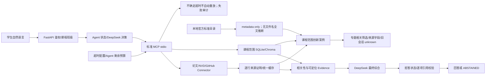
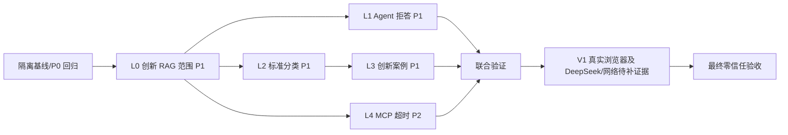

# 课程智能体最终剩余修复实施设计书

> 2026-10-02，反向技术评审修订版。根目录：`C:\Users\Asd\Desktop\edu agent`。原始依据为[题目最终要求.md](<C:/Users/Asd/Desktop/edu agent/md/题目最终要求.md:1>)；[最终联合修复实施设计书.md](<C:/Users/Asd/Desktop/edu agent/md/最终联合修复实施设计书.md:1>)及用户粘贴的 K8 报告只提供核查线索。**本轮未修改项目源码、测试、配置或数据库，未安装依赖，未重跑全量或 live 验收。**只进行了当前代码复核、本次无数据库的创新 RAG 故障注入，以及上版独立复核中三个无网络反例和隔离环境的 29 项定向测试；隔离临时 SQLite/Chroma 已清理。没有读取或输出 `.env` 密钥值；运行定向测试时禁止了 dotenv 加载。项目当前没有 `.git`，不得假称可提交或可用 `git revert`。

## A. K8 报告独立复核结论

原始课程要求编号沿用当前核对的正文：[R1 MCP 学习/实践/创新、外部工具与数据库/论文/漏洞](<C:/Users/Asd/Desktop/edu agent/md/题目最终要求.md:3>)；[R2 结构化知识库与证据检索](<C:/Users/Asd/Desktop/edu agent/md/题目最终要求.md:13>)；[R3–R5 教师访问、聚类、卡点与 FAQ](<C:/Users/Asd/Desktop/edu agent/md/题目最终要求.md:27>)；[R6–R7 学生说明、课程介绍及资料入口](<C:/Users/Asd/Desktop/edu agent/md/题目最终要求.md:53>)；[R8 六步实践、资料摘要分类](<C:/Users/Asd/Desktop/edu agent/md/题目最终要求.md:77>)；[R9 论文/开源/竞赛案例及启发式追问](<C:/Users/Asd/Desktop/edu agent/md/题目最终要求.md:101>)。

**裁决：K8 的“未通过完全验收”方向成立，但其剩余项不能全部算代码失败。**目前确认 **4 个 P1 修复批次**：L0 创新 RAG 异常时课程范围、L1 Agent 拒答/引用、L2 标准本地全文误报、L3 创新案例来源/专题相关性；另有 **1 个 P2 修复批次**：MCP 超时配置未生效且不确定结果会被自动重放。DeepSeek `continue` 后降级的根因、arXiv 首次请求为何最终显示缓存、真实浏览器操作均缺少可复查的本轮完整轨迹；分别列为**验收缺口、时序归因缺口、浏览器环境/执行缺口**，不能写成已证实的产品缺陷。创新 RAG 的条件性无范围重试是已确认的代码路径，但尚无生产 HTTP 跨课泄露证据；若实际越权复现，立即升级 P0。K8 控制慢任务超时后库计数未增加，不能反过来宣称迟到写库已发生。

证据层级：**本轮静态**＝当前源码；**本轮反例**＝临时目录运行、输出只有布尔/字段名/标题；**上版复核测试（本次未重跑）**＝隔离环境执行，14 passed + 11 passed + 4 passed，合计 **29 passed、0 failed、0 skipped、0 xfail**，三次调用各有同一类 Starlette deprecation warning（不应简单把重复 warning 计成三种问题）；**K8 报告**＝用户粘贴的历史 live/HTTP/浏览器叙述，原始隔离库和脚本已清理，本轮未独立重放。不要把上版 29 项定向通过误写成本次全量 331 项重跑，也不要把旧 live 结果写成本轮 live。

本轮可复查的最小反例：临时 `3GPP_TS_24.501_teaching_notes.md` 只含“Teaching notes only”，`StandardSourceConnector.search('24.501')` 却返回 `raw_metadata.local_uploaded=true`；`CitationGuard.enforce('无法回答这个问题，但可以参考 NAS authentication [S1]', 可定位 S1)` 返回 `ok=true`；`select_cases` 对无关“cooking contest”与相关“5G NAS experiment”仍收录前者，且输出案例键只有 `cache_status/source/source_id/summary/tags/title/type/url`。另以无数据库的故障注入确认 `_rag_resources` 先带 `course_id=2` 调用，抛 TypeError 后又无范围调用并接收返回项；这不接触正式库，也不证明真实生产 HTTP 已经跨课。以上反例均不证明任何真实模型或外网调用。K8 的 arXiv 200、NVD/GitHub、DeepSeek 多源综合只作为独立报告里的证据，需在最终复验再建立新证据。

## B. 已确认通过且不再修改的功能

| 功能 | 本轮证据及边界 | 处理 |
| --- | --- | --- |
| P0 基本后端鉴权、运行所有权、任课及班级范围 | 14 项选测包含 `test_stateful_agent_endpoints_require_login_and_owner_scope`、`test_student_cannot_access_other_student_run_or_teacher_endpoint`、`test_admin_can_access_all_courses_and_teacher_api`、`test_phase3_teacher_cannot_mix_course_and_class_scope`、`test_unassigned_teacher_is_rejected_from_phase3_and_cluster_endpoints`、`test_cluster_scope_validates_member_classes_not_only_cluster_class_id`；未授权教师重建的测试还核对拒绝前后聚类和成员数量相同。[后端范围函数](<C:/Users/Asd/Desktop/edu agent/backend/main.py:111>)、[学生课程选择](<C:/Users/Asd/Desktop/edu agent/backend/main.py:198>)、[运行所有权](<C:/Users/Asd/Desktop/edu agent/backend/main.py:1754>)继续存在。K8 报告的六账号 HTTP 是附加线索，本轮没有完整重放。 | 不设已证实的 P0 开发批次；C14 的异常时无范围重试作为首批 L0 做 fail-closed 防护，最终必须用两课两班两师两生及无授权账号重新跑真 HTTP，并核非法写库为零。 |
| J2 Agent Guard 标准/GitHub Schema | `test_action_guard_has_schema_for_registered_standard_and_github_tools` 本轮通过；[公共工具模型映射](<C:/Users/Asd/Desktop/edu agent/mcp_server/tools.py:182>)与 Guard 现有代码可见。K8 称真 Agent→MCP 两工具成功。 | 只回归，不重做 Guard。 |
| J4 课程范围 MCP 检索 | `test_course_retriever_stdio_protocol_is_course_scoped` 和 `test_multicourse_http_requires_selection_and_rejects_cross_course` 本轮通过；[MCP 课程检索](<C:/Users/Asd/Desktop/edu agent/mcp_server/tools.py:277>)已用 `HybridRetriever(course_id=...)`，K8 给出 API/MCP 同一片段与 HTTP 403。 | 不重写索引与 Schema；新增批次不得削弱作用域。 |
| J5 描述性 CVE 参数 | `test_nvd_normalizes_natural_language_query_parameters`、`test_real_vulnerability_tool_reports_safe_query_normalization` 本轮通过；K8 报告真实 `cveId=CVE-2023-4863`。 | 不重复改 NVD。 |
| J1 fake/unknown/无证明历史资源隔离 | [资源查询 SQL](<C:/Users/Asd/Desktop/edu agent/backend/storage/logger.py:1504>)要求逐行证明；[创新外部映射](<C:/Users/Asd/Desktop/edu agent/backend/innovation/service.py:339>)也要求 `provenance_verified`。K8 报告门户历史污染数 0；本轮未重新跑旧记录注入真 HTTP。 | 保留安全回归；创新案例“字段丢失/无关内容”另修，不把 J1 整体重做。 |
| J7 筛选纯逻辑 | [指纹失效](<C:/Users/Asd/Desktop/edu agent/frontend/pages/student.py:377>)、[_select_resource_payload](<C:/Users/Asd/Desktop/edu agent/frontend/pages/student.py:542>)已实现；上版 `tests/test_j7_resource_filters.py` **4 passed**。 | 目前只补真实浏览器验收；未操作浏览器不能判页面功能失败。 |

## C. K8 问题裁决矩阵

状态标签严格使用 `confirmed_defect`、`test_gap`、`environment_limitation`、`false_positive`；最后一项指“把它继续列作待修缺陷”的判断不成立，不表示未来永不回归。**代码行号均为 2026-10-01 当前工作目录重查**，不是照搬旧报告。

| 编号／级别／要求 | K8 结论；本轮复现步骤与实际→期望 | 当前根因、代码位置 | 裁决；答辩阻断／需改代码／关闭条件 |
| --- | --- | --- | --- |
| C0／P0／R1–R5 | K8 权限通过；本轮跑上述 6 项授权相关选测全通过，未授权教师重建零成员变化。→最终仍需全角色真 HTTP 零写入。 | [main.py `_resolve_teacher_scope`](<C:/Users/Asd/Desktop/edu agent/backend/main.py:111>)、[`_resolve_user_course_context`](<C:/Users/Asd/Desktop/edu agent/backend/main.py:198>)、[`_require_cluster_scope`](<C:/Users/Asd/Desktop/edu agent/backend/main.py:257>)。 | **false_positive（把 P0 当当前待修项）**；无当前 P0 证据，不改代码。若最终复验任一越权实际出现立即升 P0，绝对阻断答辩。 |
| C1／P1／R1 R2 R8 | K8 论文不匹配、课程外食谱、跨课强标记出现文字拒答却 `COMPLETED`/无关引用；本轮临时证据 S1 验证“无法回答…[S1]”被 Guard `ok=true`。→拒答即 `ABSTAINED`、空引用；仅可核主张可完成。 | [CitationGuard.enforce](<C:/Users/Asd/Desktop/edu agent/backend/guards/citation_guard.py:24>)只查引用存在、位置和全文两 token 交集；[_supports_answer](<C:/Users/Asd/Desktop/edu agent/backend/guards/citation_guard.py:80>)不按问句/主张判断；[orchestrator `_answer`](<C:/Users/Asd/Desktop/edu agent/backend/agent/orchestrator.py:843>)通过后无条件置 `COMPLETED`，[_to_chat_response](<C:/Users/Asd/Desktop/edu agent/backend/agent/orchestrator.py:1008>)返回**所有**证据引用；[router](<C:/Users/Asd/Desktop/edu agent/backend/agent/router.py:31>)把含“课程”的离题包装问句路由成课程问答。 | **confirmed_defect**；核心拒答可信度，阻断“全部完成”答辩宣称；需代码修复 L1。DoD：三种反例均 `ABSTAINED,citations=[]`，正常课程/真实多源仍完成且只返回实际引用。 |
| C2／P1／R7 R8 | K8 `3GPP_TS_24.501_teaching_notes.md` 被报 `Local full text uploaded: True`；本轮只写临时教学笔记也复现 `local_uploaded=true`。→官方目录、教学笔记、经明确核验的本地正文分开。 | [StandardSourceConnector.search](<C:/Users/Asd/Desktop/edu agent/backend/connectors/standard_source.py:64>)写摘要及 `raw_metadata.local_uploaded`；[_local_full_text_match](<C:/Users/Asd/Desktop/edu agent/backend/connectors/standard_source.py:94>)只用文件名别名包含判断；实际[教学笔记](<C:/Users/Asd/Desktop/edu agent/knowledge_base/3GPP_TS_24.501_teaching_notes.md:1>)明确写“not the copyrighted standard full text”。 | **confirmed_defect**；资料真实性 P1，阻断完全通过；需 L2。DoD：教学笔记不报本地全文；标准仍有官方元数据 URL；无显式证明的任何上传均不冒充正文。 |
| C3／P1／R9 | K8 创新案例缺顶层来源字段；本轮 `select_cases` 输出实际只有 8 个键，没有 `source_name/origin_kind/delivery_mode/fetched_at`。→每项有来源或明确 `unknown`，可追到 URL 或课程切片。 | [InnovationService._collect_cases](<C:/Users/Asd/Desktop/edu agent/backend/innovation/service.py:140>)将有来源的资源交给 [recommender.select_cases](<C:/Users/Asd/Desktop/edu agent/backend/innovation/recommender.py:11>)，[_case_from_resource](<C:/Users/Asd/Desktop/edu agent/backend/innovation/recommender.py:114>)丢字段；[浏览器页](<C:/Users/Asd/Desktop/edu agent/frontend/pages/innovation.py:50>)只显示旧 source/cache。 | **confirmed_defect**；资料可核性 P1，需 L3。DoD：POST/GET/finalize 的新案例字段完整，旧会话缺证据只能 `unknown`，不得猜 live。 |
| C4／P1／R9 | K8 混入无关本地资料；本轮给 `select_cases` 输入无关 cooking competition 与相关 NAS 文档，前者仍入选。→专题相关性先过门槛，再考虑类型多样性。 | [select_cases](<C:/Users/Asd/Desktop/edu agent/backend/innovation/recommender.py:11>)完全不接收 `topic`，先按类型选首条再用全部资源补齐；[_mcp_resources](<C:/Users/Asd/Desktop/edu agent/backend/innovation/service.py:204>)还调用无课程参数的旧本地线索。 | **confirmed_defect**；与 C3 合并 L3。DoD：无关课程笔记/竞赛不入选，相关真实来源可入选，空结果诚实显示证据不足。 |
| C5／P1／R1 R9 | K8 旧 fake/unknown 没进入创新/门户；当前 J1 来源过滤代码仍在。→保留。 | [资源 SQL](<C:/Users/Asd/Desktop/edu agent/backend/storage/logger.py:1504>)、[Portal `_external_resources`](<C:/Users/Asd/Desktop/edu agent/backend/resources/portal.py:115>)、[创新 `_external_resource_to_case`](<C:/Users/Asd/Desktop/edu agent/backend/innovation/service.py:339>)。 | **false_positive（若把 J1 过滤重列为待修）**；不改 J1；L3 必须回归 fake/unknown/伪装合法源零流入。 |
| C6／P1／R1 R8 | K8 同 run `ask_user→continue` 最终 Template fallback；本轮没有 K8 原 `model_calls` 错误、响应码或 Key 配置状态，不能判断 DeepSeek 错、网络超时还是用户配置。→同 run 在真实模型可用时应成功，模型故障应诚实标 fallback。 | [continue API](<C:/Users/Asd/Desktop/edu agent/backend/main.py:643>)重新 `create_llm_provider`；[Provider factory](<C:/Users/Asd/Desktop/edu agent/backend/llm/factory.py:13>)可因未配置/构造失败选模板；[orchestrator `_decide`](<C:/Users/Asd/Desktop/edu agent/backend/agent/orchestrator.py:234>)与[`_answer`](<C:/Users/Asd/Desktop/edu agent/backend/agent/orchestrator.py:843>)已有失败记录与降级。 | **test_gap**，可能还有环境/第三方原因；不能直接立修复。阻断“该次 DeepSeek 继续成功”宣称；用保留 `MODEL_DECISION_FAILED/MODEL_ANSWER_FAILED`、HTTP 状态与配置是否存在的隔离 live 复验关闭。若能稳定复现代码错，再另立小批。 |
| C7／P1／R1 | K8 三工具问题有同 run 真实 DeepSeek `generate_answer`、8 来源 URL/哈希，不能说“只有工具列表”；本轮未重放 live。→最终验收需新独立证据。 | [orchestrator `_answer`](<C:/Users/Asd/Desktop/edu agent/backend/agent/orchestrator.py:843>)调用 Provider 并记录模型元数据；[DeepSeekProvider.generate_answer](<C:/Users/Asd/Desktop/edu agent/backend/llm/deepseek_provider.py:36>)确有真实调用路径。 | **false_positive（把多源综合仍未实现当缺陷）**；不重复开发。但 K8 历史成功不能替代最终新 live 复验，见 H/K。 |
| C8／P2／R1 R7 | K8 `.env.example` 声称 `MCP_TOOL_TIMEOUT_SECONDS=30`，首次 arXiv 200 后最终显示 `fresh_cache`；本轮不读取 `.env`，只核 [.env.example:23](<C:/Users/Asd/Desktop/edu agent/.env.example:23>)。→配置进入 Gateway，超时不重放不确定结果。 | [Settings](<C:/Users/Asd/Desktop/edu agent/backend/core/config.py:22>)没有 MCP 字段，[main.py:83](<C:/Users/Asd/Desktop/edu agent/backend/main.py:83>)无参建 Gateway，[Gateway 默认 10 秒](<C:/Users/Asd/Desktop/edu agent/backend/tools/mcp_client.py:39>)；[_execute_allowed_tool](<C:/Users/Asd/Desktop/edu agent/backend/tools/mcp_client.py:179>)把 `MCP_CALL_TIMEOUT` 纳入自动重试，次数由 LLM 重试配置推导。 | **confirmed_defect（配置漂移与不确定重放策略）**；需 L4。P2 本身不等于真实后台写库事故；但未修前不能把首查标签当严格实时证据。DoD：配置值被采用；不确定结果零自动重放；状态与尝试次数可审计。 |
| C9／P2／R1 R7 | K8 首次外网 arXiv 200、sync run SUCCESS，最终 `cache_hit=true/fresh_cache`。当前代码**允许**第一次客户端超时、第二次重试读缓存，但旧进程/日志已清理，不能证明当时一定如此；并发同步也可能造成缓存。 | [Gateway 重试](<C:/Users/Asd/Desktop/edu agent/backend/tools/mcp_client.py:197>)、[Service 首先查新鲜缓存](<C:/Users/Asd/Desktop/edu agent/backend/resources/service.py:55>)；[Service 的交付方式](<C:/Users/Asd/Desktop/edu agent/backend/resources/service.py:429>)按最后一次成功/缓存决定。 | **test_gap（精确时序归因）**；L4 防重放并记录尝试，不凭这条把 Connector 写错缓存字段定罪。最终用空缓存、单请求、无并发的 HTTP/MCP 时间线关闭。 |
| C10／P2／R1 | K8 可控慢任务 159ms 返回 TOOL_TIMEOUT，后台完成后资源/映射/证明无新增。→保留该行为，真实慢网络再回归。 | [MCP `_run_with_timeout`](<C:/Users/Asd/Desktop/edu agent/mcp_server/tools.py:241>)仍使用线程，但[Service commit 前 deadline](<C:/Users/Asd/Desktop/edu agent/backend/resources/service.py:265>)阻止已过期提交。 | **false_positive（若称迟到写库已经发生）**；不预设修线程架构。真实 HTTP/MCP 慢工具检查是验收项，若复现迟到写入再升级为 confirmed_defect。 |
| C11／P2／R6–R9 | K8 自动化未能操作 Streamlit React 登录，CUA 无可用标签页；本轮 [J7 指纹/选择](<C:/Users/Asd/Desktop/edu agent/frontend/pages/student.py:377>)对应 **4 passed**，但没有真浏览器登录与切筛选证据。→人工/可用浏览器完成实际 UI。 | [Streamlit 登录表单](<C:/Users/Asd/Desktop/edu agent/frontend/app.py:61>)和[学生资料页](<C:/Users/Asd/Desktop/edu agent/frontend/pages/student.py:365>)有页面逻辑；自动化会话不可用是环境原因。 | **test_gap（由浏览器自动化环境限制引起）**；不安排产品修复，仅验收任务 V1。真实浏览器未跑完前 J7/UI 不能标完全通过，但不能仅因此判页面失败。 |
| C12／P2／R2 | K8 误继承正式 Chroma 路径，正式 `chroma.sqlite3` 修改时间改变；本轮只读复核其修改时间仍为 2026-10-01 19:03:22，正式 `app.db` 仍为 2026-09-29 23:31:33。→无法由时间戳证明向量内容未变。 | [Settings.vector_store_dir](<C:/Users/Asd/Desktop/edu agent/backend/core/config.py:70>) 默认落正式目录；测试须显式隔离。 | **test_gap／审计流程偏差**，不是已证实的产品代码错误；不擅自回滚或重建正式向量库。最终只读检查正式 SQLite 文档/切片与 Chroma ID 一致，必要时经授权另备份修复。 |
| C13／P1／R7 | K8 Semantic Scholar 返回 429。→按限流与缓存/降级语义报告。 | [资源 Service `_search_with_retry`](<C:/Users/Asd/Desktop/edu agent/backend/resources/service.py:337>)已区分限流；实际第三方配额不由本项目控制。 | **environment_limitation**；不改 Connector 来“保证”第三方成功；若课程答辩需展示真实论文源，arXiv 可作为已允许且需新 live 证据的来源。 |

| C14／P1（实际跨课泄露时升 P0）／R1 R2 R9 | 本轮最小隔离复现：模拟课程化 `retrieve` 抛 `TypeError`，第二次不带 `course_id` 返回 A 资料，B 的 `_rag_resources(course_id=2)` 实际收下 `COURSE_A_PRIVATE`。→作用域失败必须关闭候选路径，绝不能重试无范围检索。此测试确认异常路径，**不证明现有 HybridRetriever 正常运行时已发生 HTTP 越权**。 | [InnovationService._rag_resources:178](<C:/Users/Asd/Desktop/edu agent/backend/innovation/service.py:178>)捕获全部 `TypeError` 后在 [183 行](<C:/Users/Asd/Desktop/edu agent/backend/innovation/service.py:183>)去掉课程参数重试；当前 [HybridRetriever.retrieve:61](<C:/Users/Asd/Desktop/edu agent/backend/rag/hybrid_retriever.py:61>)本身支持 `course_id`，其[检索查询:84](<C:/Users/Asd/Desktop/edu agent/backend/rag/hybrid_retriever.py:84>)在正常路径按课过滤。 | **confirmed_defect（条件性 fail-open 分支）**；独立为首批 L0，小范围 fail-closed 修复。阻断“异常时课程隔离已完全证明”的声明；定向与真 HTTP 注入故障测试均不得返回 A 标记，正常同课仍有推荐。若真 HTTP 无需故障注入即可泄露，立刻按 P0 处理并先停后续批次。 |

## D. 最终剩余问题矩阵（只含 confirmed_defect）

| 修复编号／优先级 | 原始要求 | 实际结果→期望；代码入口 | 最小范围／数据/API/配置 | 关闭判据 |
| --- | --- | --- | --- | --- |
| L0／P1（实际越权时升 P0） | R1 R2 R9 | 创新 RAG 在带课程参数调用抛 `TypeError` 后无范围重试并可收下别课候选；[service._rag_resources:178](<C:/Users/Asd/Desktop/edu agent/backend/innovation/service.py:178>)、[重试:183](<C:/Users/Asd/Desktop/edu agent/backend/innovation/service.py:183>)。 | 只改创新后端的检索异常处理/归属核验和测试；无数据库迁移、API 必填字段或页面改动。 | 故障注入下只调用一次带课检索，B 学生零 A 标记；本课正常案例仍可读；两课真实 HTTP 均 200/403 符合权限，非法零写入。 |
| L1／P1 | R1 R2 R8 | 拒答文字带引用通过 Guard，Orchestrator 标 `COMPLETED`；[guard:24](<C:/Users/Asd/Desktop/edu agent/backend/guards/citation_guard.py:24>)→[answer:843](<C:/Users/Asd/Desktop/edu agent/backend/agent/orchestrator.py:843>)→[response:1008](<C:/Users/Asd/Desktop/edu agent/backend/agent/orchestrator.py:1008>)。 | Agent、Citation Guard、意图路由与定向测试；不改 DB 表/API 必填字段。 | 三类 K8 拒答反例均 `ABSTAINED` 且零引用，正常论文/课程/三工具仍真实 DeepSeek 完成。 |
| L2／P1 | R7 R8 | 文件名像标准的教学笔记被报本地全文；[StandardSourceConnector.search:64](<C:/Users/Asd/Desktop/edu agent/backend/connectors/standard_source.py:64>)→[_local_full_text_match:94](<C:/Users/Asd/Desktop/edu agent/backend/connectors/standard_source.py:94>)。旧缓存也可能保留错误声明：Service [先返回缓存:55](<C:/Users/Asd/Desktop/edu agent/backend/resources/service.py:55>)，Portal [直接呈现缓存摘要:115](<C:/Users/Asd/Desktop/edu agent/backend/resources/portal.py:115>)。 | 标准目录分类及**历史缓存读取纠偏**；保留 `standard_source` 官方元数据 URL，不删历史记录。默认不新增 DB/API 必填字段。 | 教学笔记与旧缓存都不声称标准正文，官方元数据仍可查，合法上传资料只在本课程标为课程文档，除非有显式核验记录。 |
| L3／P1 | R9 | 案例来源字段丢失且按类型补足无关内容；[collect:140](<C:/Users/Asd/Desktop/edu agent/backend/innovation/service.py:140>)→[select:11](<C:/Users/Asd/Desktop/edu agent/backend/innovation/recommender.py:11>)→[case:114](<C:/Users/Asd/Desktop/edu agent/backend/innovation/recommender.py:114>)。 | 创新 Service/推荐器/展示；`cases_json` 增字段但无表迁移；API 只加可选字段。依赖 L0 范围及 L2 类型语义。 | 每个新案例有来源/交付/定位；无关材料不混入；L0 范围保持、旧会话标 unknown；fake/unknown 外部事实零流入。 |
| L4／P2 | R1 R7 | `.env.example` 30 秒未入 Gateway、调用超时被自动重放；[config:16](<C:/Users/Asd/Desktop/edu agent/backend/core/config.py:22>)→[main:83](<C:/Users/Asd/Desktop/edu agent/backend/main.py:83>)→[gateway:179](<C:/Users/Asd/Desktop/edu agent/backend/tools/mcp_client.py:179>)。 | Settings、Gateway/调用元数据、定向协议测试；无需 DB 迁移；保留旧调用签名的可选兼容参数。 | 真实/受控超时只发一次不确定工具请求；超时/缓存/上游状态一致且可查尝试数；已通过的正常 stdio 与 J2/J4/J5 不回归。 |

**未进入开发矩阵：**C6/C9/C11/C12 是待补证据或环境限制；不允许把它们作为“为了通过验收”预先修改产品代码的理由。若 V1 发现真实 UI 缺陷，另开独立最小批并重新定级。

## E. 修复后目标架构



**职责边界：**后端 [课程范围](<C:/Users/Asd/Desktop/edu agent/backend/main.py:198>)是授权边界；浏览器筛选不是权限控制。Agent Planner 可建议动作和意图，不能让模型自报课程范围或单独决定“有引用即已回答”。来源证明沿用 migration 16，不重建 J1。`CitationGuard` 和 Agent 共同处理拒答、提问中的关键标识、每个实际引用的可定位性；`ChatResponse.citations` 只列最终回答引用的证据；同时校验多工具任务满足必需来源后在预算内终止，不重复派发已成功的同一工具。标准 Connector 对所有课程共享的只读**官方目录元数据**负责，课程上传的教学笔记/正文仍走课程范围文档；不能从文件名推断版权状态或全文。创新推荐先校验课程/来源和专题相关性，再做类型多样性；无证据宁可少推荐。MCP Gateway 的读超时应大于服务端工具执行预算并受 Agent 剩余总预算限制；不确定结果不重放，内层 Connector 的已定义重试另受同一 deadline 限制。

**保持不动：**J1 `resource_provenance` 与受信缓存 SQL、J2 Action Guard Schema、J4 `course_retriever` 当前课程索引、J5 NVD CVE 参数、教师统计/聚类/FAQ/卡点业务、J7 当前指纹逻辑。L1/L3/L4 都必须用这些功能做回归；L0 首先封闭异常时无课程范围重试，L3 再做创新推荐，不引入 React、PostgreSQL、Redis、Celery 或新 LLM/MCP 框架。

## F. 可独立执行的修复批次

### L0｜P1 条件性无范围重试封闭（若真 HTTP 泄露升 P0）

1. **目标与根因。**只修创新案例 RAG 的异常时课程隔离，不改正常检索排序、MCP、Connector 或页面。当前 [InnovationService._rag_resources:178](<C:/Users/Asd/Desktop/edu agent/backend/innovation/service.py:178>)在传 `course_id` 的检索抛 `TypeError` 后，[183 行](<C:/Users/Asd/Desktop/edu agent/backend/innovation/service.py:183>)再次不带课程参数调用；[HybridRetriever.search_with_metadata:84](<C:/Users/Asd/Desktop/edu agent/backend/rag/hybrid_retriever.py:84>)在 `course_id=None` 时查询不限定课程的切片。隔离故障注入已复现该返回路径，尚未证明生产 HTTP 自然发生跨课泄露。
2. **后端与状态方案。**仅改 `_rag_resources`：保留 `retrieve(query, top_k=3, course_id=course_id)`；异常时记录脱敏错误类型并返回 `[]`，绝不调用不带课参数的兼容分支。使用现有 `LearningLogger.document_chunks(course_id=...)` 或等价归属查询防御性核验 `document_id/chunk_id`，只把属于当前课、已索引且可定位的片段加入案例；无归属信息的旧候选不能猜课程。`start_session` 已由 [main.py:1430](<C:/Users/Asd/Desktop/edu agent/backend/main.py:1430>)执行课程解析，保留该入口和 [InnovationService._default_context:261](<C:/Users/Asd/Desktop/edu agent/backend/innovation/service.py:261>)；前端筛选不能代替此后端检查。禁止通过导入新检索器或删除异常分支上的测试来“修复”。
3. **API、MCP、DB、配置和兼容。**`POST /api/innovation/sessions` 与 GET/answers/finalize 的路径、必填请求、成功字段、认证状态码不变；本批无 MCP Schema/Connector/配置更改，无 SQLite/Chroma 迁移或回填。异常时案例可减少，并由已有局限性说明解释；旧 `cases_json` 不改写。课程 B 若请求课程 A 仍按现有 403，不以空结果掩盖越权请求。
4. **先失败后通过测试。**隔离单测用课程 A 独有片段和 B 会话：带 `course_id=B` 的检索器第一次抛 `TypeError`，旧实现第二次无参数会返回 A；修后只调用一次，A 标记、URL、切片 ID 在 B 响应和保存的 `cases_json` 中均为零。再用真实 HTTP、两课两师两生和无归属账号验证 B 自有片段可入选、跨课指定 403、管理员正常管理不受影响；拒绝前后相关表计数不变。故障注入测试证明封闭分支，正常运行测试证明未误伤；均不能由 Mock 单独证明不存在真实 HTTP 越权。定向测试后运行完整 pytest，并回归 J4 API/MCP 当前课检索。
5. **验收、风险、回滚和 DoD。**真实 HTTP 的 `/api/innovation/sessions`、`GET /api/resources/portal` 和课程 RAG 做两课隔离复验；浏览器只观察结果，不作为唯一权限证据。修前记录文件 SHA256 与 SQLite online backup；回滚仅恢复本批 Service/测试快照，**生产中不允许把无范围重试重新打开**，若必须回滚则先停用创新案例创建路径直至重新封闭。**DoD：异常时零无范围调用、零跨课候选与写入；正常同课案例保留；匿名/跨课/管理员 HTTP 回归；不新增迁移或依赖。**此批必须先于 L2/L3/L1/L4 完成；若独立真 HTTP 证实可自然泄露，升为 P0 并停止其余批次。

### L1｜P1 Agent 拒答状态、相关证据与引用收口

1. **目标/非目标与根因。**修 K8 论文不匹配、课程外食谱、跨课强标记三类 `COMPLETED` 假阳性及附加无关引用；不改真实 Connector、MCP Schema、课程权限。原因是路由仅关键词、工具/检索证据只按“可信”不按本题相关，Citation Guard 对整段回答做两 token 交集，随后 `_answer` 把 `ok` 一律置 `COMPLETED`，响应列全部 evidence。
2. **架构与后端位置。**在 [router.route_intent:31](<C:/Users/Asd/Desktop/edu agent/backend/agent/router.py:31>) 避免“课程智能体”这类包装词遮蔽明确离题主体；首步可接受模型提出的更保守 `off_topic→abstain`，但不能信模型把不相关问题升级为可答。在 [orchestrator._trusted_tool_evidence:732](<C:/Users/Asd/Desktop/edu agent/backend/agent/orchestrator.py:732>) 和[_retrieve:573](<C:/Users/Asd/Desktop/edu agent/backend/agent/orchestrator.py:573>)建立问题相关性门：明确 CVE/标准号、指定论文标题、引号标记等实体须在实际证据匹配；普通专题复用现有检索分数/覆盖率，不用一个全局粗暴阈值。不能让没有请求对象匹配的论文填满 `completed_sources`。
3. **最终状态伪码。**`decision = assess_answer(question, intent, answer_text, trusted_evidence)`；若回答本身表达拒答/无法核验、实体不匹配、引用伪造/缺定位/无主张支持，则 `state.status=ABSTAINED; state.stop_reason=<稳定错误码>; state.final_answer=安全拒答; citations=[]`；否则仅保留 `decision.cited_ids` 对应证据、`COMPLETED`。修改 [CitationGuard.enforce:24](<C:/Users/Asd/Desktop/edu agent/backend/guards/citation_guard.py:24>) 让它收到原问题/意图或经独立相关性判定后的 Evidence，并按被引用的句子/段落检查，而非全文任意两词；[orchestrator._answer:843](<C:/Users/Asd/Desktop/edu agent/backend/agent/orchestrator.py:843>)统一执行，[`_to_chat_response`:1008](<C:/Users/Asd/Desktop/edu agent/backend/agent/orchestrator.py:1008>)只输出实际引用。拒答文本识别是防线之一，不能代替实体与相关性检查。DeepSeek `generate_answer` 保留为最终综合，不能换成固定模板输出伪造成功；把真实 Provider 返回文本的 SHA256 记入现有 `model_calls.metadata_json`，成功 Guard 输出与 HTTP 最终 `answer` 的 SHA256 应一致，以证明最终文字确由该次模型输出形成。
4. **MCP/Connector/SQLite/前端/API。**MCP、Connector、migration 16、课程切片不改；API `POST /api/chat`、`GET /api/agent/runs/{run_id}`、`continue` 路径和必填字段不变，新增/稳定 `stop_reason=INSUFFICIENT_EVIDENCE|OFF_TOPIC|UNSUPPORTED_CITATION` 等内部原因；回答仍 200，拒答 `run_status=ABSTAINED,abstained=true,citations=[]`。前端 [学生回答展示](<C:/Users/Asd/Desktop/edu agent/frontend/pages/student.py:180>) 显示已有状态和引用，不靠隐藏引用修后端。`agent_runs.state_json` 可用既有可选状态字段，无 schema 迁移/回填。
5. **先失败后通过测试。**给现有 `tests/test_citation_guard.py` 加带引用拒答、无关 B 文档/课程 A 唯一标识、指定不存在论文标题但主题相近三反例；给 `tests/test_agent_orchestration.py` 加 Provider 返回文字拒答仍有 S1 的反例，断言运行状态与引用；两课真实 HTTP：课程 B 问 A 独有标记，B 无 A 内容、无 B 无关引用；离题食谱；正常本课问答和论文+CVE+GitHub 仍 `COMPLETED`，实际引用子集与最终文字一致；Agent 步骤中三个必要工具各最多一次、无 `MAX_STEPS`，并有真实 `generate_answer` 及 response hash 对应。ask_user→同 run_id continue 保持行为，若真实模型降级必须记录对应 model_calls，而不是默默改成“成功”。
6. **验收/风险/回滚/DoD。**定向 pytest 后全量 pytest；隔离 API/MCP/DeepSeek 至少 12 个新问，确认同 run 有真实 `generate_answer`、输入证据哈希、**模型原始回答哈希与最终成功回答哈希一致**、最终 URL 且 `fallback_used=false` 才宣称 live；只记录哈希与来源 ID，不在日志保存敏感原文；失败提供 `stop_reason`。强相关过滤可能误拒宽泛教学问答，须保留已通过正例并调证据规则，不能降低断言。回滚只恢复 router/guard/orchestrator 文件快照，保留旧 run 与日志；旧 run 可读。**DoD：K8 三种误判全部拒答且零引用，正常课程/多工具/六步/继续不回归，三工具调用不重复且不以 MAX_STEPS 结束，跨课零泄露。**依赖：无开发前置，可与 L2 在不同副本开发；L3 联测需要最终引用语义。

### L2｜P1 标准目录与本地材料分类纠正

1. **目标/非目标与根因。**标准官方元数据入口继续可用，纠正教学笔记被宣称“本地标准全文”。不自动抓取或复制受版权保护的 3GPP 正文，不重新设计文档上传。根因是 [standard_source.py `_local_full_text_match`:94](<C:/Users/Asd/Desktop/edu agent/backend/connectors/standard_source.py:94>) 文件名包含别名即命中，不检查内容、课程授权或资料类型。
2. **技术方案/位置。**[StandardSourceConnector.search:64](<C:/Users/Asd/Desktop/edu agent/backend/connectors/standard_source.py:64>) 始终把官方目录项作为 `origin_kind=local_catalog` 的**元数据/官方链接**，保留旧 `raw_metadata.local_uploaded/local_match/official_metadata_only` 字段以免旧客户端解析失败，但对未显式核验的文件设 `local_uploaded=false,local_match=null`，摘要不得写 `Local full text uploaded: True`。移除自动文件名全文推断；普通教学笔记在 [Portal `_course_documents`:80](<C:/Users/Asd/Desktop/edu agent/backend/resources/portal.py:80>) 以 `course_document` 和课程范围展示。**只修 Connector 不够：**现有 [Service.search:55](<C:/Users/Asd/Desktop/edu agent/backend/resources/service.py:55>) 可在调用 Connector 前命中旧缓存，[Portal._external_resources:115](<C:/Users/Asd/Desktop/edu agent/backend/resources/portal.py:115>) 也直接读取旧摘要与 `raw_metadata`。为 `standard_source` 建一处复用的呈现时规范化函数，Service 的 [_present_resources:147](<C:/Users/Asd/Desktop/edu agent/backend/resources/service.py:147>) 与 Portal 外部项都调用它：无经核验的正文证明时，返回视图中 `local_uploaded=false,local_match=null`，把旧 `abstract`、Portal 的 `summary/raw_summary` 及返回的嵌套 `raw_metadata.local_uploaded/local_match` 中的全文误报统一规范化为真实的“仅官方元数据”（只改响应视图，不改数据库原始审计行），仍保持 `delivery_mode=fresh_cache/stale_cache` 与原 `fetched_at`，绝不重标 live；原缓存行保留供审计。现有上传[API:924](<C:/Users/Asd/Desktop/edu agent/backend/main.py:924>)、[documents.metadata_json:808](<C:/Users/Asd/Desktop/edu agent/backend/storage/logger.py:808>)可以容纳将来**显式授权且核验**的类型，但本批无证据的旧上传不得回填为“全文”。若答辩实际需要宣称某已上传标准正文可用，另以已授权课程文档和人工核验元数据为前提，不能让共享 MCP 标准工具暴露其他课程的存在。
3. **后端/Agent/MCP/前端/API/数据。**保留 `standard_metadata_lookup` 工具名和 `{query,top_k}`；`ToolResult` 保留官方 URL、`local_catalog/local_metadata`，不引入 remote/live 假标签；[标准结果服务](<C:/Users/Asd/Desktop/edu agent/backend/resources/service.py:120>)继续区分本地目录，**旧缓存和新 Connector 结果经过同一分类函数**。`POST /api/resources/search?connector_name=standard_source` 与学生资料门户路径/状态码不变；前端只按服务真值显示“官方元数据”和单独“课程文档”。SQLite 不迁移、不回填、不删除任何文件或外部缓存；不新增依赖或 `.env` 变量。Agent 由 MCP 取得的标准 Observation 不得再含旧缓存中的错误全文声明。
4. **测试与实际验收。**先用本轮反例作为失败测试：临时 `3GPP_TS_24.501_teaching_notes.md` 即使文件名吻合，`local_uploaded=false` 且摘要无全文声明；再用隔离库**预置一条历史上有合法来源证明、但 `raw_metadata.local_uploaded=true` 与摘要误写“Local full text uploaded: True”的 `standard_source` 行**，分别通过资源搜索的缓存路径、Portal、标准 MCP 工具及 Agent 读取，断言 `abstract/summary/raw_summary/raw_metadata` 和所有学生可见输出均纠偏、数据库原行不丢、缓存标记仍为 cache。再测无本地文件、真实官方元数据 URL、合法课程上传文件只作为其课程的 `course_document`，课程 B 不可见 A 文档。现有 `tests/connectors/test_real_connectors.py::test_standard_source_metadata_distinguishes_local_full_text` 把“名称匹配”当全文正例，其预期本身错误；应替换为**更严格**的“官方元数据、教学笔记、课程上传文档三路不混类”断言，不能简单删测或改成只检查 200。如将来需要正面宣称某份文件为本地标准全文，必须另有明确授权和与具体文件哈希绑定的人工核验记录；本批没有这份证据，因此不设虚构的全文正例。通过标准 MCP stdio 和认证 HTTP 检查标准 URL/类型，浏览器资料页核对文字；全量 pytest。风险是旧页面依赖 `local_uploaded=true`，回滚 Connector/Service/Portal 展示代码快照，原文档与缓存数据不变。**DoD：新、旧标准结果及教学笔记/课程文档/官方元数据不混类、官方链接可核，未授权全文零声称。**依赖：无；L3 使用纠正后的类型。

### L3｜P1 创新案例来源与专题相关性

1. **目标/非目标与根因。**补齐每个案例的逐项来源，拒绝无关资料；不重做已通过 J1 外部来源证明，不引入新推荐模型。根因是 [_case_from_resource:114](<C:/Users/Asd/Desktop/edu agent/backend/innovation/recommender.py:114>)丢顶层字段，[select_cases:11](<C:/Users/Asd/Desktop/edu agent/backend/innovation/recommender.py:11>)按类型优先且无 topic，[_mcp_resources:204](<C:/Users/Asd/Desktop/edu agent/backend/innovation/service.py:204>)收集无课程参数的旧本地 Markdown 线索。L0 已单独封闭 `_rag_resources` 的异常范围。
2. **技术方案/位置。**[InnovationService._collect_cases:140](<C:/Users/Asd/Desktop/edu agent/backend/innovation/service.py:140>)仍从受信 Portal、按需资源服务及课程范围 RAG 获取候选；不把无课程范围的本地 `paper_search/standard_lookup` 结果混进学生案例，已有[_rag_resources:178](<C:/Users/Asd/Desktop/edu agent/backend/innovation/service.py:178>)覆盖课程文档。若未来 MCP 参与此页，也只能走现成 J4 `course_retriever` 并绑定已认证 `course_id`；不必在本批重复查询。保持 L0 已修的课程范围和归属核验；本批只改变候选可信度与专题排序。推荐器签名改内部 `select_cases(resources, *, topic, current_plan, limit)`：先验证来源/课程/可定位字段，再以现有课程 tokenizer、标题/摘要/专题标签的可解释覆盖率筛相关，最后在相关集合中做论文/项目/竞赛类型多样性；不得为凑满 6 项填无关资料。实际没有相关案例时返回空列表与已有局限性说明，不能编造案例。
3. **来源模型、旧数据与 API。**新案例顶层保留旧 `source/source_id/cache_status`，增 `source_name/origin_kind/delivery_mode/fetched_at/url/external_id/provenance_verified/topic_category`；本地课程文档用 `origin_kind=course_document,delivery_mode=local_rag`、`source_id=rag:document_id:chunk_id`，外部必须有 J1 证明及官方/仓库 URL，竞赛本地目录明确 `local_catalog`/相应资源类型，不能假称 live。[旧会话读取 `_session_payload`:253](<C:/Users/Asd/Desktop/edu agent/backend/innovation/service.py:253>)对缺字段只补 `unknown/unverified_history` 的显示默认值，不猜测历史联网；新案例 JSON 沿用 [innovation_sessions.cases_json](<C:/Users/Asd/Desktop/edu agent/backend/storage/logger.py:3633>)，**无表迁移/回填**。`POST /api/innovation/sessions`、`GET /api/innovation/sessions/{id}`、`finalize` 路径和必填请求不变，响应仅加字段；[_case_from_resource](<C:/Users/Asd/Desktop/edu agent/backend/innovation/recommender.py:114>)及 `build_final_ideas` 引用都传来源。前端[innovation.py:50](<C:/Users/Asd/Desktop/edu agent/frontend/pages/innovation.py:50>)逐项显示 URL/本地切片/交付方式，不靠页面隐藏假源；无配置新增。
4. **测试与验收。**先失败：无关 cooking contest 与相关 NAS 文档不能同时作为“NAS 推荐”，强制每类补足也不能纳入无关项；合法受信 arXiv/GitHub/标准/竞赛与本课 RAG 的顶层来源字段齐全；插入 fake/unknown/无证明合法名称旧行零展示；两课独有笔记不能跨课并回归 L0 故障注入零无范围重试；旧 `cases_json` 缺字段返回 unknown 且不改原记录。API 真 HTTP 创建/读取/回答/完成会话并核 JSON；Streamlit 真实浏览器点击来源；标准 MCP/外部 live 只在最终联测声称真实联网，单元 fake 数据不能证明。运行创新定向及全量 pytest。风险：严格相关性可能减少案例数量，允许诚实少推荐；回滚 Service/推荐器/创新页面快照，已有 JSON 不删。**DoD：案例有可核定位与准确来源，专题无关项零入选、正常与异常路径跨课零入选、旧会话安全兼容。**依赖：L0 课程范围与 L2 类型语义；与 L1 联测最终创新回答/引用。

### L4｜P2 MCP 超时配置、重试和交付状态

1. **目标/非目标与根因。**消除示例配置 30 秒与实际 Gateway 默认 10 秒漂移，避免客户端超时后不确定调用自动重放，并保留协议错误语义。**不声称已证实后台迟到写库**，不重写 stdio MCP 或 Connector。根因在 [Settings:16](<C:/Users/Asd/Desktop/edu agent/backend/core/config.py:22>)无该字段，[main Gateway:83](<C:/Users/Asd/Desktop/edu agent/backend/main.py:83>)无参初始化，[MCPClientGateway._execute_allowed_tool:179](<C:/Users/Asd/Desktop/edu agent/backend/tools/mcp_client.py:179>)把 `MCP_CALL_TIMEOUT` 当可重试；[资源 Service](<C:/Users/Asd/Desktop/edu agent/backend/resources/service.py:55>)在后续同查询看到新缓存自然返回 `fresh_cache`，这只能解释可能机制，不能倒推旧 K8 的确切请求时序。
2. **技术方案/位置。**在 [config.py:37](<C:/Users/Asd/Desktop/edu agent/backend/core/config.py:37>) 附近新增 `mcp_tool_timeout_seconds`，读取既有 [.env.example:23](<C:/Users/Asd/Desktop/edu agent/.env.example:23>) 的 `MCP_TOOL_TIMEOUT_SECONDS`，默认/上限验证为正；[main.py:83](<C:/Users/Asd/Desktop/edu agent/backend/main.py:83>)显式传给 Gateway。Gateway 区分**调用前已知失败**与**已发起后结果不确定**：对 `MCP_CALL_TIMEOUT`、读断线或类似不确定错误不自动重发真实外部工具；仅明确未派发的启动/握手失败可按现有策略重试；本地无副作用 Mermaid 的重试单独保留原用例。`call_tool` 可增加可选剩余 Agent deadline 参数，但不改现有必填签名；生效预算需覆盖 MCP Server 最长工具执行时间加传输开销且不越过 Agent 120 秒总限。实际 timeout/attempt_count/可能未知结果写现有 `tool_calls.result_json` metadata，不新增表；不得把最后一个缓存命中冒称“本次第一次 live”。
3. **MCP/缓存/API/前端。**[mcp_server/tools.py `_run_with_timeout`:241](<C:/Users/Asd/Desktop/edu agent/mcp_server/tools.py:241>)已有服务端 deadline，[ExternalResourceService.sync:190](<C:/Users/Asd/Desktop/edu agent/backend/resources/service.py:190>)提交前检查；保留。成功 `success=true,isError=false`；无缓存失败 `success=false,isError=true,error_code`；可信旧缓存降级 `success=true,isError=false,delivery_mode=stale_cache,upstream_error_code`。客户端 timeout 返回明确 `MCP_CALL_TIMEOUT` 和 `outcome_unknown=true`，**不返回 SUCCESS/fresh_cache**，下一次独立请求若见已提交缓存才可标缓存。现有 `/api/chat` 和资源 API 路径、必填字段不变，新增可选尝试元数据；Streamlit 显示服务端状态而非猜测。`EXTERNAL_HTTP_MAX_RETRIES` 是 Connector 内部有界尝试，与 Gateway 的 MCP 调用重放分别统计，不把两层次数混成一次。无 DB 迁移/回填/新依赖；只用既有 env 键，不读取密钥值。
4. **先失败后通过测试。**先以可控 MCP 伪服务返回第一次调用超时但稍后可提交的场景，断言当前 Gateway 二次发起，然后修到一次派发与 `outcome_unknown`；另测设置环境变量 30 后 Gateway 实际采用相应预算；异常/503/429/无缓存、旧可信缓存降级、标准 MCP `isError/success/error_code`，以及[现有控制慢任务](<C:/Users/Asd/Desktop/edu agent/tests/test_mcp_tools.py:165>)：分开制造服务端 TOOL_TIMEOUT 与客户端 MCP_CALL_TIMEOUT，记录超时即刻和**等待服务端任务结束后**的 `external_resources`、查询映射、逐行证明、`connector_sync_runs` 状态与外部请求次数；前三类不得迟到增加，失败 sync run 可保留但状态/错误必须真实。隔离空缓存 arXiv 首查仅一外部请求；若首次在时限内成功则为 live，若客户端先超时则该次必须是 outcome_unknown，且已写库的结果只能由**第二次独立用户请求**标 `fresh_cache`；记录本次请求与 sync run 时间线、官方 URL、回退状态，不把 mock 当 live。回归 `tests/test_mcp_client.py::test_gateway_retries_mcp_call` 的纯本地可重试路径、J2/J4/J5 标准协议/参数/课程范围；全量 pytest。
5. **验收/风险/回滚/DoD。**真实 stdio 握手、工具列表、合法/缺参/失败/超时与 HTTP/浏览器状态逐层对齐，失败日志不含密钥。延长读超时可能触及 Agent 总限和 UI 等待；由剩余总预算截断并在页面说明。回滚 config/main/gateway 文件快照，旧缓存与失败 sync run 不删；若旧客户端依赖超时自动重发，提供行为变更说明。**DoD：既有 env 值确实生效；不确定远程调用只派发一次；首查/复查/失败各自状态准确；控制慢任务在服务端结束后仍无迟到资源/映射/证明提交，失败记录可审计；J2/J4/J5 无回归。**依赖：无代码前置，但 live 联验须与 L1/L3 新回答链一起做。

## G. API、数据库与配置变化汇总

| 批次 | API/协议 | SQLite/Chroma | 配置/兼容 |
| --- | --- | --- | --- |
| L0 | 创新端点契约不变；服务端失败即无候选，跨课请求仍 403。 | 不迁移；只读取现有文档/切片归属，旧 `cases_json` 不变。 | 无新配置或前端；异常分支 fail-closed。 |
| L1 | `/api/chat`、run/continue 路径与必填字段不变；拒答业务状态和引用内容纠正。 | 不迁移；现有 Agent run/step/model/tool 记录保留。 | 无新依赖；旧 `COMPLETED` run 是历史记录，不能偷偷重写。 |
| L2 | `standard_metadata_lookup` 工具名/Schema、标准搜索 HTTP 不变；保留旧 `raw_metadata` 键但纠正含义。 | 不迁移、不猜测标记旧文档；课程上传仍独立索引。 | 官方目录与上传资料分开；不自动抓标准全文。 |
| L3 | 创新 POST/GET/finalize 响应加来源字段；旧字段不删，旧会话显示 unknown。 | `innovation_sessions.cases_json` 原 JSON 列可容纳新键；不做不可逆历史回填。 | 无新配置；页面按后端来源显示。 |
| L4 | 标准 MCP schema 保持；Gateway 可选预算与结果 metadata 增 attempt/outcome；HTTP 必填不变。 | 不迁移；tool_calls 与 connector_sync_runs 既有审计表继续使用。 | 使用已有 `MCP_TOOL_TIMEOUT_SECONDS`，启动前校验正值；不修改真实 `.env` 密钥。 |

如果实施者发现必须改 schema：**先停止该批，重新提交单独迁移设计**，在隔离副本双跑幂等和 SQLite online backup/restore 演练后才能继续；不要随手改正式库。当前方案不需要新增 migration 17。任何新字段只可加可选值/默认值，确保旧客户端与旧会话仍可读。

## H. 测试与验收矩阵

| 门槛 | 先失败输入→修复后预期 | 证据层级 |
| --- | --- | --- |
| L0 异常时课程范围 | B 会话带课检索抛 TypeError，旧代码再无范围返回 A；修后仅一次带课调用、B 响应及 `cases_json` 零 A 标记，同课正例保持。 | 最小故障注入 + 两课真 HTTP/SQLite + J4 正例；若自然 HTTP 泄露则 P0。 |
| 全量 pytest | `.venv` 完整测试，分别报告 passed/failed/skipped/xfail/warnings；任一核心 skip 不算通过。 | 本轮**未执行**；实施后必须执行。 |
| P0 角色/零非法写入 | 两课程两班两教师两学生、无授权账号、管理员；匿名 401，跨用户/课程/班级/任课 403 或 404，管理员正向 200；拒绝前后相关表计数不变。 | 真实 HTTP + 隔离 SQLite；本轮仅 14 项选测。 |
| L1 拒答/引用 | 不匹配论文、离题食谱含“课程”包装、课程 B 问 A 唯一标记；全部 `ABSTAINED,citations=[]`，正常本课/三工具 `COMPLETED` 且只列文内 S-ID；三工具各至多调用一次、非 MAX_STEPS，真实模型原始答复与成功 HTTP answer 哈希一致。 | Guard 单测 + HTTP/run trace + DeepSeek live；Mock 不单独证明最终模型。 |
| DeepSeek 继续 | 先 `ask_user`，同 run_id `continue`；若降级，查 `model_calls` 的 purpose/error_code/HTTP 异常类型/Key 是否配置，不输出 Key；真实成功须 `provider=deepseek,fallback_used=false`。 | 新隔离 live；此前 K8 一次 fallback 的原因未定。 |
| L2 标准 | 同名教学笔记及历史误报缓存均 `official_metadata_only=true,local_uploaded=false`，摘要无全文声明；旧缓存依旧标 cache、原行不丢；官方 URL 保留；课程上传只在授权课程的 `course_document` 中出现。 | Connector 单测 + 隔离旧缓存 API/Portal/MCP/Agent + HTTP + 浏览器。 |
| L3 创新 | NAS 主题排除 cooking contest；受信论文/项目/竞赛及本课 RAG 有来源、URL 或切片；fake/unknown/无证明旧行、跨课笔记不进入；带课程检索抛 TypeError 时不再发无范围调用，故障注入 HTTP 的 B 会话零 A 标记；旧会话 unknown。 | 单测 + POST/GET/finalize HTTP + SQLite cases_json + 浏览器。 |
| L4 MCP | 设置 30 秒生效，服务端 10 秒工具有安全传输余量；不确定超时只发一次；真实首查上游请求/SUCCESS 证明，第二次独立查询缓存；客户端与服务端各自超时后等待后台结束，资源/映射/证明无迟到写入，sync run 如实记失败或成功。 | 标准 stdio + Gateway/Service 日志 + 隔离 DB + 可控延时；空缓存 live 网络另测。 |
| J2/J4/J5 回归 | 标准/GitHub Agent 调用、两课程 API/MCP 相同切片与 403、描述性 CVE 只送单 ID。 | 当前选测 11 passed；修后再测 HTTP/协议，不能只测函数。 |
| 真实外网 | arXiv、NVD、GitHub 各空缓存一次上游请求、URL 与 sync run/逐行证明；二查缓存；Semantic Scholar 429 单列。 | 真实 HTTP/stdio；fake、旧缓存、Mock 不计。 |
| J7 浏览器 | 学生登录、课程选取、资料 arXiv→GitHub→年份/类型切换、实践/创新/拒答/continue；教师登录、上传 PENDING→INDEXED、统计/聚类/卡点/FAQ。 | **真人 Chrome/Edge 或可用自动化浏览器的真实交互**；`AppTest`/纯函数/HTTP 不能替代。 |

建议实施后的 PowerShell 命令在**两个独立终端**运行 API/Streamlit，先设相同隔离环境；以下是未来验收步骤，**本轮没有执行这些启动命令**：

```powershell
Set-Location 'C:\Users\Asd\Desktop\edu agent'
$env:PYTHON_DOTENV_DISABLED='1'
$env:PYTHONDONTWRITEBYTECODE='1'
$env:SQLITE_DB_PATH=Join-Path $env:TEMP 'edu_agent_final_acceptance.db'
$env:VECTOR_STORE_DIR=Join-Path $env:TEMP 'edu_agent_final_acceptance_chroma'
$env:COURSE_AGENT_API_URL='http://127.0.0.1:18880'
.\.venv\Scripts\python.exe -m uvicorn backend.main:app --host 127.0.0.1 --port 18880
```

另一个终端设置同一 `SQLITE_DB_PATH/VECTOR_STORE_DIR/COURSE_AGENT_API_URL` 后运行：

```powershell
.\.venv\Scripts\python.exe -m streamlit run frontend/app.py --server.address 127.0.0.1 --server.port 18881
```

**注意：**上方禁用 dotenv 意味着 `JWT_SECRET_KEY`（登录必需）和真实 DeepSeek Key 都不会自动加载。启动前须由用户通过安全的进程环境注入必需变量；验收者只检查“已配置/未配置”，绝不在命令、日志、报告中写密钥值。没有 JWT 配置不能声称登录已验证；没有 DeepSeek 配置就把模型 live 标未验证。测试可单独运行：

```powershell
$env:PYTHON_DOTENV_DISABLED='1'
$env:PYTHONDONTWRITEBYTECODE='1'
$env:PYTEST_DISABLE_PLUGIN_AUTOLOAD='1'
$env:SQLITE_DB_PATH=Join-Path $env:TEMP 'edu_agent_final_pytest.db'
$env:VECTOR_STORE_DIR=Join-Path $env:TEMP 'edu_agent_final_pytest_chroma'
.\.venv\Scripts\python.exe -m pytest -q -ra -p no:cacheprovider
```

真实浏览器**无需改产品代码**：在 Chrome/Edge 打开 `http://127.0.0.1:18881`，用隔离库中的学生/教师临时账号登录；若自动化无法提交 Streamlit 表单，改真人点击并保存带时间的截图、浏览器网络面板请求状态、对应 API run_id/数据库记录。记录学生每次筛选前后的条件与资源 ID；教师上传同一测试文档查看 PENDING/INDEXED 和学生引用；完成后登出。只清理本轮创建的临时进程与临时文件，确认 18880/18881 无监听；正式数据库、Chroma 和历史失败记录不得删除。若当前没有可用浏览器，则该项继续写“未验证”，不能认定页面失败或通过。

## I. 实施顺序与依赖



建议共享目录提交/快照顺序：**L0 → L2 → L3 → L1 → L4 → V1 → 最终验收**，先纠正标准/创新来源再收口 Agent 回答；L0 关闭后，L1 和 L2 可在**独立工作副本与隔离库**并行，但共享目录不可同时改同文件。每批先复现、拍文件 SHA256/SQLite online backup、最小修改、定向测试、真 HTTP/协议、全量回归、回滚演练；若该批问题在实施前已消失，报告新证据，跳过代码修改。V1 是验收执行而非产品修复批次；发现新浏览器 bug 时再单独立项。当前无 Git 仓库，不 `git init`、不声称 commit 已完成；若以后已有 Git 仓库，建议提交标题按执行顺序依次为 `fix(innovation): fail closed on scoped retrieval errors`、`fix(standards): stop inferring full text from filename`、`fix(innovation): preserve provenance and topic relevance`、`fix(agent): align abstention with grounded citations`、`fix(mcp): honor timeout and avoid ambiguous replay`，实际提交顺序按上述依赖调整。

## J. 风险、备份与回滚

1. **数据与正式 Chroma。**K8 的正式 Chroma 修改时间已变化但内容差异未知。本轮不修改它；实施前对正式 SQLite 与 Chroma 做一致备份和只读 ID/数量核验，不用一份旧 `.db` 文件覆盖 WAL 活跃库。临时测试同时覆盖 `SQLITE_DB_PATH` 与 `VECTOR_STORE_DIR`，FastAPI 与 MCP 进程共享同一绝对路径；本轮选测的临时目录已清理。
2. **按批回滚。**L0 仅回退创新 Service 的本批变更；正式环境若回退会重新开放无范围重试，须先关闭创新创建端点。L1 回退 router/guard/orchestrator，旧 run 不删；L2 回退 Connector/资料显示，源文件与标准缓存不删；L3 仅回退其 Service/推荐器/页面变更，新增 cases_json 键旧代码应可忽略；L4 回退 Settings/main/Gateway，缓存与失败 sync run 不删。回滚前停止本批服务，在隔离副本还原文件快照并跑本批旧路径冒烟；正式数据的恢复必须基于 SQLite online backup 与新增记录审计，不能盲目覆盖。
3. **主要回归。**L1 过严拒答可破坏正常 5G NAS 问答和三工具综合；L2 摘要变更可能影响依赖全文 flag 的页面/旧测试；L0 异常时减少候选但防止跨课；L3 相关性筛选可能减少竞赛案例、旧 sessions 缺新键；L4 超时调整可能让用户等太久或让本地可重试工具失效。上述每一项都有 H 节正反例，不得删旧断言掩盖。
4. **第三方与密钥。**Semantic Scholar 429、DeepSeek/NVD 网络/限流/Key 未配置分开记录。不得把 TemplateProvider、fake、旧缓存、Portal 直读或 Connector 直调成功解释为 Agent 自主 live 成功；标准官方目录只声明本地元数据与官方链接。

## K. 最终通过标准

- **P0：**只要出现任意可复现的匿名、跨用户、跨课/班、无任课教师越权或非法请求写库，停止答辩准备，先修 P0；管理员正向仍 200。当前本轮未复现 P0，不等于省略最终 HTTP 权限矩阵。
- **P1：**L0/L1/L2/L3 各自先失败后通过、L0 异常时无范围重试必须封闭、全量 pytest 无核心失败；课程/论文/标准/创新证据可核，拒答状态与引用一致；同 run 的 DeepSeek 决策与最终综合真实调用，模型回答哈希与最终成功答复匹配且非 fallback 才宣称 DeepSeek 成功；J2/J4/J5 和 J1 来源隔离仍通过。任何一个核心 P1 未关闭不得宣称课程题目完全完成。
- **P2：**L4 的配置/不确定重放修复有真实 stdio 与可控慢任务证据；J7 必须完成真人或实际自动化浏览器全流程才能标“页面已验”。浏览器工具无标签页属环境/验收缺口，不是自动产品失败。
- **live：**至少 arXiv、NVD、GitHub 各空缓存首查真实上游成功、逐行来源证明和二查缓存；标准源只声明本地官方元数据；第三方 429 仅标服务限制。若 DeepSeek `continue` 再降级，必须有模型调用错误和可复现原因，不能未查就改 Provider 或标成功。
- **最终报告：**重新按 R1–R9 给出需求矩阵、完整 pytest passed/failed/skipped/xfail/warnings、实际 HTTP/MCP/浏览器/数据库证据和仍未验证项。任何关键 live/浏览器跳过不得算通过；全量测试通过也不自动等于原始课程要求满足。

### 反向技术评审修订记录（15 项）

| 检查点 | 裁决与本版改动 |
| --- | --- |
| 1 原始要求/剩余问题 | R1–R9 逐项保留在 A/H/K；新增 C14 条件性课程范围缺陷，纳入 L3；K8 的模型继续降级与首次 arXiv 具体时序仍是待取证，不编造成已确定缺陷。 |
| 2 代码/API/数据定位 | 本版以当前 `InnovationService._rag_resources:178–185`、`HybridRetriever.retrieve:61` 复核异常范围；L0–L4 的表和 API 仅使用现有 `model_calls.metadata_json`、`tool_calls.result_json`、`innovation_sessions.cases_json`、资源与创新端点。实施时必须重新核行号。 |
| 3 后端权限 | L0 在服务端取消无范围重试，HTTP 故障注入及两课数据验证；前端展示不能替代 `_resolve_user_course_context` 和文档归属检查。若真实跨课读取复现，即按 P0 阻断。 |
| 4 fake/Mock/缓存/live | 只把空缓存上游请求加 sync run、逐行证明、官方 URL 算 live；旧缓存必须保持 cache，本地标准保持 local_catalog；Mock 只证明局部逻辑。 |
| 5 数据迁移 | 五批均利用现有 JSON 列，无表迁移/历史回填；旧误报标准在响应视图纠偏并保留原审计行。若实施中确需新表，先单独设计幂等迁移、online backup 与回滚，不在本方案擅改正式库。 |
| 6 批次依赖 | L0→L2→L3 为串行；L0 后 L1 可与 L2 在隔离副本并行；L4 代码独立，但端到端综合必须在 L1/L3/L4 均完成后验证。 |
| 7 测试可证明性 | 每批先失败后通过；L0 注入 TypeError 证明无范围重试被封闭，L4 同时检查客户端/服务端超时和任务结束后的 DB，L1 检查模型输出哈希与引用。 |
| 8 基础设施 | 沿用 FastAPI、Streamlit、SQLite、Chroma、DeepSeek、MCP；无 React、Redis、队列或新数据库。 |
| 9 已通过功能回归 | P0 真 HTTP 零非法写入、J1 来源隔离、J2 标准/GitHub Guard、J4 API/MCP 同课切片、J5 CVE 参数、正常课程问答/六步/三工具作为每批门槛。 |
| 10 Connector 与 Agent | 直接 Connector 或 MCP 单工具成功只算层级测试；最终 V1 必须从自然语言 `/api/chat` 检查 Agent 决策、标准 MCP 调用、Observation、终答。 |
| 11 DeepSeek 最终综合 | L1 在现有 model call 元数据记原始回答哈希；V1 要求同 run 的真实 `generate_answer`、`fallback_used=false`、证据 ID/URL 和最终成功回答哈希一致。 |
| 12 来源/隔离/终止 | L1 检查证据相关性及三工具各至多一次、非 MAX_STEPS；L2 纠正新旧标准声称；L0 先封闭无范围重试，L3 再核验课程归属与逐项来源。 |
| 13 浏览器环境 | V1 是验收执行，自动化不可用可由真人 Chrome/Edge 操作；无实际 UI 故障证据不设产品修复批次。 |
| 14 MCP 超时副作用 | L4 对客户端和服务端两类超时分别记录即刻与后台结束后的资源、查询映射、逐行证明和 sync run；失败记录保留，不能只看客户端报错。 |
| 15 P0/J2/J4/J5 保护 | 每批完成后跑其定向回归和真 HTTP/MCP；任何实际越权立即停批并升 P0，不靠改页面隐藏问题。 |

## L. 可直接交给 Codex 的逐批执行提示词

**共五个产品修复批次 L0–L4（4 个 P1、1 个 P2），加一个只验收任务 V1。**按 I 节建议，先 L0、L2、L3、L1、L4，再 V1；**第一段就是下方 L0 提示词，不是 PowerShell 启动命令**；每次只复制一段到 VS Code，等待该批实际证据与回滚说明，再发送下一段。以下提示词是未来实施任务，本轮**没有执行**。

### L0｜先执行：创新 RAG 异常时课程范围

```text
在 C:\Users\Asd\Desktop\edu agent 只实施 md\最终剩余修复实施设计书.md 的 L0。先重新读取当前 backend/innovation/service.py 的 InnovationService._rag_resources、backend/rag/hybrid_retriever.py 的 HybridRetriever.retrieve/search_with_metadata、backend/main.py 的创新会话认证入口和现有权限测试，重新定位行号。不要先改代码。先用隔离 SQLite/Chroma 和两门课复现：B 学生创建创新会话时，让带 course_id=B 的检索调用抛 TypeError，旧实现随后不带 course_id 调用并可收下 A 独有标记；记录调用参数、HTTP 状态、返回案例和 cases_json。确认后只修后端 fail-closed：带课程检索失败则空候选并记录脱敏错误类型，绝不无范围重试；核验返回文档与切片确属当前课程。不要改页面来代替后端权限，不动已通过的 J1/J2/J4/J5，不改数据库结构或历史记录。先失败后通过地运行故障注入和正常同课测试，再以两课两班两师两生及无授权账号跑真实 HTTP，验证匿名 401、跨课 403、管理员正向、非法请求零写入；完整 pytest 报 passed/failed/skipped/xfail/warnings。若自然 HTTP 已可跨课泄露，立即按 P0 阻断并报告，不继续其他批次。提交修改文件与新行号、具体状态码/数据库计数、风险和可执行回滚；正式回滚不能重新开放无范围检索。
```

### L2｜标准本地全文误报

```text
在 C:\Users\Asd\Desktop\edu agent 只实施 md\最终剩余修复实施设计书.md 的 L2。先重读当前 StandardSourceConnector、ExternalResourceService 的缓存先读与 _present_resources、Portal 的 _external_resources、标准元数据 API/MCP 和知识库上传代码，重新定位行号；用隔离临时目录的 3GPP_TS_24.501_teaching_notes.md 先复现 local_uploaded=true，并在隔离库预置一条有合法来源证明但误报本地全文的旧 standard_source 缓存。若已修复，停止改代码并提交证据。确认后最小修复文件名推断与旧缓存**呈现时**纠偏：官方标准仍是本地元数据+官方 URL，教学笔记与课程上传正文分别按课程文档/显式核验资料呈现，无证据不能声称标准全文；搜索缓存路径、门户、标准 MCP、Agent Observation 都要一致，且旧缓存的 `abstract/summary/raw_summary/raw_metadata` 不得残留误报。保留旧响应字段、原缓存行、真实 cache 标志和课程权限，不抓受版权保护全文，不删资料或缓存。先失败后通过地增强测试，跑标准 MCP stdio、真实 HTTP、学生/教师浏览器相关页面和全量 pytest；报告 passed/failed/skipped/xfail/warnings、文件新行号、来源字段、回滚快照及未验证项。仅清理本批临时进程/文件。
```

### L3｜创新案例来源与相关性

```text
在 C:\Users\Asd\Desktop\edu agent 只实施 md\最终剩余修复实施设计书.md 的 L3；先确认 L2 的类型语义已完成。重读 InnovationService、recommender.select_cases、_case_from_resource、cases_json 与创新页面，重新定位行号。先用 NAS 主题+无关 cooking contest、旧 fake/unknown/无证明行、两课程独有文档复现来源字段丢失和无关案例入选；L0 的无范围重试故障注入保留为回归。确认后仅修候选信任/课程范围复核、专题相关筛选、顶层 source_name/origin_kind/delivery_mode/fetched_at/url 与旧会话 unknown 兼容；不能为凑数量塞无关材料，不能把本地课程 Markdown 说成论文或标准全文。不降低旧断言，不做数据库表迁移或历史假回填。跑创新 POST/GET/finalize 真 HTTP、SQLite cases_json、浏览器来源点击、定向及全量 pytest，并回归 J1 fake 隔离；报告状态码、案例定位、测试统计、修改行号、回滚和未验证项。
```

### L1｜Agent 拒答和引用状态

```text
在 C:\Users\Asd\Desktop\edu agent 只实施 md\最终剩余修复实施设计书.md 的 L1。先重读 route_intent、CitationGuard、AgentOrchestrator._answer/_to_chat_response 与当前测试，重新定位行号。在隔离库先复现三类 K8 反例：不匹配论文带拒答文字却 COMPLETED；“作为课程智能体回答食谱”误入课程 RAG；课程 B 问课程 A 唯一标记却附 B 无关引用。确认后仅修证据相关性、引用与拒答状态：文字/事实拒答必须 ABSTAINED 且 citations=[]，完成时只暴露真正引用且支持本题的证据。保留真实 DeepSeek generate_answer、多工具调用、J2 Guard、J4 课程范围、J5 CVE 参数和 ask_user→同 run_id continue。先失败后通过测试正常本课/三工具/实践六步与三种拒答；再跑标准 MCP、真 HTTP、可用时 DeepSeek live 和全量 pytest，逐项给 run_id/模型用途、真实 `generate_answer` 的原始回答哈希与最终成功答复哈希、来源 URL/引用/状态/测试统计，三工具问题还要证明各工具至多一次且非 MAX_STEPS。若 continue fallback 重现，记录模型失败码与环境原因，未定位前不要额外改 Provider。提交文件新行号、回滚快照和未验证项。
```

### L4｜MCP 超时配置和不确定重放

```text
在 C:\Users\Asd\Desktop\edu agent 只实施 md\最终剩余修复实施设计书.md 的 L4。先重读 Settings、MCPClientGateway、mcp_server._run_with_timeout、ExternalResourceService 的缓存/截止时间代码，重新定位行号。先用隔离库和可控标准 MCP 子进程复现：MCP_TOOL_TIMEOUT_SECONDS 的配置值不进入 Gateway，以及客户端读超时后同一远程工具被自动重发。不要把 K8 的首次 arXiv 最终 fresh_cache 直接断言为某一种未观测时序。确认后最小修复配置传递、Agent 剩余预算约束、不确定结果零自动重放、attempt/outcome 错误审计；保留本地确定安全的重试和已有服务端 deadline。跑标准 MCP 握手/列工具/成功/参数错/失败/超时、客户端和服务端双层慢任务：超时即刻及后台结束后的资源/查询映射/逐行证明计数和 sync run 状态；空缓存真实 arXiv 首查与第二次独立缓存查询，并回归 J2/J4/J5。报告真实请求次数、sync run、delivery_mode、isError/success/error_code、完整 pytest 统计、修改行号、风险和回滚。第三方限流或无 Key 只能记未验证，不用 fake/Mock 冒充 live。
```

### V1｜五批完成后的只验收任务（不是第六个修复批次）

```text
在 C:\Users\Asd\Desktop\edu agent 按 md\题目最终要求.md 和 md\最终剩余修复实施设计书.md 对 L1–L4、旧 J1/J2/J4/J5/J7 做独立零信任复验。本轮只验收，不修改产品代码、测试、数据库或配置。使用新隔离 SQLite/Chroma，API/MCP 同一绝对路径；安全配置真实 DeepSeek/只读 Connector，密钥只报告是否存在。完整 pytest 分别报告 passed/failed/skipped/xfail/warnings；两课两班两师两生及无权限账号做匿名、跨用户/课/班/角色和管理员正向真 HTTP，非法写库为零；标准 MCP 握手/列表/工具/参数错/超时；空缓存 arXiv/NVD/GitHub 首查和二查，标准本地元数据，逐行来源证明；至少 12 个新自然语言问题验证 DeepSeek→Agent→MCP→Connector→SQLite→Observation→DeepSeek 最终综合、拒答/引用、ask_user→同 run_id continue。用真人 Chrome/Edge 或可用自动化浏览器真正登录 Streamlit 学生和教师，学生切来源/类型/年份、实践、创新，教师上传/索引/统计/聚类/FAQ，并留截图及对应 API/run_id。若浏览器工具无标签页，可改人工操作，仍无法完成则标未验证，不当成代码失败。结束关闭本轮服务、MCP 和浏览器，确认端口无监听；只报告结果及剩余问题，不在验收任务中顺手修代码。
```
