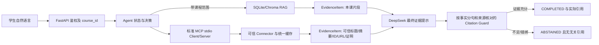

# 最终收尾修复实施设计书（反向技术评审定稿）

> 复核基点：2026-10-02 当前工作树。本文只修改本设计书，不改产品代码、测试、数据库或配置。V1 报告的 351 passed、2 skipped 和 live 记录属于上一轮提供的证据；本轮没有重跑全量测试，也没有把旧隔离库记录当成新产生的 live 证据。行号均按本轮重新读取的源码定位。

反向评审修正了四个实施风险：`RetrievalResult` 实际无 `course_id`，故课程归属须区分索引文档和本地 Markdown 降级；同一长句含多来源时不得靠粗略分句放行；`model_calls` 的成功记录只能与最终提示哈希、证据 ID/URL 及回答引用合并证明 DeepSeek 最终综合；浏览器供应器不可用只留下验收缺口。本文的代码批次数仍为 **3**，取证/验收任务数仍为 **2**。

## A. V1 剩余问题独立裁决

原始课程要求把 MCP 工具、论文/漏洞/标准资料、基于证据的问答、实践与创新列为核心要求，见[题目最终要求.md](C:/Users/Asd/Desktop/edu%20agent/md/题目最终要求.md)第 5–25、69–113 行。因此，可信论文被误拒答、多来源综合被误拒答会影响最终验收。V1 的真实调用结果可证明现象，但旧临时库已删除，无法从旧 run 还原模型原文；本轮用当前纯逻辑进行了两组不写库的反例复核。

**裁决：3 个需要代码处理的批次，2 个仅需补做验收/取证的任务。**

1. **S0，P0 边界加固：条件性课程越界路径，confirmed_defect。** 当前 `AgentOrchestrator._retrieve` 在带 `course_id` 的调用抛 `TypeError` 后，会再次执行无课程参数的检索（[orchestrator.py](C:/Users/Asd/Desktop/edu%20agent/backend/agent/orchestrator.py)第 592–605 行），结果直接转证据（同文件第 638–642 行）。本轮注入只用于复现的 retriever：第一次记录 `course_id=2` 并报 `TypeError`，第二次无范围调用返回课程 A 文档，Agent 状态接纳该证据。它**不是已证明的正常生产 HTTP 越权**；V1 正常权限 HTTP 仍通过，但此失败分支不符合课程隔离的零信任要求，须先封闭。
2. **S1，P1 真实论文引用误拒答，confirmed_defect；对 V1 具体 arXiv run 的唯一根因仍需修复前留证。** [orchestrator.py](C:/Users/Asd/Desktop/edu%20agent/backend/agent/orchestrator.py)第 791–810 行保存外部论文的 `title`、摘要、URL、ID 和内容哈希；[prompts.py](C:/Users/Asd/Desktop/edu%20agent/backend/llm/prompts.py)第 104–126 行给最终模型的证据块没有 `title`；[citation_guard.py](C:/Users/Asd/Desktop/edu%20agent/backend/guards/citation_guard.py)第 111–119 行仅用摘要 `item.text` 判断回答支持。只陈述真实论文标题的回答会被 `UNSUPPORTED_CITATION`，而不匹配标题也拒绝。V1 对应现象一致，但因缺失旧原始回答，不能宣称这就是旧 run 的全部原因。
3. **S2，P1 三工具综合误拒答，confirmed_defect；V1 具体 run 的每句映射仍需留证。** [citation_guard.py](C:/Users/Asd/Desktop/edu%20agent/backend/guards/citation_guard.py)第 135–155 行要求问题中全部编号出现在**每一条**证据中。一个问题同时含论文代号和 `CVE-...` 时，正确的论文引用因没有 CVE 编号被判 `IRRELEVANT_CITATION`。本轮用分别含论文和 CVE 的可信证据、分别带引用的两句回答复现。修复必须逐项判事实与来源，不能全局放宽阈值。
4. **D1，P2 `ask_user→continue` 的 `fallback_used`，test_gap / 语义歧义，暂不列代码缺陷。** [state.py](C:/Users/Asd/Desktop/edu%20agent/backend/agent/state.py)第 47 行只有 run 级累计布尔值；[orchestrator.py](C:/Users/Asd/Desktop/edu%20agent/backend/agent/orchestrator.py)第 653、738、937、994 行分别因检索、工具、模型降级把它置真；成功的 DeepSeek 回答也只做 OR。实际可复核到“向量失败→关键词检索成功、DeepSeek 成功→run `fallback_used=true`”的合法路径。V1 原 run 的分项原因尚无独立证据，不能把 `true` 直接裁为错误。先取证；只有所有分项均未降级而响应仍为 true，才立代码修复批次。
5. **B1，P2 浏览器连续操作，environment_limitation + test_gap。** 当前计算机控制清单只有空的 IAB、MCP Apps 表面，没有 Chrome/Edge 标签页；V1 也未留下学生/教师连续浏览器操作证据。HTTP 和前端单元测试不能替代浏览器体验，但这不能证明产品代码有错。先进行人工/可用浏览器验收；只有可重复的产品故障才另立修复批次。

## B. 已通过且不重复改造的能力

V1 报告所列的 P0 正常权限与课程隔离、J1 可信来源过滤、J2 九工具 Schema/Action Guard、J4 API/MCP 本课知识库一致、J5 描述性 CVE 提取、L2 标准元数据分类、L3 创新案例来源、L4 MCP 超时零迟到写入，以及 arXiv/NVD/GitHub 空缓存首查与缓存复查、MCP stdio、DeepSeek 实调和多种拒答，均作为**受保护回归基线**。这些是 V1 证据，不是本轮重新证明的 live 结果。各批次只补相应回归，不重写 Connector、MCP 协议、权限依赖、资料门户或教师统计。

V1 全量测试统计为 `351 passed, 0 failed, 2 skipped, 0 xfail, 22 warnings`；两个 skipped 是须显式开启的 live smoke，不计入 passed。最终复验仍须报告它们并补独立 live 证据。

## C. 最终问题矩阵

| 编号 / 优先级 | V1 结论与本轮最小复现 | 分类、根因和当前定位 | 是否改代码 / 是否阻止完整答辩 | 完成判据 |
|---|---|---|---|---|
| S0 / P0 边界 | V1 正常跨课 HTTP 403；本轮注入 retriever 使 scoped 调用 `TypeError`、unscoped 调用返回他课文档，证据被接纳 | `confirmed_defect`，`_retrieve` 失败后移除 `course_id`，见 [orchestrator.py](C:/Users/Asd/Desktop/edu%20agent/backend/agent/orchestrator.py)第 592–605、638–642 行 | 改；条件性泄漏未证实为当前生产 HTTP 利用，但零信任验收前必须封闭 | scoped 检索报错时 `ABSTAINED`、零他课证据、零非授权写入；正常本课命中不退化 |
| S1 / P1 | V1 真实 arXiv 回答 `ABSTAINED/UNSUPPORTED_CITATION`；本轮“论文标题在 `title`、摘要不重复标题”的真匹配被拒，假标题也拒 | `confirmed_defect`，标题不入最终提示；守卫支持判断遗漏可信标题，见 [prompts.py](C:/Users/Asd/Desktop/edu%20agent/backend/llm/prompts.py)第 104–126 行、[citation_guard.py](C:/Users/Asd/Desktop/edu%20agent/backend/guards/citation_guard.py)第 111–119 行；V1 旧 run 的精确原句不可恢复 | 改；阻止“真实论文有来源问答”完全通过 | 真匹配标题及摘要事实带 arXiv URL/ID 完成；假标题、虚构结论仍 `ABSTAINED` 且无无关引用 |
| S2 / P1 | V1 三工具各一次却 `IRRELEVANT_CITATION`；本轮合法论文+CVE 两句答案被全局编号规则拒 | `confirmed_defect`，将全问题编号强加每条证据，见 [citation_guard.py](C:/Users/Asd/Desktop/edu%20agent/backend/guards/citation_guard.py)第 80–94、128–163 行 | 改；阻止多源创新综合完全通过 | 论文/CVE/GitHub 各事实只绑对应源，必要来源齐全后完成；错绑、缺源、伪造引用拒答 |
| D1 / P2 | V1 continue 同 run、DeepSeek 成功、响应 `fallback_used=true`；本轮确认关键词检索可合法置真 | `test_gap`，单一累计字段混合检索/工具/模型降级；[state.py](C:/Users/Asd/Desktop/edu%20agent/backend/agent/state.py)第 47 行、[orchestrator.py](C:/Users/Asd/Desktop/edu%20agent/backend/agent/orchestrator.py)第 653、738、937、994、1073 行 | 当前不改；展示时必须说明字段是 run 内任一降级，不能解释成“DeepSeek 失败” | 复现并列出 run、step、model_call、tool_call 的降级来源；若全为 false 而响应 true，才升级为缺陷 |
| B1 / P2 | V1 无浏览器登录后连续操作；本轮计算机控制无可用现成标签页 | `environment_limitation`/`test_gap`；筛选 UI 见 [student.py](C:/Users/Asd/Desktop/edu%20agent/frontend/pages/student.py)第 516 行，产品故障未被证明 | 当前不改；浏览器证据缺口阻止“全部 UI 已验收”的声明 | 人工或可用浏览器完成 L 节清单并留截图、时间、账号角色、请求/结果；失败才按实际路径立项 |

## D. 根因与目标架构



- **范围先于检索。** FastAPI 已有课程鉴权，Agent 的检索服务也必须保持 `course_id`；任何不支持 scoped 签名的 retriever 是配置/接口错误，不能退回无范围查询。课程证据还应二次检查归属。这里仅改 Agent 边界和测试，复用现有 [hybrid_retriever.py](C:/Users/Asd/Desktop/edu%20agent/backend/rag/hybrid_retriever.py)第 61–89 行的课程过滤。
- **按实际数据形状核对归属。** `RetrievalResult` 只有 `document_id/chunk_id/metadata`，没有 `course_id`（[hybrid_retriever.py](C:/Users/Asd/Desktop/edu%20agent/backend/rag/hybrid_retriever.py)第 18–34 行）。`document_id>0` 时，可用现有 `LearningLogger.document(id)` 的 `course_id` 和 `chunks_for_document(id)` 的 `chunk_id` 核对（[logger.py](C:/Users/Asd/Desktop/edu%20agent/backend/storage/logger.py)第 892–904、1952–1964 行）；`document_id=0` 是 Agent 自己的本地 Markdown 降级形式（[orchestrator.py](C:/Users/Asd/Desktop/edu%20agent/backend/agent/orchestrator.py)第 1124–1149 行），只能在当前课程选定的本地目录分支产生并使用，不能接受外部 retriever 任意返回的 `0`。上传文档的 `visibility` 目前固定默认 `course`，`class_id` 是上传归属字段，不能在本批擅自把课程资料改成班级私有资料（[main.py](C:/Users/Asd/Desktop/edu%20agent/backend/main.py)第 1015–1024 行、[logger.py](C:/Users/Asd/Desktop/edu%20agent/backend/storage/logger.py)第 770–779 行）。班级范围继续针对用户、教师统计和 Agent run 权限回归。
- **证据结构保留来源。** `EvidenceItem` 已有 `title/text/source_url/external_id/resource_type/content_hash/trusted`，见 [llm/schemas.py](C:/Users/Asd/Desktop/edu%20agent/backend/llm/schemas.py)第 10–31 行；`Citation` 已有对应的 URL、ID、类型与交付字段，见 [backend/schemas.py](C:/Users/Asd/Desktop/edu%20agent/backend/schemas.py)第 6–22 行。无须迁移或引入新实体。可信标题要进入最终 DeepSeek 提示，并仅支持“该论文的名称/存在”等标题事实；摘要/正文结论仍须由 `text` 支持。
- **逐事实核对。** Agent 已将可信工具结果加入 `state.evidence`（[orchestrator.py](C:/Users/Asd/Desktop/edu%20agent/backend/agent/orchestrator.py)第 763–812 行），最终 `LLMRequest` 发送整组证据给 DeepSeek（同文件第 874–907 行）。原始 `Observation.content` 不直接进入最终模型；它应先经过可信来源转证据。提示模型每个可核验事实单独一句/条并就近标注引用；守卫按句/条抽取事实及引用，逐源检查，再做全问题必要来源覆盖。多个来源同句难以安全拆分时，要求重述或拒答，不能推定任一引用支持整句。
- **run 降级语义。** 现有 `fallback_used` 是“本 run 任一检索、工具或模型回退发生”的累计值，而非“最终生成是否 DeepSeek”。`provider/model` 描述最终生成者，[backend/schemas.py](C:/Users/Asd/Desktop/edu%20agent/backend/schemas.py)第 43–68 行。D1 先核证具体来源，不立即更改旧字段语义。

## E. 最终收尾修复批次

### S0：检索异常时保持课程范围（P0 边界，先执行）

1. **目标/非目标**：消除 Agent 非 scoped 重试及任何返回他课课程证据的机会；不改现有 RBAC、MCP J4 查询或数据库表。
2. **调用链/根因**：`POST /api/chat` 已鉴权并形成 `state.course_id` → `_retrieve` 带课程检索 → `TypeError` 后无范围重试 → 返回结果未经课程复核即入 `state.evidence`。[orchestrator.py](C:/Users/Asd/Desktop/edu%20agent/backend/agent/orchestrator.py)第 592–605、638–653 行。
3. **技术方案**：删除无范围重试。对 `TypeError` 与其他检索异常统一进入已有 `RETRIEVER_FAILED` 受控拒答；旧测试替身应支持 `course_id`，生产路径不能舍弃范围。对 `document_id>0`，每条结果在入证据前要求 `storage.document(document_id).course_id == state.course_id`，并确认 `chunk_id` 属于该文档；若找不到记录、ID 不匹配或核对失败，整批拒答，不用部分结果拼接回答。对 `document_id=0`，只允许 `_retrieve` 在 `response.results` 为空之后，亲自从 `_local_fallback_dir(state.course_id, storage)` 构建的本地结果进入状态；拒绝被注入 retriever 直接返回的 `0`。本地文件读取继续受 `list_knowledge_files` 的当前目录匹配约束（[loader.py](C:/Users/Asd/Desktop/edu%20agent/backend/rag/loader.py)第 15–35 行），不能由结果中的 `source` 反向拼接任意路径。
4. **具体改动**：[orchestrator.py](C:/Users/Asd/Desktop/edu%20agent/backend/agent/orchestrator.py)第 601–605 行移除重试；第 627–642 行将索引文档与本地降级结果分流并做上述核对，保留现有异常分支第 606–625 行；不改 `RetrievalResult` 或数据库结构。若性能需要，单次调用中对文档 ID 做局部去重核对。
5. **State / Citation / API / 数据库**：失败时 `ABSTAINED/RETRIEVER_FAILED`、无课程证据与引用；`POST /api/chat` 保持旧请求/响应结构，受控错误可在 `stop_reason` 中表达；无迁移、无配置变更、无 MCP Schema 改动。
6. **先失败后通过**：注入 retriever：带 `course_id=2` 时 `TypeError`，无参时返回 A 文档；修前能调用第二次并入证据，修后只调用一次、拒答。另注入 `document_id>0` 属 A 的结果及伪造的 `document_id=0`，均不得入 B 证据。正例本课索引检索和本课程目录 Markdown 降级仍完成；跨用户/跨课/无归属、管理员与 J4 API/MCP 一致性继续通过。断言拒绝路径**业务数据表**零非授权写入；允许已有 agent 审计日志记录拒绝尝试。
7. **验收**：隔离 SQLite/Chroma 跑单测与真实 HTTP `POST /api/chat`；学生 B 问 A 独有标记，预期 403 或 `ABSTAINED`（取决于请求范围），无 A 引用；本课标记完成且有本课 `document_id/chunk_id`。检查同一课程 MCP `course_retriever` 不受影响。
8. **风险/回滚/DoD**：风险是旧 retriever 替身与某些无签名插件不再兼容；只恢复本批补丁及其测试可回滚代码，但不能重新允许无范围重试。DoD：所有 Agent 课程证据有可核验课程归属，异常路径不泄露，P0/J4 回归通过。

### S1：可信论文标题与摘要分层支持（P1）

1. **目标/非目标**：匹配的真实 arXiv 论文能被 DeepSeek 引用并通过守卫；不削弱虚构论文、无来源或假标题的拒答，不修改论文 Connector/缓存。
2. **调用链/根因**：MCP 资源 → `_trusted_tool_evidence` 形成带标题的 `EvidenceItem`（[orchestrator.py](C:/Users/Asd/Desktop/edu%20agent/backend/agent/orchestrator.py)第 763–810 行）→ `_format_evidence` 漏标题（[prompts.py](C:/Users/Asd/Desktop/edu%20agent/backend/llm/prompts.py)第 104–126 行）→ `_supports_answer` 仅看摘要（[citation_guard.py](C:/Users/Asd/Desktop/edu%20agent/backend/guards/citation_guard.py)第 111–119 行）→ `UNSUPPORTED_CITATION` → Agent `ABSTAINED`（[orchestrator.py](C:/Users/Asd/Desktop/edu%20agent/backend/agent/orchestrator.py)第 971–980 行）。
3. **技术方案**：把 `title` 当成经过长度限制和现有安全清洗的**证据数据**，放进对应 `[Sx]` 的最终模型证据块，不能将其解释为系统指令；仅对已通过 `_is_trusted_resource` 来源核验、可定位、带 URL/ID/哈希的外部论文，把标题用于“名称/存在”事实匹配。论文技术结论仍须由摘要 `text` 支持；新增具体实体、年份、数值、否定或因果断言若不在对应证据中出现，不能因为共享两个关键词就放行。不能简单把标题拼入摘要、降低重叠阈值或让标题支持任意论断。先保存安全的原始回答哈希和脱敏事实片段，分辨 V1 型误拒与模型自身无依据断言。
4. **具体改动**：[prompts.py](C:/Users/Asd/Desktop/edu%20agent/backend/llm/prompts.py)第 104–126 行；[citation_guard.py](C:/Users/Asd/Desktop/edu%20agent/backend/guards/citation_guard.py)第 87–119 行增设事实类别判断/标题支持；保留 [orchestrator.py](C:/Users/Asd/Desktop/edu%20agent/backend/agent/orchestrator.py)第 791–810、1103–1121 行的原字段映射，不改外部资源入库。
5. **State / Citation / API / 数据库**：状态仍由 Guard 决定，匹配为 `COMPLETED`、错配为 `ABSTAINED`；响应引用原有 `title/source_url/external_id` 字段，不新增必填字段；`POST /api/chat` 向后兼容；无迁移、无 MCP Schema 或前端必改项。
6. **先失败后通过**：两组反例同时测试：可信论文标题匹配但摘要不重复标题，应允许“论文题名”句；同摘要配错误标题或不同 URL/ID，必须拒绝。另测“标题匹配但摘要没有支持的技术结论”、添写证据外数值/年份/因果、否定原摘要、提示词注入标题继续拒绝或被安全处理；来源 `fake/unknown` 不得入证据，引用 URL/哈希不完整拒绝，无引用拒答。使用真实 arXiv 空缓存 live 与二查 cache；将模拟测试与 live 结果分开记录。
7. **验收**：隔离库中经真实 MCP stdio `paper_search_real` 取得可信论文，HTTP 自然语言问题触发 DeepSeek 最终生成（模型调用 `generate_answer`、`fallback_used=false`）；检查 run_id、工具调用、证据的标题/摘要/URL/ID、引用数组与 Guard 结果。另问不匹配论文，预期 `ABSTAINED` 且 `citations=[]`。
8. **风险/回滚/DoD**：标题是外部不可信文本，继续用现有安全清洗；错误地把标题当全文会导致幻觉放行，必须用反例拦截。S1 仅回滚本批 prompt/guard 改动及新增测试。DoD：真匹配、假匹配、无依据结论三类均按预期；论文回答有真实 arXiv 来源，DeepSeek 真实最终综合可核查。

### S2：多来源事实与引用一一对应（P1，依赖 S1）

1. **目标/非目标**：论文+CVE+GitHub 综合回答完成且逐项有正确来源；不自动把所有工具结果附到答案，也不关闭 Guard/把阈值降至无效。
2. **调用链/根因**：三次 MCP 工具结果各入 `state.evidence` → DeepSeek 生成带 `[Sx]` 的回答（[orchestrator.py](C:/Users/Asd/Desktop/edu%20agent/backend/agent/orchestrator.py)第 874–907 行）→ Guard 当前对每项运行全问题编号规则（[citation_guard.py](C:/Users/Asd/Desktop/edu%20agent/backend/guards/citation_guard.py)第 70–94、135–163 行）→ 正确论文项因缺 CVE 而被拒。`_claim_for_citation` 第 128–132 行只按句/换行抽取，复合句可能把两个事实合在同一段。
3. **技术方案**：最终回答提示要求“每个事实一条，紧邻对应 `[Sx]`”。Guard 按句/列表项提取 claim 与引用；**每个含事实的单元必须有就近引用**，引用要逐一支持该单元中的其对应事实。单元含多个独立事实且无法确定各自引用时保守拒答，首版不追加模型重写轮次，以免打乱已有 max_steps/超时语义。显式 CVE、论文 ID、仓库名、年份和数值应在对应证据的适当字段找到；不得仅凭共享两个泛化词认定支持。全问题要求的资源类型/编号由**已验证的引用集合整体**覆盖，保留 [orchestrator.py](C:/Users/Asd/Desktop/edu%20agent/backend/agent/orchestrator.py)第 981–992 行的必需来源检查；不要求每一条论文证据都包含 CVE 编号。若外部结果本身缺少完整证据，继续拒答。保持伪造、无定位、离题及跨课程拒答。
4. **具体改动**：[citation_guard.py](C:/Users/Asd/Desktop/edu%20agent/backend/guards/citation_guard.py)第 80–94、128–177 行，必要时 [prompts.py](C:/Users/Asd/Desktop/edu%20agent/backend/llm/prompts.py)第 104–126 行及回答系统提示；[orchestrator.py](C:/Users/Asd/Desktop/edu%20agent/backend/agent/orchestrator.py)第 971–996 行仅在需要时传递原有 `required_sources`/完整问题，不绕过判定。`EvidenceItem`、`Citation` 可保持现有字段。
5. **State / Citation / API / 数据库**：三种工具 Observation 仍先转可信 Evidence；只输出实际被引用的来源，`COMPLETED` 要求所有必要类别各有被支持的 claim；缺一为 `ABSTAINED`。旧 API 路径及字段不变；无数据库迁移、MCP Schema、配置或前端强制变更。
6. **先失败后通过**：最小 2 源编号题当前失败、修后通过；3 源同类测试。负例：论文事实绑 NVD、CVE 事实绑 arXiv、GitHub 仓库链接绑论文、只引用一源、混合一长句无法定位、某个事实无引用、虚构编号或数值、fake/unknown、课程 A 证据给课程 B、离题问题，都必须拒答且无无关引用。断言工具仅各调用一次；最终 `generate_answer` 的证据 ID/URL/内容哈希与实际 Prompt 哈希一致，成功模型调用为 `deepseek` 且 `fallback_used=false`，实际回答的事实/来源可人工逐条核对。直接 Connector 成功或 MCP 调用成功均不足以满足此项。
7. **验收**：空缓存隔离库经 HTTP `POST /api/chat` 只输入自然语言综合问题 → DeepSeek 决策 → 标准 MCP 三工具 → 同库资源及来源证明 → Agent Evidence → DeepSeek 最终综合 → Guard；记录 run_id、step、tool_call、model_call 的 `purpose/provider/model/success/fallback_used`，`answer_prompt_sha256` 与 `provider_prompt_sha256` 是否一致，来源 URL/哈希、实际引用数量与最终状态。工具动作应恰为必要集合、每个工具至多一次，不能 `MAX_STEPS`；二次同问应准确标记 cache，不误报 live。先用可复现的本地测试证明逻辑，再用 live 结果证明真实服务链路，二者分别报告。
8. **风险/回滚/DoD**：主要风险是规则过松导致错绑、过严导致新误拒；负例与正例必须同时过。S2 对同一 Guard 文件依赖 S1，单独回滚用 S2 提交的反向补丁，保留 S1；若当前目录仍非 Git 仓库，先保存本批受影响文件的内容哈希与工作区外备份，不擅自 `git init`。DoD：多工具正确答案完成、错绑/缺源拒答、J1/J2/J4/J5/L2/L3/L4/P0 均回归通过。

### D1：continue 降级标志取证（仅验收任务，不预先改代码）

1. 在**隔离** SQLite/Chroma 产生全新 `ask_user→continue` run，同一 `run_id` 下对比 `POST /api/chat`、`POST /api/agent/runs/{run_id}/continue` 的 `provider/model/fallback_used`，以及检索 Observation、工具调用、逐条 `model_calls.fallback_used`；只记录配置是否存在，不读密钥值。
2. 先写出唯一的旧 API 解释：`ChatResponse.fallback_used` 为 run 内**任一组件**回退；`provider/model` 是最终生成者。DeepSeek 成功但关键词检索降级时 true 正确；DeepSeek 成功且检索/工具均未降级时 false；TemplateProvider 最终生成时 true。`GET /api/agent/runs/{run_id}` 当前 [AgentRunResponse](C:/Users/Asd/Desktop/edu%20agent/backend/schemas.py)第 80–92 行不含该字段，不把“未返回”说成不一致。
3. 如果确认“全分项均未回退而 continue true”，另立最小代码任务，检查 [orchestrator.py](C:/Users/Asd/Desktop/edu%20agent/backend/agent/orchestrator.py)第 161 行恢复状态和第 653、738、937、994、1073 行汇总；仅修错误写入点，旧布尔语义不变。该条件未证实前不修改 API/数据库/前端。

### B1：浏览器真实操作（仅验收任务，不预先改代码）

用当前环境可用浏览器、已有测试框架或用户人工浏览器完成 L 节；记录截图、时间、角色、课程/班级、请求结果。浏览器自动化供应器不可用是验收条件限制，不是产品缺陷。若人工流程失败，按最小 UI/API 复现另立代码批次；不引入 React、Playwright 或其他大型框架只为让自动化工具可点击。

## F. API 和数据结构变化

| 批次 | API 路径/契约 | Agent / Citation / Observation | SQLite / Chroma / MCP / 配置 |
|---|---|---|---|
| S0 | `POST /api/chat` 路径和字段不变；异常按现有 `run_status/stop_reason` 受控拒答 | 检索异常不产生跨课 Evidence，Observation 记录 `RETRIEVER_FAILED` | 无迁移；沿用课程过滤；MCP 不变；无新变量 |
| S1 | `POST /api/chat`、`GET /api/agent/runs/{run_id}` 字段不变，Citation 保留 `title/source_url/external_id` | 最终提示包含可信标题；标题只支持身份事实 | 无迁移、无缓存重建、无 MCP Schema 变化 |
| S2 | 同上 | claim-to-citation 校验和总体必要来源覆盖；只返回实际引用 | 无迁移、无 MCP Schema 变化 |
| D1/B1 | 不预设变化 | 仅观察现有 run 与页面 | 不改库、配置或前端 |

**数据库迁移：0 项。** 不得借“修复”重写历史资源、清除失败缓存或正式演示库。现有 `EvidenceItem` 和 `Citation` 字段已够用。若执行者发现确需增加持久字段，应停止该批，先提交新增迁移设计（备份、幂等、回填、反向迁移）供复核，不能边做边扩大范围。

## G. 测试与验收矩阵

| 场景 | 证据类型与预期 |
|---|---|
| scoped retriever `TypeError`、他课诱饵 | 单元先红后绿：只调用一次、`ABSTAINED`、零他课引用；隔离 HTTP 跨课 403/拒答、零写入 |
| 真匹配 arXiv 标题与摘要 | 单元真/假配对；真实空缓存 MCP+HTTP+DeepSeek：`COMPLETED`、arXiv URL/ID、可定位引用、最终模型非 fallback |
| 不匹配/不存在论文、虚构 CVE | `ABSTAINED`、`citations=[]`、不注入别的来源 |
| 论文+CVE+GitHub 综合 | 三工具各最多一次；`model_calls` 证明最终 DeepSeek 收到三组可信 Evidence；每条事实映射正确 URL；三类引用齐全 |
| 错误交叉引用、缺一来源、混合无法归属句 | Guard 拒答；不得靠附加所有来源或调低阈值通过 |
| 离题/跨课/fake/unknown | 离题 `ABSTAINED`；跨课证据零进入；不可信来源零进入学生回答/创新推荐 |
| ask_user→continue | 同一 run_id；分项降级与总 `fallback_used` 一致；DeepSeek 正常且无其他降级为 false，Template/真实降级为 true |
| MCP 标准协议与超时 | stdio 握手、工具列表、合法/缺参/超时；超时前记录 `external_resources/resource_query_cache_items/resource_provenance` 行数与 sync run，客户端收到 `TOOL_TIMEOUT/isError=true` 后等待超过服务端受控慢任务完成时间，再查三表及 sync run，均无迟到成功/重复写入；不要仅凭客户端返回断定任务已停止。沿用 [test_mcp_tools.py](C:/Users/Asd/Desktop/edu%20agent/tests/test_mcp_tools.py)第 165–199 行的协议测试 |
| 浏览器学生/教师 | 完成 L 节，保留实际截图和结果；前端单测/HTTP 仅作辅助 |
| 全量回归与 live | 修后运行现有 `.venv\Scripts\python.exe -m pytest`；报告 passed/failed/skipped/xfail/warnings。每种 live 首查需同时具备空缓存、外部 HTTP 结果、SUCCESS/失败 sync run、来源 URL/时间/逐行证明和第二次 cache 状态；区分 429/超时/密钥缺失，不能用 mock、直接 Connector、旧缓存替代 Agent 完整链路。以至少 12 个新自然语言问法覆盖本课、真实/假论文、真/假 CVE、标准、GitHub、多工具、实践、创新、ask_user→continue、离题和跨课 |

优先复用 `tests/test_citation_guard.py`、`tests/test_l1_agent_grounding.py`、`tests/test_agent_resume.py`、`tests/test_j4_course_scope.py`、`tests/test_j1_resource_provenance.py`、`tests/test_mcp_client.py`、`tests/connectors/test_real_connectors.py`。新增测试名由执行者按当前目录约定确定；V1 已通过的测试不能降低断言。

## H. 实施顺序和依赖

```text
S0（范围失败关闭，P0）
  └── S1（真实论文标题/摘要，P1）
        └── S2（多来源事实/引用，P1）

D1（continue 降级取证）可与 S1 的只读分析并行；若证实代码缺陷，再单列小批。
B1（真实浏览器验收）在 S0–S2 完成后执行；可提前准备账号和清单。
```

建议每批单独提交/保存补丁并验收。当前项目若不是 Git 仓库，不执行 `git init`，也不宣称有提交；采用批前文件哈希、外部备份和逐批补丁记录。三个代码批次分别建议说明：`fix(agent): fail closed on course-scoped retrieval`、`fix(citations): ground verified paper titles`、`fix(citations): validate multi-source claims individually`。

## I. 风险与回滚

- **备份**：每批前记录受影响文件及隔离库路径/哈希；产品正式 SQLite/Chroma 只读。若需要修改演示数据，另行授权；本设计无数据库迁移。
- **S0 回滚**：仅回退本批 Agent 检索改动；若回退会重开跨课失败分支，则不得继续答辩，应先修复兼容性而非恢复不安全重试。备份应置于项目内单独的 `.repair-backups/<batch>` 或受控临时目录，记录哈希和恢复命令；不得假定不存在的 Git 提交可用于回滚。
- **S1/S2 回滚**：同一 Guard 文件按批次反向应用补丁，S2 可单独撤销并保留 S1；保留失败例、原始回答哈希与测试日志。不能清空历史缓存掩盖问题。
- **网络与模型风险**：arXiv、NVD、GitHub 的本次 live 结果必须与本地 cache/fake 分开；Semantic Scholar 429 归类为第三方限流。DeepSeek 密钥只查是否配置，不打印值。live 不可达时不能把 mock 或旧缓存记为本轮通过。
- **回归风险**：引用校验一放宽就可能引入虚假事实或跨源绑定；S0 可能使不支持 `course_id` 的测试替身失败。反例与权限零写入断言是强制门槛。

## J. 最终通过标准

1. S0–S2 的正例和负例均通过，任何课程越界路径、伪造来源、无依据事实均拒答；P0 正常权限与条件异常路径一起通过。
2. 匹配真实论文 `COMPLETED` 且引用 arXiv；不匹配/不存在论文拒答；论文+CVE+GitHub 综合由 DeepSeek 最终生成、三工具必要且不重复、各事实有正确来源。
3. D1 列明 run/step/model/tool 分项，`fallback_used` 的唯一既定语义是“本 run 任一检索、MCP/工具或模型回退曾发生”；不能把它读作“最终回答由 TemplateProvider 生成”。`provider/model` 仍指最终生成者；在 `REQUIRES_INPUT` 尚未生成最终回答时，这两个字段的默认显示不作为已调用模型的证据。若发现真正汇总错误，追加最小修复并重新验收。
4. B1 有学生、教师真实浏览器连续操作证据；若环境仍不可用，只能写“UI 未验收”，不能宣称完全通过。
5. 全量 pytest 实际结果、两个 live skipped 原因、独立 live 首查/缓存复查、MCP stdio/超时、P0 与 J1/J2/J4/J5/L2/L3/L4 回归均在最终报告中给出。测试全绿本身不代替原始课程要求验收。

## K. 可直接交给 VS Code Codex 的逐批执行提示词

**总数：3 个代码修复批次（S0、S1、S2），2 个非代码验收任务（D1、B1）。一次只发送一段，确认上一段的差异和测试后再发送下一段。第一条先发 S0。**

### 第 1 条：S0（代码修复）

```text
项目 C:\Users\Asd\Desktop\edu agent。请先阅读 md\题目最终要求.md 和 md\最终收尾修复实施设计书.md 的 S0、F、G、I 节。只执行 S0：修复 backend\agent\orchestrator.py 中 _retrieve 带 course_id 的检索发生 TypeError 后无范围重试，以及返回证据缺少课程归属核对的问题。先写隔离测试复现“课程 B scoped 调用失败、unscoped 会返回 A 文档”，确认修前失败；再做最小 fail-closed 修改。保留旧 API，不能重构 RBAC、MCP、Connector，不改正式数据库，不读/输出 .env 密钥。运行 S0 定向测试、权限跨课测试、J4 课程检索回归，报告前后证据、HTTP 状态、零写入和实际修改文件。当前目录若非 Git 仓库，不要 git init；保存可单独回滚的差异。完成后停止，不执行 S1。
```

### 第 2 条：S1（代码修复）

```text
项目 C:\Users\Asd\Desktop\edu agent。先确认 S0 已通过并阅读 md\最终收尾修复实施设计书.md 的 S1、G、I 节。只执行 S1：在 backend\llm\prompts.py 给 DeepSeek 的可信证据块加入经过安全处理的论文 title；在 backend\guards\citation_guard.py 让真实可信标题只支持论文身份/标题事实，摘要或正文结论仍须由 text 支持。先做“真实标题匹配”和“错误标题/无依据结论”成对红绿测试，不许关闭 Guard、降低到无效阈值或自动附全部来源。用隔离 SQLite/Chroma、真实 MCP stdio + HTTP + DeepSeek 验证至少一篇空缓存 arXiv 首查与二查 cache，记录最终 model_call、run_id、URL、引用和状态；网络故障与代码故障分开。保留 API/数据结构兼容，不改正式库和 .env，不输出密钥。运行 J1、L1、P0、J4 回归，报告差异与回滚办法。完成后停止，不执行 S2。
```

### 第 3 条：S2（代码修复）

```text
项目 C:\Users\Asd\Desktop\edu agent。先确认 S0、S1 已通过并阅读 md\最终收尾修复实施设计书.md 的 S2、G、I 节。只执行 S2：修正 backend\guards\citation_guard.py 对多工具问题把全部编号强加每条引用的逻辑；按每句/每项事实验证对应来源，并保持全问题必需来源覆盖。先写论文+CVE+GitHub 正例和论文事实错绑 NVD、CVE 错绑 arXiv、缺来源、假引用、跨课、离题等负例的红绿测试。不能关闭 Guard、全局放宽阈值或追加所有工具来源。隔离库真实 HTTP 自然语言问题必须经过 DeepSeek 决策、标准 MCP 三工具、可信 Evidence、DeepSeek 最终综合；核对三工具各最多一次、model_call 输入证据、实际 URL、每项引用、COMPLETED/ABSTAINED。跑全量 pytest、权限及 J1/J2/J4/J5/L2/L3/L4 回归，报告 passed/failed/skipped/xfail/warnings，保留批次独立回滚差异。完成后停止。
```

### 第 4 条：D1（只取证，不预设修代码）

```text
项目 C:\Users\Asd\Desktop\edu agent。阅读 md\最终收尾修复实施设计书.md 的 D1。只用隔离 SQLite/Chroma 新建 ask_user→continue run，记录同一 run_id 的 run/step/model_call/tool_call、检索 fallback、DeepSeek/TemplateProvider 及 POST /api/chat、POST /api/agent/runs/{run_id}/continue 的 fallback_used。按“本 run 任一组件回退”解释旧布尔字段，分别验证无降级 DeepSeek=false、关键词/工具真实降级=true、TemplateProvider=true。若全分项都 false 而响应 true，先提交证据和最小新修复设计，不要顺手改 API 或正式数据库；如标志合理，明确判定 V1 为语义误解/验收缺口。不要读取或输出 .env 值。
```

### 第 5 条：B1（只做浏览器验收）

```text
项目 C:\Users\Asd\Desktop\edu agent。阅读 md\最终收尾修复实施设计书.md 的 B1 和 L 节。只做学生端、教师端真实浏览器连续操作验收；优先使用当前已有可用浏览器工具，否则使用项目已安装框架，再否则请我按清单人工操作并提供截图。不要为适配自动化工具修改产品架构或安装大型前端依赖。记录每步角色、课程、时间、可见结果和相应 HTTP 状态。若只是浏览器供应器不可用，写 environment_limitation；若人工可重复失败，给出最小产品复现、代码位置和独立新修复建议。验收后关闭本轮启动的服务。
```

## L. 浏览器人工验收清单

请使用隔离演示数据和两个课程、两个班级、两名学生、两名教师、一个无授权账号；截图避开密码、Token 和 `.env`。每项记录“时间、账号角色、课程/班级、操作、页面结果、对应请求状态”。

1. 学生登录、首次改密（如适用）、退出；退出后直接打开学生深链接应被要求登录。
2. 学生查看使用说明、课程简介、考核方式、专题导航；本课问答显示 DeepSeek 生成标记、run_id、课程引用。
3. 学生查真实论文、CVE、标准、GitHub：显示标题、来源 URL、来源类型及 live/cache/local 区别；切换专题后旧结果失效，新结果与筛选条件一致。
4. 学生自然语言综合提问触发工具轨迹和逐项引用；问不存在论文、虚构 CVE、离题问题，应拒答且无无关引用。
5. 学生完成六步实践指导、创新案例推荐与追问、`ask_user→continue` 同 run；断网或工具超时显示受控降级，不伪称实时联网。
6. 教师登录本课程：上传文档、查看 PENDING、建立索引变 INDEXED；学生能检索刚上传的本课文档并引用。
7. 教师查看访问、学习轨迹、模块统计、聚类审批/改名/合并或拆分、卡点、FAQ JSON/CSV；跨课管理被拒，管理员正向权限可用。
8. 对学生资料门户和教师筛选各连续切换两次，不刷新、刷新后均核对课程范围；记录失败时浏览器控制台错误与 HTTP 状态，不把“页面能打开”当作流程完成。
