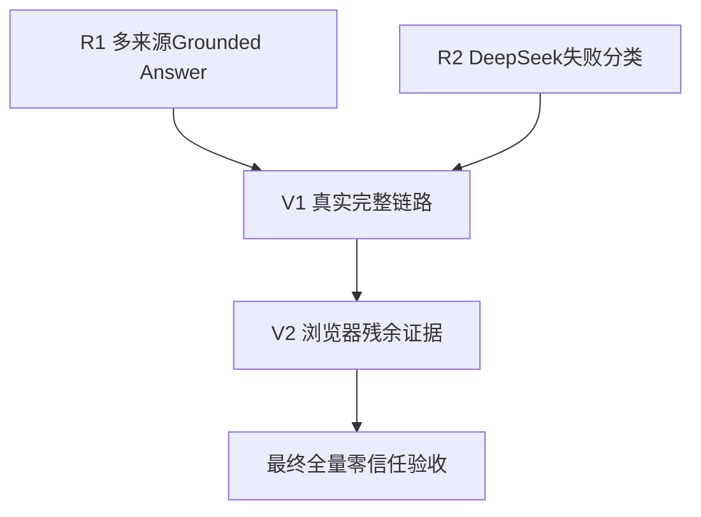

# 《最终残余问题修复计划》反向技术评审与最终执行版

本轮未修改代码、测试、配置或数据库，也未创建 Markdown 文件。以下内容可直接复制保存。

## 结论摘要

- **确认的课程功能代码缺陷：1 个**
- **确认的审计可观测性问题：1 个**
- **尚未确认的运行故障：1 个**
- **环境限制：1 类**
- **代码修复批次：2 个**
- **纯验收批次：2 个**
- **数据库迁移：0 个**
- **API 契约变更：0 个**
- **新增框架或基础设施：0 个**

推荐顺序：

```text
R1 多来源回答结构化绑定
  ├── R2 DeepSeek失败分类与脱敏审计（可并行）
  ↓
V1 真实外部工具与DeepSeek完整链路验收
  ↓
V2 浏览器残余证据补验
  ↓
最终全量零信任验收
```

上一版提出修改 Citation Guard 的方案存在扩大放行面的风险。本版已经修正为：

> **保持 Citation Guard 原有判定不变，通过结构化生成、原文证据锚点和确定性渲染解决跨语言映射问题。**

---

# A. 反向技术评审结果

| 检查项 | 裁决 | 修正情况 |
|---|---|---|
| 1. ConnectError 是否误判为产品缺陷 | 没有。A2 非沙箱 live 成功，本轮又出现 SSL EOF，属于环境差异 | 保持为 `environment_limitation` |
| 2. 是否真正复现 `MODEL_ANSWER_FAILED` | **没有在当前代码和当前调用中复现** | 不再声称已经定位其底层根因 |
| 3. 是否区分请求、解析、Guard和Template | 上一版基本区分，但对旧失败归因仍过强 | 本版建立四阶段判定 |
| 4. 是否把 Connector 成功当成 Agent 成功 | 没有 | V1 保留四层 Gate |
| 5. 是否计划放宽 Citation Guard | 上一版存在这一风险 | 本版明确禁止修改 Guard 核心判定 |
| 6. 是否遗漏 `/student` 空白页 | 没有遗漏，但应标记为已修复 | 从修复任务移除 |
| 7. deterministic fallback 漏报 | 当前已修复 | 从修复任务移除 |
| 8. 浏览器环境限制是否变成代码任务 | 没有 | 继续作为 V2 纯验收 |
| 9. 文件/API/数据库是否一致 | 基本一致 | 本版重新校准当前行号和函数 |
| 10. 批次依赖是否完整 | 上一版对诊断与 live 复验的关系不够明确 | V1 明确依赖 R1、R2 |
| 11. 是否先失败再通过 | 上一版 R1 的失败样本不够结构化 | 本版要求保存原始失败样本与阶段结果 |
| 12. 是否保护已通过功能 | 是 | 增加明确禁止修改清单 |
| 13. 是否引入新框架/迁移 | 没有 | 保持现有技术栈和数据库 |
| 14. 是否区分代码、环境、验收 | 基本做到 | 本版单独设立裁决矩阵 |
| 15. 提示词是否可直接执行 | 上一版 R1 技术边界仍有歧义 | 本版给出 4 个完整提示词 |

---

# B. 新增的最小反向复核证据

## B1. 仅强化提示词不能稳定解决问题

保持当前 Citation Guard 不变，要求 DeepSeek：

- 输出 S1、S2、S3；
- 保留原始 external_id；
- 复制英文证据原句；
- 每项附一个引用。

实际结果：

```text
DeepSeek请求成功
provider=deepseek
fallback_used=false
引用包含S1、S2、S3
Citation Guard=MISSING_CLAIM_CITATION
```

原因是模型输出了多个句子，引用只位于列表项末尾。Guard 按事实句切分后，部分事实单元没有相邻引用。

这证明单纯调整提示词不足以稳定修复。

## B2. 保持 Guard 不变的结构化渲染可以通过

使用相同证据，将每个来源渲染为单独一行：

```text
中文学习用途 + 证据原文片段 + 单一相邻引用
```

实际结果：

```text
Citation Guard ok=true
error_code=None
```

因此最安全的修复方向是：

```text
DeepSeek生成结构化claim
→ 校验source_id与原文quote
→ 确定性渲染为一条claim一个引用
→ 继续经过现有Citation Guard
```

不需要降低 Guard 阈值。

---

# C. 修订前后问题数量变化

| 分类 | 修订前 | 修订后 |
|---|---:|---:|
| 课程功能代码缺陷 | 1 | 1 |
| 审计可观测性代码问题 | 1 | 1 |
| 代码修复批次 | 2 | 2 |
| 纯验收批次 | 2 | 2 |
| 数据库迁移 | 0 | 0 |

数量没有变化，但问题定义发生了重要修正：

### 修订前

1. Citation Guard 跨语言支持算法需要调整。
2. DeepSeek 失败信息不足。

### 修订后

1. **最终回答缺少稳定的结构化 claim→source→quote 绑定。Citation Guard 保持不动。**
2. **模型失败审计信息不足，但它不等于已经定位或修复旧 `MODEL_ANSWER_FAILED`。**

旧 `MODEL_ANSWER_FAILED` 本身改为：

```text
尚未确认的运行故障
```

只有重新复现后才能判断是否还存在 Provider 产品缺陷。

---

# D. 当前问题裁决矩阵

| 编号 | 优先级 | 分类 | 问题 | 是否代码修复 |
|---|---|---|---|---|
| D1 | P1 | confirmed_defect | 多来源最终回答没有稳定的 claim→source_id→evidence_quote 结构，导致中文概括英文证据时被 Guard 拒绝 | 是 |
| D2 | P2 | confirmed_observability_defect | `MODEL_ANSWER_FAILED` 只保留顶层异常类型，无法安全区分 transport/timeout/API/empty/parse | 是 |
| U1 | P1待定 | unconfirmed | 旧 A2 的 DeepSeek `MODEL_ANSWER_FAILED` 是否仍能复现 | 否，先复验 |
| E1 | — | environment_limitation | 不同执行环境出现 ConnectError/SSL EOF | 否 |
| T1 | P2 | test_gap | 浏览器 `TOOL_TIMEOUT` 页面证据 | 否 |
| T2 | P2 | test_gap | 完整创新流程和管理员截图 | 否 |

---

# E. 已修复且禁止重复开发的项目

## E1. `/student` 深链接

当前主入口已经在[frontend/app.py](</C:/Users/Asd/Desktop/edu agent/frontend/app.py:45>)执行：

```python
if not st.session_state.get("auth_token"):
    st.info("请先在侧边栏登录。")
    return
```

学生页也在[student.py](</C:/Users/Asd/Desktop/edu agent/frontend/pages/student.py:33>)执行独立认证短路。

退出清理位于[frontend/app.py](</C:/Users/Asd/Desktop/edu agent/frontend/app.py:178>)。

针对性测试：

- `test_anonymous_main_short_circuits_before_business_pages`
- `test_student_deep_link_requires_login`
- `test_clear_auth_session_removes_all_user_scoped_state`

已通过。

因此 `/student` 不再是修复任务，只保留最终浏览器回归。

## E2. fallback_used

当前 Planner 失败后的 deterministic 接管已经在[orchestrator.py](</C:/Users/Asd/Desktop/edu agent/backend/agent/orchestrator.py:253>)：

- `model_calls.fallback_used=True`
- metadata 记录 `deterministic_evidence_policy`
- `state.fallback_used=True`

Retriever 异常和范围失败在[orchestrator.py](</C:/Users/Asd/Desktop/edu agent/backend/agent/orchestrator.py:611>)保持：

```python
fallback_used=False
```

真正执行本地关键词替代时才在[orchestrator.py](</C:/Users/Asd/Desktop/edu agent/backend/agent/orchestrator.py:660>)设置 true。

`tests/test_agent_fallback_semantics.py` 已覆盖并通过。

因此 fallback 不再是代码修复批次。

## E3. 教师和学生页面收尾

已存在：

- 回答级 provider/model/fallback/run/trace：[student.py](</C:/Users/Asd/Desktop/edu agent/frontend/pages/student.py:685>)
- 教师 FAQ JSON/CSV：[teacher.py](</C:/Users/Asd/Desktop/edu agent/frontend/pages/teacher.py:182>)
- 教师学生时间线：[teacher.py](</C:/Users/Asd/Desktop/edu agent/frontend/pages/teacher.py:210>)
- API client 时间线：[api_client.py](</C:/Users/Asd/Desktop/edu agent/frontend/api_client.py:126>)
- API client FAQ JSON：[api_client.py](</C:/Users/Asd/Desktop/edu agent/frontend/api_client.py:135>)

这些不得重新设计。

---

# F. 四类失败的唯一判定方式

后续报告必须按以下顺序判断：

| 阶段 | 判断依据 | 结论 |
|---|---|---|
| 1. DeepSeek 请求失败 | 没有正常响应；底层为 ConnectError、timeout、401、429、5xx 等 | Provider/网络/API阶段 |
| 2. DeepSeek 响应解析失败 | HTTP返回内容，但 JSON、ActionDecision 或 Pydantic Schema 校验失败 | response_parse/schema_validation |
| 3. DeepSeek 成功但 Guard 拒绝 | model_call success=true，回答已生成，Guard 返回错误码 | 引用结构或事实支持阶段 |
| 4. Template 接管 | DeepSeek model_call failure，随后 `generate_answer_fallback success=true` | fallback链路 |

判定 DeepSeek 最终综合成功必须同时满足：

```text
generate_answer或generate_grounded_answer success=true
provider=deepseek
fallback_used=false
Citation Guard ok=true
run_status=COMPLETED
```

Connector、MCP、Agent 工具调用成功均不能代替这一判定。

---

# G. 最终代码修复批次

## R1：多来源 Grounded Answer 结构化绑定

### 1. 修复目标

解决：

```text
DeepSeek成功生成
→ 来源和引用齐全
→ 因句子切分或跨语言词面差异被Guard误拒
```

### 2. 非目标

不修改：

- Citation Guard 阈值；
- Citation Guard 的 forged、location、coverage、cross-course 规则；
- Connector；
- MCP Schema；
- 权限；
- 数据库；
- 外部 API 契约；
- 单来源课程 RAG 回答路径。

### 3. 当前根因

当前 `_answer()` 在[orchestrator.py](</C:/Users/Asd/Desktop/edu agent/backend/agent/orchestrator.py:907>)让模型直接生成自由文本。

即使提示要求“一条事实一个引用”，模型仍可能：

- 一个列表项包含多个句子；
- 将引用放在列表项末尾；
- 翻译英文标题；
- 中文概括与英文证据没有足够 token 重合。

现有 Guard 严格逐事实切分，[citation_guard.py](</C:/Users/Asd/Desktop/edu agent/backend/guards/citation_guard.py:107>)会正确拒绝没有相邻引用的事实。

### 4. 技术方案

仅对“需要至少两类外部来源”的最终综合采用内部结构：

```python
class GroundedClaim(BaseModel):
    claim_text: str
    source_id: str
    evidence_quote: str

class GroundedAnswer(BaseModel):
    claims: list[GroundedClaim]
```

执行链：

```text
DeepSeek generate_structured(GroundedAnswer)
→ 校验 source_id 存在
→ 校验 evidence_quote 是对应 EvidenceItem.text/title/external_id 的原文片段
→ 校验来源类型覆盖 required_sources
→ 确定性渲染一条claim一行
→ 每行只附一个引用
→ 进入现有 Citation Guard
```

渲染示例：

```text
- 该论文可作为5G网络安全综述阅读材料，原文依据 This arXiv paper is a survey concerning 5G network security [S1]
```

原文片段和引用处于同一事实单元，因此当前 Guard 可以验证，不需要改 Guard。

### 5. 修改文件

#### [backend/llm/schemas.py](</C:/Users/Asd/Desktop/edu agent/backend/llm/schemas.py:10>)

新增内部 Schema：

- `GroundedClaim`
- `GroundedAnswer`

字段限制：

- `claim_text` 非空且限制长度；
- `source_id` 匹配 `S\d+`；
- `evidence_quote` 非空且限制长度；
- 禁止额外字段。

#### [backend/agent/orchestrator.py](</C:/Users/Asd/Desktop/edu agent/backend/agent/orchestrator.py:907>)

修改 `_answer()`：

- 单一来源继续走现有 `generate_answer()`；
- 多类外部来源走 `generate_structured(..., GroundedAnswer)`；
- 增加：
  - `_validate_grounded_answer()`
  - `_render_grounded_answer()`
  - `_normalized_quote_match()`

严格验证：

1. 每个 `source_id` 必须存在；
2. 只能引用 `answer_evidence` 中的来源；
3. `evidence_quote` 必须是相应证据的原文片段或精确 title/external_id；
4. 每个 required source type 至少有一条；
5. 不得重复绑定无关来源；
6. claim 中的 CVE、URL、GitHub repo 等标识必须属于对应证据；
7. 无效绑定直接受控拒答，不得自动改绑。

模型调用记录仍可保留：

```text
purpose=generate_answer
```

metadata 增加：

```json
{
  "output_contract": "grounded_claims_v1",
  "claim_count": 3
}
```

#### [backend/llm/template_provider.py](</C:/Users/Asd/Desktop/edu agent/backend/llm/template_provider.py:35>)

仅在 `schema is GroundedAnswer` 时提供受控确定性 fallback：

- 从可信 evidence 提取短原文；
- claim 仅说明资料类型和可核验身份；
- 不生成性能、因果、漏洞影响或实验结论；
- `fallback_used=true`。

不得使用当前通用 `schema.model_validate({})` 处理 GroundedAnswer。

#### 测试

- [test_agent_orchestration.py](</C:/Users/Asd/Desktop/edu agent/tests/test_agent_orchestration.py>)
- [test_s2_multi_source_citations.py](</C:/Users/Asd/Desktop/edu agent/tests/test_s2_multi_source_citations.py:91>)
- [test_j3_agent_evidence.py](</C:/Users/Asd/Desktop/edu agent/tests/test_j3_agent_evidence.py>)

### 6. 先失败后通过测试

先保存当前失败：

```text
DeepSeek中文自由文本
S1/S2/S3存在
Guard=MISSING_CLAIM_CITATION或UNSUPPORTED_CITATION
```

实现后测试：

#### 正例

- 英文论文证据 → 中文 claim + 精确英文 quote → S1；
- NVD → CVE ID + NVD原文 → S2；
- GitHub → owner/repository + GitHub原文 → S3；
- 最终 `COMPLETED`。

#### 反例

必须继续拒绝：

- quote 不属于该 source；
- S1 claim 使用 S2 quote；
- CVE 绑定论文；
- GitHub 仓库绑定 NVD；
- 模型添加证据不存在的百分比；
- claim 声称“证明能够阻止攻击”；
- forged S9；
- fake/unknown；
- 未覆盖 GitHub；
- 一个事实绑定多个来源；
- 跨课程证据；
- 离题问题。

### 7. 数据库和 API

- 不迁移数据库；
- 不改变 `ChatResponse`；
- 不改变 `/api/chat`；
- 不改变 `/continue`；
- 不改变 run query；
- 只在 model_calls metadata 增加内部字段。

### 8. Definition of Done

- 真实 DeepSeek 多来源回答生成成功；
- provider=deepseek；
- fallback_used=false；
- Guard 通过；
- run_status=COMPLETED；
- paper/vulnerability/project 都有一对一引用；
- Guard 核心代码无放宽修改；
- 全部安全负例继续失败。

---

## R2：DeepSeek 失败分类与脱敏审计

### 1. 修复目标

提升失败可诊断性。

本批**不声称修复旧 `MODEL_ANSWER_FAILED`**，因为当前没有稳定复现其底层异常。

### 2. 当前问题

[deepseek_provider.py](</C:/Users/Asd/Desktop/edu agent/backend/llm/deepseek_provider.py:89>)会把底层异常包装为通用 `LLMProviderError`。

[orchestrator.py](</C:/Users/Asd/Desktop/edu agent/backend/agent/orchestrator.py:963>)只记录：

```python
error_message=exc.__class__.__name__
```

无法区分失败阶段。

### 3. 修改文件

- [backend/core/errors.py](</C:/Users/Asd/Desktop/edu agent/backend/core/errors.py:6>)
- [backend/llm/deepseek_provider.py](</C:/Users/Asd/Desktop/edu agent/backend/llm/deepseek_provider.py:82>)
- [backend/agent/orchestrator.py](</C:/Users/Asd/Desktop/edu agent/backend/agent/orchestrator.py:237>)
- [backend/agent/orchestrator.py](</C:/Users/Asd/Desktop/edu agent/backend/agent/orchestrator.py:963>)
- [tests/test_llm_provider.py](</C:/Users/Asd/Desktop/edu agent/tests/test_llm_provider.py:114>)
- [tests/test_agent_orchestration.py](</C:/Users/Asd/Desktop/edu agent/tests/test_agent_orchestration.py>)

[backend/storage/logger.py](</C:/Users/Asd/Desktop/edu agent/backend/storage/logger.py:438>)不需要修改。

### 4. 分类字段

在现有 `metadata_json` 中记录：

```json
{
  "failure_category": "transport",
  "root_error_type": "ConnectError",
  "http_status": null,
  "retryable": true,
  "phase": "generate_answer"
}
```

允许类别：

- `transport`
- `timeout`
- `authentication`
- `rate_limit`
- `api_status`
- `empty_response`
- `response_parse`
- `schema_validation`
- `unknown`

### 5. 兼容性

继续保留：

```text
MODEL_DECISION_FAILED
MODEL_ANSWER_FAILED
```

不得新增 API 响应字段。

不得记录：

- API Key；
- Authorization；
- Token；
- 请求 Header；
- 完整 prompt；
- 完整响应；
- 异常堆栈。

### 6. 测试

分别模拟：

- ConnectError；
- SSLError；
- TimeoutError；
- 401/403；
- 429；
- 500；
- 空响应；
- ActionDecision 无效 JSON；
- GroundedAnswer Schema 错误；
- 正常调用。

断言：

- 分类正确；
- error_code 保持兼容；
- fallback 语义不变；
- 秘密字符串不出现在 model_calls、trace 或 API 响应。

### 7. 数据库/API

无迁移、无契约变化。

现有字段已足够：

- `model_calls.error_code`
- `model_calls.error_message`
- `model_calls.metadata_json`
- `model_calls.fallback_used`

数据库结构见[logger.py](</C:/Users/Asd/Desktop/edu agent/backend/storage/logger.py:3244>)。

### 8. Definition of Done

- 下一次 `MODEL_ANSWER_FAILED` 能判断具体阶段；
- 不能从日志或数据库恢复密钥；
- DeepSeek 成功仍为 false；
- Template 接管仍为 true；
- deterministic 接管继续为 true；
- 单纯工具失败不变成 fallback。

---

# H. 纯验收批次

## V1：真实完整链路专项复验

依赖：

```text
R1 + R2
```

四层分别判定：

1. Connector 空缓存 live/cache；
2. MCP stdio；
3. Agent 自主选工具；
4. DeepSeek GroundedAnswer + Citation Guard。

必须保存：

- run_id；
- trace_id；
- agent_steps；
- model_calls；
- tool_calls；
- sync runs；
- proof；
- source URL；
- Guard 结果。

如果出现失败：

```text
failure_category=transport
```

应归为网络环境；不能修改业务代码制造通过。

如果：

```text
generate_answer success=true
Guard rejected
```

才归入 R1 未修好。

## V2：浏览器残余证据补验

依赖：

```text
V1
```

仅补：

1. TOOL_TIMEOUT 页面；
2. 完整创新会话；
3. 管理员教师端截图；
4. V1 成功多来源回答的页面展示。

不重复大范围验收。

---

# I. 回归保护

每批必须运行：

```powershell
.\.venv\Scripts\python.exe -m pytest `
  tests\test_auth_rbac.py `
  tests\test_security_phase3.py `
  tests\test_agent_fallback_semantics.py `
  tests\test_mcp_client.py `
  tests\test_mcp_tools.py `
  tests\test_s0_retrieval_scope.py `
  tests\test_j4_course_scope.py `
  tests\test_s2_multi_source_citations.py `
  tests\test_student_frontend_session.py `
  tests\test_teacher_frontend_auth.py `
  -q -rs -p no:cacheprovider
```

必须保护：

- 认证和课程隔离；
- 教师跨课 403；
- 管理员 200；
- MCP 超时零迟到写入；
- RAG 课程范围；
- fake/unknown 隔离；
- 上传、索引、引用；
- fallback 唯一语义；
- 负例拒答；
- 教师时间线、FAQ JSON/CSV；
- 学生会话清理。

---

# J. 风险与回滚

## R1 风险

- Structured JSON 可能增加解析失败概率；
- evidence quote 可能过长；
- Template fallback 可能缺少 GroundedAnswer 支持；
- 渲染标点可能重新触发 claim 切分。

控制：

- quote 长度限制；
- exact substring 校验；
- 每行单一 claim；
- 一个 citation；
- 增加 malicious binding 测试。

回滚文件：

```text
backend/llm/schemas.py
backend/agent/orchestrator.py
backend/llm/template_provider.py
tests/test_agent_orchestration.py
tests/test_s2_multi_source_citations.py
tests/test_j3_agent_evidence.py
```

## R2 风险

主要风险是错误地保存原始异常文本。

控制：

- 只保存白名单字段；
- 不调用 `repr(request)`；
- 不存 headers/body；
- 使用固定安全消息。

回滚文件：

```text
backend/core/errors.py
backend/llm/deepseek_provider.py
backend/agent/orchestrator.py
tests/test_llm_provider.py
tests/test_agent_orchestration.py
```

项目若仍不是 Git 仓库，执行前应复制这些文件到独立备份目录；不要擅自 `git init`。

---

# K. 批次依赖



- R1 与 R2 可以并行。
- V1 必须等待 R1、R2。
- V2 必须等待 V1，才能在页面展示有效的真实多来源结果。
- 最终全量验收只执行一次。

---

# L. 可直接交给 VSCode AI 的逐批提示词

## 第一个命令：R1

```text
现在执行最终残余修复批次 R1：多来源 Grounded Answer 结构化绑定。

项目根目录：
C:\Users\Asd\Desktop\edu agent

本轮允许修改最小必要代码和测试，但不得修改数据库、API契约、权限、Connector和MCP Schema。

开始前必须读取：
- md/题目最终要求.md
- backend/llm/schemas.py
- backend/llm/base.py
- backend/llm/deepseek_provider.py
- backend/llm/template_provider.py
- backend/agent/orchestrator.py
- backend/guards/citation_guard.py
- tests/test_agent_orchestration.py
- tests/test_s2_multi_source_citations.py
- tests/test_j3_agent_evidence.py

当前已确认问题：

DeepSeek能够成功生成包含S1、S2、S3的中文多来源回答，但自由文本不能稳定保证“一条事实一个相邻引用”；现有Citation Guard因此返回MISSING_CLAIM_CITATION或UNSUPPORTED_CITATION。

禁止：
1. 修改或降低Citation Guard阈值；
2. 绕过Citation Guard；
3. 只要有S1/S2/S3就自动通过；
4. 自动把所有来源附加到所有claim；
5. 修改权限、课程范围、数据库Schema和API响应；
6. 引入新框架。

技术方案：

1. 在backend/llm/schemas.py新增：
   - GroundedClaim
     - claim_text
     - source_id
     - evidence_quote
   - GroundedAnswer
     - claims
   使用extra=forbid、长度限制和source_id格式限制。

2. 在AgentOrchestrator._answer中：
   - 单来源和课程RAG保持现有generate_answer路径；
   - 当required_sources包含至少两类外部来源时，调用DeepSeek generate_structured(request, GroundedAnswer)；
   - 验证source_id存在于本次answer_evidence；
   - evidence_quote必须是对应EvidenceItem.text、title或external_id的精确片段；
   - claim中的CVE、URL、GitHub仓库等标识不得属于其他来源；
   - required source type必须完整覆盖；
   - 不允许模型伪造或自动改绑source_id。

3. 增加确定性渲染：
   - 每个claim独立一行；
   - 每行只允许一个引用；
   - claim_text、原文依据和引用必须位于同一事实单元；
   - 原文quote放在引用之前；
   - 不写无引用前言和结论。

4. 将渲染结果继续传入现有CitationGuard.enforce。
   Citation Guard核心代码保持不动。

5. TemplateProvider仅对GroundedAnswer增加受控fallback：
   - 从可信证据提取原文；
   - 不生成新数字、性能、因果、攻击效果；
   - fallback_used保持true。

6. model_calls继续保持原API语义，可在metadata中增加：
   output_contract=grounded_claims_v1
   claim_count=N

必须先增加失败测试，再实现代码。

正例：
- 英文论文证据→中文claim+精确英文quote→S1；
- NVD→CVE ID+NVD quote→S2；
- GitHub→owner/repository+GitHub quote→S3；
- 最终Guard通过、COMPLETED。

反例必须继续拒绝：
- quote不属于source；
- CVE绑定论文；
- GitHub绑定NVD；
- 伪造S9；
- 缺少一个required source；
- 一个事实绑定多个来源；
- 加入证据不存在的数字或性能结论；
- fake/unknown；
- 离题；
- 跨课程证据。

至少运行：
tests/test_agent_orchestration.py
tests/test_s2_multi_source_citations.py
tests/test_j3_agent_evidence.py
tests/test_l1_agent_grounding.py
tests/test_citation_guard.py

输出：
- 修改文件和准确行号；
- 失败测试的原始结果；
- 修复后统计；
- Citation Guard为何没有被放宽；
- API和数据库兼容性；
- 回滚文件；
- Definition of Done。
```

## 第二个命令：R2

```text
现在执行最终残余修复批次 R2：DeepSeek失败分类与脱敏审计。

项目根目录：
C:\Users\Asd\Desktop\edu agent

注意：
本批不声称修复旧MODEL_ANSWER_FAILED，因为当前没有稳定复现其底层原因。本批只确保下一次失败能够被安全、准确分类。

开始前读取：
- backend/core/errors.py
- backend/llm/deepseek_provider.py
- backend/agent/orchestrator.py
- backend/storage/logger.py
- tests/test_llm_provider.py
- tests/test_agent_orchestration.py
- tests/test_agent_fallback_semantics.py

要求：

1. 保持现有外部错误码：
   MODEL_DECISION_FAILED
   MODEL_ANSWER_FAILED

2. 在model_calls.metadata_json中增加：
   failure_category
   root_error_type
   http_status
   retryable
   phase

3. 分类：
   transport
   timeout
   authentication
   rate_limit
   api_status
   empty_response
   response_parse
   schema_validation
   unknown

4. 保留异常链用于分类，但不得记录：
   API Key
   Authorization
   Token
   Headers
   完整prompt
   完整响应
   内部堆栈

5. Planner与最终回答使用同一分类逻辑。

6. 保持fallback唯一语义：
   - DeepSeek全部成功=false；
   - deterministic policy接管=true；
   - TemplateProvider接管=true；
   - Retriever直接失败无替代=false；
   - 工具失败无替代=false；
   - ask_user→continue按同一run历史OR聚合。

7. 不修改：
   - ChatResponse；
   - /api/chat；
   - /continue；
   - run query；
   - 数据库Schema；
   - Citation Guard；
   - Connector。

测试覆盖：
- ConnectError；
- SSLError；
- TimeoutError；
- 401/403；
- 429；
- 500；
- empty content；
- invalid ActionDecision JSON；
- GroundedAnswer Schema错误；
- 正常成功；
- 秘密字符串不能出现在model_calls、trace或API响应。

运行：
tests/test_llm_provider.py
tests/test_agent_orchestration.py
tests/test_agent_fallback_semantics.py

输出：
- 修改位置；
- 分类矩阵；
- 测试统计；
- 秘密过滤证据；
- API和数据库兼容性；
- 回滚方法。
```

## 第三个命令：V1

```text
现在执行最终残余计划 V1：真实Connector、MCP、Agent和DeepSeek完整链路专项验收。

本轮只验收，不修改代码、测试、配置文件或正式数据库。

使用：
- 新临时SQLite；
- 新临时Chroma；
- 空外部缓存；
- 独立FastAPI和Streamlit端口；
- FastAPI与MCP相同的绝对SQLITE_DB_PATH；
- 进程级临时环境变量；
- 真实DeepSeek；
- 真实只读arXiv、NVD、GitHub Connector。

不得输出密钥。

Gate 1 Connector：
- arXiv、NVD、GitHub首查live；
- 二查fresh_cache；
- 保存sync_run、URL、proof、fetched_at、cache_hit、delivery_mode和数据库计数。

Gate 2 MCP：
- stdio握手；
- 九工具Schema；
- 论文、漏洞、GitHub、标准、课程检索；
- 缺参、错参、失败和超时；
- 超时后等待并验证零迟到写入。

Gate 3 Agent：
- 只通过POST /api/chat输入自然语言；
- 不指定工具名；
- DeepSeek自主选择论文、NVD、GitHub工具；
- 每个必要工具只调用一次；
- 不进入MAX_STEPS；
- 三组Observation进入Agent State。

Gate 4 DeepSeek最终综合：
- generate_answer或generate_grounded_answer model_call成功；
- provider=deepseek；
- model有值；
- fallback_used=false；
- output_contract=grounded_claims_v1；
- 每个claim有合法source_id和精确evidence_quote；
- Citation Guard通过；
- run_status=COMPLETED；
- 引用覆盖paper、vulnerability、project。

负例：
- 不存在论文；
- 虚构CVE；
- 离题；
- 跨课程资料；
必须ABSTAINED且引用为0。

如果失败：
- 根据model_calls.failure_category区分transport、timeout、rate_limit、api_status、parse和schema；
- 网络或限流标记ENVIRONMENT_LIMITATION；
- 不修改代码制造通过。

结束后关闭全部本轮进程并清理临时数据。
输出四层独立矩阵，任何一层不能代替下一层。
```

## 第四个命令：V2

```text
现在执行最终残余计划 V2：浏览器残余证据补验。

本轮只验收，不修改代码、测试、配置或正式数据库。

只补以下内容：

1. 学生页面触发一次受控TOOL_TIMEOUT：
   - 页面显示明确超时或受控失败；
   - 不显示live成功；
   - 保存run_id、trace_id、HTTP状态和日志；
   - 超时后等待并确认数据库零迟到写入。

2. 完成一次创新流程：
   - 创建创新会话；
   - 显示可信案例；
   - 启发式追问；
   - 保存创新方向；
   - finalize；
   - fake/unknown不得显示。

3. 管理员进入教师端：
   - 两门课程统计200；
   - 时间线、聚类、卡点、FAQ JSON/CSV可用；
   - 保存不含密码、Token和密钥的截图。

4. 展示V1成功的多来源回答：
   - provider=deepseek；
   - 实际model；
   - fallback_used=false；
   - run_id和trace_id；
   - paper/CVE/GitHub逐事实引用；
   - 全局DeepSeek配置提示不能替代本次回答状态。

不重复开发或大范围重跑：
- /student深链接；
- 首次改密；
- ask_user→continue；
- 教师时间线；
- FAQ入口。

输出PASS、FAIL、BLOCKED、ENVIRONMENT_LIMITATION矩阵。
浏览器供应器不可用属于环境限制，不得修改产品代码。
结束后关闭本轮启动的服务。
```

---

# M. 最终执行信息

- **修订前问题数：2**
- **修订后问题数：2**
  - 课程功能缺陷：1
  - 审计可观测性问题：1
- **代码修复批次：2**
- **纯验收批次：2**
- **批次依赖：**
  - R1、R2 可并行；
  - V1 依赖 R1、R2；
  - V2 依赖 V1；
  - 最终全量验收依赖 V1、V2。
- **推荐顺序：** R1 → R2 → V1 → V2 → 最终全量验收。
- **是否具备开始实施条件：是。**

开始实施前只需：

1. 确认 VSCode AI 使用当前项目目录；
2. 如果项目仍不是 Git 仓库，先备份 R1 涉及文件；
3. 先发送上面的 R1 提示词；
4. 不要同时让两个 AI 修改 `backend/agent/orchestrator.py`，因为 R1、R2 都涉及该文件。