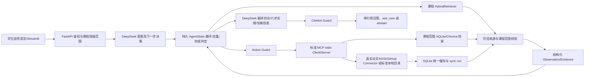
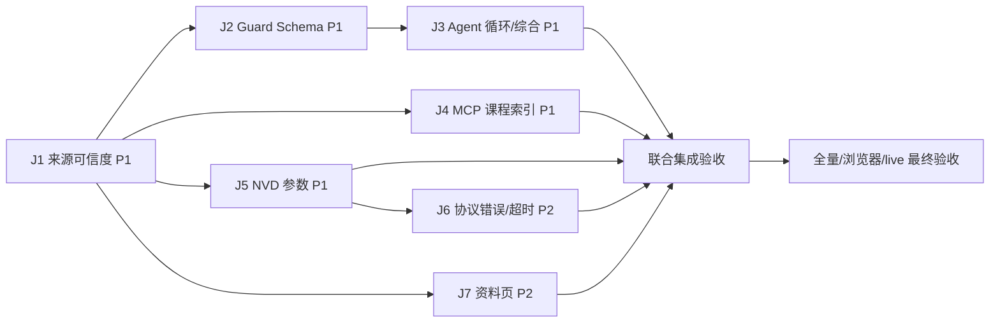

# 最终联合修复实施设计书

> 2026-09-29。依据本对话中《课程智能体整体零信任验收报告》和《真实外部工具与大模型专项零信任验收报告》，并重新核对当前源码。本文是**实施设计**，本轮没有修改项目源码、测试、数据库或配置，也没有重新执行 live 测试。此前实际运行结果与本轮静态代码复核分别标明，不把未验证风险写成已发生的故障。项目根目录为 `C:\Users\Asd\Desktop\edu agent`；当前目录不存在 `.git`，实施时不得假称已经提交或可用 `git revert`。

**反向技术评审修订版。**本次复核纠正了初版四项会影响实施的判断：①现有 `external_resources` 没有逐条连接成功的 `connector_sync_runs`，单靠来源名、URL 或同期 sync run 不能证明旧缓存由真实联网产生；②`CourseRetrieverInput` 是其他 **7 个搜索工具**的基类，直接加 `course_id` 会破坏它们的 Schema；③Agent 的 Guard 在 `_call_tool` 之前运行，课程范围必须在 Guard 前由后端绑定；④默认 `AGENT_MAX_STEPS=3` 物理上不足以完成三工具加最终回答，需要在去重与完成条件确定后明确调整预算。下文 J1/J3/J4 与 F–K 已按这些约束修订。

## A. 两份验收报告的合并结论

原始依据为 [题目最终要求.md](<C:/Users/Asd/Desktop/edu agent/md/题目最终要求.md:3>)。需求编号如下：

| 编号 | 课程原始要求及行号 |
| --- | --- |
| R1 | 基于 MCP 的学习、实践、创新智能体；统一上下文、外部工具及数据库／论文／漏洞接口，第 3–11 行。 |
| R2 | 5G NAS、区块链等结构化知识库，存储、检索并给问答／实践／创新提供证据，第 13–25 行。 |
| R3 | 教师访问记录、活跃度、学习轨迹，第 27–35 行。 |
| R4 | 自动聚类热点问题，第 37–39 行。 |
| R5 | 卡点分析和 FAQ 导出，第 41–51 行。 |
| R6 | 学生使用说明、课程目标、考核方式与专题，第 53–67 行。 |
| R7 | 论文、标准、漏洞资料入口，第 69–75 行。 |
| R8 | 专题选择、六步实践、论文／标准／漏洞检索及可核摘要分类，第 77–99 行。 |
| R9 | 论文、开源项目、竞赛案例推荐和启发式追问，第 101–117 行。 |

两轮验收应合并为**核心链路仍不通过最终完全验收**：专项隔离库证明标准 MCP、空缓存 arXiv／NVD／GitHub 首查、缓存复查和 DeepSeek 决策真实可达；同时 12 个新问题暴露工具循环、Schema 拦截、实践／创新误路由和缺少 DeepSeek 对外部证据的最终综合。历史 `fake` 记录在学生搜索、创新推荐、Agent Observation 中重现，属于可信度缺陷。旧整体报告的任课范围等 P0 在当前代码中已有后端校验，不再重复开发；新缺陷若经实施前隔离环境复现，应按下列 P1/P2 处理。实际网络服务可达只证明基础 Connector 能力，**不证明 Agent 端到端已完成**。

证据标记：**总验**＝上一轮整体零信任实际测试／HTTP／浏览器；**专项 Qn**＝上一轮隔离数据库的 12 问实际 `/api/chat`；**专项协议**＝标准 stdio MCP Client；**静态**＝本轮重读当前源码。两份验收报告在本对话中，历史 `md` 只用作线索，不把旧“通过”文字当证据。

**12 项反向评审核对：**

| 检查点 | 修订结论 |
| --- | --- |
| 1 原始要求/遗漏 | R1–R9 全量映射；新增发现已登录实践页仍走旧 `CourseAnswerer`，并入 J3；教师 R3–R6 保留回归门。 |
| 2 代码/API/库一致 | 按当前 `ActionDecision`、`CourseRetrieverInput` 继承、`PracticeGuideRequest`、外部资源/同步表结构重新定位；修订 J1 migration 16、J4 Guard 前绑定。 |
| 3 后端权限 | 多课程选择只改善页面，HTTP `_resolve_user_course_context` 与 Agent 绑定仍是授权边界；本机原始 MCP Client 的任意 `course_id` 不代表用户授权。 |
| 4 Mock/缓存/fake | 无证明旧行即使叫 arxiv 也不可信；空缓存 live 另需真实出网记录；本地标准明确 `local_catalog`。 |
| 5 迁移 | J1 的唯一 migration 16 无猜测回填、幂等建表、同事务写资源与证明，在线备份及写入后的回滚限制写明。 |
| 6 隐藏依赖 | J3 依赖 J1/J2；J4 与 J3 共改 Orchestrator 须串行集成；J7 依赖 J1 来源字段；J6 的旧缓存语义依赖 J1。 |
| 7 测试充分性 | 新增半提交、伪装合法来源、双课程、Guard 前注入、三工具第 4 步回答、实际 practice 页面与真实 DeepSeek 发送证据哈希反例。 |
| 8 新框架/重构 | 仍只用既有 FastAPI/Streamlit/SQLite/Chroma/DeepSeek/MCP；新增一张证明表，无前端框架或消息队列。 |
| 9 回归 | 旧门户直插 fixture、匿名公共实践端点、单课程用户、旧 Agent run、标准本地目录、管理员权限都列正向回归；不通过删断言。 |
| 10 Connector≠Agent | 单独的 Connector、MCP 直接调用仍只证明局部；最终门必须是自然语言 `/api/chat` 中的 DeepSeek 决策→MCP→Connector→回答链。 |
| 11 DeepSeek 最终综合 | 需同 run 的真实 `generate_answer`、发送给 Provider 的证据 ID/哈希、最终多源 URL 引用与 `fallback_used=false`；只有 `decide_next_action` 成功不能宣称。 |
| 12 来源/隔离/终止 | J1 逐行证明和假数据隔离、J4 HTTP 课程授权/MCP 作用域、J3 强制证据槽与 5 步有界终止一起作为 P1 关闭条件。 |

`resource_provenance` 只能证明**程序按受控同步流程接收了该行**，不是独立的互联网取证。答辩宣称“本次实时联网”仍须同时保留空缓存前状态、真实上游 HTTP 请求/响应状态、官方来源 URL、SUCCESS sync run 和行级证明；Mock、旧缓存或单独的来源标签都不足以证明。

## B. 已确认完成且不再安排开发的功能

| 功能 | 证据与边界 | 本设计处理 |
| --- | --- | --- |
| 登录、退出、首次改密和令牌版本 | 后端 [backend/main.py:366](<C:/Users/Asd/Desktop/edu agent/backend/main.py:366>)、[backend/main.py:389](<C:/Users/Asd/Desktop/edu agent/backend/main.py:389>)、[backend/main.py:423](<C:/Users/Asd/Desktop/edu agent/backend/main.py:423>)及 [backend/storage/logger.py:990](<C:/Users/Asd/Desktop/edu agent/backend/storage/logger.py:990>)；总验有 HTTP／浏览器证据。 | 只做回归。 |
| 教师任课范围、学习会话上下文、聚类成员范围 | [backend/analytics/activity.py:14](<C:/Users/Asd/Desktop/edu agent/backend/analytics/activity.py:14>)在无任课班级时拒绝；[backend/analytics/events.py:132](<C:/Users/Asd/Desktop/edu agent/backend/analytics/events.py:132>)复核会话归属，[backend/main.py:111](<C:/Users/Asd/Desktop/edu agent/backend/main.py:111>)、[backend/main.py:257](<C:/Users/Asd/Desktop/edu agent/backend/main.py:257>)检查教师／聚类范围；总验跨课程矩阵已有通过项。 | 历史 S0/F0 不再做开发批次；保留两课程两班负向／管理员正向回归。 |
| 模板模式同一 `run_id` 补充 | [backend/llm/template_provider.py:86](<C:/Users/Asd/Desktop/edu agent/backend/llm/template_provider.py:86>)识别已回答追问；[backend/agent/orchestrator.py:163](<C:/Users/Asd/Desktop/edu agent/backend/agent/orchestrator.py:163>)恢复状态；专项 Q9 用真实 DeepSeek 同 `run_id` 从 `ask_user` 继续到检索和完成。 | 历史 S1 不重复做；补充浏览器回归。 |
| 基础 MCP、共享 SQLite、真实 Connector 与缓存 | [backend/tools/mcp_client.py:243](<C:/Users/Asd/Desktop/edu agent/backend/tools/mcp_client.py:243>)向子进程传绝对库路径，[mcp_server/server.py:15](<C:/Users/Asd/Desktop/edu agent/mcp_server/server.py:15>)注册 stdio 工具；专项协议握手、列 9 个工具，隔离库首查 arXiv／NVD／GitHub 实际联网、次查缓存；标准为本地官方元数据。 | 不重写传输栈、现有缓存表或标准源；J1 仅新增逐行来源证明表，不能把旧缓存自动认定为真。 |
| 上传、索引、基础课程 RAG 和学生／教师页面主干 | 专项新库上传为 PENDING、重建为 INDEXED，SQLite 1 文档／1 切片、Chroma 1 条，学生 RAG 有引用；[backend/rag/hybrid_retriever.py:61](<C:/Users/Asd/Desktop/edu agent/backend/rag/hybrid_retriever.py:61>)按课程取索引切片。总验教师聚类、卡点、FAQ 和页面已逐项验过。 | 不重写上传与索引；修 MCP 课程检索不一致。 |
| 假数据正式写入口、标准本地来源标记 | 默认 Registry [backend/connectors/registry.py:88](<C:/Users/Asd/Desktop/edu agent/backend/connectors/registry.py:88>)未注册 fake；[backend/main.py:1495](<C:/Users/Asd/Desktop/edu agent/backend/main.py:1495>)明确拒绝显式 fake；[backend/resources/service.py:120](<C:/Users/Asd/Desktop/edu agent/backend/resources/service.py:120>)可将已注册标准源标 `local_catalog`。 | 不再开发“关闭 fake 同步”或“实时抓取标准全文”；修**历史记录读边界**。 |

注意：这里“已确认”指这两次验收对应的具体路径；不是对所有输入、所有运行环境的永久保证。教师自动聚类持久任务由 [backend/storage/logger.py:84](<C:/Users/Asd/Desktop/edu agent/backend/storage/logger.py:84>)的迁移 15 与 `tests/test_f2_2_persistent_auto_clustering.py` 覆盖，仍须在最终回归验证重启场景。

**原始要求覆盖复核：**R1 的真实 MCP 与自主综合由 J2/J3/J4/J5/J6 收口；R2 的课程上传/RAG 已验，MCP 同源由 J4 收口；R3 的访问/活跃/轨迹只做两师两课回归；R4 的自动语义聚类与持久任务只做重启/审批回归；R5 的卡点/FAQ 只做课程班级权限和导出回归；R6 的使用说明、课程目标、考核与专题页面只做浏览器回归；R7 的论文/标准/漏洞入口由 J1/J5/J7 收口；R8 的六步、可核摘要分类及已登录实践端点由 J1/J3/J4 收口；R9 的论文/开源/竞赛案例和启发追问由 J1/J3/J4 收口。**R3–R6 没有从两轮验收与本轮源码复核找到新的确定缺陷，因此不列开发任务，但任一回归失败会重新打开该需求。**

## C. 最新剩余问题矩阵

**分类原则：**P0＝已证实越权或不可接受数据泄露；本次专项没有新证据能把以下项定为 P0。P1＝原始 R1/R2/R8/R9 核心链路失败或来源失真；P2＝局部错误语义、体验或证据尚不足的超时风险。若实施前发现实际跨课程泄露，应立即把该项升为 P0 并先关掉。

| 编号／级别／要求 | 两份验收证据与当前复核；复现结果 → 期望 | 根因与准确位置 | 影响、依赖、完成判据 |
| --- | --- | --- | --- |
| U1／P1／R1 R7 R9 | 专项隔离库插入旧 `source_name=fake`：学生搜索可返回 `fresh_cache`、创新推荐可纳入、Agent 可读 Observation；未知来源门户显示 remote。→ fake/unknown 均不能作为可信学生证据，unknown 只标 unknown。**静态新增发现：旧行即便自称 arxiv，也无逐行成功 sync 证明；本地 Markdown 可被创新的标准工具默认类型误标。** | [backend/resources/service.py:44](<C:/Users/Asd/Desktop/edu agent/backend/resources/service.py:44>)无可信来源判定且第 105–106 行可直接回传 `result.resources`；`sync` 第 150–267 行逐条写资源、最后才把 sync run 标 SUCCESS；[backend/storage/logger.py:1383](<C:/Users/Asd/Desktop/edu agent/backend/storage/logger.py:1383>)外部行无 sync_run_id；`_migration_external_resource_connector_cache` 第 3415–3462 行无证明表；第 1472/1552 行读缓存无信任过滤；[backend/resources/portal.py:115](<C:/Users/Asd/Desktop/edu agent/backend/resources/portal.py:115>)未知一律 remote；[backend/innovation/service.py:157](<C:/Users/Asd/Desktop/edu agent/backend/innovation/service.py:157>)及第 204/308/330 行分别读按需/MCP本地线索与猜 live；[frontend/pages/student.py:437](<C:/Users/Asd/Desktop/edu agent/frontend/pages/student.py:437>)继承标签。 | 服务／Repository／SQLite 迁移 16／MCP／创新／页面；API 字段语义调整。迁移可幂等、备份回滚；无需 Key 可测隔离逻辑，真实首查需网络。所有学生可见路径历史 fake/unknown/无证明行零事实污染，合法新首查和缓存复查仍可用。U3/J7 依赖本项。 |
| U2／P1／R1 R7 R9 | 专项 Q4 标准和 Q5 GitHub 决策走到 `TOOL_SCHEMA_MISSING`；标准 MCP 直接调用却可成功。→ Agent Guard 与服务器公布的输入 Schema 一致。 | [backend/guards/action_guard.py:23](<C:/Users/Asd/Desktop/edu agent/backend/guards/action_guard.py:23>)的 `INPUT_MODELS` 漏两项，`ActionGuard._validate_tool_call` 第 61–82 行拒绝；模型类已在 [mcp_server/schemas.py:66](<C:/Users/Asd/Desktop/edu agent/mcp_server/schemas.py:66>)附近。 | Guard／MCP Schema；不迁移、不改旧 API、无需外网可测。真实 `/api/chat` 不再报 `TOOL_SCHEMA_MISSING`，非法参数仍拒绝且工具未执行。依赖 U1 的可信输出，先于 U3。 |
| U3／P1／R1 R2 R8 R9 | 专项 Q2、Q3、Q12 工具成功多次仍 `MAX_STEPS`；Q6 多工具停在列表；Q7/Q8 实践／创新变成不相关论文列表。Q11 课程外问题文字拒绝但 `abstained=false`。→ 一次足够的工具证据进入受控最终回答，多源任务补齐必要证据，实践六步／创新追问优先。**静态新增：学生实践页面走旧本地端点，即使 chat 修好也未贯通页面。** | [backend/agent/orchestrator.py:55](<C:/Users/Asd/Desktop/edu agent/backend/agent/orchestrator.py:55>)循环未记已满足目标；`_prefer_explicit_tool_request` 第 335–387 行论文关键词覆盖复合意图；`_retrieve` 第 462–527 行实践可提前回答；`_call_tool` 第 529–592 行仅自动路由分支立即固定格式完成，模型规划分支继续重复；`_answer` 第 595–659 行只接收 RAG evidence；`_to_chat_response` 第 711–743 行外部引用缺失；[backend/agent/router.py:4](<C:/Users/Asd/Desktop/edu agent/backend/agent/router.py:4>)只给规则意图，[backend/agent/schemas.py:32](<C:/Users/Asd/Desktop/edu agent/backend/agent/schemas.py:32>)无 intent；[backend/core/config.py:89](<C:/Users/Asd/Desktop/edu agent/backend/core/config.py:89>)仅 3 步；[backend/main.py:689](<C:/Users/Asd/Desktop/edu agent/backend/main.py:689>) `/api/practice/guide` 调 [backend/rag/answerer.py:48](<C:/Users/Asd/Desktop/edu agent/backend/rag/answerer.py:48>)旧 LocalRetriever，[frontend/pages/student.py:201](<C:/Users/Asd/Desktop/edu agent/frontend/pages/student.py:201>)页面用此端点。 | Agent／LLM evidence／Citation Guard／预算／实践 API 与页面；需 U1、U2，MCP 课程检索 U4 可并行实现后联测。`/api/chat` 保持原字段，实践 API 只增可选课程字段；12 新问和已登录实践页面均得到真实链路证据；离题状态 ABSTAINED。 |
| U4／P1／R1 R2 | 专项上传并索引新课程文档后，API RAG 能读，MCP `course_retriever` 只返回旧根 Markdown。→ 同一课程同一问题，MCP 和 API 查同一 SQLite/Chroma 索引且课程隔离。 | [mcp_server/tools.py:251](<C:/Users/Asd/Desktop/edu agent/mcp_server/tools.py:251>)固定 `LocalRetriever()`；[backend/rag/retriever.py:69](<C:/Users/Asd/Desktop/edu agent/backend/rag/retriever.py:69>)默认旧目录；[mcp_server/schemas.py:38](<C:/Users/Asd/Desktop/edu agent/mcp_server/schemas.py:38>)`CourseRetrieverInput` 无 course_id，且第 45–69 行被其他搜索工具继承，改 Schema 时须拆基类；现成 [backend/rag/hybrid_retriever.py:61](<C:/Users/Asd/Desktop/edu agent/backend/rag/hybrid_retriever.py:61>)已支持课程范围。 | MCP Schema／Gateway／RAG；无迁移；须与 U3 集成，API 响应保兼容。两课程上传不同标记，新文档在本课程 API/MCP 均命中，跨课程零命中；缺失/越权课程上下文拒绝，不默默用默认课程。 |
| U5／P1／R1 R7 R8 | 专项 Q3 描述性 CVE 问句首次 NVD 调用失败，精确 CVE 查询可成功。→ 从句子取单个合法 ID，或用关键词检索；空结果不得伪造 CVE。 | [backend/connectors/nvd.py:25](<C:/Users/Asd/Desktop/edu agent/backend/connectors/nvd.py:25>)仅用 `startswith('CVE-')` 判断，然后把整句作为 `cveId`；[mcp_server/tools.py:295](<C:/Users/Asd/Desktop/edu agent/mcp_server/tools.py:295>)原样传 query。 | Connector／MCP；无迁移、不必改 API；live 受网络与限流影响。精确 ID、描述句、无 ID 关键词、虚构 ID 四例响应与来源正确；首查与缓存复查可区分。与 U3 可并行开发，联测在 U3 后。 |
| U6／P2／R1 R7 | 专项标准 MCP 工具内部失败时结构化 `success=false/error_code`，但协议层 `isError` 可能仍为 false；已实测客户端 read timeout，**未实测**服务器慢任务超时后写库。→ 两层错误一致，超时不产生迟到缓存。 | [mcp_server/server.py:43](<C:/Users/Asd/Desktop/edu agent/mcp_server/server.py:43>)直接返回 dict；[mcp_server/tools.py:216](<C:/Users/Asd/Desktop/edu agent/mcp_server/tools.py:216>)ThreadPoolExecutor `wait=False` 不能中止运行中的线程；[backend/tools/mcp_client.py:271](<C:/Users/Asd/Desktop/edu agent/backend/tools/mcp_client.py:271>)优先解析 structured_content。 | MCP 协议／超时／Connector 写入；无已证实迟到写库，先隔离测试，再按复现决定是否修改取消/提交边界。成功 `isError=false`，失败 `isError=true` 且 `success=false`、一致 error_code；超时后库计数不变。依赖 U1/U5 的缓存语义。 |
| U7／P2／R7 R8 | 专项学生浏览器切到 GitHub 来源筛选后仍显示上一次 arXiv 按需结果。→ 筛选变化刷新对应结果并展示交付方式。 | [frontend/pages/student.py:322](<C:/Users/Asd/Desktop/edu agent/frontend/pages/student.py:322>)构造两份查询；第 374–375 行持久 `resource_search_payload` 无条件盖掉按当前筛选得到的门户结果。 | Streamlit 页面；可复用 [frontend/api_client.py:398](<C:/Users/Asd/Desktop/edu agent/frontend/api_client.py:398>)及第 428 行；无迁移／后端权限变化。过滤后无串源旧结果；页面标签与 API 一致。依赖 U1。 |

**仅列待验证风险，不冒称代码故障：**服务器线程超时后是否迟到写库（U6 的先测门）；模型服务 Key 配置、沙箱出网、NVD/论文/GitHub 第三方限流会使 live 无法验证，不能靠修改断言解决；演示库是否缺足量专题与创新数据需只读统计。只有实际证据证明数据不足时才建立补充演示数据任务。历史测试主要测 mock 的部分应增加真链路测试，但“覆盖不足”不是独立产品功能缺陷。当前 `.git` 不存在；不用 `git init`、不声称 Git 提交已产生。

## D. 修复后总体架构

职责边界：FastAPI 的 [backend/main.py:566](<C:/Users/Asd/Desktop/edu agent/backend/main.py:566>)认证并确定 `course_id/class_id`，AgentState 持久化用户、课程和动作；DeepSeek 只提出意图／动作与基于可信证据综合，不能自行扩大课程范围或宣称工具已调用；Action Guard 验证工具名、角色、只读风险、Schema；Gateway 通过 `ClientSession.initialize/list_tools/call_tool` 标准 stdio 协议，[backend/tools/mcp_client.py:255](<C:/Users/Asd/Desktop/edu agent/backend/tools/mcp_client.py:255>)；MCP Server 执行课程检索或真实 Connector；SQLite/Chroma 提供课程切片与统一缓存；可信来源层筛掉 fake/unknown 的事实断言；Observation 只携带经验证、裁剪和转义的内容，不能充当系统提示；最后 DeepSeek 回答经 Citation Guard 验证再输出。



复用：FastAPI RBAC、`_resolve_user_course_context`、SQLite Repository／迁移、`HybridRetriever`、Chroma、DeepSeek Provider、MCP stdio Gateway、Connector Registry、现有教师页及聚类／FAQ 模块。需改：来源读取边界、Agent Guard/Loop/证据映射、MCP `course_retriever`、NVD 参数规范化、协议错误／超时（若先测复现）、学生资料页状态。**不引入新框架、数据库、队列或前端。**

`AgentState` 现有 `messages/evidence/observations/course_id/class_id` 在 [backend/agent/state.py:28](<C:/Users/Asd/Desktop/edu agent/backend/agent/state.py:28>)，可在兼容旧 JSON 的前提下保存已调用工具签名和每种证据状态。每轮先看待满足的证据类型（如论文+CVE+项目），用规范化 `(tool_name, source, normalized_query, course_id)` 阻止同工具同参数重复；已满足所有目标或已无安全可用工具则进入 answer/abstain。三工具+最终回答至少 4 个动作，实践先检索则至少 5 个动作，因此**在完成去重/终止修复后**将新 run 默认 `AGENT_MAX_STEPS` 明确设为 5（`max_tool_calls=3` 继续有效），而非无限提高上限；旧 run 保持已存预算。120 秒总限内若真网络过慢，明确超时/拒答。实践六步和创新追问是任务目标，论文只是证据之一。

来源采用两个独立维度：`origin_kind=remote|local_catalog|course_document|unknown` 表示原始来源；`delivery_mode=live|fresh_cache|stale_cache|local_metadata|offline_fallback|failed` 表示**本次交付**。**可信证明还需第三维：当前资源行内容哈希与该行绑定的、相同 Connector 的 SUCCESS sync run；孤立的同期 sync run、来源名或 URL 均不够。**本地标准官方元数据标 `local_catalog/local_metadata`；旧 fake 和没有逐行证明的旧行保留供审计，但不能进入学生事实证据。课程知识库须由已认证的后端注入作用域，MCP 原始输入不得信任用户自称的 `course_id`。

## E. 详细修复批次

下列各批的“测试文件”是**待新增或调整的目标**，不是声称当前已有或已通过；每批在独立临时库先复现、后修复。现有测试文件见 `tests/test_agent_orchestration.py`、`tests/test_mcp_tools.py`、`tests/test_mcp_client.py`、`tests/test_f1_2_remote_resources.py`、`tests/test_resource_portal.py`、`tests/test_phase3_e2e.py`。均不得为通过测试降低断言。

### J1｜P1 历史来源隔离与统一交付语义（U1）

1. **目标／非目标：**封住所有正式读取路径中的 fake 与未知来源事实污染，准确区分 live/cache/local；保留历史行与测试用 `FakeConnector`，不重写 Connector、不过度清理库。
2. **根因／调用链：**HTTP 学生搜索→`ExternalResourceService.search`→Repository 未过滤的缓存→学生；门户只排字面 fake、未知标 remote；创新按需搜索又把 `cache_hit=false` 推断成 live；MCP 工具从同一缓存取数据，Agent Observation 因此被污染。行号见 C/U1。
3. **技术方案：**生产读边界使用**固定、明确的可信源政策**（当前 arxiv/semantic_scholar/nvd/github/standard_source；测试显式注入 fake 时只在测试服务实例开启），不直接把“某 Registry 中出现的名字”当可信。再要求每条资源有与当前 `content_hash/source_name/URL` 匹配的成功 sync 证明。旧行没有证明的一律 `unknown/unverified_history`，可在教师审计界面看，但不进入学生事实、缓存命中或 Agent Observation；上线后通过真实重同步取得证明，不伪造历史回填。读端 SQL 与 query-cache 映射均在分页前过滤；写端以**单个 SQLite 事务**提交资源、查询映射、逐条证明和 SUCCESS sync run，避免“资源已写、sync 最后失败”的半成品。来源类别、交付方式、可信证明三个维度独立生成。
4. **后端具体修改：**[backend/storage/logger.py:84](<C:/Users/Asd/Desktop/edu agent/backend/storage/logger.py:84>)注册 migration 16；第 1383 行 `upsert_external_resource`、第 1516 行 `store_resource_query_cache`、`create/finish_connector_sync_run` 的现有 SQL 抽成可接受同一 `sqlite3.Connection` 的事务内 helper；[backend/resources/service.py:150](<C:/Users/Asd/Desktop/edu agent/backend/resources/service.py:150>) `sync` 先完成远程抓取/Schema/URL 校验，并核 `resource.source_name==connector.name`，再调用 `commit_verified_sync(run_id,connector,query,resources)`，成功提交后再尝试 Chroma 外部向量索引，向量失败单独记状态、不伪造 SQLite 失败；第 44–119 行搜索的首个缓存命中、失败旧缓存以及 `if not resources and result.resources` **直接返回 Connector 对象的分支**都只可返回事务提交后复查的有效证明行，不能绕过 Repository；[backend/storage/logger.py:1472](<C:/Users/Asd/Desktop/edu agent/backend/storage/logger.py:1472>)和第 1552 行 SQL 同时检查来源、逐行证明与映射 `qc.source_name=er.source_name`；[backend/resources/repository.py:22](<C:/Users/Asd/Desktop/edu agent/backend/resources/repository.py:22>)透传；[backend/resources/portal.py:115](<C:/Users/Asd/Desktop/edu agent/backend/resources/portal.py:115>)、[backend/innovation/service.py:157](<C:/Users/Asd/Desktop/edu agent/backend/innovation/service.py:157>)复用同一验证函数；创新 `_mcp_resources` 第 204 行还须将没有官方链接和资源类型证明的 `standard_lookup` 本地 Markdown 线索标 `course_document`，不能用工具默认类型误标为标准资料（当前 `_resource_type_from_tool_item` 第 308 行只特判 paper）。伪码：`trusted = policy.allow(name) && proof.run.status=='SUCCESS' && proof.connector==row.source_name && proof.content_hash==row.content_hash && proof.url==row.url`。
5. **Agent 状态／终止：**此批不改循环；MCP `paper_search_real`/`vuln_lookup_real`/`github_project_search` 的返回必须只含可用可信项；无可信项交给既有拒答，不能因历史假项停止拒答。U3 再建立外部 Evidence。
6. **MCP Schema／协议：**不更名工具、不改入参；`ToolResult.data.resources` 保留，但每项明确 `source_name/origin_kind/delivery_mode/fetched_at/url`；失败或无可信项保留 `error_code`。协议错误同步在 J6 处理。
7. **Connector／缓存：**空缓存首次真实请求由成功 sync run 和资源证明共同认定 live；第二次同查询不新增 sync run 且命中**同一证明的**缓存。`FAILED_WITH_CACHE` 只可返回已证明旧资源，并携上游错误。fake/unknown、无证明历史行，即使伪装为 `source_name=arxiv` 且带官方格式 URL，也不能命中。`standard_source` 通过本地目录同步产生 `local_catalog` 证明，永不宣称实时抓取全文。
8. **SQLite／Chroma／迁移：**在现有 `external_resources`、`connector_sync_runs` 与映射表 [backend/storage/logger.py:3418](<C:/Users/Asd/Desktop/edu agent/backend/storage/logger.py:3418>)、[backend/storage/logger.py:3666](<C:/Users/Asd/Desktop/edu agent/backend/storage/logger.py:3666>)之外，migration 16 新增 `resource_provenance(resource_id PRIMARY KEY FK external_resources.id ON DELETE CASCADE, sync_run_id NOT NULL FK connector_sync_runs.id, connector_name NOT NULL, origin_kind NOT NULL, content_hash NOT NULL, verified_url NOT NULL, verified_at NOT NULL)`，并为 `sync_run_id` 建索引；同一资源重新同步时覆盖最新证明，旧 sync run 审计仍保留。迁移只建表/索引，**不把旧行回填为可信**，重复运行检查版本、表结构和行数不变。索引外部 Chroma 的失败不应改变 SQLite 资源证明；当前课程 `HybridRetriever` 只读 `document_chunks`，外部向量不进入课程问答，但未来如加入外部向量查询必须按证明再过滤。历史 fake 行与向量不删除。
9. **API：**`POST /api/resources/search` [backend/main.py:1494](<C:/Users/Asd/Desktop/edu agent/backend/main.py:1494>) 认证远程仍 401、显式 fake 仍 400；合法查询 200，`resources[*]` 不含 fake/unknown，保留旧字段，仅补准确 `origin_kind/delivery_mode`。`GET /api/resources/portal` 第 1297 行仍需认证，结果同政策。与旧调用兼容，不把未授权请求改成 200。
10. **前端／配置：**[frontend/pages/student.py:437](<C:/Users/Asd/Desktop/edu agent/frontend/pages/student.py:437>)逐条显示来源与本次交付；[frontend/api_client.py:428](<C:/Users/Asd/Desktop/edu agent/frontend/api_client.py:428>)只消费服务真值。复用现有 `.env.example` Connector 开关；原则上不新增环境变量，也不把演示 fake 设为默认生产来源。
11. **测试：**单元：同词的 fake、unknown、**伪装为 arxiv 的无证明行**及真 arxiv 行，只有最后一项可见；证明哈希/URL/connector/run 状态任一失配即隔离；写入中途注入 SQLite 异常，资源、映射、证明、SUCCESS 标志不得出现半提交；数据库写失败后 `result.resources` 直返分支也不能让未提交原始对象流向学生；migration 16 连续执行两次表结构/行数不变。API：匿名远程 401、显式 fake 400、登录搜索／门户 200；MCP stdio 只得可信条目；创新/Agent 不纳历史项，`standard_lookup` 本地 Markdown 不标为正式标准；空缓存三源首查、二查缓存；浏览器显示真实来源。现有 [tests/test_resource_portal.py:153](<C:/Users/Asd/Desktop/edu agent/tests/test_resource_portal.py:153>) 等用 `LearningLogger.upsert_external_resource` 直接插入“真实来源名”的 fixture，改为通过**受控 Connector 成功同步**建立证明，继续断言六类入口/摘要/分页，不可删断言或把这些 fixture 假称 live；原始直插 fixture 应单独用于“无证明历史行必须隔离”反例。Mock 用于事务和过滤反例，**不能**证明 live。
12. **实际验收：**隔离库设置同一绝对 `SQLITE_DB_PATH`，执行 `python -m pytest tests/test_storage_migrations.py tests/test_f1_2_remote_resources.py tests/test_resource_portal.py tests/test_mcp_client.py -q`；先插入三类历史行并验证不可见，再用学生令牌 `POST /api/resources/search?connector_name=arxiv` 和 `GET /api/resources/portal`（均 200），只有实时同步取得证明的行可见；空缓存三源 live 每项核 `resource_provenance.resource_id→sync_run_id`、内容哈希、官方 URL、SUCCESS，同查询复查不新增 sync run；标准本地目录单列。教师审计仍能统计未验证历史行。
13. **风险／回滚：**原有真实但无证明的旧缓存会暂时不可用于学生回答，须在隔离环境量化数量、安排真实再同步；不能用猜测式回填“恢复体验”。旧门户测试直接插入缓存的 fixture 会失效，应改为有证明的受控同步且保持原业务断言。上线前 SQLite online backup，迁移版本 16 的回滚为停写后恢复同一备份，并核对恢复点之后合法新记录的审计导出；不通过 `DROP TABLE` 或删除 fake/失败记录回滚。代码回滚会重开污染通道，不得在生产单独回退政策。
14. **DoD：**迁移 16 幂等且可从备份恢复；成功同步的资源、缓存映射、证明和 sync 状态原子一致；历史 fake/unknown/伪装合法源无证明行在搜索、门户、创新、Agent/MCP Observation 零事实污染；新合法来源首查/复查、本地/缓存/live 标签均有逐条证明。

### J2｜P1 Action Guard 与 MCP 目录 Schema 对齐（U2）

1. **目标／非目标：**使标准、GitHub 两个已注册低风险工具可被 Agent 正常选择，非法参数仍被拦；本批不处理最终综合或网络可达性。
2. **根因／调用链：**DeepSeek 生成 `call_tool` → [backend/guards/action_guard.py:61](<C:/Users/Asd/Desktop/edu agent/backend/guards/action_guard.py:61>)按本地 `INPUT_MODELS` 查找 → 第 77 行 `TOOL_SCHEMA_MISSING`；MCP 自己的 [mcp_server/tools.py:165](<C:/Users/Asd/Desktop/edu agent/mcp_server/tools.py:165>)却已有对应模型，发生两份目录漂移。
3. **方案理由：**复用 `mcp_server.tools._INPUT_MODELS` 的**公开、稳定只读投影**作为 Guard 的 Schema 来源，同时继续使用现有 `get_tool_definition`/`can_agent_execute_tool` 做角色与风险控制；不要简单删除 Guard 或相信模型输出。若避免私有符号耦合，可把 Schema 映射导出为公共函数并加一致性断言。
4. **后端位置：**[backend/guards/action_guard.py:15](<C:/Users/Asd/Desktop/edu agent/backend/guards/action_guard.py:15>)增加已存在的 `StandardMetadataLookupInput`、`GitHubProjectSearchInput` 或公共 Schema 导入；`ActionGuard._validate_tool_call` 第 61–82 行仍 `model_validate` 且 `extra=forbid`；[mcp_server/schemas.py:62](<C:/Users/Asd/Desktop/edu agent/mcp_server/schemas.py:62>)保留模型定义。关键签名不变：`validate(state, decision, started_at, timeout_seconds, role)`。
5. **Agent 状态：**Guard 通过后记录真实 `call_tool`，被拒时仍 `ABSTAINED/INVALID_ARGUMENTS` 且无工具记录；不扩大步数。
6. **MCP：**现有 9 工具目录与注册 Schema 一致；标准／GitHub 非法 `query` 长度、`top_k` 越界在 Agent 和协议都被拒绝。工具可见性仍受 [backend/tools/tool_policy.py](<C:/Users/Asd/Desktop/edu agent/backend/tools/tool_policy.py>)控制。
7. **Connector／缓存：**不变；测试使用协议模拟合法结果时只证明 Guard，live 仍由 J1/J5 证明。
8. **SQLite／Chroma：**不变；无迁移、无回填。
9. **API：**`POST /api/chat` 请求／返回字段不变；合法工具决策 200 不再 `TOOL_SCHEMA_MISSING`；非法模型参数可返回 200 `run_status=ABSTAINED,stop_reason=INVALID_ARGUMENTS`（沿用现有 Chat 契约），不把模型错误伪装为 HTTP 422 的用户错误。
10. **前端／配置：**无必改页面或变量；页面继续显示已有 `stop_reason`。
11. **测试：**单元覆盖所有 `get_agent_tool_catalog` 允许的工具都有 Schema；API 以受控 Planner 让标准/GitHub 决策，断言进入真实 Gateway；MCP stdio 列工具及缺参错误；权限断言非只读／禁用工具仍拒绝；浏览器手输标准/GitHub 问题不再显示 Schema 错误；live 再用真实 DeepSeek 和服务复验。
12. **验收：**`python -m pytest tests/test_agent_decision.py tests/test_mcp_tools.py tests/test_mcp_client.py -q`；学生令牌提交标准和项目自然语言到 `/api/chat`，记录 `run_id/agent_steps`，期望 `call_tool` 分别可达；本批允许最终综合仍失败，但不能把它计作 Guard 失败。
13. **回滚：**恢复 Guard 映射／公共 Schema 导出文件快照；不改数据库或旧工具名。注意回滚后两个工具又不能由 Agent 使用，故必须先通过 J3 再发布。
14. **DoD：**工具目录、Guard、MCP 注册 Schema 的名称和参数集合一致；合法调用穿过 Guard；非法参数零执行且有明确错误。

### J3｜P1 Agent 去重、证据终止与 DeepSeek 最终综合（U3）

1. **目标／非目标：**解决成功工具重复直至 `MAX_STEPS`、多工具任务停顿、实践／创新误路由、课程外伪完成，形成可信外部引用与真正 DeepSeek 最终回答；让**已登录学生实践页**进入同一课程范围 Agent 链路。保留匿名公共演示端点的旧本地路径并清楚标 `offline_fallback`，不让其读取课程私有索引；不改 DeepSeek SDK、MCP 传输或教师业务。
2. **根因／调用链：**[backend/agent/orchestrator.py:335](<C:/Users/Asd/Desktop/edu agent/backend/agent/orchestrator.py:335>)在初步决策后按“论文”关键词覆盖目标；[backend/agent/orchestrator.py:529](<C:/Users/Asd/Desktop/edu agent/backend/agent/orchestrator.py:529>)的模型规划工具结果仅存 Observation，状态继续 RUNNING；同一决策重复；[backend/agent/orchestrator.py:595](<C:/Users/Asd/Desktop/edu agent/backend/agent/orchestrator.py:595>) `LLMRequest` 仅含 RAG `state.evidence`；[backend/agent/orchestrator.py:711](<C:/Users/Asd/Desktop/edu agent/backend/agent/orchestrator.py:711>)引用也只由该集合产生。
3. **方案理由：**保留现有循环和 Pydantic 状态。DeepSeek Planner 的结构化决策增加**可选、枚举化的 intent**：现有 `course_qa/paper_search/vuln_lookup/standard_lookup/practice_guide` 加 `project_search/innovation/multi_source/off_topic`；旧 Provider 不填仍可用规则提示。后端以显式“实践／创新”输出目标优先，扫描自然语言中**全部**明确要求的论文/CVE/标准/项目，而非命中第一个关键词就覆写；模糊需求由模型选择或 ask_user，不盲信模型分类。任务目标规范化为“必需证据槽”（课程／论文／CVE／标准／项目／六步实践／创新提问）；每个强制槽需至少一条与问题相关、有可定位来源且 J1 证明有效的证据；强制槽缺失时 `ABSTAINED` 并说明缺口，不能把部分列表标全任务完成。每个规范化工具调用签名最多一次。成功 MCP 结果由**服务端**映射为可信 `EvidenceItem`，保留标题、来源 URL、外部 ID、类型、时间、delivery_mode、score，并只截取可核内容；这些属性需要扩展现有 Pydantic 模型，不能把额外字段塞入 `extra=forbid` 的旧模型。DeepSeek 生成最后综合，Citation Guard 按引用所在句子/段落验证标识、来源和事实支持，不以“全文有两个相同词”代替事实核验；无证据或离题直接 ABSTAINED。**默认步骤明确设为 5**，配合现有 3 次工具上限和 120 秒总限；这只是容纳三工具+最终回答的必要预算，不能代替去重与完成判定。
4. **后端位置／伪代码：**[backend/agent/schemas.py:32](<C:/Users/Asd/Desktop/edu agent/backend/agent/schemas.py:32>) `ActionDecision` 加可选 `intent` 枚举；[backend/llm/prompts.py:77](<C:/Users/Asd/Desktop/edu agent/backend/llm/prompts.py:77>) 动作 JSON 提示加入 intent 与“已经满足的证据槽”；[backend/agent/state.py:28](<C:/Users/Asd/Desktop/edu agent/backend/agent/state.py:28>)增加**可选且有默认值**的 `required_sources/completed_sources/tool_signatures` 或从现有 observations 推导；[backend/agent/orchestrator.py:55](<C:/Users/Asd/Desktop/edu agent/backend/agent/orchestrator.py:55>)循环在 Planner 前检查 `all_required_resolved`，重复调用时转 answer/abstain 或 `ask_user`；`_prefer_explicit_tool_request` 第 335 行只作高置信单工具辅助，复合任务和实践／创新不覆盖；`_retrieve` 第 462 行不让实践在首个无关结果直接结束；`_call_tool` 第 529 行统一处理自动/模型两种分支并转换证据；[backend/llm/schemas.py:10](<C:/Users/Asd/Desktop/edu agent/backend/llm/schemas.py:10>) `EvidenceItem` 增带默认值的 `source_url/external_id/origin_kind/delivery_mode/fetched_at`；[backend/llm/prompts.py:94](<C:/Users/Asd/Desktop/edu agent/backend/llm/prompts.py:94>) `_format_evidence` 将这些受控字段连同片段送入实际最终生成请求；`_answer` 第 595 行用 `LLMRequest(question,evidence=trusted_evidence)` 调 `answer_provider.generate_answer` 或 `generate_structured(PracticeGuide)`，并在现有 [backend/storage/logger.py:437](<C:/Users/Asd/Desktop/edu agent/backend/storage/logger.py:437>) `model_calls.metadata_json` 记**非敏感**的 `evidence_ids/resource_ids/content_hashes`，不记完整私人原文或系统提示；`_to_chat_response` 第 711 行返回外部 citations，并以实际成功的生成模型调用设置 `provider/model`。`if same_signature and previous_success: decide(ANSWER) else if missing_slot and budget: call_next_distinct_tool else: ANSWER_or_ABSTAIN`。
5. **Agent 动作／终止：**课程普通问答仍 retrieve→answer；论文+漏洞+项目按需要各调用一次；工具失败可换一个有意义的来源，不能无限重试同签名；`practice_guide` 输出原始要求六步，创新给相关案例与启发式追问；`ask_user→continue` 保持同 run_id；离题判断综合主题分类、课程相关性与证据，不能仅靠模型一句“超出范围”，离题/虚构 CVE/不存在论文必须 `ABSTAINED` 且 `citations=[]`；已取得可信证据但 DeepSeek 失败时明确 template fallback，不标 `provider=deepseek,fallback_used=false`。当前 [backend/agent/orchestrator.py:711](<C:/Users/Asd/Desktop/edu agent/backend/agent/orchestrator.py:711>)固定从 `answer_provider` 填充 provider/model，须随实际生成调用修正。
6. **MCP：**继续用标准 Gateway，不允许进程内函数冒充；工具 Observation 标记 `tool_name/connector/cache_hit/origin_kind/delivery_mode/error_code/run_id/step_id/trace_id`。原文仅作为不可信数据；Schema/角色仍由 Guard 验证。
7. **Connector／缓存：**依赖 J1 的可信条目；重复工具去重应避免同 run 内冗余调用，但不同请求第二次合法查询仍可命中缓存。不能将 fake、unknown、无逐行证明、缺可核 URL 的外部事实映射为 Evidence；URL 要有 HTTPS/来源域名校验，标题/摘要是非可信文本，经 [backend/guards/safety_guard.py](<C:/Users/Asd/Desktop/edu agent/backend/guards/safety_guard.py>) 裁剪和转义，不能把来源中的指令当 Planner 规则。标准可用官方链接和本地目录属性，不能说全文实时抓取。
8. **SQLite／Chroma：**复用 `agent_runs/agent_steps/tool_calls/model_calls/agent_traces` [backend/storage/logger.py:3043](<C:/Users/Asd/Desktop/edu agent/backend/storage/logger.py:3043>)；状态 JSON 增可选字段无需新列；旧 run 恢复时默认推导；课程 RAG 仍经第 462 行传 `course_id`。外部 Evidence 的来源证明依赖 J1 的迁移 16，不再为 Agent 另增表；`model_calls.metadata_json` 与 run trace 保存证据 ID/哈希即可核对最终生成输入。
9. **API：**`POST /api/chat`、`GET /api/agent/runs/{run_id}`、`POST /api/agent/runs/{run_id}/continue` 路径和必填字段不变；在 [backend/schemas.py:7](<C:/Users/Asd/Desktop/edu agent/backend/schemas.py:7>) `Citation` 增可选 `source_url/origin_kind/delivery_mode`，第 36 行 `ChatResponse` 增可选 `delivery_mode`，旧字段保留。[backend/main.py:689](<C:/Users/Asd/Desktop/edu agent/backend/main.py:689>) 已登录 `POST /api/practice/guide` 按 [backend/main.py:198](<C:/Users/Asd/Desktop/edu agent/backend/main.py:198>) 的课程范围创建 `AgentOrchestrator`（复用 `/api/chat` 的构造 helper，避免两处 Provider/Gateway 漂移）；[backend/schemas.py:111](<C:/Users/Asd/Desktop/edu agent/backend/schemas.py:111>) `PracticeGuideRequest` 仅增可选 `course_id/class_id`，响应仍继承 `ChatResponse`。匿名旧请求只用公开根 Markdown，必须显式标 `provider=local-template,fallback_used=true,delivery_mode=offline_fallback`，不得碰本课程私有库或外网；现有 [backend/main.py:1704](<C:/Users/Asd/Desktop/edu agent/backend/main.py:1704>) 的 `_effective_user_id` 会接受匿名自报 `user_id`，该路径不得把匿名自报 ID 写成已认证学生的学习记录，应固定匿名演示身份或拒绝冒名字段，并实测教师统计不受污染。若安全复核发现匿名行为不应保留，单独评审兼容性而非暗中改 401。正常回答 200 `COMPLETED/citations>0/stop_reason=ANSWERED`，拒答 200 `ABSTAINED`，需补充 200 `REQUIRES_INPUT`；他人 run 403 不受影响。
10. **前端／配置：**[frontend/pages/student.py:201](<C:/Users/Asd/Desktop/edu agent/frontend/pages/student.py:201>)实践页显示实际 `run_id/provider/model/fallback_used`、六步和来源，并透传已授权课程；聊天页显示每步工具与引用 URL/拒答原因；[frontend/api_client.py:248](<C:/Users/Asd/Desktop/edu agent/frontend/api_client.py:248>) `practice_guide` 增可选课程参数，`chat` 第 196 行/continue 第 217 行沿用 API。[backend/core/config.py:89](<C:/Users/Asd/Desktop/edu agent/backend/core/config.py:89>) 和 `.env.example` 第 35 行把**新 run 默认** `AGENT_MAX_STEPS` 从 3 改为 5，保留 `AGENT_MAX_TOOL_CALLS=3` 和 `AGENT_TIMEOUT_SECONDS=120`；禁止只改配置而不修去重/终止。旧 run 存储的 max_steps 不迁移、不静默改预算。
11. **测试：**单元：相同签名第二次被阻止、三种工具各一次后能进入第四步 answer、先 retrieve 的实践在第五步 answer、失败不伪成功、离题状态、六字段实践和创新追问；API 集成：12 个**新表述**自然问句覆盖专项 12 类，每条断言 intent/provider/model/run_id/动作序列/MCP 工具/Connector/cache_hit/URL/引用数/abstained/fallback；已登录 `POST /api/practice/guide` 在两课不同标记下有 Agent run/本课引用，跨课 403，多课未选 400；匿名旧端点只用公开本地提示而不读私有文档，携带另一学生 `user_id` 不得写入对方学习记录；MCP 协议用真实 stdio；RAG/Connector 空缓存首查与缓存复查；权限用两课两学生他人 run 403；浏览器**聊天页和实践页**问答、继续、证据点击；live 必须在同一 run 的模型调用记录中有 `purpose=decide_next_action` 与 `purpose=generate_answer` 两次真实 DeepSeek 成功，且最后一次的 `evidence_ids/resource_ids/content_hashes` 与实际可信 Observation、最终 citation 逐一对应。测试通过只记录非敏感 `answer_prompt_sha256`，在真实 `DeepSeekProvider._chat_once` [backend/llm/deepseek_provider.py:128](<C:/Users/Asd/Desktop/edu agent/backend/llm/deepseek_provider.py:128>) 调外网前核对实际 messages 哈希等于从可信 Evidence 构造的消息哈希；测试可包一层**透传到真实 HTTP**的观察器，不能替换响应或用 Mock。只见 `generate_answer` 日志行而无发送内容/证据绑定仍不算综合成功。
12. **验收：**`python -m pytest tests/test_agent_orchestration.py tests/test_agent_resume.py tests/test_agent_decision.py tests/test_mcp_client.py -q`；真实 HTTP 提交论文、CVE、标准、GitHub、三工具综合、实践、创新、虚构论文、离题共至少 12 问，逐一 `GET /api/agent/runs/{run_id}`，成功工具不重复、最终模型调用可查、引用与 URL 对应；失败/拒答不会显示伪证据。端口/密钥只报告配置状态。
13. **风险／回滚：**严谨的 Citation Guard 可能拒绝过去的自由发挥答案，这是正确拒答；也可能过度拒绝多源综合，须用**可核事实和逐条引用**测试，不可放宽为“有任意 URL 就通过”。[tests/test_agent_orchestration.py:246](<C:/Users/Asd/Desktop/edu agent/tests/test_agent_orchestration.py:246>) 等现有用固定工具格式化回答作为成功条件的测试，须保留“有可核来源且完成”这一业务断言并新增最终模型调用/引用断言，不能把旧断言简单删除或改成只看 `run_status`。回滚 Agent/LLM Schema/Chat 可选字段快照，旧 run JSON 仍能读取；不得删除现有 run 或工具记录。
14. **DoD：**12 类问题的成功路径无重复同签名工具；三工具+answer 在 5 步安全预算内完成或因真实超时/证据不足受控拒答；有可信证据才 `COMPLETED`，需要的多源证据 ID/哈希可从 Observation→DeepSeek 最终输入→citation 逐一追溯；生成调用 `fallback_used=false` 且最终文本非固定格式化逻辑才可宣称 DeepSeek 完整链路；实践／创新满足 R8/R9，离题为真正 `ABSTAINED`。

### J4｜P1 MCP 课程检索接入当前索引并绑定范围（U4）

1. **目标／非目标：**使 `course_retriever` 返回当前已 INDEXED 文档，并保持课程隔离；不重做文档解析、上传或 Chroma 索引。
2. **根因／调用链：**API 上传→SQLite 文档切片/Chroma；普通 Agent `_retrieve` 调 [backend/rag/hybrid_retriever.py:61](<C:/Users/Asd/Desktop/edu agent/backend/rag/hybrid_retriever.py:61>)，MCP `_course_retriever` 却走 [mcp_server/tools.py:251](<C:/Users/Asd/Desktop/edu agent/mcp_server/tools.py:251>) `LocalRetriever()`，读旧 Markdown。两条链路不一致；MCP 输入没有课程上下文。
3. **方案理由：**MCP 调用复用现有 `HybridRetriever(storage=LearningLogger(), vector_store=...)` 的课程过滤与关键词降级。FastAPI 已验证的 `course_id` 在**Guard 前**由 Orchestrator 注入并覆盖模型自报值；Guard 再按最终参数校验，Gateway/MCP 只消费此结果。MCP stdio 仅作为本机受信子进程运行，不当公开网络 API；操作系统对 SQLite/Chroma 目录与 MCP 启动命令也须限制为应用账号。直接标准 MCP 客户端可以自报课程用于**本地协议功能测试**，不能据此证明学生授权；授权必须由 HTTP 两课程反例证明。
4. **后端具体修改：**[mcp_server/schemas.py:38](<C:/Users/Asd/Desktop/edu agent/mcp_server/schemas.py:38>) 当前 `CourseRetrieverInput` 同时是第 45–69 行其他 **7 个搜索工具**的基类；**不能直接加必填 `course_id`，否则论文、漏洞、标准、GitHub 都被意外改 Schema**。先抽取仅含 `query/top_k` 的 `SearchInput(BaseModel)`；`CourseRetrieverInput(SearchInput)` 单独加 `course_id: int = Field(...,ge=1)`，其余工具继承 `SearchInput`，保持原有 Schema。[backend/agent/orchestrator.py:98](<C:/Users/Asd/Desktop/edu agent/backend/agent/orchestrator.py:98>) 当前 `_validate_decision` 在 `_call_tool` 前运行，故新增 `_bind_scoped_tool_arguments(state,decision)` 必须位于 `_prefer_explicit_tool_request/_enforce_initial_retrieval` **之后、`_validate_decision` 之前**；模型自报的 course_id 被覆盖，`state.course_id` 缺失则拒绝作用域工具，不能把 `None` 送 MCP。[mcp_server/tools.py:251](<C:/Users/Asd/Desktop/edu agent/mcp_server/tools.py:251>)改 `HybridRetriever(...).retrieve(query,top_k,course_id)`，返回与 API 同源的 `document_id/chunk_id/title/snippet/score/page/section/source_type`、`abstained/fallback_used`；[backend/rag/hybrid_retriever.py:84](<C:/Users/Asd/Desktop/edu agent/backend/rag/hybrid_retriever.py:84>)现有 `document_chunks(course_id=...)` 不改。伪代码：`decision=_bind_scope_from_authenticated_state(state,decision); guard.validate(state,decision); gateway.call_tool(decision.arguments)`。
5. **Agent 状态／终止：**MCP 课程结果作为课程证据，低于阈值 `abstain`；仍保持普通 `/api/chat` 的原 `_retrieve` 流程，避免无必要绕 MCP。`state.course_id=None` 时先由 FastAPI 拒绝或要求课程选择，不静默查全库。
6. **MCP Schema／协议：**这是单工具的**有意 Schema 变化**：直接 stdio 调用旧 `{query,top_k}` 不再合法，需新增 `course_id`；后端 API 旧请求保持不变，由 Agent 注入。标准客户端握手、列工具可见新 required 字段，缺参报 `INVALID_ARGUMENTS`/`isError` 由 J6 统一。若需要兼容本地演示 CLI，必须显式指定**公共演示课程 ID**且服务端验证该课程是公开演示库，不能默认所有课程。
7. **Connector／缓存：**外部 Connector 不改；`course_retriever` 返回 `origin_kind=course_document`，不用远程缓存语义。切片来源只来自本课程文档。
8. **SQLite／Chroma：**复用 `documents/document_chunks` [backend/storage/logger.py:2979](<C:/Users/Asd/Desktop/edu agent/backend/storage/logger.py:2979>)及现有 Chroma；SQLite 课程条件是主边界，向量候选必须再按已筛切片 ID 交集过滤，当前 `_vector_scores` 第 137–165 行有此做法。无迁移；API 与 MCP 子进程用同一绝对 `SQLITE_DB_PATH`，Chroma 路径也应一致。若缺本地模型，关键词降级要有界并标 `fallback_used=true`。
9. **API：**`/api/chat`/run 查询与 continue 的契约不变，非法跨课 HTTP 403/404 由 [backend/main.py:198](<C:/Users/Asd/Desktop/edu agent/backend/main.py:198>)现有范围函数控制；`/api/tools` 会反映新 MCP Schema。原有 API RAG 200 的引用定位字段保持兼容。
10. **前端／配置：**初版误称学生页已能选课程；实际上 [frontend/api_client.py:196](<C:/Users/Asd/Desktop/edu agent/frontend/api_client.py:196>) `chat`、第 398 行 `resource_portal` 和第 474 行 `start_innovation_session` 都未传 `course_id`，[frontend/pages/student.py:154](<C:/Users/Asd/Desktop/edu agent/frontend/pages/student.py:154>) 与 [frontend/pages/innovation.py:30](<C:/Users/Asd/Desktop/edu agent/frontend/pages/innovation.py:30>) 直接调用。为多课程账号加**可见课程选择**，由 `GET /api/courses`/`GET /api/classes` 的已授权集合构造并在聊天、实践、资料、创新页复用；上述 `api_client` 方法加可选 `course_id` 并透传，创新 API 的 [backend/schemas.py:299](<C:/Users/Asd/Desktop/edu agent/backend/schemas.py:299>) 已有该字段；后端仍独立校验。单课程保持旧默认；多课程未选时显示后端 `400 COURSE_REQUIRED`，不能在前端自造默认课程。`.env.example` 继续使用 `SQLITE_DB_PATH` 与现有 Chroma/离线开关；无新增 Key。
11. **测试：**单元：两课同关键词不同标记，MCP 只见本课，模型自报另一 `course_id` 仍被后端覆盖并在 Guard 前校验；确认其他八工具 Schema 未改变；API：匿名上传 401、跨课学生 chat/资源/创新/实践各 403、合法本课 200、多课程未选 400；MCP 协议：真实 stdio 握手/list_tools、缺 `course_id` 参数错误、两课合法调用结果分离；RAG：API 与 MCP 对同一上传文档的 `document_id/chunk_id/title` 一致；离线模型关键词降级；浏览器教师上传→PENDING→INDEXED，多课程学生选课并在聊天、资料、实践、创新页保持同课；live 外网非必要。
12. **验收：**使用临时库 A/B 两课各上传独特标记，执行 `python -m pytest tests/test_mcp_tools.py tests/test_mcp_client.py tests/test_phase3_e2e.py -q`；HTTP `POST /api/knowledge/upload` 与 reindex 200，`POST /api/chat` 本课回答含对应 citation；标准 stdio `course_retriever(query,course_id=A)` 含 A 不含 B，反向同理；缺课程参数失败且无全库搜索。
13. **风险／回滚：**直接 MCP 工具的输入 Schema 变化影响旧脚本，需在 README/工具说明加迁移示例；若旧脚本必须继续，用显式公共演示工具别名而非不安全默认课程。回滚 `schemas/tools/orchestrator` 文件快照，已索引文档不回退；但上线前不能回滚隔离策略后继续宣称课程隔离。
14. **DoD：**上传新文档从 API 与 MCP 得到同一课程范围的可定位片段；跨课零命中，未带作用域零全库读取；标准协议及离线降级通过。

### J5｜P1 NVD 描述性问句规范化（U5）

1. **目标／非目标：**让自然语言里的 CVE ID 或关键词正确映射 NVD 参数；不做新的漏洞库或安全结论推断。
2. **根因／调用链：**学生“CVE-202x-xxxx 对 Open5GS 的影响？”→ Agent `vuln_lookup_real` → [mcp_server/tools.py:295](<C:/Users/Asd/Desktop/edu agent/mcp_server/tools.py:295>) `ResourceQuery.query` 原文 → [backend/connectors/nvd.py:25](<C:/Users/Asd/Desktop/edu agent/backend/connectors/nvd.py:25>) `startswith('CVE-')` 为真，于第 32 行把整句传 `cveId`，NVD 拒绝或零结果。
3. **方案理由：**Connector 层单点规范化：只识别**完整、单个、语法合法** `CVE-YYYY-NNNN...`；有且仅有一个明确 ID 时用 `cveId`，否则用短关键词 `keywordSearch`，不把其他文字拼入 cveId。保留原始 query 写 sync run 审计；**本批保留现有原始 query 缓存键**，只改变 NVD HTTP 参数，避免不同原问错误共享缓存。若以后优化规范化键，另做迁移/反例测试。
4. **后端具体修改：**[backend/connectors/nvd.py:25](<C:/Users/Asd/Desktop/edu agent/backend/connectors/nvd.py:25>) `NVDConnector.search` 增 `_extract_cve_id(text)->str|None` 与 `_build_search_params(query)`；正则边界需防 `CVE-2024-1234foo`、多个 ID 和注入式长句。关键伪码：`ids=find_valid_ids(q); params={'cveId':ids[0]} if len(ids)==1 else {'keywordSearch':normalize_keywords(q),...}`；[backend/resources/service.py:44](<C:/Users/Asd/Desktop/edu agent/backend/resources/service.py:44>)和 query-cache 的规范化策略保持一致。
5. **Agent 状态／终止：**Agent 只要求漏洞证据，不自行编造 CVE；NVD 空结果时 `ABSTAINED` 或清楚说明“未检索到”，不输出似真 ID。与 J3 多工具证据槽联测。
6. **MCP Schema／协议：**`vuln_lookup_real` 的 `{query,top_k}` 不变；ToolResult 返回规范化查询方式和原始 query 的安全摘要（不含密钥）。真实 stdio 调用的 status/error_code 不能靠进程内单测证明。
7. **Connector／缓存：**首查真实 NVD 请求记录 URL/HTTP 状态/sync run，次查同查询缓存；NVD 429、网络超时、无 Key 时分开标记。不能把 `FAILED_WITH_CACHE` 称为本次 live。不得用虚构 CVE 的 fake 记录满足验收。
8. **SQLite／Chroma：**复用现有 `external_resources` 和 query-cache 唯一键，**不改 schema**；改变规范化键可能造成旧缓存暂时 miss，这是可接受重新查找，不删旧行。Chroma 不必改。
9. **API：**`POST /api/resources/search?connector_name=nvd` 与 `/api/chat` 路径、字段不变；远程搜索仍需登录；合法请求 200 包含真实 NVD URL；限流/超时在 200 业务负载中给 `status/error_code/delivery_mode` 或按现有契约返回明确错误，不能 200 假成功。
10. **前端／配置：**学生漏洞入口和 Agent 引用呈现既有 URL；[frontend/api_client.py:428](<C:/Users/Asd/Desktop/edu agent/frontend/api_client.py:428>)无需新方法。`.env.example` 沿用 `ENABLE_NVD/EXTERNAL_HTTP_TIMEOUT_SECONDS/NVD_API_KEY` 空值，绝不输出实际值。
11. **测试：**单元用 mock HTTP **只验证参数**：精确 ID、句首 ID+描述、句中 ID、无 ID 关键词、多个/畸形 ID；API 与 MCP 标准客户端真调用，断言 params 和 `source_name=nvd`；RAG/Agent 描述性问句不能停 MAX_STEPS；浏览器 CVE 链接可打开；可选 live NVD 成功与 429/timeout 区分。
12. **验收：**`python -m pytest tests/connectors/test_real_connectors.py tests/test_mcp_tools.py tests/test_agent_orchestration.py -q`；隔离空缓存以真实 `POST /api/resources/search?connector_name=nvd` 查询句中合法 CVE，记录 `connector_sync_runs`、官方 URL、二查缓存；无 Key/限流时仅写环境或服务状态，不伪称成功。
13. **风险／回滚：**关键词切词可能过宽或过窄；保留上游 NVD `totalResults`、原始 query 和返回 ID 供核对，不在前端生成安全结论。回滚 `nvd.py` 和可选缓存规范化快照；旧缓存保留。
14. **DoD：**四类参数分支正确；真实描述性问题命中可核 CVE 或明确无结果；Agent 不重复同请求，首查/复查和失败状态清楚。

### J6｜P2 MCP 错误一致性与慢工具超时（U6；条件修复）

1. **目标／非目标：**让协议 `isError`、结构化 `success/error_code` 一致，并证明超时无迟到副作用；**先测试后修改**，不把尚未观测的迟到写库当成既成事故。
2. **根因／调用链：**[mcp_server/tools.py:181](<C:/Users/Asd/Desktop/edu agent/mcp_server/tools.py:181>)内部参数失败返回 `ToolResult(success=false)`；[mcp_server/server.py:43](<C:/Users/Asd/Desktop/edu agent/mcp_server/server.py:43>)普通 dict 返回，SDK 协议可能标 `isError=false`。`_run_with_timeout` 第 216–247 行超时后 `shutdown(wait=False,cancel_futures=True)` 只取消未开始 future，运行中的 Connector 仍可写 SQLite；该副作用仅为代码风险，需延时注入 Connector 实证。
3. **技术方案：**先查项目当前 MCP SDK 对 `ToolError`/异常的协议映射并在真实 stdio Client 验证，再让**无可用数据的失败**带统一 error_code 且 `isError=true`，Gateway 同时检验两层信号，冲突则按失败处理。上游失败但旧可信缓存可用时，可定义为 `success=true/isError=false` 的**降级交付**，同时必须有 `delivery_mode=stale_cache`、`fallback_used=true`、`upstream_error_code`，不能把上游失败码抹掉或称 live。用 deadline/cancellation token 把超时传到同步服务，在**缓存提交前**检查 deadline；外部 HTTP timeout 不超过剩余工具预算，避免超时后迟到 commit。若实测无迟到写入且 SDK 已一致，缩小为测试与观测补全，不盲改线程架构。
4. **后端位置：**[mcp_server/server.py:43](<C:/Users/Asd/Desktop/edu agent/mcp_server/server.py:43>) handler 映射失败；[mcp_server/tools.py:216](<C:/Users/Asd/Desktop/edu agent/mcp_server/tools.py:216>) `_run_with_timeout` deadline；[backend/tools/mcp_client.py:271](<C:/Users/Asd/Desktop/edu agent/backend/tools/mcp_client.py:271>) structured_content 解析前看协议 `is_error`；仅在实测迟到写库时给 [backend/resources/service.py:150](<C:/Users/Asd/Desktop/edu agent/backend/resources/service.py:150>) `sync`/`_cache_resource` 第 297 行加入提交门。函数草案：`call_tool(name,args,deadline=None)`；`commit_if_not_expired(deadline,resource)`。
5. **Agent 状态／终止：**失败 Observation 保留 `success=false/error_code=TOOL_TIMEOUT|...`，可答已有可信证据但必须标降级；无证据拒答，不重试相同危险请求到 MAX_STEPS。
6. **MCP Schema／协议：**工具名与成功输出不变；无可用数据的失败协议层 `isError=true` 且结构化 error_code 一致；有可信旧缓存的上游失败使用成功降级语义并保留上游错误。使用安装中的 SDK 真实 Client 验证，不能先臆定异常类；若 SDK 不能同时提供结构化内容，客户端按 `isError` 优先并安全解析文本错误。
7. **Connector／缓存：**受控慢只读 Connector 在隔离库睡过工具 timeout，观察返回后至少一个上游最长 HTTP timeout；记录 `external_resources`、`resource_query_cache_items`、`connector_sync_runs` 行数，不应出现新的成功缓存。允许失败 sync run 留审计，不删除失败记录。缓存命中与真实失败分开。
8. **SQLite／Chroma：**原则上无迁移；若加 deadline 仅在事务提交前检查，不改已有数据。原有写入 [backend/storage/logger.py:1414](<C:/Users/Asd/Desktop/edu agent/backend/storage/logger.py:1414>) 周边需复核原子性；不要靠删除迟到行伪造通过。Chroma 索引若异步写入也需同一 deadline 门。
9. **API：**`/api/chat` HTTP 200 的业务响应应显示 `run_status=ABSTAINED|COMPLETED`、`fallback_used`、`stop_reason`，不泄露堆栈；可选 `tool_calls` 保留 error_code。既有外部资源 API status/error_code 保兼容。
10. **前端／配置：**学生工具轨迹展示“连接器超时/读取旧缓存/无证据拒答”；`.env.example` 中现有 `MCP_TOOL_TIMEOUT_SECONDS`、`EXTERNAL_HTTP_TIMEOUT_SECONDS` 设置应保证外部请求比工具总预算短；不新增基础设施。
11. **测试：**单元仅验证 deadline 门；协议：真 stdio Client 对缺参、无效枚举、无缓存 Connector 失败、工具超时分别断言 `isError=true` 与结构化失败；成功反例 `isError=false`；有旧可信缓存且上游失败时断言 `success=true/isError=false/stale_cache/upstream_error_code`；API/Agent 失败受控；浏览器提示；慢工具隔离库延时后计数不增；真实网络 timeout/429 可选择 live 执行但不以沙箱失败替代逻辑测验。
12. **验收：**`python -m pytest tests/test_mcp_tools.py tests/test_mcp_client.py tests/connectors/test_connector_framework.py -q`；标准 Client 握手、工具列表、非法参数、失败、超时；慢工具返回后等待上游超时上限并复查库；HTTP `/api/chat` 工具不可用时明确降级。若慢任务写库未复现，报告为“风险未复现、测试已覆盖”，不宣称修了不存在的 bug。
13. **风险／回滚：**协议错误映射可能使旧客户端只能读取文本错误，需维持 `error_code` 可解析；deadline 过短可能降低 live 成功率，按网络实测设置预算。回滚 MCP/Client 代码快照；数据保持，只能恢复备份不能删除历史审计。
14. **DoD：**成功和三种失败的协议/结构化状态一致；工具超时后无迟到成功缓存；Agent/页面受控降级，日志无密钥。

### J7｜P2 学生资料页筛选状态（U7）

1. **目标／非目标：**修资料筛选后旧按需结果覆盖当前筛选，准确显示来源时间与类型；不把隐藏 UI 当后端可信度修复。
2. **根因／调用链：**点击“搜索资料”保存 `resource_search_payload`；每次重绘虽调用 `GET /api/resources/portal`，却被旧 payload 在 [frontend/pages/student.py:374](<C:/Users/Asd/Desktop/edu agent/frontend/pages/student.py:374>)覆盖。切换来源/类型/年份不失效。
3. **方案理由：**在 session state 保存查询 fingerprint（keyword、topic、type、source、year、page）；只有本次请求的 fingerprint 相同才展示按需结果，否则清空并用门户结果。任何按需结果还须逐条应用当前筛选；服务端 J1 负责最终可信过滤。
4. **后端位置：**不改业务后端；保留 [backend/main.py:1298](<C:/Users/Asd/Desktop/edu agent/backend/main.py:1298>)门户认证与课程范围。
5. **Agent 状态：**不变；聊天页引用及轨迹展示由 J3 完成。
6. **MCP：**不变。
7. **Connector／缓存：**只显示服务返回的 `delivery_mode/origin_kind/fetched_at`，不猜 live。
8. **SQLite／Chroma：**不变，无迁移、无回填。
9. **API：**[frontend/api_client.py:398](<C:/Users/Asd/Desktop/edu agent/frontend/api_client.py:398>)门户与第 428 行按需搜索的现有契约可复用；不新增 HTTP 端点，不改变状态码。切换筛选并不绕过后端登录。
10. **前端／配置：**[frontend/pages/student.py:322](<C:/Users/Asd/Desktop/edu agent/frontend/pages/student.py:322>)加 fingerprint/失效逻辑；第 437 行归一化资源使用服务逐项标签；移除“学生只读展示缓存”与按需真实搜索矛盾的提示。无 `.env.example` 改动。
11. **测试：**纯函数 fingerprint 单测；API 门户来源过滤 200；浏览器：先搜 arXiv，再改 GitHub 来源，屏幕无 arXiv 旧列表，改回时按新查询展示；断网仍显示准确的 `stale_cache/failed`；匿名操作不能触发远程搜索；完整学生/教师页面回归。
12. **验收：**`python -m pytest tests/test_resource_portal.py tests/test_f1_2_remote_resources.py -q`；Streamlit 登录学生，先搜论文、切项目/GitHub、切年份，逐步截图/记录筛选条件、项目来源与缓存标签；同步打开真实 API 响应比对列表。
13. **风险／回滚：**过度失效会使用户每改一个字段都重新查网；仅按钮触发 `POST /api/resources/search`，普通筛选重绘只查门户缓存。回滚学生页文件快照，无数据库影响。
14. **DoD：**任意筛选组合页面结果与对应 API 查询一致，切筛选无旧结果穿透，标签不把缓存或本地目录叫 live。

## F. 数据库、API、MCP Schema 与前端变化汇总

| 层 | 已有结构／拟变更／兼容性 |
| --- | --- |
| SQLite | [backend/storage/logger.py:84](<C:/Users/Asd/Desktop/edu agent/backend/storage/logger.py:84>)当前迁移至版本 15；`documents/document_chunks` 第 2979/2998 行，`agent_runs/agent_steps/tool_calls` 第 3043/3067/3108 行，`external_resources/connector_sync_runs` 第 3418/3444 行，`resource_query_cache/resource_query_cache_items` 第 3666/3679 行。**J1 必须新增 migration 16**：`resource_provenance(resource_id PRIMARY KEY FK→external_resources.id ON DELETE CASCADE, sync_run_id NOT NULL FK→connector_sync_runs.id ON DELETE RESTRICT, connector_name, origin_kind, content_hash, verified_url, verified_at)`，`idx_resource_provenance_sync_run(sync_run_id)`；新成功同步才写证明，旧 fake/失败/无证明行保留但不对学生授信。J2–J7 无额外 schema 迁移。 |
| 迁移／备份 | migration 16 前用 SQLite online backup 备份主库，记录 schema version、五类缓存/同步表行数与哈希；`schema_migrations.version` 唯一检查、`CREATE TABLE/INDEX IF NOT EXISTS`、事务内执行，重复初始化不能新增表/行；**不猜测回填旧行**。新成功同步在同一事务提交资源、查询映射、逐行证明和 sync SUCCESS，失败时完整回滚并留失败 sync 审计。部署顺序：停旧写入→备份→迁移→新读写代码→旧数据隔离与合法重新同步→两课/三源验收。回滚顺序：停 API/MCP/Streamlit→导出迁移后新增业务记录的审计副本→恢复一致性备份并核对表数/版本→恢复代码快照；若正式库迁移后已产生不可丢的新业务写入，则不得直接用旧快照覆盖，须先制定逐行重放并验证，无法重放时保持新 schema 而回滚应用代码到**仍执行可信过滤的兼容版**。绝不 `DROP`/删除历史缓存来伪造回滚。 |
| API | [backend/main.py:566](<C:/Users/Asd/Desktop/edu agent/backend/main.py:566>) `POST /api/chat`、第 610 行 run、643 行 continue：请求、路径、现有响应字段保留；增可选 `Citation.source_url/origin_kind/delivery_mode` 与 `ChatResponse.delivery_mode`；多课程用户使用已有 `ChatRequest.course_id`。[backend/main.py:689](<C:/Users/Asd/Desktop/edu agent/backend/main.py:689>) 已登录 `/api/practice/guide` 走认证课程 Agent，`PracticeGuideRequest` 只增可选课程/班级字段，匿名旧公共演示行为明确降级。未登录 chat 401、他人／跨课程 403、多课程未选 400 `COURSE_REQUIRED`；业务拒答 200 带 `ABSTAINED`，不能 200 标完成。第 1297 行门户、第 1494 行资源搜索保留旧参数；显式 fake 400、无登录远程 401；可信条目和交付标签语义收紧。教师 API、上传和索引 API 不改。 |
| MCP | [mcp_server/server.py:15](<C:/Users/Asd/Desktop/edu agent/mcp_server/server.py:15>) 保留标准 stdio 与现有 9 个工具；[mcp_server/schemas.py:38](<C:/Users/Asd/Desktop/edu agent/mcp_server/schemas.py:38>) 先把共用搜索基类拆开，再仅给 `course_retriever` 增 required `course_id`，这是唯一计划中的**不向后兼容的直接 MCP 入参**，理由是避免无范围全库读取。Agent/HTTP 对用户保持兼容，由已认证服务端注入。其余工具名、query/top_k 不变；失败 `isError/success/error_code` 一致。 |
| 前端 | [frontend/pages/student.py:322](<C:/Users/Asd/Desktop/edu agent/frontend/pages/student.py:322>) 资料页失效旧查询、展示来源类别和交付方式；多课程选择透传已授权 `course_id`，实践页展示真实 Agent 轨迹；聊天引用 URL/拒答状态。[frontend/api_client.py:196](<C:/Users/Asd/Desktop/edu agent/frontend/api_client.py:196>) `chat`、第 248 行 `practice_guide`、第 398 行 `resource_portal`、第 474 行 `start_innovation_session` 加可选课程参数，旧单课程调用兼容；[frontend/pages/innovation.py:30](<C:/Users/Asd/Desktop/edu agent/frontend/pages/innovation.py:30>) 复用课程选择；continue 沿旧 run 课程不接受改选。教师页无计划改动，只执行回归。 |
| 配置 | `.env.example` 已含 `SQLITE_DB_PATH` 第 6 行、MCP 第 20–23 行、DeepSeek 第 26–29 行、Agent 第 35–37 行、外网超时和 Connector 第 66–74 行。J3 仅把新 run 默认步骤从 3 改 5，维持工具上限 3、总超时 120 秒；J6 可复用超时变量。禁止把真实密钥写入文档／脚本／测试；报告只写“已配置/未配置”。 |

**现有数据兼容重点：**旧 `agent_runs.state` 缺新增字段时默认推导且旧 run 步骤上限不变；旧资源行缺来源证明时标 unknown 并隔离，不回填为 live；`source_name=fake` 行不删除。`external_resources` 为外部元数据和缓存权威表；Chroma 现用于课程切片向量，MCP 外部 Connector 的 [mcp_server/tools.py:351](<C:/Users/Asd/Desktop/edu agent/mcp_server/tools.py:351>) `_NoopVectorStore` 不等于外部缓存不存在。不要为了口号把所有外部结果强行写 Chroma。课程文档检索必须 SQLite 范围过滤与 Chroma 候选交集一致。

## G. 测试与验收矩阵

| 必证链路 | 输入／操作 | 实际验收断言与证据形式 | Mock 边界 |
| --- | --- | --- | --- |
| API→DeepSeek→Agent→MCP→Connector→SQLite→Observation→DeepSeek | 空缓存、学生**只输入自然语言**论文+CVE+项目综合；真实 Key 已配置，不在请求中写工具名 | `/api/chat` 200；同 `run_id` 有真实 DeepSeek `decide_next_action` 和 `generate_answer`；Agent trace 的 `call_tool` 与标准 MCP 协议调用、Connector sync run、逐行 `resource_provenance` 一一匹配；最终模型调用 metadata 的证据 ID/哈希与可信 Observation、URL 引用相符；`provider=deepseek/fallback_used=false`、回答含综合判断而非 `_format_tool_answer` 原样列表。**直接调用 Connector/MCP 成功均不能单独关闭此门。** | 仅单元 mock、缓存或旧 sync run 不能关闭此门。 |
| 三源首查／复查 | 隔离库 arXiv、NVD、GitHub 各唯一查询重复两次 | 首次库从 0 增、SUCCESS sync run 与每条 `resource_provenance` 绑定当前 `content_hash/source_name/URL`，有真实官方来源、`delivery_mode=live`；第二次不新增外网 sync、`cache_hit=true/delivery_mode=fresh_cache` 且证明仍匹配。NVD 429/网络限制单列未验。 | Fake、无证明旧缓存、只写 `live` 字段均不能证明。 |
| 标准目录 | 查询 3GPP TS 24.501 | 官方链接、`origin_kind=local_catalog`，首查 `local_metadata`，后续 `fresh_cache`；不称全文实时抓取。 | 本地目录本来无需 live。 |
| API RAG = MCP 课程检索 | 两课程上传不同标记文档并 INDEXED；同账号仅属 A，另一账号仅属 B，再加一个双课程账号 | API 与 MCP 本课 `document_id/chunk_id/title` 匹配；模型伪造 `course_id=B` 被后端**在 Guard 前**覆盖；A 账号 `POST /api/chat` 指定 B 为 403，多课程未选为 400；直接本机 MCP 指定课程仅证协议，不作为用户授权证据；带引用，低相关拒答。 | 直接 `LocalRetriever` 命中旧 Markdown 不算。 |
| 多工具去重与足够性 | 论文+CVE+GitHub，另测单论文／标准／Mermaid | 必需工具各最多一次规范化同签名，三工具+answer 在 5 步内终止，`MAX_STEPS` 非成功任务终点；证据齐→DeepSeek 综合，缺证据→拒答或明确降级；模型 intent 与实际任务一致。 | 预定脚本动作只能验证循环局部，需 DeepSeek live。 |
| 可信度污染／原子同步 | 插入同词 fake、未知源、伪装 arxiv 的无证明行与真源；无查询映射与有映射各测；写到第 2 项时注入事务失败 | 学生搜索／门户／创新／Agent Observation 的无证明事实数 0；unknown 标签不 remote；拒绝显式 fake 400；合法成功同步的资源/映射/证明/SUCCESS 全有或全无；migration 16 重跑幂等。 | 受控 fixture 证明过滤和原子性；live 来源仍须另证。 |
| 拒答、追问与失败 | 不存在论文、虚构 CVE、课程外问题、需要条件的问题、模型/MCP/网络失败 | `ABSTAINED` 真状态及 `citations=[]`；`ask_user→continue` 同 run_id；错误码与 fallback 标识准确；无伪 DeepSeek 成功。 | 离线失败模拟验证控制逻辑，不能证明服务实际可达。 |
| 安全与教师回归 | 两课两班、两教师两学生无归属账号 | 匿名/跨人/跨课/跨角色 401/403，非法请求前后 SQLite 行数不变；管理员与任课教师正向 200；自动聚类重启、审批保护、卡点、FAQ 导出；25MB 上传边界。 | 页面隐藏按钮不算授权。 |
| 浏览器 | Streamlit 登录学生/教师；单课程、双课程学生各测 | 学生自由问答、引用、轨迹、资料筛选、**实践页实际 `run_id`/Agent 轨迹与六步**、创新追问、continue、断网提示；双课程学生在聊天、资料、实践、创新页都能选课且不串课；教师上传 PENDING→INDEXED、聚类/统计/FAQ/卡点；实际交互记录或截图。 | 页面可打开或旧 `CourseAnswerer` 六步文本不算 Agent 实际贯通。 |

**12 个验收用自然语言新问题模板**（执行时换新关键词和实时可查 ID，不照抄现有测试的固定问题；每条记录 `intent/provider/model/run_id/actions/MCP tools/connector/cache_hit/URL/citations/abstained/fallback_used/result`）：

1. “5G NAS 注册流程里，安全上下文什么时候更新？给出课程资料定位。”
2. “找两篇研究 NAS 信令重放风险的可核验论文，并比较研究方向。”
3. “某条真实 NVD 记录的 CVE 编号写在一句描述中，解释公开描述涉及哪一组件？”（编号取本次 live 检索结果。）
4. “3GPP TS 24.501 是什么标准？给出官方元数据链接，说明资料形式。”
5. “推荐维护中的开源 5G 核心网项目，附仓库地址和用途。”
6. “围绕一个真实 5G 核心网漏洞，结合论文与开源实现提出可验证研究方向。”
7. “帮我按六步框架设计区块链隐蔽通信抗检测实验，标出证据出处。”
8. “我已有 NAS 流量分类器，给我相关科研/开源案例并提出两个创新追问。”
9. “设计实验，但我还没告诉你约束条件；请先问我，再沿同一会话继续。”
10. “寻找一篇不存在的指定标题论文，并给出 DOI。”（预先构造不会命中真实源的标题。）
11. “明天某地天气怎么样？请作为本课程智能体回答。”
12. “当外部论文服务超时而本地资料可用时，能给我怎样的有标记降级建议？”

按每条至少记录 HTTP 状态、`run_id`、run trace、`model_calls` 用途、`tool_calls`、SQLite/Connector 同步记录、最终回答。若第 10 问偶然真实存在，重新生成新标题并保留原查询证据；虚构 CVE 单独补测。权限/失败场景使用隔离库，不触碰正式演示记录。

**建议执行命令**（修复实施后，在项目根目录且现有 `.venv` 可用时；本轮未执行）：

```powershell
$env:PYTHONDONTWRITEBYTECODE='1'
$env:PYTEST_DISABLE_PLUGIN_AUTOLOAD='1'
.\.venv\Scripts\python.exe -m pytest -q -rs -p no:cacheprovider
.\.venv\Scripts\python.exe -m pytest tests\test_agent_orchestration.py tests\test_agent_resume.py tests\test_mcp_tools.py tests\test_mcp_client.py tests\test_f1_2_remote_resources.py tests\test_resource_portal.py tests\test_phase3_e2e.py -q -rs -p no:cacheprovider
$env:RUN_LIVE_CONNECTOR_TESTS='true'
.\.venv\Scripts\python.exe -m pytest tests\connectors\test_real_connectors.py -m live -q -rs -p no:cacheprovider
```

必须分别报告 passed/failed/skipped/xfail/warnings；若 live 因网络或 Key 跳过，标“未验证”，不能算通过。启动隔离服务时用**同一个绝对临时 `SQLITE_DB_PATH` 和独立 Chroma 目录**传给 FastAPI 与 MCP 子进程，使用未占用端口；`GET /api/health` 200；Streamlit 另选端口。先从空缓存和空 `resource_provenance` 开始 live，保留网络请求、sync run 与行级证明三类证据。命令模板不读取 `.env` 密钥值。测试结束关闭本轮 API/Streamlit/MCP 进程，确认新端口无监听。

## H. 实施顺序和依赖图



先 J1 来源污染及 migration 16（且先检查旧权限是否有 P0 回归）；J2 解除动作 Guard；J3 解决自主循环与最终综合；J4/J5 可在**不同工作副本及隔离库**并行设计／实施，合并联测时 J3 必须了解二者返回契约；J6 先测超时副作用，必要时修；J7 可与 J4/J5 并行，但要等 J1 来源字段定稿。图中 J1→J2 和 J1→J5 主要是**安全优先顺序**，J2 Schema、J5 NVD 参数本身不需要读 J1 新表；J3 的真实结果验收依赖 J1 可信证明与 J2 Guard，J4 的全链路验收依赖 J3 证据映射。J3/J4 若同改 [backend/agent/orchestrator.py:55](<C:/Users/Asd/Desktop/edu agent/backend/agent/orchestrator.py:55>) 必须串行集成，不能在共享目录并行编辑。每批独立复现、实现、定向测试、HTTP/协议验收、全量回归、快照回滚；不要机械沿用历史 S0–S3。

建议提交说明**仅在将来已有 Git 仓库时使用**：`fix(resources): quarantine untrusted cached sources`；`fix(agent): align tool argument schemas`；`fix(agent): synthesize trusted multi-tool evidence`；`fix(mcp): retrieve course-scoped indexed documents`；`fix(nvd): normalize descriptive CVE queries`；`fix(mcp): align protocol errors and timeout deadline`；`fix(ui): invalidate stale resource searches`。目前 `Test-Path .git` 为 false，不 `git init`；以批次文件快照/哈希代替虚构提交。

## I. 风险、备份和回滚计划

1. **实施前基线：**记录项目文件清单、每批拟改文件 SHA256、当前测试统计；只读统计正式库的 `schema_migrations`、课程/班级、documents/chunks、external_resources 按来源、sync runs、agent runs。密钥只报告配置与否，切勿打印 `.env`。先用 SQLite online backup 制作一致备份，并在隔离副本演练还原；不要直接复制仍在 WAL 写入的单一 `.db` 文件。
2. **按批回滚：**J1 涉及 migration 16，执行 F 节的停写／审计导出／备份恢复或兼容读代码回退，不能只恢复资源 SQL 文件；J2 恢复 Guard；J3 恢复 Agent/LLM/Schema 可选字段与新 run 默认步数；J4 恢复 MCP Schema/检索/Gateway/前端可选课程参数；J5 恢复 NVD；J6 恢复 MCP Server/Client/deadline；J7 恢复学生页。每次回滚先停止 API/Streamlit/MCP，使用同一隔离库做旧路径冒烟；正式库不因代码回滚自动删除缓存、索引、失败日志或旧 run。
3. **最重要回归风险：**J1 过滤过严导致真实来源被丢、分页数错误；J3 把安全拒答变成虚假完成或 Citation Guard 过度拒绝；J4 旧 MCP 客户端因 required `course_id` 失效；J5 NVD 正则误抓多个 ID；J6 deadline 影响真实慢请求；J7 页面重新触网过频。每一项对应上文的反例测试，修复失败立即回滚当前批而非降低断言。
4. **数据库迁移：**J1 的版本 16 是本修订版**明确要求**，只建逐行来源证明表与索引，不对无法核验的历史行回填可信证明。先备份→幂等迁移两次核对→新同步原子写入→两课两班/三源/旧 run 回归；失败按 F 节恢复一致备份或保持新版 schema 使用安全兼容读代码。需要保留 migration 后真实业务写入时，先导出并验证可重放，再决定恢复点；绝不在未备份正式库执行反向 `DROP`。
5. **环境/第三方：**网络 DNS、沙箱、Key 缺失、NVD/论文/GitHub 429 与代码失败分别记录；不能通过修改配置掩盖缺陷，也不能把缓存称为本次 live。Streamlit 和 MCP 子进程结束后检查相关端口与子进程，避免遗留。

## J. 最终通过标准

- **不能答辩的 P0 门槛：**任意已证实匿名、跨用户、跨课程、无任课教师越权或真实秘密泄露必须先修复，HTTP 401/403、零非法写库与管理员正向 200 齐备。当前专项未新确认 P0，但最终回归不能跳过。
- **P1 关闭：**J1–J5 的真实 HTTP、标准 MCP、隔离 SQLite、学生浏览器和至少 12 问矩阵全部满足 DoD；migration 16 的逐行证明、原子同步、两次运行幂等及备份恢复实测齐备；DeepSeek `decide_next_action` **及** `generate_answer` 都在实际 `/api/chat` 链路成功且 `fallback_used=false`，最终模型调用绑定可信外部 Evidence ID/哈希与回答引用；空缓存 arXiv、NVD、GitHub 各有一次真实 live，并验证第二次缓存；课程文档 API/MCP 同范围且 HTTP 学生不能越课；fake/unknown/无证明旧行零污染。否则最终完全通过和“真实外部工具＋大模型自主综合”宣称均不成立。
- **P2 关闭：**J6 协议成功/错误/超时一致、迟到写库风险有定向实测并处理实测问题；J7 页面过滤正确，均有真实协议或浏览器证据。若仅 UI 提示小缺陷且核心门槛通过，可另行说明条件；不能将 `skipped` 视为通过。
- **允许降级：**外部服务不可用时只允许带 `stale_cache/fresh_cache` 时间、来源 URL 的旧资料或明确 `offline_fallback` 的课程检索；无可信证据拒答。标准元数据始终标本地目录。DeepSeek 不可用时显示 template/local-template 和 `fallback_used=true`。
- **阻止最终通过的 skip：**任何用于证明真实 DeepSeek、真实 stdio MCP、三源空缓存 live、两课权限、学生/教师浏览器核心流程的 skipped/未测试，都不能标该能力完全通过。第三方限流只能记“环境/服务限制，尚未完成 live 验证”。
- **最终重跑：**全量 pytest（逐项统计）、权限/Agent/MCP/RAG/Connector/聚类/端到端/live 分类测试；两课程两班两师两生、双课程学生及无归属用户 HTTP 权限矩阵；教师上传索引统计聚类卡点 FAQ；学生 12 新问、继续、**已登录实践端点与实践页面的 Agent run**、创新页面、资料筛选；真 MCP 握手/列工具/调用/非法参数/错误/超时；断网/模型失败；端口及 MCP 子进程清理确认。

## K. 可以逐条复制到 VS Code Codex 的执行提示词

**总数：7 个执行批次，另有 1 次最终只验收复验。**其中 **6 个有已确认修复目标**：J1–J5 为核心 P1，J7 为页面 P2；**J6 是条件核验批次**，只有协议错误或迟到写库实测复现时才修改 P2 代码。当前没有已确认的新 P0 开发批次，但每批及最终复验都必须检查旧权限 P0 是否回归。建议按 **J1 → J2 → J3 → J4 → J5 → J6 → J7 → 最终复验** 串行执行；其中 J4、J5 在独立工作副本与隔离库中可并行开发，但在同一个 VS Code 项目目录中请按此顺序逐批执行。J6 若风险未复现且现有协议行为正确，交付证据并关闭，不为凑批次数修改代码。J1–J5 未通过 DoD 时，不要宣称真实外部工具与 DeepSeek 自主综合能力已完成。

下列每段都是**完整、独立、可直接复制的提示词**。一次只发送一段，等待它交付证据与回滚说明后再发送下一段；不要把七段一次性交给 Codex。若实施前代码已有变化，先重新定位文件与行号。当前目录没有 Git 仓库时不擅自 `git init`，以文件快照和校验值作为回滚边界。所有隔离测试的 FastAPI 与 MCP 子进程必须使用同一个绝对 `SQLITE_DB_PATH`，隔离 Chroma 目录；不得触碰正式演示库，不读取或输出 `.env` 密钥值。Mock 只能证明局部逻辑，不能替代真实 live、标准 MCP 或 DeepSeek 证据。

### K1. J1（P1）历史来源隔离与统一交付语义

```text
请在 C:\Users\Asd\Desktop\edu agent 仅实施 md\最终联合修复实施设计书.md 的 J1 批次，不做 J2–J7。先阅读 J1、F、G、I 节及当前源码，核对文件、函数、行号。使用新的临时 SQLite/Chroma 环境，先复现：插入同词的历史 fake、unknown、伪装成 arxiv 但无逐行成功同步证明的记录，以及真正经 Connector 成功同步的记录；分别测有、无查询缓存映射时的学生搜索、资料门户、创新推荐和 Agent/MCP Observation。若缺陷无法复现，报告证据并停止本批代码修改。

确认缺陷后按 J1 最小范围修复：生产可信源政策；新增幂等 migration 16 的 resource_provenance 逐行证明；资源、查询映射、证明和 SUCCESS sync run 同事务提交；所有学生可见读路径在分页前过滤无证明行；本地标准元数据、live、fresh_cache、stale_cache、unknown 分开标注。不得猜测回填历史真实来源，不删除旧缓存或失败记录，不让 result.resources 直接返回分支绕过 Repository。保持原 API 必填字段、权限与旧数据可读性；已登录与匿名实践的其他问题留给 J3。

先做 SQLite online backup，并验证 migration 连续运行两次的结构/行数不变及注入中途写失败时全事务回滚。运行 J1 定向测试、完整 pytest、真实 HTTP、标准 MCP、空缓存 arXiv/NVD/GitHub 首查和同查询缓存复查；真实联网须同时提供上游请求状态、官方 URL、SUCCESS sync run 与行级证明，不能凭 delivery_mode 字段认定 live。报告 passed/failed/skipped/xfail/warnings、修改文件与新行号、API 状态、数据库计数、未验证项和可执行回滚方案。关闭本批服务，只清理本批临时文件。J1 DoD 不满足就不要开始 J2。
```

### K2. J2（P1）Action Guard 与 MCP 工具 Schema 对齐

```text
请在 C:\Users\Asd\Desktop\edu agent 仅实施 md\最终联合修复实施设计书.md 的 J2 批次；先核对 J1 已有验收证据，不重复改 J1。重新阅读 J2 和当前 action_guard、MCP 工具目录及 Schema，先用真实 POST /api/chat 和标准 MCP stdio 客户端复现：模型选择 standard_metadata_lookup 或 github_project_search 时 Guard 返回 TOOL_SCHEMA_MISSING，而直接 MCP 工具可调用。记录 run_id、Agent 步骤和协议结果；若问题已消失，报告原因并停止本批修改。

仅修复 Guard 与现有九工具目录的 Schema 漂移，保留角色、只读风险、工具白名单和参数范围校验；禁止直接跳过 Guard。缺参、越界参数、禁用工具必须零执行并有明确错误；合法标准/GitHub 工具经 Agent Guard、真实 MCP Client/Server 到达工具。不得把 MCP 直接调用成功当成 Agent 自主调用成功。本批不修 Agent 最终综合、NVD 参数或课程 RAG。

运行 J2 定向测试、完整 pytest、标准 MCP 握手/列工具/合法与非法调用，以及两条自然语言 /api/chat 回归。报告 passed/failed/skipped/xfail/warnings、修改文件与新行号、HTTP 状态、Guard/MCP 轨迹、未验证项和回滚快照；测试完关闭本批进程。若最终回答仍失败，单列 J3 问题，不把它算作 J2 通过证据。
```

### K3. J3（P1）Agent 去重、终止与 DeepSeek 最终综合

```text
请在 C:\Users\Asd\Desktop\edu agent 仅实施 md\最终联合修复实施设计书.md 的 J3 批次；先确认 J1、J2 已通过各自 DoD。重新定位 Agent 状态循环、Planner、LLM Evidence、Citation Guard、POST /api/chat 和 POST /api/practice/guide 的当前代码。先用新的自然语言问题复现：成功工具重复调用到 MAX_STEPS；论文+CVE+GitHub 任务停在列表；实践/创新被论文关键词误路由；课程外回答文字拒绝但状态仍 COMPLETED；已登录实践页面走旧本地回答。若某项已修复，给实证并从本批删去。

只按 J3 修复确实存在的项：为已调用工具建立规范化签名与必需证据槽，阻止同参数重复调用；证据足够才进入 answer，缺强制证据进入 ABSTAINED；实践六步与创新追问优先于论文关键词；新 run 的默认步骤预算足够容纳三工具和最终回答，同时维持工具次数和总超时上限。把经过 J1 信任验证的 MCP Observation 映射为带来源 URL/ID/类型/交付方式的 Evidence，送入真实 DeepSeek generate_answer，并由 Citation Guard 核实最终引用。已登录实践 API/页面也走认证课程范围的 Agent；匿名公共演示不得读私有课程或冒名写另一学生的学习记录。不要以增加步数、固定格式化答案或只调用 decide_next_action 冒充最终综合。

用至少 12 个本轮新表述问题测试课程问答、论文、CVE、标准、GitHub、三工具综合、六步实践、创新、ask_user→同 run_id continue、不存在论文/虚构 CVE、离题和失败降级。必须通过真实 /api/chat 留下同一 run_id 中 DeepSeek 决策与最终 generate_answer 两次非 fallback 调用、真实 stdio MCP、Connector/sync run、可信 Observation、最终输入证据 ID/哈希及可核 URL 引用；模型输入只记录非敏感哈希，不泄露密钥或个人资料。再跑权限、浏览器聊天/实践和完整 pytest。报告全部测试统计、修改位置、12 问矩阵、失败/未验证项与回滚步骤，关闭本批进程。只有 Mock 或 Connector 直调的结果不能关闭 J3。
```

### K4. J4（P1）MCP course_retriever 接入课程索引与权限范围

```text
请在 C:\Users\Asd\Desktop\edu agent 仅实施 md\最终联合修复实施设计书.md 的 J4 批次；先确认 J1–J3 的接口与证据契约已确定。重新读取 mcp_server/schemas.py、mcp_server/tools.py、backend/agent/orchestrator.py、HybridRetriever 和学生/创新页。用隔离库创建两个课程、两个班级及不同归属账号，分别上传并索引含独特标记的文档；先复现 API RAG 命中新文档，而标准 MCP course_retriever 仍读旧 Markdown 的差异。若已一致，报告证据并停止该项修改。

仅为 course_retriever 增必需 course_id，先拆出公共 SearchInput，不能让继承 CourseRetrieverInput 的其他七个搜索工具意外增加必填参数。模型自报 course_id 必须在 Agent Guard 之前被认证后的课程范围覆盖；未选课程不得查全库。MCP 工具改用现有 SQLite/Chroma HybridRetriever 与关键词降级，并返回可定位 document_id/chunk_id/title。多课程学生在聊天、资料、实践和创新页选课；页面选择不能替代 FastAPI 后端跨课程校验。普通旧 /api/chat 请求保持兼容，直接本机 MCP 指定课程只证明协议功能，不算学生授权证据。

用两课标记文档分别验证 API 与 MCP 本课片段一致、跨课零命中、学生 HTTP 越课 403、无课程选择 400、模型伪造课程被覆盖、其他八个工具 Schema 不变；标准 MCP 握手/列工具/缺参/调用与浏览器教师上传索引→学生检索全流程均需实测。运行定向和全量 pytest，报告统计、HTTP 状态、片段 ID、修改文件与新行号、旧客户端兼容风险和回滚方案；关闭本批进程，不修改正式库。
```

### K5. J5（P1）NVD 描述性问题的 CVE 参数规范化

```text
请在 C:\Users\Asd\Desktop\edu agent 仅实施 md\最终联合修复实施设计书.md 的 J5 批次；先确认 J1–J4 已完成或其接口契约已合并。重新读取 NVDConnector.search、vuln_lookup_real、资源缓存键和当前测试。先复现一句含真实 CVE 编号及描述的自然语言请求被整体当作 NVD cveId 发送，而精确 CVE ID 可成功；保留原始请求和上游状态证据。若缺陷已消失，报告并停止本批代码修改。

在 NVD Connector 层最小修改：完整单一合法 CVE ID 才用 cveId；无 ID、多个 ID 或畸形文本走受限关键词检索/明确参数错误，不能把整句塞进 cveId，也不能编造 CVE。原始查询继续用于现有缓存键和 sync run 审计，不在本批重做缓存 schema。保留 NVD 官方 URL、响应状态、限流/超时错误和缓存交付标记。本批不改其他 Connector 或 Agent 总体循环。

单元测试覆盖精确 ID、句首/句中 ID、无 ID、多个/畸形 ID；再用真实标准 MCP 与已认证 /api/chat 测描述性问题。隔离空缓存真实 NVD 首查和相同问题二查须分别记录官方请求/URL、SUCCESS sync run、resource_provenance、cache_hit；429、网络失败或缺 Key 要单列未验证/降级，不能用 Mock 证明 live。运行 J5 定向与完整 pytest，报告 passed/failed/skipped/xfail/warnings、修改位置、新行号、实际请求参数、回滚步骤并关闭进程。
```

### K6. J6（P2，条件修复）MCP 错误语义与慢工具超时

```text
请在 C:\Users\Asd\Desktop\edu agent 仅执行 md\最终联合修复实施设计书.md 的 J6 批次；先确认 J1 和 J5 的来源/失败契约已稳定。本批必须先测后改：用官方/标准 MCP stdio Client 做握手、列工具、缺参、Connector 失败、可信旧缓存降级及慢工具超时；分别记录协议 isError、结构化 success/error_code、上游错误、超时前后 SQLite 行数及后台任务结束时间。通过隔离库和可控延时复现超时后是否有迟到资源写入，不对正式库制造延时任务。

若协议错误语义已经一致且超时后无副作用，只补足缺失测试/证据并报告 J6 无需代码修复。若复现问题，按 J6 最小修改 MCP Server/Client 的失败映射与同步提交 deadline：无可用数据的失败 isError=true/success=false；可信 stale cache 降级可 success=true，但必须保留 upstream_error_code、fallback 和 stale_cache 标记；超时后不得迟到提交。不要重构线程池或删除失败审计来掩盖问题。

运行真实 MCP 协议、Agent 失败降级、资源缓存及完整 pytest，统计 passed/failed/skipped/xfail/warnings；给出修改文件与新行号或无需修复的实证、超时前后库计数、兼容风险、回滚方案。结束后确认 MCP/辅助进程和端口无遗留。直接 Python 函数调用不能证明协议语义。
```

### K7. J7（P2）学生资料页筛选状态

```text
请在 C:\Users\Asd\Desktop\edu agent 仅实施 md\最终联合修复实施设计书.md 的 J7 批次；先确认 J1 的来源和交付字段已稳定。重新读取 frontend/pages/student.py 的 resource_search_payload、frontend/api_client.py 与资料门户 API。用真实 Streamlit 浏览器先复现：学生搜索 arXiv 后切换来源为 GitHub、再切资源类型/年份，页面仍显示旧 arXiv 按需列表；同步记录每次 API 响应。若现象已不存在，报告证据并停止本批修改。

仅修页面查询 fingerprint 与旧按需结果失效逻辑；当前筛选不一致时不得用旧 session_state 覆盖门户结果。逐条显示后端真实 source_name、origin_kind、delivery_mode、fetched_at，不能把 cache/local/unknown 渲染成 live。普通筛选只读门户缓存，按需联网仍由明确按钮触发，避免每次重绘重复请求。不要仅隐藏假来源来代替 J1 后端过滤或改变既有 API 权限。

做 fingerprint 单元测试、匿名资料接口权限测试、学生浏览器连续切来源/类型/年份与断网降级对照、教师页面回归和完整 pytest；报告 passed/failed/skipped/xfail/warnings、页面实际结果与 HTTP 字段、修改文件与新行号、回滚页面快照。关闭本批 Streamlit/FastAPI 进程，不动数据库。
```

### K8. 七批结束后的最终零信任复验（验收，不是第八个修复批次）

```text
请在 C:\Users\Asd\Desktop\edu agent 对 md\最终联合修复实施设计书.md 的 J1–J7 做一次独立零信任复验。本轮只验收，不修改代码、测试、配置或数据库，不安装依赖；所有 live 使用新的空缓存隔离库及同一绝对 SQLITE_DB_PATH 的 API/MCP 子进程。先重读 md\题目最终要求.md 和当前代码，不沿用各批自报完成结论。

运行完整 pytest，分别统计 passed/failed/skipped/xfail/warnings；按权限、Agent、MCP、RAG、Connector、聚类和端到端分组。用至少两课程、两班、两师、两生及无授权账号走真实 HTTP 与 Streamlit 学生/教师浏览器。标准 MCP 客户端验证握手、列表、调用、非法参数、失败、超时；课程新文档的 API/MCP 检索与跨课隔离一致。用本轮至少 12 个新自然语言问题，通过 /api/chat 验证 DeepSeek 决策→Agent→标准 MCP→空缓存真实 arXiv/NVD/GitHub→SQLite 逐行证明→Observation→DeepSeek 最终综合→引用；第二次同查询必须准确标缓存。标准只按本地官方元数据声明；历史 fake/unknown/伪装合法源不得进入任何学生可见事实。

逐项给出 J1–J7 通过/失败/未验证、代码行号、HTTP 状态、MCP 协议结果、run_id/trace_id、sync run 与来源 URL。若第三方限流、网络或密钥缺失，把真实 live 标未验证，不能用 Mock 或旧缓存代替。结束关闭本轮 API、Streamlit、MCP，确认端口无遗留；按 P0/P1/P2 判定能否最终验收及答辩演示。本轮只报告剩余问题，不立即修代码。
```

**每批固定交付顺序：**复现证据 → 当前代码定位 → 最小修改或“无需修改”的证据 → 定向测试 → 真实 HTTP/MCP/浏览器 → 全量回归 → 数据兼容和回滚验证 → 未验证项。未满足对应 J 节 DoD 的批次不得写“已完成”。
