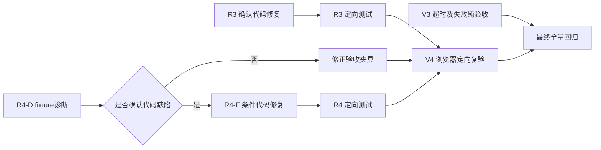

# 《最终验收残余修复计划》反向评审修订版

本轮未修改产品代码、测试、配置或数据库。以下内容直接替换上一版计划。

## 一、修订结论

上一版有一处关键设计偏差：

> 把“同一 `source_id` 只能使用一次”当成了 GroundedAnswer 的固有安全要求。

当前 [GroundedAnswer Schema](</C:/Users/Asd/Desktop/edu agent/backend/llm/schemas.py:53>) 只规定每个 claim 绑定一个 `source_id`，没有规定一个来源不能支持多个 claim；原始课程要求也没有这种限制。

当前 `GROUNDING_DUPLICATE_SOURCE` 来自 [orchestrator.py:1438](</C:/Users/Asd/Desktop/edu agent/backend/agent/orchestrator.py:1438>) 的额外运行时规则。该错误发生在 Citation Guard 调用之前；Citation Guard 实际从 [orchestrator.py:1071](</C:/Users/Asd/Desktop/edu agent/backend/agent/orchestrator.py:1071>) 才开始执行。

修订后的R3将：

- 允许同一可信来源支持多个不同claim；
- 保持每个claim只绑定一个source；
- 对每个claim独立校验quote、标识符、可信度和课程范围；
- 拒绝重复claim和完全重复绑定；
- 保证paper、vulnerability、project等必需来源类型全部覆盖；
- 继续执行原Citation Guard；
- 不自动改绑、不硬编码答案、不降低Guard。

---

# A. 最终问题数量

| 分类 | 修订前 | 修订后 |
|---|---:|---:|
| 已确认代码缺陷 | 1 | 1 |
| 尚待诊断的问题 | 1 | 1 |
| 纯验收缺口 | 2 | 2 |
| 确定代码修复批次 | 1 | 1 |
| 条件代码修复分支 | 1 | 1 |
| 纯验收批次 | 2 | 2 |
| 数据库迁移 | 0 | 0 |

数量未变化，但R3的修复定义已改变：

- 修订前：强制所有`source_id`全局唯一。
- 修订后：允许合理复用source，拒绝重复claim、错误quote、错误类型和伪造绑定。

---

# B. 已通过且不再重复开发的功能

以下能力已由V1/V2或此前复验通过，不再安排开发：

- arXiv、NVD、GitHub空缓存live首查和fresh_cache复查；
- MCP stdio握手；
- 9个工具及Schema；
- DeepSeek自主决策；
- Agent通过MCP各调用paper、NVD、GitHub一次；
- Agent没有循环和`MAX_STEPS`；
- 不存在论文、虚构CVE、离题、跨课程资料正确拒答；
- 管理员教师端；
- 两课程统计；
- 学习时间线；
- FAQ JSON/CSV；
- 聚类和卡点；
- 创新会话创建、追问、方向生成和finalize；
- 上传→PENDING→INDEXED→学生引用；
- ask_user→continue同一run_id；
- fallback_used已有语义修复；
- 回答级provider/model/fallback/run_id/trace_id展示；
- 标准本地官方元数据类型；
- fake/unknown来源隔离。

最终回归可以验证这些功能，但不得重新设计或替换。

---

# C. 最终问题矩阵

| 编号 | 优先级 | 分类 | 问题 | 是否改代码 |
|---|---|---|---|---|
| R3 | P1 | `confirmed_defect` | GroundedAnswer校验无依据地禁止同一可信source支持多个合理claim，同时结构化提示未携带完整约束 | 是 |
| R4-D | P1待定 | `dependent_revalidation / acceptance_fixture` | V2创新会话`cases_json=0`，但没有逐阶段证据证明可信相关候选进入过推荐链 | 先诊断 |
| R4-F | P1待定 | `conditional_confirmed_defect` | 仅当R4-D证明候选在产品链内部丢失时成立 | 条件修改 |
| V3 | P2 | `test_gap` | 页面未稳定取得真实`TOOL_TIMEOUT`证据；Connector失败场景也未在V1中形成独立证据 | 否 |
| V4 | P1依赖项 | `dependent_revalidation` | 多来源回答和可信创新案例浏览器展示依赖R3、R4 | 否 |
| 截图归档 | P2 | `environment_limitation` | 内置浏览器输出了截图，但未保存为独立文件 | 否 |

---

# D. R3最终技术设计

## D1. 失败阶段必须准确区分

V1链路为：

```text
DeepSeek HTTP及JSON生成
→ GroundedAnswer Pydantic解析成功
→ _validate_grounded_answer()
→ GROUNDING_DUPLICATE_SOURCE
→ ABSTAINED
```

它不是：

- DeepSeek传输失败；
- JSON解析失败；
- Template降级；
- Citation Guard拒绝；
- Connector失败；
- MCP失败。

当前结构化回答路径：

- Schema：[schemas.py:53](</C:/Users/Asd/Desktop/edu agent/backend/llm/schemas.py:53>)
- DeepSeek结构化调用：[deepseek_provider.py:45](</C:/Users/Asd/Desktop/edu agent/backend/llm/deepseek_provider.py:45>)
- `_answer()`：[orchestrator.py:920](</C:/Users/Asd/Desktop/edu agent/backend/agent/orchestrator.py:920>)
- `_validate_grounded_answer()`：[orchestrator.py:1412](</C:/Users/Asd/Desktop/edu agent/backend/agent/orchestrator.py:1412>)
- `_render_grounded_answer()`：[orchestrator.py:1480](</C:/Users/Asd/Desktop/edu agent/backend/agent/orchestrator.py:1480>)
- Citation Guard入口：[orchestrator.py:1071](</C:/Users/Asd/Desktop/edu agent/backend/agent/orchestrator.py:1071>)

## D2. 当前提示问题

`_answer()`已把以下字段写入`LLMRequest`：

```python
instructions=_answer_instructions(state)
metadata={
    "intent": state.intent,
    "required_sources": state.required_sources,
}
```

但 [build_structured_messages()](</C:/Users/Asd/Desktop/edu agent/backend/llm/prompts.py:71>) 当前只发送：

- 问题；
- 证据；
- JSON Schema。

没有发送：

- `request.instructions`；
- `required_sources`；
- source type与source_id关系。

因此提示确实不完整，但只改提示属于概率性修复，不能作为唯一修复。

## D3. 修订后的确定性不变量

### 每个claim

每个claim必须：

1. 只有一个`source_id`；
2. `source_id`存在于本次`answer_evidence`；
3. 来源通过可信度校验；
4. 外部来源有合法URL、content hash、external ID或title；
5. `evidence_quote`精确来自相同source的text、title或external_id；
6. CVE、URL、仓库名等标识不得来自另一source；
7. claim不得含模型自行插入的`[Sx]`；
8. 最终引用由渲染器确定性添加。

### 同一source支持多个claim

允许，但必须同时满足：

- claim文本不同；
- 每个claim独立通过quote匹配；
- 每个claim独立通过identifier绑定；
- 每个claim渲染成独立行；
- 每行紧邻相同source的引用；
- Citation Guard逐事实继续检查；
- GroundedAnswer总claim数仍受Schema的`max_length=10`限制。

### 拒绝的重复

新增或明确区分：

- `GROUNDING_DUPLICATE_CLAIM`
  - 规范化后claim文本相同。
- `GROUNDING_DUPLICATE_BINDING`
  - `source_id + claim_text + evidence_quote`三者完全重复。
- `GROUNDING_QUOTE_MISMATCH`
  - quote不属于该source。
- `GROUNDING_IDENTIFIER_MISMATCH`
  - claim引用了其他source的CVE、仓库或URL。
- `GROUNDING_SOURCE_COVERAGE`
  - 未覆盖所有必需来源类型。

不再因为`source_id`单独重复而失败。

### required source覆盖

`paper + vulnerability + project`表示：

- 至少一个paper claim；
- 至少一个vulnerability claim；
- 至少一个project claim。

它不表示：

- 每种类型只能出现一次；
- 每个source只能出现一次；
- 总共只能生成三条claim。

## D4. 修改范围

允许修改：

- [backend/llm/prompts.py](</C:/Users/Asd/Desktop/edu agent/backend/llm/prompts.py:71>)
- [backend/agent/orchestrator.py](</C:/Users/Asd/Desktop/edu agent/backend/agent/orchestrator.py:1412>)
- [tests/test_j3_agent_evidence.py](</C:/Users/Asd/Desktop/edu agent/tests/test_j3_agent_evidence.py:180>)
- 可新增`tests/test_r3_grounded_answer_contract.py`

一般不需要修改：

- `backend/llm/schemas.py`

禁止修改：

- `backend/guards/citation_guard.py`
- Connector
- MCP Schema
- RBAC
- 数据库Schema
- API响应Schema
- TemplateProvider答案逻辑

## D5. Prompt与验证器双重修复

### Prompt

GroundedAnswer结构化消息加入：

- 白名单化的`request.instructions`；
- required source types；
- 每个证据的`source_id`和`resource_type`；
- same source可支持多个claim；
- 每个claim都必须提供独立quote；
- 不得重复claim；
- 不得把一个source的quote绑定给另一个source。

不得把整个metadata或内部状态直接发送给模型。

### 验证器

移除仅凭以下条件拒绝的逻辑：

```python
if claim.source_id in seen_source_ids:
    GROUNDING_DUPLICATE_SOURCE
```

替换成：

```text
规范化claim去重
+ 完整binding去重
+ 每条claim独立quote校验
+ 每条claim独立identifier校验
+ required type集合覆盖
```

## D6. 输出失败时的行为

任何结构化校验失败：

- 记录精确grounding error；
- run进入`ABSTAINED`；
- citations为空；
- 不尝试自动改绑；
- 不把失败输出送给页面；
- 不用Template伪装为DeepSeek成功。

---

# E. R4最终裁决设计

## E1. 当前不能直接认定业务缺陷

V2只证明：

```text
status=FINALIZED
questions_json_count=6
final_ideas_json_count=2
cases_json_count=0
```

没有证明：

- 相关可信资源是否被相同query检索到；
- query cache是否对应创新专题；
- V2的外部资源是否包含专题关键词；
- Connector在该进程是否启用；
- 候选在哪一步被过滤。

当前代码已经存在完整链路：

- API创建服务：[main.py:1424](</C:/Users/Asd/Desktop/edu agent/backend/main.py:1424>)
- 收集案例：[service.py:144](</C:/Users/Asd/Desktop/edu agent/backend/innovation/service.py:144>)
- 按需Connector：[service.py:165](</C:/Users/Asd/Desktop/edu agent/backend/innovation/service.py:165>)
- 课程RAG：[service.py:186](</C:/Users/Asd/Desktop/edu agent/backend/innovation/service.py:186>)
- 外部资源转换：[service.py:379](</C:/Users/Asd/Desktop/edu agent/backend/innovation/service.py:379>)
- 可信和相关性选择：[recommender.py:50](</C:/Users/Asd/Desktop/edu agent/backend/innovation/recommender.py:50>)
- 持久化：[logger.py:2035](</C:/Users/Asd/Desktop/edu agent/backend/storage/logger.py:2035>)
- 页面展示：[innovation.py:49](</C:/Users/Asd/Desktop/edu agent/frontend/pages/innovation.py:49>)

现有测试也已证明注入可信相关资源时可以产生案例：

- [test_f1_2_remote_resources.py:193](</C:/Users/Asd/Desktop/edu agent/tests/test_f1_2_remote_resources.py:193>)
- [test_l3_innovation_cases.py:167](</C:/Users/Asd/Desktop/edu agent/tests/test_l3_innovation_cases.py:167>)
- [test_innovation.py:180](</C:/Users/Asd/Desktop/edu agent/tests/test_innovation.py:180>)

因此R4必须先执行fixture诊断。

## E2. 验收夹具必须满足

外部案例：

- source_name不能是fake/unknown；
- 有合法HTTP(S) URL；
- 有`resource_provenance`；
- 对应sync run为SUCCESS或可信缓存降级；
- `provenance_verified=true`；
- `origin_kind=remote`或合法`local_catalog`；
- `delivery_mode`属于live、fresh_cache、stale_cache、local_metadata；
- 标题、摘要或标签与专题相关。

课程案例：

- 必须来自当前课程；
- 文档为INDEXED；
- chunk属于当前课程文档；
- source_id为`rag:*`或`document:*`；
- 不得包含另一课程文档。

公共外部资源本身不拥有`course_id`。课程隔离要求是：

- 用户必须有当前创新会话课程权限；
- 本地课程文档必须按course_id过滤；
- 公共外部资源不能携带另一课程私有内容。

不得擅自给`external_resources`新增`course_id`。

## E3. 逐阶段诊断

必须记录：

```text
portal keyword candidates
portal topic candidates
on-demand candidates
RAG candidates
converted candidates
trusted candidates
relevance scores
deduplicated cases
cases_json
API cases
browser cases
```

特别检查 [portal.py:227](</C:/Users/Asd/Desktop/edu agent/backend/resources/portal.py:227>)：

- keyword当前使用完整子串匹配；
- 如果fixture只包含部分语义词而不包含完整专题短语，返回0可能是fixture与查询策略不匹配；
- 在证明合理相关候选因此被错误排除前，不修改全局门户搜索。

## E4. 条件修复

只有出现以下证据才进入产品修改：

| 丢失位置 | 条件修复位置 |
|---|---|
| API没有触发按需查询 | `backend/main.py`或`innovation/service.py` |
| Connector返回资源但转换为None | `_external_resource_to_case()` |
| 可信案例被错误判为不可信 | `_is_trusted_case()` |
| 明确相关案例score=0 | `_topic_relevance()`/alias |
| select_cases非空但cases_json为空 | `LearningLogger.create_innovation_session()` |
| cases_json非空但API为空 | `_session_payload()` |
| API非空但页面不显示 | `frontend/pages/innovation.py` |

如果可信相关fixture正常进入案例：

```text
R4 = acceptance_fixture
产品代码不修改
```

---

# F. V3超时验收修订

V3不是生产功能开发。

使用现有：

- [j6_mcp_server_helper.py](</C:/Users/Asd/Desktop/edu agent/tests/j6_mcp_server_helper.py:16>)
- [MCP _run_with_timeout](</C:/Users/Asd/Desktop/edu agent/mcp_server/tools.py:241>)

需要分别证明三件事：

1. 客户端按时收到`TOOL_TIMEOUT`；
2. 服务端工作单元在有限时间内结束，没有永久后台线程或子进程；
3. 工作单元结束后数据库无迟到写入。

注意：Python运行中的线程不能依靠`Future.cancel()`强制终止。因此不能只检查客户端159ms返回就宣称后台任务终止。

验收需要：

- marker记录worker started/ended；
- 等待Connector延迟时间及安全余量；
- 确认worker已结束；
- 确认没有遗留MCP/Python子进程；
- 比较数据库计数；
- 确认无RUNNING sync run；
- 确认没有迟到SUCCESS。

如果worker继续执行但最终受deadline保护而零写入，应准确写成：

```text
客户端超时返回成功；
后台工作在宽限期内结束；
数据库零迟到写入；
不是立即强制终止。
```

如果宽限期后仍未结束，则V3失败并另立P2缺陷，不能伪报通过。

V3还应补V1未形成独立证据的真实Connector失败语义：

- controlled upstream failure；
- `success=false`；
- `error_code=CONNECTOR_SERVICE_ERROR`；
- 不得写成`TOOL_TIMEOUT`；
- 不得显示live成功。

---

# G. V4依赖

V4不得使用：

- V1旧失败run；
- 直接Connector结果；
- 直接MCP结果；
- 手工构造页面状态；
- 预置最终答案；
- TemplateProvider答案；
- 旧缓存冒充本轮live。

依赖：

```text
R3通过 ──→ V4多来源回答
R4-D完成
   ├─ acceptance_fixture修正 ──→ V4创新案例
   └─ R4-F代码修复通过 ───────→ V4创新案例
V3可独立
```

---

# H. 测试要求

## H1. R3先失败后通过

修复前必须保存：

- 允许同一可信source支持两个不同claim的测试；
- 当前结果为`GROUNDING_DUPLICATE_SOURCE`。

修复后：

- 两个不同claim引用同一source且quote各自有效：通过；
- 相同claim重复：失败；
- 完全相同binding重复：失败；
- source相同但第二条quote错误：失败；
- required paper/CVE/GitHub全部覆盖：通过；
- 缺少任一类型：失败。

## H2. Citation Guard保护

必须继续验证：

- forged source ID；
- missing claim citation；
- citation location；
- unsupported claim；
- irrelevant citation；
- course scope；
- fake/unknown；
- 无关引用；
- 不存在论文、虚构CVE、离题问题。

不得修改Guard阈值或跳过Guard。

## H3. DeepSeek最终综合

通过必须同时满足：

```text
model_call purpose=generate_answer
success=true
provider=deepseek
model非空
fallback_used=false
output_contract=grounded_claims_v1
Citation Guard ok=true
run_status=COMPLETED
```

工具或MCP成功不能代替这些条件。

---

# I. API和数据库影响

| 项目 | 变化 |
|---|---|
| `/api/chat` | 无 |
| `/api/agent/runs/{run_id}` | 无 |
| `/api/innovation/sessions` | 无 |
| ChatResponse | 无 |
| GroundedAnswer | 字段结构不变 |
| innovation_sessions | 无迁移 |
| cases_json | 继续使用 |
| model_calls | 继续使用现有metadata_json |
| resource_provenance | 继续使用 |
| external_resources | 不新增course_id |
| 新框架 | 无 |

---

# J. 最终批次数和依赖



数量：

- **确定代码修复批次：1（R3）**
- **条件代码修复批次：最多1（R4-F）**
- **诊断/验收夹具批次：1（R4-D）**
- **纯验收批次：2（V3、V4）**
- **最终全量验收：1**

---

# K. 删除或合并的任务

已删除：

- “所有source_id全局唯一”的无依据规则；
- “每种来源类型只能有一条claim”的无依据规则；
- 直接把`cases_json=0`认定为业务代码缺陷；
- 给公共外部资源增加course_id的潜在迁移；
- 为TOOL_TIMEOUT增加生产页面按钮；
- 重跑已通过的管理员、教师统计、Connector live/cache和九工具开发。

已合并：

- GroundedAnswer提示完善和确定性验证合并到R3；
- V1的Connector失败语义与TOOL_TIMEOUT证据合并到V3；
- 多来源页面和创新案例页面合并到V4。

---

# L. 可直接交给VSCode AI的逐批命令

## 命令1：R3实施

```text
现在执行最终验收残余计划R3。

本批允许修改：
- backend/llm/prompts.py
- backend/agent/orchestrator.py
- R3直接相关测试
- 必要时新增tests/test_r3_grounded_answer_contract.py

原则上不要修改backend/llm/schemas.py，因为当前GroundedClaim已经是单source_id结构。

禁止修改：
- backend/guards/citation_guard.py
- Connector
- MCP Schema
- RBAC和课程隔离
- 数据库Schema
- API响应字段
- TemplateProvider答案逻辑
- .env
- 不得降低测试断言

先新增失败测试，证明：
同一可信source支持两个不同claim、每个claim具有独立正确quote时，
当前代码错误返回GROUNDING_DUPLICATE_SOURCE。

然后实施：

1. build_structured_messages在GroundedAnswer场景中加入：
   - request.instructions；
   - required source types；
   - evidence source_id与resource_type目录；
   - 每个claim只能绑定一个source；
   - 同一source允许支持多个不同claim；
   - 每个claim必须独立提供精确quote；
   - 禁止重复claim和错误绑定。

2. 修改_validate_grounded_answer：
   - 删除“只因source_id重复就失败”的规则；
   - 增加规范化claim文本去重；
   - 增加source_id+claim+quote完整binding去重；
   - 保留unknown source、untrusted source、quote mismatch、
     identifier mismatch、unrequested type和source coverage；
   - required_sources按类型集合至少覆盖一次，不限制每类型只能一条。

3. _render_grounded_answer继续每个claim独立一行，
   每行带本claim的quote和source_id引用。

4. 无效输出继续ABSTAINED，不自动改绑，不使用Template冒充DeepSeek。

测试必须包括：
- 同source两个不同有效claim：通过；
- 相同claim重复：失败；
- 完全相同binding重复：失败；
- 同source第二条quote错误：失败；
- paper/CVE/GitHub覆盖：通过；
- 缺少任一类型：失败；
- forged、fake、unknown、跨课程和错绑：失败。

完成判定：
- 新测试先失败后通过；
- Citation Guard未修改；
- API/数据库无变化；
- 安全负例不回归。

失败停止条件：
- 必须放宽Citation Guard才能通过；
- 必须自动改绑引用；
- 必须硬编码答案；
- 必须改数据库/API；
- 负例开始通过。

输出：
文件、函数、行号、修改摘要、测试命令、统计、失败前后证据。
```

## 命令2：R3定向测试

```text
现在执行R3定向复验。除修正明显错误的R3测试夹具外，不修改产品代码。

运行：
- R3新增测试
- tests/test_j3_agent_evidence.py
- tests/test_s2_multi_source_citations.py
- Agent orchestration相关测试
- Citation Guard相关测试
- 课程隔离和负例拒答相关测试

检查：
1. 同source多个合理claim可通过；
2. 每个claim只有一个source_id；
3. 每个claim有独立精确quote；
4. duplicate claim和duplicate binding被拒；
5. required paper/CVE/GitHub全部覆盖；
6. quote错绑、identifier错绑、forged、fake/unknown被拒；
7. Citation Guard仍实际执行；
8. run、model_calls、tool_calls、source_id、quote、citation、
   provider、model、fallback和stop_reason一致。

完成判定：
- 0 failed；
- 不修改Citation Guard；
- 不降低安全断言；
- 输出passed/failed/skipped/xfail/warnings及关键证据。

出现权限、课程隔离、负例拒答或fallback回归时立即停止。
```

## 命令3：R4-D创新案例诊断

```text
现在执行R4-D创新可信案例链隔离诊断。

本轮不得修改产品代码、正式测试、配置或正式数据库。

使用新临时SQLite/Chroma，准备：
- 与专题明确相关的可信paper；
- 与专题明确相关的可信GitHub project；
- 合法URL；
- 成功sync run；
- resource_provenance；
- content hash；
- 与创新请求相同的query cache映射；
- 当前课程INDEXED文档；
- 另一课程文档；
- fake、unknown和无proof负例。

通过真实POST /api/innovation/sessions执行。

记录：
1. portal keyword候选；
2. portal topic候选；
3. on-demand候选；
4. RAG候选及course_id；
5. resource转换结果；
6. trust过滤结果；
7. relevance score和命中term；
8. dedupe结果；
9. cases_json；
10. API cases；
11. 页面展示结果。

裁决：
- 可信相关案例进入cases_json/API/页面：
  classification=acceptance_fixture，停止，不修改产品代码。
- 案例在产品链中具体阶段丢失：
  classification=confirmed_defect，报告丢失函数、输入输出和建议最小修复，
  本命令仍不得修改代码。
- 网络或Connector未启用：
  classification=environment_limitation。
- fixture缺少query mapping、关键词或proof：
  classification=acceptance_fixture。

不得把fake、unknown、无URL、无proof或跨课程资料作为成功案例。
输出逐阶段计数和裁决矩阵。
```

## 命令4：R4-F条件修复

```text
只有R4-D明确输出confirmed_defect后才执行本命令。
如果R4-D为acceptance_fixture或environment_limitation，停止，不修改代码。

根据R4-D确定的唯一丢失阶段进行最小修改。

允许修改范围按根因选择一处或最少几处：
- backend/innovation/service.py
- backend/innovation/recommender.py
- backend/storage/logger.py
- frontend/pages/innovation.py
- 对应创新测试

禁止：
- 修改可信来源规则以接纳fake/unknown；
- 自动生成伪案例；
- 用无URL或无proof记录填充cases_json；
- 删除course_id范围检查；
- 给external_resources新增course_id；
- 修改数据库Schema；
- 大范围重构资源门户；
- 把fixture或Mock宣称为live。

先保存同一输入的修复前失败证据，再修改，再使用完全相同输入复验。

必须验证：
- 可信相关案例进入cases_json；
- API和页面显示一致；
- final ideas保留来源；
- 不相关、fake、unknown、无proof和跨课程资料继续被过滤；
- 无数据库迁移和API契约变化。

失败停止条件：
- 无法确定候选丢失阶段；
- 需要放宽来源可信规则；
- 需要删除课程隔离；
- 需要伪造外部结果。

输出修改文件、行号、前后数据流、测试统计和回滚方式。
```

## 命令5：V3纯验收

```text
现在执行V3 MCP Connector失败和TOOL_TIMEOUT纯验收。

本轮不得修改产品代码、测试、配置文件或正式数据库。
允许使用临时启动器、临时数据库、临时Chroma、临时账号和
tests/j6_mcp_server_helper.py。

场景A：controlled Connector failure
- J6_CONNECTOR_MODE=fail；
- 调用真实stdio MCP；
- 结果success=false；
- error_code=CONNECTOR_SERVICE_ERROR或项目真实映射错误；
- 不能写成TOOL_TIMEOUT；
- 不能显示live成功。

场景B：controlled timeout
- Connector延迟0.5秒；
- 工具超时0.15秒；
- 通过真实POST /api/chat和学生页面触发；
- 页面工具轨迹显示TOOL_TIMEOUT；
- 不显示live成功；
- 保存run_id、trace_id、HTTP状态和日志。

分别记录：
1. 客户端返回时间；
2. worker started marker；
3. worker ended marker；
4. MCP/Python子进程状态；
5. external_resources；
6. resource_query_cache；
7. resource_query_cache_items；
8. resource_provenance；
9. connector_sync_runs；
10. RUNNING和SUCCESS sync run数量。

等待超过worker延迟和安全余量后再次检查。

准确区分：
- 客户端按时超时；
- worker是否立即取消；
- worker是否在宽限期内自然结束；
- 数据库是否零迟到写入。

如果worker在宽限期内结束且零写入，可判受控超时通过，但不得声称立即强杀。
如果worker不结束或出现迟到写入，判FAIL并报告P2缺陷。

结束关闭所有临时进程并清理临时文件。
输出PASS/FAIL/BLOCKED/ENVIRONMENT_LIMITATION矩阵。
```

## 命令6：V4浏览器定向验收

```text
现在执行V4浏览器定向纯验收。

前置条件：
- R3定向测试通过；
- R4-D已经裁决；
- 如果R4-D确认缺陷，则R4-F必须通过；
- 使用新隔离SQLite/Chroma；
- 不使用V1旧失败run或手工页面数据。

本轮不得修改代码、测试、配置或正式数据库。

多来源回答：
1. 学生只输入自然语言；
2. DeepSeek自主决定工具；
3. Agent经MCP调用paper、NVD、GitHub；
4. 每个必要工具无无意义重复；
5. 多组Observation进入State；
6. DeepSeek完成grounded_claims_v1；
7. model_call success=true；
8. provider=deepseek；
9. model有值；
10. fallback_used=false；
11. Citation Guard通过；
12. run_status=COMPLETED；
13. 页面显示run_id、trace_id、工具轨迹和逐claim引用；
14. 同source多claim时，每条claim有独立quote。

创新流程：
1. 使用已证明相关的可信资源和相同专题；
2. 创建会话；
3. cases_json非空；
4. 页面显示可信paper或project案例；
5. 显示source_name、origin_kind、delivery_mode、URL；
6. 完成追问、方向生成和finalize；
7. final ideas保留证据；
8. fake、unknown、不相关和跨课程案例不显示。

负例：
- 不存在论文；
- 虚构CVE；
- 离题；
- 跨课程标记。
必须ABSTAINED且引用0。

不得使用：
- 直接Connector结果代替Agent；
- 直接MCP结果代替Agent；
- Template答案；
- 预置最终回答；
- 旧缓存冒充本轮live；
- 全局DeepSeek绿色配置框代替本run模型证据。

保存脱敏截图、HTTP状态、run_id、trace_id、model_calls、
tool_calls、source proof和cases_json证据。
浏览器供应器不可用标记ENVIRONMENT_LIMITATION。
结束关闭本轮进程。
```

## 命令7：最终全量回归与验收

```text
现在执行课程智能体最终全量回归和零信任验收。

本轮只验收，不修改代码、测试、数据库或配置，不安装依赖、不降低断言。

1. 从md/题目最终要求.md重新建立R1、R2等需求矩阵。
2. 运行完整pytest并报告passed、failed、skipped、xfail、warnings。
3. 分组运行权限、Agent、MCP、RAG、Connector、创新、聚类和端到端测试。
4. 使用隔离SQLite/Chroma启动FastAPI、Streamlit和MCP。
5. 使用两个课程、两个班级、两名学生、两名教师、管理员和无授权账号。
6. 验证学生端：
   - 登录、改密、退出、深链接；
   - 使用说明、课程简介、考核、专题；
   - RAG、引用、拒答；
   - 实践六步框架；
   - 论文、CVE、标准、GitHub；
   - 创新可信案例、追问、方向和finalize；
   - ask_user→continue；
   - answer级provider/model/fallback/run/trace。
7. 验证教师端：
   - 上传→PENDING→INDEXED→学生引用；
   - 统计、时间线、模块；
   - 聚类审批、改名、合并/拆分；
   - 卡点；
   - FAQ JSON/CSV；
   - 跨课程403和管理员200。
8. 验证Connector空缓存live及fresh_cache。
9. 验证MCP stdio、Schema、缺参、错参、失败和超时。
10. 验证完整链：
    API→DeepSeek Planner→Agent→MCP→Connector→SQLite
    →Observation→DeepSeek GroundedAnswer→Citation Guard→COMPLETED。
11. 分别证明：
    Connector成功；
    MCP成功；
    Agent自主工具调用成功；
    DeepSeek最终综合成功。
12. 验证同一source支持多个合理claim时每条quote独立有效。
13. 验证duplicate claim、duplicate binding、错quote、错identifier被拒。
14. 验证不存在论文、虚构CVE、离题和跨课程证据拒答。
15. 验证fallback唯一语义。
16. 验证TOOL_TIMEOUT worker结束状态和零迟到写入。
17. 结束后关闭本轮进程并清理临时数据。

禁止：
- 把Mock、fake、旧缓存或工具直调当成Agent成功；
- 放宽或绕过Citation Guard；
- 自动改绑引用；
- 把skipped算作通过；
- 把页面能打开写成功能通过；
- 输出密钥。

最终输出：
A. 结论；
B. 测试统计；
C. 原始需求矩阵；
D. 浏览器矩阵；
E. Connector/MCP/Agent/DeepSeek四层矩阵；
F. R3/R4/V3/V4结果；
G. 未验证项；
H. P0/P1/P2；
I. 是否可以进入答辩。
```

---

# M. 最终结论

- **修订前确认缺陷：1个**
- **修订后确认缺陷：1个**
- **确定代码修复批次：1个，R3**
- **条件代码修复批次：最多1个，R4-F**
- **纯验收批次：2个，V3、V4**
- **额外诊断/夹具批次：1个，R4-D**
- **数据库迁移：0**
- **新增框架：0**

R3的最终修复目标已经明确：

```text
允许同一可信来源支持多个合理claim
+ 每个claim独立quote和标识符校验
+ 必需来源类型完整覆盖
+ 确定性渲染
+ 原Citation Guard继续执行
```

**已经具备开始实施R3的条件。** R4尚不具备直接修改产品代码的条件，必须先执行R4-D。